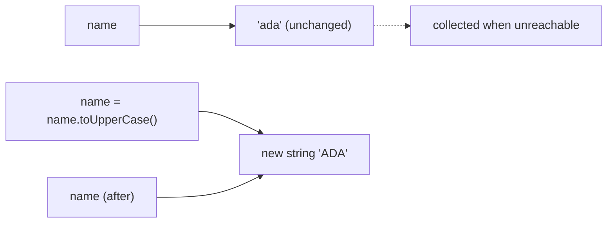

## Introduction

Almost everything a web application handles arrives as text. A form field gives you a string, even when the user typed a number. A URL is a string. An HTTP header, a JSON document before it is parsed, a CSS class name, an error message, a log line — all strings. Before you can search, slice or format text (the subjects of the next lessons), you need a precise picture of what a string *is* in JavaScript and what you can and cannot do to one.

Two facts shape that picture. First, a string is a **primitive value**, not an object: it has no identity of its own, and two strings with the same characters are the same value. Second, a string is **immutable**: once created, its characters can never change. Every operation that looks like it modifies a string — upper-casing it, trimming it, replacing a word — actually produces a *new* string and leaves the original untouched.

Those two facts explain a surprising amount of everyday behaviour: why `name.trim()` on its own line does nothing, why `s[0] = 'X'` silently fails, why strings work so well as `Map` keys, and why `new String('a') === 'a'` is `false`. This lesson covers how strings are created and converted, what immutability means precisely, how to read individual characters and length, and how to build larger strings out of smaller ones. The nested section [[b1-string-indexing]] deals with indexing and `length` in detail, because that is where JavaScript's UTF-16 representation first becomes visible.

## Before you start

- **Primitive types** — the seven primitives and how they differ from objects. See [[b1-primitive-types]], especially [[b1-type-string]].
- **Autoboxing** — how a primitive like `'abc'` can have methods even though it is not an object. See [[b1-autoboxing]]; you need only the idea that a temporary wrapper object is created when you call a method.
- **Primitive vs reference values** — what it means for a value to be copied rather than shared. See [[b1-primitive-vs-reference]] and [[b1-immutability-primitives]].
- **`let` and `const`** — the difference between reassigning a variable and changing a value. See [[b1-var-let-const]].

## The intuition

Think of a string as a **printed label** from a label maker. You can read any character on it. You can cut a copy of part of it, or print a new label that combines two old ones. What you cannot do is take a pen and change one letter on an existing label — the label maker only ever produces fresh labels.

A variable holding a string is like a sticky note saying "the label I care about is *that* one". When you write `name = name.toUpperCase()`, you print a new upper-case label and move the sticky note to point at it. The old label still exists until nobody points at it, and then the garbage collector throws it away.

The analogy stops working in one place: real labels have identity — two labels printed with the same text are still two physical objects. JavaScript strings have no such identity. `'cat'` and `'cat'` are not two equal labels; they are the same value, in the same way that the number `3` here and the number `3` there are the same number. That is why `===` compares strings by their characters.

## Creating strings

### String literals

The usual way to create a string is a **string literal** — text written directly in the source code between quotes. JavaScript has three quoting styles:

```javascript title="literals.js"
const single = 'hello';
const double = "hello";
const backtick = `hello`;

console.log(single === double, double === backtick);
console.log(typeof single, typeof backtick);
console.log('She said "hi"', "It's fine", `both ' and " work`);
```

```output
true true
string string
She said "hi" It's fine both ' and " work
```

All three produce the same kind of value: a primitive of type `string`. Single and double quotes are completely interchangeable; teams pick one by convention (Prettier defaults to double quotes, many style guides prefer single) and use the other only to avoid escaping, as in `"It's fine"`. Backticks create a **template literal**, which adds two abilities the other forms lack: interpolation with `${expression}` and literal line breaks. Template literals are covered in [[b1-template-literals]]; for this lesson it is enough to know that an untagged template literal always produces an ordinary string primitive.

Characters that cannot appear directly between quotes — a newline, a backslash, the quote character itself — are written as **escape sequences** such as `\n`, `\\` and `\'`. These are taught in [[b1-escape-sequences]].

### Converting other values with `String()`

Very often you have a non-string value — a number, a boolean, an array — and need its text form. The most predictable tool is `String(value)` called **without** `new`:

```javascript title="string-function.js"
console.log(String(42), String(3.5), String(-0), String(1e21));
console.log(String(true), String(null), String(undefined));
console.log(String([1, [2, 3]]), String({}), String(Symbol('id')));
console.log(typeof String(42));
```

```output
42 3.5 0 1e+21
true null undefined
1,2,3 [object Object] Symbol(id)
string
```

`String()` is a conversion function: it always returns a primitive string, and it accepts every value. Notice what each case produces, because these are the same rules JavaScript uses whenever it converts a value to text. Numbers use their shortest round-trip form (`-0` becomes `'0'`, very large numbers switch to exponent notation). `null` and `undefined` become the words `'null'` and `'undefined'`. Arrays join their elements with commas, recursively. Plain objects become `'[object Object]'`, which is almost never what you want to show a user.

The symbol case is special. `String(Symbol('id'))` works and gives `'Symbol(id)'`, but the other conversion routes refuse symbols:

```javascript title="symbol-conversion.js"
const id = Symbol('id');
console.log(String(id));
try {
  console.log('' + id);
} catch (err) {
  console.log(err.constructor.name + ': ' + err.message);
}
```

```output
Symbol(id)
TypeError: Cannot convert a Symbol value to a string
```

The language designers made implicit conversion of symbols an error on purpose: a symbol is meant to be an opaque key, and silently turning it into text in `'key: ' + sym` would hide bugs. `String(sym)` is an explicit request, so it is allowed. The complete conversion rules — including how objects with custom `toString` or `Symbol.toPrimitive` are handled — are in [[b1-string-conversion]] and [[b1-to-primitive]].

### Other ways to get a string

Three other routes are common in real code, and each has a catch:

| Route | Example | Result | Catch |
|---|---|---|---|
| `value.toString()` | `(255).toString(16)` | `'ff'` | Throws `TypeError` on `null` and `undefined`, which have no methods |
| Concatenation with `''` | `'' + 42` | `'42'` | Throws on symbols; for objects it asks for the *default* primitive, which can differ from `String()` (see [[b1-string-interpolation]]) |
| Template literal | `` `${42}` `` | `'42'` | Throws on symbols |

`toString()` is useful when you need its extra arguments — `Number.prototype.toString(radix)` formats in another base — but `String(value)` is the safest general-purpose conversion because it never throws on `null` or `undefined`.

Strings can also be built from numeric character codes. `String.fromCharCode` takes UTF-16 code units, and `String.fromCodePoint` takes full Unicode code points:

```javascript title="from-codes.js"
console.log(String.fromCharCode(72, 105));
console.log(String.fromCodePoint(0x1f642));
console.log(String.fromCharCode(0xd83d, 0xde42));
```

```output
Hi
🙂
🙂
```

The last two lines produce the same emoji in different ways — one from a single code point, one from the two 16-bit units that encode it. Why an emoji needs two units is explained in the indexing section below and fully in [[b1-unicode-strings]].

Finally, `JSON.parse('"hi"')` returns a primitive string, never a wrapper object. Data that comes from an API through `JSON.parse` or `response.json()` therefore behaves exactly like strings you wrote as literals.

## Primitive strings and `String` objects

JavaScript has a second, rarely useful kind of string value: the **`String` wrapper object**, created with `new String(...)`. It is an object that holds a primitive string inside it. The language uses wrappers internally to give primitives their methods — that is what [[b1-autoboxing]] describes — but creating one yourself causes bugs:

```javascript title="wrapper-objects.js"
const primitive = 'a';
const wrapper = new String('a');

console.log(typeof primitive, typeof wrapper);
console.log(primitive === wrapper, primitive == wrapper);
console.log(new String('a') === new String('a'));
console.log(new String('') ? 'truthy' : 'falsy');
console.log(wrapper.valueOf() === primitive);
```

```output
string object
false true
false
truthy
true
```

Every line is a trap. `typeof` reports `'object'`, so type checks such as `typeof x === 'string'` reject the wrapper. Strict equality compares an object with a primitive, so it is `false`; loose equality unwraps the object first, so it is `true` — the same comparison gives two different answers depending on the operator. Two wrappers with identical text are two different objects, so `===` between them is `false`. And because every object is truthy, `new String('')` is truthy even though it holds the empty string, so `if (input)` would treat it as a non-empty value.

The fix is simple: never write `new String(...)`. Use literals for fixed text and `String(value)` (without `new`) for conversion. If you receive a wrapper from old code, `valueOf()` returns the primitive inside it. Linters such as ESLint flag `new String` with the `no-new-wrappers` rule.

## Immutability

### What immutable means

A value is **immutable** if no operation can change it after it is created. For strings, that means no method, operator or assignment can alter the characters of an existing string. Methods that seem to modify a string return a new one:

```javascript title="immutable-methods.js"
const original = 'hello';
const shouted = original.toUpperCase();
const padded = original.padStart(8, '*');

console.log(original);
console.log(shouted);
console.log(padded);
```

```output
hello
HELLO
***hello
```

`original` is still `'hello'` after both calls. `toUpperCase` and `padStart` read it, compute a result, and hand back a different string. This holds for every string method in the language — `trim`, `replace`, `slice`, `concat`, `normalize` and all the rest.

Trying to change a character directly does not work either. A string's characters look like array elements, but they are read-only:

```javascript title="assign-index.js"
let word = 'cat';
word[0] = 'b';
console.log(word);
word.length = 1;
console.log(word, word.length);
```

```output
cat
cat 3
```

In ordinary (sloppy-mode) scripts, the assignments are silently ignored. In [[b1-strict-mode]] — which is automatically on inside ES modules and class bodies — the same assignment throws, which is far easier to debug:

```javascript title="assign-index-strict.js"
'use strict';
const word = 'cat';
try {
  word[0] = 'b';
} catch (err) {
  console.log(err.constructor.name + ': ' + err.message);
}
```

```output
TypeError: Cannot assign to read only property '0' of string 'cat'
```

To "change" a character, you build a new string from pieces of the old one and reassign the variable: `word = 'b' + word.slice(1)`.

### Immutability is not the same as `const`

Beginners often mix up two separate ideas. **`const`** is about the *variable*: it prevents the name from being pointed at a different value. **Immutability** is about the *value*: it prevents the value itself from changing. Strings are immutable whether they are stored in `let`, `const` or an object property.

```javascript title="let-vs-immutable.js"
let greeting = 'hi';
const alias = greeting;     // both names refer to the same string value
greeting = greeting + '!';  // builds a new string, rebinds greeting only
console.log(greeting, alias);

const fixed = 'hi';
try {
  fixed = 'bye';
} catch (err) {
  console.log(err.constructor.name);
}
```

```output
hi! hi
TypeError
```

`greeting = greeting + '!'` is legal because `greeting` is a `let` variable — but the string `'hi'` was not modified. A new string `'hi!'` was created and `greeting` was moved to it. `alias` still refers to `'hi'`, which proves the original value is unchanged. The `TypeError` on the last assignment comes from `const`, not from string immutability. Arrays and objects are the mirror image: a `const` array cannot be reassigned, but its contents can be changed with `push`. See [[b1-const]].

### Why strings are immutable

JavaScript could have made strings mutable, as C does with character arrays. Immutability was chosen — in JavaScript, Java, Python and C# alike — because it removes a whole category of bugs and enables useful optimisations.

**Safe sharing.** When you pass a string to a function or store it in an object, nobody can change it behind your back. A function that receives `userId` cannot corrupt the caller's copy, because there is nothing to corrupt. With mutable text, every API would have to decide whether to copy its inputs defensively.

**Reliable keys.** Strings are the most common keys in objects, `Map`s, `Set`s and caches. A key that could change after insertion would leave its entry stored under the wrong hash. Immutable strings guarantee that a key stays the same key forever.

**Cheap copies and comparisons.** Because a string never changes, assigning it to another variable does not need to copy any characters; engines share the same storage. Equality compares contents, and engines can often skip the character-by-character comparison when two strings are known to be the same internal object.

The cost of immutability is that every modification allocates a new string. For a single change this is negligible. For text built up from thousands of pieces it matters a little more, which is the subject of the next section.

## Building strings from pieces

There are four everyday ways to combine strings. All of them produce new strings; they differ in readability and in what they accept.

```javascript title="combining.js"
const first = 'Ada';
const last = 'Lovelace';

console.log(first + ' ' + last);
console.log(`${first} ${last}`);
console.log(first.concat(' ', last));
console.log([first, last].join(' '));

let line = 'Total';
line += ': ';
line += 42;
console.log(line);
console.log('ha'.repeat(3), '7'.padStart(3, '0'), 'ab'.padEnd(5, '.'));
```

```output
Ada Lovelace
Ada Lovelace
Ada Lovelace
Ada Lovelace
Total: 42
hahaha 007 ab...
```

The `+` operator concatenates when either side is a string, converting the other side to text — that is why `line += 42` produced `'Total: 42'`. It is also the source of the classic bug `'1' + 2 === '12'`, explained in [[b1-plus-coercion]]. **Template literals** are usually the most readable choice when values are mixed into fixed text. `concat` exists but offers nothing over `+` and is rarely used. `join` is the natural choice when the pieces are already in an array or the number of pieces varies. `repeat` and `padStart`/`padEnd` (ES2017) build repeated or fixed-width text without loops.

### Does `+=` in a loop create performance problems?

Because strings are immutable, a loop like `result += piece` looks as if it copies the whole growing string on every iteration, which would be O(n²). Older advice therefore said to always collect pieces in an array and `join` them at the end.

Modern engines make this mostly unnecessary. V8 (Chrome, Node.js, Deno), SpiderMonkey (Firefox) and JavaScriptCore (Safari) all represent the result of a concatenation lazily, as a **rope**: a small node pointing at the two halves, with the characters copied into one flat buffer only when something needs to read them. Appending in a loop therefore stays fast in practice. This is an engine optimisation, not a language guarantee, and it is invisible to your code — the string still behaves as an immutable value.

The practical rule: write whichever form is clearest. Use `join` when you naturally have an array (for example the result of `map`), and use `+=` or template literals otherwise. Measure with a profiler before rewriting string building for speed.

```javascript title="build-list.js"
const items = ['milk', 'eggs', 'bread'];
const html = '<ul>' + items.map((item) => `<li>${item}</li>`).join('') + '</ul>';
console.log(html);
```

```output
<ul><li>milk</li><li>eggs</li><li>bread</li></ul>
```

Here `map` already gives an array of pieces, so `join('')` is the natural way to glue them. (Inserting raw data into HTML like this is only safe when the data is trusted; see [[b3-xss]].)

## Comparing strings

Because strings are primitives, `===` compares them **by content**: two strings are equal if they have the same length and the same 16-bit code units in the same order. It does not matter how or where each string was created.

```javascript title="compare.js"
const a = 'note';
const b = ['n', 'o', 't', 'e'].join('');
console.log(a === b);
console.log('apple' < 'banana', 'Zebra' < 'apple', '10' < '9');
console.log('Zebra'.localeCompare('apple'));
```

```output
true
true true true
1
```

The relational operators `<` and `>` compare code unit by code unit. That gives alphabetical order for plain lower-case English, but every upper-case letter sorts before every lower-case one (`'Z'` is code 90, `'a'` is 97), and numeric strings compare digit by digit, so `'10' < '9'`. For text shown to people, use `localeCompare` or `Intl.Collator`, which follow language rules; `'Zebra'.localeCompare('apple')` returns a positive number because "Zebra" comes after "apple" in English. [[b1-comparison-operators]] covers these rules in depth, and [[b1-unicode-strings]] explains why two strings that look identical can still be unequal.

## Indexing and length {#b1-string-indexing}

A string is an ordered sequence, so every character position has a numeric **index**, starting at `0` for the first position and ending at `length - 1` for the last. The **`length`** property tells you how many positions there are. Reading individual positions is how parsers, validators and formatting code inspect text — checking the first character of a command, the last character of a path, or walking through a string one position at a time.

### Reading a character

There are three ways to read the character at a position, and they differ only at the edges:

```javascript title="read-char.js"
const s = 'JavaScript';
console.log(s.length);
console.log(s[0], s.charAt(0), s.at(0));
console.log(s[s.length - 1], s.at(-1));
console.log(s[99], JSON.stringify(s.charAt(99)), s.at(99));
console.log(s[-1], s.at(-2));
```

```output
10
J J J
t t
undefined "" undefined
undefined p
```

- **Bracket notation `s[i]`** returns a one-character string, or `undefined` when `i` is out of range. It does not understand negative numbers: `s[-1]` looks for a property literally named `'-1'`, which does not exist.
- **`s.charAt(i)`** returns the empty string `''` instead of `undefined` when out of range. It predates bracket access on strings (which arrived in ES5) and is mostly seen in older code.
- **`s.at(i)`** (ES2022) accepts negative indexes that count from the end, so `s.at(-1)` is the last character and `s.at(-2)` the second to last. It returns `undefined` when out of range.

No version ever throws for a bad index. That is convenient but means an off-by-one bug produces `undefined` or `''` quietly instead of failing loudly. `s.at(-1)` is the clearest way to read the last character, replacing the noisier `s[s.length - 1]`.

Bracket notation works on strings because a string behaves like an object with read-only properties named `'0'`, `'1'`, `'2'` and so on. Only **canonical** index names count — the exact text a number converts to. `s['0']` is index 0, but `s['00']` and `s[1.5]` are ordinary property names that do not exist:

```javascript title="canonical-index.js"
const s = 'cat';
console.log(s['0'], s['00'], s[1.5], s['1']);
console.log(Object.getOwnPropertyDescriptor(s, 0));
console.log(Object.keys(s));
```

```output
c undefined undefined a
{ value: 'c', writable: false, enumerable: true, configurable: false }
[ '0', '1', '2' ]
```

The property descriptor shows why assigning to `s[0]` fails: the index property is `writable: false`. (Descriptors are covered in [[b1-property-descriptors]].) `length` is similarly read-only and non-enumerable, which is why it does not appear in `Object.keys`.

### Character codes

Sometimes you need the number behind a character — to check whether it is a digit, to implement a simple hash, or to compare against a range. `charCodeAt(i)` returns the 16-bit code at position `i`, and `codePointAt(i)` returns the full Unicode code point starting there:

```javascript title="char-codes.js"
const s = 'A1z';
console.log(s.charCodeAt(0), s.charCodeAt(1), s.charCodeAt(2));
console.log(s.charCodeAt(99));

const isDigit = (ch) => ch >= '0' && ch <= '9';
console.log(isDigit('7'), isDigit('x'));
```

```output
65 49 122
NaN
true false
```

Out-of-range `charCodeAt` gives `NaN`, consistent with "no error, only a strange value". The `isDigit` helper works because comparing single characters compares their codes, and `'0'` through `'9'` are consecutive codes 48 to 57.

### What `length` actually counts

Here is where many beginners are surprised. `length` does **not** count the characters you see. It counts **UTF-16 code units** — the 16-bit numbers in which JavaScript stores text.

Most characters you will meet — Latin, Greek, Cyrillic, Arabic, Hebrew, most Chinese, Japanese and Korean characters — fit in one code unit. But Unicode defines more than a million possible characters, far more than 16 bits can hold. Characters beyond the first 65,536, which include almost all emoji, are stored as **two** code units called a **surrogate pair**:

```javascript title="length-emoji.js"
const s = 'JS🙂';
console.log(s.length);
console.log(s.charCodeAt(2).toString(16), s.charCodeAt(3).toString(16));
console.log(JSON.stringify(s[2]), JSON.stringify(s.at(-1)));
console.log([...s].length, [...s]);
console.log(s.codePointAt(2).toString(16));
```

```output
4
d83d de42
"\ud83d" "\ude42"
3 [ 'J', 'S', '🙂' ]
1f642
```

The string shows three characters, but `length` is 4. Indexes 2 and 3 each hold half of the emoji; reading either one alone gives a **lone surrogate**, a meaningless fragment (shown here through `JSON.stringify` because a terminal cannot display it). In particular, `s.at(-1)` and `s[s.length - 1]` return half an emoji when the string ends in one.

Spreading a string with `[...s]` or looping with `for...of` walks it by **code point** instead, keeping each pair together, so `[...s].length` is 3. `codePointAt(2)` reads both halves and returns the emoji's real code point, U+1F642.

The reason for this design is historical. JavaScript was created in 1995, when Unicode was a 16-bit standard and one code unit really was one character, so `length` and indexing were defined on 16-bit units — the same choice Java and Windows made at the time. Unicode grew beyond 16 bits in 1996, surrogate pairs were invented to fit the new characters into 16-bit systems, and JavaScript kept its original definition for compatibility. Even code points are not always what a person calls one character: an accented letter can be two code points, and a family emoji can be several joined together. [[b1-unicode-strings]] teaches all three levels — code units, code points and grapheme clusters — and how to count each.

### Walking a string

Two loop styles visit a string's contents, and they see different things:

```javascript title="walk-string.js"
const s = 'a🙂b';
for (let i = 0; i < s.length; i++) {
  console.log('index', i, s.charCodeAt(i).toString(16));
}
for (const ch of s) {
  console.log('char', ch);
}
```

```output
index 0 61
index 1 d83d
index 2 de42
index 3 62
char a
char 🙂
char b
```

The counting loop visits code units — four of them — which is exactly what you want when the algorithm works on positions, as `slice` and `indexOf` do. The `for...of` loop uses the string's iterator, which yields whole code points, so the emoji arrives intact. Choose `for...of` when you are processing characters as a reader would think of them (with the grapheme caveat above), and the index loop when you need positions. Loop mechanics are covered in [[b1-for-loops]] and [[b1-for-of-in]].

> [!WARNING] Truncating with an index can split an emoji
> `text.slice(0, 20)` or `text.substring(0, maxLength)` cut at a code-unit position. If position 20 falls between the two halves of a surrogate pair, the result ends in a lone surrogate, which renders as a replacement character. For user-visible truncation, truncate by code points or grapheme clusters instead (see [[b1-unicode-strings]]).

## How it works internally

The ECMAScript specification defines a **String value** as "a finite ordered sequence of zero or more 16-bit unsigned integer values". That is all a string is at the language level: a list of code units. `length` is the size of that list, an index is a position in it, and `===` compares two lists element by element. The specification also caps the length at 2⁵³ − 1, but engines impose much smaller practical limits — V8 (in Node.js 22, for example) allows just under 2²⁹ code units, about 536 million, on 64-bit systems, and exceeding it throws `RangeError: Invalid string length`.

When you use a string like an object — `s.length`, `s[0]`, `s.toUpperCase()` — the engine conceptually creates a **String exotic object**, the wrapper that [[b1-autoboxing]] describes. "Exotic" means it has special property behaviour: it exposes a read-only, enumerable property for each valid index and a read-only `length`, all computed from the primitive inside. In practice engines optimise this away and never allocate a real wrapper for ordinary method calls.

Inside an engine, a string can have several representations, none of which you can observe from JavaScript:

| Representation (V8 names) | What it is | Why it exists |
|---|---|---|
| Sequential string | Characters in one contiguous buffer, 1 byte per character if all are Latin-1, otherwise 2 | The normal, flat form; one-byte storage halves memory for mostly-ASCII text |
| Cons string (rope) | A node pointing to two other strings | Makes `a + b` O(1); flattened on first character access |
| Sliced string | A reference to part of a parent string | Makes some `slice` results cheap by sharing the parent's buffer |
| Internalized string | A single shared copy kept in a table | Literals and property names are deduplicated so comparisons can be pointer checks |

Immutability is what makes all of these safe. A cons string can share its halves, and a sliced string can share its parent's memory, only because none of them can ever change. If strings were mutable, writing to one would corrupt every string sharing its storage.




## Worked example: formatting a receipt

This program brings creation, conversion, building and indexing together. It formats a fixed-width receipt of the kind a point-of-sale terminal or a plain-text email prints, where every row must be exactly 28 characters wide.

```javascript title="receipt.js"
const WIDTH = 28;

function money(cents) {
  // Integer cents avoid floating-point rounding; format only at the edge.
  const dollars = String(Math.floor(cents / 100));
  return '$' + dollars + '.' + String(cents % 100).padStart(2, '0');
}

function line(label, cents) {
  const price = money(cents);
  const room = WIDTH - price.length - 1; // one space before the price
  const shown = label.length > room ? label.slice(0, room - 1) + '…' : label;
  return shown.padEnd(room, '.') + ' ' + price;
}

function receipt(items) {
  const rows = items.map((item) => line(item.name, item.cents));
  const total = items.reduce((sum, item) => sum + item.cents, 0);
  const rule = '-'.repeat(WIDTH);
  return [rule, ...rows, rule, line('TOTAL', total)].join('\n');
}

const output = receipt([
  { name: 'Coffee', cents: 350 },
  { name: 'Blueberry muffin with extra crumble', cents: 425 },
  { name: 'Water', cents: 105 },
]);
console.log(output);
console.log(output.split('\n').every((row) => row.length === WIDTH));
```

```output
----------------------------
Coffee................ $3.50
Blueberry muffin with… $4.25
Water................. $1.05
----------------------------
TOTAL................. $8.80
true
```

Walk through `line('Blueberry muffin with extra crumble', 425)`. `money(425)` builds `'$4.25'` from three pieces: `String(4)`, a dot, and `String(25).padStart(2, '0')`. The padding matters for amounts like 105 cents, where `105 % 100` is `5` and must print as `'05'`. The price is 5 code units long, so `room` is `28 - 5 - 1 = 22`. The label is 35 units long, more than 22, so it is cut to `room - 1 = 21` units with `slice` and an ellipsis is appended, giving exactly 22. `padEnd(22, '.')` then has nothing to add. For `'Coffee'` the label fits, and `padEnd` fills the remaining 16 positions with dots.

Every operation here created a new string. `label` is never modified; `slice`, `+`, `padEnd` and `join` each return fresh values, and the final `join('\n')` assembles the rows. The last line is a self-check: splitting the output back into rows and confirming each is 28 long.

Now feed it a label containing emoji:

```javascript title="receipt-emoji.js"
const WIDTH = 28;
function line(label, price) {
  const room = WIDTH - price.length - 1;
  const shown = label.length > room ? label.slice(0, room - 1) + '…' : label;
  return shown.padEnd(room, '.') + ' ' + price;
}

const row = line('Iced lattes 🧊🧊🧊🧊🧊🧊', '$5.00');
console.log(row.length);
console.log(JSON.stringify(row));
```

```output
28
"Iced lattes 🧊🧊🧊🧊\ud83e… $5.00"
```

The row is still 28 code units long, so the self-check would pass, but it is broken. `'Iced lattes '` is 12 units and each ice-cube emoji is 2, so `slice(0, 21)` keeps four whole emoji plus the first half of the fifth. That orphaned `\ud83e` displays as a replacement character (often a question mark in a box). This is the indexing lesson in miniature: `length`, `slice` and `padEnd` all count code units, which is fine for ASCII receipts and wrong for arbitrary user text. A production version would truncate by grapheme clusters with `Intl.Segmenter`, as shown in [[b1-unicode-strings]].

## In real systems

**Form input and URLs.** Every `input.value`, `URLSearchParams.get()` result and `location.pathname` is a string, even when it looks numeric. Code that forgets this produces `'1' + 1 === '11'`. Convert explicitly with `Number()` at the boundary, and convert back with `String()` or a template literal when you display it.

**Keys and caches.** Strings are the default key type for objects, `Map`s, React `key` props, Redux action types and HTTP cache keys. Immutability is what makes this safe: a cache key such as `` `user:${id}:profile` `` cannot be changed after it is used to store an entry, so lookups with an equal string always find it.

**Logging and serialisation.** Log lines, CSV rows and plain-text emails are built by joining many small strings. Teams use template literals for single lines and `array.join('\n')` for multi-line output, rather than micro-optimising concatenation.

**Comparison and identity.** Because strings compare by value, code can freely compare `status === 'active'` without worrying where `status` came from — parsed JSON, a constant, or a template. This is also why string-typed unions (`'idle' | 'loading' | 'error'`) are a popular way to model state in TypeScript and React.

## Trade-offs and alternatives

| Technique | Best for | Watch out for |
|---|---|---|
| Literal `'...'` or `"..."` | Fixed text | Escaping the quote character; no interpolation |
| Template literal | Mixing values into text; multi-line text | `${obj}` silently prints `[object Object]` |
| `+` / `+=` | Short concatenations, building in loops | Numeric strings: `'1' + 2` is `'12'` |
| `array.join(sep)` | A variable number of pieces, separators between them | Forgetting the separator: the default is `','` |
| `String(value)` | Converting any value safely | Objects print as `[object Object]` |
| `value.toString()` | Number formatting with a radix | Throws on `null` / `undefined` |
| `new String(value)` | Nothing in modern code | Object semantics: `typeof`, `===`, truthiness all surprise |

Immutability itself is a trade-off. It makes strings safe to share and use as keys, at the cost of creating new strings for every change. When you genuinely need to edit text in place character by character — a text editor's buffer, for instance — applications use other structures: an array of characters or lines, a rope or piece table, or a `Uint16Array`/`Uint8Array` of encoded text. Ordinary application code almost never needs these.

## Common mistakes

> [!MISTAKE] Calling a method and ignoring the result
> `input.trim();` on its own line does nothing useful: `trim` returns a new string, and the original is unchanged. Write `input = input.trim();` or use the result directly. The same applies to `toLowerCase`, `replace`, `padStart` and every other string method.

**Trying to assign to an index.** `s[0] = 'X'` is ignored in sloppy mode and throws in strict mode. Build a new string instead: `s = 'X' + s.slice(1)`.

**Using `new String`.** It creates an object, so `typeof` gives `'object'`, `===` against a primitive is `false`, and `new String('')` is truthy. Use `String(value)` without `new`.

**Calling `toString()` on a value that might be missing.** `user.nickname.toString()` throws when `nickname` is `undefined`. `String(user.nickname)` gives `'undefined'`, which is safe but may leak into the UI; usually you want a default: `user.nickname ?? ''` (see [[b1-nullish-coalescing]]).

**Assuming `length` counts visible characters.** `'🙂'.length` is 2. Validation like "maximum 10 characters" or truncation with `slice` gives wrong answers on emoji and some accented text. Decide whether you mean code units (storage), code points or what users see, and use the matching tool.

**Expecting `s[-1]` to give the last character.** Bracket notation has no negative indexing; `s[-1]` is `undefined`. Use `s.at(-1)`.

## Interview perspective

String basics come up as warm-up questions and as traps inside larger coding problems. Interviewers listen for precise vocabulary: "primitive", "immutable", "returns a new string", "code units".

> [!INTERVIEW] A strong answer to "Are JavaScript strings mutable?"
> "No. Strings are immutable primitives. Methods like `toUpperCase` or `replace` return new strings, and assigning to `s[0]` is ignored — or throws in strict mode, because the index properties are read-only. What can change is the variable: `let s = 'a'; s += 'b'` rebinds `s` to a new string. Immutability lets engines share string storage and makes strings safe as `Map` keys."

Questions to be ready for:

- **What does `typeof new String('a')` return, and why avoid it?** `'object'`; wrappers break `===`, `typeof` checks and truthiness.
- **What is `'🙂'.length` and why?** 2, because the emoji is outside the 16-bit range and is stored as a surrogate pair; `length` counts UTF-16 code units.
- **Difference between `s[i]`, `charAt(i)` and `at(i)`?** Out of range: `undefined`, `''`, `undefined`. Only `at` supports negative indexes.
- **Is string concatenation in a loop O(n²)?** Not in practice: engines use ropes so appends are cheap; the language does not specify it. Use `join` when you naturally have an array.
- **`String(x)` vs `x.toString()` vs `'' + x`?** `String` works on everything, including `null`, `undefined` and symbols; `toString` throws on `null`/`undefined`; `'' + x` throws on symbols and uses the default primitive hint for objects.

A follow-up to anticipate: *"How would you reverse a string?"* The textbook answer `s.split('').reverse().join('')` breaks emoji because `split('')` splits surrogate pairs. `[...s].reverse().join('')` keeps code points together, and a fully correct answer for combined characters uses `Intl.Segmenter`, as discussed in [[b1-unicode-strings]].

```quiz
Q: What does this print? `let s = 'cat'; s[0] = 'b'; s.toUpperCase(); console.log(s);`
- [ ] `bat`
- [ ] `BAT`
- [x] `cat`
- [ ] `CAT`
> Strings are immutable. The index assignment is silently ignored in sloppy mode, and `toUpperCase()` returns a new string that is thrown away because it is not assigned. `s` still refers to the original `'cat'`. `BAT` would require both operations to modify the string in place, which no string operation can do.

Q: Which expression is `true`?
- [ ] `new String('a') === 'a'`
- [ ] `typeof new String('a') === 'string'`
- [x] `String('a') === 'a'`
- [ ] `new String('a') === new String('a')`
> `String('a')` called without `new` is a conversion function that returns a primitive, so it is identical to the literal. With `new`, you get an object: `typeof` is `'object'`, strict equality against a primitive is false, and two separate objects are never `===` to each other even with the same contents.

Q: For `const s = 'Hi🙂'`, what are `s.length` and `[...s].length`?
- [ ] 3 and 3
- [x] 4 and 3
- [ ] 3 and 4
- [ ] 4 and 4
> The emoji is a single code point above U+FFFF, so it is stored as two UTF-16 code units. `length` counts code units (2 + 2 = 4). Spreading uses the string iterator, which yields whole code points, so the array has three elements. Answering 3 for `length` is the common mistake of counting what you see.

Q: What does `'JavaScript'.at(-1)` return, compared with `'JavaScript'[-1]`?
- [x] `'t'` and `undefined`
- [ ] `'t'` and `'t'`
- [ ] `undefined` and `undefined`
- [ ] `'J'` and `undefined`
> `at` treats negative indexes as offsets from the end, so `at(-1)` is the last character. Bracket notation looks up a property named `'-1'`, which strings do not have, so it returns `undefined`. Negative indexing exists only in methods such as `at` and `slice`.
```

## Practice

1. **Predict, then run.** For each expression, write the result before running it: `String(null)`, `` `${[1, 2]}` ``, `(10).toString(2)`, `'' + undefined`, `String([])`, `new String('') ? 1 : 2`, `'abc'[3]`, `'abc'.charAt(3)`, `'abc'.at(-4)`.
2. **Capitalise.** Write `capitalize(word)` that returns the word with its first character upper-cased and the rest unchanged. Handle the empty string without errors. Then explain why your function cannot modify its argument.
3. **Initials.** Write `initials(fullName)` so that `initials('ada king lovelace')` returns `'A.K.L.'`. Use indexing and `join`, not regular expressions.
4. **Wrapper detector.** Write `isStringLike(x)` that returns `true` for both `'a'` and `new String('a')` but `false` for numbers and arrays. (Hint: `typeof` alone is not enough; consider `Object.prototype.toString.call(x)`, from [[b1-object-tostring]].)
5. **Fix the receipt.** Change `line` in the worked example so that it never splits a surrogate pair, by working with `[...label]` instead of `label`. Explain what it still gets wrong for a flag emoji such as `'🇯🇵'`.

## Quick revision {#quick-revision}

- Strings are primitives of type `string`: sequences of 16-bit UTF-16 code units, compared by content with `===`.
- Create with `'...'`, `"..."` (identical) or backticks (template literal: interpolation and multi-line). Convert with `String(x)` — never throws, handles `null`, `undefined`, symbols.
- `x.toString()` throws on `null`/`undefined`; `'' + x` and `` `${x}` `` throw on symbols. Objects become `'[object Object]'`; arrays join with commas.
- `new String(x)` makes a wrapper object: `typeof` → `'object'`, `===` fails, `new String('')` is truthy. Never use it.
- Immutable: every method returns a new string; `s[0] = 'x'` is ignored (sloppy) or throws `TypeError` (strict). Store the result: `s = s.trim()`.
- `const` stops reassignment of the variable; immutability stops change of the value. Strings have the second regardless of the first.
- Build with `+`, `+=`, template literals, `join`, `repeat`, `padStart`/`padEnd`. Engines use ropes, so `+=` loops are fine in practice.
- `s[i]` → `undefined` out of range; `charAt(i)` → `''`; `at(i)` supports negatives (`at(-1)` = last unit). Only canonical index names work (`s['00']` is `undefined`).
- `length` counts code units, not visible characters: `'🙂'.length === 2`. `[...s]` and `for...of` iterate by code point; `charCodeAt` vs `codePointAt`.
- `<`/`>` compare code units (`'Z' < 'a'`, `'10' < '9'`); use `localeCompare` / `Intl.Collator` for human ordering.

## Key takeaways {#key-takeaways}

- A JavaScript string is an immutable primitive: no operation can change its characters, so every "modification" returns a new string that you must store.
- `String(value)` is the safest conversion; `new String(value)` creates an object with confusing semantics and should never be used.
- Immutability is about the value, `const` is about the variable — `let s` can be rebound to new strings, but no string is ever edited.
- Immutability is why strings are safe to share, reliable as keys, and cheap for engines to copy, slice and concatenate internally.
- Indexing and `length` work on UTF-16 code units, so emoji and other characters above U+FFFF occupy two positions; use `at(-1)` for the last unit and code-point or grapheme tools for user-visible text.
