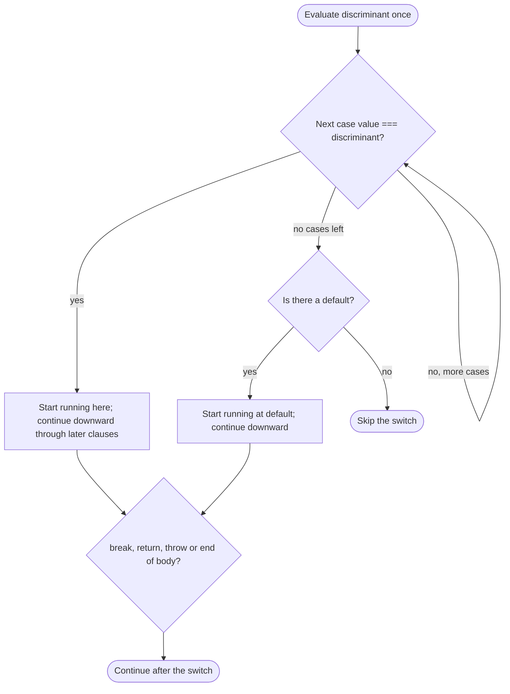

## Introduction

Many decisions depend on a single value that can take one of several known forms. An HTTP response is 200, 404 or 500. A Redux action has a `type` such as `'cart/add'` or `'cart/remove'`. A keyboard handler cares whether the key was `'ArrowUp'`, `'ArrowDown'`, `'Enter'` or `'Escape'`. You can write these with an `if` / `else if` chain, but every line repeats the same comparison:

```javascript title="if-chain.js"
function keyAction(key) {
  if (key === 'ArrowUp') {
    return 'move up';
  } else if (key === 'ArrowDown') {
    return 'move down';
  } else if (key === 'Enter') {
    return 'select';
  } else if (key === 'Escape') {
    return 'close';
  } else {
    return 'ignore';
  }
}
console.log(keyAction('Enter'), '|', keyAction('Tab'));
```

```output
select | ignore
```

The **`switch` statement** states the shared part once — "look at `key`" — and then lists the possible values:

```javascript title="switch-version.js"
function keyAction(key) {
  switch (key) {
    case 'ArrowUp':
      return 'move up';
    case 'ArrowDown':
      return 'move down';
    case 'Enter':
      return 'select';
    case 'Escape':
      return 'close';
    default:
      return 'ignore';
  }
}
console.log(keyAction('Enter'), '|', keyAction('Tab'));
```

```output
select | ignore
```

The two functions behave identically. The `switch` makes the shape of the decision visible at a glance: one value, several labelled destinations, and a fallback.

But `switch` is not a nicer-looking `if` chain. It was inherited from C, and it brings C's mechanics: it **jumps** to the matching case and then keeps running downwards through the following cases until something stops it. That behaviour, called **fall-through**, is useful in a few situations and the source of the most common `switch` bug in all others. It also uses **one scope for all its cases**, which produces errors that confuse people who expect each case to be separate. This lesson explains both so that you can use `switch` without being surprised by it.

## Before you start

- **if / else** — `switch` is an alternative to `else if` chains. See [[b1-if-else]].
- **Strict equality** — `switch` compares with the same rule as `===`. See [[b1-equality]] and [[b1-comparison-operators]].
- **Block scope and the temporal dead zone** — needed to understand `let` inside cases. See [[b1-let]] and [[b1-tdz]].
- **break** — how `switch` cases are usually ended. Taught fully in [[b1-break-continue]].

## The intuition

Think of a `switch` as a page of labelled sections with one entry point. The value in `switch (…)` tells you which label to start reading at. You find the first label that matches, start reading there, and **keep reading downward** — past the next labels, which are just markers on the page — until you hit an instruction that says "stop reading" (`break`), "leave the function" (`return`) or "something went wrong" (`throw`), or until you reach the end of the page.

The labels are not walls between sections. They are only places where reading can *start*. That one fact explains fall-through: if a section has no "stop" instruction, reading simply continues into the next section.

The analogy is accurate for execution but not for matching. Finding the label is not a single lookup; the engine compares your value with each label's value **in order**, using strict equality, until one matches. The details are below.

## The syntax

```text
switch (discriminant) {
  case expression1:
    statements…
  case expression2:
    statements…
  default:
    statements…
}
```

The value in parentheses is the **discriminant**. Each `case expression:` is a **case clause**, and `default:` is the optional **default clause**. The statements after a clause run when execution reaches that clause, either by matching or by falling into it from above.

Each case's statements are usually ended with `break`, which exits the whole `switch` and continues after its closing brace:

```javascript title="basic-switch.js"
function describeStatus(code) {
  let text;
  switch (code) {
    case 200:
      text = 'OK';
      break;
    case 404:
      text = 'Not Found';
      break;
    case 500:
      text = 'Internal Server Error';
      break;
    default:
      text = 'Unknown status';
  }
  return `${code} ${text}`;
}
console.log(describeStatus(200));
console.log(describeStatus(404));
console.log(describeStatus(418));
```

```output
200 OK
404 Not Found
418 Unknown status
```

Inside a function, `return` also ends a case — it leaves the function, so it necessarily leaves the `switch` too. That is why the `keyAction` example needs no `break`s. Many style guides prefer a `switch` of `return`s for exactly this reason: there is no way to forget the `break`.

The last clause does not need a `break`, because there is nothing below it to fall into. Some teams add one anyway so that a case added later at the bottom is not accidentally fallen into.

## How switch evaluates, step by step

The specification defines `switch` precisely, and the precise version explains every surprising behaviour. When execution reaches a `switch`:

1. The **discriminant is evaluated once** and its value is remembered.
2. The case clauses are visited **in source order**. For each one, its expression is evaluated, and the result is compared with the discriminant using **strict equality** (the same algorithm as `===`).
3. At the **first** case whose value is strictly equal, matching stops. Execution starts at that clause's statements and continues downward through all following clauses' statements — matching is not repeated — until a `break`, `return`, `throw` or `continue` (when inside a loop) transfers control out, or until the end of the `switch` body.
4. If **no case matches**, execution starts at the `default` clause, wherever it appears, and continues downward from there in the same way.
5. If there is no match and no `default`, nothing runs.

Step 2 has a consequence most people do not know: **case expressions are evaluated lazily**. Cases below the match are never evaluated at all. You can see this by using a function call as a case expression:

```javascript title="lazy-cases.js"
function trace(value) {
  console.log('  evaluating case', value);
  return value;
}

function pick(x) {
  switch (x) {
    case trace(1):
      return 'one';
    case trace(2):
      return 'two';
    case trace(3):
      return 'three';
  }
}

console.log('result:', pick(2));
```

```output
  evaluating case 1
  evaluating case 2
result: two
```

Case `3` was never evaluated. In normal code, case expressions are literals and this does not matter, but it shows that case values are ordinary **expressions**, not constants — `case limit + 1:` or `case Status.Active:` are both legal. (C and Java require compile-time constants; JavaScript does not.)



## Strict equality: what matches and what does not

Because cases are compared with `===`, no type conversion happens. A number never matches a string:

```javascript title="strict-matching.js"
function roomName(id) {
  switch (id) {
    case 1:
      return 'Lobby';
    case 2:
      return 'Kitchen';
    default:
      return 'Unknown room';
  }
}

const fromUrl = new URLSearchParams('room=1').get('room'); // URL values are strings
console.log(typeof fromUrl, roomName(fromUrl));
console.log(roomName(Number(fromUrl)));
```

```output
string Unknown room
Lobby
```

This is the most common real-world `switch` surprise. Values from URLs, form fields, `localStorage`, `dataset` attributes and environment variables are **always strings**. Convert them once, at the boundary, before switching on them — or write the cases as strings.

Three more consequences of strict equality:

- **`NaN` never matches anything**, not even `case NaN:`, because `NaN === NaN` is `false`. Use `Number.isNaN` in an `if` before the `switch`.
- **`0` and `-0` match each other**, because `0 === -0` is `true`.
- **Objects and arrays match only by reference.** `case [1, 2]:` creates a new array every time it is evaluated, so it can never equal anything you pass in. `switch` compares identity, not contents.

```javascript title="strict-edge-cases.js"
function kind(x) {
  switch (x) {
    case NaN:
      return 'NaN case';
    case 0:
      return 'zero case';
    default:
      return 'default';
  }
}
console.log(kind(NaN), '|', kind(-0), '|', kind('0'));

const ADMIN = { role: 'admin' };
function check(user) {
  switch (user) {
    case ADMIN:
      return 'same object';
    default:
      return 'different object';
  }
}
console.log(check(ADMIN), '|', check({ role: 'admin' }));
```

```output
default | zero case | default
same object | different object
```

`switch` does not do pattern matching. It cannot test ranges, types or shapes by itself. There is a TC39 proposal for a pattern-matching `match` expression, but it is at an early stage and is not part of the language.

## Fall-through

### Deliberate fall-through: grouping cases

Fall-through has one clean, widely accepted use: giving several values the **same** behaviour by stacking empty cases.

```javascript title="grouped-cases.js"
function dayType(day) {
  switch (day) {
    case 'Sat':
    case 'Sun':
      return 'weekend';
    case 'Mon':
    case 'Tue':
    case 'Wed':
    case 'Thu':
    case 'Fri':
      return 'weekday';
    default:
      throw new RangeError(`Unknown day: ${day}`);
  }
}
console.log(dayType('Sun'), dayType('Wed'));
try {
  dayType('Funday');
} catch (err) {
  console.log(err.message);
}
```

```output
weekend weekday
Unknown day: Funday
```

When `day` is `'Sat'`, matching starts at `case 'Sat':`, whose body is empty, so execution falls through to `case 'Sun':`'s statements and returns `'weekend'`. Stacked empty cases read naturally as "any of these", and linters treat them as intentional.

Fall-through with statements in between is occasionally useful for cumulative behaviour, such as applying all migration steps from a given version onward:

```javascript title="cumulative.js"
function migrate(fromVersion) {
  const steps = [];
  switch (fromVersion) {
    case 1:
      steps.push('add email column');
      // falls through
    case 2:
      steps.push('split name into first/last');
      // falls through
    case 3:
      steps.push('add index on email');
      break;
    default:
      steps.push('already up to date');
  }
  return steps;
}
console.log(migrate(1));
console.log(migrate(3));
console.log(migrate(4));
```

```output
[
  'add email column',
  'split name into first/last',
  'add index on email'
]
[ 'add index on email' ]
[ 'already up to date' ]
```

The `// falls through` comments are not decoration. ESLint's `no-fallthrough` rule (enabled in its recommended set) reports any case with statements that falls into the next one, unless the case ends with a comment matching `falls through` (or similar wording). The comment tells both the linter and the next reader that the missing `break` is intentional.

### Accidental fall-through: the classic bug

The flip side is what happens when you *forget* a `break`:

```javascript title="missing-break.js"
function priceFor(plan) {
  let price = 0;
  switch (plan) {
    case 'free':
      price = 0;
    case 'pro':            // missing break above: 'free' falls into here
      price = 12;
      break;
    case 'team':
      price = 40;
      break;
  }
  return price;
}
console.log(priceFor('free'), priceFor('pro'), priceFor('team'));
```

```output
12 12 40
```

Free users are charged the pro price. Nothing throws, nothing warns at runtime; the value is simply wrong. This is why the `no-fallthrough` lint rule exists, why many teams prefer `return` in every case, and why lookup objects (below) are often a better fit when each case only produces a value.

### Where default goes

`default` is usually last, but it can appear anywhere — and its position matters because of fall-through. Step 4 of the algorithm says an unmatched value starts executing **at** the default clause and then continues downward:

```javascript title="default-position.js"
function trail(x) {
  const visited = [];
  switch (x) {
    case 1:
      visited.push('case 1');
      // falls through
    default:
      visited.push('default');
      // falls through
    case 2:
      visited.push('case 2');
      break;
    case 3:
      visited.push('case 3');
  }
  return visited.join(' -> ');
}
console.log('x=1:', trail(1));
console.log('x=2:', trail(2));
console.log('x=3:', trail(3));
console.log('x=9:', trail(9));
```

```output
x=1: case 1 -> default -> case 2
x=2: case 2
x=3: case 3
x=9: default -> case 2
```

Two things to notice. A value of `3` matches `case 3` even though `default` appears earlier — `default` is used only when **no** case matches, wherever it sits. And an unmatched value `9` runs `default` and then falls into `case 2`. Writing code like this on purpose is almost never a good idea; the example exists to show the rule. Put `default` last.

## One switch, one scope

The braces of a `switch` form **a single block**. Every case shares it. A `let` or `const` declared in one case is in scope in every other case, which causes two kinds of error.

**Redeclaration.** Two cases cannot each declare their own `let result`:

```javascript title="redeclare.js"
try {
  new Function(`
    switch (action) {
      case 'add':
        let result = 1;
        break;
      case 'remove':
        let result = 2;
        break;
    }
  `);
} catch (err) {
  console.log(`${err.name}: ${err.message}`);
}
```

```output
SyntaxError: Identifier 'result' has already been declared
```

(`new Function` is used so the parse error can be caught and printed; in a normal file the script would fail to load. The message is from V8 in Node.js 22.)

**Temporal dead zone.** Worse, a variable declared in one case can be *used* in another case before its declaration has run. The binding exists for the whole block, but it is uninitialised until its declaration executes — and if execution jumped past the declaration, it never does:

```javascript title="tdz-in-switch.js"
function label(kind) {
  switch (kind) {
    case 'a':
      let message = 'Alpha';
      return message;
    case 'b':
      message = 'Bravo';   // same binding as above, but its declaration never ran
      return message;
  }
}
console.log(label('a'));
try {
  console.log(label('b'));
} catch (err) {
  console.log(`${err.name}: ${err.message}`);
}
```

```output
Alpha
ReferenceError: Cannot access 'message' before initialization
```

The fix for both is the same: **give each case its own block** when it declares variables.

```javascript title="case-blocks.js"
function label(kind) {
  switch (kind) {
    case 'a': {
      const message = 'Alpha';
      return message;
    }
    case 'b': {
      const message = 'Bravo';   // a different binding in a different block
      return message;
    }
    default:
      return 'unknown';
  }
}
console.log(label('a'), label('b'), label('z'));
```

```output
Alpha Bravo unknown
```

The braces after `case 'a':` are an ordinary block statement, so each case now has its own scope. ESLint's `no-case-declarations` rule (also in the recommended set) flags declarations directly under a `case` for exactly this reason. See [[b1-tdz]] for the general mechanism.

## switch (true)

You will sometimes see this pattern, which uses `switch` for range checks:

```javascript title="switch-true.js"
function bmiCategory(bmi) {
  switch (true) {
    case bmi < 18.5:
      return 'underweight';
    case bmi < 25:
      return 'normal';
    case bmi < 30:
      return 'overweight';
    default:
      return 'obese';
  }
}
console.log(bmiCategory(17), bmiCategory(22.4), bmiCategory(31));
```

```output
underweight normal obese
```

It works because the discriminant is the boolean `true`, and each case expression evaluates to a boolean. The first case whose expression is *exactly* `true` wins. Note "exactly": `case user.name:` would not match even for a non-empty name, because `'Ana' === true` is false — this pattern needs real booleans, not truthy values.

Opinions differ. Some developers find `switch (true)` tidy; many consider it a misuse that hides an `if` chain behind unfamiliar syntax. An `else if` chain says the same thing with no trick, so prefer it in shared code unless your team has agreed on the pattern.

## How it works internally

V8 compiles a `switch` into bytecode for its Ignition interpreter, and what it produces depends on the cases. For a few cases, it emits a sequence of `TestEqualStrict` comparisons, each followed by a conditional jump to that case's code — essentially the same as an `if` chain. For many **dense small-integer** cases, it can emit a **jump table**: you can see this with `node --print-bytecode`. On Node.js 22, a `switch` with integer cases `0` through `11` compiled to a range check followed by a single `SwitchOnSmiNoFeedback` instruction that jumps directly to the right case by index, instead of up to twelve comparisons. ("Smi" is V8's name for a small integer stored directly rather than as a heap object.)

That optimisation is an engine detail, not a language guarantee, and the optimising compilers may rearrange things further. The practical lesson is that `switch` is not slow and not meaningfully faster than an `if` chain for typical sizes; choose between them for readability.

At the language level, the important internal fact is that the whole `switch` body is one block with one lexical environment, created when the `switch` starts. All `let`/`const`/`class` declarations in any case are hoisted into it and start uninitialised — which is exactly why the redeclaration and temporal-dead-zone errors above occur.

## Worked example: a reducer

Frontend state management is the place you are most likely to meet `switch` in production. A **reducer** takes the current state and an action describing what happened, and returns the next state. Redux, React's `useReducer`, and many state machines use this shape, and the conventional implementation is a `switch` on `action.type`.

```javascript title="cart-reducer.js"
const initialState = { items: [], couponCode: null };

function cartReducer(state, action) {
  switch (action.type) {
    case 'cart/itemAdded': {
      const existing = state.items.find((i) => i.id === action.id);
      const items = existing
        ? state.items.map((i) => (i.id === action.id ? { ...i, qty: i.qty + 1 } : i))
        : [...state.items, { id: action.id, qty: 1 }];
      return { ...state, items };
    }
    case 'cart/itemRemoved':
      return { ...state, items: state.items.filter((i) => i.id !== action.id) };
    case 'cart/couponApplied':
    case 'cart/couponReplaced':
      return { ...state, couponCode: action.code };
    case 'cart/cleared':
      return initialState;
    default:
      return state;   // unknown actions leave state unchanged
  }
}

const actions = [
  { type: 'cart/itemAdded', id: 'book' },
  { type: 'cart/itemAdded', id: 'book' },
  { type: 'cart/itemAdded', id: 'pen' },
  { type: 'cart/couponApplied', code: 'SAVE10' },
  { type: 'cart/itemRemoved', id: 'pen' },
  { type: 'analytics/pageViewed' },
];

const finalState = actions.reduce(cartReducer, initialState);
console.log(JSON.stringify(finalState));
```

```output
{"items":[{"id":"book","qty":2}],"couponCode":"SAVE10"}
```

Each design choice has a reason:

- **Every case returns**, so fall-through is impossible except where it is intended (`couponApplied` and `couponReplaced` share a body).
- The `'cart/itemAdded'` case declares `const existing` and `const items`, so it is wrapped in **braces** to give it its own scope.
- The **`default` returns the unchanged state**. In Redux every reducer sees every action, including ones meant for other parts of the app (`'analytics/pageViewed'` here), so ignoring unknown actions is required, not just defensive.
- Each case returns a **new object** rather than mutating `state`, which is how React and Redux detect that something changed.

## Exhaustive switches in TypeScript

In TypeScript, `switch` gains a powerful property: the compiler **narrows** the type of the discriminant in each case, and it can check that you handled every possibility. With a union type whose members share a literal `kind` field (a **discriminated union**), assigning the leftover value to `never` in `default` turns a forgotten case into a compile error:

```typescript title="shapes.ts"
type Shape =
  | { kind: 'circle'; radius: number }
  | { kind: 'square'; side: number }
  | { kind: 'triangle'; base: number; height: number };

function area(shape: Shape): number {
  switch (shape.kind) {
    case 'circle':
      return Math.PI * shape.radius ** 2;   // shape is narrowed to the circle type
    case 'square':
      return shape.side ** 2;
    default: {
      const unhandled: never = shape;       // error: the triangle case is missing
      throw new Error(`Unhandled shape: ${JSON.stringify(unhandled)}`);
    }
  }
}
```

```output
shapes.ts(13,13): error TS2322: Type '{ kind: "triangle"; base: number; height: number; }' is not assignable to type 'never'.
```

That output is from `tsc --strict` (TypeScript 6.0). When someone adds a new shape to the union, every `switch` that forgot to handle it fails to compile, which is far better than discovering the missing case in production. Add `case 'triangle': return (shape.base * shape.height) / 2;` and the error disappears, because nothing is left to reach `default`. The `throw` still matters at runtime, since data from a server can contain kinds the type system never saw.

## In real systems

**Reducers and state machines.** As above: Redux reducers, `useReducer`, XState-style transition logic and game loops dispatch on a type or state name.

**Protocol and event handling.** WebSocket message handlers switch on `message.type`; keyboard handlers switch on `event.key`; HTTP clients switch on response status classes. These are discrete, known values — the ideal `switch` input.

**Parsers and interpreters.** Tokenisers switch on the current character, and interpreters (including toy ones in interviews) switch on an opcode or AST node type, where grouped cases like `case '+': case '-':` are natural.

**Command-line tools.** Node.js scripts often `switch (process.argv[2])` to dispatch subcommands such as `build`, `test` or `serve`.

## Trade-offs and alternatives

When every case only **produces a value**, an object (or `Map`) lookup is often shorter and has no fall-through risk:

```javascript title="lookup-table.js"
const STATUS_TEXT = {
  200: 'OK',
  404: 'Not Found',
  500: 'Internal Server Error',
};

function describeStatus(code) {
  return STATUS_TEXT[code] ?? 'Unknown status';
}
console.log(describeStatus(200), '|', describeStatus(418));
// Lookup keys are strings, so beware inherited properties on plain objects:
console.log(describeStatus('constructor') === 'Unknown status');
```

```output
OK | Unknown status
false
```

The last line shows the lookup table's own trap: plain objects inherit properties such as `constructor` from `Object.prototype`, so a key that came from user input can hit one of them. Use `Object.hasOwn(STATUS_TEXT, code)`, an object created with `Object.create(null)`, or a `Map` when keys come from outside. Note also that object keys are strings, so `STATUS_TEXT['200']` and `STATUS_TEXT[200]` are the same entry — the opposite of `switch`, which distinguishes `'200'` from `200`.

| Tool | Best for | Weak at |
|---|---|---|
| `switch` | Many discrete values, cases that run statements, grouped cases, TypeScript exhaustiveness | Ranges and compound conditions; fall-through and shared-scope bugs |
| `if` / `else if` | Ranges, compound conditions, different variables per branch | Long repetitive chains on one value |
| Object / `Map` lookup | Mapping a key to a value or handler function; data-driven tables | Ranges; behaviour that is more than a value; inherited-key traps on plain objects |

A good rule: if the decision is "one value, many known options, each doing something", use `switch`. If it is "one value, many known options, each producing a value", consider a lookup table. If it involves ranges or several variables, use `if`.

## Common mistakes

> [!MISTAKE] Forgetting break
> A case without `break`, `return` or `throw` runs straight into the next case's statements. Use `return` in each case when the `switch` is inside a function, enable ESLint `no-fallthrough`, and mark deliberate fall-through with a `// falls through` comment.

**Switching on a string that should be a number (or the reverse).** `switch ('1')` never matches `case 1:`. Convert input from URLs, forms and storage before switching.

**Declaring variables directly under `case`.** All cases share one scope, so a second `let x` is a redeclaration error and a variable used in a case that skipped its declaration throws a `ReferenceError`. Wrap such case bodies in braces.

**Expecting `case NaN:` or `case [1, 2]:` to match.** Strict equality makes `NaN` match nothing and compares objects by reference.

**Using `break` to leave a surrounding loop.** Inside a `switch`, `break` exits the `switch`, not the loop around it. Use `return`, a labelled `break`, or `continue` (which does target the loop). See [[b1-break-continue]] and [[b1-nested-control-flow]].

**Leaving out `default` where unknown values are possible.** Without it, an unexpected value silently does nothing. Either handle it or throw.

## Interview perspective

> [!INTERVIEW] What a strong answer sounds like
> "`switch` evaluates the discriminant once, then compares it with each case in order using strict equality. At the first match it starts executing and falls through subsequent cases until a `break`, `return` or `throw`. If nothing matches it starts at `default`, wherever it is. All cases share one block scope, so I wrap case bodies that declare variables in braces."

Common questions:

- **What is printed?** A snippet with a missing `break`, or with `default` in the middle, is the classic puzzle. Trace it with the algorithm: find the start point, then run downward until something stops you.
- **Does `switch` use `==` or `===`?** Strict equality, so `'1'` does not match `1`.
- **Why might `let` in a case throw?** Shared scope: redeclaration is a `SyntaxError`, and use before the declaration has run is a temporal-dead-zone `ReferenceError`.
- **`switch` versus object lookup?** Lookup tables are concise and data-driven for value mapping; `switch` handles behaviour, grouped cases and TypeScript exhaustiveness checking.
- **How do you make sure every case is handled?** In TypeScript, a `never` assignment in `default` on a discriminated union; in JavaScript, a `default` that throws.

## Practice

1. **Trace it.** Without running it, predict the output of `trail(1)` and `trail(9)` from the `default-position.js` example if the `// falls through` after `case 1` were replaced with `break`.
2. **Fix the pricing bug.** Rewrite `priceFor` so each plan returns its price with no possibility of fall-through. Then write the same thing as a lookup table that throws on an unknown plan.
3. **Group cases.** Write `isVowel(ch)` using a `switch` with stacked cases for `a e i o u`, case-insensitively.
4. **Parse a command.** Write `run(argv)` that switches on `argv[0]` (`'add'`, `'list'`, `'remove'`), declares a local variable in two of the cases, and avoids any shared-scope error.
5. **Exhaustiveness.** Add a `'triangle'` case to the TypeScript `area` function and confirm with `tsc --strict` that the error goes away.

```quiz
Q: What does `switch ('2') { case 2: console.log('number'); break; default: console.log('other'); }` print?
- [ ] `number`
- [x] `other`
- [ ] Both `number` and `other`
- [ ] It throws a TypeError
> `switch` compares with strict equality, so the string `'2'` is not equal to the number `2` and no case matches. Execution starts at `default`. Loose equality would have matched, which is why values read from URLs or forms must be converted before switching.

Q: `x` is 1. `switch (x) { case 1: log('a'); case 2: log('b'); break; case 3: log('c'); }` — what is logged?
- [ ] `a`
- [x] `a` then `b`
- [ ] `a`, `b` then `c`
- [ ] Nothing
> Matching starts at `case 1`, which has no `break`, so execution falls through into `case 2`'s statements and logs `b`. The `break` there exits the switch before `case 3`. Case labels are entry points, not barriers.

Q: Why does declaring `let total` under two different `case` labels of the same switch fail?
- [ ] `let` is not allowed inside `switch`
- [x] All cases share one block scope, so the second declaration redeclares the same name
- [ ] Case bodies are evaluated in strict mode
- [ ] `let` declarations must appear before the first `case`
> The braces of a switch form a single block. Two `let total` declarations in it are a redeclaration, which is a SyntaxError. Wrapping each case body in its own `{ }` gives each declaration its own scope.

Q: A switch has `default` as its first clause, followed by `case 'a': ... break;`. What runs when the discriminant is `'a'`?
- [ ] The default clause, because it comes first
- [ ] The default clause, then `case 'a'`
- [x] Only `case 'a'`
- [ ] Nothing, because default must be last
> `default` is used only when no case matches, regardless of its position. `'a'` matches `case 'a'`, so execution starts there. Position matters only for fall-through: an unmatched value starting at `default` would continue into the clauses below it.
```

## Quick revision {#quick-revision}

- `switch (d) { case v: … default: … }` — the discriminant is evaluated once; cases are compared in order with strict equality (`===`).
- Case expressions are ordinary expressions, evaluated lazily; cases after the match are never evaluated.
- Execution starts at the first matching case and **falls through** later clauses until `break`, `return`, `throw`, `continue` (in a loop) or the end.
- No match → start at `default` wherever it is, then fall through from there; no default → nothing runs.
- Stacked empty cases are the accepted way to group values; mark other deliberate fall-through with `// falls through` (ESLint `no-fallthrough`).
- `'1'` does not match `1`; `NaN` matches nothing; `0` matches `-0`; objects match only by reference.
- All cases share one block scope: duplicate `let` is a SyntaxError, cross-case use hits the TDZ; wrap case bodies in `{ }` (ESLint `no-case-declarations`).
- `switch (true)` with boolean cases works but is usually clearer as an `if` chain.
- V8 compiles small switches to compare-and-jump sequences and dense small-integer switches to a jump table (`SwitchOnSmiNoFeedback`).
- Lookup objects suit value mapping (watch inherited keys; use `Map` or `Object.hasOwn`); `if` suits ranges.
- TypeScript: assign the leftover discriminant to `never` in `default` for compile-time exhaustiveness.

## Key takeaways {#key-takeaways}

- A `switch` is a strict-equality jump into a list of statements, not a set of isolated branches.
- Case labels are entry points: without `break` or `return`, execution falls through into the next case.
- Strict comparison means types must match exactly, so convert external input before switching.
- One shared scope means variables declared in cases need their own braces.
- Prefer `return` in every case, keep `default` last, and let linters catch accidental fall-through.
- Use `switch` for discrete values that drive behaviour, a lookup table for discrete values that map to data, and `if` for ranges and compound conditions.
