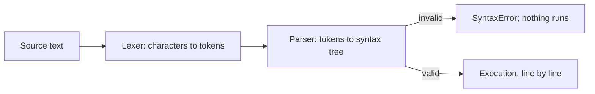

## Introduction

Every JavaScript program starts as plain text in a file. Before the engine can run a single line, it has to read that text and work out its structure: which characters form a name, which form a number, where each statement ends, and which words have special meaning. The rules for that structure are the language's **syntax**.

Most of the time you will not think about syntax at all — you write code, a formatter tidies it, and it runs. But a handful of syntax rules cause real, confusing bugs: a function that returns `undefined` because of a line break, a variable named `class` that will not compile, a typo that silently creates a global variable, or a log statement that shows a value your code never had. Each of these comes from one of the topics in this lesson.

This lesson covers the shape of JavaScript source text and then seven focused topics, each in its own section so it can be read on its own:

- **Comments** — text the engine ignores.
- **Identifiers** — the names you give variables and functions.
- **Keywords and reserved words** — names the language keeps for itself.
- **Case sensitivity** — why `total` and `Total` are different.
- **Semicolons and ASI** — how statements end, and when the engine adds semicolons for you.
- **Strict mode** — an opt-in (and in modern code, automatic) set of safer rules.
- **Console and output** — how to print values while developing.

## Before you start

- [[b1-what-is-javascript]] — what JavaScript is and how to run it (browser console or `node file.js`).
- [[b1-statements-expressions]] — statements versus expressions. It helps but is not required; this lesson defines the terms it uses.

All snippets run in Node.js 22 unless marked as browser-only, and the outputs shown are what they print.

## The intuition

Reading code is like reading a sentence in a language you know. First your eyes split the text into **words** and **punctuation** without thinking about meaning: "The", "cat", "sat", ".". Then you check that the words form a valid **sentence**: "cat the sat." has the right words in an invalid order. Only then do you work out what the sentence *means*.

A JavaScript engine does the same in three stages. The **lexer** (or tokenizer) splits text into **tokens**. The **parser** checks that the tokens form valid statements and builds a tree from them. Only after the whole file has parsed successfully does **execution** begin. That order explains a fact beginners find surprising: one syntax mistake on line 300 prevents lines 1 to 299 from running too, because the engine never reaches the execution stage.



## Tokens: the words of JavaScript

Here is a small program. Every character in it belongs to one kind of token, or to whitespace and comments that separate tokens.

```javascript title="tokens.js"
const price = 120;          // a statement: declare a constant
const taxRate = 0.2;
function withTax(amount) {  // a function declaration with one parameter
  return amount * (1 + taxRate);
}
if (withTax(price) > 100) {
  console.log('Total:', withTax(price));
}
{
  const inner = 'block-scoped';
  console.log(inner);
}
console.log(typeof inner);
```

```output
Total: 144
block-scoped
undefined
```

The token kinds are:

| Token kind | Examples from the program | Role |
|---|---|---|
| **Identifiers** | `price`, `taxRate`, `withTax`, `amount`, `console` | Names you (or the host) define |
| **Keywords** | `const`, `function`, `return`, `if`, `typeof` | Words with fixed meaning in the grammar |
| **Literals** | `120`, `0.2`, `1`, `'Total:'`, `'block-scoped'` | Values written directly in code |
| **Punctuators** | `=`, `;`, `(`, `)`, `{`, `}`, `*`, `+`, `>`, `.`, `,` | Operators and structural punctuation |

**Literals** come in several forms: numbers (`42`, `3.14`, `0xff` hexadecimal, `0b1010` binary, `1_000_000` with separators, `10n` for a `BigInt`), strings in single quotes, double quotes or backticks (template literals), `true`, `false`, `null`, regular expressions (`/ab+c/i`), and array and object literals (`[1, 2]`, `{ id: 1 }`).

**Whitespace** — spaces, tabs and line breaks — separates tokens but is otherwise mostly insignificant: `1+1` and `1 + 1` are the same. The important exception is that **line breaks sometimes matter**, because of automatic semicolon insertion, covered below.

**Statements** are built from tokens and are usually ended by `;`. **Blocks** — statements grouped in `{ }` — appear in function bodies, `if` and loop bodies, and on their own. A block also creates a **scope** for `let` and `const`: `inner` exists only inside its block, which is why `typeof inner` outside it is `'undefined'`. See [[b1-block-scope-vars]].

One lexing detail shows why the parser and lexer cooperate: the `/` character can be division (`a / b`) or the start of a regular expression (`/ab+c/`). The lexer decides from context — after a value it is division, where a value is expected it starts a regex — which is one reason JavaScript's grammar is harder to parse than it looks.

### Early errors: syntax is checked before anything runs

Because the whole file is parsed before execution, any syntax error stops everything:

```javascript title="early-error.js"
console.log('this line never runs');
const 2fast = true;
```

```output
SyntaxError: Invalid or unexpected token
```

The first line is valid, yet nothing prints. The engine reported the error during parsing, before execution started. The specification calls these **early errors**. The same applies to some rule violations that are not typos at all, such as using a reserved word as a variable name or, in strict mode, declaring two parameters with the same name. Errors such as `ReferenceError` and `TypeError`, by contrast, happen at run time, when the faulty line executes — after earlier lines have already run. [[b1-parsing-jit]] explains parsing in more depth.

A file may begin with a **hashbang** line such as `#!/usr/bin/env node`, which lets Unix systems run the file directly as a command. Engines treat it as a comment; it was standardised in ES2023 and is valid only as the very first line.

## Comments {#b1-comments}

**Comments** are text in your source code that the engine ignores completely. They exist for people — to explain intent, warn about pitfalls, document function parameters or temporarily disable a line — and never affect how the program behaves. JavaScript has two forms: a **line comment** starts with `//` and runs to the end of the line; a **block comment** starts with `/*`, ends with `*/` and can span several lines.

```javascript title="comments.js"
#!/usr/bin/env node
// Line comment: everything to the end of this line is ignored
const taxRate = 0.2; // a trailing comment explains a value

/*
  Block comment: can span several lines.
  Useful for longer explanations.
*/
const price = 100;

/**
 * JSDoc comment: still just a comment to the engine,
 * but editors and TypeScript read it for types and hints.
 * @param {number} amount
 * @returns {number}
 */
function withTax(amount) {
  return amount * (1 + taxRate);
}

console.log(withTax(price) /* inline block comment */);
// console.log('disabled line');
```

```output
120
```

The lexer treats comments much like whitespace: a comment separates tokens but never becomes one. That is why `withTax(price) /* inline block comment */` behaves exactly like `withTax(price)`.

### JSDoc

A block comment that starts with `/**` is conventionally a **JSDoc** comment. The engine ignores it like any other comment, but editors show it as documentation when you hover over the function, and TypeScript can use its `@param` and `@returns` tags to type-check plain JavaScript files. It is the standard way to document public functions in libraries.

### Block comments do not nest

The first `*/` always ends a block comment, wherever it appears. This causes two kinds of bugs:

```javascript title="nesting.js"
/* outer /* inner */ still in outer? */
```

```output
SyntaxError: Unexpected token '*'
```

The comment ended at the first `*/`; the parser then sees `still in outer? */` as code. The same thing happens with text that happens to contain `*/`, such as a file pattern like `src/**/*.js` inside a block comment. Use `//` comments to disable blocks of code (editors toggle them with Ctrl+/ or Cmd+/), and keep glob patterns in line comments.

### What comments should say

Good comments explain **why**, not **what**. `i++; // increment i` adds nothing; `// Retry once: the payment provider returns 503 during deploys` records knowledge the code cannot express. Commented-out code tends to rot — version control remembers old code better than comments do.

> [!WARNING] Comments ship to users
> Browser JavaScript is sent to users as text. Unless your build removes comments (minifiers usually do), anyone can read them in DevTools. Never put passwords, API keys, internal URLs or embarrassing notes in comments.

### Legacy HTML-style comments

For compatibility with 1990s pages that hid scripts from very old browsers, classic scripts also treat `<!--` as the start of a line comment (and `-->` at the start of a line). This is a web-legacy rule in Annex B of the specification. It is a syntax error in ES modules (`SyntaxError: HTML comments are not allowed in modules`). You should never write it, but it explains why such a line does not break an old script.

## Identifiers {#b1-identifiers}

An **identifier** is a name you give to something in your code: a variable, constant, function, parameter, class or label. The engine uses the name to look up the value it refers to. The rules are short:

- The first character must be a letter, `$` or `_`.
- Later characters may be letters, digits, `$` or `_`.
- "Letter" means any Unicode letter, not just A–Z, so `café`, `π` and `名前` are valid.
- The name must not be a **reserved word** such as `class` or `return` (next section).

```javascript title="identifiers.js"
const $el = 'ok';
const _internal = 1;
const π = Math.PI;
const café = true;
const userName2 = 'Ada';
console.log($el, _internal, π > 3, café, userName2);
```

```output
ok 1 true true Ada
```

Two rules explain the most common errors. Names **cannot start with a digit** — `const 2fast = true` is a syntax error, because the lexer would read `2` as the start of a number. Names **cannot contain hyphens or spaces** — `const first-name = 'Ada'` is parsed as `first - name`, an expression, and fails with `SyntaxError: Missing initializer in const declaration`. Use `firstName` instead.

### Conventions

The rules allow far more than conventions recommend. In most JavaScript codebases:

| Convention | Used for | Example |
|---|---|---|
| `camelCase` | Variables, functions, methods, properties | `cartTotal`, `fetchUser` |
| `PascalCase` | Classes, constructors, React components, types | `ShoppingCart`, `UserCard` |
| `UPPER_SNAKE_CASE` | Constants fixed at write time | `MAX_RETRIES` |
| Leading `_` | "Internal, please don't touch" (a convention only, not privacy) | `_cache` |
| Leading `$` | Historically jQuery objects or DOM elements; also framework-specific meanings | `$button` |

Prefer ASCII names in shared code unless your team agrees otherwise: everyone can type them, and they avoid the lookalike problem below. Naming well is covered in [[b1-variable-naming]].

### Identifiers versus property names

Identifiers are names that the engine looks up in a **scope**. Property names are different: they are keys on an object, and any string can be a key. A property name that is not a valid identifier just needs quotes and bracket access:

```javascript title="property-names.js"
const obj = { default: 1, class: 'x', new: true, 'first-name': 'Ada' };
console.log(obj.default, obj.class, obj.new, obj['first-name']);
```

```output
1 x true Ada
```

`default`, `class` and `new` are reserved words, so they cannot name variables, but after a `.` the grammar expects a property name and any word is allowed. `'first-name'` contains a hyphen, so it must be quoted in the literal and read with brackets. See [[b1-dot-vs-bracket]].

### Unicode details

An identifier can also be written with Unicode escapes: `const abc = 1` declares a variable named `abc`. This is rarely useful and occasionally used to disguise code, which is why security reviewers look for it.

Visually identical names can be different identifiers. `é` can be stored as one code point or as `e` followed by a combining accent; the engine does not normalise them, so two variables that look like `café` can be distinct. Similarly, Cyrillic `а` looks like Latin `a`. Linters can flag non-ASCII identifiers for this reason.

Class bodies support **private names** written with `#`, such as `#balance`. They are not ordinary identifiers: they are only valid inside the class, after `this.` or another instance. See [[b1-public-private-fields]].

## Keywords and Reserved Words {#b1-keywords}

A **keyword** is a word with a fixed meaning in JavaScript's grammar, such as `if`, `const`, `function`, `return` or `class`. Keywords tell the parser which construct is starting, so they cannot also be used as names for variables, functions or parameters. The full set of words you cannot use as identifiers is called **reserved words**.

The reason is ambiguity. If `if` could be a variable, then `if (x) {}` could be a call to a function named `if` followed by a block, or an `if` statement. Reserving the word removes the question.

### The reserved word list

| Category | Words |
|---|---|
| Always reserved | `break` `case` `catch` `class` `const` `continue` `debugger` `default` `delete` `do` `else` `enum` `export` `extends` `false` `finally` `for` `function` `if` `import` `in` `instanceof` `new` `null` `return` `super` `switch` `this` `throw` `true` `try` `typeof` `var` `void` `while` `with` |
| Reserved in strict mode | `implements` `interface` `let` `package` `private` `protected` `public` `static` `yield` |
| Reserved in modules and async functions | `await` |
| Reserved in generator functions | `yield` |
| Not bindable in strict mode | `arguments`, `eval` |

`true`, `false` and `null` are literals rather than keywords, but they are reserved in the same way. `enum` is reserved for possible future use and does nothing in JavaScript today (TypeScript gives it a meaning).

```javascript title="reserved.js"
let class = 1;
```

```output
SyntaxError: Unexpected token 'class'
```

Because of strict mode and modules, a word's status can depend on where the code runs. `var let = 1` works in a sloppy classic script but fails in strict mode. `var await = 1` works in a classic script, but the same line in an ES module fails with `SyntaxError: Unexpected reserved word`. Code that worked as an old-style script can therefore break when it is converted to a module. Treat every word in the table as reserved in new code.

### Contextual keywords

Some words are special only in particular positions and remain usable as ordinary names elsewhere. These are **contextual keywords**: `async`, `get`, `set`, `static` (in sloppy code), `of`, `as`, `from`, `target` (in `new.target`) and `meta` (in `import.meta`).

```javascript title="contextual.js"
let async = 1, get = 2, of = 3;
console.log(async + get + of);
```

```output
6
```

`async` is a keyword only right before `function` or an arrow function; `of` only inside `for (... of ...)`; `get` and `set` only in object literals and classes. Legal is not the same as wise: a variable named `async` confuses readers.

### Words that look reserved but are not

`undefined`, `NaN` and `Infinity` are **not** keywords. They are read-only properties of the global object. At the global level, assigning to them silently does nothing in sloppy mode and throws a `TypeError` in strict mode. Inside a function, though, you *can* declare a local variable named `undefined` that shadows the global one — `let undefined = 5` is legal there. Never do it; it makes every `x === undefined` check in that scope wrong. This is also why some older code writes `void 0` to get a guaranteed `undefined` value.

As with identifiers, **property names may be any word**: `obj.default`, `obj.class`, `promise.catch()` and `response.delete()` are all fine, because after a `.` the parser expects a property name, not a binding.

## Case Sensitivity {#b1-case-sensitivity}

JavaScript is **case-sensitive**: uppercase and lowercase letters are different characters, so `total`, `Total` and `TOTAL` are three different names. This applies to variables, functions, properties, keywords and built-in APIs. The engine compares names character by character and does no case folding when it looks them up.

```javascript title="case.js"
const user = { name: 'Ada' };
console.log(user.name);
console.log(user.Name);
let total = 1;
let Total = 2;
console.log(total, Total);
console.log([1, 2].map((n) => n * 2), new Map([[1, 'one']]).get(1));
```

```output
Ada
undefined
1 2
[ 2, 4 ] one
```

`user.Name` is `undefined`, not an error: reading a property that does not exist simply gives `undefined`, so a capitalisation mistake in a property name produces a wrong value rather than a crash. `total` and `Total` coexist without conflict. And `map` (the array method) and `Map` (the built-in class) are unrelated things whose names differ only by case.

### Errors that come from case

Case mistakes in **variable** names fail loudly, because looking up a name that does not exist throws:

```javascript title="case-error.js"
try { Console.log('x'); } catch (e) { console.log(e.name + ': ' + e.message); }
```

```output
ReferenceError: Console is not defined
```

Keywords are case-sensitive too: `If`, `Const` or `RETURN` are treated as ordinary identifiers, not keywords. In a browser, a common slip is `Document.getElementById(...)`: `Document` is the name of the DOM interface (a constructor), while the object representing the page is lowercase `document`, so the call fails with a `TypeError`.

Conventions make case carry meaning. `PascalCase` names signal classes and constructors you call with `new` (`Map`, `Date`, `ShoppingCart`); `camelCase` signals values and functions. React depends on this: `<button>` is an HTML element, while `<Button>` is your component. A component named `button` would be treated as an unknown HTML tag.

### Case in strings and other systems

String comparison is case-sensitive as well: `'Apple' === 'apple'` is `false`. When comparing user input, normalise both sides first. For English text `toLowerCase()` is enough; for international text, use `localeCompare` with a sensitivity option, because case rules vary by language:

```javascript title="string-case.js"
console.log('Apple' === 'apple', 'Apple'.toLowerCase() === 'apple');
console.log('straße'.toUpperCase());
console.log('Straße'.localeCompare('STRASSE', 'de', { sensitivity: 'base' }));
```

```output
false true
STRASSE
0
```

The German `ß` uppercases to two letters, `SS`, and `localeCompare` with `sensitivity: 'base'` treats the two spellings as equal (result `0`). Naive lowercase-and-compare would not.

Finally, watch the boundaries with other systems. **HTML** tag and attribute names are case-insensitive (`<DIV>` and `<div>` are the same element), but JavaScript strings are not. **File paths** in `import` statements are case-sensitive on Linux servers and in most CI environments, but not by default on macOS or Windows — so `import { Cart } from './cart.js'` for a file named `Cart.js` can work on your laptop and fail in production.

## Semicolons / ASI {#b1-asi}

In JavaScript, most statements end with a semicolon. **Automatic Semicolon Insertion (ASI)** is the set of rules by which the parser inserts a semicolon for you when you leave one out and the code would otherwise be invalid. It is why code without semicolons usually works — and why, in a few specific situations, it silently does something different from what you meant.

The most important thing to understand is that **ASI does not insert a semicolon at every line break**. It inserts one only in specific circumstances.

### The rules

1. **When the next token cannot continue the statement.** If the parser reaches a token that is not allowed by the grammar, and that token is separated from the previous one by a line break (or is a `}`), a semicolon is inserted before it. In `const a = 1` followed on the next line by `const b = 2`, the parser cannot continue `1 const`, so it inserts `;` after `1`.
2. **At the end of the input**, if the final statement is not terminated.
3. **In restricted productions.** Certain constructs forbid a line break at a specific point. If one appears there, a semicolon is inserted even though the code could otherwise continue — or, where a semicolon cannot produce valid code, the parser reports a syntax error. The key ones: a line break after `return`, `break`, `continue`, `throw` or `yield`; before a postfix `++` or `--`; before `=>` in an arrow function (a syntax error); and between `async` and `function`.

ASI never inserts a semicolon inside a `for (...)` header and never inserts one if the result would be an empty statement.

### The `return` trap

Restricted productions cause the most famous ASI bug:

```javascript title="asi-return.js"
function broken() {
  return
  {
    ok: true
  }
}
function fixed() {
  return {
    ok: true
  }
}
console.log(broken(), fixed())
```

```output
undefined { ok: true }
```

A line break directly after `return` triggers rule 3, so `broken` becomes `return;` — returning `undefined` — followed by an unreachable block containing a label. No error is reported. The fix is to start the returned expression on the same line as `return`. Similarly, a line break after `throw` is a syntax error (`Illegal newline after throw`), because `throw;` alone is not valid.

### The leading-bracket trap

The opposite problem occurs when you *expect* a semicolon and ASI does not insert one, because the next line can legally continue the previous statement. This happens when a line starts with `(`, `[`, `` ` ``, `+`, `-` or `/`:

```javascript title="asi-continue.js"
const log = console.log
const value = 5
(function () { log('iife') })()
```

```output
TypeError: 5 is not a function
```

`5 (function...)` is valid syntax — a call — so no semicolon is inserted, and the engine tries to call `5`. The same happens with arrays: a line starting with `[0, 1].forEach(...)` after `const names = ['Ada', 'Lin']` is read as indexing into the array literal: `['Ada', 'Lin'][0, 1].forEach(...)`. A line starting with a template literal turns the previous expression into a tag function.

Postfix `++` shows rule 3 working in the other direction:

```javascript title="asi-increment.js"
let i = 1
let j = 5
i
++j
console.log(i, j)
```

```output
1 6
```

A line break before postfix `++` is forbidden, so a semicolon is inserted after `i`, and `++j` becomes a prefix increment of `j`.

### Choosing a style

Two consistent styles are common, and both are safe *with tooling*:

- **Always write semicolons.** This is the more common choice and makes the leading-bracket trap impossible. Prettier's default.
- **Omit semicolons** (the "standard" style). Then you must put a semicolon at the *start* of any line that begins with `(`, `[` or `` ` ``:

```javascript title="no-semicolon-style.js"
const add = (a, b) => a + b;
const result = add(1, 2)
;[3, 4].forEach((n) => console.log(n))
console.log(result)
```

```output
3
4
3
```

In either style, the `return` rule still applies: semicolons you write cannot stop ASI from inserting one after `return`. Let a formatter enforce the style rather than relying on memory.

## Strict Mode {#b1-strict-mode}

**Strict mode** is a restricted variant of JavaScript that turns several silent mistakes into errors, removes a few confusing features, and makes `this` behave more predictably. You opt into it with the directive `'use strict';` at the top of a script or function — and you get it automatically in ES modules and class bodies, which means most modern code already runs in strict mode. Code that is not strict is informally called **sloppy mode**.

Strict mode was added in ES5 (2009) because the language's early design was too forgiving, and simply changing the rules would have broken existing websites. A directive let new code opt into better rules while old pages kept working.

### Enabling it

```javascript title="enable.js"
'use strict';              // first statement of a classic script: whole file is strict

function legacy() {
  'use strict';            // or first statement of a function: only that function
}
```

The directive must be the **first statement** (comments above it are fine). Placed anywhere else, it is just a string expression and does nothing. **ES modules** (`type="module"`, `.mjs`, `import`/`export` files) and **class bodies** are always strict; you cannot turn it off there. A function with default parameters, destructured parameters or rest parameters cannot contain its own `'use strict'` directive — that is a syntax error — so put the directive at the file level instead.

### What changes

**1. Assigning to an undeclared variable throws.** This is the change that catches the most bugs:

```javascript title="implicit-global.js"
function sloppyTotal(prices) {
  totl = 0;                       // typo: never declared
  for (const p of prices) totl += p;
  return totl;
}
console.log(sloppyTotal([5, 10]), typeof globalThis.totl);

function strictTotal(prices) {
  'use strict';
  totalX = 0;                     // same typo, in strict mode
  return totalX;
}
try {
  strictTotal([5, 10]);
} catch (e) {
  console.log(e.name + ': ' + e.message);
}
```

```output
15 number
ReferenceError: totalX is not defined
```

In sloppy mode, assigning to a name that was never declared quietly creates a property on the global object, so `totl` leaks out of the function and can collide with other code. Strict mode reports the mistake immediately.

**2. `this` is `undefined` in plain function calls.** In sloppy mode, calling a function without an object (`fn()`) sets `this` to the global object; in strict mode it is `undefined`:

```javascript title="strict-this.js"
function whoAmISloppy() { return this === globalThis; }
function whoAmIStrict() { 'use strict'; return this; }
console.log(whoAmISloppy(), whoAmIStrict());

const counter = {
  count: 0,
  increment() { 'use strict'; this.count++; },
};
const inc = counter.increment;
try { inc(); } catch (e) { console.log(e.name + ': ' + e.message); }
```

```output
true undefined
TypeError: Cannot read properties of undefined (reading 'count')
```

Detaching a method from its object loses `this`. In sloppy mode, `inc()` would have read and written `count` on the global object without any error, corrupting global state. Strict mode makes the bug fail loudly. See [[b1-this-default]].

**3. Silent failures become errors.** Writing to a read-only property (including a frozen object's), adding properties to a non-extensible object, and deleting a non-deletable property all throw a `TypeError` instead of doing nothing:

```javascript title="silent-failures.js"
'use strict';
const frozen = Object.freeze({ id: 1 });
try { frozen.id = 2; } catch (e) { console.log(e.name + ': ' + e.message); }
function f(a) { a = 99; return arguments[0]; }
console.log(f(1));
```

```output
TypeError: Cannot assign to read only property 'id' of object '#<Object>'
1
```

**4. `arguments` no longer mirrors parameters.** In sloppy mode, reassigning a parameter also changes `arguments[0]` (the same call returns `99`). Strict mode keeps them separate, as the output above shows.

**5. Confusing syntax is banned.** Each of these is a `SyntaxError` in strict mode: the `with` statement; duplicate parameter names (`function f(a, a) {}`); legacy octal literals like `010` (use `0o10`); `delete` on a plain variable name; using `eval` or `arguments` as variable names; and the strict-mode reserved words (`let`, `static`, `implements` and others).

**6. `eval` is contained.** Variables declared inside a strict `eval` stay inside it instead of leaking into the surrounding scope.

### Why it matters day to day

Because modules and classes are strict, most code you write in a modern project is already strict, whether or not you see the directive. Strict mode matters most when you work with classic scripts (inline `<script>` tags, older libraries, browser console snippets), or when you copy code between a module and a classic script and find it behaves differently. Strict code is also easier for engines to optimise, since features like sloppy `eval` and `with` prevent the engine from knowing which variables a function uses.

> [!TIP] You rarely need to write `'use strict'`
> In ES modules, TypeScript output targeting modules, and class bodies, strict mode is already on. Add the directive only at the top of classic script files that you cannot convert to modules.

## Console and Output {#b1-console-output}

The **`console`** object is the developer's window into a running program: you call its methods to print values, warnings, errors, tables and timings to the browser's DevTools console or, in Node.js, to the terminal. It is a **host API**, not part of the ECMAScript language — every browser and Node.js provide it, following the WHATWG Console Standard loosely, but formatting details differ between them. It is meant for developers, not for showing information to users.

### The everyday methods

```javascript title="console.js"
const user = { id: 1, name: 'Ada', roles: ['admin'] };
console.log('user:', user);
console.log('%s has %d roles', user.name, user.roles.length);
console.error('Something failed');   // goes to stderr in Node.js
console.warn('Deprecated option');   // also stderr in Node.js
console.table([{ id: 1, name: 'Ada' }, { id: 2, name: 'Lin' }]);
console.group('Checkout');
console.log('validate cart');
console.log('charge card');
console.groupEnd();
console.count('render');
console.count('render');
console.assert(user.roles.length === 0, 'user should have no roles');
```

```output
user: { id: 1, name: 'Ada', roles: [ 'admin' ] }
Ada has 1 roles
Something failed
Deprecated option
┌─────────┬────┬───────┐
│ (index) │ id │ name  │
├─────────┼────┼───────┤
│ 0       │ 1  │ 'Ada' │
│ 1       │ 2  │ 'Lin' │
└─────────┴────┴───────┘
Checkout
  validate cart
  charge card
render: 1
render: 2
Assertion failed: user should have no roles
```

- **`console.log(...values)`** prints any number of values separated by spaces. Passing a label and the value as separate arguments (`'user:', user`) keeps the object inspectable; concatenating (`'user: ' + user`) would print `user: [object Object]`.
- **Format specifiers** in the first string — `%s` (string), `%d` or `%i` (integer), `%f` (float), `%o`/`%O` (object), and `%c` (CSS styling, browsers only) — are filled from the following arguments. They are a host feature, not language syntax.
- **`console.error`** and **`console.warn`** mark the severity. Browsers style them red and yellow and include a stack trace you can expand; Node.js writes them to the standard error stream (stderr) rather than standard output (stdout), which matters when output is redirected to a file or another program.
- **`console.table`** shows an array of objects (or an object of objects) as a table, ideal for comparing records.
- **`console.group`** / **`groupEnd`** indent related messages; browsers let you collapse the group.
- **`console.count(label)`** counts how many times a line was reached, useful for "how often does this render?".
- **`console.assert(condition, message)`** prints only when the condition is *false*. It does not throw or stop execution.

Two more are useful for measurement and inspection. **`console.time(label)`** and **`console.timeEnd(label)`** print the elapsed time between the two calls (for example `sum: 1.234ms`; the number varies from run to run and is only a rough guide — use the Performance panel or `performance.now()` for serious measurement). **`console.dir(obj)`** prints an object's properties; in browsers it is the way to see a DOM element as a JavaScript object rather than as HTML, and in Node.js it accepts options such as `{ depth: null }` to print deeply nested objects in full instead of as `[Object]`.

### Live objects can mislead

In browser DevTools, a logged object is shown as a collapsed preview. When you expand it, DevTools reads the object's properties **at the moment you click**, not at the moment it was logged. If code changed the object after the `console.log`, the expanded view shows the new values, while the one-line preview may still show the old ones. A blue "i" icon next to it warns that the value was evaluated later.

```javascript title="live-object.js (browser)"
const cart = { items: 1 };
console.log(cart);   // expand this later: it shows items: 2
cart.items = 2;
```

When you need the value *as it was*, log a snapshot: `console.log(JSON.stringify(cart))`, `console.log({ ...cart })` for a shallow copy, or `structuredClone(cart)` for a deep one. Node.js formats the object immediately when you log it, so this particular surprise is browser-specific.

### Console in production

Console calls are cheap but not free: logging large objects in a loop that runs thousands of times slows the page and can keep objects in memory while DevTools is open. Leftover `console.log` calls also leak internal data to anyone who opens DevTools. Teams typically remove them with a lint rule (`no-console`) or a build step, and use a proper logging library on servers, which adds timestamps, levels and structured output. Using the console to *debug* is covered in [[b1-basic-debugging]] and [[b3-devtools-console]].

## In real systems

**Formatters and linters.** Prettier decides whitespace, semicolons and quote style automatically, so syntax style is never debated in code review. ESLint catches syntax-adjacent mistakes: `no-undef` for misspelled variables, `no-unexpected-multiline` for the ASI leading-bracket trap, `no-console` for leftover logs.

**Build tools.** Bundlers and minifiers strip comments, rename identifiers to single letters, and insert semicolons, so production code looks nothing like the source; source maps translate it back for debugging ([[b1-source-maps]]).

**Modules everywhere.** Because frameworks and bundlers treat files as ES modules, strict mode and module-reserved words (`await`) apply to almost all application code.

**Code review.** Reviewers look for case-only differences in import paths, implicit globals in legacy scripts and non-ASCII lookalike identifiers in suspicious changes.

## Common mistakes

> [!MISTAKE] A line break after `return`
> `return` followed by a newline returns `undefined`, because ASI inserts a semicolon there. Start the returned value on the same line, for example `return {` or `return (`.

**Using hyphens or reserved words in names.** `first-name`, `class` and `new` are not valid variable names. Use `firstName`, `className`, `isNew`.

**Case mismatches.** `user.Name` silently gives `undefined`; `Console.log` throws; `import './Cart.js'` for `cart.js` fails only on case-sensitive file systems.

**Starting a line with `(` or `[` in semicolon-free code.** The line continues the previous statement. Put a semicolon first or use semicolons everywhere.

**Relying on implicit globals.** A typo in sloppy mode creates a global silently. Use modules or `'use strict'`, and declare every variable with `let` or `const`.

**Nesting block comments.** The first `*/` ends the comment; use `//` to disable code.

**Trusting an expanded object in the browser console.** It shows current values, not the values at log time. Log a snapshot.

## Interview perspective

> [!INTERVIEW] Explaining ASI precisely
> "ASI isn't 'semicolons at every newline'. The parser inserts one when the next token can't continue the statement and there's a line break before it, at the end of input, and after restricted keywords like `return`, `throw`, `break` and `continue`. That's why `return` followed by a newline returns `undefined`, and why a line starting with `(` or `[` can merge with the previous line."

Other common questions:

- **What does `'use strict'` do?** Undeclared assignments throw, `this` is `undefined` in plain calls, silent failures throw, `with` and duplicate parameters are banned. Modules and classes are always strict.
- **Is `undefined` a keyword?** No; it is a read-only global property, and can even be shadowed locally.
- **Can you use `class` as a property name?** Yes: `obj.class` is fine; property names are not bindings.
- **Why does a single syntax error stop the whole file?** The file is fully parsed before execution; early errors abort before any statement runs.
- **Why might a logged object show different values when expanded?** Browser DevTools evaluates the object lazily when you expand it.

## Practice

1. List every token in `const total = items.length > 0 ? sum(items) : 0;` and label each as identifier, keyword, literal or punctuator.
2. Decide which are valid variable names, and fix the invalid ones: `user_name`, `2ndPlace`, `$total`, `default`, `first name`, `café`, `let` (in a module), `_`.
3. Predict the output, then run it: a function that has `return` on one line and `a + b` on the next; a semicolon-free file where a line starts with `[1, 2].forEach`.
4. Take a sloppy-mode function with a misspelled variable assignment and a detached method call. Add `'use strict'` and explain each new error.
5. Log an object in the browser console, mutate it, then expand the log. Repeat with `JSON.stringify` and `structuredClone`, and explain the difference.
6. Use `console.table`, `console.group` and `console.count` to inspect a list of orders and count how often a filter function runs.

```quiz
Q: A file has a syntax error on line 50. What happens to the `console.log` on line 1?
- [ ] It runs, then the error is thrown at line 50
- [x] It never runs, because the whole file is parsed before any of it executes
- [ ] It runs only in strict mode
- [ ] It runs, and line 50 is skipped
> Engines parse the entire script before executing it. A syntax error is an early error found during parsing, so execution never starts. Runtime errors like ReferenceError are different: lines before them do run.

Q: What does this function return? `function f() { return` (newline) `  42; }`
- [ ] `42`
- [x] `undefined`
- [ ] A SyntaxError
- [ ] `null`
> A line break directly after `return` is a restricted production: ASI inserts a semicolon there, so the function executes `return;` and gives `undefined`. The `42;` line is unreachable. Writing `return 42;` on one line fixes it.

Q: Which of these is a valid variable name?
- [ ] `first-name`
- [ ] `2fast`
- [ ] `class`
- [x] `$total_2`
> Identifiers may start with a letter, `$` or `_`, and continue with letters, digits, `$` or `_`. `first-name` is parsed as subtraction, `2fast` starts with a digit, and `class` is a reserved word.

Q: In strict mode, what happens when a function assigns `count = 1` and `count` was never declared?
- [ ] A global variable `count` is created
- [ ] The assignment is silently ignored
- [x] A `ReferenceError` is thrown
- [ ] `count` becomes a local variable of the function
> Sloppy mode creates an accidental global property, which hides typos. Strict mode, which is automatic in modules and classes, throws a ReferenceError so the mistake is caught where it happens.

Q: In browser DevTools you log an object, then your code changes one of its properties. When you expand the logged object, what do you see?
- [ ] Always the values at the moment of logging
- [x] The values at the moment you expand it, which may include the later change
- [ ] An error, because the object changed
- [ ] Only the property names, without values
> DevTools reads a logged object's properties lazily, when you expand it. To capture the state at log time, log a snapshot such as `JSON.stringify(obj)` or `structuredClone(obj)`.
```

## Quick revision {#quick-revision}

- Pipeline: lexer (text → tokens) → parser (tokens → tree) → execution. Syntax errors stop the whole file before anything runs.
- Tokens: identifiers, keywords, literals, punctuators; whitespace and comments only separate tokens. `/` is division or a regex by context.
- Comments: `//` to end of line, `/* */` multi-line, `/** */` JSDoc; block comments do not nest; comments ship to browsers unless stripped; `<!--` is legacy and illegal in modules; `#!` hashbang only on line 1 (ES2023).
- Identifiers: start with a letter, `$` or `_`; then letters, digits, `$`, `_`; Unicode allowed; no hyphens, no leading digits, no reserved words. Property names may be any string.
- Reserved: always (`class`, `return`, `new`, `default`, `enum`, ...), strict mode (`let`, `static`, `yield`, `implements`, ...), modules/async (`await`). Contextual: `async`, `get`, `set`, `of`, `from`, `as`. `undefined`, `NaN`, `Infinity` are global properties, not keywords.
- Case-sensitive: `total` ≠ `Total`; `map` ≠ `Map`; wrong-case property → `undefined`, wrong-case variable → `ReferenceError`. Import paths are case-sensitive on Linux.
- ASI: inserts `;` when the next token cannot continue and a line break precedes it, at end of input, and after `return`/`break`/`continue`/`throw`/`yield` + newline; not before lines starting `(`, `[`, `` ` ``, `+`, `-`, `/`.
- Strict mode: `'use strict'` first statement; automatic in modules and classes. Undeclared assignment throws; `this` is `undefined` in plain calls; read-only writes throw; no `with`, duplicate params, `010` octals; `arguments` detached from params.
- Console: `log`, `error`/`warn` (stderr in Node.js), `table`, `group`, `count`, `assert` (prints when false), `time`/`timeEnd`, `dir`. Browser logs of objects are live; snapshot with `JSON.stringify` or `structuredClone`.

## Key takeaways {#key-takeaways}

- JavaScript source is tokenised and parsed in full before execution, so a single syntax error prevents the whole file from running.
- Names follow simple rules — letters, digits, `$` and `_`, no leading digit, no reserved words — but property names can be anything.
- JavaScript is strictly case-sensitive, and wrong-case property names fail quietly as `undefined`.
- ASI inserts semicolons only in specific situations; the `return`-newline and leading-bracket traps are the two to remember, and a formatter removes the guesswork.
- Strict mode turns silent mistakes into errors and is already on in modules and classes, which is where most modern code lives.
- The console is a host tool for developers; use the right method for the job, and log snapshots when values change after logging.
