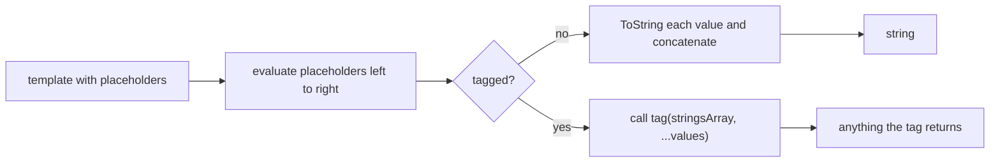

## Introduction

An ordinary template literal immediately turns every value into a string and glues everything together. That is exactly right for a log message. It is exactly wrong when the result is a piece of HTML, a SQL query or a CSS rule, because by the time you have a string, it is too late to tell which parts were fixed text written by the programmer and which parts came from data. Was `<b>` in the result written in the template, or did a user type it? Once concatenated, you cannot know.

A **tagged template** solves this by not concatenating. You place a function name immediately before the backticks — `` html`<p>${text}</p>` `` — and instead of building a string, JavaScript **calls that function**, handing it the fixed pieces of text and the evaluated values as separate arguments. The function, called the **tag**, decides what to do: escape the values and return safe HTML, replace them with `$1`, `$2` placeholders and return a query object for a database driver, parse the text as CSS, or anything else. It can return any type, not just a string.

Tagged templates arrived with template literals in ECMAScript 2015. You may never write a tag in application code, but you will use them constantly through libraries: `styled-components` and Emotion for CSS-in-JS (`` styled.button`...` ``), Lit for web components (`` html`...` ``), `graphql-tag` (`` gql`...` ``), SQL clients such as postgres.js (`` sql`...` ``), and the built-in `String.raw`. Understanding what a tag receives makes those libraries far less magical and lets you judge whether they are actually safe.

## Before you start

- **Template literals** — placeholders, how values are converted, and escape sequences. See [[b1-template-literals]], especially [[b1-string-interpolation]] and [[b1-escape-sequences]].
- **Functions and rest parameters** — `function tag(strings, ...values)` collects the extra arguments into an array. See [[b1-spread-rest]] and [[b1-parameters]].
- **`reduce`** — several examples combine the pieces with `Array.prototype.reduce`. See [[b1-array-map-filter-reduce]].
- **Object freezing** — the strings array is frozen. See [[b1-object-freeze-seal]].

## The intuition

An untagged template literal is like a print shop that fills in a form letter and hands you the finished page. A tagged template is like asking the print shop for the **blank form and the filler values separately**, so that you can inspect each value before writing it in — redacting some, formatting others, or deciding not to produce a letter at all and producing a spreadsheet row instead.

The tag never sees variable names or the expressions inside `${...}`. By the time the tag runs, every placeholder expression has already been evaluated. What the tag receives is the fixed text, cut at the placeholders, and the list of values that belong in the gaps.

## What a tag function receives

A tagged template is written as an expression that evaluates to a function, followed directly by a template literal — no parentheses. JavaScript calls the function with:

1. A **strings array**: the fixed text pieces, in order. If the template has *n* placeholders, this array always has *n* + 1 elements; pieces can be empty strings.
2. The **values**: one argument per placeholder, already evaluated, **not** converted to strings.

```javascript title="inspect-tag.js"
function inspect(strings, ...values) {
  console.log('strings:', strings, 'values:', values);
  return 'tag result';
}

const user = 'Ada';
const count = 3;
console.log(inspect`Hi ${user}, you have ${count} items`);
inspect`${user}`;
inspect``;
```

```output
strings: [ 'Hi ', ', you have ', ' items' ] values: [ 'Ada', 3 ]
tag result
strings: [ '', '' ] values: [ 'Ada' ]
strings: [ '' ] values: []
```

The first call has two placeholders, so three strings. Notice that `count` arrives as the number `3`, not the string `'3'`: the tag gets real values and decides itself how to turn them into text. The second call shows that a template starting and ending with a placeholder still has empty pieces at both ends — that is what keeps the count at "one more string than values" in every case, so a tag can always rebuild the text by alternating `strings[0]`, `values[0]`, `strings[1]`, `values[1]`, …, `strings[n]`.

The value of the whole tagged-template expression is **whatever the tag returns**. Here it is the string `'tag result'`, which ignores the input entirely. It could equally be a number, an object, a DOM node, a function or a promise.



## Rebuilding and transforming the default result

The simplest useful tag reproduces what an untagged template does, which makes the structure clear:

```javascript title="interleave.js"
function interleave(strings, ...values) {
  return strings.reduce(
    (out, str, i) => out + str + (i < values.length ? String(values[i]) : ''),
    '',
  );
}

function upperValues(strings, ...values) {
  return strings.reduce(
    (out, str, i) => out + str + (i < values.length ? String(values[i]).toUpperCase() : ''),
    '',
  );
}

const name = 'Ada';
const n = 3;
console.log(interleave`Hi ${name}, you have ${n} items` === `Hi ${name}, you have ${n} items`);
console.log(upperValues`Hi ${name}, you have ${n} items`);
```

```output
true
Hi ADA, you have 3 items
```

`reduce` walks the strings array. For each piece it appends the piece and then, if a value belongs after it, that value converted to text. The `i < values.length` check skips the gap after the last piece, which has no value. `upperValues` is the same loop with one transformation applied only to the values — the fixed text "Hi" and "you have" is untouched. That asymmetry is the whole point of tags: **the programmer's text and the data can be treated differently**.

### Calling convention details

A few rules about how the tag is called are worth knowing precisely.

**Placeholders are evaluated before the tag runs**, left to right. The tag cannot delay or skip evaluating them.

**Any expression that produces a function can be the tag**, including member expressions and calls: `` styled.button`...` ``, `` lib.html`...` ``, and `` styled(Link)`...` `` (which calls `styled(Link)` first, then uses the returned function as the tag).

**`this` follows normal call rules.** For `` obj.tag`...` `` the tag is called as a method, so `this` is `obj`. For a bare `` tag`...` `` it is a plain function call: `this` is `undefined` in strict mode and the global object in sloppy mode. See [[b1-this-implicit]].

**Parentheses change the meaning.** `` tag(`Hi ${name}`) `` is an ordinary call with one argument: an already-concatenated string. The tag receives no strings array and no separate values, so it cannot escape anything.

```javascript title="calling-convention.js"
const order = [];
const value = (x) => { order.push(`value ${x}`); return x; };
function tag(strings, ...values) {
  order.push('tag runs');
  return values;
}
tag`${value(1)} and ${value(2)}`;
console.log(order);

const greeter = { greeting: 'Hello', tag(strings, ...values) { return `${this.greeting}, ${values[0]}!`; } };
console.log(greeter.tag`${'Ada'}`);

const show = (arg) => (Array.isArray(arg) ? 'strings array' : typeof arg);
console.log(show`Hi ${1}`, show(`Hi ${1}`));
```

```output
[ 'value 1', 'value 2', 'tag runs' ]
Hello, Ada!
strings array string
```

The order array shows both values computed before the tag starts. `greeter.tag` sees `this === greeter`. The last line is the parentheses trap in one line: the same template text reaches the function as a strings array when tagged and as a plain string when passed in parentheses.

## Cooked and raw strings

Each text piece exists in two versions. The **cooked** string has escape sequences processed — `\n` is a newline character. The **raw** string is the source text as written, with backslashes kept (line breaks in the source are still normalised to `\n`). The strings array holds the cooked versions, and its `raw` property holds an array of the raw versions:

```javascript title="cooked-raw.js"
function show(strings) {
  return { cooked: strings[0], raw: strings.raw[0] };
}
console.log(show`C:\temp`);
console.log(show`line\nbreak`.raw.length, show`line\nbreak`.cooked.length);
console.log(String.raw`C:\temp\new`);
console.log(String.raw({ raw: ['a', 'b', 'c'] }, 1, 2));
```

```output
{ cooked: 'C:\temp', raw: 'C:\\temp' }
11 10
C:\temp\new
a1b2c
```

In the first line, Node displays the cooked string with `\t` because it contains a real tab character; the raw string contains a backslash followed by `t`, which Node shows as `\\t`. The lengths confirm it: the raw `line\nbreak` is 11 characters (the backslash and `n` count separately), and the cooked version is 10.

**`String.raw`** is a built-in tag that interleaves the *raw* strings with the values. Because it is an ordinary function, you can call it directly with any object that has a `raw` array, as the last line does — occasionally handy, mostly a curiosity.

### Invalid escapes are allowed in tagged templates

In an untagged template, a malformed escape such as `\unicode` (a `\u` not followed by valid hex digits) is a `SyntaxError`. Since ES2018, tagged templates relax this rule: the template is allowed, the cooked string for that piece is **`undefined`**, and the raw string is still available.

```javascript title="invalid-escape.js"
function show(strings) {
  return { cooked: strings[0], raw: strings.raw[0] };
}
console.log(show`\unicode and \xyz`);
try {
  eval('`\\unicode`');
} catch (err) {
  console.log(err.constructor.name + ': ' + err.message);
}
```

```output
{ cooked: undefined, raw: '\\unicode and \\xyz' }
SyntaxError: Invalid Unicode escape sequence
```

The relaxation exists so that tags can embed other languages that use backslashes differently — LaTeX (`\underline`), Windows paths (`C:\users`), regular expressions. A tag that only reads `strings.raw` works with any backslash content. A tag that reads cooked strings should be prepared for `undefined`.

## The strings array is frozen and cached per call site

Two properties of the strings array make tags efficient and are relied on by real libraries.

**It is frozen.** Both the array and its `raw` array are frozen with `Object.freeze`, so a tag cannot modify them. In sloppy mode an assignment is silently ignored; in strict mode it throws.

**It is the same object every time the same template is evaluated.** The engine creates the strings array once per **call site** — per place in the source code where the tagged template is written — and reuses it on every later evaluation. Two different sites get different arrays, even if their text is identical.

```javascript title="per-site-cache.js"
const compiled = new WeakMap();
let compiles = 0;

function tpl(strings, ...values) {
  let template = compiled.get(strings);
  if (!template) {
    compiles++;
    template = strings.join('{}');         // stands in for expensive parsing
    compiled.set(strings, template);
  }
  return { template, values };
}

const render = (n) => tpl`<p>Count: ${n}</p>`;
for (let n = 0; n < 1000; n++) render(n);
console.log(compiles, render(5));

tpl`<p>Count: ${1}</p>`;                   // same text, different call site
console.log(compiles);

function tryToChange(strings) {
  'use strict';
  try { strings[0] = 'changed'; } catch (err) { return err.constructor.name; }
}
console.log(tryToChange`original`);
```

```output
1 { template: '<p>Count: {}</p>', values: [ 5 ] }
2
TypeError
```

`render` is called 1,001 times, but the template inside it is a single call site, so the strings array is always the same object and the "expensive" work happens once. The `WeakMap` uses the array itself as the cache key, which is safe because its identity never changes and its contents cannot be mutated. The tagged template written separately below has identical text but is a different call site, so it gets its own array and a second compile. The last line confirms that writing to the strings array in strict mode throws a `TypeError`. The `values` array, by contrast, is an ordinary array created fresh by the rest parameter on each call.

This is the mechanism behind Lit's efficient rendering: Lit uses the strings array of each `` html`...` `` site as a key, parses the static HTML once into a reusable template, and on re-render only updates the parts corresponding to the values. CSS-in-JS libraries use the same identity to avoid re-processing styles.

> [!NOTE] Caching is per site, not per text
> From ES2015 to ES2018, the specification shared one strings array between all call sites with identical raw text. ES2019 changed this to one array per call site, which is what current engines implement. Do not rely on two sites with the same text sharing an array.

## Worked example: an HTML-escaping tag

The [[b1-template-literals]] lesson showed that interpolation inserts text verbatim, so user data in an HTML string can inject markup. A tag can fix this systematically: escape every value by default, and let already-safe fragments (produced by the same tag) through unchanged.

```javascript title="html-tag.js"
const escapeHtml = (value) =>
  String(value)
    .replaceAll('&', '&amp;')
    .replaceAll('<', '&lt;')
    .replaceAll('>', '&gt;')
    .replaceAll('"', '&quot;')
    .replaceAll("'", '&#39;');

class SafeHtml {
  constructor(text) { this.text = text; }
  toString() { return this.text; }
}

function toHtml(value) {
  if (value instanceof SafeHtml) return value.text;        // trusted: built by html``
  if (Array.isArray(value)) return value.map(toHtml).join('');
  if (value === null || value === undefined || value === false) return '';
  return escapeHtml(value);                                // everything else is data
}

function html(strings, ...values) {
  let out = strings[0];
  values.forEach((value, i) => {
    out += toHtml(value) + strings[i + 1];
  });
  return new SafeHtml(out);
}

const user = { name: '<script>alert(1)</script>', tags: ['js', '<b>bold</b>'], admin: false };
const card = html`<div class="user">
  <h2>${user.name}</h2>
  <ul>${user.tags.map((tag) => html`<li>${tag}</li>`)}</ul>
  ${user.admin && html`<span class="badge">admin</span>`}
</div>`;
console.log(String(card));
```

```output
<div class="user">
  <h2>&lt;script&gt;alert(1)&lt;/script&gt;</h2>
  <ul><li>js</li><li>&lt;b&gt;bold&lt;/b&gt;</li></ul>
  
</div>
```

Follow the data. The tag receives the four fixed text pieces exactly as the programmer wrote them — those are trusted, because they are part of the source code, and are copied into the output unchanged. Each value goes through `toHtml`, which treats it as untrusted unless proven otherwise. The user's name is plain data, so its angle brackets are escaped and the script tag becomes harmless text. The `tags` value is an array of `SafeHtml` objects created by nested `` html`<li>…</li>` `` calls; each is already escaped, so `toHtml` joins them without escaping twice — but the `<b>` inside a tag value was escaped by the inner call. The `admin && …` value is `false`, which `toHtml` renders as nothing, so the template can use `&&` the way JSX does. (Only the whitespace of that line remains.)

Returning a `SafeHtml` object rather than a string is the key design decision. It marks the result as "already escaped", so that nesting works and so that code receiving it can distinguish trusted HTML from raw strings. Real libraries add more: escaping that depends on whether the value is in an attribute, a URL, or element content, and refusing values in dangerous positions such as inside `<script>`. This example handles element content and quoted attributes only; use a maintained library or the DOM APIs for production code ([[b3-xss-prevention]]).

## Worked example: a SQL parameter tag

Databases protect against **SQL injection** with *parameterised queries*: the SQL text contains numbered placeholders (`$1`, `$2` in PostgreSQL), and the values are sent separately so they are never parsed as SQL. A tag can build that pair automatically from natural-looking code:

```javascript title="sql-tag.js"
function sql(strings, ...values) {
  // reduce without an initial value starts with strings[0] and i = 1
  const text = strings.reduce((query, piece, i) => query + '$' + i + piece);
  return { text, values };
}

const name = "O'Brien'; DROP TABLE users; --";
const minAge = 18;
const query = sql`SELECT * FROM users WHERE name = ${name} AND age >= ${minAge}`;
console.log(query);
```

```output
{
  text: 'SELECT * FROM users WHERE name = $1 AND age >= $2',
  values: [ "O'Brien'; DROP TABLE users; --", 18 ]
}
```

`reduce` without an initial value uses `strings[0]` as the starting accumulator and begins the callback at index 1, so each later piece is preceded by `$1`, `$2`, and so on — exactly one placeholder per gap. The malicious-looking name never becomes part of the SQL text; a driver such as `pg` would send `text` and `values` separately, and the database would treat the whole name as one string value. Compare this with an untagged template, which would paste the quote and `DROP TABLE` straight into the query.

This is how libraries like postgres.js expose `` sql`...` ``. The safety comes entirely from the tag's implementation and the driver's parameter support; the backtick syntax is just the delivery mechanism. See [[c9-parameterized-queries]] and [[c7-prepared-statements]].

## In real systems

**CSS-in-JS.** `styled-components` and Emotion use tags such as `` styled.button`color: ${(p) => p.color};` ``. The values here are often *functions* — the tag stores them and calls them later with component props. That is only possible because tags receive real values rather than strings. See [[b5-css-in-js]].

**Templating.** Lit's `` html`...` `` returns a `TemplateResult` object, not a string. Lit caches each call site's strings array, prepares DOM once, and updates only the dynamic parts on re-render.

**Query languages.** `graphql-tag`'s `` gql`...` `` parses GraphQL source into an abstract syntax tree at runtime (or at build time with a compiler plugin). SQL tags such as postgres.js and Slonik convert values into parameters.

**Utilities.** `String.raw` for regex sources and paths; `dedent` libraries that strip indentation; i18n libraries whose tags look up the strings array as a translation key and insert values into the translated sentence.

**Tooling.** Editors and formatters recognise conventional tag names — `html`, `css`, `gql`, `sql` — and apply syntax highlighting and formatting for the embedded language. Even a tag that does nothing but return the interleaved string can be worth having for that reason.

## Trade-offs and alternatives

| Approach | When it fits | Cost |
|---|---|---|
| Untagged template | Plain text for logs and messages | No escaping or structure |
| Tagged template | Embedding another language with separate handling of data | The tag must be written and trusted; behaviour is hidden behind syntax |
| Builder API (`query.where('name', '=', name)`) | Complex dynamic structure | More verbose; less like the target language |
| Separate template files (Handlebars, JSX) | Large markup, designers editing templates | Build step or extra runtime |
| DOM APIs (`textContent`, `createElement`) | Small UI updates in the browser | Verbose for large structures |

Tags shine when you want code to read like the embedded language while keeping data separate. Their main risk is false confidence: a tag only provides the guarantees its implementation provides. A tag named `html` that simply concatenates is exactly as dangerous as an untagged template.

## Common mistakes

> [!MISTAKE] Assuming the tag syntax makes code safe
> `` html`<p>${input}</p>` `` is safe only if `html` escapes values. The syntax hands the tag the pieces; it applies no escaping itself. Check what the library does — and never build your own "sanitiser" for production HTML without a thorough test suite.

**Calling the tag with parentheses.** `` sql(`... ${id}`) `` passes a finished string, so the value is already embedded in the SQL. Remove the parentheses.

**Forgetting the last string piece.** Loops that iterate over `values` and append `strings[i]` lose `strings[values.length]`, the trailing text. Start with `strings[0]` and append `value + strings[i + 1]`, or iterate over `strings`.

**Converting values too early.** A tag should decide how each value becomes text. Calling `String(value)` first throws away information — arrays, `SafeHtml` markers, functions, `null` — that the tag may need.

**Reading cooked strings that may be `undefined`.** If the template can contain backslash sequences that are not valid JavaScript escapes, use `strings.raw`.

**Mutating the strings array.** It is frozen. Build a new array or string instead.

## Interview perspective

Tagged templates come up in frontend interviews about security, CSS-in-JS and "how does library X work?", and occasionally as a "write this tag" exercise.

> [!INTERVIEW] "What does a tag function receive?"
> "A frozen array of the template's literal text pieces — always one more than the number of placeholders — with a `raw` property holding the unprocessed versions, followed by the placeholder values as separate arguments, already evaluated but not converted to strings. The tag can return anything. The strings array is cached per call site, so libraries use it as a cache key."

Questions to be ready for:

- **How is `` tag`a${1}b${2}c` `` called?** `tag(['a', 'b', 'c'], 1, 2)`, where the array also has `raw: ['a', 'b', 'c']` and is frozen.
- **How does `String.raw` work?** It is a built-in tag that interleaves `strings.raw` with the values.
- **Why would a library rely on the identity of the strings array?** To parse static parts once per call site and reuse the result on every render.
- **Implement `` html`...` `` that escapes values.** Interleave strings with escaped values; mark results as safe so nested templates are not double-escaped.
- **Why are invalid escapes allowed in tagged templates?** So tags can embed languages like LaTeX or regex; the cooked value is `undefined` and the raw text remains available (ES2018).

```quiz
Q: For `` tag`${a} and ${b}` ``, what is the strings array?
- [ ] `[' and ']`
- [x] `['', ' and ', '']`
- [ ] `['${a}', ' and ', '${b}']`
- [ ] `[a, ' and ', b]`
> The strings array always has one more element than there are placeholders. When the template starts or ends with a placeholder, the corresponding piece is the empty string. The tag never sees the source of the expressions, only their evaluated values, which arrive as separate arguments.

Q: What does `` tag(`Hi ${name}`) `` pass to `tag`?
- [ ] A strings array and the value of `name`
- [x] A single, already-concatenated string
- [ ] The raw source text of the template
- [ ] Nothing; it is a syntax error
> With parentheses, the template literal is untagged: it is evaluated into one string first, and that string is passed as an ordinary argument. Only `` tag`...` `` with no parentheses invokes the tagged-template call with separate pieces and values.

Q: A function contains `` return css`color: red;` `` and is called 100 times. How many distinct strings arrays does `css` receive?
- [x] 1
- [ ] 100
- [ ] 2: one cooked and one raw
- [ ] It depends on whether the text changes
> The strings array is created once per call site and reused on every evaluation of that site, so all 100 calls receive the same frozen array. The raw strings live on its `raw` property, not in a separate argument. This stability is what lets libraries cache work per template.

Q: What happens with `` String.raw`\unicode` `` compared with an untagged `` `\unicode` ``?
- [ ] Both are syntax errors
- [x] `String.raw` returns `'\unicode'`; the untagged version is a `SyntaxError`
- [ ] Both return `'\unicode'`
- [ ] `String.raw` returns `undefined`
> Since ES2018, tagged templates allow invalid escape sequences: the cooked string becomes `undefined`, but the raw text is kept. `String.raw` uses only raw strings, so it returns the backslash sequence as written. Untagged templates still reject malformed `\u` escapes.
```

## Practice

1. **Highlight tag.** Write `` mark`...` `` that wraps every value in `[` and `]`, so that `` mark`Hi ${'Ada'}, ${3} new` `` returns `'Hi [Ada], [3] new'`. Make sure a template that ends with a placeholder still works.
2. **Currency tag.** Write `` usd`Total: ${12.5} (tax ${1.25})` `` that formats every number with `Intl.NumberFormat` as US dollars and leaves other values unchanged.
3. **Dedent tag.** Turn the `dedent` helper from [[b1-multiline-strings]] into a tag that works on the cooked strings and still inserts values correctly.
4. **Attribute safety.** Extend the `html` tag so that a value placed inside an `href` attribute is rejected unless it starts with `https:` or `/`. How does the tag know it is in an attribute? (Hint: look at the end of the preceding string piece.)
5. **Cache experiment.** Using a `WeakMap`, confirm that two functions containing identical tagged templates receive different strings arrays, and that calling one function repeatedly reuses its array.

## Quick revision {#quick-revision}

- `` tag`...` `` calls `tag(strings, ...values)` instead of building a string; the result is whatever the tag returns (any type).
- `strings.length === values.length + 1`; pieces can be empty (`` tag`${x}` `` → `['', '']`). Values arrive evaluated but not stringified.
- Placeholders are evaluated left to right before the tag is called. `obj.tag` sets `this` to `obj`; `tag(...)` with parentheses passes a plain string.
- Cooked strings: escapes processed. `strings.raw`: source text with backslashes kept (line breaks normalised to `\n`).
- ES2018: invalid escapes are allowed in tagged templates; that piece's cooked value is `undefined`.
- `String.raw` = built-in tag that interleaves raw strings with values; callable as `String.raw({ raw: [...] }, ...values)`.
- The strings array (and its `raw`) is frozen and cached per call site: same object on every evaluation of that site, different objects for different sites. Libraries use it as a `WeakMap` key.
- Uses: HTML escaping (Lit), CSS-in-JS (styled-components), GraphQL (`gql`), SQL parameters, dedent, i18n, editor highlighting.
- Safety comes from the tag's implementation, never from the syntax.

## Key takeaways {#key-takeaways}

- A tagged template hands a function the programmer's fixed text and the data separately, which is what makes escaping, parameterisation and embedded languages possible.
- The strings array always has one more element than the values, so a tag can always interleave them; values are passed as real values, not strings.
- Cooked strings have escapes processed and raw strings keep the source text; `String.raw` is a tag that uses the raw ones.
- Because the strings array is frozen and identical for every evaluation of the same call site, libraries can cache parsing work keyed on it.
- The backtick syntax provides no protection by itself — always know what a tag actually does with its values.
