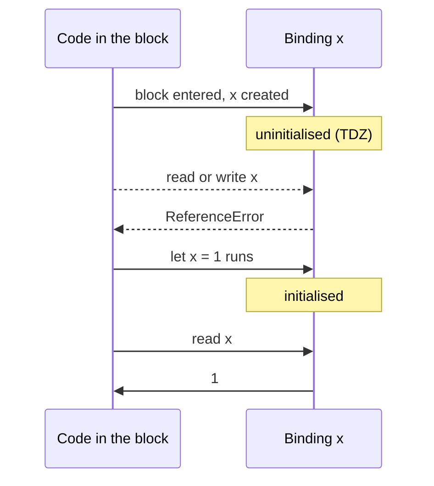

## Introduction

Run this, and the first `console.log` throws:

```javascript title="first-tdz.js"
try {
  console.log(limit);
} catch (e) {
  console.log(e.name + ': ' + e.message);
}
let limit = 10;
console.log(limit);
```

```output
ReferenceError: Cannot access 'limit' before initialization
10
```

Read the message carefully. It does not say "`limit` is not defined". It says the engine *knows* about `limit` but cannot let you use it yet. That state — a variable that exists but cannot be touched — is the **temporal dead zone (TDZ)**. It applies to every `let`, `const` and `class` binding, from the moment its scope is entered until its declaration has been executed.

The TDZ is behind a whole family of errors that look baffling at first: a variable that throws even though an outer variable of the same name exists, `typeof` throwing when it normally never does, a default parameter that cannot see its neighbour, an import that crashes only when files load in a certain order. This lesson explains the single rule behind all of them and walks through each case.

## Before you start

- **Hoisting** — the idea that the engine creates bindings for a scope's declarations before running its code. See [[b1-hoisting]], especially [[b1-let-const-hoisting]].
- **`let` and `const`** — their block scope and basic behaviour. See [[b1-let]] and [[b1-const]].
- **Scope and shadowing** — an inner declaration hides an outer one of the same name. See [[b1-shadowing]].

## The intuition

Imagine a theatre seating plan printed before the show. Every seat has a name on it from the start, so nobody else can take it. But some seats are taped off with a sign: "reserved — the guest arrives at scene 3". Until scene 3, the seat is not empty and available; it is off-limits. Sitting in it, or even checking what is on it, gets you thrown out.

A `let`, `const` or `class` binding is such a seat. It is reserved when its block starts — so the name is taken, and an outer variable with the same name is hidden — but it is taped off until the declaration line runs. A `var` is different: its seat holds a cardboard placeholder (`undefined`) from the start, so you can sit there early and get nonsense without any warning.

## The rule

When execution enters a scope — a block, a function body, a script, a module — the engine creates a binding for every lexical declaration in it (`let`, `const`, `class`). These bindings start **uninitialised**. Any attempt to read the binding, assign to it, or pass it to `typeof` while it is uninitialised throws a `ReferenceError`. Executing the declaration initialises it: with the given value, or with `undefined` for a bare `let x;`. From then on, it is an ordinary variable.

So the TDZ for a binding is the period of execution from **entering its scope** to **finishing its declaration**.



Writing is forbidden just like reading:

```javascript title="tdz-write.js"
try {
  count = 5;                // assignment in the TDZ also throws
} catch (e) {
  console.log(e.name + ': ' + e.message);
}
let count = 0;
console.log(count);
```

```output
ReferenceError: Cannot access 'count' before initialization
0
```

### Two different ReferenceErrors

Two error messages look alike but mean different things, and telling them apart is the fastest way to debug:

| Message (V8: Chrome, Node.js, Edge) | Meaning |
|---|---|
| `Cannot access 'x' before initialization` | A binding named `x` exists in scope but is in its TDZ |
| `x is not defined` | No binding named `x` exists anywhere in the scope chain |

Other engines word the first one differently — Firefox says "can't access lexical declaration 'x' before initialization", Safari says "Cannot access uninitialized variable" — but the meaning is the same. The first message tells you to look for a declaration of `x` *later* in the same or an enclosing scope; the second tells you `x` was never declared, or is misspelled.

## Temporal, not spatial

The word *temporal* is the key to the TDZ. The dead zone is a period of **time during execution**, not a region of **source text** above the declaration. Code written above the declaration is fine if it only runs after the declaration has executed:

```javascript title="temporal.js"
function readSettings() {
  return settings.theme;     // written above the const...
}

try {
  readSettings();            // ...but called before it runs: TDZ
} catch (e) {
  console.log(e.name + ': ' + e.message);
}

const settings = { theme: 'dark' };
console.log(readSettings()); // called after it runs: fine
```

```output
ReferenceError: Cannot access 'settings' before initialization
dark
```

The function body mentions `settings` before the `const` line, and that is perfectly legal. What matters is when the function is *called*. This is why functions and constants at the top level of a module can refer to each other in any order, as long as nothing calls the functions until the constants are initialised.

The same rule applies within a loop. A block is re-entered on every iteration, and each entry starts a fresh TDZ:

```javascript title="tdz-per-iteration.js"
function tick(n) {
  for (let i = 0; i < n; i++) {
    try {
      console.log(step);     // step is re-created, uninitialised, on every pass
    } catch (e) {
      console.log(`iteration ${i}: ${e.name}`);
    }
    let step = i * 10;
  }
}
tick(2);
```

```output
iteration 0: ReferenceError
iteration 1: ReferenceError
```

The `step` from iteration 0 was initialised, but iteration 1 has its own new `step` that starts uninitialised again.

## The TDZ shadows outer variables

Because the binding exists from the start of its scope, it hides any outer variable of the same name for the **whole** scope — including the lines before the declaration:

```javascript title="tdz-shadowing.js"
const x = 'outer';
{
  try {
    console.log(x);        // the inner x already shadows the outer one
  } catch (e) {
    console.log(e.name + ': ' + e.message);
  }
  const x = 'inner';
  console.log(x);
}
console.log(x);
```

```output
ReferenceError: Cannot access 'x' before initialization
inner
outer
```

If you expected the first `console.log` to print `'outer'`, that expectation is exactly what the TDZ prevents. A name inside a block means one binding throughout that block; it never refers to the outer variable on some lines and the inner one on others. This example is also the standard proof that `let` and `const` **are** hoisted: if they were not, the outer `x` would be found.

### Initialising a variable from itself

A special case of shadowing catches people who reuse a name:

```javascript title="self-reference.js"
const limit = 10;
function doubled() {
  const limit = limit * 2;   // intended: outer limit times two
  return limit;
}
try {
  doubled();
} catch (e) {
  console.log(e.name + ': ' + e.message);
}
```

```output
ReferenceError: Cannot access 'limit' before initialization
```

The right-hand side `limit * 2` is evaluated before the inner `limit` is initialised, and the name `limit` inside `doubled` refers to the inner binding, which is in its TDZ. With `var`, the same code would silently compute `undefined * 2`, giving `NaN`. The fix is to use a different name: `const doubledLimit = limit * 2`.

## typeof is not a safe check in the TDZ

`typeof` is the one operator that normally never throws on an unknown name: `typeof somethingUndeclared` returns `'undefined'`. That is why old code uses `typeof x === 'undefined'` to test whether a global exists. Inside a TDZ, though, the name *is* declared, so `typeof` tries to read the binding and throws:

```javascript title="tdz-typeof.js"
console.log(typeof neverDeclared);   // no binding anywhere: 'undefined'
try {
  console.log(typeof later);         // binding exists but is uninitialised
} catch (e) {
  console.log(e.name + ': ' + e.message);
}
let later = 1;
console.log(typeof later);
```

```output
undefined
ReferenceError: Cannot access 'later' before initialization
number
```

In practice this bites when a feature-detection check sits in the same scope as a later declaration of the same name — for example, a script that checks `typeof config === 'undefined'` at the top and declares `let config` further down. The check does not see a global `config`; it sees the script's own uninitialised binding and throws. Use a different local name, or check the global explicitly with `'config' in globalThis` or `globalThis.config === undefined` ([[b1-typeof]], [[b1-global-variables]]).

## Where else the TDZ appears

### Default parameters

Function parameters are initialised left to right, and each one is in a TDZ until its turn. A default value may refer to an earlier parameter but not to a later one:

```javascript title="tdz-params.js"
function size(width, height = width * 2) {   // earlier parameter: fine
  return [width, height];
}
console.log(size(3));

function broken(a = b, b = 2) {              // later parameter: still uninitialised
  return a + b;
}
try {
  broken();
} catch (e) {
  console.log(e.name + ': ' + e.message);
}
console.log(broken(1));                      // a supplied, so its default never runs
```

```output
[ 3, 6 ]
ReferenceError: Cannot access 'b' before initialization
3
```

The error happens only when the default actually runs. `broken(1)` supplies `a`, so the expression `b` is never evaluated. Note also that default values are evaluated in a scope of their own, *before* the function body exists: a default cannot see a `let` declared in the body, and will find an outer variable of that name instead. See [[b1-parameters]].

### Classes

Class declarations are lexical, like `let`: the name is in its TDZ until the `class` statement runs. Unlike function declarations, you cannot use a class above its definition:

```javascript title="tdz-class.js"
try {
  const shape = new Circle(2);
} catch (e) {
  console.log(e.name + ': ' + e.message);
}
class Circle {
  constructor(r) { this.r = r; }
}
console.log(new Circle(2).r);

try {
  class Square extends Rect {}    // the superclass is evaluated when Square is defined
} catch (e) {
  console.log(e.name + ': ' + e.message);
}
class Rect {}
```

```output
ReferenceError: Cannot access 'Circle' before initialization
2
ReferenceError: Cannot access 'Rect' before initialization
```

The `extends` clause is evaluated when the subclass is defined, so a superclass must be defined first — a common error when classes are split across files that import each other. See [[b1-class-hoisting]].

### switch statements

All `case` clauses share one block. If execution jumps to a case that comes after a `let` or `const` declared in an earlier case, that declaration was skipped and the binding is still in its TDZ. [[b1-let]] shows the error; the fix is to wrap each case body in its own braces.

### Circular module imports

ES modules are linked before any of them runs, and exported `let`, `const` and `class` bindings start in the TDZ like any other. When two modules import each other, one of them must run first, and if it uses an export of the other at its top level, that export is still uninitialised. Consider three files:

```javascript title="main.mjs"
import { formatPrice } from './format.mjs';
console.log(formatPrice(5));
```

```javascript title="format.mjs"
import { CURRENCY } from './config.mjs';
export const formatPrice = (n) => `${CURRENCY}${n.toFixed(2)}`;
```

```javascript title="config.mjs"
import { formatPrice } from './format.mjs';
export const CURRENCY = '$';
export const FREE_SHIPPING_LABEL = formatPrice(50);   // runs before format.mjs has
```

```output
ReferenceError: Cannot access 'formatPrice' before initialization
```

`main` imports `format`, which imports `config`, which imports `format` again — a cycle. Because `format` is already being loaded, the engine runs `config` first, and `config` calls `formatPrice` at its top level, before `format.mjs` has executed its `const`. Interestingly, if `formatPrice` were a **function declaration**, this would work: function declarations are initialised when the module is instantiated, before any module code runs. The robust fix is to break the cycle, or to avoid calling imported values at a module's top level. See [[b1-circular-deps]].

### A global let whose initialiser throws

One last, rare case shows that the TDZ can be permanent. At the top level of a classic browser script, if a `let` or `const` initialiser throws, the binding is created but never initialised. It stays in its TDZ for the life of the page: every later script that touches it gets a `ReferenceError`, and no script can redeclare it, because the name is taken (this was checked in Chrome). It is a good reason to keep risky initialisation inside functions or modules, where failure does not poison a shared global name.

## Why the language has a TDZ

When ES2015 introduced `let` and `const`, the committee could have copied `var` and initialised them to `undefined` at the start of the block. They chose not to, for three reasons.

**`const` needs it.** A `const` must only ever hold one value. If it were `undefined` before its line and something else after, code could observe two different values for a "constant". The TDZ guarantees that every successful read of a `const` sees the same value.

**Consistent scoping.** A name in a block should refer to the same binding on every line of the block. Starting the inner binding at the top of the block gives that consistency; the TDZ makes the early part of that range safe by forbidding access instead of returning a placeholder.

**Early failure.** Reading a variable before it is set is nearly always a bug. With `var`, the bug yields `undefined`, which flows into later calculations and surfaces far away as `NaN`, `"undefined"` in the UI, or a failed condition. The TDZ throws at the exact line where the mistake is, with the variable's name in the message.

The cost is small: some code must be reordered, and engines must check initialisation on access. Engines remove those checks when they can prove a binding is always initialised before use, so the overhead is rarely measurable.

## How it works internally

In the specification, a declarative environment record can hold a binding in an *uninitialised* state. Entering a block runs *BlockDeclarationInstantiation*, which creates each lexical binding with *CreateMutableBinding* (for `let`) or *CreateImmutableBinding* (for `const` and `class`) without initialising it. Reading a binding calls *GetBindingValue*, and assigning calls *SetMutableBinding*; both throw a `ReferenceError` if the binding is uninitialised. Evaluating the declaration calls *InitializeBinding*, which ends the TDZ ([[b1-lexical-environment]]).

`typeof` normally returns `'undefined'` for an unresolvable name because it checks for a missing binding before reading. In the TDZ the binding is found, so the read happens and throws.

Engines represent "uninitialised" with an internal marker value — V8 calls it *the hole* — stored in the variable's slot. A read checks for the marker and throws if it finds it. When the compiler can see that a variable is always written before it is read (the common case), it omits the check.

## In real systems

**Most TDZ errors come from ordering.** In application code, the typical TDZ error is a module-level helper called during initialisation before a `const` it needs, or a React component file where a constant is defined below the code that uses it at import time. The fix is almost always to move the declaration up or to delay the call.

**Bundlers and circular imports.** Large codebases accumulate import cycles. They often work by luck — the order happens to be right — until someone adds an import and the order changes, producing a TDZ error at start-up. Tools such as `madge` or ESLint's `import/no-cycle` rule detect cycles before they cause trouble.

**Linters catch the simple cases.** ESLint's `no-use-before-define` flags uses of variables, functions and classes above their declaration, which catches most TDZ problems before the code runs.

## Trade-offs and alternatives

| Behaviour before declaration | Keyword | Effect |
|---|---|---|
| Initialised to the function | function declaration | Can be called early; usually convenient |
| Initialised to `undefined` | `var` | Silent wrong values |
| Uninitialised (TDZ) | `let`, `const`, `class` | Immediate `ReferenceError` at the faulty line |

The TDZ is not something you choose or avoid; it comes with using `let`, `const` and `class`, which you should use anyway. The practical choice is how to structure code so you never hit it: declare things before using them, keep module top levels free of calls that depend on other modules, and break import cycles.

## Common mistakes

> [!MISTAKE] Thinking let and const are not hoisted
> They are. The binding exists from the start of the scope — that is why it shadows outer variables early and why the error says "before initialization" rather than "not defined". It is only unusable until its declaration runs.

**Reusing a name for a derived value.** `const total = total + tax` inside a function, intending the outer `total`, reads the inner one in its TDZ. Give the new value a new name.

**Using `typeof` as a guard in a scope that declares the name later.** It throws instead of returning `'undefined'`. Rename the local or test `globalThis` explicitly.

**Calling a class before its definition.** Unlike functions, classes cannot be used above their declaration. Move the class up, or into its own module that is imported first.

**Top-level side effects in modules with cycles.** Code that runs during import and calls into another module in a cycle may hit an uninitialised export. Keep top-level module code to declarations, and do work inside functions called after all imports are ready.

## Interview perspective

> [!INTERVIEW] "What is the temporal dead zone?"
> "It's the time between entering a scope and executing a `let`, `const` or `class` declaration. The binding already exists — it's hoisted — but it's uninitialised, so reading it, writing it, or even `typeof` on it throws a `ReferenceError`. It's temporal because it's about when code runs, not where it's written: a function that mentions the variable is fine as long as it's called after the declaration. It exists so `const` can never be seen with two values and so use-before-declaration bugs fail immediately instead of producing `undefined`."

Questions to be ready for:

- **Output of `let x = 1; { console.log(x); let x = 2; }`?** `ReferenceError` — the inner `x` shadows from the start of the block.
- **`typeof undeclared` vs `typeof tdzVariable`?** `'undefined'` vs a thrown `ReferenceError`.
- **Does `var` have a TDZ?** No; it is initialised to `undefined` at function entry. Function declarations have none either: they are initialised with the function.
- **Can `function f(a = b, b = 1) {}` be called?** `f()` throws because `b` is uninitialised when `a`'s default runs; `f(0)` works because `a`'s default does not run.
- **Why might an import be "before initialization" only sometimes?** Circular imports: which module evaluates first depends on the import graph and entry point.

## Practice

1. For each snippet, say whether it prints a value or throws, and why:

   ```javascript
   // a
   function f() { return y; }
   const y = 2;
   console.log(f());
   // b
   console.log(z);
   var z = 3;
   // c
   { console.log(typeof w); let w = 4; }
   ```

2. Fix this without renaming the outer variable:

   ```javascript
   const rate = 0.2;
   function withTax(price) {
     const rate = rate + 0.05;
     return price * (1 + rate);
   }
   ```

3. Reorder this code so that it runs without error, changing nothing else:

   ```javascript
   const app = new App(defaults);
   const defaults = { theme: 'light' };
   class App { constructor(o) { this.options = o; } }
   ```

4. Two modules import each other, and one exports `export const VERSION = '1.0'` that the other reads at its top level. Describe two ways to make the program start reliably.

```quiz
Q: What does `const x = 'outer'; { console.log(x); const x = 'inner'; }` do?
- [ ] Prints 'outer'
- [ ] Prints 'inner'
- [ ] Prints undefined
- [x] Throws ReferenceError: Cannot access 'x' before initialization
> The inner const x is created when the block is entered, so it shadows the outer x from the block's first line. It stays uninitialised until its declaration runs, so the log reads a binding in its TDZ and throws. It never falls back to the outer variable.

Q: What does `typeof value` do if `value` is a `let` declared later in the same block?
- [ ] Returns 'undefined'
- [ ] Returns 'object'
- [x] Throws a ReferenceError
- [ ] Returns the type of the eventual value
> typeof only returns 'undefined' for names with no binding at all. Here the binding exists but is uninitialised, so typeof has to read it, and reading a binding in its TDZ throws.

Q: Why does this work? `function show() { return msg; } const msg = 'hi'; console.log(show());`
- [ ] Functions are exempt from the TDZ
- [ ] const variables are initialised to undefined first
- [x] show is called after the const declaration has run, so msg is initialised by then
- [ ] msg is copied into show when show is defined
> The TDZ is about execution time, not position in the source. The function body may mention msg anywhere; what matters is that by the time show() runs, the const line has executed and msg is initialised.

Q: `function f(a = b, b = 2) { return a + b; }` — which call throws?
- [x] f()
- [ ] f(1)
- [ ] f(1, 1)
- [ ] None of them
> Parameters are initialised left to right. In f(), a's default reads b while b is still uninitialised, so it throws. When a is supplied, its default expression never runs, so f(1) returns 3 and f(1, 1) returns 2.
```

## Quick revision {#quick-revision}

- **TDZ** = from entering a scope until a `let`/`const`/`class` declaration finishes executing.
- In the TDZ, **read, write and `typeof`** all throw `ReferenceError` ("Cannot access 'x' before initialization" in V8).
- "is not defined" = no binding at all; "before initialization" = binding exists, still in TDZ.
- **Temporal, not spatial**: code above the declaration is fine if it runs after it.
- The binding **shadows** outer names for the whole scope, including before its line → proof of hoisting.
- `const x = x + 1` with an outer `x` → TDZ error (inner `x` used on the right).
- Each block entry (each loop iteration) starts a fresh TDZ.
- Also appears in: **default parameters** (later params), **classes** (including `extends`), **`switch`** cases, **circular imports**, a global `let` whose initialiser threw (permanent).
- `var` and function declarations have no TDZ.
- Why: `const` must have one observable value; consistent block scoping; fail fast at the faulty line.

## Key takeaways {#key-takeaways}

- `let`, `const` and `class` are hoisted but start uninitialised; any use before the declaration runs throws.
- The dead zone is about execution order, so functions may refer to later declarations as long as they are called after them.
- The error message tells you the binding exists; look for a declaration of that name later in the scope.
- Shadowing begins at the top of the block, which is why reusing a name for a derived value fails.
- The TDZ turns silent `undefined` bugs into immediate, named errors; structure code so declarations come before use and module top levels do not depend on cyclic imports.
