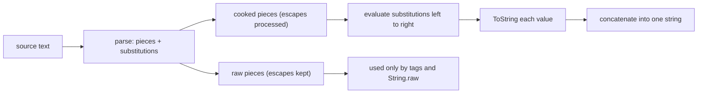

## Introduction

Before 2015, building a string out of fixed text and values in JavaScript meant chaining `+` operators:

```javascript title="concatenation.js"
const user = 'Ada';
const count = 3;
const message = 'Hello ' + user + ', you have ' + count + ' new ' +
  (count === 1 ? 'message' : 'messages') + '.';
console.log(message);
```

```output
Hello Ada, you have 3 new messages.
```

It works, but it is hard to read and easy to break. Every boundary between text and value needs a closing quote, a `+`, and an opening quote, so a missing space (`'Hello' + user`) or a stray quote is easy to miss. Multi-line text was worse: you had to write `\n` for each line break and glue lines together with `+`.

ECMAScript 2015 (ES6) added **template literals**: string literals written between backticks (`` ` ``) instead of quotes. They have three abilities that ordinary string literals lack:

1. **Interpolation** — `${expression}` embeds the value of any JavaScript expression in the text.
2. **Multi-line text** — line breaks typed inside the backticks become part of the string.
3. **Tagging** — placing a function name before the backticks lets that function process the pieces, which powers libraries for HTML, CSS and SQL. That feature has its own lesson, [[b1-tagged-templates]].

The same message as a template literal:

```javascript title="template.js"
const user = 'Ada';
const count = 3;
const message = `Hello ${user}, you have ${count} new ${count === 1 ? 'message' : 'messages'}.`;
console.log(message);
console.log(typeof message);
```

```output
Hello Ada, you have 3 new messages.
string
```

The text reads the way it will appear, and the values sit exactly where they belong. The result is an ordinary string primitive — template literals are a nicer way to *write* strings, not a new type.

This lesson teaches the three topics that determine how template literals behave in practice: [[b1-string-interpolation|interpolation]], [[b1-multiline-strings|multi-line strings]], and the [[b1-escape-sequences|escape sequences]] shared by all JavaScript string literals.

## Before you start

- **String basics** — string literals, immutability and `String()` conversion. See [[b1-string-creation]].
- **Expressions vs statements** — `${...}` accepts an expression, not a statement. See [[b1-statements-expressions]].
- **Type conversion** — how values turn into strings. See [[b1-string-conversion]]; [[b1-to-primitive]] explains how objects are converted.
- **The ternary operator** — used for conditional pieces of text. See [[b1-ternary]].

## The intuition

Think of a template literal as a **form letter with blanks**. The fixed text is printed in advance; each `${...}` is a blank. When the line of code runs, JavaScript fills each blank by running the small program inside it, turning the result into text, and writing that text into the blank. Then it hands you the completed letter as one ordinary string.

Two consequences follow from this picture. First, blanks are filled **at the moment the template is evaluated**, using the values variables have at that moment — a template is not a live view that updates later. Second, whatever lands in a blank is **plain text**. JavaScript does not know whether the letter is HTML, a URL or SQL, so it does not escape anything. If a value contains `<script>`, that is exactly what goes into the blank.

## Template literal syntax

A template literal starts and ends with a backtick. Inside it, any characters are allowed, including both kinds of quote, without escaping:

```javascript title="syntax.js"
const plain = `no placeholders at all`;
const quotes = `She said "it's fine"`;
const empty = ``;
console.log(plain, '|', quotes, '|', JSON.stringify(empty));
console.log(plain === 'no placeholders at all');
```

```output
no placeholders at all | She said "it's fine" | ""
true
```

A template literal with no `${...}` is a plain string literal with different delimiters. Some teams use backticks everywhere for consistency; others reserve them for strings that interpolate or span lines, so that a backtick signals "something dynamic here". Both conventions are common, and linters such as ESLint's `quotes` rule can enforce either.

The only characters that need escaping inside a template literal are the backtick itself and the two-character sequence `${` when you want it literally. A lone `$` or a lone `{` is ordinary text. The details are in the escape-sequences section below.

## Interpolation {#b1-string-interpolation}

**Interpolation** is inserting the value of an expression into a string. In a template literal, you write `${expression}` and the expression's value, converted to a string, appears at that position. The `${` and `}` are called the **substitution** delimiters, and the part inside is evaluated as ordinary JavaScript code.

### Any expression can go in a placeholder

The placeholder accepts any **expression** — anything that produces a value: a variable, arithmetic, a property access, a function call, a ternary, another template literal. It does not accept **statements** such as `if`, `for` or `const`.

```javascript title="expressions.js"
const price = 19.99;
const qty = 3;
const user = { name: 'Ada', roles: ['admin', 'editor'] };

console.log(`Total: ${price * qty}`);
console.log(`Rounded: ${(price * qty).toFixed(2)}`);
console.log(`User: ${user.name.toUpperCase()} (${user.roles.length} roles)`);
console.log(`Status: ${qty > 0 ? 'in stock' : 'sold out'}`);
console.log(`Outer ${`inner ${1 + 1}`} done`);
```

```output
Total: 59.97
Rounded: 59.97
User: ADA (2 roles)
Status: in stock
Outer inner 2 done
```

The fifth line nests a template literal inside a placeholder. The inner template is evaluated first and its result becomes the value for the outer placeholder. Nesting is legal at any depth, but more than one level quickly becomes hard to read — compute the inner value in a named variable instead.

Here the first line happens to print `59.97`, but floating-point arithmetic does not always cooperate: `0.1 + 0.2` prints `0.30000000000000004`. Interpolation shows whatever the number really is; formatting is a separate step, covered below.

### How values become text

Each placeholder's value goes through the **ToString** conversion, with one important detail for objects. This table shows what common values produce:

| Value in `${...}` | Text inserted |
|---|---|
| `'Ada'` | `Ada` |
| `42`, `-0`, `1e21`, `NaN` | `42`, `0`, `1e+21`, `NaN` |
| `10n` (bigint) | `10` |
| `true` | `true` |
| `null`, `undefined` | `null`, `undefined` |
| `[1, 2, 3]` | `1,2,3` |
| `[]` | (empty string) |
| `{ a: 1 }` | `[object Object]` |
| `Symbol('x')` | throws `TypeError` |

```javascript title="conversion.js"
console.log(`${null} ${undefined} ${[1, [2, 3]]} ${{ a: 1 }}`);
const nickname = undefined;
console.log(`Welcome back, ${nickname}!`);
console.log(`Welcome back, ${nickname ?? 'friend'}!`);
try {
  console.log(`${Symbol('id')}`);
} catch (err) {
  console.log(err.constructor.name + ': ' + err.message);
}
```

```output
null undefined 1,2,3 [object Object]
Welcome back, undefined!
Welcome back, friend!
TypeError: Cannot convert a Symbol value to a string
```

Two of these deserve attention because they produce text that looks valid to the program and wrong to the user. **`undefined` and `null` become words**: a missing value shows up as "Welcome back, undefined!" in the UI, with no error. Provide a fallback with `??` ([[b1-nullish-coalescing]]) or check the value first. **Plain objects become `[object Object]`**: if you meant to show the data, use `JSON.stringify(obj)` or pick specific properties.

For objects, the conversion asks the object for a primitive with the hint `"string"`, which means it calls `toString()` first and only falls back to `valueOf()` if that does not return a primitive. The `+` operator uses the hint `"default"`, which for most objects tries `valueOf()` first. The difference is visible when an object defines both:

```javascript title="string-hint.js"
const temperature = {
  valueOf() { return 21; },
  toString() { return '21°C'; },
};
console.log(`${temperature}`);
console.log('' + temperature);
console.log(String(temperature));
console.log(temperature + 1);
```

```output
21°C
21
21°C
22
```

The template literal and `String()` both use the string hint, so they print `'21°C'`. Concatenation with `+` uses the default hint, gets `21` from `valueOf`, and converts that to `'21'`. So `` `${x}` `` and `'' + x` are not always interchangeable; the template literal behaves like `String(x)`, except that it throws on symbols. `Date` objects are the built-in case where this matters: `` `${date}` `` gives the readable date string. The full algorithm is in [[b1-to-primitive]].

### Evaluation order and side effects

Placeholders are evaluated **left to right**, once each, at the moment the template literal is evaluated:

```javascript title="evaluation-order.js"
let i = 0;
console.log(`${i++} ${i++} ${i}`);

const calls = [];
const track = (label) => { calls.push(label); return label; };
const result = `${track('a')}-${track('b')}-${track('c')}`;
console.log(result, calls);

let name = 'Ada';
const greeting = `Hi ${name}`;
name = 'Grace';
console.log(greeting);
```

```output
0 1 2
a-b-c [ 'a', 'b', 'c' ]
Hi Ada
```

The first line shows the order: the first `i++` yields `0`, the second yields `1`, and by the third placeholder `i` is `2`. The last example shows that a template literal is evaluated once, producing a fixed string. Changing `name` afterwards does not change `greeting`, because `greeting` holds a string, not a recipe. If you want a reusable template, wrap it in a function: `` const greet = (name) => `Hi ${name}`; ``.

Because placeholders can call functions, they can have side effects — and those side effects happen even if the resulting string is never used. A log message like `` logger.debug(`state: ${expensiveDump()}`) `` runs `expensiveDump()` even when debug logging is switched off, because the argument is built before `debug` is called. Keep placeholders cheap and free of assignments.

### Building lists and conditional text

Two patterns appear constantly in UI code that builds strings: inserting a list, and including a piece only under some condition.

```javascript title="lists-and-conditions.js"
const items = ['milk', 'eggs'];
console.log(`<ul>${items.map((item) => `<li>${item}</li>`)}</ul>`);
console.log(`<ul>${items.map((item) => `<li>${item}</li>`).join('')}</ul>`);

const isAdmin = false;
console.log(`Menu: Home${isAdmin && ' | Admin'}`);
console.log(`Menu: Home${isAdmin ? ' | Admin' : ''}`);
```

```output
<ul><li>milk</li>,<li>eggs</li></ul>
<ul><li>milk</li><li>eggs</li></ul>
Menu: Homefalse
Menu: Home
```

`map` returns an array, and an array converts to text by joining its elements with **commas**, so the first version leaves a stray comma between the list items. Always finish with `.join('')` (or another separator). The second pair shows a related trap: `isAdmin && ' | Admin'` evaluates to `false` when the condition is false, and `false` becomes the text `'false'`. Use a ternary with an empty-string branch. (JSX in React ignores `false` when rendering children, which is why `&&` is common there; template literals have no such rule.)

### Interpolation is not formatting

Unlike C's `printf` or Python's f-string format specifiers (`f"{x:.2f}"`), JavaScript template literals have no built-in formatting syntax. You format values with ordinary functions inside the placeholder:

```javascript title="formatting.js"
const amount = 1234.5;
const usd = new Intl.NumberFormat('en-US', { style: 'currency', currency: 'USD' });
console.log(`Raw: ${amount}`);
console.log(`Fixed: ${amount.toFixed(2)}`);
console.log(`Currency: ${usd.format(amount)}`);
console.log(`Padded: ${String(7).padStart(3, '0')}`);
```

```output
Raw: 1234.5
Fixed: 1234.50
Currency: $1,234.50
Padded: 007
```

`toFixed(2)` gives two decimal places, `Intl.NumberFormat` produces locale-aware currency with thousands separators, and `padStart` gives fixed width. For dates, plural forms and other locale-sensitive text, the `Intl` APIs (`Intl.DateTimeFormat`, `Intl.PluralRules`) are the right tools; see [[b1-number-methods]] and [[b1-intl-datetime]].

## Multiline strings {#b1-multiline-strings}

A **multiline string** is a string that contains line breaks. In a classic `'...'` or `"..."` literal, a raw line break is a syntax error; you write the escape `\n` instead. In a template literal, a line break typed in the source becomes a newline character in the string. What you type between the backticks is what you get — including, as you will see, the spaces you used to indent your code.

### Writing text across lines

```javascript title="multiline.js"
const poem = `Roses are red,
Violets are blue.`;
const classic = 'Roses are red,\nViolets are blue.';
const joined = ['Roses are red,', 'Violets are blue.'].join('\n');

console.log(poem);
console.log(poem === classic, poem === joined);
console.log(poem.split('\n').length);
```

```output
Roses are red,
Violets are blue.
true true
2
```

All three strings are identical: each contains one newline character (`\n`, code 10) between the lines. The template literal version is easier to write and read when the text itself has several lines — an e-mail body, a block of HTML, a SQL query in a test, a help message for a command-line tool. Building the lines as an array and joining them with `'\n'` is the best choice when lines are added conditionally or in a loop.

### Indentation becomes part of the string

The catch with multi-line template literals is that **every character between the backticks counts**, including the leading spaces you add to keep code tidy:

```javascript title="indentation.js"
function renderCard() {
  const html = `
    <div class="card">
      <p>Hello</p>
    </div>
  `;
  return html;
}
console.log(JSON.stringify(renderCard()));
console.log(JSON.stringify(renderCard().trim()));
```

```output
"\n    <div class=\"card\">\n      <p>Hello</p>\n    </div>\n  "
"<div class=\"card\">\n      <p>Hello</p>\n    </div>"
```

`JSON.stringify` makes the invisible characters visible. The string starts with a newline (the line break right after the opening backtick), every line carries the function's indentation, and it ends with a newline plus two spaces. `trim()` removes the leading and trailing whitespace, but the inner lines still carry their extra indentation.

Whether this matters depends on where the text goes. Browsers collapse runs of whitespace in normal HTML, so indented markup renders the same. But whitespace is significant in `<pre>` elements, in `<textarea>` values, in elements styled with `white-space: pre`, in plain-text e-mails, in YAML and Markdown, and in tests that compare exact strings. For those, either write the content flush against the left margin, or remove the common indentation with a helper:

```javascript title="dedent.js"
function dedent(text) {
  const lines = text.replace(/^\n/, '').replace(/\n\s*$/, '').split('\n');
  const indents = lines.filter((line) => line.trim()).map((line) => line.match(/^ */)[0].length);
  const common = Math.min(...indents);
  return lines.map((line) => line.slice(common)).join('\n');
}

function query() {
  return dedent(`
    SELECT id, name
    FROM users
      WHERE active = true
  `);
}
console.log(query());
console.log(JSON.stringify(query()));
```

```output
SELECT id, name
FROM users
  WHERE active = true
"SELECT id, name\nFROM users\n  WHERE active = true"
```

`dedent` removes the first newline and the trailing whitespace-only line, finds the smallest indentation among non-blank lines, and slices that many spaces off every line. Relative indentation — the extra two spaces before `WHERE` — is preserved. Libraries such as `dedent` on npm provide this as a tagged template (`` dedent`...` ``), using the technique from [[b1-tagged-templates]].

### Line endings

Different systems end lines differently: Unix, Linux and macOS use **LF** (`\n`, line feed), while Windows traditionally uses **CRLF** (`\r\n`, carriage return followed by line feed). If a source file is saved with Windows line endings, does a multi-line template literal contain `\r\n`?

No. The ECMAScript specification requires that line breaks inside a template literal are **normalised to `\n`**: a CRLF or a lone CR in the source becomes a single LF in the string. So `` `a<CRLF>b` `` is always `'a\nb'`, three code units long, regardless of how the file was saved. This is a rule of the language, not a property of your editor or operating system — a claim you will sometimes see in tutorials that template newlines "depend on the source file" is wrong.

Text that arrives from *outside* your source code is a different matter. A file read from disk, an HTTP body, or data pasted from Windows applications may contain `\r\n`. When splitting such text into lines, split on the regular expression `/\r?\n/` — an optional `\r` followed by `\n`:

```javascript title="line-endings.js"
const fromWindowsFile = 'first\r\nsecond\nthird';
console.log(fromWindowsFile.split('\n').map((line) => JSON.stringify(line)));
console.log(fromWindowsFile.split(/\r?\n/));
```

```output
[ '"first\\r"', '"second"', '"third"' ]
[ 'first', 'second', 'third' ]
```

Splitting on `'\n'` alone leaves an invisible `\r` at the end of `'first'`, which makes comparisons such as `line === 'first'` fail mysteriously.

### Continuing a line without a newline

Both classic strings and template literals support a **line continuation**: a backslash immediately before a line break means "continue on the next line" and adds nothing to the string. It lets you wrap a long single-line string in the source:

```javascript title="continuation.js"
const classic = 'This is one long line \
written across two source lines.';
const template = `So is \
this one.`;
console.log(classic);
console.log(template);
```

```output
This is one long line written across two source lines.
So is this one.
```

The backslash and the line break both disappear. Note that the leading spaces on the continued line *would* be kept, which is why the second source line starts at the left margin. Many style guides discourage continuations because a single trailing space after the backslash turns it into a different escape (or a syntax error); concatenation or a template literal is usually clearer.

## Escape sequences {#b1-escape-sequences}

An **escape sequence** is a backslash followed by one or more characters that together stand for a single character in the string. Escapes exist because some characters cannot be typed directly between quotes: the quote character that ends the literal, the backslash itself, invisible control characters such as a newline or tab, and characters you cannot easily type on your keyboard. The backslash acts like a shift key for the next character — "treat what follows specially". To get a real backslash, you escape the backslash: `\\`.

### The common escapes

| Escape | Character | Code unit |
|---|---|---|
| `\n` | Line feed (newline) | U+000A |
| `\r` | Carriage return | U+000D |
| `\t` | Horizontal tab | U+0009 |
| `\\` | Backslash | U+005C |
| `\'` | Single quote | U+0027 |
| `\"` | Double quote | U+0022 |
| `\b` | Backspace | U+0008 |
| `\f` | Form feed | U+000C |
| `\v` | Vertical tab | U+000B |
| `\0` | Null character (when not followed by a digit) | U+0000 |

```javascript title="common-escapes.js"
console.log('line one\nline two');
console.log('name:\tAda');
console.log('It\'s', "say \"hi\"", 'back\\slash');
console.log(JSON.stringify('a\tb\r\n'), 'a\tb\r\n'.length);
```

```output
line one
line two
name:	Ada
It's say "hi" back\slash
"a\tb\r\n" 5
```

Notice that each escape produces exactly one code unit: `'a\tb\r\n'` has five. `\'` and `\"` are only *needed* inside a literal delimited by the same quote, but they are allowed in either kind. `\b`, `\f` and `\v` are rarely used outside legacy protocols.

### Unicode escapes

Three escapes let you write any character by its number, which is useful for invisible characters (`\u00a0`, the no-break space), characters that look identical to others, and characters your editor or keyboard cannot produce:

- **`\xHH`** — exactly two hexadecimal digits, for code units U+0000 to U+00FF: `'\x41'` is `'A'`.
- **`\uHHHH`** — exactly four hexadecimal digits, for one UTF-16 code unit: `'\u00e9'` is `'é'`.
- **`\u{H…}`** (ES2015) — one to six hexadecimal digits for any Unicode **code point** up to `10FFFF`: `'\u{1F642}'` is `'🙂'`.

```javascript title="unicode-escapes.js"
console.log('\x41', '\u0041', '\u{41}');
console.log('caf\u00e9', '\u{1F642}', '\uD83D\uDE42');
console.log('\u{1F642}'.length, '\u{1F642}' === '\uD83D\uDE42');
```

```output
A A A
café 🙂 🙂
2 true
```

The emoji U+1F642 is above U+FFFF, so it cannot be written with a single four-digit `\u` escape. With `\u{1F642}` you write the code point directly; the engine stores it as two code units, which is why `length` is 2. The older way is to write the two surrogate code units yourself, `\uD83D\uDE42` — identical result, much harder to read. [[b1-unicode-strings]] explains surrogates.

### Unknown and forbidden escapes

A backslash before a character with no special meaning is dropped: `'\q'` is `'q'`, and `'\d'` is `'d'`. This is called a **non-escape character**, and it is a common source of bugs when writing regular expressions as strings, covered below.

Some escapes are errors:

- A malformed Unicode escape — `'\u12'` with too few digits, or `'\u{110000}'` beyond the Unicode range — is always a `SyntaxError`, in every mode.
- **Legacy octal escapes** such as `'\01'` or `'\251'` (from C) are allowed in sloppy-mode classic strings for compatibility, but are a `SyntaxError` in [[b1-strict-mode]] and in template literals. `\8` and `\9` are similarly banned in strict mode. Use `\x` or `\u` instead.
- `\0` is allowed everywhere, as long as it is not followed by a digit.

### Escapes inside template literals

Template literals support all the escapes above, plus two of their own:

- A backtick is written as a backslash followed by a backtick, because a bare backtick would end the literal.
- A literal `${` is written with a backslash before the dollar sign (or before the brace), so it is not treated as the start of a placeholder.

```javascript title="template-escapes.js"
console.log(`Use \`backticks\` for templates`);
console.log(`Write \${name} to interpolate`);
console.log(`Costs $5, or {five} dollars`);
console.log(`price: $${(9.5).toFixed(2)}`);
```

```output
Use `backticks` for templates
Write ${name} to interpolate
Costs $5, or {five} dollars
price: $9.50
```

A `$` not followed by `{`, or a `{` not preceded by `$`, needs no escaping. The last line shows a dollar sign immediately before a placeholder: the first `$` is ordinary text, and `${...}` begins the substitution.

### `String.raw`: turning escapes off

Sometimes you want backslashes to stay backslashes — Windows file paths, regular-expression source, LaTeX, or documentation about escape sequences. Writing `'C:\\Users\\ada'` with every backslash doubled is error-prone. **`String.raw`** is a built-in tag function (ES2015) that returns the **raw** text of a template literal, with escape sequences left unprocessed. Placeholders still work.

```javascript title="string-raw.js"
console.log('C:\temp\new');
console.log('C:\\temp\\new');
console.log(String.raw`C:\temp\new`);
console.log(String.raw`Line\n${1 + 1}`);
console.log(String.raw`\u{1F642}`.length);
```

```output
C:	emp
ew
C:\temp\new
C:\temp\new
Line\n2
9
```

The first line shows the bug that `String.raw` prevents: in a normal string, `\t` became a tab and `\n` a newline, mangling the path. `String.raw` keeps `\t` and `\n` as two characters each, while the `${1 + 1}` placeholder is still evaluated. The last line confirms that the raw text of `\u{1F642}` is the nine characters as typed, not an emoji. The one thing `String.raw` cannot express is a raw string ending in an odd number of backslashes, because the final backslash would escape the closing backtick. How tags receive raw text is explained in [[b1-tagged-templates]].

### Escapes in other languages inside JavaScript

JavaScript strings often contain text in *another* language that has its own escaping rules — JSON, regular expressions, HTML. Each layer processes its own escapes, which is the root of the double-escaping confusion.

**Regular expressions written as strings.** `new RegExp('\d+')` does not match digits. The string literal processes `\d` first; since `d` is not an escape, the backslash is dropped and the regex receives `d+`. You must double the backslash so the string contains `\d`:

```javascript title="regex-escaping.js"
console.log('\d+', new RegExp('\d+').test('123'));
console.log('\\d+', new RegExp('\\d+').test('123'));
console.log(new RegExp(String.raw`\d+`).test('123'), /\d+/.test('123'));
```

```output
d+ false
\d+ true
true true
```

A regex literal (`/\d+/`) or `String.raw` avoids the extra layer. See [[b1-regex-basics]].

**JSON.** JSON strings must use double quotes and allow only a subset of JavaScript's escapes: `\"`, `\\`, `\/`, `\b`, `\f`, `\n`, `\r`, `\t` and `\uHHHH`. JavaScript extras such as `\x41`, `\u{...}`, `\'` and line continuations are invalid JSON and make `JSON.parse` throw. Never build JSON by hand with template literals; use `JSON.stringify`, which adds quotes and escapes for you — and do not wrap its output in extra quotes or escape it again, which produces double-escaped text like `"{\"a\":1}"` ([[b1-json-stringify-parse]]).

**HTML.** HTML entities such as `&lt;` and `&amp;` are not JavaScript escapes; `'\&lt;'` is the text `&lt;` with a dropped backslash. Escaping for HTML is a separate step, shown in the worked example below.

## How it works internally

When the engine parses a template literal, it splits it into alternating **string pieces** and **substitutions**. For `` `Hi ${name}, you have ${n} items` ``, the pieces are `'Hi '`, `', you have '` and `' items'`, and the substitutions are `name` and `n`. There is always exactly one more piece than there are substitutions; pieces can be empty.

Each piece exists in two forms. The **cooked** form has escape sequences processed: `\n` becomes a newline character. The **raw** form is the source text exactly as written, backslashes included, except that line terminators are normalised to `\n`. An ordinary template literal uses the cooked pieces. Tagged templates can see both, and `String.raw` uses the raw ones.

Evaluating an untagged template literal then follows a simple algorithm: start with the first cooked piece; for each substitution in order, evaluate the expression, convert the value with ToString (throwing for symbols), append it, and append the next cooked piece. The result is a primitive string. Escapes and line-ending normalisation happen at parse time, so they cost nothing when the code runs; each evaluation only computes the substitutions and concatenates.



For a tagged template, the engine instead passes the pieces as an array (with a `raw` property) and the substitution values as separate arguments to the tag function, and caches that array per source location. [[b1-tagged-templates]] covers this.

## Worked example: rendering a comment card safely

A comment widget receives data from an API and renders it as an HTML snippet. This example shows interpolation, a multi-line template, conditional text and the difference that escaping makes.

```javascript title="comment-card.js"
const escapeHtml = (value) =>
  String(value)
    .replaceAll('&', '&amp;')   // must run first, or it would re-escape the others
    .replaceAll('<', '&lt;')
    .replaceAll('>', '&gt;')
    .replaceAll('"', '&quot;')
    .replaceAll("'", '&#39;');

function commentCard(comment) {
  const replies = comment.replies ?? 0;
  return `<article class="comment">
  <h3>${escapeHtml(comment.author)}</h3>
  <p>${escapeHtml(comment.text)}</p>
  <small>${replies} ${replies === 1 ? 'reply' : 'replies'}${comment.edited ? ' · edited' : ''}</small>
</article>`;
}

console.log(commentCard({ author: 'Ada', text: 'Templates are great & so are <tags>', replies: 1 }));
console.log(commentCard({ author: 'Mallory', text: '', edited: true }));
```

```output
<article class="comment">
  <h3>Ada</h3>
  <p>Templates are great &amp; so are &lt;tags&gt;</p>
  <small>1 reply</small>
</article>
<article class="comment">
  <h3>Mallory</h3>
  <p>&lt;img src=x onerror=alert(1)&gt;</p>
  <small>0 replies · edited</small>
</article>
```

The template is written flush against the left margin, so its indentation is exactly the indentation of the output. Each value from the comment passes through `escapeHtml` before insertion. The `replies` count gets a fallback with `??`, so a missing field prints `0` rather than `undefined`, and two ternaries handle pluralisation and the optional "edited" marker, each with an empty-string branch.

The second comment shows why escaping matters. Without `escapeHtml`, the template would insert `` as real markup; if that string were then assigned to `element.innerHTML`, the browser would try to load the image, fail, and run the attacker's `onerror` code. That is a **cross-site scripting (XSS)** attack. The template literal did nothing to prevent it — interpolation inserts text verbatim. With escaping, the angle brackets become `&lt;` and `&gt;` and the browser displays them as text. (This example was run in Node.js; the browser behaviour described is the standard `innerHTML` parsing behaviour and was not run here.)

In real applications, prefer APIs that never parse text as HTML — `element.textContent = text`, or a framework such as React that escapes interpolated values automatically — or use a well-tested sanitiser. Hand-written escaping like `escapeHtml` is correct for element content and quoted attribute values, but not for every context (URLs in `href`, inline scripts, CSS). See [[b3-xss]] and [[b3-textcontent-innertext]].

## In real systems

**UI strings and logging.** Template literals are the default way to build messages: error texts, log lines, toast notifications, `aria-label`s. Logging libraries often accept structured fields (`logger.info({ userId }, 'login')`) instead, which keeps values machine-readable and avoids building strings that may never be printed.

**HTML.** Interpolating untrusted data into HTML strings is the classic XSS vector. Frameworks avoid it by building DOM nodes or escaping by default; when libraries do use template literals for HTML, they use *tagged* templates (such as Lit's `` html`...` ``), which receive the values separately and can escape them.

**URLs.** A placeholder does not encode its value. `` `/search?q=${query}` `` with `query = 'rock & roll'` produces `/search?q=rock & roll`, which the server will read as `q=rock ` plus a stray parameter. Encode each component with `encodeURIComponent(query)`, or build URLs with `URLSearchParams` and `URL`.

**SQL and shell commands.** Building a query as `` `SELECT * FROM users WHERE name = '${name}'` `` invites **SQL injection**: a name such as `' OR '1'='1` changes the meaning of the query. Database drivers accept parameters separately (`WHERE name = $1`) so the value is never parsed as SQL; some libraries offer tagged templates that convert placeholders into parameters automatically. See [[c9-parameterized-queries]].

**Generated code and configuration.** Build tools generate CSS, JavaScript and configuration files with multi-line template literals. Indentation and trailing newlines matter here, so these tools use dedent helpers or join arrays of lines.

## Trade-offs and alternatives

| Approach | Strengths | Weaknesses |
|---|---|---|
| Template literal | Readable; any expression; multi-line; ToString like `String()` | No escaping or formatting; indentation leaks into multi-line text |
| `+` concatenation | Works everywhere; fine for two or three pieces | Noisy; easy to drop spaces; `+` with numbers can add instead of join |
| `array.join(sep)` | Variable numbers of pieces; clean line building | Less readable for fixed text |
| Tagged template | Can escape, parameterise or parse values | Needs a tag function; slightly more machinery |
| DOM APIs / framework rendering | Safe by construction for HTML | Not a string; different programming model |
| `Intl` formatters, i18n libraries | Locale-correct numbers, dates, plurals | Extra API to learn |

Template literals should be the default for building text. Reach for the alternatives when the destination has its own syntax (HTML, SQL, URLs), when the output must be localised into many languages — where translators need whole sentences with named placeholders rather than fragments glued in code — or when you are joining a variable number of lines.

## Common mistakes

> [!MISTAKE] Using quotes instead of backticks
> `'Hello ${name}'` with single or double quotes is an ordinary string; it prints the characters `${name}` literally. Only backticks interpolate. Editors that highlight `${...}` differently inside backticks make this easy to spot.

**Letting `undefined` and `[object Object]` reach the UI.** Interpolation never fails on missing data; it prints the words `undefined` and `null`, or `[object Object]` for plain objects. Provide defaults with `??` and pick specific fields.

**Forgetting `join('')` after `map`.** An array in a placeholder is joined with commas.

**Using `&&` for optional text.** `${cond && 'text'}` prints `false` when the condition fails. Use `${cond ? 'text' : ''}`.

**Assuming interpolation escapes.** It does not — for HTML, URLs, SQL or shell commands. Use the matching encoding function or a parameterised API.

**Unwanted indentation in multi-line text.** Leading spaces and the newline after the opening backtick are part of the string. Trim, dedent, or write the text flush left.

**Single backslashes in paths and regex strings.** `'C:\new'` contains a newline, and `new RegExp('\d')` matches the letter `d`. Double the backslashes or use `String.raw`.

## Interview perspective

Interviewers use template literals to probe your understanding of type conversion and security more than syntax.

> [!INTERVIEW] "Are template literals safe against XSS?"
> "No. Interpolation converts each value to a string and inserts it as-is; it has no idea the result is HTML. If I put user input in a template and assign it to `innerHTML`, a value like `` runs. The fixes are to avoid HTML strings — use `textContent` or a framework that escapes by default — or to escape values for the right context, which a tagged template can automate."

Questions to be ready for:

- **What does `` `${[1, 2]}` `` produce? And `` `${{}}` ``?** `'1,2'` and `'[object Object]'` — arrays join with commas, plain objects use the default `toString`.
- **Are `` `${x}` `` and `'' + x` always the same?** No. The template uses the string hint (`toString` first); `+` uses the default hint (`valueOf` first for most objects). Both throw for symbols, while `String(x)` does not.
- **When are placeholders evaluated?** Once, left to right, when the template literal is evaluated; later changes to variables do not affect the string.
- **How do you write a literal backtick or `${` in a template?** Escape them with a backslash before the backtick or the dollar sign.
- **What does `String.raw` do?** Returns the raw source text of the template, leaving escape sequences unprocessed while still evaluating placeholders.
- **Does a CRLF line break in the source produce `\r\n` in a template literal?** No; the specification normalises line breaks in templates to `\n`.

```quiz
Q: What does `` `Items: ${['a', 'b'].map((x) => x.toUpperCase())}` `` evaluate to?
- [ ] `'Items: AB'`
- [x] `'Items: A,B'`
- [ ] `'Items: [A, B]'`
- [ ] `"Items: ['A', 'B']"`
> `map` returns an array, and arrays convert to text by joining their elements with commas, so the result is `'A,B'`. To get `'AB'` you must call `.join('')` yourself. The bracketed forms are how a console *displays* an array, not how ToString converts it.

Q: Given `const t = { valueOf() { return 1; }, toString() { return 'one'; } }`, what are `` `${t}` `` and `'' + t`?
- [x] `'one'` and `'1'`
- [ ] `'1'` and `'1'`
- [ ] `'one'` and `'one'`
- [ ] `'1'` and `'one'`
> A template literal converts with the string hint, which calls `toString` first. The `+` operator uses the default hint, which for ordinary objects calls `valueOf` first and then converts the number `1` to the string `'1'`. This is the main case where the two are not interchangeable.

Q: What is `` String.raw`a\tb`.length ``, compared with `` `a\tb`.length ``?
- [ ] 3 and 3
- [x] 4 and 3
- [ ] 3 and 4
- [ ] 4 and 4
> In an ordinary template, `\t` is processed into a single tab character, so `a`, tab, `b` is three code units. `String.raw` keeps the raw source text, where `\t` is two characters — a backslash and a `t` — giving four.

Q: Why is `` fetch(`/api/search?q=${query}`) `` a bug when `query` is user input?
- [ ] Template literals cannot be used as function arguments
- [ ] `fetch` requires string concatenation
- [x] The value is inserted without URL encoding, so characters like `&`, `#` and spaces change the URL's meaning
- [ ] Placeholders are evaluated after `fetch` runs
> Interpolation inserts raw text. A query such as `rock & roll` adds a second, broken parameter, and `#` would start a fragment. Wrap the value in `encodeURIComponent` or build the URL with `URLSearchParams`. Placeholders are evaluated before the call, so timing is not the problem.
```

## Practice

1. **Predict the output.** Write down the results of `` `${null}` ``, `` `${[]}` ``, `` `${[null]}` ``, `` `${0 || 'none'}` ``, `` `${0 ?? 'none'}` ``, `` `${new Date(0).getUTCFullYear()}` `` and `` `${1 + '1'}` ``, then run them.
2. **Plural helper.** Write `countLabel(n, singular, plural)` so that `` `You have ${countLabel(2, 'file', 'files')}` `` reads naturally for 0, 1 and 2. Then rewrite it with `Intl.PluralRules`.
3. **Dedent edge cases.** Extend `dedent` so it handles tab indentation and lines that contain only spaces. Write three tests with exact expected strings.
4. **Safe URL builder.** Write `searchUrl(base, params)` that builds a URL from an object of query parameters, first with template literals and `encodeURIComponent`, then with `URL` and `URLSearchParams`. Test it with values containing `&`, `=`, spaces, `#` and emoji.
5. **Escape audit.** For each of these, say what string it produces or whether it is a syntax error, then check: `'\q'`, `'\x4'`, `'\u{1F600}'`, `` `\01` ``, `'\01'`, `'C:\\new'`, `` String.raw`C:\new` ``.

## Quick revision {#quick-revision}

- Template literals (ES2015) use backticks and produce ordinary string primitives. Features: interpolation, multi-line text, tagging.
- `${expr}` accepts any expression (not statements). Placeholders are evaluated once, left to right, when the literal is evaluated; side effects run even if the string is unused.
- Conversion: ToString with the **string** hint (`toString` before `valueOf`), like `String(x)` — but symbols throw. `null`/`undefined` → words; arrays → comma-joined; plain objects → `[object Object]`.
- `'' + x` uses the **default** hint and can differ from `` `${x}` `` for objects with `valueOf`.
- After `map`, call `.join('')`; for optional text use `cond ? 'x' : ''`, not `&&` (prints `false`).
- No built-in formatting: use `toFixed`, `padStart`, `Intl.NumberFormat`, `Intl.DateTimeFormat`, `Intl.PluralRules`.
- Multi-line: line breaks in backticks become `\n`; indentation and the newline after the opening backtick are content — `trim()` or dedent. CRLF/CR in the source are normalised to LF in templates. Split external text with `/\r?\n/`.
- Line continuation (backslash + newline) adds nothing to the string, in both quote styles.
- Escapes: `\n \r \t \\ \' \" \b \f \v \0`, `\xHH`, `\uHHHH`, `\u{H…}` (any code point). Unknown escapes drop the backslash (`'\q'` = `'q'`). Malformed `\u` is always a `SyntaxError`; legacy octal is banned in strict mode and templates.
- Template-only escapes: backslash + backtick, and backslash before `${`. A lone `$` or `{` is literal.
- `String.raw` keeps raw text (escapes unprocessed) and still evaluates placeholders; useful for paths and regex sources.
- Layers: `new RegExp('\\d')` needs doubled backslashes; JSON allows only a subset of escapes; HTML entities are not JS escapes.
- Interpolation never escapes: encode for HTML (`textContent`, framework escaping), URLs (`encodeURIComponent`, `URLSearchParams`) and SQL (parameters).

## Key takeaways {#key-takeaways}

- A template literal is a string literal with holes: each `${...}` is evaluated once, converted like `String()`, and glued into an ordinary string.
- Interpolation turns `undefined`, `null` and plain objects into misleading text without any error, so supply defaults and pick the fields you want to show.
- In multi-line templates, everything between the backticks is content — including indentation — while line endings are always normalised to `\n`.
- Escape sequences let a literal contain quotes, backslashes, control characters and any Unicode code point; `String.raw` switches them off when backslashes must stay literal.
- Each embedded language (regex, JSON, HTML, URLs, SQL) has its own escaping rules on top of JavaScript's, and interpolation applies none of them — use the matching encoding or a parameterised API.
