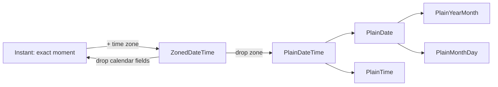

## Introduction

The previous lessons in this module showed what `Date` cannot do well. It is mutable, so helpers change their callers' values ([[b1-date-pitfalls]]). Its months start at 0. It can only see two time zones — UTC and the host's — so "9 AM in Berlin" cannot be expressed without a library. It has no type for a calendar date, so birthdays become instants and shift a day for some users ([[b1-local-vs-utc]]). Adding a month overflows instead of clamping, and nothing distinguishes "24 hours later" from "same time tomorrow". For two decades, applications filled the gap with libraries: Moment.js, then date-fns, Luxon and Day.js.

**`Temporal`** is the language's own answer. It is a global namespace object, like `Math` or `Intl`, containing a family of types. Its central design decision is that **different kinds of time data get different types**. An instant on the global timeline is a `Temporal.Instant`. A calendar date with no time or zone, such as a birthday, is a `Temporal.PlainDate`. A date and time in a named zone, such as a meeting, is a `Temporal.ZonedDateTime`. Every Temporal object is **immutable**: methods like `add` return a new object. Months are numbered 1 to 12. Time zones are IANA names, and arithmetic accounts for daylight saving time (DST).

This lesson is about direction as much as API. `Temporal` is shipping in browsers but not yet everywhere, so you need to know what it is for, what it looks like, and how to adopt it safely.

## Before you start

- **Date basics, timestamps, local versus UTC** — what `Date` stores and its two views. See [[b1-date-basics]], [[b1-unix-timestamps]] and [[b1-local-vs-utc]].
- **Date arithmetic pitfalls** — month overflow, DST days, mutation. See [[b1-date-pitfalls]]; this lesson revisits each one.
- **Intl.DateTimeFormat** — formatting for display. See [[b1-intl-datetime]].
- **BigInt** — `Instant` exposes nanoseconds as a `BigInt`. See [[b1-bigint]].

### Availability and how these examples were checked

Temporal was designed in the TC39 committee as a proposal and reached Stage 3 (design complete, ready for implementation) in 2021, followed by several years of refinements. Firefox shipped it in version 139 (2025) and Chrome in version 144 (early 2026). Support in Safari and in Node.js releases has lagged; check MDN's compatibility table and the TC39 proposals list for the current state rather than relying on a date in a lesson.

Node.js 22, used for the rest of this module, does not enable Temporal by default. The outputs below were produced with its experimental `--harmony-temporal` flag, which runs an early V8 implementation; they match the specified behaviour, but that flag is not suitable for production. In production code that must run everywhere, use feature detection or a polyfill, covered below.

## The intuition

Think of the different things people mean by "a time":

- "The payment was captured at this exact moment" — a point on the global timeline, the same everywhere.
- "My birthday is 15 May" — a box on a calendar, with no clock and no place.
- "The shop opens at 09:00" — a reading on a wall clock, with no date.
- "The stand-up is at 09:00 Berlin time on 4 March" — a wall-clock reading in a specific place, which therefore pins down a moment.
- "The video is 1 hour 30 minutes long" — an amount of time, not a point in time.

`Date` forces all five into one shape: a millisecond count. Temporal gives each its own type, and the type tells you — and the code — which operations make sense. You cannot ask a birthday for its hour, and you cannot add "one day" to an instant, because an instant has no calendar to say how long a day is.



The arrows show the key conversions. Going from an `Instant` to a `ZonedDateTime` needs a time zone. Going from a `PlainDateTime` back to a `ZonedDateTime` also needs a zone — and may hit a DST gap or overlap, which Temporal makes you decide about.

## The types

| Type | Represents | Example `toString()` | Typical use |
|---|---|---|---|
| `Temporal.Instant` | An exact moment, nanosecond precision | `2024-03-09T16:00:00Z` | Event timestamps, logs |
| `Temporal.ZonedDateTime` | Instant + IANA zone + calendar | `2024-03-09T11:00:00-05:00[America/New_York]` | Meetings, reminders, anything "in a place" |
| `Temporal.PlainDate` | Calendar date | `2024-03-09` | Birthdays, due dates, holidays |
| `Temporal.PlainTime` | Wall-clock time | `09:30:00` | Opening hours, alarm times |
| `Temporal.PlainDateTime` | Date and time, no zone | `2024-03-09T09:30:00` | Form input before a zone is known |
| `Temporal.PlainYearMonth` | A month of a year | `2024-02` | Credit-card expiry, monthly reports |
| `Temporal.PlainMonthDay` | A recurring day | `12-25` | Anniversaries |
| `Temporal.Duration` | A length of time | `P1DT2H` | Timeouts, "add 3 months", differences |

`Temporal.Now` provides the current time in the forms you need: `Temporal.Now.instant()`, `Temporal.Now.zonedDateTimeISO(timeZone?)`, `Temporal.Now.plainDateISO(timeZone?)`, and `Temporal.Now.timeZoneId()` for the host zone. "ISO" in these names refers to the ISO 8601 calendar, which is the default; Temporal also supports other calendars such as Hebrew or Japanese through an explicit calendar argument.

Values are created with `from`, which accepts an ISO string or an object of fields, and print with `toString()` as ISO 8601 (extended with a `[zone]` annotation for `ZonedDateTime`). Strings that are not valid ISO throw `RangeError`; there is no lenient fallback parser like `Date`'s.

## How Temporal fixes the Date pitfalls

### Immutability and 1-based months

```javascript title="plain-date.mjs"
const d = Temporal.PlainDate.from('2024-03-09');
const later = d.add({ days: 3 });
console.log(d.toString(), later.toString());
console.log(d.with({ day: 1 }).toString());
console.log(d.dayOfWeek, d.daysInMonth);
console.log(Temporal.PlainDate.from({ year: 2024, month: 2, day: 1 }).toString());
```

```output
2024-03-09 2024-03-12
2024-03-01
6 31
2024-02-01
```

`add` returned a new object and left `d` unchanged, so the aliasing bug from [[b1-date-pitfalls]] cannot happen. `with` replaces fields and also returns a new object. `month: 2` means February. `dayOfWeek` follows ISO 8601: Monday is 1 and Sunday is 7 (9 March 2024 was a Saturday, so 6), unlike `Date.getDay()` where Sunday is 0.

### Month arithmetic clamps by default

```javascript title="months.mjs"
const date = Temporal.PlainDate.from('2024-01-31');
console.log(date.add({ months: 1 }).toString());
try {
  date.add({ months: 1 }, { overflow: 'reject' });
} catch (err) {
  console.log(err.name);
}
console.log(Temporal.PlainDate.from({ year: 2024, month: 2, day: 30 }).toString());

const signup = Temporal.PlainDate.from('2024-01-31');
console.log([1, 2, 3, 4].map((n) => signup.add({ months: n }).toString()).join(' '));
```

```output
2024-02-29
RangeError
2024-02-29
2024-02-29 2024-03-31 2024-04-30 2024-05-31
```

Where `Date` rolled 31 January + 1 month to 2 March, Temporal **constrains** to the last valid day, 29 February. The `overflow` option makes the rule explicit: `'constrain'` (default) clamps, `'reject'` throws `RangeError`. The same option applies when building from fields, so 30 February becomes 29 February or an error, never 1 March. Computing each billing date from the anchor, as in the last line, keeps the 31st whenever the month has one. Strings are stricter: `Temporal.PlainDate.from('2024-02-30')` always throws, because a string is either valid ISO or not.

### Durations versus calendar steps

`ZonedDateTime` knows its zone's DST rules, so it can tell "one day" from "24 hours":

```javascript title="dst.mjs"
const zdt = Temporal.ZonedDateTime.from('2024-03-09T12:00[America/New_York]');
console.log(zdt.add({ days: 1 }).toString());
console.log(zdt.add({ hours: 24 }).toString());

const sunday = Temporal.ZonedDateTime.from('2024-03-10T00:00[America/New_York]');
console.log(sunday.hoursInDay);
```

```output
2024-03-10T12:00:00-04:00[America/New_York]
2024-03-10T13:00:00-04:00[America/New_York]
23
```

`add({ days: 1 })` is a calendar step and keeps noon; `add({ hours: 24 })` is elapsed time and lands at 1 PM, because 10 March 2024 had 23 hours in New York — which `hoursInDay` reports directly. With `Date` you had to know which method to use; here the units say what you mean.

### Choosing what happens in DST gaps and overlaps

When a wall-clock time does not exist or occurs twice, `ZonedDateTime.from` accepts a `disambiguation` option: `'compatible'` (default, same as `Date`: earlier time in overlaps, later in gaps), `'earlier'`, `'later'`, or `'reject'`.

```javascript title="disambiguation.mjs"
console.log(Temporal.ZonedDateTime.from('2024-03-10T02:30[America/New_York]').toString());
const second = Temporal.ZonedDateTime.from('2024-11-03T01:30[America/New_York]', {
  disambiguation: 'later',
});
console.log(second.toString());
try {
  Temporal.ZonedDateTime.from('2024-03-10T02:30[America/New_York]', { disambiguation: 'reject' });
} catch (err) {
  console.log(err.name);
}
```

```output
2024-03-10T03:30:00-04:00[America/New_York]
2024-11-03T01:30:00-05:00[America/New_York]
RangeError
```

A scheduler can use `'reject'` to surface "this time does not exist on that day" to a user instead of silently moving the event.

### Comparing and sorting

```javascript title="compare.mjs"
const ds = ['2024-03-09', '2023-12-25', '2024-01-01'].map((s) => Temporal.PlainDate.from(s));
console.log(ds.sort(Temporal.PlainDate.compare).map(String));

const d = Temporal.PlainDate.from('2024-03-09');
console.log(d.equals(Temporal.PlainDate.from('2024-03-09')));
try {
  console.log(d < d.add({ days: 1 }));
} catch (err) {
  console.log(err.name);
}
```

```output
[ '2023-12-25', '2024-01-01', '2024-03-09' ]
true
TypeError
```

Each type has a static `compare(a, b)` that returns -1, 0 or 1, which is exactly the shape `sort` wants, and an `equals` method. Relational operators throw `TypeError` on purpose: `valueOf()` throws so that `<` cannot silently compare strings or `NaN`, the source of several `Date` bugs.

### Differences

```javascript title="until.mjs"
const start = Temporal.PlainDate.from('2024-01-01');
console.log(start.until('2024-03-01').toString());
console.log(start.until('2024-03-01', { largestUnit: 'months' }).toString());
console.log(Temporal.PlainDate.from('2024-03-09').until('2024-03-11').days);
console.log(Temporal.Duration.from({ hours: 1, minutes: 30 }).total({ unit: 'minutes' }));
```

```output
P60D
P2M
2
90
```

`until` and `since` return a `Duration`, printed in ISO 8601 duration format (`P60D` is 60 days, `P2M` two months). `largestUnit` chooses how to express it. Counting calendar days across the New York spring-forward weekend gives exactly 2, with no rounding trick, because `PlainDate` has no hours to be affected by DST.

## Converting between Date and Temporal

Real code will mix the two for years: libraries, APIs and browser features still use `Date`. Convert at the boundary, through the instant they share.

```javascript title="interop.mjs"
const legacy = new Date('2024-03-09T16:00:00Z');
const instant = legacy.toTemporalInstant();          // Date -> Instant
console.log(instant.toString());
console.log(instant.epochMilliseconds, instant.epochNanoseconds);

const back = new Date(instant.epochMilliseconds);     // Instant -> Date
console.log(back.toISOString());

const inNewYork = instant.toZonedDateTimeISO('America/New_York');
console.log(inNewYork.toString(), inNewYork.hour, inNewYork.offset);
console.log(Temporal.Instant.fromEpochMilliseconds(1710000000000).toString());
```

```output
2024-03-09T16:00:00Z
1710000000000 1710000000000000000n
2024-03-09T16:00:00.000Z
2024-03-09T11:00:00-05:00[America/New_York] 11 -05:00
2024-03-09T16:00:00Z
```

`Date.prototype.toTemporalInstant()` is part of the Temporal specification. Going back, `new Date(instant.epochMilliseconds)` loses anything below a millisecond, which `Date` cannot store. `epochNanoseconds` is a `BigInt` because nanoseconds since 1970 exceed `Number.MAX_SAFE_INTEGER`. A `PlainDate` has no instant, so converting it to a `Date` requires choosing a zone and time first, for example `date.toZonedDateTime({ timeZone, plainTime: '00:00' })`.

For JSON, Temporal types have `toJSON()` that returns their ISO string, so `JSON.stringify({ due: plainDate })` gives `{"due":"2024-03-09"}` — the calendar date, not a UTC instant. Parse it back with `Temporal.PlainDate.from` (see [[b1-json-replacer-reviver]] for revivers). For display, `toLocaleString` and `Intl.DateTimeFormat.prototype.format` accept Temporal objects in engines that support them ([[b1-intl-datetime]]).

## Worked example: a meeting defined in another zone

A team's weekly stand-up is at 09:00 in Berlin. A colleague in New York wants to know when it falls for them during March 2024, when the US and the EU change clocks on different dates (10 March and 31 March).

```javascript title="standup.mjs"
// A weekly stand-up is defined in Berlin wall-clock time.
const firstMeeting = Temporal.ZonedDateTime.from('2024-03-04T09:00[Europe/Berlin]');

for (let week = 0; week < 5; week++) {
  const berlin = firstMeeting.add({ weeks: week });        // calendar step: stays 09:00
  const newYork = berlin.withTimeZone('America/New_York'); // same instant, other wall clock
  console.log(
    berlin.toPlainDate().toString(),
    berlin.toPlainTime().toString().slice(0, 5), 'Berlin =',
    newYork.toPlainTime().toString().slice(0, 5), 'New York',
  );
}
```

```output
2024-03-04 09:00 Berlin = 03:00 New York
2024-03-11 09:00 Berlin = 04:00 New York
2024-03-18 09:00 Berlin = 04:00 New York
2024-03-25 09:00 Berlin = 04:00 New York
2024-04-01 09:00 Berlin = 03:00 New York
```

How it works:

- The meeting is stored as a `ZonedDateTime` in its **owner's** zone, because the rule "09:00 in Berlin" is defined there.
- `add({ weeks: week })` is computed from the anchor (as recommended in [[b1-date-pitfalls]]) and is a calendar step, so every occurrence stays at 09:00 Berlin time even after Berlin's clocks change on 31 March.
- `withTimeZone` keeps the instant and changes only the wall clock it is read on.
- For three weeks the gap between the cities is 5 hours instead of the usual 6, because the US moved its clocks three weeks earlier. With `Date` and fixed offsets, this is exactly the case that goes wrong; with Temporal it is a few lines.

Doing the same with `Date` would require a library or hand-written zone conversion with `Intl.DateTimeFormat` parts, and would still struggle with the reverse step (wall-clock time in Berlin → instant).

## Adopting Temporal today

Because availability varies, adoption is a deliberate choice:

1. **Feature-detect** if Temporal is an optional improvement: `if (typeof Temporal !== 'undefined') { … } else { … }`. This keeps two code paths, so it suits small, isolated uses.
2. **Use a polyfill** if you want to write Temporal code everywhere. The two maintained ones are `@js-temporal/polyfill` (from proposal champions) and `temporal-polyfill`. They add bundle weight (tens of kilobytes compressed), so load them only where needed, or conditionally when native support is missing.
3. **Keep `Date` + `Intl` + a library** if your codebase already depends on date-fns or Luxon and works. Migrate gradually, starting with new code at boundaries such as API parsing.

```javascript title="detect.mjs"
if (typeof Temporal !== 'undefined') {
  console.log('Temporal available; today is', Temporal.Now.plainDateISO().toString());
} else {
  console.log('Temporal not available; falling back to Date', new Date().toISOString());
}
```

Run without the flag, Node.js 22 takes the second branch; the date printed depends on when you run it, so no fixed output is shown. In TypeScript, Temporal types come from the `lib` setting once your TypeScript version includes them, or from the polyfill's own type declarations.

## In real systems

- **Calendars and scheduling** store events as `ZonedDateTime` strings (`2024-03-04T09:00:00+01:00[Europe/Berlin]`). The bracketed zone annotation is standardised as RFC 9557, so other systems can parse it.
- **Forms** produce `PlainDate` (`<input type="date">`) and `PlainTime` values; keeping them as plain types avoids the "previous day" bug entirely.
- **APIs and databases** keep exchanging instants as ISO strings with `Z` or timestamps; `Temporal.Instant.from` and `toString` read and write them.
- **High-precision timing** in logs and tracing can use `Instant`'s nanoseconds, although browsers typically coarsen clock precision for security, so `Temporal.Now.instant()` will not have true nanosecond resolution.

## Trade-offs and alternatives

Temporal's advantages are correctness by construction — the right type for each kind of data, immutability, explicit zones and overflow rules — and no dependency once support is universal. Its costs are a larger API to learn, more verbose code for trivial cases (`Date.now()` stays the shortest way to get a timestamp), uneven support today, and the need to convert at boundaries with code that still uses `Date`.

| Situation | Recommendation |
|---|---|
| Timestamp, elapsed time, simple instants | `Date.now()` / `Date` remain fine |
| Calendar dates, recurring events, other zones | Temporal (native or polyfill), or Luxon / date-fns-tz |
| Display formatting | `Intl.DateTimeFormat`, which accepts both `Date` and Temporal |
| Existing app on a date library | Keep it; introduce Temporal in new modules when your support baseline allows |

## Common mistakes

> [!MISTAKE] Assuming Temporal exists everywhere
> Support is recent and incomplete across engines and Node.js versions. Detect it or ship a polyfill; do not let a `ReferenceError` reach users of older browsers.

**Using `PlainDateTime` for events in a place.** Without a zone it cannot become an instant, and DST is ignored. Use `ZonedDateTime` when the time belongs to a location.

**Using `Instant` for birthdays.** That recreates the `Date` problem. A birthday is a `PlainDate`.

**Comparing with `<` or `===`.** `<` throws `TypeError`; `===` compares object identity. Use `compare` and `equals`.

**Expecting `add` to modify the object.** It returns a new value; `d.add({ days: 1 })` on its own line does nothing useful.

**Losing precision when converting back to `Date`.** `Date` stores milliseconds; sub-millisecond parts of an `Instant` are dropped.

## Interview perspective

**"What is Temporal and why does JavaScript need it?"** A new built-in date/time API with separate immutable types and explicit time zones, replacing `Date`, which is mutable, 0-based in months, limited to UTC and the host zone, and leaves arithmetic to overflow rules. Name a concrete bug it prevents, such as the 31 January + 1 month case or DST "tomorrow".

**"Which Temporal type would you use for a flight departure? A birthday? A video's length?"** `ZonedDateTime` (departure in the airport's zone; `Instant` if only the moment matters), `PlainDate`, `Duration`.

**"Can you use it today?"** Explain current browser support, that Node.js support depends on the version, and the polyfill or feature-detection strategies. Strong candidates say they would check MDN rather than assert support from memory.

## Practice

1. Rewrite the `addMonthsClamped` helper from [[b1-date-pitfalls]] with `PlainDate`. How many lines does it take?
2. Using `ZonedDateTime`, compute how many hours long 3 November 2024 was in `America/New_York`, and in `Europe/London`.
3. Write `nextOccurrence(plainTime, timeZone, now)` that returns the next `ZonedDateTime` at that wall-clock time, and decide what it should do in a DST gap.
4. Convert a `Date` from an API to a `PlainDate` in the user's zone, then back to the start of that day as a `Date`.
5. Write a feature-detecting wrapper `todayKey(timeZone)` that uses Temporal when available and `Intl.DateTimeFormat` parts otherwise.

```quiz
Q: Which Temporal type should store a user's date of birth?
- [ ] `Temporal.Instant`, because it is the most precise
- [ ] `Temporal.ZonedDateTime`, in the user's current time zone
- [x] `Temporal.PlainDate`, because a birthday is a calendar date with no time or zone
- [ ] `Temporal.PlainDateTime`, set to midnight
> A birthday is the same calendar box wherever the person is. Storing it as an instant or a zoned value reintroduces the "previous day" bug when viewed from other zones, and adding a fake midnight adds information that is not true.
```

```quiz
Q: `Temporal.ZonedDateTime.from('2024-03-09T12:00[America/New_York]')` — what do `.add({ days: 1 })` and `.add({ hours: 24 })` return?
- [ ] Both return 2024-03-10 at 12:00
- [x] 12:00 and 13:00 on 10 March, because that day is 23 hours long
- [ ] 12:00 and 11:00 on 10 March, because clocks moved forward
- [ ] Both throw, because 10 March has a DST gap
> Days are calendar steps that keep the wall-clock time; hours are elapsed time. Clocks skipped 2:00–3:00 on 10 March, so 24 elapsed hours after noon is 1 PM. The gap is at 2 AM, not at noon, so nothing throws.
```

```quiz
Q: What does `Temporal.PlainDate.from('2024-01-31').add({ months: 1 })` return?
- [ ] 2024-03-02, like `Date`'s overflow
- [x] 2024-02-29, because the default overflow is `'constrain'`
- [ ] It throws `RangeError` by default
- [ ] 2024-02-28, because February has 28 days
> Temporal clamps to the last valid day by default. Use `{ overflow: 'reject' }` to throw instead. February 2024 is in a leap year, so its last day is the 29th. Rolling into March is `Date`'s behaviour, which Temporal deliberately avoids.
```

## Quick revision {#quick-revision}

- `Temporal` is a global namespace of immutable date/time types designed to replace most `Date` use; months are 1–12, zones are IANA names.
- Types: `Instant` (exact moment, ns), `ZonedDateTime` (instant + zone + calendar), `PlainDate`, `PlainTime`, `PlainDateTime`, `PlainYearMonth`, `PlainMonthDay`, `Duration`.
- `Temporal.Now.instant()`, `.zonedDateTimeISO(tz)`, `.plainDateISO(tz)`, `.timeZoneId()`.
- Create with `from(isoStringOrFields)`; invalid strings throw `RangeError`. `toString()`/`toJSON()` give ISO 8601 (plus `[zone]`).
- `add`/`subtract`/`with` return new objects. Month overflow defaults to `'constrain'` (31 Jan + 1 month = 29 Feb); `'reject'` throws.
- `ZonedDateTime`: `add({ days })` keeps wall time, `add({ hours })` adds elapsed time; `hoursInDay`; `disambiguation` for gaps/overlaps.
- Compare with `Type.compare` / `equals`; `<` throws `TypeError`.
- `until`/`since` return `Duration`; `largestUnit` controls the shape.
- Interop: `date.toTemporalInstant()`, `new Date(instant.epochMilliseconds)`, `Instant.fromEpochMilliseconds(ms)`; `epochNanoseconds` is a `BigInt`.
- Support: Firefox 139+, Chrome 144+; others vary — feature-detect or polyfill (`@js-temporal/polyfill`, `temporal-polyfill`).

## Key takeaways {#key-takeaways}

- Temporal separates kinds of time data into types, so the type itself prevents category mistakes like treating a birthday as an instant.
- Immutability, 1-based months, clamped month arithmetic and explicit DST handling remove the classic `Date` pitfalls by design.
- `ZonedDateTime` is the tool for anything that happens "at a time in a place"; `Date` cannot represent that.
- Convert between `Date` and Temporal through the instant at your application's boundaries.
- Adopt it deliberately: check current support, then feature-detect or polyfill.
