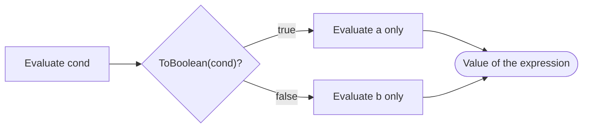

## Introduction

Much of programming is choosing between two values: singular or plural, "Log in" or "Log out", a discounted price or the full one. With only `if` statements, every such choice needs a variable declared in advance and assigned in two places:

```javascript title="if-vs-ternary.js"
function label(count) {
  let text;
  if (count === 1) {
    text = '1 item';
  } else {
    text = `${count} items`;
  }
  return text;
}
const label2 = (count) => (count === 1 ? '1 item' : `${count} items`);
console.log(label(1), label(3), label2(1), label2(0));
```

```output
1 item 3 items 1 item 0 items
```

Both functions do the same thing. The second uses the **conditional operator**, written `condition ? valueIfTrue : valueIfFalse`. It is usually called the **ternary operator** because it is the only JavaScript operator that takes three operands. Since it is an expression — it produces a value — it can go anywhere a value can: the right side of a `const`, a `return`, a function argument, a template literal, or a JSX attribute.

That ability is why the ternary is everywhere in frontend code, especially React, where component bodies are mostly expressions. It is also why it is overused: a chain of nested ternaries can be harder to read than the `if` statements it replaced. This lesson teaches the exact rules and the judgement for when to use it.

## Before you start

- **Statements and expressions** — the ternary is an expression, `if` is a statement. See [[b1-statements-expressions]].
- **Truthy and falsy values** — the condition is tested by truthiness, not compared with `true`. See [[b1-truthy-falsy]].
- **if / else** — what the ternary replaces. See [[b1-if-else]].
- **Logical operators and short-circuiting** — the ternary skips the branch it does not choose, like `&&` and `||`. See [[b1-logical-operators]].

## The intuition

Read `cond ? a : b` as a question with two prepared answers: "*Is* `cond`? If so, `a`; otherwise, `b`." The `?` asks the question and the `:` separates the two answers.

It helps to think of it as a fork in a road that only one car travels. The condition is evaluated first, then exactly one of the two branches is evaluated; the other is never visited. If the unused branch contains a function call, that call does not happen. If it contains an expression that would throw, it does not throw.

Where the analogy stops working: a road fork can lead to whole journeys, but each branch of a ternary is a single *expression*. You cannot put a `return`, a `for` loop or a `const` declaration inside a branch. When a branch needs statements, you need `if`.

## How the ternary evaluates

`cond ? a : b` is evaluated in three steps:

1. Evaluate `cond` and convert its value to a boolean with the truthiness rule.
2. If it is truthy, evaluate `a` and return its value.
3. Otherwise, evaluate `b` and return its value.

```javascript title="basics.js"
const n = 7;
const parity = n % 2 === 0 ? 'even' : 'odd';
const abs = n < 0 ? -n : n;
console.log(parity, abs);
console.log(`You have ${n} new message${n === 1 ? '' : 's'}`);
console.log(Math.max(n > 5 ? 10 : 0, 3));
console.log([1, 0, 'a', ''].map((v) => (v ? 'truthy' : 'falsy')));
```

```output
odd 7
You have 7 new messages
10
[ 'truthy', 'falsy', 'truthy', 'falsy' ]
```

The first two lines are the classic uses: picking a label and computing an absolute value. The template literal shows a ternary embedded inside `${…}`, a very common way to pluralise. The `Math.max` line shows it as a function argument. The last line shows that the condition does not need to be a boolean: `1` and `'a'` are truthy, `0` and `''` are falsy.

The result of the ternary is whatever the chosen branch produced, so the two branches can have different types. `ok ? 1 : 'one'` is a number or a string depending on `ok`. JavaScript does not mind; TypeScript gives the expression the union type `1 | 'one'` (or `number | string` for non-literal values), and it narrows the type of variables inside each branch, just as it does for `if`.

### Only one branch is evaluated

Because only the chosen branch runs, the ternary is a **short-circuiting** operator, like `&&`, `||` and `??` ([[b1-short-circuit]]).

```javascript title="one-branch.js"
function bump(s) { console.log('called', s); return s; }
function pick(flag) {
  return flag ? bump('yes') : bump('no');
}
console.log(pick(false));
const user = null;
console.log(user ? user.name : 'guest');
```

```output
called no
no
guest
```

`bump('yes')` never ran. The second example relies on this: `user.name` would throw a `TypeError` on `null`, but it is in the branch that is not chosen, so it is never evaluated. This is the ternary equivalent of a guard.

## Precedence: the ternary binds loosely

The conditional operator has **very low precedence**: lower than all arithmetic, comparison and logical operators (`??` and `||` included), and higher only than assignment, arrow functions, `yield` and the comma operator. So the condition swallows everything to its left, up to an assignment or an opening bracket.

```javascript title="precedence-traps.js"
const online = true;
console.log('Status: ' + online ? 'on' : 'off');
console.log('Status: ' + (online ? 'on' : 'off'));
const price = 10, member = true;
console.log(price * member ? 0.9 : 1);
console.log(price * (member ? 0.9 : 1));
```

```output
on
Status: on
0.9
9
```

The first line does not print "Status: on". Because `+` binds tighter than `?:`, it is parsed as `('Status: ' + online) ? 'on' : 'off'`. The condition is the string `'Status: true'`, which is truthy, so the whole expression is just `'on'`. The same happens with `*`: `price * member` (`10 * true`, which is 10) became the condition. The fix is always the same — **wrap the ternary in parentheses when it is part of a larger expression**. Template literals avoid the problem because `${…}` acts as parentheses.

Low precedence also has a convenient side. In `const x = a > b ? a : b` and `return isValid ? save() : reject()`, no parentheses are needed, because comparison and logical operators inside the condition all bind tighter than `?:`. The full table is in [[b1-precedence]].

## Chained ternaries and right-associativity

A ternary branch can itself be a ternary. The operator is **right-associative**, which means `a ? b : c ? d : e` groups as `a ? b : (c ? d : e)`. That grouping is what makes a chain read like an `if` / `else if` ladder:

```javascript title="chained.js"
function grade(score) {
  return score >= 90 ? 'A'
    : score >= 80 ? 'B'
    : score >= 70 ? 'C'
    : 'F';
}
console.log(grade(95), grade(85), grade(72), grade(10));
```

```output
A B C F
```

Each `:` introduces "otherwise, if…", and the final branch is the `else`. Formatted with one condition per line and the `:` at the start of each line, a flat chain like this is readable. To see that the grouping really is right to left, compare it with the grouping JavaScript does not use:

```javascript title="associativity.js"
const a = true;
console.log(a ? 'x' : false ? 'y' : 'z');     // a ? 'x' : (false ? 'y' : 'z')
console.log((a ? 'x' : false) ? 'y' : 'z');   // the grouping JS does NOT use
```

```output
x
y
```

With right-associativity, `a` is true so the answer is `'x'` and the rest is never evaluated. If the operator grouped left to right (as PHP's did before PHP 8 made unparenthesised chains an error), the first ternary would produce `'x'`, which would then become the condition of the second.

Chains become hard to read when the nesting is in the *middle* operand rather than the last one — `a ? (b ? x : y) : z` — or when conditions are long. Those are the cases where an `if` statement or a lookup table is clearer.

## Expressions only: what cannot go in a branch

Each operand of the ternary is an expression. Statements such as `return`, `throw`, `break`, `let` and `if` are not allowed:

```javascript title="no-statements.js"
const f = (ok) => ok ? 1 : throw new Error('bad');
```

```output
SyntaxError: Unexpected token 'throw'
```

There is a TC39 proposal for "throw expressions", but it is not part of the language as of ES2025, so engines reject this. To throw conditionally inside an expression you have to call a helper function that throws, or use an `if` statement.

Assignments *are* expressions, so `c ? x = 1 : y = 2` is legal and assigns to one of the two variables. It is also an `if` statement in disguise, with the value thrown away. Linters flag it (ESLint's `no-unused-expressions`), and you should write `if (c) x = 1; else y = 2;` instead. The ternary is for **choosing a value**, not for choosing an action.

## Ternary versus `if`, `||`, `??` and lookup tables

The ternary is one of several ways to make a choice. Picking the right one is mostly about what the code is deciding.

| Situation | Best fit | Example |
|---|---|---|
| Choose between two values | Ternary | `const label = done ? 'Done' : 'Pending'` |
| Choose between two actions or blocks of statements | `if` / `else` | `if (done) archive(task); else remind(task);` |
| Value or a fallback when it is `null`/`undefined` | `??` | `const name = input ?? 'Guest'` |
| Value or a fallback when it is any falsy value | `\|\|` | `const title = heading \|\| 'Untitled'` |
| Map one of many known keys to values | Lookup object or `Map` | `COLORS[status] ?? 'grey'` |
| Many conditions, each with logic | `if` / `else if` or early returns | See the worked example |

`x ? x : fallback` is a common pattern that already has a name: it is `x || fallback`, except that `x` is evaluated twice. `x != null ? x : fallback` is `x ?? fallback`. Use the shorter operators when the rule they encode is exactly the one you mean.

### The truthiness trap

The ternary tests truthiness, so `0`, `''` and `NaN` take the "false" branch:

```javascript title="truthiness-trap.js"
const count = 0;
console.log(count ? `${count} results` : 'No results');
const score = 0;
console.log(score ? score : 'no score', score ?? 'no score', score || 'no score');
```

```output
No results
no score 0 no score
```

The first line is correct: zero results should say "No results". The second is a bug if a score of 0 is a real score — the ternary and `||` both discard it, while `??` keeps it. When `0` or `''` is valid data, write the condition you mean: `score !== undefined ? …`, `count > 0 ? …`, or `name !== '' ? …`.

## How it works internally

The grammar names this construct a **ConditionalExpression**:

```text
ConditionalExpression :
    ShortCircuitExpression ? AssignmentExpression : AssignmentExpression
```

That one line explains the behaviour above. The condition is a `ShortCircuitExpression` — anything built from `||`, `&&`, `??` and the operators that bind tighter — which is why `'Status: ' + online` becomes the whole condition. Each branch is an `AssignmentExpression`, the most general expression form short of the comma operator, which is why an assignment or an arrow function can appear in a branch without parentheses, and why a branch can contain another `ConditionalExpression`, giving right-associativity.

The evaluation rule in the specification is: evaluate the condition, apply `ToBoolean` to its value, then evaluate *only* the corresponding branch and return its value. Engines compile it to a conditional jump, exactly like `if`/`else`; there is no performance difference between the two, so choose on readability alone.



## Worked example: an order status label

An order page shows a status label and a colour. The rules are ordered by priority: cancelled orders say "Cancelled" whatever else is true; delivered beats shipped; shipped beats paid.

```javascript title="order-status.js"
// Version 1: nested ternaries
function statusLabelV1(order) {
  return order.cancelled ? 'Cancelled'
    : order.deliveredAt ? `Delivered ${order.deliveredAt}`
    : order.shippedAt ? 'On the way'
    : order.paid ? 'Preparing'
    : 'Awaiting payment';
}

// Version 2: the same rules as early returns
function statusLabelV2(order) {
  if (order.cancelled) return 'Cancelled';
  if (order.deliveredAt) return `Delivered ${order.deliveredAt}`;
  if (order.shippedAt) return 'On the way';
  return order.paid ? 'Preparing' : 'Awaiting payment';
}

// A simple value mapping is clearer as a lookup table
const TONE = { Cancelled: 'red', 'On the way': 'blue', Preparing: 'amber' };
const toneFor = (label) => TONE[label] ?? (label.startsWith('Delivered') ? 'green' : 'grey');

const orders = [
  { paid: false },
  { paid: true },
  { paid: true, shippedAt: '2026-10-20' },
  { paid: true, shippedAt: '2026-10-20', deliveredAt: '2026-10-22' },
  { paid: true, cancelled: true },
];
for (const o of orders) {
  const label = statusLabelV1(o);
  console.log(label === statusLabelV2(o), label, toneFor(label));
}
```

```output
true Awaiting payment grey
true Preparing amber
true On the way blue
true Delivered 2026-10-22 green
true Cancelled red
```

Both versions give identical results (the first column of the output confirms it). Version 1 is a flat chain: every nested ternary is in the *last* position, so it reads top to bottom as a priority list, and it fits naturally in a JSX expression. Version 2 uses **early returns**: each rule is an `if` that leaves the function, and only the final two-way choice is a ternary. Version 2 scales better — when "Delivered" needs to log an analytics event, or a rule needs two lines of logic, an `if` can hold statements and a ternary branch cannot.

The colour mapping shows the third option. Most labels map directly to a colour, so a lookup object expresses that more clearly than a chain of `label === 'Cancelled' ? 'red' : label === …`. The ternary handles the one label that is not a fixed string, and `??` supplies the default. Adding a new status is now a one-line change to `TONE`.

### Conditional rendering in JSX

JSX lets you embed expressions in `{…}` but not statements, which is why the ternary is the standard way to render one of two elements in React:

```jsx title="StatusBadge.jsx"
function StatusBadge({ order }) {
  const label = statusLabelV2(order);
  return (
    <span className={`badge badge-${toneFor(label)}`}>
      {order.cancelled ? <s>{label}</s> : label}
      {order.items.length > 0 ? ` · ${order.items.length} items` : null}
    </span>
  );
}
```

The first ternary chooses between two elements. The second returns `null` for "render nothing", which React renders as nothing — safer than `order.items.length && …`, which would render a stray `0` for an empty order. This component was not run here; it follows the React 19 rendering rules for `null` and numbers. Many teams follow a rule of thumb: one ternary inside JSX is fine, but anything nested should be moved into a variable or a small component above the `return`.

## In real systems

**UI text and attributes.** Plurals, button labels (`isEditing ? 'Save' : 'Edit'`), class names (`` `tab ${active ? 'tab-active' : ''}` ``) and ARIA attributes (`aria-expanded={open ? 'true' : 'false'}`) are almost always ternaries.

**Configuration by environment.** In a Vite project, `const apiUrl = import.meta.env.PROD ? 'https://api.example.com' : 'http://localhost:3000'` picks a value at module load time.

**Return values.** Small pure functions such as comparators (`a.date < b.date ? -1 : a.date > b.date ? 1 : 0`) and formatters return the result of a ternary directly.

**Code style tooling.** Prettier formats chained ternaries in a consistent indented layout, and ESLint offers `no-nested-ternary` and `no-unneeded-ternary` (which flags `cond ? true : false`, better written as `Boolean(cond)` or just `cond` if it is already boolean).

## Trade-offs and alternatives

The ternary's strength is that it is an expression: it lets you initialise a `const` instead of declaring a `let` and assigning it in two branches, which keeps variables immutable and makes "every path assigns a value" obvious. It also keeps short decisions on one line, next to where the value is used.

Its weakness is the same property. Because branches can only be expressions, a ternary invites cramming logic into one line. Long conditions, nested ternaries in the middle operand, and branches with side effects all make code harder to read and debug — you cannot put a breakpoint on "the else branch" of a one-line ternary as easily as on a line inside an `else` block.

A practical rule: use a ternary when both branches are short values and the whole expression fits comfortably on one line, or when it is a flat chain where each condition is simple. Otherwise, reach for `if`/`else`, early returns, a lookup table, or a small helper function with a descriptive name.

## Common mistakes

> [!MISTAKE] Forgetting that `+` binds tighter than `? :`
> `'Total: ' + hasDiscount ? discounted : full` uses `'Total: ' + hasDiscount` as the condition and drops the prefix. Wrap the ternary: `'Total: ' + (hasDiscount ? discounted : full)`, or use a template literal.

**Treating `0` or `''` as "missing".** `qty ? qty : 1` turns a deliberate 0 into 1. Use `qty ?? 1` or an explicit comparison.

**Using the ternary for side effects.** `isValid ? submit() : showError()` as a statement works, but it is an `if` in disguise. Write the `if`.

**Writing `cond ? true : false`.** It is just `Boolean(cond)` — or `cond` itself if it is already a boolean.

**Nesting in the middle operand.** `a ? b ? x : y : z` is legal and confusing. Restructure with `if` or parentheses at the very least.

**Trying to `return` or `throw` from a branch.** Branches are expressions; use `if` for control flow.

## Interview perspective

> [!INTERVIEW] When do you use a ternary instead of if/else?
> "When I'm choosing between two *values* — initialising a `const`, returning a value, or rendering one of two elements in JSX. It evaluates only the chosen branch, so it's safe as a guard. When the branches are *actions* or need more than one expression, or when the chain gets nested, I switch to `if` or a lookup table, because readability matters more than saving lines."

Questions to expect:

- **What does `'a' + true ? 'b' : 'c'` evaluate to?** `'b'` — the condition is `'atrue'`, which is truthy.
- **How does `a ? b : c ? d : e` group?** `a ? b : (c ? d : e)`; the operator is right-associative.
- **Is the unused branch evaluated?** No; only the chosen branch runs, so `obj ? obj.x : null` is a safe guard.
- **Can you `return` inside a ternary?** No; branches must be expressions. You can return a ternary: `return ok ? a : b`.
- **Is a ternary faster than `if`?** No measurable difference; both compile to a conditional jump.
- **Rewrite `x ? x : y` and `x != null ? x : y`.** `x || y` and `x ?? y`.

```quiz
Q: What does `console.log('Count: ' + 0 ? 'some' : 'none')` print?
- [ ] `Count: none`
- [ ] `Count: some`
- [x] `some`
- [ ] `none`
> `+` binds tighter than the conditional operator, so the condition is `'Count: ' + 0`, which is the string 'Count: 0'. A non-empty string is truthy, so the whole expression is 'some' and the prefix disappears. Parentheses around the ternary would give 'Count: none'.

Q: Given `const a = false, b = true;`, what does `a ? 'x' : b ? 'y' : 'z'` evaluate to?
- [ ] `'x'`
- [x] `'y'`
- [ ] `'z'`
- [ ] It is a SyntaxError without parentheses
> The operator is right-associative, so this is `a ? 'x' : (b ? 'y' : 'z')`. `a` is false, so the inner ternary runs; `b` is true, so the result is 'y'. Chained ternaries are legal without parentheses and read like an else-if ladder.

Q: `let calls = 0; const f = () => ++calls; const v = calls ? f() : f() + f();` What are `v` and `calls` afterwards?
- [ ] `v` is 1, `calls` is 3
- [x] `v` is 3, `calls` is 2
- [ ] `v` is 2, `calls` is 3
- [ ] `v` is 1, `calls` is 1
> `calls` is 0, which is falsy, so only the second branch runs and the first `f()` is never evaluated. `f() + f()` calls f twice, yielding 1 and 2, so v is 3 and calls is 2. If both branches were evaluated, calls would be 3.

Q: Which is the best replacement for `const qty = input.qty ? input.qty : 1` when `0` is a valid quantity and only a missing value should default to 1?
- [ ] `const qty = input.qty || 1`
- [x] `const qty = input.qty ?? 1`
- [ ] `const qty = !!input.qty ? input.qty : 1`
- [ ] `const qty = input.qty && 1`
> The original ternary tests truthiness, so a quantity of 0 becomes 1. `||` and the `!!` version have the same bug. `??` falls back only for null or undefined, so 0 is kept. `input.qty && 1` returns 1 for any truthy quantity, which is wrong.
```

## Practice

1. Rewrite with a ternary where it improves the code, and explain where it does not: (a) `let msg; if (n > 0) msg = 'positive'; else msg = 'not positive';` (b) `if (user) { log(user); render(user); } else { redirect(); }`.
2. Predict, then run: `1 ? 2 ? 3 : 4 : 5`, `0 ? 1 : '' ? 2 : 3`, `'x' + (false ? 'y' : 'z')`, `null ?? 0 ? 'a' : 'b'`.
3. Write `relativeDay(date)` returning `'Today'`, `'Yesterday'`, `'Tomorrow'` or the ISO date, first as a chained ternary, then with early returns. Which is easier to extend with `'Last week'`?
4. Replace the nested ternary `size === 's' ? 12 : size === 'm' ? 16 : size === 'l' ? 20 : 14` with a lookup table and a default.
5. Find and fix the bug: ``const cls = 'btn ' + primary ? 'btn-primary' : 'btn-secondary';``

## Quick revision {#quick-revision}

- `cond ? a : b`: evaluate `cond`, apply truthiness, evaluate and return only `a` or only `b`.
- It is an expression: use in `const`, `return`, arguments, template literals, JSX.
- Unused branch never runs: safe as a guard (`user ? user.name : 'guest'`).
- Very low precedence: `'x' + c ? a : b` means `('x' + c) ? a : b`. Parenthesise inside larger expressions.
- Right-associative: `a ? b : c ? d : e` is `a ? b : (c ? d : e)`; flat chains read like else-if.
- Branches must be expressions: no `return`, `throw`, `let`, loops.
- Truthiness trap: `0`, `''`, `NaN` take the false branch; use `??` or explicit comparisons.
- `x ? x : y` ≡ `x || y` (but evaluates `x` twice); `x != null ? x : y` ≡ `x ?? y`; `c ? true : false` ≡ `Boolean(c)`.
- Choose values with ternaries, actions with `if`, many fixed mappings with a lookup table.
- In JSX, prefer `cond ? <A/> : null` over `n && <A/>` when the condition might be `0`.

## Key takeaways {#key-takeaways}

- The ternary chooses between two values inside an expression and evaluates only the chosen branch.
- Its low precedence means it swallows everything to its left; wrap it in parentheses when combining it with other operators.
- It is right-associative, so flat chains work like `else if`, but nesting in the middle operand hurts readability.
- It tests truthiness, so valid zeros and empty strings need `??` or an explicit comparison.
- Use it for values, not actions; when branches need statements or the logic grows, switch to `if`, early returns or a lookup table.
