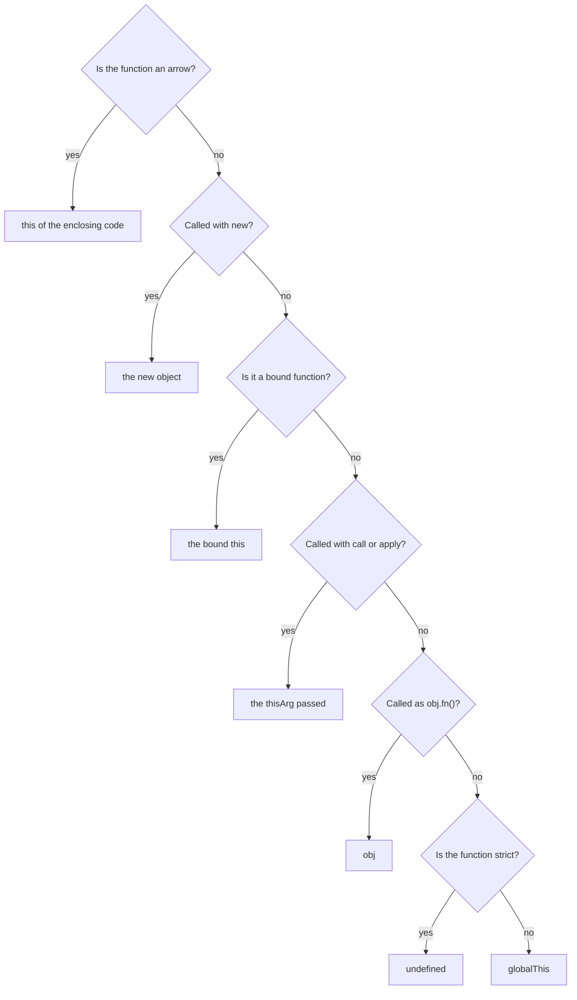
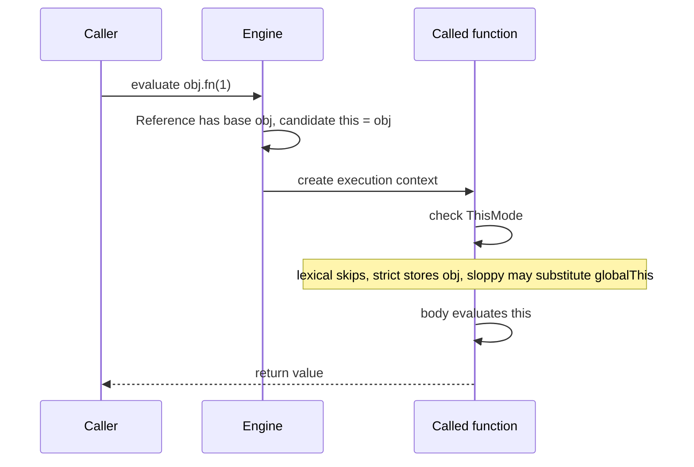

## Introduction

Most functions only need their parameters. A **method** — a function stored on an object and meant to work with that object — also needs to know *which object* it is working on. A `total()` method on a shopping cart must read that cart's items, not some other cart's. JavaScript gives every regular function a hidden extra input for this purpose, called **`this`**.

What surprises people coming from Java, C# or Python is how `this` gets its value. In Java, `this` inside a method always refers to the instance the method belongs to. In JavaScript, a function does not belong to any object. The same function can be stored on many objects, passed to another function, or called on its own. So `this` cannot be decided when the function is written. It is decided **every time the function is called**, by the shape of the call:

```javascript title="first-look.mjs"
function describe() {
  return `I am ${this.name}`;
}

const ada = { name: 'Ada', describe };
const grace = { name: 'Grace', describe };

console.log(ada.describe());
console.log(grace.describe());

try {
  describe();
} catch (err) {
  console.log(err.message);
}
```

```output
I am Ada
I am Grace
Cannot read properties of undefined (reading 'name')
```

One function, three calls, three different values of `this`. Called through `ada`, `this` is `ada`. Called through `grace`, it is `grace`. Called on its own, with no object in front of it, `this` is `undefined` (this file is an ES module, which is strict code), and reading `.name` from `undefined` throws.

That last line is the single most common `this` bug in JavaScript. It appears whenever a method is handed to something else — `setTimeout`, `addEventListener`, an array's `map`, a React prop — and that something calls it without the object. This lesson teaches the five rules that decide `this`, the order in which they apply, and the reliable ways to keep `this` pointing where you want. The companion lesson [[b1-call]] covers the three methods `call`, `apply` and `bind` in full depth.

## Before you start

- **Functions and methods** — function declarations, function expressions and the shorthand method syntax `{ greet() {} }`. See [[b1-function-declaration]] and [[b1-function-expression]].
- **Arrow functions** — the `() => {}` syntax. See [[b1-arrow-functions]]; its section [[b1-lexical-this]] goes deeper into one of the rules taught here.
- **Strict mode** — what `'use strict'` does, and that ES modules and class bodies are always strict. See [[b1-strict-mode]].
- **Objects** — creating objects with literals and reading properties. See [[b1-object-literals]].
- **Callbacks** — passing a function to another function to be called later. See [[b1-callbacks-sync]].

You do not need to know prototypes yet; the lesson explains the one fact about them it uses.

## The intuition

Think of `this` as a blank on a form that the *caller* fills in, not the author. The function's code says "do this to whoever is named in the blank". Each time someone calls the function, they fill the blank according to how they make the call:

- write `cart.total()` and the blank says `cart`;
- write `total()` with nothing in front, and the blank stays empty (`undefined`);
- write `total.call(otherCart)` and you fill the blank by hand;
- write `new Total()` and JavaScript fills it with a brand-new object.

So the question to ask when you see `this` is never "where was this function written?" It is **"how was this function called?"** Look at the call site — the line of code that runs the function — and read `this` off its shape.

There is one deliberate exception. An **arrow function** has no blank of its own. When an arrow function uses `this`, it uses the `this` of the code around it, exactly the way it would use any outer variable. For arrows, the question flips back to "where was it written?"

The form analogy stops working in one place: a blank on a paper form is filled once. `this` is filled freshly on every call, so the same function can see a different `this` each time it runs.

## The five rules at a glance

Every regular (non-arrow) function call falls into one of four shapes, and arrows are the fifth case. Each has a section below; this table is the map.

| Rule | Call shape | `this` inside the function |
|---|---|---|
| Default | `fn()` | `undefined` in strict code; the global object in sloppy code |
| Implicit | `obj.fn()` or `obj['fn']()` | `obj` |
| Explicit | `fn.call(x)`, `fn.apply(x)`, `fn.bind(x)()` | `x` |
| `new` | `new Fn()` | A newly created object |
| Arrow | Any call of an arrow function | The `this` of the surrounding code, whatever the call shape |

When more than one rule seems to apply — a bound function stored on an object and called as a method, say — they are tried in a fixed order, covered in the precedence section after the five rules.



## Default / Global Binding {#b1-this-default}

**Default binding** is the rule for a regular function called on its own, with no object in front of it and no `call`, `apply`, `bind` or `new`: a plain `fn()`. In that case there is no receiver to use as `this`, and JavaScript falls back to a default. Which default depends on whether the function is strict:

- in **strict** code, `this` is `undefined`;
- in **sloppy** (non-strict) code, `this` is the **global object** — `window` in a browser page, `global` in Node.js. ES2020 added `globalThis` as a name for it that works in every environment.

Strictness is a property of the *called* function, decided by where it was written. Code is strict if it is inside an ES module, inside a `class` body, or in a file or function that starts with `'use strict'`. Classic browser `<script>` tags and Node.js CommonJS files (`.cjs`, or `.js` without `"type": "module"`) are sloppy unless they opt in. This file is CommonJS, so it is sloppy by default:

```javascript title="default-binding.cjs"
function sloppy() {
  return this;
}

function strict() {
  'use strict';
  return this;
}

console.log(sloppy() === globalThis);
console.log(strict());

function strictCaller() {
  'use strict';
  return sloppy();          // the callee's mode decides, not the caller's
}
console.log(strictCaller() === globalThis);
```

```output
true
undefined
true
```

The last call shows that the rule follows the function being called. `strictCaller` is strict, but it calls `sloppy`, which is not, so `sloppy` still receives the global object.

### Why sloppy mode uses the global object

Early JavaScript wanted plain calls to work without ceremony inside browser pages, where nearly everything lived on `window`. Falling back to the global object meant a function that used `this` would at least find *something*. The cost was that mistakes became silent. The classic case is a **constructor function** — a function meant to be called with `new` (see [[b1-this-new]]) — called without it:

```javascript title="forgotten-new.cjs"
function Counter() {
  this.count = 0;           // meant for a new object
}

const c = Counter();        // forgot `new`
console.log(c);
console.log(globalThis.count);
```

```output
undefined
0
```

Without `new`, `Counter()` is a plain call. In sloppy code `this` is the global object, so `this.count = 0` quietly creates a **global variable** named `count`, and `c` is `undefined` because the function returns nothing. Any other code that uses a global `count` is now broken, and nothing reported an error.

Strict mode was designed to turn this kind of silent damage into a loud failure. The same constructor in an ES module throws at the exact line of the mistake:

```javascript title="forgotten-new.mjs"
function Counter() {
  this.count = 0;
}

try {
  Counter();
} catch (err) {
  console.log(`${err.name}: ${err.message}`);
}
```

```output
TypeError: Cannot set properties of undefined (setting 'count')
```

This is the main reason to prefer strict code: a missing receiver becomes an immediate `TypeError` instead of a corrupted global. ES2015 classes go further — calling a class without `new` always throws, strict or not — and a constructor function can protect itself with **`new.target`**, which is `undefined` in a plain call. Both are shown in [[b1-this-new]].

### `this` at the top level of a file

Default binding is about functions, but beginners often meet `this` outside any function first, and arrows at the top level inherit it, so it is worth knowing:

| Where the code runs | Top-level `this` |
|---|---|
| Classic browser `<script>` | `window` |
| ES module (browser `type="module"`, `.mjs`, or Node with `"type": "module"`) | `undefined` |
| Node.js CommonJS file | `module.exports` (an empty object `{}` at first) |

Do not rely on any of these. If you need the global object, write `globalThis`, which says what you mean. See [[b1-global-variables]] and [[b1-module-scope]].

> [!MISTAKE] Expecting a plain call to "see" the object it came from
> `const f = user.greet; f();` is a default-binding call: there is nothing before the parentheses but `f`. It does not matter that the function was found on `user` a line earlier. In strict code `this` is `undefined`; in sloppy code it is the global object, and `this.name` usually reads `window.name`, which is an empty string in browsers — a bug that does not even throw.

## Implicit Binding {#b1-this-implicit}

**Implicit binding** is the rule for a **method call**: when a function is called as a property of an object — `obj.method()` or `obj['method']()` — `this` inside it is that object. Nobody passes `this` explicitly; the object is implied by the syntax of the call, which is where the name comes from. This is the rule that makes ordinary object-oriented code work.

A practical way to read it: **`this` is the object immediately to the left of the last dot (or bracket) before the parentheses.**

```javascript title="implicit-binding.mjs"
const shop = {
  name: 'Shop',
  report() { return this.name; },
  inventory: {
    name: 'Inventory',
    report() { return this.name; },
  },
};

console.log(shop.report());
console.log(shop.inventory.report());   // left of the last dot is shop.inventory
console.log(shop['report']());          // bracket notation is also a method call
console.log(shop.report?.());           // so is an optional call
```

```output
Shop
Inventory
Shop
Shop
```

In `shop.inventory.report()`, the last property access is `.report` on `shop.inventory`, so `this` is the inner object, not `shop`. Bracket notation and optional calling (`?.()`, see [[b1-optional-chaining]]) are still property accesses followed by a call, so they bind `this` the same way.

### The function is not owned by the object

A method is an ordinary function that happens to be stored in a property. Store the same function on two objects and each call gets the object it went through. This was the opening example: one `describe` function, stored on both `ada` and `grace`, reported a different name each time.

The same idea explains **inherited methods**. When you call a method that an object gets from its prototype (the object it inherits from, see [[b1-prototype-chain]]), `this` is still the object you called *through*, not the prototype where the function was found:

```javascript title="inherited-this.mjs"
const animal = {
  speak() { return `${this.name} makes a sound`; },
};

const dog = Object.create(animal);   // dog inherits from animal
dog.name = 'Rex';

console.log(dog.speak());
console.log(Object.hasOwn(dog, 'speak'));
```

```output
Rex makes a sound
false
```

`speak` lives on `animal`, not on `dog`, yet `this` is `dog`. That is how one method on `Class.prototype` can serve every instance of a class. Getters and setters follow the same rule: `this` in a getter is the object the property was read from ([[b1-getters-setters]]).

### When the object disappears from the call

Implicit binding depends entirely on the **shape of the call expression**. The moment the function is pulled out into a value and called later, the object is no longer part of the call:

```javascript title="detached.mjs"
const user = {
  name: 'Ada',
  greet() { return `Hi, ${this?.name}`; },
};

const greet = user.greet;           // copy the function into a variable
const { greet: destructured } = user;

console.log(user.greet());
console.log(greet());
console.log(destructured());
```

```output
Hi, Ada
Hi, undefined
Hi, undefined
```

Both `greet()` and `destructured()` are plain calls, so default binding applies and `this` is `undefined` (the `?.` stops the read from throwing so you can see the value). Destructuring methods out of an object is a common way to cause this by accident: `const { list } = api.users; list();` loses `api.users`.

### Parentheses keep `this`; other operators drop it

A well-known interview trap asks what `(obj.method)()` does. The answer is that it behaves exactly like `obj.method()` — `this` is `obj`. Plain grouping parentheses do not change the call. But almost any *operator* applied to the method first does lose `this`:

```javascript title="grouping.mjs"
const obj = {
  check() { return this === obj; },
};

console.log((obj.check)());               // grouping only
console.log((0, obj.check)());            // comma operator
console.log((obj.check = obj.check)());   // assignment
console.log((obj.missing || obj.check)()); // logical OR
```

```output
true
false
false
false
```

The reason is in how the language specification evaluates `obj.check`. It does not immediately produce the function; it produces a **Reference** — an internal record meaning "property `check` of `obj`". A call on a Reference uses its base (`obj`) as `this`. The grouping operator passes the Reference through unchanged. The comma, assignment and `||` operators all need an actual value, so they read the function out of the Reference, and the base is thrown away. You will see `(0, fn)()` in bundler output for this reason: tools emit it on purpose to call an imported function *without* a `this`.

> [!WARNING] `this` is not the object where the function was defined
> Writing a function inside an object literal does not attach it to that object permanently. Only the call shape matters. A method defined on `user` and called through `admin` sees `admin`; called through nothing, it sees `undefined`.

## Explicit Binding {#b1-this-explicit}

**Explicit binding** means choosing `this` yourself instead of letting the call shape decide. Every regular function inherits three methods from `Function.prototype` for this:

- `fn.call(thisArg, a, b)` calls `fn` immediately, with `this` set to `thisArg` and arguments passed one by one;
- `fn.apply(thisArg, [a, b])` does the same, with the arguments in an array;
- `fn.bind(thisArg, a)` does not call anything; it returns a **new function** that, whenever it is called, runs `fn` with `this` fixed to `thisArg` (and `a` placed before any later arguments).

```javascript title="explicit-binding.mjs"
function intro(greeting, punctuation) {
  return `${greeting}, I am ${this.name}${punctuation}`;
}

const ada = { name: 'Ada' };

console.log(intro.call(ada, 'Hello', '.'));
console.log(intro.apply(ada, ['Hi', '.']));

const introAda = intro.bind(ada, 'Hey');
console.log(introAda('?'));
console.log(introAda.call({ name: 'Grace' }, '?'));   // bound this wins
```

```output
Hello, I am Ada.
Hi, I am Ada.
Hey, I am Ada?
Hey, I am Ada?
```

`intro` is not a method of `ada` at all; `call` and `apply` let it run as if it were. The last line shows what makes `bind` different: the bound function's `this` is permanent. Calling it with `call` and a different object has no effect on `this` — the technical name for this is **hard binding**. Binding a bound function again does not change `this` either; it can only add more preset arguments.

### Why explicit binding exists

Explicit binding solves two problems that the other rules cannot. The first is **reuse without copying**: a function written for one kind of object can run on another object that has the right shape. `Array.prototype.slice.call(arguments)` ran an array method on the array-like `arguments` object for years before `Array.from` existed. That idea has its own section, [[b1-function-borrowing]]. The second is **keeping `this` attached to a function you are about to hand away**: `button.addEventListener('click', view.render.bind(view))` gives the browser a function whose `this` cannot be lost, which is covered in [[b1-this-lost]].

### What happens to `null`, `undefined` and primitives

The value you pass as `thisArg` is used as-is in strict functions. Sloppy functions adjust it, for historical reasons: `null` and `undefined` become the global object, and primitives such as `5` or `'text'` are **boxed** — wrapped in a `Number` or `String` object:

```javascript title="thisarg-coercion.cjs"
function sloppy() { return this; }
function strict() { 'use strict'; return this; }

console.log(sloppy.call(null) === globalThis, typeof sloppy.call(5));
console.log(strict.call(null), typeof strict.call(5));
```

```output
true object
null number
```

This is why older code wrote `Math.max.apply(null, numbers)`: `Math.max` ignores `this`, so `null` was a placeholder meaning "no receiver".

### Two things explicit binding cannot do

It cannot change the `this` of an **arrow function** — arrows have no `this` of their own to set, so the `thisArg` is silently ignored (see [[b1-this-arrow]]). And it does not survive `new`: calling a bound function with `new` creates a fresh object and ignores the bound `this`. The full order in which the rules apply is in the precedence section of [[b1-this]].

Several built-in APIs offer explicit binding as a parameter. `forEach`, `map`, `filter`, `some`, `every`, `find` and `findIndex` accept an optional second argument that becomes `this` inside the callback, and so does the third argument of `Array.from(arrayLike, mapFn, thisArg)`. With arrow callbacks this parameter is unnecessary, which is why modern code rarely uses it.

The full behaviour of the three methods — argument handling, partial application with `bind`, polyfills and performance — is taught in [[b1-call]], [[b1-apply]] and [[b1-bind]].

## new Binding {#b1-this-new}

**`new` binding** is the rule for a function called with the `new` operator: `new Fn(args)`. In that call, `this` inside `Fn` is a **brand-new object** that `new` creates for the occasion, and that object is normally what the `new` expression evaluates to. Functions designed to be called this way are called **constructors**; they set up the new object by assigning to `this`.

`new Fn(args)` performs four steps:

1. Create a new, empty object.
2. Set that object's prototype (its internal `[[Prototype]]` link) to `Fn.prototype`, so it inherits the methods stored there.
3. Call `Fn` with `this` set to the new object and the given arguments.
4. If `Fn` returned an object, the `new` expression evaluates to that object. Otherwise — no `return`, `return;`, or a primitive — it evaluates to the new object from step 1.

```javascript title="new-binding.mjs"
function User(name) {
  this.name = name;                  // step 3: this is the new object
}
User.prototype.hello = function () { // step 2 makes this available to instances
  return `Hello from ${this.name}`;
};

const u = new User('Ada');
console.log(u.hello(), u instanceof User);

function ReturnsObject() {
  this.a = 1;
  return { replaced: true };         // an object return replaces the new object
}
function ReturnsPrimitive() {
  this.a = 1;
  return 42;                         // a primitive return is ignored
}
console.log(new ReturnsObject(), new ReturnsPrimitive());
```

```output
Hello from Ada true
{ replaced: true } ReturnsPrimitive { a: 1 }
```

The object-return case is legal but unusual. It throws away the object `new` created, along with its prototype link, so `new ReturnsObject() instanceof ReturnsObject` is `false`. It is occasionally used to return a cached instance; otherwise, constructors should not return anything. The full mechanics of `new`, including what `Fn.prototype` and `constructor` are, belong to [[b1-new-operator]] and [[b1-constructor-functions]].

### Classes use the same rule

A `class` constructor is a `new`-bound function with stricter rules. Inside `constructor`, `this` is the new instance. A class cannot be called without `new` at all, and in a **derived class** (`class Dog extends Animal`), `this` does not exist until `super()` has run, because the parent constructor is the one that creates the object:

```javascript title="class-new.mjs"
class Animal {
  constructor() { this.kind = 'animal'; }
}

class Dog extends Animal {
  constructor() {
    try {
      this.name = 'Rex';             // too early
    } catch (err) {
      console.log(err.name);
    }
    super();
    this.name = 'Rex';
  }
}

console.log(new Dog());

try {
  Dog();
} catch (err) {
  console.log(err.message);
}
```

```output
ReferenceError
Dog { kind: 'animal', name: 'Rex' }
Class constructor Dog cannot be invoked without 'new'
```

### Which functions can be called with `new`

Only functions with an internal `[[Construct]]` behaviour work with `new`: ordinary (non-async, non-generator) function declarations and expressions, and classes. **Arrow functions** and **shorthand methods** (`{ m() {} }`) cannot be constructors, and `new` on them throws `TypeError: … is not a constructor`. For arrows this follows from the arrow rule: a function with no `this` of its own has nowhere to put the new object.

### Detecting a forgotten `new`

Inside any function, `new.target` refers to the function that `new` was applied to, or is `undefined` in a normal call. A constructor function can use it to refuse plain calls instead of silently writing to the global object or crashing on `undefined`:

```javascript title="new-target.mjs"
function Account(owner) {
  if (!new.target) {
    throw new TypeError('Account must be called with new');
  }
  this.owner = owner;
}

try {
  Account('Ada');
} catch (err) {
  console.log(err.message);
}
console.log(new Account('Ada').owner);
```

```output
Account must be called with new
Ada
```

In a class hierarchy, `new.target` is the class that was actually instantiated: in `new Dog()`, it is `Dog` even inside `Animal`'s constructor. Base classes use this to stop themselves being instantiated directly.

## Arrow-Function Lexical Binding {#b1-this-arrow}

**Arrow functions do not have their own `this`.** When an arrow function's body uses `this`, JavaScript looks it up in the surrounding code — the nearest enclosing regular function, class body or file — exactly as it would look up an ordinary variable the arrow did not declare. This is called **lexical `this`**: "lexical" means decided by where the code is written. As a result, none of the four call-site rules apply to arrows. Calling an arrow as a method, with `call`, `apply` or `bind`, or as a plain function all give the same `this`, and calling one with `new` throws.

```javascript title="arrow-this.mjs"
const timer = {
  seconds: 5,
  report() {
    const arrow = () => this.seconds;                   // uses report's this
    const regular = function () { return this?.seconds; }; // has its own this
    return { arrow: arrow(), regular: regular() };
  },
};

console.log(timer.report());

const topLevel = () => this;
console.log(topLevel.call({ seconds: 1 }));             // thisArg is ignored
```

```output
{ arrow: 5, regular: undefined }
undefined
```

Inside `report`, `this` is `timer` (implicit binding). The arrow uses that same `this`, so it reads `5`. The regular inner function is called as `regular()` — a plain call — so it gets its own `this`, which is `undefined` in this module. The last call shows that `call` cannot override an arrow: `topLevel` was created at the top level of a module, where `this` is `undefined`, and it stays `undefined`.

### Why arrows were designed this way

Before ES2015, the inner-function problem above was everywhere. A method that set up a callback — for `forEach`, `setTimeout` or an event listener — wanted the callback to use the method's `this`, but the callback was a regular function with its own `this`. Developers wrote `var self = this;` and used `self` inside the callback, or appended `.bind(this)`. Arrow functions made the common case the default: a function written inside a method sees the method's `this` with no extra code.

Note what "lexical" does and does not mean. The arrow does not remember a particular object forever. It uses the enclosing function's `this` *for the run in which the arrow was created*. If `report` were called through a different object, the arrow created during that call would see that object. The step-by-step lookup and more examples are in [[b1-lexical-this]].

### Where arrows are the wrong choice

Because an arrow cannot receive a call-site `this`, it is wrong anywhere that needs one:

```javascript title="arrow-as-method.mjs"
const counter = {
  count: 5,
  getArrow: () => this?.count,      // this of the module, not counter
  getMethod() { return this.count; },
};

console.log(counter.getArrow(), counter.getMethod());
```

```output
undefined 5
```

An object literal is not a function and does not create a `this`, so an arrow property looks past it to the module's `this`. Use method shorthand for object methods and prototype methods. The same applies to a DOM event handler that relies on `this` being the element (`this.classList.toggle(...)`): an arrow handler sees the outer `this` instead, so use `event.currentTarget` or a regular function.

### Arrow functions as class fields

The most common modern use of arrows for `this` is a **class field**: `handleClick = () => { … }`. A class field initializer runs once per instance, during construction, with `this` set to the new instance — so the arrow captures that instance permanently, and the method can be passed around freely. This has costs that a prototype method does not:

```javascript title="field-vs-method.mjs"
class Timer {
  seconds = 0;
  tickArrow = () => { this.seconds += 1; };   // own property, per instance
  tickMethod() { this.seconds += 1; }          // shared, on Timer.prototype
}

const a = new Timer();
const b = new Timer();
console.log(a.tickArrow === b.tickArrow, a.tickMethod === b.tickMethod);
console.log(Object.keys(a), 'tickArrow' in Timer.prototype);

const detached = a.tickArrow;
detached();
console.log(a.seconds);

class FastTimer extends Timer {
  tickArrow = () => { super.tickArrow?.(); this.seconds += 10; };
}
const f = new FastTimer();
f.tickArrow();
console.log(f.seconds);                        // parent's tick never ran
```

```output
false true
[ 'seconds', 'tickArrow' ] false
1
10
```

Every instance gets its own copy of the arrow (`false`), while the prototype method is shared (`true`). The detached arrow still updates `a`, which is the point. But because the arrow is an instance property, not a prototype method, a subclass cannot reach the parent's version through `super`: `super.tickArrow` is `undefined`, so `FastTimer` silently skipped the parent's logic. For classes that will be extended, a prototype method plus `bind` in the constructor (or at the place it is passed) keeps inheritance working. The trade-off is discussed further in [[b1-arrow-functions]].

## Losing this in Callbacks {#b1-this-lost}

**Losing `this`** is what happens when a method is passed somewhere as a plain function value — to `setTimeout`, `addEventListener`, `map`, a promise's `then`, or a component prop — and is later called by code that does not know about the original object. Passing `obj.method` passes only the function; the object is not included. Whoever eventually calls the function decides `this`, and it is almost never your object. The method then reads or writes properties on `undefined`, the global object or some unrelated object.

```javascript title="lost-this.mjs"
const counter = {
  count: 0,
  increment() {
    this.count += 1;
    return this.count;
  },
};

console.log(counter.increment());          // implicit binding: fine

const callLater = (fn) => fn();            // any API that calls a callback
try {
  callLater(counter.increment);
} catch (err) {
  console.log(err.message);
}
```

```output
1
Cannot read properties of undefined (reading 'count')
```

`callLater(counter.increment)` reads the property `increment` — producing the function value — and passes that value in. Inside `callLater`, the call is `fn()`, a plain call. Default binding applies, and in strict code `this` is `undefined`.

### Who fills in `this` for common APIs

Each API decides how to call your function, so a lost method sees different things in different places:

| API | `this` inside a regular-function callback |
|---|---|
| `array.map(fn)`, `forEach`, `filter`, … | `undefined` (or the global object if `fn` is sloppy), unless you pass the `thisArg` parameter |
| `promise.then(fn)` | `undefined` (or the global object if `fn` is sloppy) |
| `element.addEventListener('click', fn)` | The element the listener is attached to (`event.currentTarget`) |
| `setTimeout(fn)` in browsers | `window`, per the HTML specification |
| `setTimeout(fn)` in Node.js | Node's internal `Timeout` object |

The event-listener row produces a subtler bug than a crash. `this` is a real object, but the wrong one. Node.js implements the same `EventTarget` interface as the browser, so this example runs in Node and behaves like a DOM button (it was not run in a browser):

```javascript title="listener-this.mjs"
const button = new EventTarget();          // stands in for a DOM element
const view = {
  clicks: 0,
  onClick() { this.clicks += 1; },
};

button.addEventListener('click', view.onClick);
button.dispatchEvent(new Event('click'));

console.log(view.clicks, button.clicks);
```

```output
0 NaN
```

The listener ran with `this === button`. `this.clicks += 1` read `button.clicks` (`undefined`), added 1 (`NaN`), and created a `clicks` property on the button. `view.clicks` never changed, and no error was thrown.

### Three fixes, and how they differ

All fixes make sure the call that eventually happens includes the right object.

**1. Wrap the call in an arrow function.** `() => view.onClick()` is a new function whose body is a proper method call. When the API calls the wrapper, the wrapper calls `view.onClick()` with implicit binding. This is the most readable fix and lets you pass arguments explicitly: `(event) => view.onClick(event)`. The wrapper looks up `view` when it runs, so if the variable is reassigned later, the new object is used.

**2. Bind the method.** `view.onClick.bind(view)` produces a function hard-bound to `view`. It is useful when you need to keep the function to use again — in particular, to remove an event listener, which requires *the same function object* that was added. Each call to `bind` creates a new function, so binding inline twice gives two different functions:

```javascript title="remove-listener.mjs"
const button = new EventTarget();
const view = { clicks: 0, onClick() { this.clicks += 1; } };

button.addEventListener('click', view.onClick.bind(view));
button.removeEventListener('click', view.onClick.bind(view)); // a different function
button.dispatchEvent(new Event('click'));
console.log(view.clicks);

const bound = view.onClick.bind(view);    // keep one reference
button.addEventListener('ping', bound);
button.removeEventListener('ping', bound);
button.dispatchEvent(new Event('ping'));
console.log(view.clicks);
```

```output
1
1
```

The first removal did nothing because it passed a new bound function, so the original listener still fired. The second pair used one stored reference, so the removal worked and the ping did not count. Leftover listeners like the first one are a common source of memory leaks in single-page applications.

**3. Make the method an arrow class field.** `onClick = () => { … }` captures the instance at construction, so `instance.onClick` can be passed anywhere. It costs one function per instance and does not work with `super`, as shown in [[b1-this-arrow]].

### The React connection

React class components — the older style of React component, see [[b4-class-components-foundations]] — hit this problem constantly, because event handlers are passed as props: `<button onClick={this.handleClick}>`. React calls the handler without the component as `this`, so the classic fix was `this.handleClick = this.handleClick.bind(this)` in the constructor, or an arrow class field. Writing `onClick={this.handleClick.bind(this)}` inside `render` also works but creates a new function on every render; a child wrapped in `React.memo` or extending `PureComponent` compares props by reference, sees a "new" prop each time and re-renders needlessly. Function components with hooks, the standard style in React 19, do not use `this` at all; the equivalent identity concern there is handled by [[b4-usecallback]].

> [!TIP] Spotting the bug
> The error `Cannot read properties of undefined (reading 'x')` inside a method, where `x` is something you set on `this`, almost always means the method was called without its object. Find where the method is passed as a value (`obj.method` without parentheses) and fix that line.

## Precedence: when several rules apply

Sometimes one call matches more than one shape. A bound function can be stored on an object and called as a method; a bound function can be called with `new`. The rules are applied in this order, strongest first:

1. **Arrow** — if the function is an arrow, nothing else matters; `this` is lexical.
2. **`new`** — a `new` call always gets the fresh object, even on a bound function.
3. **Bound** — a function created by `bind` always uses its bound `this` (except under `new`).
4. **`call` / `apply`** — an explicit `thisArg` beats the call shape.
5. **Implicit** — `obj.fn()` uses `obj`.
6. **Default** — `undefined`, or the global object in sloppy code.

```javascript title="precedence.mjs"
function identify() {
  return this?.label;
}

const a = { label: 'a', identify };
const b = { label: 'b', identify };

console.log(a.identify());              // implicit
console.log(a.identify.call(b));        // call beats implicit

const boundToA = identify.bind(a);
const c = { label: 'c', identify: boundToA };
console.log(c.identify());              // bind beats implicit
console.log(boundToA.call(b));          // bind beats call

function Thing(label) { this.label = label; }
const BoundThing = Thing.bind(a);
const t = new BoundThing('fresh');
console.log(t.label, a.label);          // new beats bind; a is untouched
```

```output
a
b
a
a
fresh a
```

The `new` result shows that `bind` does not make a function useless as a constructor. `new BoundThing('fresh')` builds a new object linked to `Thing.prototype` and ignores the bound `a`. This ordering is defined by the language specification, so every modern engine agrees on it.

## How it works internally

The rules above are descriptions of a small amount of machinery in the ECMAScript specification. Knowing it makes the rules feel inevitable rather than memorised.

**Every function object records how it treats `this`.** The specification calls this its `[[ThisMode]]`, and it has three possible values: *lexical* for arrow functions, *strict* for strict regular functions, and *global* for sloppy regular functions. It is fixed when the function is created.

**Every call carries a candidate `this`.** When the engine evaluates a call expression, it looks at what was before the parentheses. If it was a property access (`obj.fn`, `obj['fn']`) — a Reference with a base — the candidate is the base object. Otherwise the candidate is `undefined`. `call`, `apply` and bound functions supply their own candidate instead, and `new` supplies the newly created object.

**On entry, the function decides what to do with the candidate.** Each call creates a new **execution context** with its own environment record (see [[b1-function-execution-context]]). Then the engine binds `this`:

- if `[[ThisMode]]` is *lexical*, it binds nothing — the environment has no `this` slot at all;
- if *strict*, the candidate is stored unchanged, even if it is `undefined`, `null` or a primitive;
- if *global*, `undefined` and `null` are replaced by the global object and primitives are converted to wrapper objects before storing.

**Evaluating the `this` keyword walks outward.** When code says `this`, the engine looks for the nearest environment that has a `this` slot, starting at the current one. A regular function's environment always has one, so `this` resolves there. An arrow's environment does not, so the search continues to the enclosing function's environment — the one that was active when the arrow was created, because environments are linked by where code is written. That walk is the whole of "lexical `this`".



A **bound function** is a special kind of function object (an "exotic object" in spec terms) with three internal slots: the target function, the bound `this` and the preset arguments. Calling it ignores whatever candidate `this` the call supplied and calls the target with the stored one, which is why neither `call` nor implicit binding can override it. Constructing it with `new` goes to the target's construct behaviour instead, which creates a fresh object — hence `new` beating `bind`.

Engines such as V8 do not literally allocate a record for every lookup; they optimise heavily. But they must produce exactly these results.

## Worked example: predict the output

The fastest way to build fluency with `this` is to read call sites and predict results before running code. Try each `console.log` line before reading the output.

```javascript title="predict.mjs"
const cart = {
  owner: 'Ada',
  items: [12, 2],
  total() {
    return this.items.reduce((sum, price) => sum + price, 0);
  },
  describe(prefix) {
    return `${prefix} ${this.owner}: ${this.total()}`;
  },
  describeLater() {
    return [1].map(function () { return this?.owner; });
  },
  describeLaterArrow() {
    return [1].map(() => this.owner);
  },
};

const guest = { owner: 'Guest', items: [7], total: cart.total };

console.log(cart.describe('Cart of'));                 // 1
console.log(cart.describe.call(guest, 'Borrowed by')); // 2
console.log(cart.describeLater());                     // 3
console.log(cart.describeLaterArrow());                // 4

const describeAda = cart.describe.bind(cart, 'Bound to');
guest.describe = describeAda;
console.log(guest.describe());                         // 5

const { describe } = cart;
try {
  describe('Detached');                                // 6
} catch (err) {
  console.log(err.message);
}
```

```output
Cart of Ada: 14
Borrowed by Guest: 7
[ undefined ]
[ 'Ada' ]
Bound to Ada: 14
Cannot read properties of undefined (reading 'owner')
```

Walk through each one:

1. `cart.describe(...)` is a method call, so `this` is `cart`. Inside, `this.total()` is also a method call on `cart`, giving `14`.
2. `call(guest, ...)` sets `this` to `guest`. `this.total()` now runs `guest.total`, which is the same function as `cart.total`, with `this` as `guest` — so it sums `guest.items` to `7`. Borrowing works because `guest` has the properties `total` needs.
3. `map` calls the regular callback as a plain function. Its own `this` is `undefined`, so it returns `undefined`.
4. The arrow callback has no `this` of its own and uses `describeLaterArrow`'s, which is `cart`.
5. `guest.describe()` looks like implicit binding on `guest`, but `describeAda` is a bound function, and binding beats implicit. `this` is `cart`.
6. Destructuring copied the function into a variable. `describe('Detached')` is a plain call, so `this` is `undefined` and reading `this.owner` throws.

## In real systems

**Classes and prototype methods.** Every method you write in a `class` lives on the prototype and relies on implicit binding: `user.save()` works because `this` is `user`. Frameworks that call your methods for you — lifecycle hooks in Angular, Vue's Options API, Web Components' `connectedCallback` — always call them as methods on your instance, which is why `this` is the instance inside them ([[b1-classes]]).

**Event-driven UI code.** Vanilla DOM code often uses classes that register listeners in a constructor or `connect()` method. These classes either store bound handlers (so they can remove them later in `disconnect()`) or use arrow class fields. Choosing one approach per codebase and sticking to it avoids a mix where some handlers lose `this` and others do not ([[b3-add-event-listener]]).

**Library APIs that set `this` on purpose.** Some libraries deliberately call your callback with a meaningful `this`. Mocha test callbacks receive the test context as `this` (which is why Mocha's documentation asks for `function () {}` rather than arrows when you need `this.timeout()`), and jQuery calls handlers with `this` set to the DOM element. If you write an arrow, you lose that value — so read the API's documentation before converting callbacks to arrows.

**Wrappers that forward `this`.** Utility functions such as `debounce`, `throttle` and `memoize` return a wrapper around your function. A correct wrapper is a regular function that calls `fn.apply(this, args)`, so that `obj.debouncedSave()` still runs `save` with `this === obj`. A wrapper that calls `fn(...args)` silently breaks every method it wraps. See [[b1-impl-debounce-throttle]].

**TypeScript.** TypeScript can type `this`. A function can declare a fake first parameter, `function onClick(this: HTMLButtonElement, e: MouseEvent)`, and the compiler rejects calls where `this` would be wrong. The `noImplicitThis` option (on under `strict`) reports an error when `this` would have type `any`, catching many detached-function bugs at compile time.

## Trade-offs and alternatives

Dynamic `this` is a trade-off, not a mistake. It allows one function to serve many objects — the basis of prototype inheritance and method borrowing — at the cost of a whole category of bugs when functions are passed around.

| Approach | How `this` is kept | Cost | Best when |
|---|---|---|---|
| Prototype method, called as `obj.m()` | Implicit binding | None; one shared function | Normal method calls |
| Arrow wrapper at the call site, `() => obj.m()` | Implicit binding inside the wrapper | One small function per wrapper created | Passing a method once as a callback |
| `bind`, stored once | Hard binding | One function per binding | Listeners you must later remove; constructor-time binding |
| Arrow class field | Lexical capture of the instance | One function per instance; no `super` access | Handlers in classes that are not subclassed |
| No `this`: closures or plain functions | Variables captured by closure | Different style of code | Factories, React function components, functional code |

The last row is a real alternative. A **factory function** that returns an object of closures over private variables never uses `this`, so it can never lose it ([[b1-private-state]], [[b1-classes-vs-factories]]). React's move from class components to function components with hooks removed `this` from most React code for the same reason. The cost is that closures are not shared through a prototype: each object gets its own copy of every function, which matters only when you create very many objects.

## Common mistakes

**Passing a method without its object.** `setTimeout(obj.save, 1000)`, `promise.then(service.handle)` and `items.forEach(logger.log)` all detach the method. Fix with a wrapper (`() => obj.save()`), `bind`, or an arrow class field.

**Using an arrow as an object or prototype method.** `{ total: () => this.items.length }` reads the surrounding `this`, not the object. Use method shorthand: `{ total() { return this.items.length; } }`.

**Using a regular function for a callback inside a method.** `this.items.map(function (x) { return this.tax * x; })` gives the callback its own `this`. Use an arrow callback, which shares the method's `this`.

**Assuming `bind` can be undone or redone.** Calling `call` or `bind` again on a bound function does not change its `this`. Keep a reference to the original function if you need to bind it differently.

**Binding in a render loop or on every call.** `el.addEventListener('click', this.onClick.bind(this))` inside a function that runs repeatedly adds a new listener each time, and none of them can be removed. Bind once and store the result.

> [!MISTAKE] Thinking `this` refers to the function itself
> In `function counter() { this.calls++; }`, `this` is not `counter`. A function that wants to refer to itself uses its name (`counter.calls++`) or a closure variable. `this` is the receiver of the call, never the function object, unless you explicitly pass the function as `thisArg`.

## Interview perspective

`this` questions are among the most common JavaScript interview topics, usually as "what does this print?" puzzles. Interviewers look for one thing above all: that you read the **call site**, not the definition.

> [!INTERVIEW] What a strong answer sounds like
> "`this` is set per call, by how the function is called. `obj.fn()` gives `obj`; a plain `fn()` gives `undefined` in strict mode or the global object in sloppy mode; `call`, `apply` and `bind` set it explicitly; `new` gives the new object. Arrow functions are the exception — they have no `this` and use the enclosing scope's, so `call` and `bind` can't change it. Here, `const f = obj.fn; f()` is a plain call, so `this` is `undefined`."

Questions you should be able to answer:

- **What decides `this`?** The call site — the shape of the call expression — for regular functions; the enclosing scope for arrows.
- **Why does `const fn = obj.log; fn()` fail?** It is a plain call; the object is not part of the call, so default binding applies.
- **Can `bind` change an arrow's `this`? Can `call` change a bound function's `this`?** No to both. Arrows have no `this` binding; bound functions ignore the supplied `this`.
- **What happens with `new` on a bound function?** `new` wins: a fresh object is created and the bound `this` is ignored; preset arguments are still used.
- **What is the difference between strict and sloppy default binding?** `undefined` versus the global object; strict mode turns silent global writes into `TypeError`s.
- **Does `(obj.fn)()` lose `this`?** No — grouping keeps the property reference. `(0, obj.fn)()` or `(obj.fn = obj.fn)()` do lose it.
- **How do you fix `this` in a callback?** Arrow wrapper, `bind`, arrow class field or a `thisArg` parameter, with the trade-offs of each.

A frequent follow-up: *"How does `this` work in classes?"* Class bodies are strict, methods live on the prototype and use implicit binding, so a detached class method gets `undefined`. Static methods use implicit binding too, so `this` inside a static method is the class itself when called as `ClassName.method()`.

```quiz
Q: In an ES module, what does `const f = user.greet; f();` pass as `this` to `greet` (a regular method)?
- [ ] `user`, because `greet` was defined on `user`
- [x] `undefined`, because `f()` is a plain call in strict code
- [ ] The global object, because no receiver was given
- [ ] `f`, the function itself
> `this` comes from the call shape, and `f()` has no object before the parentheses, so default binding applies. ES modules are strict, so the default is `undefined`. The global object would be used only if `greet` were sloppy code. Where the function was defined does not matter.

Q: `const bound = fn.bind(a); const obj = { m: bound };` What is `this` in `obj.m.call(b)`?
- [ ] `obj`, from implicit binding
- [ ] `b`, from `call`
- [x] `a`, from `bind`
- [ ] `undefined`
> A bound function ignores any `this` supplied by the call, whether from implicit binding or `call`. Only `new` overrides a bound `this`. So the answer is `a`.

Q: Inside a method, why does `this.items.map(function (x) { return this.rate * x; })` throw, while the arrow version works?
- [ ] `map` does not accept regular functions
- [x] `map` calls the regular callback as a plain function, so it gets its own `this` (`undefined`), while an arrow uses the method's `this`
- [ ] Regular functions cannot read properties of `this`
- [ ] Arrow functions are always bound to the object they are written in
> A regular function always gets a fresh `this` per call, decided by how `map` calls it — a plain call, so `undefined` in strict code. An arrow has no `this` and looks outward to the method's. The last option is tempting but wrong: an arrow uses the enclosing *function's* `this`, not an object literal's.

Q: What does `(obj.check)()` pass as `this`?
- [x] `obj`, because grouping parentheses keep the property reference
- [ ] `undefined`, because the parentheses turn the method into a value
- [ ] The global object
- [ ] It is a syntax error
> The grouping operator returns its operand's Reference unchanged, so the call still has `obj` as its base. Operators that need a value — comma, assignment, `||` — discard the base, which is why `(0, obj.check)()` loses `this`.
```

## Practice

1. **Predict, then run.** For each call, write down `this` before running: `obj.fn()`, `(obj.fn)()`, `(0, obj.fn)()`, `obj.fn.call(null)` in a strict and in a sloppy file, `new obj.fn()` where `fn` is shorthand method syntax.
2. **Fix the timer.** A `Stopwatch` class has `start() { setInterval(this.tick, 1000); }` and `tick() { this.elapsed++; }`. Explain why `elapsed` never changes, and fix it three ways: arrow wrapper, `bind` in the constructor and an arrow class field. Then add a `stop()` method and say which fixes make `clearInterval` straightforward.
3. **Listener cleanup.** Write a class that registers a `'message'` listener on an `EventTarget` in `connect()` and removes it in `disconnect()`. Prove with a counter that the listener stops firing.
4. **Write a `this`-preserving wrapper.** Implement `logCalls(fn)` that returns a function which logs the arguments and then calls `fn`. Make `obj.method = logCalls(obj.method); obj.method()` still see `this === obj`.
5. **Guard a constructor.** Write a constructor function `Vector(x, y)` that throws a helpful error when called without `new`, using `new.target`.

## Quick revision {#quick-revision}

- `this` is decided per call by the **call site** for regular functions; arrows take it from the enclosing scope.
- Default `fn()`: `undefined` in strict code (modules, classes, `'use strict'`); the global object in sloppy code. The called function's own strictness decides.
- Implicit `obj.fn()` / `obj['fn']()` / `obj.fn?.()`: `this` is the object left of the last dot. Inherited methods get the object called through.
- Detaching (`const f = obj.fn`, destructuring, passing as a callback) loses implicit binding.
- `(obj.fn)()` keeps `this`; `(0, obj.fn)()`, assignment and `||` lose it.
- Explicit: `call(this, a, b)`, `apply(this, [a, b])` run now; `bind(this, a)` returns a hard-bound function. Sloppy functions turn `null`/`undefined` into the global object and box primitives.
- `new Fn()`: new object, prototype set to `Fn.prototype`, `this` is the object, returned unless `Fn` returns an object. Arrows and shorthand methods are not constructors. `new.target` detects plain calls.
- Arrow functions: no own `this`; `call`/`apply`/`bind` ignore `thisArg`; wrong as object or prototype methods; right for callbacks inside methods.
- Precedence: arrow > `new` > `bind` > `call`/`apply` > implicit > default.
- Lost-`this` fixes: arrow wrapper, `bind` (store it to remove listeners), arrow class field (per-instance, no `super`), `thisArg` parameter.

| API | `this` for a regular callback |
|---|---|
| `map`/`forEach`/`then` | `undefined` (strict) unless `thisArg` |
| `addEventListener` | The element (`currentTarget`) |
| `setTimeout` | `window` (browser), `Timeout` (Node.js) |

## Key takeaways {#key-takeaways}

- `this` is an extra input filled in by each call, not a property of where the function was written; always read the call site.
- Four call shapes decide it — plain, method, explicit and `new` — and arrow functions opt out by inheriting `this` from the surrounding code.
- Strict mode makes a missing receiver an immediate `TypeError` instead of a silent write to the global object.
- Passing `obj.method` as a value passes only the function, so `this` is lost; wrap, bind or use an arrow field to keep it.
- `bind` creates a permanent `this` that only `new` can override, and every `bind` call creates a new function.
- Choose arrows for callbacks inside methods and regular methods for anything that needs a call-site receiver.
