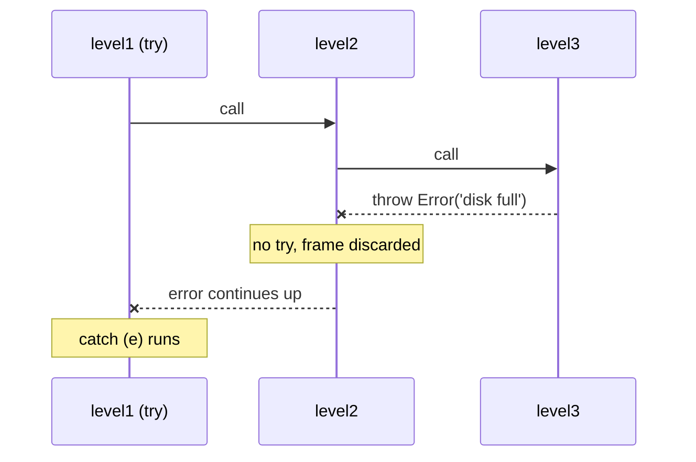

## Introduction

Imagine a function that loads a user's settings: it reads a file, parses it as JSON, and validates the result. Any of those steps can fail. Without a dedicated mechanism, each step would have to return some "it failed" signal, and every caller would have to check that signal and pass it upward, through every layer, until it reached code that knew what to do. Most of the program would be error-checking boilerplate, and forgetting one check would let the failure slip through silently.

**Exceptions** solve this. When code detects a problem it cannot handle, it **throws**: it stops what it is doing and hands an error to the nearest enclosing code that has declared it can handle errors. Every function in between is skipped automatically. The code that handles the error is written in one place — a **`catch`** block — and code that must run no matter what, such as closing a file or hiding a spinner, goes in a **`finally`** block.

JavaScript's exception handling uses four keywords: `throw`, `try`, `catch` and `finally`. The rules are short, but they have sharp corners — a `return` inside `finally` can silently discard an error, and a `try` around a `setTimeout` catches nothing. This lesson teaches the rules precisely enough that you can predict the output of any combination.

What gets thrown — the error objects themselves — is covered in [[b1-error-types]]. Designing your own error classes is in [[b1-custom-errors]]. This lesson is about control flow.

## Before you start

- **Functions and the call stack** — throwing unwinds the stack of active function calls. See [[b1-call-stack]].
- **Error objects** — you should know that `new Error('msg')` creates an object with `name`, `message` and `stack`. See [[b1-error-types]].
- **Block scope** — `try`, `catch` and `finally` are blocks, so `let` and `const` inside them are local. See [[b1-block-scope-vars]].
- **Promises, lightly** — the last part connects to `await`. [[b1-promises]] and [[b1-async-await]] give the background.

## The intuition

Picture a stack of trays in a cafeteria, one tray per function call: `main` at the bottom, the function it called on top of it, and so on. Normally, when a function finishes, its tray is removed and control returns to the tray below.

A `throw` is like an alarm going off on the top tray. Each tray is removed immediately — the code on it does not finish — until the alarm reaches a tray that has a `try`/`catch` "net" around the call that was running. That net catches the error, and execution continues from the `catch` block on that tray. If no tray has a net, the alarm reaches the bottom of the stack and the host (browser or Node.js) reports an uncaught error.

`finally` is a rule stuck to a tray: "before you remove me, do this". Whether the tray is being cleared normally, by a `return`, or by an alarm passing through, the `finally` code runs on the way out.

## throw

The `throw` statement takes any expression, evaluates it, and starts exception propagation with that value:

```js title="throw-basic.js"
function parsePercent(text) {
  const n = Number(text);
  if (!Number.isFinite(n) || n < 0 || n > 100) {
    throw new RangeError(`Expected 0-100, got "${text}"`);
  }
  return n;
}

console.log(parsePercent('42'));
try {
  console.log(parsePercent('250'));
} catch (e) {
  console.log(`${e.name}: ${e.message}`);
}
```

```output
42
RangeError: Expected 0-100, got "250"
```

Three properties of `throw` matter.

**It is a statement, not an expression.** You cannot write `const n = value ?? throw new Error()`. (A "throw expressions" proposal exists but is not part of the language.) Wrap it in a function or use an `if`.

**Nothing after it in the same block runs.** `throw` transfers control the moment it executes, like `return` does, so code after it is unreachable.

**Any value can be thrown**, but you should throw `Error` objects. A thrown string has no stack trace and no `name`, which makes the failure much harder to trace. [[b1-error-types]] explains this in detail.

### When to throw

Throw when a function **cannot do what its name promises** and the caller needs to know. `parsePercent('250')` cannot return a valid percentage, so it throws. In contrast, "no search results" is a normal outcome, not a failure: `findUser(id)` returning `null` for a missing user is often clearer than throwing. A useful test is whether a reasonable caller would want to handle the case in its normal flow (return a value) or treat it as something going wrong (throw).

## try and catch

A `try` block runs its statements. If any of them — or any function they call, however deep — throws, the rest of the `try` block is skipped and control jumps to the `catch` block, with the thrown value bound to the name in parentheses.

```js title="unwinding.js"
function level3() {
  console.log('level3 start');
  throw new Error('disk full');
}
function level2() {
  console.log('level2 start');
  level3();
  console.log('level2 end'); // skipped: level3 threw
}
function level1() {
  try {
    level2();
    console.log('after level2'); // skipped
  } catch (e) {
    console.log('level1 caught:', e.message);
  }
  console.log('level1 continues');
}
level1();
```

```output
level2 start
level3 start
level1 caught: disk full
level1 continues
```

Follow the trays. `level3` throws; it has no `try`, so its frame is discarded. `level2` has no `try` either, so its frame is discarded and `'level2 end'` never prints. `level1` called `level2` from inside a `try`, so the error stops there, the `catch` block runs, and execution continues normally after the whole `try`/`catch` statement. From the outside, `level1` returned normally — the error was fully handled.



### The catch binding

The name in `catch (e)` is a new variable scoped to the `catch` block, like a function parameter. It does not exist after the block ends. You can destructure it — `catch ({ name, message })` — though that throws a new TypeError if someone threw `null` or `undefined`.

Since ES2019, if you do not need the value at all, you can omit the binding:

```js title="optional-binding.js"
function isValidJson(text) {
  try {
    JSON.parse(text);
    return true;
  } catch {
    return false;
  }
}
console.log(isValidJson('{"a":1}'), isValidJson('{a:1}'));
```

```output
true false
```

**Optional catch binding** is appropriate exactly when the *kind* of failure does not matter — here, every failure means "not valid JSON". If different failures need different handling, take the binding and inspect it.

### Catch only what you can handle

A `catch` receives *everything* thrown inside its `try`: the error you expected, but also typos (`ReferenceError`), null-access bugs (`TypeError`) and failures from deep inside libraries. A `catch` that treats all of them as the expected case hides real bugs.

The fix is to check what you caught and **rethrow** anything you did not anticipate:

```js title="selective-catch.js"
function loadSettings(raw) {
  try {
    const settings = JSON.parse(raw);
    return { theme: settings.theme ?? 'light' };
  } catch (e) {
    if (e instanceof SyntaxError) {
      // Corrupt saved settings are expected; fall back to defaults.
      return { theme: 'light' };
    }
    throw e; // anything else is a bug and must stay visible
  }
}

console.log(loadSettings('{"theme":"dark"}'));
console.log(loadSettings('not json'));
try {
  loadSettings(null); // JSON.parse(null) parses "null"; then null.theme...
} catch (e) {
  console.log('rethrown:', e.name);
}
```

```output
{ theme: 'dark' }
{ theme: 'light' }
rethrown: TypeError
```

`JSON.parse(null)` converts `null` to the string `"null"`, which is valid JSON, and returns `null`. Then `settings.theme` throws a TypeError. If the `catch` had returned defaults for *every* error, this bug — a caller passing `null` — would have been silently converted into "light theme" and never noticed. Rethrowing keeps it loud.

`throw e` rethrows the *same object*, so its original stack trace is preserved; it still points at where the error was created, not at the rethrow.

### Adding context while rethrowing

Often the right move is neither swallowing nor rethrowing unchanged, but **wrapping**: throw a new, more meaningful error and attach the original as its `cause` (ES2022):

```js title="wrap-cause.js"
function readConfig(text, path) {
  try {
    return JSON.parse(text);
  } catch (e) {
    throw new Error(`Config file ${path} is not valid JSON`, { cause: e });
  }
}
try {
  readConfig('{ port: 80 }', '/etc/app.json');
} catch (e) {
  console.log(e.message);
  console.log('caused by:', e.cause.name);
}
```

```output
Config file /etc/app.json is not valid JSON
caused by: SyntaxError
```

The new message says *what the program was trying to do*, which the low-level `SyntaxError` cannot know. The `cause` keeps the low-level detail and its stack. Node.js and browser consoles print the cause chain when you log the outer error.

## finally

A `finally` block runs **whenever control leaves the `try` statement**, by any route: the `try` finished normally, the `catch` finished, a `return`, `break` or `continue` jumped out, or an exception is passing through uncaught. A `try` must have a `catch`, a `finally`, or both; `try { } finally { }` with no `catch` is valid and common.

`finally` exists for **cleanup** — work that must happen whether or not the main work succeeded: releasing a lock, closing a file handle, hiding a loading indicator, restoring a temporarily changed setting.

```js title="finally-routes.js"
function attempt(mode) {
  try {
    if (mode === 'throw') throw new Error('boom');
    if (mode === 'return') return 'returned early';
    return 'finished';
  } catch (e) {
    return `caught ${e.message}`;
  } finally {
    console.log(`  finally ran (${mode})`);
  }
}
for (const mode of ['normal', 'return', 'throw']) {
  console.log(attempt(mode));
}
```

```output
  finally ran (normal)
finished
  finally ran (return)
returned early
  finally ran (throw)
caught boom
```

Notice the order: in every case the `finally` line prints *before* the returned value is logged by the caller. When the `try` or `catch` executes `return`, the return value is computed and set aside, `finally` runs, and only then does the function actually return.

### finally with loops

`break` and `continue` inside a `try` also pass through `finally`:

```js title="finally-loop.js"
for (let i = 0; i < 3; i++) {
  try {
    if (i === 1) continue;
    if (i === 2) break;
    console.log('body', i);
  } finally {
    console.log('finally', i);
  }
}
```

```output
body 0
finally 0
finally 1
finally 2
```

### The return value is captured before finally runs

A `return x` in the `try` evaluates `x` *at that moment*. Changing the variable in `finally` does not change what is returned:

```js title="finally-capture.js"
function counter() {
  let x = 1;
  try {
    return x;
  } finally {
    x = 2;
    console.log('x in finally is', x);
  }
}
console.log('returned', counter());
```

```output
x in finally is 2
returned 1
```

(If `x` were an object, mutating its properties in `finally` *would* be visible, because the returned value is a reference to the same object.)

### Control flow inside finally overrides everything

This is the corner that causes real bugs. If `finally` itself completes with a `return`, `throw`, `break` or `continue`, that **replaces** whatever was happening — including an exception in flight:

```js title="finally-override.js"
function returnOverrides() {
  try {
    return 'from try';
  } finally {
    return 'from finally';
  }
}
function errorSwallowed() {
  try {
    throw new Error('payment failed');
  } finally {
    return 'ok'; // the error is silently discarded
  }
}
function errorMasked() {
  try {
    throw new Error('original problem');
  } finally {
    throw new Error('cleanup failed'); // replaces the original
  }
}
console.log(returnOverrides());
console.log(errorSwallowed());
try {
  errorMasked();
} catch (e) {
  console.log('caller sees:', e.message);
}
```

```output
from finally
ok
caller sees: cleanup failed
```

`errorSwallowed` is the dangerous one: a payment failure becomes a successful `'ok'` with no trace. `errorMasked` is subtler and common in real code — a cleanup step (closing a connection that is already broken) throws, and the error that explains *why* things broke is lost. The rules that follow:

- **Never `return` from `finally`.** Many linters flag it (ESLint's `no-unsafe-finally`).
- **Make cleanup unlikely to throw**, and if it can throw, catch inside `finally` and log, so the original error survives.

> [!WARNING] finally is for cleanup only
> A `finally` block should not decide the function's result. If it returns, throws or breaks, it overwrites the outcome of the `try` and `catch`, including errors you needed to see.

### Nested try statements

When `try` statements nest, an error is caught by the innermost `catch` whose `try` contains it, and each `finally` on the way out runs in order, innermost first:

```js title="nested.js"
try {
  try {
    throw new Error('inner');
  } finally {
    console.log('1. inner finally');
  }
} catch (e) {
  console.log('2. outer catch:', e.message);
} finally {
  console.log('3. outer finally');
}
```

```output
1. inner finally
2. outer catch: inner
3. outer finally
```

The inner `try` has no `catch`, so the error passes through it — running its `finally` on the way — to the outer `catch`.

```quiz
Q: What does `f()` return? `function f() { try { throw new Error('a'); } catch (e) { return 'b'; } finally { console.log('c'); } }`
- [ ] It throws `Error('a')`
- [x] `'b'`, after logging `c`
- [ ] `undefined`, because finally has no return
> The `catch` handles the error and starts returning `'b'`. Control is leaving the `try`
> statement, so `finally` runs and logs `c`. Because `finally` completes normally, the pending
> `return 'b'` goes ahead. Only a `return`, `throw`, `break` or `continue` inside `finally` would
> replace it.
```

## How it works internally

The specification models every statement's result as a **completion record**: a small record saying how the statement finished. Its type is *normal* (ran to the end), *return*, *throw*, *break* or *continue*, and it carries a value (the return value or the thrown value). `throw expr` evaluates `expr` and produces a *throw* completion with that value.

Every construct passes completions upward. A function body that produces a *throw* completion makes the call itself produce a *throw* completion in the caller — that is the unwinding you saw. The `try` statement is the one place that inspects them:

1. Run the `try` block and record its completion `C`.
2. If `C` is a *throw* completion and there is a `catch`, bind the thrown value and run the `catch` block; its completion becomes the new `C`.
3. If there is a `finally`, run it and record its completion `F`. If `F` is *normal*, the result of the whole statement is `C`. Otherwise — `F` is a return, throw, break or continue — the result is `F`, and `C` is discarded.

Step 3 is the whole explanation for the `finally` edge cases: a normal `finally` lets the pending return or throw continue unchanged, and an abrupt `finally` replaces it.

Engines implement this with exception tables or handler records rather than checking after every statement: entering a `try` notes where its handler is; a throw consults those records to find the nearest handler and discards the stack frames in between. That makes the non-throwing path cheap. Older V8 versions (the Crankshaft compiler, before 2017) refused to optimise functions containing `try`/`catch`, which led to advice to move `try` into small wrapper functions. Since the TurboFan compiler, functions with `try`/`catch` are optimised normally, and that advice is obsolete. Actually *throwing* is still relatively expensive, because the engine builds a stack trace, so do not use exceptions for ordinary loop control.

## try/catch and asynchronous code

`try`/`catch` only catches errors thrown **while its `try` block is on the call stack**. Code that is *scheduled* inside the `try` but runs later is outside it:

```js title="async-escape.js"
process.on('uncaughtException', (e) => {
  console.log('uncaught:', e.message);
});
try {
  setTimeout(() => {
    throw new Error('thrown from timer');
  }, 0);
  console.log('try block finished');
} catch (e) {
  console.log('caught:', e.message); // never runs
}
```

```output
try block finished
uncaught: thrown from timer
```

By the time the timer callback runs, the `try` block finished long ago and its frame is gone; the callback runs on a fresh call stack started by the event loop (see [[b1-event-loop]]). The error is uncaught. (The `process.on` line is Node.js-specific and only here so the program keeps running to print it; without it Node.js prints the error and exits with code 1.) The same applies to event listeners, callbacks passed to `fs.readFile`, and `.then` callbacks: put the `try` *inside* the callback, or use the callback API's own error channel, such as the error-first argument in Node.js ([[b1-error-first-callbacks]]).

Promises have their own error channel — a rejected promise — and `await` connects it back to `try`/`catch`. Inside an `async` function, `await` on a rejected promise *throws* the rejection reason at that line, so an ordinary `try`/`catch` around the `await` handles it:

```js title="await-catch.mjs"
const fetchUser = (id) =>
  id > 0
    ? Promise.resolve({ id, name: 'Ada' })
    : Promise.reject(new Error(`No user ${id}`));

async function show(id) {
  try {
    const user = await fetchUser(id);
    console.log('loaded', user.name);
  } catch (e) {
    console.log('failed:', e.message);
  } finally {
    console.log('hide spinner');
  }
}
await show(1);
await show(-1);
```

```output
loaded Ada
hide spinner
failed: No user -1
hide spinner
```

This file uses top-level `await`, so it must run as an ES module (hence the `.mjs` extension). The `finally` that hides a spinner is the canonical front-end use. Forgetting the `await` — `return fetchUser(id)` without it inside the `try` — means the rejection happens after the `try` has finished, and the `catch` never sees it. That pitfall and its subtleties are covered in [[b1-await-try-catch]]; rejected promises nobody handles at all are covered in [[b1-unhandled-rejection]].

### Last-resort global handlers

When an exception escapes all `try` blocks, the host reports it. In browsers, an uncaught exception fires an `error` event on `window` (also reachable as `window.onerror`) and prints "Uncaught …" in the console; the page keeps running, but the task that threw was abandoned. In Node.js, an uncaught exception fires `process.on('uncaughtException')`; with no listener, Node.js prints the stack and exits with code 1. These hooks are for **reporting** — sending the error to a monitoring service — not for recovering, because by the time they run the program is in an unknown state. Node.js's documentation explicitly says the process should be restarted after an `uncaughtException`.

## Worked example: a lock that is always released

A classic use of `finally`: an operation takes a lock, and the lock must be released whether the operation succeeds or fails, or every later caller will wait forever.

```js title="with-lock.js"
const lock = { held: false };

function withLock(task) {
  if (lock.held) throw new Error('Lock already held');
  lock.held = true;
  try {
    return task();
  } finally {
    // Runs on success, on error, and on early return from task().
    lock.held = false;
  }
}

console.log(withLock(() => 'saved'), '| held:', lock.held);
try {
  withLock(() => {
    throw new Error('write failed');
  });
} catch (e) {
  console.log(e.message, '| held:', lock.held);
}
console.log(withLock(() => 'saved again'), '| held:', lock.held);
```

```output
saved | held: false
write failed | held: false
saved again | held: false
```

Step through it. The lock is checked and taken *before* the `try`; if taking it failed, there would be nothing to release, so it must not be inside the `try`. The `try` contains only the work. There is no `catch`: `withLock` cannot do anything useful about a failed task, so it lets the error continue to the caller — `finally` releases the lock on the way. Without `finally`, the second call would leave `lock.held` as `true`, and the third call would throw "Lock already held" for a failure that happened earlier.

The same structure — acquire, `try` the work, release in `finally`, no `catch` — applies to database transactions, file handles, temporary DOM state, and toggling a `loading` flag around an `await`.

## In real systems

**API handlers** wrap the whole request in one `try`/`catch` at the top (often in framework middleware), translate known errors into status codes (a validation error into 400, not-found into 404), and turn everything else into a 500 with a logged stack. Lower layers mostly throw and do not catch.

**UI event handlers** catch around `await` calls so they can show an error message, and use `finally` to reset loading state so a button never stays disabled after a failure.

**React** components cannot use `try`/`catch` to catch errors thrown during rendering of their children; that role is played by **error boundaries** ([[b4-error-boundaries]]). Event handlers and async code inside components still use ordinary `try`/`catch`.

**Libraries** that wrap lower-level failures use `{ cause }` so that an application log shows both "Could not save order 18" and the underlying "connection reset".

## Trade-offs and alternatives

Exceptions keep the success path clean and make it impossible to *forget* to propagate a failure: an unhandled error does not vanish, it surfaces. The cost is that failure paths are invisible in function signatures — nothing in `parseConfig(text)` says it throws — and a broad `catch` can hide bugs.

The main alternative is returning errors as values: `{ ok: true, value }` or `{ ok: false, error }` (a **result type**). It makes failures explicit and type-checkable in TypeScript, and suits expected outcomes such as validation results. Many codebases mix both: result values for expected, recoverable outcomes, and exceptions for unexpected failures and programming errors. `Promise.allSettled` ([[b1-promise-allsettled]]) is the same idea for batches of promises.

## Common mistakes

**Catching everything and continuing.** `catch (e) {}` or `catch (e) { return defaultValue; }` with no check turns typos and null bugs into wrong-but-silent behaviour. Catch narrowly, check the type, rethrow the rest.

**Logging and rethrowing at every layer.** If five layers each `console.error` then rethrow, one failure produces five log entries. Handle or log at one boundary; elsewhere let errors pass or wrap them with `cause`.

**`return` or `throw` in `finally`.** It discards the real outcome. Keep `finally` to cleanup.

**Expecting `try` to catch callback errors.** It catches only synchronous throws during the `try` and rejections from promises it `await`s.

**Missing `await` inside `try`.** `try { return save(); } catch {}` in an `async` function does not catch `save`'s rejection; `return await save()` does.

**Acquiring a resource inside the `try` whose `finally` releases it.** If acquisition fails, `finally` releases something that was never acquired. Acquire before the `try`.

## Interview perspective

**Output-prediction questions** dominate: combinations of `return` in `try` and `finally`, `throw` in `finally`, nested `try` with only `finally`, and loops with `continue`. Answer by stating the rule — "a `finally` that completes normally lets the pending completion continue; an abrupt one replaces it" — then applying it.

**"Does `finally` always run?"** Whenever control leaves the `try` statement by any route. It does not run if control never leaves: an infinite loop inside `try`, or the process being killed (`process.exit()` in Node.js exits immediately without running pending `finally` blocks).

**"Why doesn't this `try` catch the error in `setTimeout`?"** The callback runs later, on a new call stack, after the `try` has finished. Strong answers mention the event loop and show the fix: `try` inside the callback, or promises with `await`.

**"When would you rethrow?"** When the error is not one this code knows how to handle. Mention wrapping with `cause` to add context.

```quiz
Q: What does this print? `function g() { try { throw new Error('A'); } finally { return 'B'; } } try { console.log(g()); } catch (e) { console.log(e.message); }`
- [ ] `A`
- [x] `B`
- [ ] Both `A` and `B`
> The `try` produces a throw completion carrying Error A. There is no `catch`, so `finally`
> runs; its `return 'B'` is an abrupt completion, which replaces the pending throw. `g` returns
> `'B'` normally, so the caller's `catch` never runs and error A is lost.
```

```quiz
Q: A function calls `setTimeout(() => { throw new Error('x') }, 0)` inside a try block. Where can the error be handled?
- [ ] In the surrounding catch block
- [x] Only by a try/catch inside the callback, or by a global uncaught-error handler
- [ ] In a finally block attached to the surrounding try
> The callback runs on a fresh call stack from the event loop after the `try` statement has
> completed, so neither its `catch` nor its `finally` is active any more. The error is uncaught
> unless the callback catches it itself; the host then reports it via `window`'s `error` event or
> Node.js's `uncaughtException`.
```

## Practice

1. Predict, then run: a `for` loop of three iterations whose body is `try { if (i === 1) return i; } finally { console.log(i); }`, inside a function. What is logged and what is returned?
2. Write `safeJsonParse(text, fallback)` that returns the fallback only for `SyntaxError` and rethrows anything else. Write a call that proves the rethrow path works.
3. Write `async function withSpinner(task)` that sets `state.loading = true`, awaits `task()`, and guarantees `state.loading` is `false` afterwards, whether the task resolves or rejects. Test both.
4. Rewrite `errorMasked` from this lesson so that a failing cleanup is logged but the original error is what reaches the caller.
5. A colleague's code has `catch (e) { console.error(e); throw e; }` in six nested functions. Explain the problem and propose where handling should live.

## Quick revision {#quick-revision}

- `throw expr` is a statement; it can throw any value, but throw `Error` objects for stack traces.
- A throw skips the rest of each frame up the call stack until the nearest enclosing `try` with a `catch`.
- `catch (e)` binds the thrown value in block scope; ES2019 allows `catch { }` with no binding.
- Catch narrowly: check the type, handle what you expect, `throw e` the rest (stack is preserved).
- Wrap with context: `throw new Error('what we were doing', { cause: e })`.
- `finally` runs whenever control leaves the `try` statement: normal end, `return`, `break`, `continue` or a passing throw.
- A `return x` in `try` captures `x`'s value before `finally` runs; reassigning `x` in `finally` does not change it.
- `return`/`throw`/`break` inside `finally` replaces the pending result, swallowing or masking errors.
- Spec model: completion records; an abrupt `finally` completion wins, a normal one passes the pending completion through.
- `try` does not catch errors from callbacks scheduled for later; `await` inside `try` does catch rejections.
- Global last resorts: `window` `error` event; Node.js `uncaughtException` (then restart the process).

## Key takeaways {#key-takeaways}

- Exceptions let the code that detects a failure and the code that handles it be far apart, with every layer in between skipped automatically.
- A `catch` should handle only the failures it understands; rethrow or wrap the rest so bugs stay visible.
- `finally` is for cleanup that must always happen, and it must never return or throw on its own account.
- `try`/`catch` is synchronous: it covers code on the stack during the `try`, plus promises you `await` there.
- Global handlers are for reporting, not recovery.
