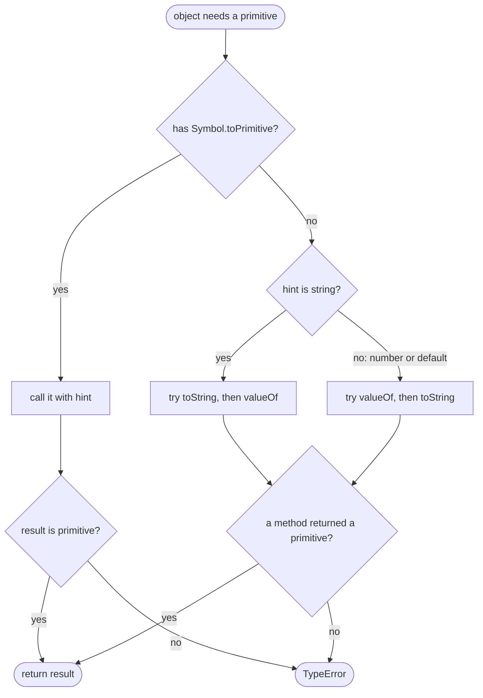

## Introduction

Here is a small object that represents a price, and two attempts to use it in ordinary expressions:

```javascript title="price-object.js"
const price = { amount: 1999, currency: 'USD' };

console.log(price + 1);
console.log(price * 2);
console.log(`Price: ${price}`);
```

```output
[object Object]1
NaN
Price: [object Object]
```

None of these lines throws an error, and none does anything useful. Compare that with a `Date`, which is also an object:

```javascript title="date-object.js"
const start = new Date('2024-01-01T00:00:00Z');
const end = new Date('2024-01-02T00:00:00Z');

console.log(end - start);
console.log(start < end);
console.log(typeof (start + 1));
```

```output
86400000
true
string
```

Subtracting two dates gives the number of milliseconds between them, comparing them works, and adding a number produces a string. The date clearly knows how to become a number for `-` and `<`, and a string for `+`. The plain object knows only one feeble trick: becoming the text `'[object Object]'`.

The reason is a step the language performs every time an operator receives an object. Operators are defined on **primitive values** — strings, numbers, bigints, booleans, symbols, `null` and `undefined`. Before an operator can do its work, any object operand must be converted to a primitive. The specification calls this step **ToPrimitive**, and objects control its result through three methods: `valueOf`, `toString` and `Symbol.toPrimitive`. Dates override these methods; plain objects inherit generic defaults.

Understanding ToPrimitive explains a whole family of puzzling results — `[] + {}`, `[] == 0`, `String(obj)` differing from `obj + ''` — and it lets you design objects, such as money or durations, that work sensibly with operators. Just as importantly, it tells you when *not* to: an explicit method is often clearer than an object that quietly turns into a number.

## Before you start

- **Objects as values** — objects are reference values with properties and methods. See [[b1-objects-as-values]].
- **Explicit conversion** — `String()`, `Number()` and the ToString and ToNumber operations, which call ToPrimitive when they meet an object. See [[b1-explicit-conversion]].
- **The prototype chain** — `valueOf` and `toString` are usually inherited from `Object.prototype` or a built-in prototype rather than defined on the object itself. See [[b1-prototype-chain]].
- **Symbols** — `Symbol.toPrimitive` is a *well-known symbol*, a built-in symbol the language uses as a hook. See [[b1-symbols]] and [[b1-well-known-symbols]].

## The intuition

Imagine a receptionist at a building that only admits plain visitors — numbers and strings. When an object arrives, the receptionist asks it to send down a representative. The question comes with a note saying what the building needs right now: "a number, please", "a string, please", or "either is fine". That note is the **hint**.

An object can answer in one of two ways. A modern object has a single receptionist of its own, `Symbol.toPrimitive`, who reads the note and decides what to send. An object without one falls back on an older routine: it tries two methods in turn, `valueOf` and `toString`, in an order that depends on the note, and sends the first answer that is a primitive. If neither method produces a primitive, the visitor is turned away with a `TypeError`.

Where the analogy stops: the hint is a preference, not a requirement. An object asked for a number may return a string, and the operator will then convert that string further. ToPrimitive only guarantees that what comes back is *some* primitive.

## When ToPrimitive runs, and with which hint

ToPrimitive runs whenever an operation needs a primitive and has received an object. The operation also chooses the hint. The following table was checked by giving an object a `Symbol.toPrimitive` method that logs the hint it receives:

| Hint | Operations that pass it |
|---|---|
| `"number"` | `Number(obj)`, unary `+obj` and `-obj`, arithmetic `-` `*` `/` `%` `**`, relational `<` `>` `<=` `>=`, `Math` functions, global `isNaN` |
| `"string"` | `String(obj)`, template literals, using an object as a property key `o[obj]`, `'a'.concat(obj)`, `parseInt(obj)`, `Array.prototype.join` on elements |
| `"default"` | binary `+`, loose equality `==` against a primitive, `new Date(obj)` |
| not called at all | `if (obj)`, `Boolean(obj)`, `!obj`, `===`, `Object.is`, `JSON.stringify` |

```javascript title="which-hint.js"
const spy = {
  [Symbol.toPrimitive](hint) {
    console.log('hint:', hint);
    return hint === 'number' ? 42 : 'spy';
  },
};

console.log(+spy);
console.log(`${spy}`);
console.log(spy + 1);
console.log(spy == 'spy');
console.log(Boolean(spy), spy === spy);
```

```output
hint: number
42
hint: string
spy
hint: default
spy1
hint: default
true
true true
```

The `"default"` hint deserves a word. Binary `+` cannot know whether you meant addition or concatenation until it has the primitives, so it does not express a preference; `==` is in the same position. Ordinary objects treat `"default"` exactly like `"number"`. Dates are the one built-in that treat it like `"string"` — which is why `date + 1` concatenates while `date - 1` subtracts.

The last row matters as much as the others. Conditions never call ToPrimitive, so **no object can make itself falsy**; strict equality compares objects by identity without converting them; and `JSON.stringify` uses its own rules (`toJSON`, then enumerable properties) rather than `valueOf` or `toString`.

## The algorithm

The specification's ToPrimitive is short. Given an input and an optional preferred type:

1. If the input is already a primitive, return it unchanged.
2. Look up the property `Symbol.toPrimitive` on the object (through its prototype chain). If it exists and is not `undefined` or `null`:
   - If it is not callable, throw a `TypeError`.
   - Call it with the hint string: `"string"`, `"number"`, or `"default"` when no preferred type was given.
   - If the result is a primitive, return it. If it is an object, throw a `TypeError`.
3. Otherwise run **OrdinaryToPrimitive**, treating a missing preference as `"number"`:
   - For `"string"`, try the methods `toString` then `valueOf`. For `"number"`, try `valueOf` then `toString`.
   - For each, if the property is a function, call it; if the result is a primitive, return it. If the property is not a function, or returns an object, move on.
   - If both attempts fail, throw a `TypeError`.



Watch the fallback order happen, including the failure case:

```javascript title="ordinary-order.js"
const traced = {
  valueOf() { console.log('  valueOf called'); return {}; },
  toString() { console.log('  toString called'); return '7'; },
};
console.log('number hint:', +traced);
console.log('string hint:', String(traced));

const hopeless = { valueOf() { return {}; }, toString() { return {}; } };
try { hopeless + 1; } catch (e) { console.log(e.name + ': ' + e.message); }
```

```output
  valueOf called
  toString called
number hint: 7
  toString called
string hint: 7
TypeError: Cannot convert object to primitive value
```

With the number hint, `valueOf` runs first, returns an object (which does not count), and `toString` is tried next; its `'7'` is then converted by unary `+` into the number 7. With the string hint, `toString` succeeds at once and `valueOf` is never called. The `hopeless` object has no way to produce a primitive, so the operator throws. The error message is V8's; other engines word it differently.

This order explains why plain objects and arrays end up as strings even in numeric contexts. Their inherited `valueOf` (from `Object.prototype`) returns the object itself, which is not a primitive, so it always "fails" and `toString` decides the result. That is how `+[]` becomes `+''` and then `0`, and `{} * 1` becomes `'[object Object]' * 1` and then `NaN`.

## valueOf() {#b1-valueof}

`valueOf` is the method an object uses to say "if you need a primitive from me — usually a number — here it is". During ToPrimitive it is tried *first* for the `"number"` and `"default"` hints and *second* for the `"string"` hint. You rarely call it yourself; the engine calls it for you when the object meets an operator.

### The default does nothing useful

Every ordinary object inherits `Object.prototype.valueOf`, which simply returns the object itself. Because the result is an object, ToPrimitive treats it as "no answer" and moves on to `toString`. So for plain objects, arrays and functions, `valueOf` is effectively invisible.

A few built-ins override it with something meaningful:

```javascript title="builtin-valueof.js"
const arr = [1, 2];
console.log(arr.valueOf() === arr);
console.log(new Date('2024-01-01T00:00:00Z').valueOf());
console.log(new Number(5).valueOf(), typeof new Number(5).valueOf());
console.log(new Number(5) + 1, new Boolean(false) + 1, new String('a') + 'b');
```

```output
true
1704067200000
5 number
6 1 ab
```

A `Date`'s `valueOf` returns its timestamp in milliseconds, which is what makes `end - start` and `start < end` work. The wrapper objects created by `new Number`, `new Boolean` and `new String` return the primitive they wrap, which is how wrapper objects take part in arithmetic (see [[b1-autoboxing]]). For `new Boolean(false) + 1`, `valueOf` returns `false`, which converts to `0`, giving `1`.

### Defining your own

An object that genuinely *is* a quantity can define `valueOf` to return that quantity. Then numeric operators, comparisons and sorting by subtraction work naturally:

```javascript title="custom-valueof.js"
class Temperature {
  constructor(celsius) { this.celsius = celsius; }
  valueOf() { return this.celsius; }
  toString() { return `${this.celsius}°C`; }
}

const readings = [new Temperature(21.5), new Temperature(-3), new Temperature(8)];
readings.sort((a, b) => a - b);

console.log(readings.map(String));
console.log(readings[0] < readings[1], Math.max(...readings));
console.log(`Coldest: ${readings[0]}`);
console.log('Coldest: ' + readings[0]);
```

```output
[ '-3°C', '8°C', '21.5°C' ]
true 21.5
Coldest: -3°C
Coldest: -3
```

`a - b` uses the number hint, so `valueOf` supplies the Celsius values and the comparator works. `<` and `Math.max` use the number hint as well. The template literal uses the string hint, so `toString` runs and the unit appears. The last line is the trap: binary `+` passes `"default"`, which ordinary objects treat as number, so `valueOf` wins and the unit vanishes. **When an object defines both methods, `obj + ''` and `` `${obj}` `` give different text.** Templates are the reliable way to get the `toString` form.

### Things valueOf does not affect

`valueOf` is consulted only by ToPrimitive. It does not change identity comparisons — two `Temperature(8)` objects are still not `===`, and `==` between two objects also compares identity without converting either side (see [[b1-equality]]). It does not affect truthiness: a `Temperature(0)` is truthy. And `JSON.stringify` ignores it on ordinary objects — it serialises enumerable properties, or calls a `toJSON` method if one exists:

```javascript title="valueof-json.js"
const t = { celsius: 8, valueOf() { return 8; } };
console.log(JSON.stringify(t), JSON.stringify({ valueOf() { return 3; } }));
console.log(JSON.stringify(new Number(3)));
```

```output
{"celsius":8} {}
3
```

The one exception is the built-in wrapper objects, which `JSON.stringify` unwraps to their primitive (that is why `new Number(3)` serialises as `3`). For your own classes, define `toJSON` if you want a particular JSON form.

### Rules for a good valueOf

Return a primitive — returning an object silently pushes the decision to `toString`. Keep it fast and free of side effects, because the engine may call it at moments you do not expect (every comparison in a sort calls it twice). And define it only for objects that really are a single quantity: a temperature, a duration, a money amount stored in cents. An object such as a user or an order has no natural number, and giving it one invites bugs like `user1 < user2` quietly returning something.

```quiz
Q: A class defines `valueOf()` returning a number and `toString()` returning a formatted label. Which expression produces the label?
- [ ] `obj + ''`
- [x] `` `${obj}` ``
- [ ] `obj * 1`
- [ ] `obj < 10`
> Template literals ask for a primitive with the "string" hint, so `toString` is tried first. Binary `+` passes "default", which ordinary objects handle like "number", so `valueOf` wins and you get the number as text. `*` and `<` use the "number" hint.
```

## toString() {#b1-object-tostring}

`toString` is the method an object uses to describe itself as text. During ToPrimitive it is tried *first* for the `"string"` hint and *second* for `"number"` and `"default"`. Because the default `valueOf` returns the object itself, `toString` ends up deciding the conversion for most objects, in any context.

### The default: `[object Tag]`

Ordinary objects inherit `Object.prototype.toString`, which returns `'[object '`, a tag, and `']'`. The tag comes from the object's `Symbol.toStringTag` property if it has one, or from built-in rules (`Array`, `Function`, `Date`, `Null`, and so on) when called on those values. For a plain object the tag is `Object`:

```javascript title="default-tostring.js"
console.log(String({}), String({ [Symbol.toStringTag]: 'Money' }));
console.log(Object.prototype.toString.call([]), Object.prototype.toString.call(null));
```

```output
[object Object] [object Money]
[object Array] [object Null]
```

Calling `Object.prototype.toString` explicitly with `.call` is a well-known way to get a value's type tag, because many built-in prototypes replace `toString` with something else. The details, and why the tag is a label rather than proof of type, are in [[b1-tostringtag]].

### Built-in overrides

Most built-in prototypes override `toString` with a more useful description, and these overrides are what you see whenever a built-in object meets `+`, a template or `String()`:

```javascript title="builtin-tostring.js"
console.log(String([1, [2, [3]]]));
console.log(String(new Error('disk full')));
console.log(String(/ab+c/gi));
console.log(String((a, b) => a + b));
console.log(String(Math.max));
console.log((255).toString(16), (10).toString(2));
```

```output
1,2,3
Error: disk full
/ab+c/gi
(a, b) => a + b
function max() { [native code] }
ff 1010
```

Arrays join their elements with commas (recursively, so nesting is lost). Errors produce `"Name: message"`. Regular expressions give their source and flags. Functions return their source text, and built-in functions return a placeholder containing `[native code]`. `Number.prototype.toString` accepts a radix from 2 to 36. `Date.prototype.toString` returns a human-readable date in the *local* time zone, in a format the specification fixes but that depends on where the code runs, so it is unsuitable for storage — use `toISOString()` for that.

### Defining your own

A custom `toString` gives readable output whenever the object is put into text:

```javascript title="custom-tostring.js"
class Point {
  constructor(x, y) { this.x = x; this.y = y; }
  toString() { return `(${this.x}, ${this.y})`; }
}

const p = new Point(1, 2);
console.log(`Clicked at ${p}`);
console.log('Clicked at ' + p);
console.log(String(p), +p);
console.log(p == '(1, 2)');
```

```output
Clicked at (1, 2)
Clicked at (1, 2)
(1, 2) NaN
true
```

This time `'Clicked at ' + p` agrees with the template: `Point` has no `valueOf` of its own, so the inherited one returns the object, fails, and `toString` is used. `+p` asks for a number, gets the string `'(1, 2)'` from `toString`, and converts it to `NaN`. The final line shows that `==` uses the same conversion, which is seldom what anyone intends.

Note what does *not* use your `toString`: `console.log(p)` in Node.js and in browser DevTools prints an interactive view of the object's properties, not its `toString` result. Only text conversions — templates, `+`, `String()`, `join` — call it.

### Rules for a good toString

Return a string (a non-string primitive is allowed by the algorithm but confuses readers). Never throw: template literals and string concatenation call `toString` without a `try`, so a throwing `toString` turns an innocent log message into a crash. Keep it cheap and side-effect free. And do not treat a function's `toString` as reliable: minifiers rewrite source, built-ins hide theirs, and checking source text is not a security mechanism.

```quiz
Q: A class defines only `toString()`, returning `'(1, 2)'`. What is `'P' + p`?
- [ ] `'P[object Object]'`
- [x] `'P(1, 2)'`
- [ ] `NaN`
- [ ] It throws because `+` asks for a number first
> Binary `+` passes the "default" hint, so ordinary objects try `valueOf` first. The inherited `valueOf` returns the object itself, which is not a primitive, so ToPrimitive falls through to `toString`, which returns '(1, 2)'. Because one operand is then a string, `+` concatenates.
```

## Symbol.toPrimitive {#b1-symbol-toprimitive}

`Symbol.toPrimitive` is a built-in symbol you can use as a method name. An object that has a method under this key takes complete control of its conversion: ToPrimitive calls that method with the hint and uses its result, and **never looks at `valueOf` or `toString`**. It was added in ES2015 to replace the two-method dance with one explicit hook.

### Shape and rules

The method receives one argument, the hint string `"number"`, `"string"` or `"default"`, and must return a primitive. The engine enforces three rules: if the property holds something that is not a function, the conversion throws; if the method returns an object, the conversion throws; if the property is `undefined` or `null`, it is ignored and the ordinary `valueOf`/`toString` lookup runs.

```javascript title="toprimitive-rules.js"
const wins = {
  [Symbol.toPrimitive]() { return 1; },
  valueOf() { return 2; },
};
console.log(+wins);

try { +{ [Symbol.toPrimitive]() { return {}; } }; } catch (e) { console.log(e.name); }
try { +{ [Symbol.toPrimitive]: 42 }; } catch (e) { console.log(e.name); }
console.log(+{ [Symbol.toPrimitive]: null, valueOf() { return 7; } });
```

```output
1
TypeError
TypeError
7
```

### A class with deliberate conversions

The real value of the hook is that it lets you decide, per hint, what makes sense. Take an amount of money stored as integer cents (storing cents avoids floating-point rounding; see [[b1-floating-point]]):

```javascript title="money.js"
class Money {
  constructor(cents, currency = 'USD') {
    this.cents = cents;
    this.currency = currency;
  }

  [Symbol.toPrimitive](hint) {
    if (hint === 'number') return this.cents;
    if (hint === 'string') return `${(this.cents / 100).toFixed(2)} ${this.currency}`;
    // "default" (binary +, ==): refuse, so price + 1 cannot silently mean anything.
    throw new TypeError('Use .cents or String(money) explicitly');
  }
}

const price = new Money(1999);
console.log(`Total: ${price}`);
console.log(price * 2, price > 1000);
try { price + 1; } catch (e) { console.log(e.message); }
try { price == 1999; } catch (e) { console.log(e.message); }
```

```output
Total: 19.99 USD
3998 true
Use .cents or String(money) explicitly
Use .cents or String(money) explicitly
```

The design choice is in the `"default"` branch. Returning `this.cents` would make `price + 1` mean "add one cent" and `price + ' due'` produce `'1999 due'` — both plausible-looking and both likely to be bugs. Throwing forces the caller to say which representation they want. You could equally return the string form for `"default"`, which is what `Date` does. There is no universal answer; the point of `Symbol.toPrimitive` is that you make the choice deliberately rather than inheriting it from whichever of `valueOf` or `toString` happens to be tried first.

### Built-ins that use it

Two built-in prototypes define `Symbol.toPrimitive`. `Date.prototype[Symbol.toPrimitive]` maps `"default"` to the string behaviour, which is the entire reason dates concatenate with `+`; it throws for any hint other than the three valid ones. `Symbol.prototype[Symbol.toPrimitive]` returns the symbol itself, so a `Symbol` wrapper object unwraps to its symbol. `Object.prototype` has no such method, which is why ordinary objects fall back to `valueOf` and `toString`.

### Keep it pure

ToPrimitive may run more than once for one expression, and in places a reader does not see. A conversion method with side effects produces genuinely strange code — the famous puzzle below is legal JavaScript:

```javascript title="side-effects.js"
const a = {
  n: 0,
  [Symbol.toPrimitive]() { return ++this.n; },
};
console.log(a == 1 && a == 2 && a == 3);
```

```output
true
```

Each `==` converts `a` again, and each conversion increments the counter. Interviewers use this puzzle to check that you know `==` calls ToPrimitive; in real code, a conversion method should return the same answer every time for the same object state.

In TypeScript you can declare the method with a typed hint: `[Symbol.toPrimitive](hint: 'number' | 'string' | 'default'): number | string`. Types are not checked at runtime, so the method should still handle unexpected hints.

```quiz
Q: An object has `Symbol.toPrimitive`, `valueOf` and `toString` methods. Which ones run when you evaluate `` `${obj}` ``?
- [x] Only `Symbol.toPrimitive`, called with `"string"`
- [ ] `toString`, because templates always call it
- [ ] `Symbol.toPrimitive`, then `toString` if it returns a number
- [ ] `valueOf`, then `toString`
> When an object has a callable `Symbol.toPrimitive`, ToPrimitive calls it with the hint and returns its result (or throws if it is an object). `valueOf` and `toString` are never consulted. If the method returns a number for the string hint, the template converts that number to text with ToString; it does not try other methods.
```


## Dates: the built-in exception

Dates are the object you will meet most often in conversions, and their behaviour follows directly from the pieces above. Predict each line before reading the output:

```javascript title="dates.js"
const d1 = new Date('2024-01-01T00:00:00Z');
const d2 = new Date('2024-01-01T00:00:00Z');

console.log(d1 == d2, d1 === d2);
console.log(+d1 === +d2, d1.getTime() === d2.getTime());
console.log(d1 <= d2 && d1 >= d2);
console.log(typeof (d1 + 0), typeof (d1 - 0));
```

```output
false false
true true
true
string number
```

The first line surprises many people: two dates for the same instant are not `==`. When both operands of `==` are objects, there is nothing to convert — the comparison checks whether they are the *same object*, and they are not. The second line fixes it by converting both to numbers explicitly; `getTime()` says the same thing more readably. The third line works because relational operators use the number hint, so both dates become timestamps — which is why `<=` and `>=` behave while `==` does not. The last line is `Date.prototype[Symbol.toPrimitive]` at work: binary `+` passes `"default"`, which dates map to a string, while `-` passes `"number"`.

The practical rule: **compare dates with `getTime()` (or unary `+`), never with `==` or `===`**, and do arithmetic on timestamps, not on `Date` objects with `+`. The newer `Temporal` API takes this further: its types are designed to throw from `valueOf`, so `<` and `-` cannot be used on them by accident and you must call explicit comparison methods. See [[b1-date-pitfalls]] and [[b1-temporal-api]].

## How it works internally

In the specification, ToPrimitive is an abstract operation called from inside the other conversions. **ToNumber** and **ToNumeric** call it with the hint `"number"`; **ToString** calls it with `"string"`; **ToPropertyKey** (used when an object becomes a property name) calls it with `"string"`; and a few operations — the `+` operator, `IsLooselyEqual` (the algorithm behind `==`) and the `Date` constructor — call it without a preference, which becomes `"default"` for an exotic `Symbol.toPrimitive` method and `"number"` for the ordinary path.

Finding the hooks is an ordinary property lookup. `GetMethod(obj, @@toPrimitive)` walks the prototype chain just like `obj[Symbol.toPrimitive]` would, so a method defined on a class is found through `Class.prototype`, and a getter or a `Proxy` trap can intercept it. OrdinaryToPrimitive then does `Get(obj, "valueOf")` and `Get(obj, "toString")` the same way. Because these are plain lookups and calls, any user code can run during a conversion — which is exactly why conversions can throw, log or (unwisely) mutate state.

The order of the two ordinary methods follows from what each hint wants. A number is most likely to come from `valueOf` (dates, wrappers), and text is most likely to come from `toString`, so each hint tries the likely method first and the other as a fallback. The fallback is why an object with only a `toString` still works in arithmetic, and an object with only a `valueOf` still works in a template.

Engines such as V8 make the common case fast — for an operand that is already a primitive, step 1 returns immediately and no lookup happens — but whatever optimisations they apply, the observable behaviour is always the algorithm above. That is also why patching built-in prototypes is dangerous: redefining `Array.prototype.toString` would change the result of every `[] + x` in the program, including inside libraries.

## Worked example: a Duration value class

A fitness app stores lap times as durations. The team wants three things: sorting and comparison should work numerically, putting a duration into text should give `1m 35s`, and JSON should contain plain milliseconds for the server. Here is a class that meets all three with one conversion hook and one `toJSON` method:

```javascript title="duration.js"
class Duration {
  #ms;

  constructor(ms) {
    if (!Number.isFinite(ms) || ms < 0) throw new RangeError(`Invalid duration: ${ms}`);
    this.#ms = ms;
  }

  static seconds(s) { return new Duration(s * 1000); }

  get ms() { return this.#ms; }

  [Symbol.toPrimitive](hint) {
    if (hint === 'number') return this.#ms;
    // "string" and "default" both give the readable form, like Date does.
    const totalSeconds = Math.round(this.#ms / 1000);
    const m = Math.floor(totalSeconds / 60);
    const s = totalSeconds % 60;
    return m > 0 ? `${m}m ${s}s` : `${s}s`;
  }

  toJSON() { return this.#ms; }
}

const laps = [Duration.seconds(95), Duration.seconds(42), Duration.seconds(61)];
laps.sort((a, b) => a - b);

console.log(`Fastest lap: ${laps[0]}`);
console.log('Laps: ' + laps.join(', '));
console.log(laps[0] < laps[1], Math.min(...laps));
console.log(JSON.stringify({ laps }));
console.log(laps[0] + 1);
```

```output
Fastest lap: 42s
Laps: 42s, 1m 1s, 1m 35s
true 42000
{"laps":[42000,61000,95000]}
42s1
```

Step through what happens. The comparator `a - b` passes the number hint to each duration, receives milliseconds and sorts numerically. The template literal passes the string hint and gets `42s`. `join` converts each element with ToString, so each element is asked with the string hint. `<` and `Math.min` use the number hint. `JSON.stringify` ignores `Symbol.toPrimitive` entirely and calls `toJSON`, so the server receives numbers. The milliseconds live in a private field (`#ms`), so outside code reads them through the `ms` getter instead of changing them.

The last line shows the cost of choosing the string form for `"default"`: `laps[0] + 1` concatenates. That is the same trade-off `Date` makes, and it is acceptable here because adding a plain number to a duration has no clear meaning anyway. A team that wanted `+` to be a hard error could throw in the `"default"` branch, as the `Money` example did. Notice also what the class does *not* do: it does not define `valueOf` or `toString` separately, so there is exactly one place to read to understand every conversion.

## In real systems

**Dates** are the everyday case: `Date.now() - start` for elapsed time, `a - b` comparators to sort dates, and `getTime()` for equality. Libraries that wrap dates commonly define `valueOf` to return the timestamp for the same reasons.

**Value objects** — money, durations, versions, coordinates — are where custom conversions are sometimes justified. Many teams decide against them and expose explicit methods such as `toCents()`, `format()` and `compare(other)`, because explicit calls survive refactors and code review better than implicit conversions. When a conversion hook is used, `Symbol.toPrimitive` is preferred over a `valueOf`/`toString` pair, because it puts the policy in one place.

**Defensive refusal.** Some objects should never be converted silently. Throwing from `Symbol.toPrimitive` (or from `valueOf`) turns a silent `'[object Object]'` or `NaN` into an immediate, traceable error. The Temporal types mentioned above use this technique.

**Debugging output.** `console.log` and DevTools show an object's structure, not its `toString`, but log lines built with templates (`` logger.info(`saved ${order}`) ``) do call `toString`. A sensible `toString` on domain classes makes such logs readable; a missing one fills logs with `[object Object]`.

**Puzzles and interviews.** Expressions such as `[] + {}`, `[] == ![]` and `a == 1 && a == 2` are all explained by ToPrimitive. They are covered in [[b1-plus-coercion]] and [[b1-abstract-equality]].

## Trade-offs and alternatives

| Option | Benefit | Cost | Choose when |
|---|---|---|---|
| No hooks (inherit defaults) | Nothing to maintain | Objects become `'[object Object]'` or `NaN` silently | Most objects: entities, records, services |
| `toString` only | Readable logs and templates | `+obj` gives `NaN`, `obj == 'text'` can match | You want readable text and nothing else |
| `valueOf` (+ `toString`) | Numeric operators and sorting work | Two methods, `obj + ''` and templates disagree | Legacy code; simple quantities |
| `Symbol.toPrimitive` | One method, explicit per-hint policy, can refuse | Less familiar to some readers | New value classes that need operator support |
| Explicit methods (`toCents()`, `format()`) | Obvious at every call site, type-checkable | More verbose | Most application code |

The deciding question is whether an object *is* a single quantity in every reasonable reading. A duration is; a user is not. Even for quantities, explicit methods are often the better choice in a large team, because a reader seeing `a - b` cannot tell that `a` is an object with a conversion hook.

## Common mistakes

**Returning an object from a conversion method.** `valueOf() { return this; }` or a `Symbol.toPrimitive` that returns an object either falls through to the next method or throws a `TypeError`. Always return a primitive.

**Expecting `obj + ''` to call `toString`.** Binary `+` passes `"default"`, so for ordinary objects `valueOf` runs first. Use a template literal or `String(obj)` when you want the text form.

**Comparing dates with `==` or `===`.** Both compare object identity. Compare `getTime()` values.

**Expecting `JSON.stringify` to use `valueOf` or `toString`.** It uses `toJSON` and enumerable properties. Define `toJSON` for a custom JSON form.

**Expecting conversion hooks to affect truthiness or `===`.** Neither calls ToPrimitive. An object is always truthy and only `===` to itself.

**Side effects in conversion methods.** Conversions can run several times per expression, as the `a == 1 && a == 2 && a == 3` puzzle shows. Keep them pure.

**Throwing from `toString` by accident.** A `toString` that reads a property of `undefined` turns every log template that mentions the object into a crash. Keep it simple and defensive.

> [!MISTAKE] "`toString` is only used for strings, `valueOf` only for numbers"
> Each is a *fallback* for the other. An object with only `toString` still takes part in arithmetic (usually producing `NaN`), and an object with only `valueOf` still appears in templates. The hint chooses which one is tried first, not which one is allowed.

## Interview perspective

**"What happens when you write `obj + 1`?"** Binary `+` calls ToPrimitive on `obj` with the `"default"` hint. If `obj` has `Symbol.toPrimitive`, that decides; otherwise `valueOf` is tried, then `toString`, and the first primitive wins. Then, if either side is a string, `+` concatenates; otherwise it adds numerically. A strong answer names the hint and the fallback order, and mentions the `TypeError` when no primitive is produced.

**"Why does `[] + {}` give `'[object Object]'`?"** Both are objects; both inherited `valueOf` methods return the object itself, so `toString` is used: `[]` becomes `''` and `{}` becomes `'[object Object]'`. One side is a string, so the result is their concatenation.

**"Why does `date + 1` concatenate but `date - 1` subtract?"** `-` passes `"number"`; `+` passes `"default"`, and `Date.prototype[Symbol.toPrimitive]` treats `"default"` as `"string"`.

**"Can you make `a == 1 && a == 2 && a == 3` true?"** Yes, with a `Symbol.toPrimitive` or `valueOf` that returns an incrementing counter, because each `==` converts `a` again. Then explain why such code should never exist.

**"How would you make a `Money` class work with operators?"** Implement `Symbol.toPrimitive`, return cents for `"number"`, a formatted string for `"string"`, and make a deliberate choice for `"default"` — possibly throwing. Add `toJSON`. Then argue for explicit methods as the more maintainable alternative.

**Follow-up: "Which operations never call ToPrimitive?"** Conditions and `Boolean()`, `===`, `Object.is`, and `JSON.stringify`. Also `==` between two objects.

## Practice

1. **Predict the trace.** An object logs inside both `valueOf` (returning `{}`) and `toString` (returning `'5'`). For `obj * 2`, `` `${obj}` ``, `obj + 1` and `obj == 5`, write down which methods run in which order and the result. Then run it.
2. **Version numbers.** Write a `Version` class for strings such as `'1.10.2'` so that `v1 < v2` compares versions correctly (1.10.2 is greater than 1.9.0) and `` `${v}` `` prints the original text. Hint: encode the version as a single number for the `"number"` hint, and state the limits of your encoding.
3. **Refuse silently wrong use.** Give an `Order` class a `Symbol.toPrimitive` that throws a helpful error for every hint, and show which common mistakes (`'Order: ' + order`, `order > 5`) it now catches.
4. **Fix the comparison.** A scheduling function checks `if (meeting.start == slot.start)` with two `Date` objects. Explain why it never matches and fix it two different ways.
5. **Explain the asymmetry.** In your own words, explain why an object with only a `toString` method returning `'12'` gives `24` for `obj * 2` but `'121'` for `obj + 1`.

## Quick revision {#quick-revision}

- Operators work on primitives; objects are converted first by **ToPrimitive(obj, hint)**.
- Hints: `"number"` — `Number()`, unary `+`/`-`, `- * / % **`, `< > <= >=`, `Math.*`. `"string"` — `String()`, templates, property keys, `join`, `parseInt`. `"default"` — binary `+`, `==` with a primitive, `new Date(obj)`.
- Never called by: `if`/`Boolean()`/`!`, `===`, `Object.is`, `JSON.stringify`, `==` between two objects.
- Algorithm: `Symbol.toPrimitive` if present (must be callable, must return a primitive, otherwise `TypeError`); else OrdinaryToPrimitive: `"string"` → `toString` then `valueOf`; `"number"`/`"default"` → `valueOf` then `toString`; neither primitive → `TypeError`.
- `Object.prototype.valueOf` returns the object itself, so `toString` decides for plain objects and arrays: `[]` → `''`, `[1,2]` → `'1,2'`, `{}` → `'[object Object]'`.
- Built-in `valueOf`: Date → ms timestamp, wrappers → their primitive.
- Built-in `toString`: Array join, Error `"Name: message"`, RegExp source, Function source / `[native code]`, Number radix, Date local readable text.
- `obj + ''` uses `valueOf` first; `` `${obj}` `` and `String(obj)` use `toString` first.
- Date: `Symbol.toPrimitive` maps `"default"` → string, so `d + 1` is a string, `d - 1` a number. Compare with `getTime()`; `d1 == d2` compares identity.
- `JSON.stringify` uses `toJSON`, not `valueOf` (wrapper objects are unwrapped).
- Conversion methods: return primitives, stay pure, never throw by accident.

## Key takeaways {#key-takeaways}

- Every time an operator meets an object, the object is asked for a primitive, with a hint saying whether a number, a string or either is preferred.
- Without `Symbol.toPrimitive`, `valueOf` and `toString` are tried in hint order, and the first primitive wins; plain objects fall through to `toString` because their `valueOf` returns themselves.
- `Symbol.toPrimitive` replaces both methods with one explicit, per-hint policy, and can refuse conversions by throwing.
- Dates are special because their hook treats `"default"` as string: `+` concatenates, `-` and `<` use timestamps, and `==` compares identity.
- Conditions, `===` and `JSON.stringify` never call these hooks.
- Define conversions only for objects that truly are one quantity, keep them pure, and prefer explicit methods when clarity matters more than brevity.
