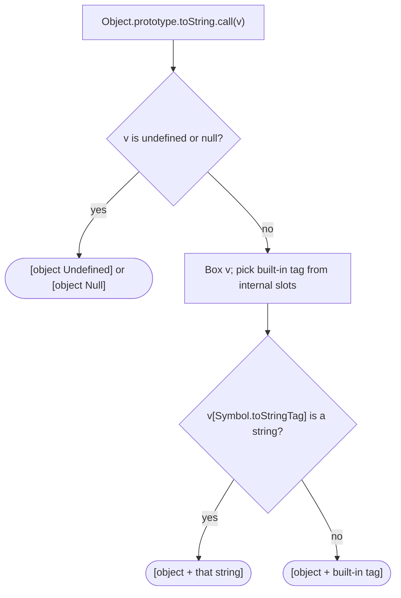

## Introduction

`typeof` tells you very little about objects. A map, a date, an array, a promise and a regular expression are all `"object"`. When you are debugging — or writing a logger that has to describe whatever value it receives — you want a more specific name. JavaScript has had an answer since its earliest days, and it looks odd at first:

```javascript title="first-tag.js"
const tag = (v) => Object.prototype.toString.call(v);
console.log(typeof new Map(), typeof [], typeof new Date(0));
console.log(tag(new Map()), tag([]), tag(new Date(0)));
console.log(tag(null), tag(42));
```

```output
object object object
[object Map] [object Array] [object Date]
[object Null] [object Number]
```

The default `toString` method that every plain object inherits from `Object.prototype` returns a string of the form `[object Tag]`, and the tag names the kind of object. Since ES2015, part of that tag comes from a property keyed by a special symbol, **`Symbol.toStringTag`**. Built-ins such as `Map` and `Promise` define it, and you can define it on your own classes so that they describe themselves as `[object Money]` instead of the anonymous `[object Object]`.

This lesson explains how the tag is computed, how to set it, and — just as important — what it is *not*: it is a label for humans and logs, not a type check, because any object can claim any tag.

## Before you start

- **`typeof`** — what it reports for each kind of value, and why it stops at `"object"`. See [[b1-typeof]].
- **Symbols** — unique property keys, and the idea of **well-known symbols** that the language itself looks up (`Symbol.iterator`, `Symbol.toPrimitive`). See [[b1-symbols]] and [[b1-well-known-symbols]].
- **Prototype lookup** — an object can read a property from its prototype. See [[b1-prototype-chain]].
- **`toString`** — that objects are converted to strings with a `toString` method, and many types override it. See [[b1-object-tostring]].

## The intuition

Think of a conference where every attendee wears a badge printed by the front desk. For the original guests — arrays, dates, errors, functions — the desk prints the badge from the registration records it keeps privately; nobody can change those records. Newer guests carry their own badge on a lanyard (`Symbol.toStringTag`), and the desk prints whatever that badge says. If a guest's lanyard says something, the desk uses it even for the original guests.

The analogy captures both halves of the mechanism: a built-in fallback that comes from hidden internal state, and an override that comes from an ordinary property anyone can set. It also explains the security warning — a badge you print yourself says nothing reliable about who you are.

## How `Object.prototype.toString` builds the tag

When you call `Object.prototype.toString` with some value as `this`, the specification (ES2015 and later) runs these steps:

1. If `this` is `undefined`, return `"[object Undefined]"`. If it is `null`, return `"[object Null]"`.
2. Convert `this` to an object (primitives are boxed into wrapper objects, as in [[b1-autoboxing]]).
3. Choose a **built-in tag** from the object's internal slots: `"Array"` if it is an array (seeing through proxies), `"Arguments"` for an `arguments` object, `"Function"` if it is callable, `"Error"`, `"Boolean"`, `"Number"`, `"String"`, `"Date"` or `"RegExp"` if it has the matching internal slot, and `"Object"` otherwise.
4. Read the property `this[Symbol.toStringTag]`, following the prototype chain as for any property read.
5. If that property's value is a string, use it as the tag. Otherwise use the built-in tag.
6. Return `"[object " + tag + "]"`.



The built-in list in step 3 is short on purpose. It covers exactly the types that existed before ES2015, so old code that relied on `[object Array]` or `[object Date]` kept working. Every type added since — `Map`, `Set`, `Promise`, `Symbol`, `BigInt`, typed arrays, generators — gets its name from a `Symbol.toStringTag` property on its prototype instead.

You can see the difference in the property descriptors:

```javascript title="where-tags-live.js"
console.log(Object.getOwnPropertyDescriptor(Map.prototype, Symbol.toStringTag));
console.log(Object.hasOwn(Array.prototype, Symbol.toStringTag),
  Object.hasOwn(Date.prototype, Symbol.toStringTag));
```

```output
{
  value: 'Map',
  writable: false,
  enumerable: false,
  configurable: true
}
false false
```

`Map.prototype` owns a non-writable `Symbol.toStringTag` property whose value is `'Map'`. `Array.prototype` and `Date.prototype` have none: their tags come from the internal-slot fallback. Typed arrays use a getter on their shared prototype, which returns the specific name (`'Uint8Array'`, `'Float64Array'`…).

## The tags of common values

This table is worth skimming once; you will recognise the pattern quickly.

```javascript title="builtin-tags.mjs"
const tag = (v) => Object.prototype.toString.call(v);
const values = {
  'undefined': undefined, 'null': null, '42 (number)': 42, "'hi'": 'hi', 'true': true,
  '10n': 10n, 'Symbol()': Symbol(), '[]': [], '{}': {}, '() => {}': () => {},
  'new Error()': new Error(), 'new TypeError()': new TypeError(),
  'new Set()': new Set(), 'Promise.resolve()': Promise.resolve(), 'Math': Math,
  'JSON': JSON, 'new Uint8Array(2)': new Uint8Array(2),
  'async function': async function () {}, 'generator object': (function* () {})(),
  'arguments': (function () { return arguments; })(),
  'new Proxy([], {})': new Proxy([], {}), 'Object.create(null)': Object.create(null),
};
for (const [label, v] of Object.entries(values)) console.log(label.padEnd(20), tag(v));
const ns = await import('data:text/javascript,export const a = 1;');
console.log('module namespace'.padEnd(20), tag(ns));
```

```output
undefined            [object Undefined]
null                 [object Null]
42 (number)          [object Number]
'hi'                 [object String]
true                 [object Boolean]
10n                  [object BigInt]
Symbol()             [object Symbol]
[]                   [object Array]
{}                   [object Object]
() => {}             [object Function]
new Error()          [object Error]
new TypeError()      [object Error]
new Set()            [object Set]
Promise.resolve()    [object Promise]
Math                 [object Math]
JSON                 [object JSON]
new Uint8Array(2)    [object Uint8Array]
async function       [object AsyncFunction]
generator object     [object Generator]
arguments            [object Arguments]
new Proxy([], {})    [object Array]
Object.create(null)  [object Object]
module namespace     [object Module]
```

A few results reward a closer look. Primitives get the name of their wrapper (`Number`, `String`, `BigInt`), because step 2 boxes them. `new TypeError()` reports `Error`, not `TypeError`: errors have the `[[ErrorData]]` slot, and error prototypes do not define a tag, so subclasses are indistinguishable here — use `err.name` or `instanceof` for that. An async function is callable, so its built-in tag is `Function`, but `AsyncFunction.prototype` defines the tag `'AsyncFunction'`, which wins. A proxy around an array still reports `Array`, because the array check in step 3 sees through proxies. `Object.create(null)` has no `toString` method of its own, but calling `Object.prototype.toString` on it explicitly still works.

All of this is the output of Node.js 22. In browsers, DOM objects get tags from their interface names — for example `[object HTMLDivElement]` — as defined by the Web IDL specification; that was not run for this lesson.

## Why you must use `.call`

Most values do not use `Object.prototype.toString` when you call `.toString()` on them, because their own prototypes override it with something more useful:

```javascript title="why-call.js"
const tag = (v) => Object.prototype.toString.call(v);
console.log([1, 2].toString(), tag([1, 2]));
console.log((5).toString(), tag(5));
console.log(new Map().toString(), Map.prototype.toString === Object.prototype.toString);
```

```output
1,2 [object Array]
5 [object Number]
[object Map] true
```

`Array.prototype.toString` joins the elements, and `Number.prototype.toString` formats the number. `Map` does not override `toString`, so `new Map().toString()` reaches `Object.prototype.toString` through the chain. To get the tag reliably for any value, borrow the original method and call it with your value as `this`: `Object.prototype.toString.call(value)`. This is the idiom you will see in libraries.

## Setting a tag on your own classes

Instances of your own classes have no tag, so they print as `[object Object]`. Define `Symbol.toStringTag` on the class's prototype to fix that. A getter is the usual way in a class body, because it lives on the prototype and is shared by every instance:

```javascript title="custom-tag.js"
const tag = (v) => Object.prototype.toString.call(v);

class Temperature {
  constructor(celsius) { this.celsius = celsius; }
  get [Symbol.toStringTag]() { return 'Temperature'; }
}
class Plain {}

const t = new Temperature(21);
console.log(tag(t), tag(new Plain()));
console.log(String(t), `${t}`);
console.log(JSON.stringify(t), Object.keys(t));
console.log(tag({ [Symbol.toStringTag]: 42 }));
```

```output
[object Temperature] [object Object]
[object Temperature] [object Temperature]
{"celsius":21} [ 'celsius' ]
[object Object]
```

Line by line: the tag changes the `Object.prototype.toString` result. Because `Temperature` does not define its own `toString`, string conversion (`String(t)`, template literals) uses the inherited one and also shows the tag. `JSON.stringify` and `Object.keys` ignore it completely — symbol-keyed properties are skipped by both, and a getter on the prototype is not an own property anyway. A tag whose value is not a string, like `42`, is ignored and the built-in tag is used.

A related detail: a `static [Symbol.toStringTag]` field sets the tag of the *class itself* (the constructor function), not of its instances. That is rarely what you want.

### Where the tag shows up in tools

Node.js's `util.inspect`, which `console.log` uses, prints the tag in square brackets when it differs from the constructor name:

```javascript title="inspect-tag.js"
class Temp {
  constructor() { this.c = 1; }
  get [Symbol.toStringTag]() { return 'Celsius'; }
}
console.log(new Temp());
const box = { v: 1 };
Object.defineProperty(box, Symbol.toStringTag, { value: 'Box' });
console.log(box);
```

```output
Temp [Celsius] { c: 1 }
Object [Box] { v: 1 }
```

Browser developer tools also use the tag when describing some objects, though each one formats values differently. The practical benefit is the same everywhere: logs and error messages that say what an object is.

## A tag is a label, not proof

Because the tag in step 4 is an ordinary property lookup, any object can claim any tag — even the names of the legacy built-ins whose fallback was meant to be trustworthy:

```javascript title="forged.js"
const tag = (v) => Object.prototype.toString.call(v);

const fakeDate = { [Symbol.toStringTag]: 'Date' };
console.log(tag(fakeDate), fakeDate instanceof Date);
try { fakeDate.getTime(); } catch (e) { console.log(e.name + ': ' + e.message); }

const arr = [1, 2];
arr[Symbol.toStringTag] = 'NotAnArray';
console.log(tag(arr), Array.isArray(arr));

const liar = new Proxy({}, {
  get: (target, key) => (key === Symbol.toStringTag ? 'Liar' : undefined),
});
console.log(tag(liar));
```

```output
[object Date] false
TypeError: fakeDate.getTime is not a function
[object NotAnArray] true
[object Liar]
```

The plain object passes a "tag says Date" check and then crashes when used as a date. A real array can disguise itself, which also means the pre-ES2015 polyfill for `Array.isArray` (comparing the tag with `'[object Array]'`) is no longer reliable — `Array.isArray` itself is unaffected. A proxy can return a tag dynamically.

So never use a tag to make a decision that matters: not for validating input, not for authorisation, not for choosing which code path handles untrusted data. Use checks that read internal state that cannot be faked (`Array.isArray`, private brand checks), or check the specific capabilities you need.

> [!WARNING] Not a security boundary
> `[object User]` or `[object AdminSession]` from `Object.prototype.toString` only means some object returned that string from a property. Anyone who can create objects can produce it.

## Worked example: a `typeName` helper for logs

A logging utility wants a short type name for any value, to print messages like `expected Date, got Map`. Here is a helper that combines `typeof` for primitives with the tag for objects:

```javascript title="type-name.mjs"
function typeName(value) {
  if (value === null) return 'null';
  const t = typeof value;
  if (t !== 'object' && t !== 'function') return t;
  return Object.prototype.toString.call(value).slice(8, -1);
}

class Money {
  constructor(cents, currency) { this.cents = cents; this.currency = currency; }
  get [Symbol.toStringTag]() { return 'Money'; }
}

const ns = await import('data:text/javascript,export const a = 1;');
const values = [null, undefined, 42, 'hi', [], {}, new Map(), new Date(0), /re/g,
  Promise.resolve(), new Uint8Array(4), async () => {}, new Money(500, 'EUR'), ns];
for (const v of values) console.log(typeName(v));
```

```output
null
undefined
number
string
Array
Object
Map
Date
RegExp
Promise
Uint8Array
AsyncFunction
Money
Module
```

How it works: `null` is handled first because `typeof null` is `"object"` (a historical quirk, see [[b1-typeof-null]]). Other primitives return their lower-case `typeof` name, which reads more naturally in messages than the wrapper names `Number` or `String`. For objects and functions, `slice(8, -1)` removes the leading `"[object "` (eight characters) and the trailing `"]"`. `Money` reports its own name because it defines a tag.

This helper is appropriate *because* it only produces text for humans. If the same function were used to decide whether to call `value.getTime()`, a forged tag could crash the program, as shown in the previous section. Notice also that it does not distinguish error subclasses (all are `Error`) or your untagged classes (all are `Object`); for richer logging you might add `value.constructor?.name` as a second hint.

## In real systems

**Logging and debugging.** Tags make objects identifiable in logs and inspectors. Libraries that expose classes — database clients, HTTP clients, framework objects — often define a tag for exactly this reason.

**Type-detection utilities.** Utility libraries such as lodash use the `Object.prototype.toString` result internally to recognise built-in kinds in functions like `isDate` and `isPlainObject`, alongside other checks. This works because built-in objects normally have honest tags; it is a heuristic for convenience, not a guarantee.

**Cross-realm descriptions.** Unlike `instanceof`, the tag does not depend on the realm's constructors: an array or map from an iframe or a Node.js `vm` context still reports `[object Array]` or `[object Map]`. That makes it useful for describing foreign values, although for arrays `Array.isArray` remains the reliable test ([[b1-instanceof]] covers realms).

**Platform objects.** Module namespace objects report `[object Module]`, and browsers give DOM objects tags like `[object HTMLInputElement]`. Seeing such a tag in a log immediately tells you which kind of object leaked into a place it should not be.

## Trade-offs and alternatives

The tag is the most *descriptive* type information JavaScript offers for objects and is realm-independent, which makes it ideal for messages. It is also the least *trustworthy*, because it is user-controllable. Pick the tool by what you need:

| Need | Use | Why |
|---|---|---|
| Kind of a primitive | `typeof` | Exact and cannot be faked |
| Is it an array? | `Array.isArray` | Reads internal state; realm-safe |
| Is it an instance of my class (one realm)? | `instanceof` | Follows inheritance; TypeScript narrows on it |
| Was it really constructed by my class? | `#field in obj` | Private brand check; cannot be forged |
| A readable name for logs | `Object.prototype.toString.call` | Descriptive, realm-independent |
| A name for an instance of any class | `obj.constructor?.name` | Informative but also forgeable |

## Common mistakes

**Calling `value.toString()` and expecting a tag.** Arrays, numbers, dates and functions override `toString`. Use `Object.prototype.toString.call(value)`.

**Using the tag to validate input.** `{ [Symbol.toStringTag]: 'Date' }` passes a tag check. Validate with checks that cannot be forged, or check the methods you are about to call.

**Expecting the tag in JSON.** `JSON.stringify` skips symbol-keyed properties. If a serialised object needs a type marker, add an explicit string property such as `type: 'money'`.

**Setting a non-string tag.** A number or object value is ignored and the built-in tag is used.

**Expecting error subclasses to differ.** `new TypeError()` and your `ValidationError` both report `[object Error]`. Use `err.name` or `instanceof`.

> [!MISTAKE] "Built-in tags such as `[object Array]` cannot be faked"
> Before ES2015 that was true, which is why `Object.prototype.toString` became the standard type-detection trick. Since ES2015, a `Symbol.toStringTag` property overrides even the internal-slot tags, so an ordinary array — or a plain object — can report any name.

## Interview perspective

**"What does `Object.prototype.toString.call([])` return, and why `.call`?"** `"[object Array]"`. `.call` is needed because arrays override `toString`; borrowing the original method gives the tag.

**"What is `Symbol.toStringTag`?"** A well-known symbol; when an object (or its prototype) has a string-valued property under that key, `Object.prototype.toString` uses it as the tag. Built-ins added since ES2015 rely on it; legacy built-ins get their tag from internal slots unless overridden.

**"Can you use it for type checking?"** Only for display. It is forgeable through an ordinary property or a proxy. Strong candidates contrast it with `Array.isArray` and private brand checks.

**Follow-up: "Why does `typeof` say `object` for `null` but the tag says `Null`?"** `typeof null` is a legacy bug kept for compatibility; `Object.prototype.toString` special-cases `null` and `undefined` in its first step.

```quiz
Q: What does `Object.prototype.toString.call(new Set())` return?
- [ ] `"[object Object]"`
- [x] `"[object Set]"`
- [ ] `"Set {}"`
- [ ] `"[object Collection]"`
> `Set.prototype` defines `Symbol.toStringTag` as `'Set'`, and `Object.prototype.toString` uses that string as the tag. `"[object Object]"` would only appear if no tag existed, and `Set {}` is how Node.js's inspector displays sets, not a toString result.

Q: Why does `[1, 2].toString()` return `"1,2"` instead of `"[object Array]"`?
- [ ] Arrays have no `Symbol.toStringTag`
- [x] `Array.prototype` overrides `toString` with a method that joins the elements
- [ ] Arrays are primitives
- [ ] `toString` only returns tags in strict mode
> Method lookup finds `Array.prototype.toString` before reaching `Object.prototype.toString`. To get the tag, call the original method explicitly with `Object.prototype.toString.call(arr)`. The array having no own tag property is true but irrelevant, since the tag method is never reached.

Q: A class defines `get [Symbol.toStringTag]() { return 'Money'; }`. Which output does not include the tag?
- [ ] `String(new Money())`
- [ ] `` `${new Money()}` ``
- [x] `JSON.stringify(new Money())`
- [ ] `Object.prototype.toString.call(new Money())`
> String conversion and template literals call the inherited `Object.prototype.toString`, which reads the tag. `JSON.stringify` serialises only own enumerable string-keyed properties, so a symbol-keyed getter on the prototype never appears.

Q: A function receives untrusted input and checks `Object.prototype.toString.call(x) === '[object Date]'` before calling `x.getTime()`. What is the problem?
- [ ] Dates report `[object Object]`, so the check never passes
- [x] Any object can set `Symbol.toStringTag` to `'Date'`, pass the check and then crash
- [ ] The check fails for dates from another realm
- [ ] There is no problem; built-in tags cannot be faked
> The tag is read from an ordinary property, so `{ [Symbol.toStringTag]: 'Date' }` passes. Real dates from another realm pass too, so realms are not the issue. Validate by trying the operation safely or with a check that reads internal state.
```

## Practice

1. **Tag survey.** Predict, then check, the tag of: `new WeakSet()`, `new ArrayBuffer(8)`, `function* () {}`, `new Intl.NumberFormat()`, `globalThis` in Node.js, and `new (class extends Map {})()`.
2. **Label your classes.** Add a `Symbol.toStringTag` getter to a class `Order` and confirm how `console.log`, `String()` and `JSON.stringify` show an instance.
3. **Break a check.** Write `isRegExp(x)` using the tag, then construct an object that fools it and a real regular expression that fails it (hint: you can set the tag on an instance). Rewrite it so neither trick works.
4. **Improve `typeName`.** Extend the worked example so that untagged class instances report their constructor name, and explain why that is still only suitable for logs.
5. **Explain the history.** In three sentences, explain why ES2015 kept internal-slot tags for `Array` and `Date` but used `Symbol.toStringTag` for `Map` and `Promise`.

## Quick revision {#quick-revision}

- `Object.prototype.toString.call(v)` returns `[object Tag]`; `undefined` and `null` give `Undefined` and `Null`.
- Tag = `v[Symbol.toStringTag]` if it is a string, otherwise a built-in tag from internal slots: `Array`, `Arguments`, `Function`, `Error`, `Boolean`, `Number`, `String`, `Date`, `RegExp`, else `Object`.
- Built-ins added in ES2015+ (`Map`, `Set`, `Promise`, `Symbol`, `BigInt`, typed arrays, generators, `AsyncFunction`) define `Symbol.toStringTag` on their prototypes.
- Primitives are boxed first, so `42` gives `[object Number]`. Error subclasses all give `[object Error]`. Proxied arrays give `[object Array]`.
- Use `.call` because many types override `toString` (`[1,2].toString()` is `"1,2"`).
- Set a tag with `get [Symbol.toStringTag]() { return 'Name'; }` in a class; it shows in `String(obj)`, template literals and Node.js inspection, never in JSON.
- Non-string tags are ignored. `static [Symbol.toStringTag]` tags the class itself, not instances.
- Tags are forgeable (own property, prototype, proxy) and must never be used for validation or security.
- Tags are realm-independent, which helps describe foreign values; use `Array.isArray`, `instanceof` or brand checks for decisions.

## Key takeaways {#key-takeaways}

- `Symbol.toStringTag` is the property `Object.prototype.toString` reads to name an object in `[object Tag]`.
- Legacy built-ins get their tag from internal slots; newer built-ins and your own classes supply it through the symbol.
- Borrow the method with `Object.prototype.toString.call(value)` to get a tag for any value.
- Give your classes a tag to make logs and inspectors readable.
- A tag is a self-declared label: excellent for messages, worthless as proof of type.
