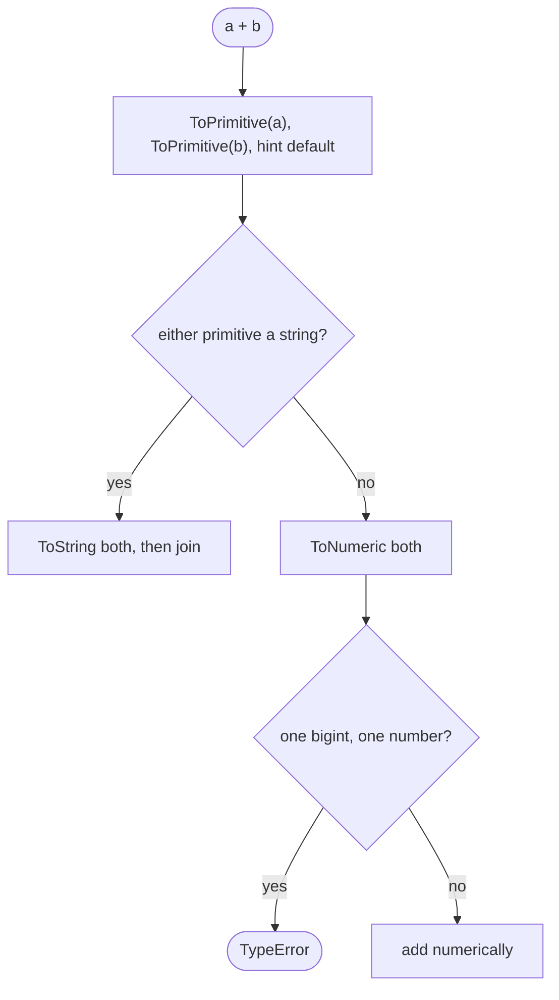

## Introduction

Run these two lines and the results look contradictory:

```javascript title="minus-vs-plus.js"
console.log('5' - 1);
console.log('5' + 1);
```

```output
4
51
```

Neither line contains a conversion function, yet both changed a type. In the first, `-` turned the string `'5'` into the number `5` and subtracted. In the second, `+` turned the number `1` into the string `'1'` and joined the two strings. This automatic changing of types is called **type coercion**.

Strictly, coercion covers every conversion from one type to another. When you write `Number('5')` the conversion is **explicit** — visible in the source and chosen by you (see [[b1-explicit-conversion]]). When an operator converts a value because it needs a different type, the conversion is **implicit**, and that is what most people mean when they say "coercion". This lesson is about the implicit kind: where it happens, what it does, and how to stop it from causing bugs.

JavaScript coerces because of where it came from. It was created in 1995 to add small behaviours to web pages, written by people who were often not professional programmers. Values from forms were always strings, and a language that refused `'5' * 2` would have been frustrating. So the designers made operators forgiving: rather than raise an error, an operator converts its operands to whatever it needs. That decision is now permanent — changing it would break existing websites — and every JavaScript developer has to know the rules.

The rules are not random. Each operator applies one of a few conversion algorithms, and once you know which operator uses which, results such as `'5' - 1`, `[] + {}` and `null >= 0` become predictable. That predictability is the goal of this lesson.

## Before you start

- **Primitive types** — the seven primitive types and the difference between primitives and objects. See [[b1-primitive-types]].
- **Explicit conversion** — what ToString, ToNumber and ToBoolean produce for each kind of value, including `Number('')` being `0`. This lesson relies on those tables. See [[b1-explicit-conversion]].
- **Truthy and falsy values** — the eight falsy values used by every condition. See [[b1-truthy-falsy]].
- **Object-to-primitive conversion** — how an object is turned into a primitive, using `valueOf`, `toString` or `Symbol.toPrimitive` and a *hint*. Summarised here; taught in [[b1-to-primitive]].

## The intuition

Think of each operator as a machine with labelled input slots. The `-` machine's slots say "numbers only". The `if` machine's slot says "a yes or no". The template-literal machine's slots say "text". When you feed a machine the wrong type, it does not jam; it runs the value through a converter attached to that slot and carries on.

So the question to ask about any expression is never "what does this look like?" but **"what type does this operator need, and which converter does it attach?"** `-` needs numbers, so `'5' - 1` converts the string. The `+` machine is the odd one out: it has two possible jobs, adding and joining, and it decides which one to do by looking at what arrived. That makes `+` the most important operator to learn precisely, and it has its own section below.

The converters are the same ones `String()`, `Number()` and `Boolean()` use. That is why knowing the explicit conversions well is most of the work: implicit coercion only adds the question of *which* converter each operator applies.

## The conversions behind every coercion

Every implicit coercion uses one of these specification operations. Their results are covered in detail in [[b1-explicit-conversion]]; here is what you need to recognise them:

| Operation | Result | Used by | Key results |
|---|---|---|---|
| ToBoolean | `true`/`false` | conditions, `!`, `&&`, `\|\|` | 8 falsy values; every object is truthy |
| ToNumber / ToNumeric | number (or bigint) | arithmetic, relational, unary `+`/`-` | `''` → 0, `null` → 0, `undefined` → NaN, `'12px'` → NaN, `[]` → 0 |
| ToString | string | templates, `+` with a string, property keys | `null` → `'null'`, `[1,2]` → `'1,2'`, `{}` → `'[object Object]'` |
| ToPrimitive | primitive | first step for any object operand | calls `Symbol.toPrimitive`, or `valueOf`/`toString` |
| ToInt32 | 32-bit integer | bitwise operators | drops the fraction, wraps at 2³² |

**ToNumeric** is the version of ToNumber that also allows bigints: arithmetic operators use it so that `2n * 3n` works, then throw a `TypeError` if one operand is a bigint and the other a number, because mixing them could silently lose precision.

## Implicit coercion {#b1-implicit-coercion}

Implicit coercion is a type conversion that happens because an operator or built-in function needs a different type than it received — without any conversion function in your code. The algorithms are exactly the ones `String()`, `Number()` and `Boolean()` use; what makes coercion *implicit* is only that the source code does not show it. That invisibility is the whole problem: a reader cannot see that `price + shipping` might be joining text rather than adding money.

Implicit coercion happens in a fixed set of places. Learning them as a list is worthwhile, because once you can spot every coercion site, you can decide at each one whether the conversion is intended.

### 1. Conditions and logical operators: ToBoolean

`if`, `while`, `do…while`, the middle part of `for`, the ternary `?:`, `!`, `&&` and `||` all convert a value to a boolean to make a decision. The rule is the falsy list from [[b1-truthy-falsy]]. One detail matters here: `&&` and `||` *use* ToBoolean to decide, but they *return* one of the original operands, unconverted.

```javascript title="boolean-contexts.js"
const input = '0';
if (input) console.log('the string "0" is truthy');
console.log(0 || 'default', '' && 'never', !!'0', !'');
```

```output
the string "0" is truthy
default  true true
```

`'' && 'never'` returns `''` (the first falsy operand), which `console.log` prints as nothing between the two spaces. If you need a real boolean from these operators, wrap the expression in `Boolean(...)`.


### 2. Arithmetic: ToNumeric on every operand

The operators `-`, `*`, `/`, `%`, `**`, unary `-`, and `++`/`--` always convert their operands to numbers (or bigints). None of them has a string meaning, so there is no ambiguity about what they want:

```javascript title="arithmetic.js"
console.log('10' - '4', '3' * [2], 4 / '2', '9' % 4, '2' ** 3, -'');
console.log(1 - true, 'a' * 1, null * 5, undefined * 5);

let count = '5';
count++;
console.log(count, typeof count);

let total = '5';
total += 1;
console.log(total, typeof total);
```

```output
6 6 2 1 8 -0
0 NaN 0 NaN
6 number
51 string
```

Every value goes through the Number() rules: `[2]` becomes `'2'` and then `2`; `-''` is the negation of `0`, which is `-0`; `true` becomes `1`; `null` becomes `0`; `undefined` and `'a'` become `NaN`, and any arithmetic involving `NaN` gives `NaN`. The last two blocks look alike and behave differently. `count++` is numeric, so the string `'5'` becomes the number `6`. `total += 1` means `total = total + 1`, and `+` with a string operand joins, so the result is the string `'51'`. Increment operators are covered in [[b1-increment-decrement]].

### 3. Relational comparison: strings stay strings, everything else becomes a number

`<`, `>`, `<=` and `>=` first convert object operands to primitives with the `"number"` hint. Then there are two cases. If **both** primitives are strings, they are compared as strings, character by character by UTF-16 code unit — the same order a dictionary would use if uppercase letters all came before lowercase ones. Otherwise both are converted to numbers and compared numerically, and any comparison involving `NaN` is `false`.

```javascript title="relational.js"
console.log('10' < '9', '10' < 9, 'Zebra' < 'apple', 'app' < 'apple');
console.log(null >= 0, null > 0, null == 0);
console.log(undefined >= 0, NaN <= NaN, [2] > 1);
```

```output
true false true true
true false false
false false true
```

The first line shows the string case. `'10' < '9'` is `true` because the first characters are compared first, and `'1'` comes before `'9'`. Mix in one number and the comparison becomes numeric, so `'10' < 9` is `false`. `'Zebra' < 'apple'` is `true` because every uppercase letter has a smaller code than every lowercase letter. A prefix is smaller than the longer string. This is why a list of numeric strings, such as version parts or IDs read from a CSV file, must be converted before comparing; for human-friendly text ordering use `localeCompare` or `Intl.Collator`.

The second line is a famous puzzle. `null >= 0` is `true`, `null > 0` is `false`, and yet `null == 0` is `false`. The relational operators convert `null` with ToNumber, giving `0`, so they compare `0 >= 0` (true) and `0 > 0` (false). Loose equality does **not** convert `null` to a number: its algorithm has a special rule that `null` equals only `undefined` (see [[b1-abstract-equality]]). Two different algorithms, two different answers. `undefined >= 0` is `false` because `undefined` becomes `NaN`, and every comparison with `NaN` fails.

### 4. Loose equality: its own algorithm

`==` and `!=` coerce too, but with a dedicated algorithm rather than one of the general conversions: `null` and `undefined` equal each other and nothing else, booleans become numbers, strings compared with numbers become numbers, and objects compared with primitives become primitives. It is taught in [[b1-equality]]. The relevant point here is that it is *not* the same as truthiness: `'0' == false` is `true` even though `'0'` is truthy.

### 5. Text contexts: ToString

Template literals convert every interpolated value with ToString (objects with the `"string"` hint). So does any value used as a **property key**: object property names are always strings (or symbols), so `obj[1]` and `obj['1']` are the same property, and using an object as a key turns it into `'[object Object]'`:

```javascript title="property-keys.js"
const seen = {};
seen[1] = 'number key';
seen[true] = 'boolean key';
seen[{ id: 7 }] = 'object key';
console.log(Object.keys(seen));
console.log(seen['1'], seen['[object Object]']);

const ids = new Map();
ids.set(1, 'number');
ids.set('1', 'string');
console.log(ids.size);
```

```output
[ '1', 'true', '[object Object]' ]
number key object key
2
```

Every object key becomes the same string `'[object Object]'`, so all objects used as keys would overwrite each other. When you need keys that keep their type — numbers distinct from strings, or objects as keys — use a `Map`, which does not coerce keys (see [[b1-map-vs-object]]).

### 6. Bitwise operators: ToInt32

`|`, `&`, `^`, `~`, `<<`, `>>` and `>>>` convert their operands to 32-bit integers: ToNumber first, then the fraction is dropped and the value wraps around modulo 2³². You will see `x | 0` and `~~x` in older code as a fast "convert to integer":

```javascript title="bitwise.js"
console.log('7.9' | 0, ~~'-7.9', 3000000000 | 0);
```

```output
7 -7 -1294967296
```

The third result shows why this trick is dangerous: numbers outside the 32-bit signed range wrap into nonsense. Use `Math.trunc(Number(x))` instead. See [[b1-bitwise-operators]].

### 7. Built-in functions that convert their arguments

Many built-in functions apply a conversion to their arguments before doing their work. Three cases cause real bugs:

```javascript title="builtins.js"
console.log([10, 1, 2].sort(), [10, 1, 2].sort((a, b) => a - b), ['b', 'a', 'C'].sort());
console.log(isNaN('hello'), Number.isNaN('hello'), Math.max('3', '20', 10));
```

```output
[ 1, 10, 2 ] [ 1, 2, 10 ] [ 'C', 'a', 'b' ]
true false 20
```

`Array.prototype.sort` with no comparator converts every element to a **string** and sorts by code units, so `10` comes before `2` and uppercase before lowercase. Always pass a comparator for numbers (see [[b1-array-sort]]). The global `isNaN` converts its argument to a number first, so it answers "would this become NaN?" rather than "is this NaN?"; `Number.isNaN` does not convert (see [[b1-number-isnan]]). `Math` functions convert all arguments with ToNumber, which is convenient until one of them is `'abc'` and the result becomes `NaN`.

### Seeing coercion in your own code

Every item above is a place where a value of the wrong type can slip through without an error. In practice, three habits catch nearly all of them. Convert input explicitly at the boundary, so values inside your program already have the right type. Use `===` instead of `==`. And let tools flag the rest: TypeScript rejects most mixed-type arithmetic (it reports an error for `'5' - 1` and for `'5' < 1`, but accepts `'5' + 1` because joining a string and a number is legitimate), and linters such as ESLint provide rules like `eqeqeq` and `no-implicit-coercion`, with typescript-eslint adding `restrict-plus-operands` and `restrict-template-expressions`. (The TypeScript errors were checked with the compiler version 6.0 in this project.)

```quiz
Q: What does `let n = '5'; n++;` leave in `n`?
- [x] The number `6`
- [ ] The string `'51'`
- [ ] The string `'6'`
- [ ] `NaN`
> `++` is an arithmetic operator, so it converts its operand with ToNumeric before adding one. `'5'` becomes 5, and n becomes the number 6. Contrast `n += 1`, which uses `+` and would join the string and the number into '51'.

Q: Why is `null >= 0` true while `null == 0` is false?
- [ ] Because `>=` is defined as `> || ==`
- [x] Relational operators convert `null` to the number 0, but `==` has a special rule that `null` only equals `undefined`
- [ ] Because `null` is an object
- [ ] It is an engine bug kept for compatibility
> `>=` uses numeric comparison after ToNumber, and ToNumber(null) is 0, so it evaluates 0 >= 0. Loose equality never converts null to a number; its algorithm returns true only for null == undefined (and null == null). The two operators use different algorithms, so they disagree.

Q: What does `['10', '9', '1'].sort()` return?
- [ ] `['1', '9', '10']`
- [x] `['1', '10', '9']`
- [ ] `['10', '9', '1']`
- [ ] `['9', '10', '1']`
> The default sort compares elements as strings, code unit by code unit. '10' starts with '1', which sorts before '9', so '10' lands between '1' and '9'. Pass a comparator such as `(a, b) => a - b` to sort numerically.
```

## Coercion with + {#b1-plus-coercion}

The `+` operator does two different jobs: it **adds** numbers and it **joins** (concatenates) strings. JavaScript decides which job to do *after* looking at the operands, which is why the same operator produces `3` from `1 + 2` and `'12'` from `'1' + 2`. Every other arithmetic operator always converts to numbers; `+` is the only one whose result type depends on its inputs. That makes it the single most common source of coercion bugs.

### The algorithm

For `a + b`, the engine performs these steps:

1. Convert each operand to a primitive with ToPrimitive and the `"default"` hint. Primitives pass through unchanged; ordinary objects try `valueOf` first, then `toString`; dates prefer their string form.
2. If **either** primitive is a string, convert both with ToString and join them.
3. Otherwise convert both with ToNumeric. If one is a bigint and the other a number, throw a `TypeError`. Otherwise add them.



The important consequence is in step 2: **a single string anywhere makes `+` a string operation**, and it does not matter which side the string is on.

### Applying it

```javascript title="plus-cases.js"
console.log(1 + 2, '1' + 2, 1 + '2');
console.log(true + 1, null + 1, undefined + 1, true + '1', null + 'x');
console.log([] + [], [] + {}, 1 + [], 1 + [2], [1, 2] + [3]);
console.log('a' + 1n);
try { 1n + 1; } catch (e) { console.log(e.message); }
try { '' + Symbol('s'); } catch (e) { console.log(e.message); }
```

```output
3 12 12
2 1 NaN true1 nullx
 [object Object] 1 12 1,23
a1
Cannot mix BigInt and other types, use explicit conversions
Cannot convert a Symbol value to a string
```

Walk through the second line. `true + 1`: no strings, so both become numbers, `1 + 1 = 2`. `null + 1`: `null` becomes `0`. `undefined + 1`: `undefined` becomes `NaN`. `true + '1'`: there is a string, so `true` becomes `'true'` and the result is `'true1'`.

The third line contains only objects, and every one goes through ToPrimitive first. Arrays and plain objects have no useful `valueOf`, so their `toString` is used: `[]` becomes `''`, `{}` becomes `'[object Object]'`, `[2]` becomes `'2'` and `[1, 2]` becomes `'1,2'`. Now every result has at least one string, so every one is a concatenation: `'' + ''` is the empty string (printed as nothing at the start of the line), `1 + []` is `'1'`, and `[1, 2] + [3]` is `'1,23'` — not an array, and not a sum. To combine arrays use spread (`[...a, ...b]`) or `concat`.

The last lines cover the newer types. A bigint joins a string normally. A bigint and a number cannot be added, because the result type would be ambiguous and precision could be lost silently, so you must convert one side yourself. A symbol cannot be joined into a string at all; use `String(sym)` or `sym.description`.

### Left to right, one pair at a time

`+` is left-associative: `a + b + c` means `(a + b) + c`. Each `+` makes its own decision based on its own two operands, so the position of a string in a chain changes the result:

```javascript title="plus-chains.js"
console.log(1 + 2 + '3');
console.log('1' + 2 + 3);
console.log('1' + (2 + 3));
console.log('Total: ' + 10 + 5);
console.log(`Total: ${10 + 5}`);
console.log('b' + 'a' + +'a' + 'a');
```

```output
33
123
15
Total: 105
Total: 15
baNaNa
```

`1 + 2 + '3'` adds first (`3`) and then joins (`'33'`). `'1' + 2 + 3` joins first, producing `'12'`, and every later `+` sees a string, giving `'123'`. Parentheses change the order. The `'Total: '` line is the everyday version of this bug: a label at the front turns all the following numbers into text. The template literal fixes it because the arithmetic happens inside `${}` before any text is involved. The last line is a well-known joke: `+'a'` is a *unary* plus, which converts `'a'` to `NaN`, and the remaining `+` operators join `'ba'`, `'NaN'` and `'a'`.

### The `{} + []` puzzle: statement versus expression

You may see claims that `{} + []` is `0`. Whether it is depends on how the code is parsed, not on coercion:

```javascript title="block-puzzle.js"
console.log(eval('{} + []'));
console.log(eval('({} + [])'));
console.log({} + []);
console.log(eval('{} + {}'));
```

```output
0
[object Object]
[object Object]
NaN
```

When `{` appears at the *start of a statement*, JavaScript parses it as an empty **block**, not an object literal. What remains is `+[]` — a unary plus — which converts `[]` to `''` and then `0`. Wrapped in parentheses, or used as a function argument, `{}` is an object literal, and the expression is the ordinary concatenation `'[object Object]'`. `eval` is used here only to evaluate the text as a standalone statement. Interactive consoles differ: some rewrite input that starts with `{` so that it is treated as an expression, so the same text can show different results in different tools. The lesson is about parsing (see [[b1-statements-expressions]]), not about `+`.

### Writing `+` safely

The safest habit is to give `+` only one kind of operand at a time. When you mean arithmetic, make sure both sides are numbers — convert input with `Number()` at the boundary, as shown in [[b1-explicit-conversion]]. When you mean text, use a template literal, which makes the intent unmistakable and computes any arithmetic inside `${}` first. Compound assignment follows the same rule: `sum += value` concatenates as soon as either `sum` or `value` is a string, which is how running totals turn into long strings of digits.

```quiz
Q: What is `[1, 2] + [3, 4]`?
- [ ] `[1, 2, 3, 4]`
- [ ] `10`
- [x] `'1,23,4'`
- [ ] `NaN`
> Both arrays are objects, so `+` first converts them to primitives. Arrays have no useful valueOf, so toString runs and gives '1,2' and '3,4'. At least one operand is now a string, so `+` concatenates: '1,2' + '3,4' is '1,23,4'. Use spread or concat to combine arrays.

Q: What does `'Score: ' + 4 + 2` produce?
- [ ] `'Score: 6'`
- [x] `'Score: 42'`
- [ ] `'Score: 4 2'`
- [ ] `NaN`
> `+` is evaluated left to right. 'Score: ' + 4 gives the string 'Score: 4', and then 'Score: 4' + 2 joins again. Write `'Score: ' + (4 + 2)` or, better, `` `Score: ${4 + 2}` ``.
```

## How it works internally

In the specification, each operator's evaluation steps name the conversion they apply. Binary arithmetic operators share one algorithm, **ApplyStringOrNumericBinaryOperator**. Only for `+` does it contain the extra string branch: it calls ToPrimitive on both operands, checks whether either result is a string, and if so returns the concatenation of their ToString results. For every other operator, and for `+` without strings, it calls **ToNumeric** on both operands, throws a `TypeError` if their types (number versus bigint) differ, and then calls the type's own operation, such as `Number::subtract` or `BigInt::multiply`.

Relational operators use **IsLessThan**. It converts both operands with ToPrimitive (`"number"` hint); if both results are strings it compares code units; if one is a bigint and the other a string, it tries to parse the string as a bigint; otherwise it converts both to numerics and compares. IsLessThan can return *undefined* when `NaN` is involved, and every relational operator turns undefined into `false`. That is why `NaN < 1`, `NaN >= 1` and `NaN <= NaN` are all `false`. `a <= b` is computed as "not (b < a)", with undefined becoming false — so `null <= 0` is true for the same reason as `null >= 0`.

Conditions call **ToBoolean**, which is a pure table lookup that never runs user code. Property access calls **ToPropertyKey**, which uses ToPrimitive with the `"string"` hint and keeps symbols as symbols. Template literals call ToString on each substitution.

Performance follows from this. Coercion itself is cheap for primitives, but code whose operands change type from call to call is harder for an optimising compiler to specialise. Converting once at the boundary gives the engine stable types to optimise — and gives readers stable types to reason about.

## Worked example: a cart total built from strings

An online shop renders its cart from data attributes and inputs, so every price and quantity arrives as a string. The first version of the summary code relies on whatever the operators do:

```javascript title="cart-buggy.js"
// Values as they arrive from data attributes and inputs: all strings.
const lines = [
  { price: '12.50', qty: '2' },
  { price: '3.25', qty: '4' },
  { price: '0.99', qty: '' },
];

const subtotalBuggy = lines.reduce((sum, line) => sum + line.price * line.qty, 0);
const itemCountBuggy = lines.reduce((n, line) => n + line.qty, 0);
const labelBuggy = 'Subtotal: ' + subtotalBuggy + 5 + ' (incl. shipping)';

console.log(subtotalBuggy);
console.log(itemCountBuggy);
console.log(labelBuggy);
```

```output
38
024
Subtotal: 385 (incl. shipping)
```

The output tells three different coercion stories. The subtotal is *correct by accident*: `line.price * line.qty` uses `*`, which converts both strings to numbers, and `''` becomes `0` for the last line. Adding a number to the running total `sum` keeps it numeric. The item count is broken: `n + line.qty` adds the number `0` to the string `'2'`, and from then on every step concatenates, giving `'024'`. The label is broken too: `'Subtotal: ' + 38` is already a string, so `+ 5` appends the digit instead of adding shipping.

The fixed version converts each field once, validates it, and keeps money in integer cents to avoid floating-point rounding (see [[b1-floating-point]]):

```javascript title="cart-fixed.js"
function toQuantity(raw) {
  if (raw.trim() === '') return 0; // an empty quantity field means "none"
  const n = Number(raw);
  if (!Number.isInteger(n) || n < 0) throw new Error(`Bad quantity: ${raw}`);
  return n;
}

function toCents(raw) {
  const n = Number(raw);
  if (raw.trim() === '' || !Number.isFinite(n)) throw new Error(`Bad price: ${raw}`);
  return Math.round(n * 100);
}

const lines = [
  { price: '12.50', qty: '2' },
  { price: '3.25', qty: '4' },
  { price: '0.99', qty: '' },
].map((l) => ({ cents: toCents(l.price), qty: toQuantity(l.qty) }));

const subtotal = lines.reduce((sum, l) => sum + l.cents * l.qty, 0);
const itemCount = lines.reduce((n, l) => n + l.qty, 0);
const shipping = 500;

console.log(subtotal, itemCount);
console.log(`Total: ${((subtotal + shipping) / 100).toFixed(2)} (${itemCount} items)`);
```

```output
3800 6
Total: 43.00 (6 items)
```

The decisions are each deliberate. Empty quantities mean zero *because the code says so*, not because ToNumber happens to agree; an empty price is an error, because a product without a price is a data problem. After the `map`, every value inside the program is a number, so `+` can only add. The display string is built with a template literal, so the arithmetic `subtotal + shipping` happens before any text is involved, and `toFixed(2)` formats the result. The same reasoning applies to any data that arrives as text: decide the types at the edge, and let operators work on values of one type.

## In real systems

**Forms and the DOM.** Input values, data attributes and `textContent` are strings. Coercion bugs in front-end code are most often a `+` or `+=` on one of these. React and other frameworks do not change this: a controlled input's `event.target.value` is still a string.

**Sorting and comparison of IDs and versions.** IDs read from URLs or CSV files are strings, so `<` compares them as text and the default `sort()` orders them as text. Convert to numbers when they are numeric and fit safely, or compare with a function that understands the format.

**Object keys.** Plain objects coerce keys to strings, so caches keyed by objects or by mixed number/string IDs collide. `Map` keeps keys as they are.

**Lint and type rules.** Most teams enable `eqeqeq` and either TypeScript or typescript-eslint's `restrict-plus-operands`, so that the remaining coercion in the codebase is intentional. Idioms that rely on coercion, such as `if (user)` for an object-or-null value or `x == null` for null-or-undefined, are usually allowed explicitly.

**Logging and templates.** Interpolating objects into log messages produces `[object Object]`. Use `JSON.stringify` or pass the object as a separate argument to the logger so that it is serialised properly.

## Trade-offs and alternatives

Coercion is not always bad. Some uses are clear and idiomatic:

| Coercion | Usually fine? | Why |
|---|---|---|
| `if (user)` where `user` is an object or `null` | Yes | No falsy value is valid data |
| `` `Order ${id} shipped` `` with a number | Yes | Template literals clearly mean text |
| `x == null` to test for `null` or `undefined` | Yes, if the team allows it | Well-known idiom; `==` with `null` has no other matches |
| `if (count)` where `0` is a valid count | No | Rejects real data |
| `a + b` where either may be a string | No | Silently joins instead of adding |
| `'10' < '9'` or default `sort()` on numbers | No | Compares text, not numbers |
| `x \| 0` to truncate | No | Wraps large numbers; use `Math.trunc` |

The alternative to relying on coercion is explicit conversion at the boundary plus strict operators inside: `Number()`, `String()`, `Boolean()`, `===`, template literals and comparators. It costs a few characters and makes every type change visible in review. Schema validation libraries go one step further, converting and validating whole request bodies in one place with clear error messages.

## Common mistakes

**Adding values from inputs.** `a.value + b.value` concatenates. Convert both first.

**Starting a running total with a string.** `let total = ''` or a string element in a `reduce` turns every following `+` into concatenation. Start numeric totals at `0` and add numbers only.

**Putting arithmetic after a text prefix.** `'Total: ' + a + b` joins. Use parentheses or a template literal.

**Comparing numeric strings with `<`.** `'10' < '9'` is true. Convert first, or use `localeCompare` with `{ numeric: true }` for natural ordering of text.

**Sorting numbers without a comparator.** `[10, 1, 2].sort()` gives `[1, 10, 2]`. Pass `(a, b) => a - b`.

**Using objects as plain-object keys.** All objects become `'[object Object]'`. Use a `Map`.

**Treating `null >= 0` as evidence that `null == 0`.** Relational operators and `==` use different algorithms. Test for `null` explicitly.

**Mixing bigint and number in arithmetic.** `1n + 1` throws. Convert with `BigInt(n)` or `Number(b)` deliberately.

> [!MISTAKE] "`+` converts to a number if it can"
> It is the opposite. `+` converts to a *string* if either operand is a string after ToPrimitive, and only adds when neither is. `'5' + 1` is `'51'` even though `'5'` looks numeric. The other arithmetic operators are the ones that always convert to numbers.

## Interview perspective

**"What is type coercion? Give an example of implicit and explicit."** Coercion is converting a value from one type to another. Explicit: `Number('5')`. Implicit: `'5' * 2`, where `*` converts the string itself. Strong answers add that both use the same specification algorithms, and list the main coercion sites.

**"Why is `'5' - 1` 4 but `'5' + 1` '51'?"** `-` only has a numeric meaning, so it converts both operands with ToNumber. `+` is overloaded: after converting operands to primitives, if either is a string it concatenates.

**"Predict: `[] + []`, `[] + {}`, `1 + [2]`, `true + true`."** `''`, `'[object Object]'`, `'12'`, `2`. Explain ToPrimitive turning arrays into strings via `toString`, and that `true + true` has no strings so both become `1`.

**"Why is `{} + []` sometimes 0?"** At the start of a statement, `{}` is a block, leaving `+[]`, which is `0`. As an expression it is `'[object Object]'`. This tests parsing knowledge more than coercion.

**"Explain `null >= 0` versus `null == 0`."** Relational comparison uses ToNumber, so `null` becomes 0; `==` has a special case for `null`. A strong answer names both algorithms.

**"How do you prevent coercion bugs in a team?"** Convert at boundaries, `===` everywhere (with an agreed exception for `== null` if desired), template literals for text, comparators for sorts, TypeScript or lint rules such as `restrict-plus-operands` and `eqeqeq`.

## Practice

1. **Predict, then run.** `'3' * '4'`, `'3' + 4 + 5`, `3 + 4 + '5'`, `[] * 2`, `[3] * [4]`, `{} * 2` (as an expression), `'b' > 'a'`, `'B' > 'a'`, `undefined + 1`, `null + null`, `'7' - - '3'`.
2. **Find every coercion.** Take this function and mark each coercion site and the conversion it performs: `function f(a, b) { if (a) return a + b; return b * 2 > '10' ? String(b) : !b; }`. Then rewrite it so that no implicit coercion remains, assuming `a` and `b` should be numbers.
3. **Fix the sort.** A table sorts prices read from cells with `rows.sort((x, y) => x.price > y.price ? 1 : -1)`, where `price` is a string such as `'9.99'` or `'10.50'`. Explain the wrong order it produces and fix it.
4. **Natural ordering.** Sort `['file10.txt', 'file2.txt', 'file1.txt']` into human order using `localeCompare` with the `numeric` option, and explain why converting with `Number()` would not work here.
5. **Explain a puzzle.** Write a step-by-step explanation of `'b' + 'a' + +'a' + 'a'` that names the operator and conversion at each step.

## Quick revision {#quick-revision}

- Coercion = converting between types. Explicit: `Number(x)`. Implicit: an operator converts for you. Same algorithms either way.
- Conditions, `!`, `&&`, `||`, `?:` → ToBoolean (falsy: `false, 0, -0, 0n, '', null, undefined, NaN`). `&&`/`||` return an operand, not a boolean.
- `- * / % **`, unary `-`, `++`/`--` → ToNumeric: `'10' - '4'` = 6, `null * 5` = 0, `undefined * 5` = NaN, `let c = '5'; c++` leaves 6. Mixing bigint and number throws.
- `< > <= >=` → ToPrimitive(number); both strings → code-unit comparison (`'10' < '9'` true, `'Z' < 'a'` true); else numeric; NaN → false.
- `null >= 0` true, `null > 0` false, `null == 0` false; `undefined >= 0` false.
- `==` has its own algorithm — see the equality lesson.
- Templates and property keys → ToString: `obj[1]` is `obj['1']`; object keys become `'[object Object]'`; `Map` does not coerce.
- Bitwise → ToInt32: `'7.9' | 0` = 7; `3000000000 | 0` wraps negative.
- Built-ins: default `sort()` compares strings; global `isNaN` converts; `Math.max` converts.
- `+`: ToPrimitive(default) both → any string? join : ToNumeric and add (bigint + number throws, symbol + string throws).
- `[] + []` = `''`; `[] + {}` = `'[object Object]'`; `1 + [2]` = `'12'`; `[1,2] + [3]` = `'1,23'`; `true + 1` = 2; `null + 1` = 1; `undefined + 1` = NaN.
- Left to right: `1 + 2 + '3'` = `'33'`; `'1' + 2 + 3` = `'123'`. `{} + []` at statement start = 0 (block + unary plus).
- Prevent: convert at boundaries, `===`, templates for text, comparators for sorting, TypeScript and lint rules.

## Key takeaways {#key-takeaways}

- Implicit coercion runs the same conversions as `String()`, `Number()` and `Boolean()`; what makes it risky is that the code does not show it.
- Ask what type each operator needs: conditions want booleans, arithmetic and relational operators want numbers (unless both sides of a comparison are strings), templates and property keys want strings.
- `+` is the exception: it joins if either operand is a string after ToPrimitive and adds only otherwise, evaluated left to right one pair at a time.
- Relational operators and `==` use different algorithms, which is why `null >= 0` is true and `null == 0` is false.
- Strings compare by code units and default `sort()` compares as strings, so numeric data must be converted before ordering.
- Convert data once at the boundary, use strict operators and template literals inside, and let TypeScript and lint rules catch what remains.
