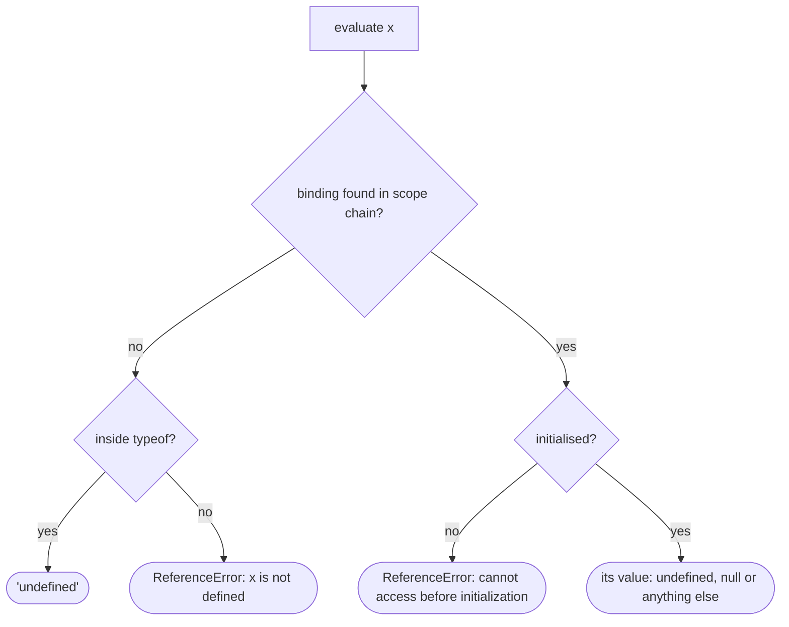

## Introduction

Most languages have one way to say "there is nothing here" — Java and C# have `null`, Python has `None`. JavaScript has two values for it, `undefined` and `null`, plus a third situation that looks similar but is really an error: a variable that was never declared. Beginners often treat the three as interchangeable, and most of the time code still runs. Then a default parameter is ignored, a field disappears from a JSON request, or a `ReferenceError` crashes the page — and the difference suddenly matters.

Here are the three in one sentence each, which the rest of the lesson unpacks:

- **`undefined`** is a value meaning *no value has been provided*. The language produces it automatically.
- **`null`** is a value meaning *deliberately empty*. Code produces it on purpose.
- **Undeclared** is not a value at all. It means *no variable by this name exists*, and reading it throws.

```javascript title="three-nothings.js"
let declared;                         // exists, no value yet
const profile = { middleName: null }; // exists, deliberately empty
console.log(declared, profile.middleName, profile.nickname);
try { console.log(neverDeclared); } catch (e) { console.log(e.name + ': ' + e.message); }
console.log(typeof declared, typeof profile.middleName, typeof neverDeclared);
```

```output
undefined null undefined
ReferenceError: neverDeclared is not defined
undefined object undefined
```

`declared` exists but was never assigned, so it holds `undefined`. `profile.middleName` was explicitly set to `null`. `profile.nickname` does not exist, and reading a missing *property* gives `undefined` without complaint. But reading a missing *variable*, `neverDeclared`, throws. The last line adds a twist: `typeof` reports `"undefined"` for both the undefined value and the undeclared name, and `"object"` for `null`. So `typeof` alone cannot tell the three apart.

Understanding this distinction pays off in API design (does `null` in a request mean "clear this field" or "not sent"?), in TypeScript (optional properties versus nullable ones), and in debugging the most common runtime error in JavaScript, "Cannot read properties of undefined".

## Before you start

- **Primitive types** — `undefined` and `null` are two of the seven primitives. See [[b1-type-undefined]] and [[b1-type-null]] for each one on its own; this lesson compares them.
- **Variables and declarations** — what it means for a variable to be declared and initialised. See [[b1-variables]] and [[b1-tdz]].
- **typeof** — what it reports and why `typeof null` is `"object"`. See [[b1-typeof]].

## The intuition

Picture a row of mailboxes.

- An **undeclared** variable is a mailbox that was never installed. Reaching for it is an error — there is nothing to open.
- **`undefined`** is an installed mailbox that is empty because nobody has put anything in it yet.
- **`null`** is an installed mailbox containing a card that reads "intentionally empty". Someone checked and left that message on purpose.

The analogy captures intent: `undefined` is the default state, `null` is a decision. Where it falls short: JavaScript does not enforce the intent. Nothing stops code from assigning `undefined` deliberately or returning `null` by accident. The meanings are conventions — strong, widely shared conventions that standard APIs follow — and your code is clearer when it follows them too.

## Where undefined comes from

`undefined` is what JavaScript hands you whenever it has to produce a value and none was supplied:

| Situation | Example | Result |
|---|---|---|
| Variable declared without a value | `let x;` | `x` is `undefined` |
| Missing object property | `({}).name` | `undefined` |
| Missing array element | `[1, 2][5]` | `undefined` |
| Parameter not passed | `function f(a) {}; f()` | `a` is `undefined` |
| Function with no `return` (or bare `return;`) | `(() => {})()` | `undefined` |
| Destructuring that finds nothing | `const [a, b] = [1]` | `b` is `undefined` |
| Optional chaining that short-circuits | `null?.x` | `undefined` |
| The `void` operator | `void 0` | `undefined` |

The common thread is that you rarely write `undefined` yourself; the language fills it in. That is why a stray `undefined` in your output is usually a clue that something upstream was *not provided* — a misspelled property, a forgotten `return`, a missing argument.

## Where null comes from

`null` almost never appears unless some code chose it. Standard APIs use it for "I looked, and there is nothing":

- `document.getElementById('x')` and `querySelector` return `null` when no element matches (browser DOM APIs, described from the specification and not run here).
- `'abc'.match(/z/)` returns `null` when the regular expression does not match.
- `localStorage.getItem('missing')` returns `null` for an absent key (browser API).
- `Object.getPrototypeOf(Object.prototype)` is `null` — the end of every prototype chain.
- `JSON.parse` produces `null` wherever the JSON text says `null`, which is the only way JSON can express "no value".
- Databases return SQL `NULL` columns as `null` through most JavaScript drivers.

Your own code should follow the same pattern: return or store `null` when "nothing" is a legitimate, expected answer — no user is selected, the optional field was cleared, the search found no match.

## Undeclared is an error, not a value

An undeclared variable is a name that no `let`, `const`, `var`, function, class, parameter or import ever introduced in any enclosing scope. When the engine tries to resolve such a name, the lookup walks all the way up the scope chain to the global scope and finds nothing ([[b1-name-resolution]]). What happens next depends on what you were doing:

- **Reading** it throws `ReferenceError: x is not defined`, in every mode.
- **`typeof`** on it returns `"undefined"` — a deliberate exemption for feature detection.
- **Assigning** to it in sloppy mode *creates a global variable*; in strict mode it throws.

```javascript title="sloppy-global.js"
x = 5;                            // sloppy mode: creates a global by accident
console.log(globalThis.x);
```

```output
5
```

```javascript title="strict-global.js"
'use strict';
try { y = 5; } catch (e) { console.log(e.name + ': ' + e.message); }
```

```output
ReferenceError: y is not defined
```

Accidental globals from typos were a major source of bugs in early JavaScript, and preventing them is one of the main reasons [[b1-strict-mode|strict mode]] exists. ES modules and class bodies are always strict, so in modern code an undeclared name is always an error.

Note that the error message says "is not defined", which sounds like "is undefined" but means something completely different: the *variable* does not exist, not that its *value* is `undefined`. A related but distinct error is "Cannot access 'x' before initialization", which means the variable *is* declared with `let`, `const` or `class` but you read it in its temporal dead zone ([[b1-tdz]]). The fix for an undeclared variable is never to "check whether it is undefined" — it is to declare it, import it, or fix the typo.

## How undefined and null behave

The two values are treated differently by almost every part of the language. This table is worth studying closely:

```javascript title="behaviour-table.js"
const rows = [
  ['typeof', typeof undefined, typeof null],
  ['Boolean', Boolean(undefined), Boolean(null)],
  ['Number', Number(undefined), Number(null)],
  ['String', String(undefined), String(null)],
  ['+ 1', undefined + 1, null + 1],
  ['JSON', JSON.stringify({ v: undefined }), JSON.stringify({ v: null })],
];
for (const [label, u, n] of rows) console.log(label.padEnd(8), String(u).padEnd(10), String(n));
console.log(undefined == null, undefined === null, null == 0, undefined == false);
console.log(null >= 0, null > 0, null == 0);
```

```output
typeof   undefined  object
Boolean  false      false
Number   NaN        0
String   undefined  null
+ 1      NaN        1
JSON     {}         {"v":null}
true false false false
true false false
```

Read it row by row.

- **`typeof`** gives `"undefined"` and `"object"` — the second is the legacy bug covered in [[b1-typeof-null]].
- **Truthiness**: both are falsy.
- **Numeric conversion differs**: `undefined` becomes `NaN` but `null` becomes `0`. So `null + 1` is `1`, and a `null` that slips into arithmetic produces plausible-looking wrong numbers instead of an obvious `NaN`. This is one of the sneakiest consequences of the difference.
- **String conversion** gives `"undefined"` and `"null"` — which is how those words end up in rendered UI text.
- **JSON**: a property holding `undefined` is omitted entirely; `null` is kept.

The last two lines show equality. Under **loose equality** `==`, `null` and `undefined` are equal to each other and to nothing else — not `0`, not `''`, not `false`. Under **strict equality** `===` they are different. And the final line is a well-known oddity: relational comparisons such as `>=` convert `null` to `0`, so `null >= 0` is `true` even though `null == 0` is `false`, because `==` has its own special rule for `null` instead of converting it. The full equality algorithm is in [[b1-equality]].

## Defaults, ?? and ?.

Several modern features decide what counts as "missing", and they do not all agree:

```javascript title="missing-features.js"
function greet(name = 'friend') { return `hi ${name}`; }
const { theme = 'light' } = { theme: null };
console.log(greet(undefined), greet(null), theme);
const u = { address: null };
console.log(u.address?.city, u.phone?.number, u.address ?? 'no address');
console.log([0 ?? 42, '' ?? 'x', 0 || 42, '' || 'x']);
```

```output
hi friend hi null null
undefined undefined no address
[ 0, '', 42, 'x' ]
```

**Default parameters and destructuring defaults apply only to `undefined`.** `greet(null)` prints `hi null`, and destructuring `{ theme: null }` keeps `null`. The reasoning is that `null` is a value somebody passed on purpose, whereas `undefined` means nothing was passed. If your data source (often JSON) uses `null` for missing fields, defaults will not kick in, and you need `??` instead.

**`??` (nullish coalescing) and `?.` (optional chaining) treat both as missing.** `u.address?.city` stops at `null` and returns `undefined` rather than throwing; `u.address ?? 'no address'` falls back for either value. Unlike `||`, `??` does *not* replace other falsy values: `0 ?? 42` keeps `0` and `'' ?? 'x'` keeps the empty string, while `||` replaces both. Use `??` for defaults whenever `0`, `''` or `false` are legitimate values ([[b1-nullish-coalescing]], [[b1-optional-chaining]]).

### Missing versus present-but-undefined

A property can exist and hold `undefined`, and that reads the same as a property that does not exist. Arrays have the same distinction between a **hole** and a slot containing `undefined`:

```javascript title="present-vs-missing.js"
const holes = [1, , 3];
const filled = [1, undefined, 3];
console.log(holes[1], 1 in holes, 1 in filled, holes.length);
console.log(holes.map((x) => x ?? 'gap'), filled.map((x) => x ?? 'gap'));
function count() { return arguments.length; }
console.log(count(), count(undefined));
```

```output
undefined false true 3
[ 1, <1 empty item>, 3 ] [ 1, 'gap', 3 ]
0 1
```

Both arrays return `undefined` at index 1, but only `filled` actually has an element there, as the `in` operator shows. `map` skips holes entirely, so the hole survives as an "empty item" while the real `undefined` is replaced ([[b1-sparse-arrays]]). For objects, use `'key' in obj` (includes inherited properties) or `Object.hasOwn(obj, 'key')` (own only) when the difference matters ([[b1-object-hasown]]). For function arguments, `arguments.length` (or a rest parameter's length) distinguishes "not passed" from "passed `undefined`" — rarely needed, but it is how some libraries implement overloaded functions.

## How it works internally

In the specification, `undefined` and `null` are the sole values of the Undefined and Null types. Neither has a wrapper object, so `ToObject` throws a `TypeError` for both; that is why any property access on them — `x.foo`, `x[0]`, `x.toString()` — throws, while property access on other primitives autoboxes.

`undefined` is also a property of the global object (`globalThis.undefined`), made non-writable and non-configurable in ES5. `null` is a literal keyword. That is why you could once write `var undefined = 1` at the global level in ES3 engines, and why you can still shadow `undefined` with a local variable or parameter today — the reason old libraries wrapped code in `(function (undefined) { … })()` and wrote `void 0`. With linters forbidding the shadowing, comparing against `undefined` directly is safe.

Undeclared names are handled by **reference resolution**. When the engine evaluates an identifier, it searches the chain of environment records outward. If no record has the binding, the result is an *unresolvable reference*. Reading through an unresolvable reference throws `ReferenceError`; the `typeof` operator special-cases it and returns `"undefined"`; assignment in sloppy mode creates a property on the global object. A declared-but-uninitialised `let` binding is different: the binding is found, but it is marked uninitialised, and reading it throws "Cannot access before initialization".

In engines, `undefined` and `null` are preallocated singleton values (V8 calls them oddballs), so checking `x === null` or `x === undefined` is a single pointer comparison.



## Worked example: PATCH requests and the meaning of null

A profile-editing form sends only the changes to the server. The server follows the JSON Merge Patch convention (RFC 7396): a key that is **absent** means "leave unchanged", a key set to **`null`** means "clear this field", and any other value means "set it". This is exactly the undefined-versus-null distinction, carried across a network.

```javascript title="patch.js"
// Server contract (JSON Merge Patch style):
//   key absent -> leave unchanged, key: null -> clear it, key: value -> set it
function applyPatch(record, patch) {
  const next = { ...record };
  for (const [key, value] of Object.entries(patch)) {
    if (value === null) delete next[key];
    else next[key] = value;
  }
  return next;
}

// Form state: undefined = "user did not touch", null = "user cleared the field"
function buildPatch(edits) {
  const patch = {};
  for (const [key, value] of Object.entries(edits)) {
    if (value !== undefined) patch[key] = value;   // drop untouched fields
  }
  return patch;
}

const stored = { name: 'Ada', phone: '555-0100', bio: 'Engineer' };
const edits = { name: 'Ada Lovelace', phone: null, bio: undefined };

const patch = buildPatch(edits);
const body = JSON.stringify(patch);
console.log(body);
console.log(applyPatch(stored, JSON.parse(body)));

const buggy = { name: edits.name || null, phone: edits.phone || null, bio: edits.bio || null };
console.log(applyPatch(stored, buggy));
```

```output
{"name":"Ada Lovelace","phone":null}
{ name: 'Ada Lovelace', bio: 'Engineer' }
{ name: 'Ada Lovelace' }
```

The form state uses `undefined` for fields the user never touched and `null` for fields the user explicitly emptied. `buildPatch` drops `undefined` entries, so the request body contains only real intentions: rename, and clear the phone number. (`JSON.stringify` would also have dropped the `undefined` property on its own, but filtering explicitly makes the intent visible and works for transports other than JSON.) `applyPatch` on the server treats `null` as "delete", so the result keeps `bio` unchanged and removes `phone`.

The buggy version collapses the distinction with `|| null`, a pattern that is common in real code. Every untouched field becomes `null`, which the server reads as "clear it" — and the user's bio is silently wiped. Notice too that `|| null` would turn a legitimately empty string or `0` into `null` as well. The lesson: when `undefined` and `null` carry different meanings in a contract, never normalise one into the other, and never use `||` to supply them.

```quiz
Q: What does `function f(x = 1) { return x; }` return for `f(null)` and `f(undefined)`?
- [ ] 1 and 1
- [x] null and 1
- [ ] null and undefined
- [ ] 1 and undefined
> Default parameters are applied only when the argument is undefined. null is treated as a value the caller chose, so it is kept. Use `x ?? 1` inside the function if null should also fall back.

Q: Which expression is true?
- [ ] `null == 0`
- [ ] `undefined == false`
- [x] `null == undefined`
- [ ] `null === undefined`
> Loose equality has a special rule: null and undefined are equal to each other and to nothing else. They are not converted to numbers or booleans for ==. Strict equality compares types, and they are different types.

Q: A file has no declaration of `config`. In an ES module, what does `if (config === undefined) {}` do?
- [ ] Runs the if body, because config is undefined
- [ ] Skips the if body
- [x] Throws ReferenceError: config is not defined
- [ ] Creates a global named config
> An undeclared name is not a variable holding undefined; resolving it fails. Reading it throws in every mode. Only `typeof config` avoids the error, and only sloppy-mode assignment would create a global — modules are always strict.
```

## In real systems

**API contracts.** REST APIs that support partial updates need a way to say "clear" versus "do not change". JSON Merge Patch uses absent versus `null`; GraphQL distinguishes an argument that is omitted from one explicitly set to `null`. Front-end code must preserve that distinction through forms and serialisation.

**Databases and ORMs.** SQL `NULL` arrives as JavaScript `null`. An ORM update with `{ phone: undefined }` typically means "do not touch the column", while `{ phone: null }` writes `NULL`. Mixing them up either fails to clear data or wipes it.

**TypeScript.** With `strictNullChecks`, `string | null` and `string | undefined` are different types, and an optional property `phone?: string` is (by default) `string | undefined`. The `exactOptionalPropertyTypes` option goes further and distinguishes "absent" from "present with value undefined". These features exist precisely because the runtime distinction causes bugs ([[b2-null-undefined-ts]], [[b2-strict-null-checks]]).

**React rendering.** A component that returns `null` renders nothing ([[b4-rendering-null]]). Rendering `{value}` where `value` is `null` or `undefined` shows nothing, but `{String(value)}` shows the words "null" or "undefined" — a common source of stray text in UIs.

**Style conventions.** Teams differ. Some use `undefined` everywhere and avoid `null` in their own code (converting at boundaries); others reserve `null` for "explicitly empty" as this lesson recommends. Both are defensible; inconsistency within one codebase is not.

## Trade-offs and alternatives

| Need | Use | Why |
|---|---|---|
| "Not provided" / optional | `undefined` (omit the property) | Language default; triggers default parameters; dropped by JSON |
| "Deliberately empty" | `null` | Explicit; survives JSON; matches DOM and SQL |
| Treat both as missing | `x == null`, `??`, `?.` | One check for both values |
| Distinguish them | `x === null`, `x === undefined` | Exact |
| Did the caller pass it at all? | `'key' in obj`, `Object.hasOwn`, `arguments.length` | `undefined` value and absence read the same |
| Avoid "nothing" entirely | A real default (`[]`, `''`, `0`) or a result type | Removes null checks where an empty value is meaningful |

Using two "nothing" values gives you more expressive power — partial updates need it — at the cost of more cases to handle. Where there is no meaningful difference between "not provided" and "empty", collapsing to one value or to a real empty default (an empty array instead of `null` for "no items") often makes code simpler.

## Common mistakes

**Using `||` to supply defaults.** It replaces `0`, `''` and `false` as well as `null`/`undefined`. Use `??`.

**Expecting default parameters to handle `null`.** They do not. Normalise with `??` or change the data source.

**Checking for an undeclared variable with `=== undefined`.** It throws before the comparison runs. Use `typeof x === 'undefined'` for globals that may not exist — or better, declare or import the variable.

> [!MISTAKE] Using == null without meaning it
> `value == null` deliberately treats `null` and `undefined` the same. That is often exactly right, but in a contract where they mean different things (like PATCH), it hides the difference. Say out loud which values you intend to match, and write `=== null` or `=== undefined` when only one is correct.

**Letting `null` into arithmetic.** `null` converts to `0`, so `price * qty` with a `null` quantity gives `0` rather than `NaN`. Validate before computing.

**Serialising `undefined` and expecting it to arrive.** `JSON.stringify` drops `undefined` properties and turns `undefined` array elements into `null`. Send `null` if the receiver must see the key.

**Assuming `typeof x === 'object'` excludes null.** It does not; see [[b1-typeof-null]].

## Interview perspective

This topic is a staple of JavaScript screening interviews, usually as "explain the difference" followed by output prediction.

> [!INTERVIEW] "What's the difference between undefined, null and undeclared?"
> "`undefined` is the value JavaScript gives anything that hasn't been provided — an unassigned variable, a missing property or argument, a function with no return. `null` is a value you assign on purpose to mean 'empty'. Undeclared means the variable doesn't exist at all; reading it throws a ReferenceError, except with `typeof`, which returns 'undefined'. They behave differently: `typeof null` is 'object', `Number(null)` is 0 but `Number(undefined)` is NaN, default parameters only apply to `undefined`, and JSON keeps `null` but drops `undefined`. `null == undefined` is true; `===` is false."

Common follow-ups:

- **`null == 0`? `null >= 0`?** `false` and `true` — `==` has a special null rule, relational operators convert `null` to `0`.
- **How do you check for "null or undefined" in one test?** `x == null`, or `x ?? fallback` for defaults.
- **Difference between `??` and `||`?** `??` falls back only for `null`/`undefined`; `||` for any falsy value.
- **What does "x is not defined" mean versus "x is undefined"?** The first is an undeclared variable (ReferenceError); the second describes a declared variable whose value is `undefined`.
- **When would you choose `null` over `undefined`?** For an explicit "no value" that must survive serialisation or mean something different from "not provided".

## Practice

1. **Classify.** For each, say whether the result is `undefined`, `null` or a `ReferenceError`: `[].pop()`, `'a'.match(/b/)`, `({}).x`, `new Map().get('k')`, `Object.getPrototypeOf(Object.create(null))`, reading `zzz` in a module, `JSON.parse('null')`, `[1, 2].find((n) => n > 5)`.
2. **Fix the defaults.** `function connect({ retries = 3, timeout = 1000 } = {})` is called with config loaded from JSON where missing values are `null`. Explain why defaults are ignored and fix it.
3. **Merge patch.** Extend `applyPatch` to handle nested objects recursively, as RFC 7396 specifies.
4. **Detect "not passed".** Write `setTitle(title)` that clears the title when called with `null`, does nothing when called with no argument, and sets it otherwise. Use a rest parameter to detect "no argument".
5. **Arithmetic audit.** Find three expressions in which `null` produces a misleading number instead of `NaN`, and write a helper that rejects both `null` and `undefined` before computing.

## Quick revision {#quick-revision}

- `undefined`: automatic "no value" — unassigned variables, missing properties/elements/arguments, no `return`, failed destructuring, `void 0`.
- `null`: deliberate "empty" — set by code; returned by DOM lookups, `match`, `localStorage.getItem`; end of prototype chain; JSON's only "no value".
- Undeclared: no binding exists. Reading throws `ReferenceError` ("is not defined"); `typeof` returns `"undefined"`; sloppy assignment creates a global, strict throws. Different from TDZ ("before initialization").
- `typeof undefined` is `"undefined"`; `typeof null` is `"object"`.
- `Number(undefined)` is `NaN`; `Number(null)` is `0`. `String()` gives `"undefined"` / `"null"`. Both falsy.
- `null == undefined` true; neither `==` anything else. `===` distinguishes them. `null >= 0` is true, `null == 0` false.
- Default parameters and destructuring defaults fire only for `undefined`. `??` and `?.` treat both as missing; `??` keeps `0`, `''`, `false`.
- JSON drops `undefined` properties (array elements become `null`); keeps `null`.
- Present-but-undefined vs absent: `in`, `Object.hasOwn`, array holes, `arguments.length`.
- Partial-update APIs: absent = unchanged, `null` = clear. Never normalise with `|| null`.

## Key takeaways {#key-takeaways}

- `undefined` means nothing was provided, `null` means something was deliberately emptied, and undeclared means the variable does not exist.
- Reading an undeclared variable throws; reading a missing property returns `undefined`.
- The two values convert, compare and serialise differently — `null` becomes `0` in arithmetic and survives JSON, `undefined` becomes `NaN` and disappears.
- Defaults fire only for `undefined`; use `??` when `null` should fall back too, and never `||` when `0` or `''` are valid.
- When an API gives `null` and `undefined` distinct meanings, preserve them end to end; when it does not, pick one convention and stick to it.
