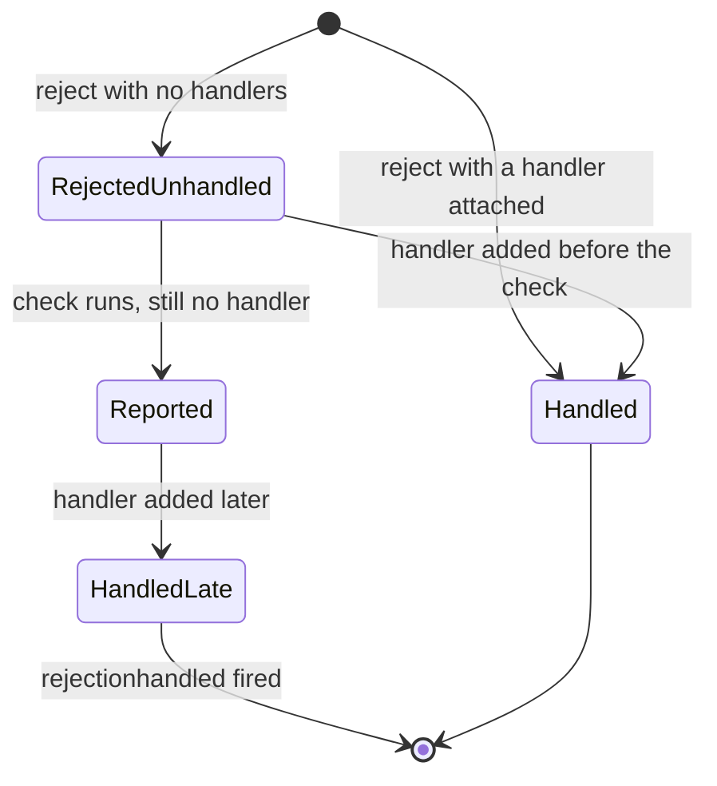

## Introduction

In synchronous code, an error that nobody catches cannot go unnoticed: it climbs the call stack, and if nothing catches it, the host prints "Uncaught Error" and abandons the task (or, in Node.js, exits the process). See [[b1-throw-try-catch]].

Promises break that guarantee. A promise **rejects** instead of throwing: its failure is stored inside the promise object, waiting for someone to ask for it with `.catch`, `.then(_, onRejected)` or `await`. If nobody ever asks, there is no call stack to climb. Before hosts did anything about it, such failures vanished — a request failed, a save did not happen, and nothing appeared in any log.

An **unhandled rejection** is a promise that is rejected while no handler is attached to it. Modern hosts track these and report them, much like uncaught exceptions: browsers log "Uncaught (in promise)" and fire an `unhandledrejection` event; Node.js, since version 15, by default treats them as fatal and **exits the process**. That last point makes this topic practical rather than theoretical: one forgotten `.catch` in a Node.js server can take the whole server down.

This lesson explains precisely what counts as handling, when the host checks, how browsers and Node.js differ, and the everyday code patterns that create unhandled rejections without anyone noticing.

## Before you start

- **Promises and their states** — pending, fulfilled, rejected, and how `.then`/`.catch` return new promises. See [[b1-promises]] and [[b1-promise-chaining]].
- **async/await** — `await` turns a rejection into a throw inside an `async` function. See [[b1-async-await]] and [[b1-await-try-catch]].
- **The microtask queue** — promise reactions run as microtasks, after the current synchronous code. See [[b1-microtasks]].
- **Uncaught exceptions** — what hosts do with synchronous errors nobody catches. See [[b1-throw-try-catch]].

## The intuition

Think of a rejected promise as a registered letter containing bad news. The post office (the host) holds it for collection. If someone has already signed up to collect it — attached a handler — the letter goes straight to them. If nobody has, the post office does not wait forever: once the current round of deliveries is over, it raises an alarm saying "undeliverable bad news".

The analogy also explains the "late handler" case. If someone shows up to collect the letter after the alarm was raised, they still get it, and the post office records that it was collected after all — but the alarm has already gone off. In Node.js's default mode, that alarm shuts the building down, so a late collector may never get the chance.

## What counts as handling

A promise is **handled** as soon as any reaction is registered on it — any call to `.then`, `.catch` or `.finally`, or an `await` of it. That sounds generous, but there is a catch: each of those calls also *creates a new promise*, and if the original rejects, the new promise may reject too. It is the new promise's job to be handled next.

```js title="what-handles.js"
process.on('unhandledRejection', (reason) => {
  console.log('unhandled:', reason.message);
});

const a = Promise.reject(new Error('a'));
a.then(null, (e) => console.log('handled by then(_, onRejected):', e.message));

const b = Promise.reject(new Error('b'));
b.catch((e) => console.log('handled by catch:', e.message));

const c = Promise.reject(new Error('c'));
c.then(() => console.log('never runs')); // success callback only

const d = Promise.reject(new Error('d'));
d.finally(() => console.log('finally ran for d'));
```

```output
handled by then(_, onRejected): a
handled by catch: b
finally ran for d
unhandled: c
unhandled: d
```

The first two are fully handled: a rejection callback receives the error and returns normally, so the promises they create are fulfilled.

`c` is the trap the topic is known for. `c.then(onFulfilled)` does attach a reaction to `c`, so `c` itself is handled. But the reaction has no rejection callback, so the rejection **passes through** to the promise that `.then` returned — and nothing is attached to *that* promise. The host reports the error from the derived promise. The same is true of `.finally`: it runs its callback and then passes the rejection on, so a chain ending in `.finally` without a `.catch` still produces an unhandled rejection.

The general rule: **follow the chain to its last promise**. A rejection is handled when some rejection callback in the chain receives it and does not throw again. If the last promise in the chain can reject, the chain is unhandled.

The `process.on('unhandledRejection')` line is Node.js-specific; it is here only so the program prints the reports instead of exiting at the first one. The order in which the `unhandled:` lines appear depends on how many microtask steps each chain takes, so do not rely on it.

### await counts — but only once it runs

`await p` registers a reaction on `p` and, inside an `async` function, rethrows the rejection at the `await` line. So `try { await p } catch {}` handles it, and an `async` function that `await`s without a `try` passes the rejection to *its own* returned promise. That promise must then be handled by its caller — which is how async errors propagate. See [[b1-error-propagation]].

### void is not handling

`void someAsyncCall()` is sometimes used to tell a linter "I am deliberately not awaiting this". The `void` operator evaluates the expression and discards the result; it attaches nothing to the promise. If it rejects, the rejection is unhandled.

## When the host decides

A rejection is not reported the instant it happens — that would make `Promise.reject(x).catch(f)` impossible, since the rejection happens before `.catch` is even called. Instead, hosts check **after the current batch of synchronous code and microtasks has finished**. In browsers, the HTML specification does this at the end of each microtask checkpoint; Node.js does it after draining its microtask and `process.nextTick` queues. Any handler attached during the same synchronous run, or in a microtask before the check, counts.

The specification models this with a **host hook**: whenever a promise is rejected with no handlers, the engine calls `HostPromiseRejectionTracker(promise, "reject")`; whenever a handler is first attached to an already-rejected promise, it calls `HostPromiseRejectionTracker(promise, "handle")`. Each promise also has a `[[PromiseIsHandled]]` flag that becomes true the first time any reaction is registered. The host keeps a list of rejected-but-unhandled promises, removes any that get handled before its check, and reports the rest.

### Late handlers and rejectionhandled

If a handler is attached *after* the host has reported a rejection, the promise becomes handled, the handler runs normally, and the host fires a second notification: `rejectionhandled` in browsers, `rejectionHandled` in Node.js. Monitoring code can use it to retract the earlier report.

```js title="late-handler.js"
process.on('unhandledRejection', (r) => console.log('1. unhandledRejection:', r.message));
process.on('rejectionHandled', () => console.log('3. rejectionHandled'));

const p = Promise.reject(new Error('slow consumer'));
setTimeout(() => {
  p.catch((e) => console.log('2. late catch got:', e.message));
}, 10);
```

```output
1. unhandledRejection: slow consumer
2. late catch got: slow consumer
3. rejectionHandled
```

A promise can therefore be "unhandled" for a while and then handled. Hosts report it anyway, because the alternative — waiting indefinitely — would mean never reporting genuinely lost errors. And in Node.js's default mode, without the `unhandledRejection` listener above, the process would have exited at step 1 and the late `catch` would never have run.



## What browsers do

When a rejection is still unhandled at the check, browsers fire an **`unhandledrejection`** event on `window` (and on `self` in workers). The event is a `PromiseRejectionEvent` with two useful properties: `promise`, the rejected promise, and `reason`, the rejection value. If no listener calls `event.preventDefault()`, the browser logs the rejection to the console, typically as "Uncaught (in promise) Error: …". If a handler is attached later, a `rejectionhandled` event fires with the same shape.

```js title="browser-report.js"
// Runs in a browser page or worker. Shown for reference; not executed here.
window.addEventListener('unhandledrejection', (event) => {
  reportToMonitoring({
    kind: 'unhandledrejection',
    message: event.reason?.message ?? String(event.reason),
    stack: event.reason?.stack,
  });
  // Uncomment to suppress the default console message:
  // event.preventDefault();
});

window.addEventListener('rejectionhandled', (event) => {
  reportToMonitoring({ kind: 'rejectionhandled', message: String(event.reason) });
});
```

The page does **not** stop working: other code, timers and event handlers continue. The damage is local and quiet — a failed save that the UI never reflects, a spinner that spins forever because the code that would hide it never ran. That quietness is why front-end teams send these events to an error-monitoring service; most such services install an `unhandledrejection` listener automatically.

This browser snippet was not run for this lesson; its behaviour is as described by the HTML specification and MDN. `reportToMonitoring` stands for whatever your monitoring client provides.

## What Node.js does

Node.js's behaviour is controlled by the `--unhandled-rejections` flag and has changed over time, so the version matters.

| Mode | Behaviour on an unhandled rejection |
|---|---|
| `throw` (default since Node.js 15) | Emit `unhandledRejection`. If no listener exists, raise it as an uncaught exception — the process prints the error and exits with code 1. |
| `strict` | Raise as an uncaught exception immediately, even if `unhandledRejection` listeners exist (they still run if the exception is caught by `uncaughtException`). |
| `warn` | Always print a warning, never crash. |
| `warn-with-error-code` | Like `warn`, and set the process exit code to 1. |
| `none` | Silence all warnings. |

Before Node.js 15, the default was to print an `UnhandledPromiseRejectionWarning` along with a deprecation warning promising that future versions would crash. Node.js 15 made that promise real. A lot of older advice ("it is only a warning") predates this change.

Here is the default in action, in Node.js 22:

```js title="crash.js"
Promise.reject(new Error('nobody listened'));
setTimeout(() => console.log('this never prints'), 10);
console.log('synchronous code finished');
```

```output
synchronous code finished
```

The synchronous line prints, then the host checks, finds the unhandled rejection, prints the error and its stack to standard error (not shown above), and exits with code 1 before the timer can fire — so `this never prints` never does.

Two Node.js events let you observe this:

- `process.on('unhandledRejection', (reason, promise) => { ... })` — registering a listener **prevents the default crash** in `throw` mode. That is useful for reporting, but it also means that a listener which only logs turns a crash back into silent continuation.
- `process.on('rejectionHandled', (promise) => { ... })` — the late-handler notification.

A rejected top-level `await` in an ES module is not an unhandled rejection in this sense; it is a failure of the module's own evaluation, and Node.js prints the error and exits with code 1 in every mode.

> [!IMPORTANT] Crash, then restart
> For servers, the Node.js documentation recommends letting the process exit on unexpected errors and having a supervisor (systemd, a container orchestrator, PM2) start a fresh one. An `unhandledRejection` listener should report the error and then exit, not keep a process of unknown state running.

## Where unhandled rejections come from

Unhandled rejections are rarely written on purpose. They come from a handful of patterns that look correct.

### Fire-and-forget async calls

Calling an `async` function without `await` or `.catch` starts it and drops its promise:

```js title="fire-and-forget.mjs"
process.on('unhandledRejection', (r) => console.log('unhandled:', r.message));

async function sendAnalytics(event) {
  throw new Error(`analytics endpoint down (${event})`);
}

function onCheckout() {
  sendAnalytics('checkout'); // promise dropped
  console.log('checkout complete');
}
onCheckout();
```

```output
checkout complete
unhandled: analytics endpoint down (checkout)
```

Sometimes not waiting is exactly right — checkout should not wait for analytics. But "not waiting" must not mean "not handling". Attach a handler: `sendAnalytics('checkout').catch(logError)`. The same applies to `async` callbacks passed to APIs that ignore return values, such as `addEventListener`, `setTimeout` and `array.forEach`: the promise each call returns is discarded, so the callback must catch its own errors.

### Starting promises early, awaiting them one at a time

This one surprises experienced developers. Starting two operations in parallel and then awaiting them in sequence leaves the second unobserved while the code waits on the first:

```js title="sequential-await.mjs"
const sleep = (ms, failMessage) =>
  new Promise((resolve, reject) =>
    setTimeout(() => (failMessage ? reject(new Error(failMessage)) : resolve(ms)), ms));

process.on('unhandledRejection', (r) => console.log('unhandled:', r.message));
process.on('rejectionHandled', () => console.log('rejectionHandled'));

async function loadDashboard() {
  const profile = sleep(50);                 // starts now, takes 50 ms
  const alerts = sleep(10, 'alerts failed'); // starts now, fails after 10 ms
  try {
    await profile; // during these 50 ms nothing is attached to `alerts`
    await alerts;
  } catch (e) {
    console.log('caught in loadDashboard:', e.message);
  }
}
await loadDashboard();
```

```output
unhandled: alerts failed
caught in loadDashboard: alerts failed
rejectionHandled
```

The `try`/`catch` *does* eventually catch the error, but too late: `alerts` rejected at 10 ms, while the function was still suspended on `await profile`. Without the listener, Node.js would have exited at that moment. The fix is to await both together, which attaches handlers to every promise immediately:

```js title="parallel-await.mjs"
const sleep = (ms, failMessage) =>
  new Promise((resolve, reject) =>
    setTimeout(() => (failMessage ? reject(new Error(failMessage)) : resolve(ms)), ms));

async function loadDashboard() {
  try {
    const [profile, alerts] = await Promise.all([sleep(50), sleep(10, 'alerts failed')]);
  } catch (e) {
    console.log('caught in loadDashboard:', e.message);
  }
}
await loadDashboard();
```

```output
caught in loadDashboard: alerts failed
```

`Promise.all` subscribes to every input as soon as it is called, so no input is ever unobserved, and later rejections of other inputs are absorbed by `Promise.all`'s own handlers rather than reported. Use `Promise.allSettled` when you need every result regardless of failures. See [[b1-promise-all]] and [[b1-sequential-vs-parallel]].

### Forgetting to return inside a chain

```js title="missing-return.mjs"
process.on('unhandledRejection', (r) => console.log('unhandled:', r.message));

const save = () => Promise.reject(new Error('save failed'));

Promise.resolve()
  .then(() => {
    save(); // no `return`: the chain does not wait for or see this promise
  })
  .catch((e) => console.log('caught:', e.message));
```

```output
unhandled: save failed
```

The `.catch` is attached to the outer chain, but `save()`'s promise was never returned into it, so the chain completed successfully and the rejection had no handler. `return save();` connects it. This is the promise-chain version of the missing `await` inside `try`.

### Handlers that throw

A `.catch` that itself throws — or calls a function that throws — produces a new rejection on the promise `.catch` returned. If that is the end of the chain, the new rejection is unhandled. Error-handling code must be simple and safe for this reason.

```quiz
Q: Which line leaves an unhandled rejection if `load()` rejects?
- [ ] `load().catch(console.error)`
- [ ] `await load()` inside a `try` block with a `catch`
- [x] `load().then(render)`
- [ ] `Promise.allSettled([load()])`
> `.then(render)` registers only a success callback, so the rejection passes through to the
> promise `.then` returns, which has no handler. `.catch` and `try`/`await` handle the error
> directly, and `Promise.allSettled` attaches its own handlers and fulfils with a
> `{ status: 'rejected' }` entry.
```

## Worked example: safe background tasks

Many applications have work that should run in the background without blocking the user: analytics, cache warming, prefetching. A small helper makes "do not wait, but do handle" the easy path:

```js title="background.mjs"
const failures = [];

function runInBackground(label, task) {
  // Call the task inside a promise chain so synchronous throws are captured too.
  Promise.resolve()
    .then(task)
    .catch((error) => {
      // Reporting must not throw, or it creates a new unhandled rejection.
      failures.push({ label, message: error?.message ?? String(error) });
    });
}

async function warmCache() {
  throw new Error('cache server unavailable');
}
function prefetchAvatars() {
  throw new TypeError('avatars is not iterable'); // synchronous bug
}

runInBackground('warm-cache', warmCache);
runInBackground('prefetch', prefetchAvatars);
console.log('page rendered');

setTimeout(() => console.log(failures), 0);
```

```output
page rendered
[
  { label: 'prefetch', message: 'avatars is not iterable' },
  { label: 'warm-cache', message: 'cache server unavailable' }
]
```

(The prefetch failure is recorded first because the rejection of an `async` function's promise takes a few more microtask steps to reach the `.catch`; the order is not something to rely on.)

Two details make this robust. First, the task is called inside `.then(task)` rather than as `task().catch(...)`; if the function throws synchronously, as `prefetchAvatars` does, `task()` would throw before any `.catch` existed, whereas inside `.then` the throw becomes a rejection of the chain. Second, the handler only records the failure — in a real application it would send it to monitoring — and does nothing that could itself throw. The caller still does not wait, so the page renders immediately.

## In real systems

**Servers** treat an unhandled rejection as a bug. They run with Node.js's default `throw` mode (or `strict`), report through `unhandledRejection` and then exit, and rely on a process supervisor to restart. Lint rules such as `@typescript-eslint/no-floating-promises` and `no-misused-promises` find dropped promises statically before they reach production.

**Front ends** install an `unhandledrejection` listener through their error-monitoring client and watch the counts. Because the page keeps running, the visible symptom is usually a stuck UI state, so teams also make sure loading flags are reset in `finally` blocks.

**Test runners** such as Vitest and Jest report unhandled rejections during a test run as failures, which catches fire-and-forget bugs in tests before users do.

**Libraries** avoid creating promises that nobody receives. A function that returns a promise leaves handling to the caller; a function that starts background work internally must catch it internally.

## Trade-offs and alternatives

Reporting unhandled rejections aggressively — Node.js's crash-by-default — makes lost async errors impossible to miss, at the cost of occasionally killing a process over a rejection that was going to be handled late. Code that handles promises late is fragile anyway, so the fix is to attach handlers promptly, not to relax the mode. Setting `--unhandled-rejections=warn` hides the symptom and leaves the bug.

An empty `.catch(() => {})` silences the report too, and is occasionally correct — for example when a promise exists only to be raced and its outcome is truly irrelevant. When you write one, leave a comment explaining why the failure does not matter. Otherwise, handle the error meaningfully or let it reach a caller that can.

## Common mistakes

**`.then(onSuccess)` with no rejection handler at the end of a chain.** The rejection flows into the derived promise. End every chain with `.catch`, or `await` it inside a `try`.

**Using an `unhandledRejection` listener that only logs.** In Node.js it prevents the crash, leaving the process running in an unknown state. Log, then exit.

**Calling an async function without awaiting or catching.** Either await it or attach `.catch`. `void` does not count.

**Passing async functions to `forEach`, event listeners or timers.** Their returned promises are discarded. Catch inside the callback, or use `for...of` with `await` when order matters.

**Starting promises early and awaiting them one by one.** Rejections that happen while waiting on an earlier `await` are unhandled. Use `Promise.all` or `Promise.allSettled`.

**Missing `return` inside `.then`.** The inner promise is detached from the chain and its rejection escapes. Return it.

## Interview perspective

**"What is an unhandled promise rejection?"** A promise that is rejected with no handler attached by the time the host checks — after the current synchronous code and microtasks. Mention `unhandledrejection` in browsers and Node.js's default crash since version 15.

**"Is `p.then(fn)` handling the rejection?"** It registers a reaction on `p`, but the rejection passes to the promise `.then` returns; if that promise has no handler, the rejection is reported from there. You need `.catch` or a second argument.

**"Why does this code crash Node.js even though it has a `try`/`catch`?"** Usually the sequential-await pattern: a pre-started promise rejected while the function was awaiting a different one. The fix is `Promise.all`.

**"How do you handle these in production?"** Lint against floating promises, attach handlers at the source, install global listeners for reporting only, and in Node.js let the process exit and restart. Strong answers mention `rejectionhandled` and the spec hook `HostPromiseRejectionTracker`.

```quiz
Q: In Node.js 22 with default flags and no listeners, `Promise.reject(new Error('x'))` runs at the top of a CommonJS script, followed by a 100 ms `setTimeout` that logs a message. What happens?
- [ ] A warning is printed and the timer message is logged
- [x] The error is printed and the process exits with code 1 before the timer fires
- [ ] Nothing, because the rejection has no handler to report to
> Since Node.js 15 the default `--unhandled-rejections=throw` mode raises an unhandled rejection
> as an uncaught exception when no `unhandledRejection` listener exists, which ends the process.
> The check runs once the synchronous code and microtasks finish, long before 100 ms. The
> warning-only behaviour is from Node.js 14 and earlier, or the explicit `warn` mode.
```

## Practice

1. For each snippet, say whether it reports an unhandled rejection, then check in Node.js with an `unhandledRejection` listener: `p.finally(f)`; `p.catch(f).then(g)` where `g` throws; `await Promise.race([p, never])` inside `try`; `Promise.any([p])` with no handler.
2. Find every `async` callback passed to `forEach`, `addEventListener` or `setTimeout` in a project you know. Rewrite one so its errors are handled.
3. Write a Node.js entry point that installs `unhandledRejection` and `uncaughtException` handlers which log the error with a timestamp and then exit with code 1. Explain why it exits instead of continuing.
4. Rewrite `loadDashboard` from this lesson with `Promise.allSettled` so the dashboard renders the profile even when alerts fail, and shows an inline message for the failed part.

## Quick revision {#quick-revision}

- Unhandled rejection: a promise rejected with no reaction attached by the time the host checks.
- Handling = `.catch`, `.then(_, onRejected)`, or `await` inside `try`. `.then(onFulfilled)` and `.finally` pass the rejection to a new promise that also needs a handler. `void p` handles nothing.
- The host checks after synchronous code and microtasks finish (HTML: end of microtask checkpoint; Node.js: after draining its queues).
- Spec: `HostPromiseRejectionTracker(promise, "reject" | "handle")`, `[[PromiseIsHandled]]` flag.
- Late handler: still runs; hosts then fire `rejectionhandled` (browser) / `rejectionHandled` (Node.js).
- Browser: `unhandledrejection` `PromiseRejectionEvent` with `promise` and `reason`; `preventDefault()` suppresses the console message; the page keeps running.
- Node.js 15+: default `throw` mode exits with code 1 unless an `unhandledRejection` listener exists; other modes `strict`, `warn`, `warn-with-error-code`, `none`. Node.js 14 and earlier only warned.
- Sources: fire-and-forget calls, async callbacks to `forEach`/listeners/timers, sequentially awaiting already-started promises, missing `return` in `.then`, handlers that throw.
- Fixes: `.catch` at the end of every chain, `Promise.all`/`allSettled` for parallel work, lint for floating promises, global listeners for reporting only.

## Key takeaways {#key-takeaways}

- A rejection must reach a rejection handler somewhere along its chain; a handler that only covers success does not count.
- Hosts decide shortly after the rejection — once the current synchronous code and microtasks are done — so handlers must be attached promptly.
- Browsers report and continue; Node.js since version 15 exits by default, which makes a single dropped promise a production outage.
- Most unhandled rejections come from a few patterns: dropped async calls, async callbacks whose promises are ignored, and promises started early but awaited late.
- Global `unhandledrejection` listeners are for reporting; the fix always belongs at the place the promise was created.
