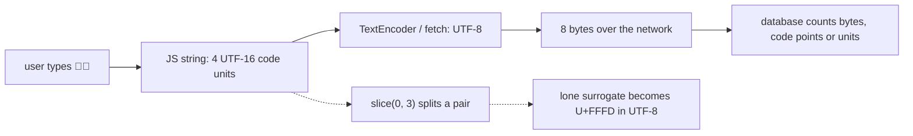

## Introduction

Try this in any JavaScript console: `'🙂'.length`. The answer is `2`. A thumbs-up with a skin tone, `'👍🏽'.length`, is `4`. A family emoji, `'👨‍👩‍👧'.length`, is `8`. And two strings that both display as "café" can fail `===`.

These are not bugs in JavaScript. They are the visible edges of how text is represented in computers in general and in JavaScript in particular. Most of the time you do not notice, because English text, numbers and code all sit in the part of Unicode where the simple model holds. Then a user types an emoji into a 20-character username field, pastes their name from a Mac, or writes in Hindi, and suddenly the character counter is wrong, a truncated preview ends in a "�" replacement symbol, a search fails to find a word that is clearly there, or the database rejects text that the frontend accepted.

This lesson builds the mental model that explains all of these. There are **three levels** at which you can count "characters" in a JavaScript string — **code units**, **code points** and **grapheme clusters** — and most string bugs come from using an API that works at one level when you meant another. Once you know which level each API uses, the surprises disappear.

## Before you start

- **String basics** — indexing, `length` and immutability. See [[b1-string-creation]] and [[b1-string-indexing]].
- **String methods** — `slice`, `split`, `indexOf` and friends. See [[b1-string-methods]].
- **Escape sequences** — `\uHHHH` and `\u{...}`. See [[b1-escape-sequences]].
- **`for...of`** — loops over iterables such as strings. See [[b1-for-of-in]].
- **Hexadecimal** — code points are written in base 16, such as `U+1F642`. You only need to recognise the notation.

## The intuition

Picture a string at three zoom levels.

At the **closest zoom**, you see a row of small, equal-sized boxes, each holding a 16-bit number. These are **code units**, and they are what JavaScript actually stores. `length`, `[i]`, `slice` and `indexOf` all work at this level.

Zoom out one step and some neighbouring boxes merge: a pair of boxes turns out to be one entry in the Unicode catalogue. These entries are **code points** — Unicode's numbered characters. `for...of`, spreading with `[...s]` and `codePointAt` work at this level.

Zoom out once more to what a person sees on screen. Several code points can merge into one visible symbol: a letter plus an accent, or several emoji glued together into a family. Each visible unit is a **grapheme cluster**. Only `Intl.Segmenter` works at this level.

For plain English text, all three views show the same number of things, which is why the distinction is easy to ignore. The rest of this lesson explains what happens when they differ.

## Unicode and code points

**Unicode** is the universal catalogue of characters. It assigns every character — Latin letters, Chinese characters, Arabic letters, mathematical symbols, emoji, and invisible control characters — a unique number called a **code point**, written `U+` followed by at least four hexadecimal digits. `A` is `U+0041`, `é` is `U+00E9`, `€` is `U+20AC`, and `🙂` is `U+1F642`.

Code points range from `U+0000` to `U+10FFFF`, room for about 1.1 million characters. That space is divided into 17 **planes** of 65,536 code points each. **Plane 0**, the **Basic Multilingual Plane (BMP)**, covers `U+0000` to `U+FFFF` and contains almost every character used in modern writing systems. The other 16 planes — the **supplementary** or "astral" planes — hold emoji, historic scripts, rare Chinese characters and mathematical alphanumerics such as `𝒜`.

A code point is an abstract number. To store it in memory or send it over a network, it has to be **encoded** as bytes or fixed-size units. The three standard encodings are UTF-8 (one to four bytes per code point), UTF-16 (one or two 16-bit units) and UTF-32 (always one 32-bit unit). JavaScript strings use UTF-16.

## UTF-16 and surrogate pairs

When JavaScript was designed in 1995, Unicode was a 16-bit standard: every character fitted in 16 bits, and an encoding called UCS-2 stored each character in exactly one 16-bit unit. JavaScript, like Java and Windows NT, adopted that model, so a string was defined as a sequence of 16-bit units with "one unit = one character".

In 1996, Unicode 2.0 expanded beyond 16 bits. To keep 16-bit systems working, it introduced **UTF-16**: BMP code points are still stored as one 16-bit **code unit**, and code points above `U+FFFF` are stored as **two** code units called a **surrogate pair**. Unicode reserved the range `U+D800`–`U+DFFF` for this purpose — those numbers are never characters on their own. A **high surrogate** (`D800`–`DBFF`) comes first and a **low surrogate** (`DC00`–`DFFF`) second.

JavaScript kept its definition: a string is still a sequence of 16-bit code units, and `length`, indexing and most methods still count units. Characters above `U+FFFF` therefore take two positions.

```javascript title="surrogates.js"
const smile = '🙂';
console.log(smile.length);
console.log(smile.charCodeAt(0).toString(16), smile.charCodeAt(1).toString(16));
console.log(smile.codePointAt(0).toString(16));

const cp = 0x1f642;
const offset = cp - 0x10000;              // 20-bit number
const high = 0xd800 + (offset >> 10);     // top 10 bits
const low = 0xdc00 + (offset & 0x3ff);    // bottom 10 bits
console.log(high.toString(16), low.toString(16));
console.log('🙂' === smile, '\u{1f642}' === smile);
```

```output
2
d83d de42
1f642
d83d de42
true true
```

The arithmetic shows exactly how a surrogate pair is formed. Subtract `0x10000` from the code point, leaving a number that fits in 20 bits. The top 10 bits are added to `0xD800` to make the high surrogate; the bottom 10 bits are added to `0xDC00` to make the low surrogate. You never need to do this by hand — `String.fromCodePoint` and `\u{...}` do it — but seeing it once makes clear that a surrogate pair is just a mechanical encoding of one larger number.

`charCodeAt(i)` returns the raw code unit at position `i`. `codePointAt(i)` checks whether position `i` holds a high surrogate followed by a low surrogate and, if so, combines them into the full code point.

### Lone surrogates

A surrogate code unit that is not part of a correct high-low pair is a **lone surrogate**. JavaScript strings may contain them — a string is only a list of 16-bit numbers, with no requirement that they form valid UTF-16 — and they appear whenever code cuts a string between the two halves of a pair:

```javascript title="lone-surrogates.js"
const text = 'hi🙂';
const cut = text.slice(0, 3);
console.log(cut.length, JSON.stringify(cut));
console.log(cut.isWellFormed(), text.isWellFormed());
console.log(JSON.stringify(cut.toWellFormed()));
console.log(new TextEncoder().encode(cut));
try {
  encodeURIComponent(cut);
} catch (err) {
  console.log(err.constructor.name + ': ' + err.message);
}
```

```output
3 "hi\ud83d"
false true
"hi�"
Uint8Array(5) [ 104, 105, 239, 191, 189 ]
URIError: URI malformed
```

Slicing at index 3 kept only the high surrogate. `JSON.stringify` shows it as the escape `\ud83d` (since ES2019, `JSON.stringify` escapes lone surrogates instead of emitting invalid text). `isWellFormed()` and `toWellFormed()` (ES2024, available in all current browsers and Node.js 20+) detect and repair lone surrogates; repair replaces each one with `U+FFFD`, the **replacement character** "�". The same replacement happens silently when the string is converted to UTF-8 with `TextEncoder` — the bytes `239, 191, 189` are U+FFFD in UTF-8 — which is how a corrupted emoji turns into "�" in a database or on another user's screen. `encodeURIComponent` refuses outright with a `URIError`.

## Which APIs see which level

This table is the core reference for the lesson.

| Level | APIs that work at this level |
|---|---|
| Code units (16-bit) | `length`, `s[i]`, `charAt`, `charCodeAt`, `at`, `slice`, `substring`, `indexOf`, `split('')`, `String.fromCharCode`, `\uHHHH`, regex without the `u` flag |
| Code points | `codePointAt`, `String.fromCodePoint`, `for...of`, `[...s]`, `Array.from(s)`, `\u{...}`, regex with the `u` or `v` flag |
| Grapheme clusters | `Intl.Segmenter` with `granularity: 'grapheme'` |
| Bytes (UTF-8) | `TextEncoder`, `Blob`, `fetch` bodies; `Buffer.byteLength` in Node.js |

```javascript title="iterate-levels.js"
const s = 'A🙂é';
console.log(s.length, [...s].length, Array.from(s));
for (let i = 0; i < s.length; i++) {
  console.log('unit', i, s.charCodeAt(i).toString(16));
}
for (const ch of s) {
  console.log('point', ch, ch.codePointAt(0).toString(16), 'length', ch.length);
}
console.log(/^.$/.test('🙂'), /^.$/u.test('🙂'));
```

```output
4 3 [ 'A', '🙂', 'é' ]
unit 0 41
unit 1 d83d
unit 2 de42
unit 3 e9
point A 41 length 1
point 🙂 1f642 length 2
point é e9 length 1
false true
```

`length` reports four code units while spreading produces three code points. The counting loop visits all four units, including the two halves of the emoji. The `for...of` loop yields three code points, but the emoji's `ch.length` is 2, because each yielded value is itself a JavaScript string of one or two code units. In regular expressions, `.` matches one code unit by default, so it cannot match a whole emoji; with the `u` (Unicode) flag, `.` matches one code point. The `u` flag also enables `\u{...}` escapes and Unicode property classes such as `\p{L}` (any letter) inside patterns — see [[b1-regex-classes-quantifiers]].

`codePointAt` has one trap: its argument is a **code-unit** index. `'🙂'.codePointAt(1)` points into the middle of the pair and returns only the low surrogate, `0xDE42`. Iterate with `for...of` rather than calling `codePointAt` with a counting index.

## Grapheme clusters: what users call a character

Code points still do not match what a person sees. A **grapheme cluster** (Unicode's "extended grapheme cluster") is a sequence of one or more code points that displays and behaves as a single unit — one cursor position, one backspace, one "character" in a user's mind. Common multi-code-point clusters are:

- **Combining marks**: `e` (`U+0065`) followed by a combining acute accent (`U+0301`) displays as `é`. Many scripts, including Hindi and Thai, rely on combining marks heavily.
- **Emoji modifier sequences**: `👍` followed by a skin-tone modifier `🏽` displays as one thumbs-up.
- **Flags**: two **regional indicator** symbols, such as `🇯` + `🇵`, display as the Japanese flag 🇯🇵.
- **ZWJ sequences**: emoji joined by the invisible **zero-width joiner** (`U+200D`), such as man + ZWJ + woman + ZWJ + girl, display as a family.

`Intl.Segmenter` (part of the ECMAScript Internationalization API since ES2022; Firefox was the last major browser to ship it, in 2024) splits text into grapheme clusters using the Unicode rules:

```javascript title="levels.js"
const segmenter = new Intl.Segmenter('en', { granularity: 'grapheme' });
const count = (text) => ({
  units: text.length,
  points: [...text].length,
  graphemes: [...segmenter.segment(text)].length,
  utf8: new TextEncoder().encode(text).length,
});

const samples = {
  ascii: 'hello',
  precomposed: 'café',
  combining: 'café',
  emoji: '🙂',
  skinTone: '👍🏽',
  flag: '🇯🇵',
  family: '👨‍👩‍👧',
};
for (const [label, text] of Object.entries(samples)) {
  const c = count(text);
  console.log(label.padEnd(12), c.units, c.points, c.graphemes, c.utf8);
}
```

```output
ascii        5 5 5 5
precomposed  4 4 4 5
combining    5 5 4 6
emoji        2 1 1 4
skinTone     4 2 1 8
flag         4 2 1 8
family       8 5 1 18
```

The columns are code units, code points, grapheme clusters and UTF-8 bytes. Only for `hello` do all four agree. The two "café" strings look identical but differ in every column except graphemes. The family emoji is one grapheme, five code points (three people and two joiners), eight code units and eighteen bytes. When a product requirement says "maximum 20 characters", someone has to decide which of these columns it means — and the frontend, the backend and the database need to agree.

Iterating the result of `segment()` gives objects with a `segment` property (the cluster's text) and an `index` (its code-unit position). `Intl.Segmenter` also supports `granularity: 'word'` and `'sentence'`, which handle languages such as Japanese and Thai that do not separate words with spaces. Grapheme rules are updated with each Unicode version, so very new emoji may segment differently on older browsers.

## Normalisation: when equal-looking strings are not equal

Unicode often has more than one way to write the same visible text. `é` can be a single precomposed code point (`U+00E9`) or `e` plus a combining accent (`U+0065 U+0301`). Both are correct Unicode and display identically, but they are different code-unit sequences, so `===`, `includes` and `indexOf` treat them as different strings. macOS file systems, some keyboards and copy-pasted text commonly produce the decomposed form.

**Normalisation** converts text to a standard form so that equivalent strings become identical. `String.prototype.normalize(form)` supports the four Unicode normalisation forms:

| Form | What it does | Typical use |
|---|---|---|
| `NFC` (default) | Composes: `e` + accent → `é` | Storing and comparing text; the web's standard form |
| `NFD` | Decomposes: `é` → `e` + accent | Stripping accents, linguistic processing |
| `NFKC` | Composes and also folds "compatibility" variants: full-width `Ａ` → `A`, `fi` → `fi`, `²` → `2` | Identifiers, usernames, search keys |
| `NFKD` | Decomposes and folds compatibility variants | Search indexing |

```javascript title="normalize.js"
const composed = 'café';
const decomposed = 'café';
console.log(composed === decomposed, composed.length, decomposed.length);
console.log(composed.normalize() === decomposed.normalize());
console.log(decomposed.includes(composed), decomposed.normalize().includes(composed));

console.log('Ａｄａ'.normalize('NFKC'), 'file'.normalize('NFKC'), 'x²'.normalize('NFKC'));
const angstrom = 'Å';                 // the Angstrom sign
console.log(angstrom === 'Å', angstrom.normalize() === 'Å');

const stripAccents = (s) => s.normalize('NFD').replace(/[̀-ͯ]/g, '');
console.log(stripAccents('Crème Brûlée'));
```

```output
false 4 5
true
false true
Ada file x2
false true
Creme Brulee
```

After NFC normalisation, both "café" strings are the same four code units and every comparison works. The NFKC line shows compatibility folding: full-width letters (common in East Asian input), ligatures and superscripts become their plain equivalents. That makes NFKC useful for usernames, where `Ａｄａ` and `Ada` should not be two different accounts — but it is too aggressive for general text, since it changes meaning (`x²` becomes `x2`). The accent-stripping helper decomposes and then deletes the combining marks in the range `U+0300`–`U+036F`; it works for Latin-script accents but is not a general transliteration tool.

A practical policy: normalise to NFC at the boundaries of your system — when text arrives from users, files or APIs — and store NFC. Use NFKC plus case folding for identifiers that must be unique. Normalise both sides before comparing text from different sources. [[b1-equality]] shows this from the comparison side.

## Comparing, sorting and changing case

The relational operators and the default `Array.prototype.sort` compare strings **code unit by code unit**. That puts all upper-case ASCII letters before lower-case ones, puts `é` (code unit `0xE9`) after `z`, and orders many astral characters by their *surrogate* values, so an emoji (high surrogate around `0xD83D`) sorts before characters such as `～` (`U+FF5E`) even though its code point is larger.

```javascript title="sorting.js"
const words = ['éclair', 'eclipse', 'Zebra', 'apple'];
console.log([...words].sort());
console.log([...words].sort((a, b) => a.localeCompare(b)));
console.log([...words].sort(new Intl.Collator('en').compare));
console.log('😀' < '～', 0x1f600 < 0xff5e);
```

```output
[ 'Zebra', 'apple', 'eclipse', 'éclair' ]
[ 'apple', 'éclair', 'eclipse', 'Zebra' ]
[ 'apple', 'éclair', 'eclipse', 'Zebra' ]
true false
```

`localeCompare` and `Intl.Collator` sort by human language rules: case and accents are secondary differences, so `éclair` sits next to `eclipse` and `Zebra` sorts with the Z words. For sorting many items, create one `Intl.Collator` and reuse its `compare` function; it avoids repeating locale setup on every comparison. The last line shows the surrogate-order surprise: by code point, U+1F600 is greater than U+FF5E, but `<` compares the first code units, `0xD83D` and `0xFF5E`.

Case conversion is Unicode-aware but not length-preserving: `'ß'.toUpperCase()` is `'SS'`, and the ligature `'ffi'.toUpperCase()` is `'FFI'`. Language-specific rules (Turkish dotted and dotless i) need `toLocaleUpperCase('tr')`. For case-insensitive matching across languages, `a.localeCompare(b, undefined, { sensitivity: 'accent' })` (or `'base'` to ignore accents too) is more reliable than lower-casing both sides. See [[b1-string-methods]].

## How it works internally

The ECMAScript specification defines a string as a sequence of 16-bit unsigned integers and says that, *when* a string is interpreted as text, it is treated as UTF-16. It deliberately does not require well-formedness, which is why lone surrogates are legal. All index-based operations are defined on code units, and the string iterator (used by `for...of` and spread) is defined to decode surrogate pairs into code points, yielding a lone surrogate as a one-unit string when it cannot pair it.

Engines store strings more compactly than the specification's model suggests. V8, for example, stores a string with one byte per character when every code unit is below `0x100` (Latin-1), and switches to two bytes per unit otherwise — so adding a single emoji to a long ASCII string can double its memory. This is invisible to your code: `length` and indexes behave identically.

At the edges of the JavaScript world, text is converted to other encodings. The web platform overwhelmingly uses **UTF-8** for network traffic and files: `fetch` encodes request bodies as UTF-8, `TextEncoder` produces UTF-8 bytes, and HTML pages declare `<meta charset="utf-8">`. Any lone surrogate becomes U+FFFD in that conversion. Databases and APIs may count length in UTF-8 bytes (MySQL's older `utf8` charset could not store code points above U+FFFF at all; its `utf8mb4` can), in code points (PostgreSQL's `length()` on text), or in UTF-16 units (Java and C#, like JavaScript).

`Intl.Segmenter`, `normalize`, `localeCompare` and the case mappings rely on Unicode data tables. Browsers and Node.js ship them via the International Components for Unicode (ICU) library, so results can change slightly with the Unicode version that a browser or Node.js release includes.



## Worked example: counting, truncating and reversing safely

A social app needs three helpers: a character counter for a bio field limited to 20 "characters" as users perceive them, a function that truncates long bios for previews, and (for a playful feature) a reverse function. All three must work for emoji, flags and accented text. Before reading the output, try to predict each line.

```javascript title="safe-text.js"
const segmenter = new Intl.Segmenter('en', { granularity: 'grapheme' });
const graphemes = (text) => Array.from(segmenter.segment(text), (part) => part.segment);

function visibleLength(text) {
  return graphemes(text.normalize('NFC')).length;
}

function truncate(text, max) {
  const parts = graphemes(text);
  return parts.length <= max ? text : parts.slice(0, max - 1).join('') + '…';
}

const reverse = (text) => graphemes(text).reverse().join('');

const bio = 'Loves 🇯🇵 travel 👨‍👩‍👧 and cafés';
console.log(bio.length, visibleLength(bio));
console.log(truncate(bio, 10));
console.log(JSON.stringify(bio.slice(0, 7) + '…'));
console.log(reverse('ab🇯🇵👍🏽'));
console.log([...'ab🇯🇵👍🏽'].reverse().join(''));
console.log(JSON.stringify('ab🙂'.split('').reverse().join('')));
```

```output
37 26
Loves 🇯🇵 t…
"Loves \ud83c…"
👍🏽🇯🇵ba
🏽👍🇵🇯ba
"\ude42\ud83dba"
```

`bio.length` is 37 code units, but `visibleLength` reports 26 graphemes: the flag counts once, the family counts once, and the decomposed "é" counts once. The function normalises to NFC first so that the count does not depend on how the user's keyboard encoded accented letters (for grapheme counting this changes nothing, but it makes the stored form consistent). `truncate` cuts on grapheme boundaries, so the preview keeps the flag whole. The naive `slice(0, 7)` cuts the flag between its two code points — and worse, inside the surrogate pair of the first regional indicator — leaving the lone surrogate `\ud83c`.

The three reverse lines show the three levels in action. Reversing graphemes keeps the thumbs-up with its skin tone and the flag intact. Reversing code points with `[...s]` keeps each emoji's surrogates together but separates the skin-tone modifier from the thumb and swaps the two regional indicators — 🇯🇵 (JP) becomes 🇵🇯 (PJ, which is not a country, so it typically renders as two letter boxes). Reversing code units with `split('')` swaps the halves of each surrogate pair, producing invalid UTF-16.

The validation rule for a bio limit then becomes `visibleLength(bio) <= 20` — but the server must count the same way. If the backend enforces "20" using a database column measured in bytes or code points, a 20-grapheme bio containing a family emoji will be rejected. Agree on one definition and enforce the storage limit separately, typically generously in bytes.

## In real systems

**Input limits.** HTML's `maxlength` attribute counts UTF-16 code units, so a 10-character limit allows only five emoji. Mobile keyboards, Twitter/X-style counters and database columns may each count differently. Pick a definition (graphemes for what users see, bytes for storage) and apply it consistently on client and server.

**Usernames and security.** Visually similar characters — Latin `a` and Cyrillic `а`, full-width letters, combining marks — let attackers register look-alike names ("homoglyph" attacks). Systems normalise identifiers with NFKC, case-fold them, and often restrict the allowed scripts. Domain names use a similar process (IDNA) and browsers display suspicious mixed-script domains as Punycode (`xn--…`).

**Search.** Search features normalise both the index and the query, and often strip accents, so that "cafe" finds "café". `Intl.Collator` with `sensitivity: 'base'` supports accent-insensitive equality on the client.

**Truncation in UI.** Notification previews, table cells and SMS gateways truncate text. Cutting by `slice` produces "�" at the end when it splits an emoji. Use `Intl.Segmenter`, or let CSS truncate visually with `text-overflow: ellipsis` when the full text can stay in the DOM.

**Encoding boundaries.** URLs require percent-encoded UTF-8 (`encodeURIComponent('🙂')` is `'%F0%9F%99%82'`), and lone surrogates make it throw. Calling `toWellFormed()` before encoding text from untrusted sources avoids crashes.

## Trade-offs and alternatives

| Need | Tool | Cost and caveats |
|---|---|---|
| Storage size, indexes for `slice` | `length`, code-unit methods | Fast; wrong for "characters" outside the BMP |
| Iterate characters roughly | `for...of`, `[...s]` | Allocates; splits combining marks and emoji sequences |
| What users perceive | `Intl.Segmenter` | Slower and allocates; results vary slightly by Unicode version |
| Byte limits | `TextEncoder().encode(s).length` | Allocates a byte array; use `Buffer.byteLength` in Node.js |
| Equality of user text | `normalize('NFC')` then `===` | Must be applied to both sides, every time |
| Human ordering | `Intl.Collator`, `localeCompare` | Locale-dependent; slower than `<` |

Code-unit operations are the right choice for most internal work — parsing ASCII formats, slicing at positions returned by `indexOf`, building identifiers — because they are fast and exact. Reach for code points and graphemes only where a human-visible notion of "character" matters, such as counting, truncating, reversing and cursor movement.

## Common mistakes

> [!MISTAKE] Using `length` as a character count
> `'👍🏽'.length` is 4. Validation, counters and truncation based on `length` or `slice` break on emoji and decomposed accents. Use `Intl.Segmenter` for user-perceived characters and `TextEncoder` for bytes.

**Reversing or splitting with `split('')`.** It splits surrogate pairs into lone surrogates. Use `[...s]` for code points, or graphemes for user-visible text.

**Comparing unnormalised text.** Two "café" strings from different sources can differ. Normalise both sides first.

**Calling `codePointAt` with a counting loop.** `codePointAt(i)` takes a code-unit index; at the second half of a pair it returns a lone surrogate. Use `for...of`.

**Sorting with the default `sort()`.** It orders by code unit: upper case first, accented letters after `z`. Use `localeCompare` or `Intl.Collator`.

**Assuming the regex `.` matches a character.** Without the `u` flag it matches one code unit. Add `u` for code points; graphemes still need `Intl.Segmenter`.

**Assuming case conversion preserves length.** `'ß'.toUpperCase()` is `'SS'`. Do not use indexes from one case form on the other.

## Interview perspective

Unicode questions test whether you understand representation rather than API trivia. The best answers name the three levels and pick the right tool for each.

> [!INTERVIEW] "Why is `'🙂'.length` equal to 2?"
> "JavaScript strings are sequences of UTF-16 code units. The emoji's code point, U+1F642, is above U+FFFF, so UTF-16 encodes it as a surrogate pair — two 16-bit units — and `length` counts units. `[...s].length` counts code points, which gives 1 here. For what users see as characters, including flags and skin tones, I'd use `Intl.Segmenter` with grapheme granularity."

Questions to be ready for:

- **Code unit vs code point vs grapheme?** A 16-bit storage unit; a Unicode character number; a user-perceived character made of one or more code points.
- **How do you reverse a string correctly?** `[...s].reverse().join('')` handles surrogates; a grapheme-based reverse with `Intl.Segmenter` also handles combining marks, flags and ZWJ sequences.
- **Why can two strings that look the same fail `===`?** Different code-point sequences for the same text, such as composed vs decomposed accents; normalise with `normalize('NFC')`.
- **What is a lone surrogate and how does it arise?** Half of a surrogate pair, typically from `slice` or `split('')`; it becomes U+FFFD when encoded to UTF-8 and makes `encodeURIComponent` throw. Detect with `isWellFormed()`.
- **What does the regex `u` flag change?** `.` and character classes match code points, `\u{...}` and `\p{...}` work, and invalid escapes become errors.

```quiz
Q: What are `'👍🏽'.length` and `[...'👍🏽'].length`?
- [ ] 1 and 1
- [ ] 2 and 1
- [x] 4 and 2
- [ ] 8 and 4
> The thumbs-up and the skin-tone modifier are two separate code points, each above U+FFFF, so each takes two UTF-16 code units: `length` is 4. Spreading yields code points, giving 2. Only `Intl.Segmenter` reports the single visible character. 8 is the size in UTF-8 bytes, not a JavaScript length.

Q: `'café' === 'café'` is `false`. What makes the comparison succeed?
- [ ] `toLowerCase()` on both sides
- [x] `normalize()` on both sides
- [ ] `trim()` on both sides
- [ ] Using `==` instead of `===`
> One string uses `e` plus a combining accent and the other a precomposed `é`. They are canonically equivalent but different code-unit sequences. NFC normalisation (the default for `normalize()`) turns both into the precomposed form. Case conversion, trimming and loose equality do not change the code points involved.

Q: What does `'ab🙂'.split('').reverse().join('')` produce?
- [ ] `'🙂ba'`
- [x] A string with the emoji's surrogates swapped, which is invalid UTF-16
- [ ] `'ba🙂'`
- [ ] It throws a `TypeError`
> `split('')` splits into code units, so the emoji becomes two lone surrogates. Reversing puts the low surrogate before the high one, which no longer forms a valid pair. `[...'ab🙂'].reverse().join('')` keeps the code point together and gives `'🙂ba'`.

Q: Which API counts the flag `'🇯🇵'` as one character?
- [ ] `'🇯🇵'.length`
- [ ] `[...'🇯🇵'].length`
- [ ] `Array.from('🇯🇵').length`
- [x] Counting the segments from `new Intl.Segmenter('en', { granularity: 'grapheme' }).segment('🇯🇵')`
> A flag is two regional-indicator code points (4 code units). `length` gives 4; spreading and `Array.from` give 2 code points. Only grapheme segmentation applies the Unicode rule that a pair of regional indicators forms one cluster.
```

## Practice

1. **Three counts.** Write `stats(text)` returning `{ units, points, graphemes, bytes }` and run it on `'naïve'`, `'𝒜𝒷𝒸'`, `'🏳️‍🌈'` and a string of your own. Explain every difference.
2. **Safe slice.** Write `sliceGraphemes(text, start, end)` that behaves like `slice` but with grapheme indexes, including negative indexes.
3. **Username normaliser.** Write `normalizeUsername(name)` that trims, applies NFKC, lower-cases, and rejects names containing characters outside `\p{L}`, `\p{N}`, `_` and `-` (use the regex `u` flag). Test it with `'Ａｄａ'`, `'ada'` and `'adа'` (Cyrillic `а`). Which pair does it fail to catch, and why?
4. **Surrogate detector.** Without using `isWellFormed`, write a function that returns the indexes of all lone surrogates in a string, using `charCodeAt`.
5. **Byte budget.** A database column allows 255 UTF-8 bytes. Write `fitsInColumn(text)` and `truncateToBytes(text, maxBytes)` that never cuts inside a grapheme.

## Quick revision {#quick-revision}

- Three levels: **code units** (16-bit, what JS stores), **code points** (Unicode numbers U+0000–U+10FFFF), **grapheme clusters** (what users see).
- BMP (U+0000–U+FFFF) = 1 code unit. Above U+FFFF = **surrogate pair**: high `D800–DBFF` + low `DC00–DFFF`. Formula: `cp - 0x10000`, top 10 bits + `0xD800`, bottom 10 bits + `0xDC00`.
- JS chose 16-bit units in 1995 (UCS-2 era); Unicode 2.0 (1996) added surrogates; JS kept unit-based `length`.
- Code-unit APIs: `length`, `[i]`, `charAt`, `charCodeAt`, `at`, `slice`, `substring`, `indexOf`, `split('')`, `fromCharCode`, `\uHHHH`, regex without `u`.
- Code-point APIs: `codePointAt` (takes a unit index), `fromCodePoint`, `for...of`, `[...s]`, `Array.from`, `\u{...}`, regex with `u`/`v`.
- Graphemes: `Intl.Segmenter(locale, { granularity: 'grapheme' })` — combining marks, skin tones, flags, ZWJ sequences.
- Lone surrogates come from cutting pairs; `isWellFormed`/`toWellFormed` (ES2024); become U+FFFD in UTF-8; `encodeURIComponent` throws `URIError`.
- Normalise before comparing: NFC (default, compose), NFD (decompose; strip accents with `/[̀-ͯ]/g`), NFKC/NFKD (fold compatibility forms; identifiers).
- `<` and default `sort()` compare code units; use `localeCompare` / `Intl.Collator`. Case mapping can change length (`ß` → `SS`).
- UTF-8 on the wire: `TextEncoder().encode(s).length` for bytes. Front end, back end and database must agree on what "length" means.

## Key takeaways {#key-takeaways}

- A JavaScript string is a sequence of UTF-16 code units, so characters above U+FFFF — including almost all emoji — occupy two positions as a surrogate pair.
- Most string bugs come from mixing levels: `length` and `slice` count code units, `for...of` and spread count code points, and only `Intl.Segmenter` counts what users perceive as characters.
- Cutting between the halves of a surrogate pair creates a lone surrogate, which turns into "�" when the text leaves JavaScript as UTF-8.
- Visually identical text can have different code points; normalise with `normalize()` before comparing, searching or storing.
- Sort and compare human-readable text with `Intl.Collator` or `localeCompare`, and decide explicitly whether a length limit means graphemes, code points or bytes.
