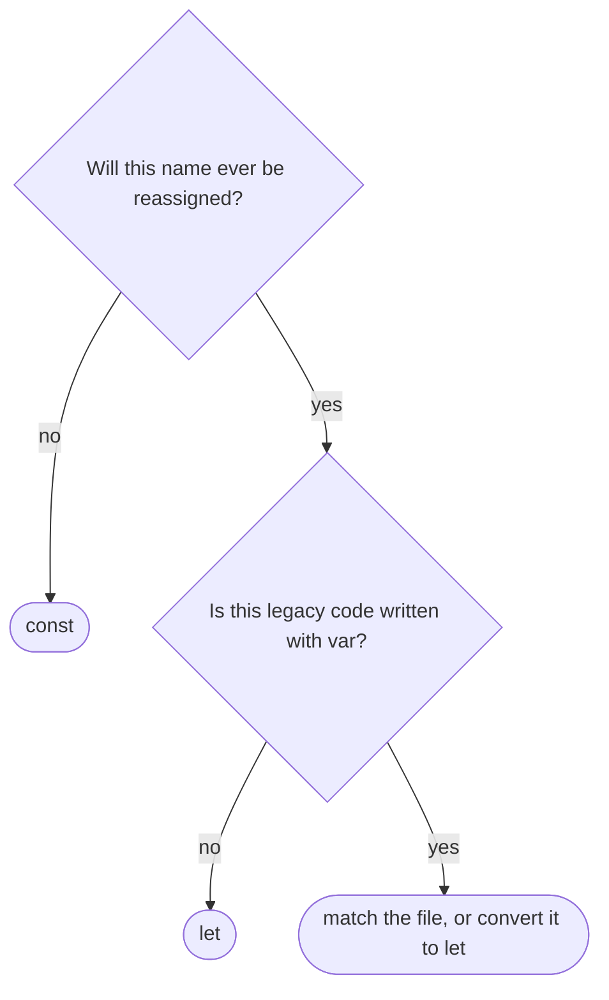

## Introduction

A beginner reading modern JavaScript meets three ways to declare a variable — `var`, `let` and `const` — and reasonably asks why one language needs three. The answer is history. From 1995 to 2015 JavaScript had only `var`, which follows rules unlike most other languages. ES2015 added `let` and `const` with the block-scoping rules programmers expected, but could not change `var` without breaking millions of existing websites. So all three remain.

This lesson puts them side by side. It first gives the complete comparison and a rule for choosing, then teaches the three kinds of scope that explain most of the differences:

- **Function scope**, where `var` lives.
- **Block scope**, where `let`, `const` and `class` live.
- **Global scope**, where all of them can end up, with different consequences.

Each keyword has a full lesson of its own — [[b1-var]], [[b1-let]] and [[b1-const]] — so this one concentrates on the contrasts and on the scopes themselves.

## Before you start

- **Variables** — declaration, initialisation, assignment and redeclaration. See [[b1-variables]].
- **Scope** — the general idea that a name is visible only in a region of code. See [[b1-scope]] for the overview.
- **Functions and blocks** — what a function body is and what a block `{ }` is. See [[b1-syntax-basics]].

## The intuition

Think of three containers of different shapes:

- **`var`** is a container the size of the whole function. Wherever in the function you write it, it fills the entire function.
- **`let`** is a container the size of the nearest pair of braces. You can empty it and refill it.
- **`const`** is the same size as `let`, but sealed once filled. If what you sealed inside is an object, the object itself can still be rearranged; you just cannot swap it for a different one.

All three can sit at the very top level of a program, which is the global scope — and there, `var` behaves differently again.

## The complete comparison

| | `var` | `let` | `const` |
|---|---|---|---|
| Introduced | ES1 (1997 standard) | ES2015 | ES2015 |
| Scope | Nearest function (or script/module) | Nearest block | Nearest block |
| Binding created | On function/script entry | On block entry | On block entry |
| Value before its line | `undefined` | `ReferenceError` (TDZ) | `ReferenceError` (TDZ) |
| Initialiser required | No | No | **Yes** |
| Reassignment | Allowed | Allowed | `TypeError` |
| Redeclaration in same scope | Allowed (with `var`) | SyntaxError | SyntaxError |
| Top level of classic script | Property of `window` | Global, not on `window` | Global, not on `window` |
| `for (… i …)` closures | One shared binding | One binding per iteration | Works in `for…of`/`for…in`; classic `for` throws on update |

The table looks long, but almost every row follows from two design decisions. `let` and `const` are **lexical declarations**: they belong to blocks, they exist uninitialised until their line runs (the temporal dead zone, [[b1-tdz]]), and they forbid duplicates. `const` adds one rule: the binding is **immutable**, so it must be initialised immediately and never reassigned. Everything that makes `var` different comes from its pre-2015 design: function scope, initialisation to `undefined`, tolerance of duplicates, and storage on the global object.

## Seeing the difference in one function

Here the same names are declared at function level and again inside an `if` block:

```javascript title="compare.js"
function compare() {
  var a = 1;
  let b = 2;
  const c = 3;
  if (true) {
    var a = 10;   // the same a: var ignores the block
    let b = 20;   // a new b, only inside the block
    console.log('if', a, b, c);
  }
  console.log('fn', a, b, c);
}
compare();
```

```output
if 10 20 3
fn 10 2 3
```

Inside the block, `a` is `10`, `b` is `20`, and `c` is read from the function level. After the block, `a` is still `10` — the inner `var a = 10` was not a new variable but a redeclaration of the function's `a`, so it overwrote it. `b` is back to `2`, because the inner `let b` was a separate variable that shadowed the outer one only inside the block. That one example contains the main practical difference: **`var` leaks out of blocks; `let` and `const` do not.**

## How to choose

Modern style follows one rule:

1. Use **`const`** for every binding that is never reassigned. This is most of them: function results, objects and arrays (even ones you mutate), imported values, functions assigned to names, DOM references.
2. Use **`let`** only when the binding must be reassigned: loop counters, accumulators, values assigned in different branches.
3. Do not use **`var`** in new code.

The reasons are practical. `const` tells readers a name will not be repointed, so they can stop tracking it; `let` stands out as the place where something changes. Block scope keeps each variable close to its use. The temporal dead zone turns ordering mistakes into immediate errors instead of `undefined`. And forbidding duplicates catches copy-paste bugs. ESLint's `no-var` and `prefer-const` rules enforce this style automatically.



The rest of this lesson explains the three scopes that the keywords live in.

## Function Scope {#b1-function-scope-vars}

**Function scope** means a name is visible throughout the entire body of the function it is declared in — from its first line to its last, including inside every nested block — and nowhere outside the function. In JavaScript, `var` declarations, function parameters and (in sloppy-mode code) function declarations are function-scoped. Each call of the function gets a fresh set of these variables.

```javascript title="function-scope.js"
function outer(x) {
  if (x > 0) {
    var msg = 'positive';
  } else {
    var msg = 'not positive';
  }
  console.log(msg);          // visible after the if/else: msg belongs to outer

  function inner() {
    var secret = 'inner only';
    return x * 2;            // inner can see outer's parameter
  }
  console.log(inner());
  console.log(typeof secret); // outer cannot see inner's variables
}
outer(5);
```

```output
positive
10
undefined
```

Three facts are visible here. Both `var msg` declarations, though written in separate branches, refer to one variable belonging to `outer`, so it is readable after the `if`/`else`. The nested function `inner` can read `outer`'s parameter `x`, because scopes nest: an inner function sees everything in the functions around it. But the reverse is not true — `outer` cannot see `inner`'s `secret`. A function boundary is a wall that lets you look outwards but not inwards.

### What belongs to function scope

The function's **parameters** are function-scoped, which is why `function f(a) { var a; }` refers to the same `a` and keeps the argument's value. All `var` declarations anywhere in the body belong to the function, however deeply they are nested in blocks — but *not* those inside nested functions, which belong to those functions. Function declarations written directly in the body are function-scoped too, and are initialised with the complete function at entry, which is why they can be called above the line that defines them ([[b1-function-hoisting]]).

### Every call has its own scope

Function scope is created per **call**, not per function. Two calls of the same function have completely separate variables:

```javascript title="per-call.js"
function makeCounter() {
  var count = 0;              // a new count for every call of makeCounter
  return function () {
    count += 1;
    return count;
  };
}
const a = makeCounter();
const b = makeCounter();
console.log(a(), a(), b());
```

```output
1 2 1
```

`a` and `b` each close over the `count` from their own call of `makeCounter`. This is the mechanism behind closures and private state ([[b1-closures]]).

### Why function scope existed

Before 2015, the function was the only privacy boundary JavaScript had. To keep variables out of the shared global scope, code was wrapped in functions — most famously the **IIFE**, `(function () { var private = …; })();` ([[b1-iife]]). Programmers from C or Java, used to braces creating a scope, were regularly caught out by `var` escaping from `if` and `for` blocks. That mismatch is why block scope was added. Function scope is still real and still matters — parameters and closures depend on it — but for variables you now get a tighter boundary with `let` and `const`.

## Block Scope {#b1-block-scope-vars}

**Block scope** means a name is visible only inside the nearest enclosing pair of braces `{ }` — an `if` or `else` body, a loop body, a `try`, `catch` or `finally` block, a `switch` body, or a bare block — and is gone once execution leaves those braces. `let`, `const` and `class` declarations are block-scoped. So are function declarations inside blocks in strict-mode code.

```javascript title="block-scope.js"
{
  const secret = 42;
  console.log(secret);
}
try {
  console.log(secret);       // outside the block: no such binding
} catch (e) {
  console.log(e.name + ': ' + e.message);
}

try {
  JSON.parse('{bad json');
} catch (err) {              // err is scoped to the catch block
  console.log('caught', err.name);
}
console.log(typeof err);

if (true) {
  class Temp {}
  console.log(typeof Temp);
}
console.log(typeof Temp);    // classes are block-scoped too
```

```output
42
ReferenceError: secret is not defined
caught SyntaxError
undefined
function
undefined
```

Each binding vanishes at its closing brace. The `catch` parameter `err` is scoped to its `catch` block, so it does not exist afterwards. `Temp` is visible only inside the `if`.

### Blocks are scopes each time they run

A block creates a new scope **every time execution enters it**. A loop body is entered once per iteration, so `let` and `const` declared inside the body are fresh on each pass, and `for (let i …)` goes further by giving the header variable a new binding per iteration ([[b1-closures-in-loops]]). This is why closures created in a loop with `let` each remember their own values.

### A closure can keep a block's variables alive

Leaving a block ends a binding's *visibility*, but not necessarily its *life*. If a function created inside the block uses the variable, the variable survives for as long as that function does:

```javascript title="block-closure.js"
let render;
{
  const greeting = 'Hello';           // only visible inside this block...
  render = (name) => `${greeting}, ${name}`;
}
console.log(render('Ada'));           // ...but still alive for the closure
```

```output
Hello, Ada
```

Nothing outside the block can name `greeting`, yet `render` still uses it. When no closure holds it, a block-scoped variable becomes unreachable and its memory can be reclaimed ([[b1-closure-memory]]).

### switch is one block

All the `case` clauses of a `switch` share one block, so a `let` or `const` in one case is in scope — and possibly in its temporal dead zone — in the others. Declaring the same name in two cases is a SyntaxError. Wrap each case body in its own `{ }` to give it a separate scope ([[b1-let]] shows the error).

### Function declarations in blocks

Function declarations inside blocks are the one messy corner. In **strict mode** they are block-scoped like `let`. In **sloppy mode**, for compatibility with pre-2015 browsers, a legacy rule (Annex B of the specification) also creates a function-scoped `var`-like binding that is assigned when the block runs:

```javascript title="block-function-sloppy.js"
console.log(typeof early);      // the var-like binding exists, still undefined
{
  function early() { return 'from block'; }
}
console.log(typeof early);      // assigned when the block ran
```

```output
undefined
function
```

```javascript title="block-function-strict.js"
'use strict';
{
  function early() { return 'from block'; }
  console.log(typeof early);
}
console.log(typeof early);      // strict: block-scoped only
```

```output
function
undefined
```

Because the behaviour depends on the mode, avoid declaring functions inside blocks. Assign a function expression to a `const` instead — `const early = () => …` — which is block-scoped in every mode.

## Global Scope {#b1-global-scope-vars}

**Global scope** is the outermost scope, the one that contains everything else. A name declared there is visible to all code that shares that scope. In a browser, every classic (non-module) `<script>` on a page shares a single global scope, so a top-level declaration in one script is visible in all the others. ES modules and Node.js files work differently, as explained below.

### Two kinds of global variable

The global scope in a classic script is unusual: it is split into two parts.

- The **global object** — `window` in browsers, reachable everywhere as `globalThis` — holds built-ins like `document`, `setTimeout` and `alert`. Top-level `var` and function declarations are stored here, as properties.
- A separate **declarative record** holds top-level `let`, `const` and `class`. These are global variables, visible by name in every classic script, but they are not properties of `window`.

```javascript title="page-script.js"
// A classic <script> in a browser (checked in Chrome)
var fromVar = 1;
let fromLet = 2;
const fromConst = 3;
function fromFunction() {}

console.log(window.fromVar, window.fromLet, window.fromConst);
console.log(typeof window.fromFunction);
console.log(fromLet, globalThis === window);
```

```output
1 undefined undefined
function
2 true
```

Why the split? `var` and function declarations had always been stored on the global object, and old pages depended on reading them back as `window.something`. When `let` and `const` arrived, the language gave them their own store so that new code would stop cluttering `window`. The global object itself, and how to use `globalThis` deliberately, are the subject of [[b1-global-variables]].

### Sharing and collisions

Because classic scripts share one global scope, they can collide. If two scripts both declare `let config` at top level, the second fails with `SyntaxError: Identifier 'config' has already been declared` and does not run at all. If both use `var config`, nothing fails — the second silently overwrites the first, which is worse. A top-level `var` can even collide with a built-in: in a browser, `var name = 123` reuses the existing `window.name` property, which stores everything as a string.

There is also the **accidental global**. In sloppy code, assigning to a name that was never declared creates a property on the global object:

```javascript
function save(price) {
  total = price;   // forgot let: in sloppy mode this creates globalThis.total
}
```

In strict mode the same line throws `ReferenceError: total is not defined`. Strict mode is automatic in modules and classes ([[b1-strict-mode]]).

### Modules and Node.js do not share a global scope

ES modules — `<script type="module">`, `.mjs` files, and code processed by bundlers such as Vite or webpack — give each file its own **module scope** that sits between the file's code and the global scope. A top-level `var`, `let` or `const` in a module is private to that module: it does not become a `window` property and other scripts cannot see it. To share something, a module exports it and others import it. Top-level `this` in a module is `undefined`, not `window` ([[b1-module-scope]]).

Node.js behaves similarly. A CommonJS file is wrapped in a function, so its top-level variables are local to the file; an ES module file has module scope. Neither puts top-level declarations on `globalThis`.

| Where the code runs | Top-level `var` | Top-level `let`/`const` | Visible to other files? |
|---|---|---|---|
| Classic browser script | Global, on `window` | Global, not on `window` | Yes, to all classic scripts |
| ES module (browser or Node) | Module-scoped | Module-scoped | Only through `export`/`import` |
| Node CommonJS file | File-scoped | File-scoped | Only through `module.exports`/`require` |

The practical lesson: keep application code in modules, and treat a real global as a deliberate decision made with `globalThis.name = …`, never as a side effect of a declaration.

## How it works internally

When a function is called, the engine creates an environment for the call. `var` declarations and parameters go into the function's **VariableEnvironment**, created once per call. `let`, `const` and `class` go into the **LexicalEnvironment**, which starts as the function's top-level environment and is replaced by a new, nested environment every time a block with lexical declarations is entered and restored when it exits ([[b1-variable-environment]], [[b1-lexical-environment]]).

At the top level of a classic script, the **global environment record** combines an *object record* (backed by the global object, receiving `var` and function declarations) and a *declarative record* (receiving `let`, `const` and `class`). Before a script runs, the engine checks its top-level names against both records; a lexical name that already exists in either one is a redeclaration, which is why a second script's `let config` fails before any of it runs. Module code instead gets a *module environment record*, whose parent is the global environment.

Name lookup walks outwards from the current environment through each parent until it finds the name or reaches the global environment ([[b1-scope-chain]]). Engines resolve most of this at compile time, so the walk does not happen literally at run time.

## Worked example: modernising a legacy function

This function was written in the `var` era. It works, but relies on several `var` behaviours:

```javascript title="legacy.js"
function report(orders) {
  if (!orders.length) {
    var message = 'No orders';
    return message;
  }
  for (var i = 0; i < orders.length; i++) {
    var total = (total || 0) + orders[i].amount;
  }
  var message = 'Total: ' + total;
  return message;
}
console.log(report([{ amount: 5 }, { amount: 7 }]));
console.log(report([]));
```

```output
Total: 12
No orders
```

Reading it with function scope in mind: `message` is declared twice (legal with `var`); `total` is declared inside the loop but read before its first assignment through `total || 0`, which works only because `var total` is hoisted to `undefined`; and `i` survives the loop. Converting every `var` to `let` would break it: the second `let message` is a SyntaxError, and `let total` inside the loop body would be a new binding on each iteration, so `total || 0` would read it in its dead zone.

The modern version declares each variable once, in the smallest scope that needs it, with the right keyword:

```javascript title="modern.js"
function report(orders) {
  if (!orders.length) {
    return 'No orders';
  }
  let total = 0;                        // reassigned in the loop: let
  for (const order of orders) {         // fresh binding per order: const
    total += order.amount;
  }
  const message = `Total: ${total}`;    // computed once: const
  return message;
}
console.log(report([{ amount: 5 }, { amount: 7 }]));
console.log(report([]));
```

```output
Total: 12
No orders
```

Same behaviour, but each name now has one declaration, one clear scope, and a keyword that tells you whether it changes. (The loop could also be `orders.reduce((sum, o) => sum + o.amount, 0)`, removing the last `let`.)

## In real systems

**Lint rules encode the choice.** `no-var`, `prefer-const` and `block-scoped-var` (which flags `var` used outside the block it was declared in) are standard ESLint rules. In a TypeScript or modern JavaScript codebase you will almost never see `var` outside generated code.

**Bundlers make global scope rare.** Because Vite, webpack and similar tools treat every file as a module, top-level declarations in application code are module-scoped. Real globals usually come from third-party `<script>` tags (analytics, payment widgets) that deliberately set properties on `window`.

**Transpiled output.** When code is compiled for very old browsers (ES5 targets), TypeScript and Babel turn `let` and `const` into `var`, renaming variables and wrapping loop bodies in functions where needed so the block-scoping behaviour is preserved.

## Trade-offs and alternatives

There are few real trade-offs here: for new code, `const` and `let` are better than `var` in every respect that matters. The only cost of lexical declarations is strictness — the TDZ and the redeclaration rule can make legacy code fail when converted — and that strictness is what exposes real bugs.

Between `const` and `let`, the trade-off is minor. Some developers prefer `let` everywhere and reserve `const` for values that are "conceptually constant", arguing that `const` on a mutable object misleads readers. The widely adopted convention is the opposite — `const` for every binding not reassigned — because it is mechanical, tool-enforced and tells readers exactly one useful fact. Pick one convention per codebase and let the linter apply it.

## Common mistakes

> [!MISTAKE] "let is block-scoped, const is function-scoped"
> Both `let` and `const` are block-scoped. The only differences between them are that `const` must be initialised and cannot be reassigned.

**Assuming any braces create a scope for every variable.** Braces scope `let`, `const` and `class`, not `var`. A `var` in an `if` block belongs to the whole function.

**Expecting `window.x` after a top-level `let x`.** Top-level `let` and `const` are globals but not `window` properties, and in modules they are not global at all.

**Converting `var` to `let` blindly.** Duplicate declarations become SyntaxErrors, early reads become TDZ errors, and variables used after their block become `ReferenceError`s. Convert deliberately, declaring each variable once in the right scope.

**Declaring functions inside blocks.** Behaviour differs between strict and sloppy mode. Use `const fn = () => …` inside blocks instead.

## Interview perspective

> [!INTERVIEW] "Compare var, let and const."
> "`var` is function-scoped, hoisted and initialised to `undefined`, can be redeclared, and at the top level of a classic script it becomes a property of `window`. `let` and `const` are block-scoped, are hoisted but stay in the temporal dead zone until their declaration runs, can't be redeclared in the same scope, and don't create `window` properties. The difference between `let` and `const` is only that `const` must be initialised and can't be reassigned — it doesn't freeze objects. I use `const` by default, `let` when I need to reassign, and never `var`."

Follow-ups to expect:

- **Output of the mixed example** (`var a` and `let b` redeclared in an `if`) — explain that `var` merges and `let` shadows.
- **Why can't you redeclare `let` but you can redeclare `var`?** Backward compatibility for `var`; deliberate strictness for lexical declarations.
- **What is the global object, and why don't `let` globals appear on it?** The global scope has an object record and a separate declarative record; ES2015 put new declarations in the second to stop polluting `window`.
- **How does a module change global scope?** Each module gets its own scope; nothing is global unless explicitly put on `globalThis`.

## Practice

1. Predict the output:

   ```javascript
   var x = 1;
   let y = 1;
   function test() {
     if (true) {
       var x = 2;
       let y = 2;
     }
     return [x, y];
   }
   console.log(test(), x, y);
   ```

2. In a classic browser script, which of `window.a`, `window.b`, `window.c` and `window.d` are defined after this runs, and why?

   ```javascript
   var a = 1;
   let b = 2;
   function c() {}
   d = 4;
   ```

3. Convert this to `let`/`const`, declaring each variable in the smallest possible scope:

   ```javascript
   function pick(items, min) {
     var result = [];
     for (var i = 0; i < items.length; i++) {
       var item = items[i];
       if (item.score >= min) { var label = item.name.toUpperCase(); result.push(label); }
     }
     return result;
   }
   ```

4. Explain why a page with two classic scripts that each say `let state = {}` partly stops working, and give two fixes.

```quiz
Q: What does this print? `function f() { var a = 1; let b = 1; if (true) { var a = 2; let b = 2; } console.log(a, b); } f();`
- [ ] 1 1
- [x] 2 1
- [ ] 2 2
- [ ] SyntaxError: Identifier 'a' has already been declared
> The inner var a refers to the same function-scoped a, so it overwrites it with 2. The inner let b is a new block-scoped variable that shadows the outer b only inside the if; after the block, the outer b is still 1. Redeclaring var is legal, so there is no SyntaxError.

Q: Which declarations are block-scoped?
- [ ] var only
- [ ] let only
- [x] let, const and class
- [ ] var, let and const
> let, const and class are lexical declarations, scoped to the nearest block. var is scoped to the nearest function, and ignores the braces of if, for and bare blocks.

Q: In a classic browser script, `let theme = 'dark';` at the top level. What is `window.theme`?
- [ ] 'dark'
- [x] undefined
- [ ] It throws a ReferenceError
- [ ] null
> Top-level let, const and class are stored in the global scope's declarative record, not on the global object. theme is a global variable, readable by name in other classic scripts, but it is not a property of window. A top-level var would be.

Q: Why does a top-level `var` in an ES module not create a `window` property?
- [ ] Modules forbid var
- [ ] Modules run in strict mode, which disables var
- [x] Each module has its own module scope, so its top-level declarations are not global
- [ ] Browsers delete module variables from window after loading
> A module's top-level code runs in a module environment whose parent is the global environment. Declarations made there belong to the module. var is allowed in modules and still function/module-scoped, but it never reaches the global object.
```

## Quick revision {#quick-revision}

- **`var`**: function-scoped, initialised to `undefined` at entry, redeclarable, reassignable, top-level in classic script → `window` property.
- **`let`**: block-scoped, TDZ until its line, not redeclarable, reassignable.
- **`const`**: like `let`, plus must be initialised and cannot be reassigned. Objects it holds stay mutable.
- Rule: **`const` by default, `let` when reassigning, never `var`** (`prefer-const`, `no-var`).
- **Function scope**: `var`, parameters and sloppy function declarations; visible in the whole function body including nested blocks; new per call; inner functions see outer variables, not the reverse.
- **Block scope**: `let`, `const`, `class` (and strict-mode block functions); visible only inside `{ }`; new each time the block is entered; closures can keep variables alive; `switch` is one block.
- **Global scope**: classic scripts share it; `var`/function → global object; `let`/`const`/`class` → declarative record (global, not on `window`); duplicate lexical globals across scripts → SyntaxError; accidental globals in sloppy mode.
- **Modules / Node files**: own scope; nothing global without `globalThis`.

## Key takeaways {#key-takeaways}

- The three keywords exist because ES2015 added block scoping without being able to change `var`.
- `var` leaks out of blocks and merges duplicates; `let` and `const` stay in their block and reject duplicates.
- Function scope is created per call and is what closures build on; block scope is created each time a block is entered.
- The global scope has two halves, which is why `var` globals appear on `window` and `let`/`const` globals do not.
- Modules give every file its own scope, which removes most global-scope problems.
- Use `const` unless you need to reassign, then `let`; leave `var` to legacy code.
