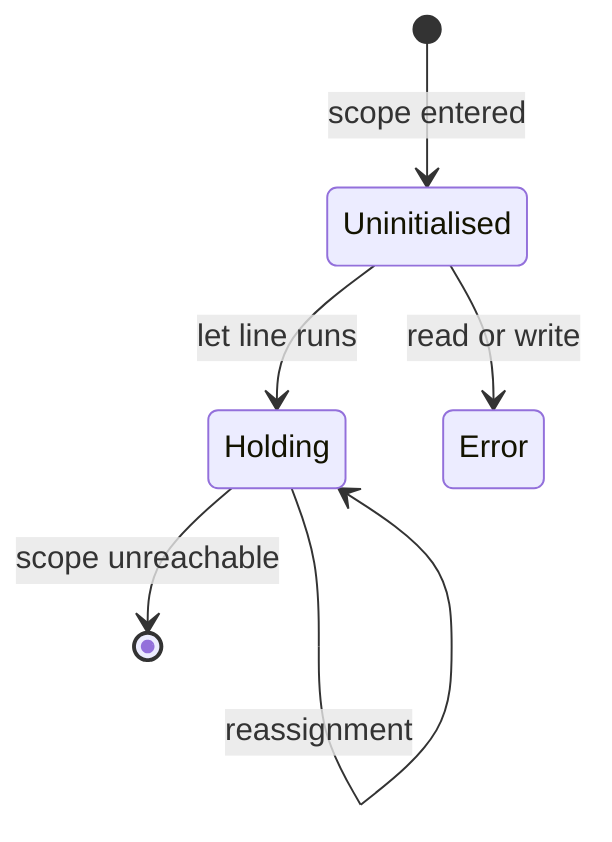

## Introduction

Every program needs to remember things. A shopping cart remembers which items you added, a form remembers what you typed, a game remembers the score. JavaScript remembers values by giving them names: you write `let score = 0`, and from then on the word `score` stands for that value until you change it.

That name-to-value connection is called a **variable**. The idea sounds simple, and at the level of "a name holds a value" it is. But almost every confusing JavaScript bug that involves variables — "why did changing this object change that one too?", "why is this `undefined`?", "why does this `const` let me change it?" — comes from blurring three things that the language keeps separate:

1. **The name** and **the value** are different things. Two names can refer to the same value, and changing which value a name refers to is different from changing the value itself.
2. **Declaring** a variable, **initialising** it and **assigning** to it are three different steps that can happen at different times.
3. Whether a name may be **declared twice** depends on the keyword and the scope.

This lesson teaches all three. It covers what is common to every variable; the three declaration keywords get their own lessons — [[b1-var]], [[b1-let]] and [[b1-const]] — and are compared side by side in [[b1-var-let-const]].

## Before you start

- **Statements and expressions** — that `let x = 1;` is a statement while `x = 1` on its own is an expression that produces a value. See [[b1-statements-expressions]].
- **Identifiers** — which words are legal names (`total`, `_count`, `$el`) and which are reserved (`class`, `return`). See [[b1-identifiers]].
- **Running code** — you should be able to run a `.js` file with Node.js or paste code into a browser console. Every snippet here was run in Node.js 22, and the output shown is what it printed.

You do not need to know about scope or hoisting in detail. This lesson explains the parts it needs and links to the full treatments.

## The intuition

Picture a set of labelled tags on strings, and a table covered with objects. A variable is a tag: the label is the name, and the string is tied to one object on the table. Writing `let count = 0` makes a tag labelled `count` and ties it to the number `0`.

Two things can happen later, and they are completely different:

- **Reassignment** unties the string and ties it to a different object. `count = 1` moves the `count` tag from `0` to `1`. Nothing on the table changed.
- **Mutation** leaves the strings alone and changes an object on the table. If a tag `user` is tied to an object `{ name: 'Ada' }`, then `user.name = 'Grace'` paints a new name on that object. Every tag tied to it sees the change.

Here is the picture as code:

```javascript title="binding-vs-value.js"
let count = 0;
const user = { name: 'Ada' };
const alias = user;      // a second tag tied to the same object

count = 1;               // reassignment: count now refers to a different value
alias.name = 'Grace';    // mutation: change the object both tags are tied to

console.log(count);
console.log(user.name);
console.log(user === alias);
```

```output
1
Grace
true
```

`alias.name = 'Grace'` changed what `user.name` prints, because `user` and `alias` are two tags on one object — there is only one object. `user === alias` is `true` because `===` on objects asks "same object?", not "same contents?".

Where the analogy stops: numbers, strings and the other primitive values cannot be painted over at all — they are immutable — so with primitives only reassignment exists. That difference is the subject of [[b1-primitive-vs-reference]].

## What a variable is

In the language specification, the connection between a name and a value is called a **binding**. A binding lives in a scope: a region of code in which the name means that particular binding. When you write `count` in an expression, the engine looks for a binding named `count`, starting in the current scope and moving outwards (the full lookup rules are in [[b1-name-resolution]]). If it finds one, `count` evaluates to that binding's current value.

So a variable is not a box that physically contains a value. It is an entry in a table — "the name `count`, in this scope, currently refers to this value". This matters because:

- Several bindings can refer to one object, as `user` and `alias` did above.
- A binding can exist before it has a value, which is exactly what produces the different behaviour of `var` and `let` before their lines run.
- A binding can be **mutable** (you may later point it at another value) or **immutable** (fixed once set). `let` and `var` make mutable bindings; `const` makes immutable ones. Immutability of the *binding* says nothing about whether the *value* can change.

Every variable goes through up to three steps. **Declaration** creates the binding in a scope. **Initialisation** gives it its first value. **Assignment** gives it a new value later. Sometimes all three happen on one line, sometimes they are spread across a function, and sometimes the first two happen before your code runs at all. The next four sections take each step in turn, then look at what happens when a name is declared twice.

## Declaration {#b1-declaration}

A **declaration** is the piece of source code that introduces a name into a scope. It tells the engine: "in this region of code, the name `x` refers to a binding of mine." Declaring a name is not the same as giving it a value — `let x;` declares `x` without providing one.

JavaScript has more kinds of declaration than the three variable keywords. All of these introduce bindings:

| Declaration | Example | Scope it belongs to |
|---|---|---|
| `var` | `var total = 0;` | Nearest function (or the script) |
| `let` | `let count = 0;` | Nearest block `{ }` |
| `const` | `const limit = 10;` | Nearest block `{ }` |
| Function declaration | `function save() {}` | Nearest function in sloppy code; nearest block in strict code |
| Class declaration | `class User {}` | Nearest block `{ }` |
| `import` | `import { x } from './a.js';` | The module |
| Function parameters | `function f(a, b) {}` | That function |
| `catch` parameter | `catch (err) {}` | That `catch` block |

### Declarations are found before code runs

The single most important fact about declarations is that the engine collects them **before** executing the code in their scope. When a function is called, or a block or script is entered, the engine first scans that scope's declarations and creates a binding for each one. Only then does it run the statements in order. This set-up step is what people call **hoisting**, and it is taught in detail in [[b1-hoisting]].

Because bindings exist before any line runs, a declaration affects its whole scope, including lines written above it:

```javascript title="declare-early.js"
console.log(typeof total);   // the function binding already exists and holds the function
let a;                       // declaration without an initialiser
console.log(a);
a = 10;
const b = 20;
function total() { return a + b; }
console.log(total());
```

```output
function
undefined
30
```

The first line calls `typeof total` before the `function total` line, and the function is already there. That is a property of function declarations specifically: they are given their value during set-up. `let a;` declares `a` and, when the line runs, gives it the value `undefined`. Then `a = 10` assigns, `const b = 20` declares and initialises `b`, and `total()` adds them.

### Some mistakes are caught before anything runs

Because declarations are collected before execution, some errors are reported before the first statement of the script runs. These are called **early errors**. Declaring the same `let` name twice in one scope is one of them:

```javascript title="early-error.js"
console.log('start');
let x = 1;
let x = 2;
```

```output
SyntaxError: Identifier 'x' has already been declared
```

`start` is never printed. The whole file is rejected while it is being parsed, which is why a duplicate declaration at the bottom of a file stops the top of the file from running too. The same applies to `const x;` without a value (`SyntaxError: Missing initializer in const declaration`) and to a lexical declaration used as the body of an `if` without braces:

```javascript
if (loggedIn) let greeting = 'hi';
// SyntaxError: Lexical declaration cannot appear in a single-statement context
```

That last rule exists because a `let` that is the entire body of an `if` would create a scope containing only itself, which is useless and almost certainly a mistake. Wrap the body in braces and it becomes legal.

### Declaring without var, let or const

If you assign to a name that has no declaration anywhere, in sloppy (non-strict) code JavaScript does not complain. It quietly creates a property on the global object:

```javascript title="accidental-global.js"
function saveTotal(price, qty) {
  total = price * qty;   // no let/const/var: there is no binding called total
  return total;
}

saveTotal(5, 3);
console.log(globalThis.total);
```

```output
15
```

That is not a declaration; it is a failed lookup that sloppy mode turns into a global property. In [[b1-strict-mode]] — which is automatic in ES modules and class bodies — the same assignment throws `ReferenceError: total is not defined`. Always declare names explicitly, and prefer modules so that this mistake is an error.

## Initialization {#b1-initialization}

**Initialisation** is the moment a binding receives its first value. Before it is initialised, a binding can exist but be unusable. The three keywords differ precisely in *when* initialisation happens:

| Keyword | When the binding is created | When it is initialised | Reading it before initialisation |
|---|---|---|---|
| `var` | On entering the function or script | Immediately, to `undefined` | Gives `undefined` |
| `let` | On entering the block | When the `let` line runs (to `undefined` if no value is given) | Throws `ReferenceError` |
| `const` | On entering the block | When the `const` line runs; a value is required | Throws `ReferenceError` |

Watch all three rows happen in one function:

```javascript title="initialisation.js"
function demo() {
  console.log(v);            // var: created and set to undefined on function entry
  try {
    console.log(w);          // let: created on entry but not yet initialised
  } catch (e) {
    console.log(e.name + ': ' + e.message);
  }
  var v = 1;
  let w;                     // initialised to undefined here
  console.log(w);
  w = 2;
  console.log(v, w);
}
demo();
```

```output
undefined
ReferenceError: Cannot access 'w' before initialization
undefined
1 2
```

Line by line: `v` already holds `undefined` when the function starts, so the first log works and prints `undefined`. `w` exists — the error message names it, which proves the engine knows about it — but it has not been initialised, so reading it throws. When `let w;` runs, `w` is initialised to `undefined`. Then the two assignments give both variables real values.

The period during which a `let`, `const` or `class` binding exists but is uninitialised is called the **temporal dead zone**. It has its own lesson, [[b1-tdz]], because it produces several surprising errors. For now, the useful distinction is between two different "empty" states: a `var` before its line is *born but empty* (`undefined`), while a `let` before its line is *not yet born* (an error).

### Initialisation is not assignment

The `=` in `let x = 1` looks like assignment, but it is part of the declaration syntax — it is the **initialiser**. The difference becomes visible with `const`:

```javascript
const limit = 10;   // initialiser: allowed, this is how a const gets its value
limit = 20;         // assignment: TypeError: Assignment to constant variable.
```

A `const` must be initialised in its declaration and can never be assigned afterwards. There is no way to "declare a const now and fill it in later" — `const limit;` on its own is a SyntaxError.

### When the value depends on a branch

Sometimes the first value is not known until a condition is checked. With `let`, you can declare first and assign in each branch:

```javascript
function grade(score) {
  let letter;                     // declared and initialised to undefined
  if (score >= 90) letter = 'A';
  else if (score >= 75) letter = 'B';
  else letter = 'C';
  return letter;
}
```

This works, but the variable spends a few lines holding `undefined`, and a forgotten branch would return `undefined` silently. When the logic is short, you can usually keep a `const` by computing the value in one expression:

```javascript
const letter = score >= 90 ? 'A' : score >= 75 ? 'B' : 'C';
```

For longer logic, move it into a small function and write `const letter = gradeFor(score);`. Initialising a variable where it is declared, with its final value, makes it impossible to read it in a half-set-up state.

### Parameters are initialised first

A function's parameters are initialised, left to right, before its body runs. A default value can therefore use an earlier parameter, but not a later one:

```javascript title="parameter-init.js"
function size(width, height = width * 2) {
  return [width, height];
}
console.log(size(3));

function broken(a = b, b = 2) {
  return a + b;
}
try {
  broken();
} catch (e) {
  console.log(e.name + ': ' + e.message);
}
```

```output
[ 3, 6 ]
ReferenceError: Cannot access 'b' before initialization
```

When `broken()` evaluates the default for `a`, the parameter `b` exists but has not been initialised yet — the same dead-zone rule that applies to `let`. Default values cannot see variables declared inside the function body either; they are evaluated in their own scope before the body exists. [[b1-parameters]] covers default parameters fully.

## Assignment vs Reassignment {#b1-assignment}

**Assignment** stores a value into an existing binding or property using `=`. When the target is a variable that already had a value, this is **reassignment**: the name now refers to a different value. When the target is a property, such as `user.name = 'Grace'`, it is **mutation** of the object, and the variable holding the object is untouched.

```javascript title="assignment.js"
let score = 0;
score = score + 10;      // reassignment
score += 5;              // compound assignment: read, compute, write back

const box = { n: 1 };
box.n = 2;               // property assignment: mutates the object; allowed
try {
  box = {};              // reassigning a const binding
} catch (e) {
  console.log(e.name + ': ' + e.message);
}
console.log(score, box.n);
```

```output
TypeError: Assignment to constant variable.
15 2
```

`box.n = 2` succeeds even though `box` is a `const`, because it does not touch the binding `box` at all — it follows `box` to its object and changes a property there. `box = {}` tries to point the binding at a new object and fails. This is the root of the most common interview question about `const`: **`const` makes the binding immutable, not the value.** The full story is in [[b1-const]].

### Reassigning one name never affects another

Because a variable refers to a value rather than containing it, reassigning one name has no effect on other names that referred to the same value:

```javascript title="rebind.js"
let p = { v: 1 };
let q = p;          // q refers to the same object as p
p = { v: 2 };       // p now refers to a new object; q is untouched

let s = 'hi';
let t = s;
t += '!';           // builds a new string and rebinds t

console.log(q.v, p.v);
console.log(s, t);
```

```output
1 2
hi hi!
```

After `p = { v: 2 }`, `q` still refers to the original object. And `t += '!'` does not modify the string `'hi'` — strings are immutable — it creates the new string `'hi!'` and rebinds `t` to it, leaving `s` alone.

### Assignment is an expression

An assignment produces a value: the value that was assigned. That lets assignments be chained, and it explains some surprising code:

```javascript title="assignment-expression.js"
let a, b;
a = b = 0;                     // b = 0 runs first and produces 0, then a = 0

let x;
console.log(x = 5);            // logs the value of the assignment expression

let first = 'left', second = 'right';
[first, second] = [second, first];   // destructuring assignment: a swap
console.log(a, b, first, second);
```

```output
5
0 0 right left
```

`=` groups right to left, so `a = b = 0` means `a = (b = 0)`. The fact that assignment is an expression is also why `if (x = 5)` is legal and almost always a bug — it assigns and then tests the truthiness of `5`. The last example is **destructuring assignment**, where the left side is a pattern; see [[b1-destructuring]].

### Compound and logical assignment

Compound operators like `+=`, `-=` and `*=` read the current value, compute, and write the result back: `score += 5` behaves like `score = score + 5`, except the target expression is evaluated only once. The logical assignment operators `&&=`, `||=` and `??=` (ES2021) assign only when a condition holds — `name ??= 'Guest'` assigns only if `name` is `null` or `undefined`. All of these are reassignments, so all of them throw on a `const`. The operator family is covered in [[b1-assignment-operators]] and [[b1-logical-assignment]].

### What can go wrong

Assignment fails in three typical ways, each with a different error:

- Assigning to a `const`: `TypeError: Assignment to constant variable.` The right-hand side is evaluated first, then the write fails.
- Assigning to a property of `undefined` or `null`: `let settings; settings.theme = 'dark';` throws `TypeError: Cannot set properties of undefined (setting 'theme')`. The variable exists; the object does not.
- Assigning to an undeclared name in strict mode: `ReferenceError: total is not defined`. In sloppy mode the same line silently creates a global, as shown in the Declaration section.

## Redeclaration {#b1-redeclaration}

**Redeclaration** means declaring the same name a second time *in the same scope*. Whether JavaScript allows it depends on the keywords involved. The rule is short: **`var` may be redeclared with `var`; any combination involving `let`, `const` or `class` in the same scope is a SyntaxError.**

```javascript title="var-redeclare.js"
var a = 1;
var a;            // redeclaration without a value: keeps the current value
console.log(a);
var a = 2;        // redeclaration with a value: behaves like an assignment
console.log(a);

function f(n) {
  var n;          // redeclares the parameter; the argument value survives
  return n;
}
console.log(f(5));
```

```output
1
2
5
```

All three `var a` declarations refer to one binding. The second one does nothing at all, because `var` bindings are created once, at set-up, and a `var` without an initialiser has nothing to do when its line runs. The third behaves as a plain assignment. Inside `f`, `var n` refers to the same binding as the parameter `n`, so the argument is kept.

Every one of the following, by contrast, is rejected before the code runs, each with `SyntaxError: Identifier '…' has already been declared`:

```javascript
let x = 1; let x = 2;                  // let + let
var y = 1; let y = 2;                  // var + let in the same scope
function g(a) { let a = 1; }           // parameter + let in the function body
try {} catch (e) { let e = 1; }        // catch parameter + let in the catch block
function h() { let z; { var z; } }     // the var is hoisted to h's scope, where z already exists
```

The last one surprises people: the `var z` is written inside an inner block, but `var` belongs to the whole function, so it collides with `let z` in the function's top-level scope.

### Why the rules differ

`var` dates from 1995, when scripts were often built by pasting files together. If two files both said `var config`, crashing would have broken pages, so redeclaration was allowed and the two simply shared one variable. That tolerance hides real bugs: a second `var config = 'prod'` hundreds of lines away silently overwrites the first. When `let` and `const` arrived in ES2015, they adopted a "one name, one binding per scope" rule so that accidental duplicates fail loudly.

### Redeclaration is not shadowing

Declaring the same name in an **inner** scope is not redeclaration. It creates a second, separate binding that hides the outer one inside that scope. This is called **shadowing**, and it is legal for every keyword:

```javascript title="shadowing.js"
let y = 1;
{
  let y = 2;                  // a new binding, only inside this block
  console.log('inner', y);
}
console.log('outer', y);
```

```output
inner 2
outer 1
```

The inner block has its own `y`; when it ends, the outer `y` is visible again with its original value. Shadowing is covered in [[b1-shadowing]].

### Redeclaration across script tags

In a browser, all classic (non-module) `<script>` tags share one global scope. A top-level `let user` in one script and a top-level `let user` — or `var user` — in another is a redeclaration, and the second script fails with a SyntaxError and does not run at all. Modules avoid this because each module has its own scope ([[b1-module-scope]]).

> [!NOTE] The browser console is more lenient
> Chrome DevTools (since Chrome 80) lets you re-run `let x = …` at the console prompt without the "already declared" error, so you can iterate quickly. This is a console convenience only; the same two declarations in a page's scripts still fail.

## How it works internally

The specification models every scope as an **environment record**: a table from names to bindings, plus a link to the enclosing scope's record. The lesson [[b1-lexical-environment]] explains these records in depth; here is how the steps of this lesson map onto them.

When a scope is entered, the engine runs a set-up procedure (for functions it is called *FunctionDeclarationInstantiation*; blocks and scripts have their own versions). For each `var` it creates a mutable binding and immediately initialises it to `undefined`. For each `let` it creates a mutable binding and leaves it **uninitialised**. For each `const` and `class` it does the same but marks the binding immutable. For each function declaration it creates the function object and initialises the binding with it. Duplicate lexical names are detected while parsing, which is why they are early errors.

Then the statements run. Evaluating `let x = 1` or `const x = 1` calls *InitializeBinding*, which moves the binding from uninitialised to holding `1`. Evaluating `x = 2` calls *SetMutableBinding*, which throws a `TypeError` if the binding is immutable and a `ReferenceError` if it is still uninitialised. Reading `x` calls *GetBindingValue*, which throws a `ReferenceError` for an uninitialised binding.

Engines such as V8 do not literally build these tables for every call. They resolve most names when compiling, store variables in registers or stack slots, and move a variable into a heap-allocated *context* only when a closure needs it to outlive the call ([[b1-closures]]). The observable behaviour is still exactly what the specification describes.



## Worked example: tracking a cart total

Here is a small, realistic function that uses every idea in this lesson. It computes a cart summary, keeps a running total, and must not let callers corrupt shared data.

```javascript title="cart.js"
const TAX_RATE = 0.2;                       // never rebound: const

function summarise(items) {
  let subtotal = 0;                         // rebound in the loop: let
  for (const item of items) {               // a fresh const binding per item
    subtotal += item.price * item.qty;
  }
  const tax = subtotal * TAX_RATE;          // computed once: const
  const summary = { subtotal, tax, total: subtotal + tax };
  return summary;
}

const cart = [
  { name: 'Pen', price: 2, qty: 3 },
  { name: 'Book', price: 12, qty: 1 },
];

const result = summarise(cart);
console.log(result);

result.total = 0;                           // mutation: allowed, result is a const binding
console.log(result.total);

const snapshot = result;                    // second name, same object
snapshot.tax = 99;
console.log(result.tax);
```

```output
{ subtotal: 18, tax: 3.6, total: 21.6 }
0
99
```

`TAX_RATE`, `tax`, `summary`, `cart` and `result` are declared with `const` because nothing ever points them at a different value. `subtotal` changes on every iteration, so it is a `let`. The loop variable `item` is a `const` because each iteration gets its own fresh binding rather than reassigning one.

The second half shows the trap this lesson warned about. `result` is a `const`, yet `result.total = 0` succeeds, because it mutates the object. And `snapshot.tax = 99` changes what `result.tax` prints, because `snapshot` and `result` are two names for one object. If callers must not change the summary, the function should return a frozen object or a copy — see [[b1-object-freeze-seal]] and [[b1-copying-objects]].

## In real systems

**Linters enforce the declaration rules.** Most JavaScript and TypeScript codebases run ESLint with `no-var` (use `let`/`const`), `prefer-const` (use `const` when a `let` is never reassigned), `no-undef` (catch accidental globals) and `no-shadow` (optional, flags confusing shadowing). The rules in this lesson are therefore not only interview trivia — they are what your code review tool will flag.

**React state is a binding-versus-value problem.** In a React component, `const [items, setItems] = useState([])` gives you a fresh `const` binding on each render. Calling `items.push(x)` mutates the existing array, so React — which compares old and new values with `Object.is` — sees the same array and may not re-render. The fix is to create a new array: `setItems([...items, x])`. Understanding that mutation and rebinding are different is exactly what makes this rule make sense; see [[b1-closures-react]].

**Configuration objects.** `export const config = { apiUrl: '/v1' }` prevents any module from rebinding `config`, but any importer can still write `config.apiUrl = '/v2'` and change it for everyone. Teams that need real protection freeze the object at creation.

## Trade-offs and alternatives

| Choice | What you gain | What you give up |
|---|---|---|
| Declare and initialise on one line | No half-initialised state; easiest to read | Needs the value up front (use a helper function if the logic is long) |
| Declare first, assign in branches | Handles values that depend on conditions | The variable briefly holds `undefined`; a missed branch is silent |
| `const` binding | Readers know the name never moves; accidental `=` throws | Must have a value immediately; cannot accumulate |
| `let` binding | Can be reassigned (counters, accumulators) | Readers must scan the scope to know its current value |
| `var` binding | Works in very old engines | Function scope, silent redeclaration, global-object pollution |

The modern default is: `const` for every binding that is never reassigned, `let` for the few that are, and `var` only when maintaining legacy code. [[b1-var-let-const]] explains the reasoning behind that rule.

## Common mistakes

> [!MISTAKE] Thinking const makes a value unchangeable
> `const user = { name: 'Ada' }; user.name = 'Grace';` works. `const` fixes the binding, not the object. Use `Object.freeze` for a shallow read-only object, or copy instead of mutating.

**Expecting two variables to be independent copies.** `const b = a` where `a` is an object or array does not copy anything; both names refer to one object, and mutating through either is visible through both. Copy explicitly with `{ ...a }` or `[...a]` (shallow) or `structuredClone(a)` (deep).

**Forgetting the declaration keyword.** `total = 0` with no `let` creates a global in sloppy code and throws in strict code. Turn on strict mode or use modules, and let the linter's `no-undef` catch it.

**Reading a `let` above its declaration.** Code that worked with `var` (giving `undefined`) throws a `ReferenceError` after switching to `let`. Move the declaration above its first use; the error is pointing at a real ordering problem.

**Declaring the same name in two `switch` cases.** All `case` clauses share one block, so `let msg` in two cases is a redeclaration. Wrap each case body in its own `{ }`.

## Interview perspective

Interviewers use variable questions to check that you understand the model, not just the syntax. The strongest answers separate the name from the value and the binding from the object.

> [!INTERVIEW] "Is const immutable?"
> "The binding is. Once a `const` is initialised, the name can never refer to a different value, so `x = …` throws a `TypeError`. But if the value is an object or array, the object itself is still mutable — `const arr = []; arr.push(1)` is fine. For a read-only object I'd use `Object.freeze`, which is shallow, or avoid mutation altogether."

Questions you should be able to answer:

- **What is the difference between declaration and initialisation?** Declaration creates the binding in a scope when the scope is entered; initialisation gives it its first value. For `var` both happen at scope entry (value `undefined`); for `let`/`const` initialisation waits until the declaration line runs.
- **What does `let x; console.log(x);` print, and how is that different from reading `x` before the `let` line?** After the line, `undefined`. Before it, a `ReferenceError`, because the binding is in the temporal dead zone.
- **Why is `let x = 1; let x = 2;` an error but `var x = 1; var x = 2;` is not?** `var` permits redeclaration for backward compatibility; lexical declarations forbid it so duplicates are caught. The `let` case is an early error, so nothing in the file runs.
- **What does `a = b = 5` do?** Assigns `5` to `b`, then assigns the result (`5`) to `a`, because assignment is a right-associative expression. If neither is declared, sloppy mode creates two globals.
- **If `const a = {}; const b = a; b.x = 1;`, what is `a.x`?** `1` — both names refer to the same object.

## Practice

1. Predict the output, then run it:

   ```javascript
   let a = [1, 2];
   let b = a;
   b.push(3);
   b = [9];
   console.log(a, b);
   ```

2. Rewrite this so that every binding that can be `const` is `const`, and explain why the others cannot be:

   ```javascript
   var items = ['a', 'b'];
   var count = 0;
   for (var i = 0; i < items.length; i++) { count++; }
   var label = count > 1 ? 'many' : 'one';
   ```

3. Explain why this file prints nothing at all, and fix it without renaming anything:

   ```javascript
   console.log('loading');
   function setup() { let ready = false; }
   let ready = true;
   let ready = false;
   ```

4. Which of these lines throw, and with which error type? `const k;` — `let m; m = 1;` — `const n = 1; n++;` — `let o; o.x = 1;`

5. Write a function `makeSummary(items)` that returns a summary object the caller cannot modify, and demonstrate that an attempted modification has no effect.

```quiz
Q: After `const user = { name: 'Ada' }; const alias = user; alias.name = 'Grace';`, what is `user.name`?
- [ ] 'Ada', because user is a const
- [x] 'Grace', because user and alias refer to the same object
- [ ] It throws a TypeError, because alias is a const
- [ ] undefined
> There is only one object; `alias = user` copies the reference, not the object. `alias.name = 'Grace'` mutates that object, which `const` allows — `const` only forbids rebinding the names. So `user.name` reads 'Grace'.

Q: What does this print? `function f() { console.log(v); var v = 1; } f();`
- [x] undefined
- [ ] 1
- [ ] ReferenceError: Cannot access 'v' before initialization
- [ ] ReferenceError: v is not defined
> `var` bindings are created and initialised to `undefined` when the function is entered, before any line runs. The assignment of 1 happens later. The "before initialization" error belongs to `let` and `const`, whose bindings stay uninitialised until their line runs.

Q: Which of these is a legal program?
- [ ] `let a = 1; let a = 2;`
- [ ] `var b = 1; let b = 2;`
- [x] `let c = 1; { let c = 2; }`
- [ ] `function f(d) { let d = 1; }`
> The inner `let c` is in a different (inner) scope, so it shadows the outer `c` rather than redeclaring it. The other three each declare one name twice in the same scope with at least one lexical declaration, which is an early SyntaxError.

Q: Which statement about `const total = 0;` followed later by `total += 5;` is correct?
- [ ] It works, because += mutates rather than reassigns
- [x] It throws a TypeError, because += reassigns the binding
- [ ] It is a SyntaxError reported before the program runs
- [ ] It silently leaves total as 0
> `total += 5` reads total, adds 5 and writes the result back to the binding — that write is a reassignment, and writing to a `const` binding throws `TypeError: Assignment to constant variable.` at run time. Numbers are primitives, so there is nothing to mutate.
```

## Quick revision {#quick-revision}

- A variable is a **binding**: a name in a scope that refers to a value. Several names can refer to one object.
- **Reassignment** points a name at a different value; **mutation** changes an object. `const` forbids the first, not the second.
- Three steps: **declare** (binding created at scope entry), **initialise** (first value), **assign** (later values).
- `var`: created and set to `undefined` at function/script entry. `let`/`const`: created at block entry, uninitialised until their line (temporal dead zone).
- `let x;` initialises to `undefined` when the line runs. `const` requires an initialiser; `const x;` is a SyntaxError.
- The `=` in a declaration is an initialiser, not an assignment.
- Assignment is a right-associative expression: `a = b = 0`; its value is the assigned value.
- Assigning to an undeclared name: global property in sloppy mode, `ReferenceError` in strict mode.
- Redeclaration in the same scope: `var` + `var` allowed; anything with `let`/`const`/`class` (including parameters and `catch` parameters) is an early SyntaxError.
- Same name in an inner scope is **shadowing**, not redeclaration, and is always legal.

| Step | `var` | `let` | `const` |
|---|---|---|---|
| Binding created | Function/script entry | Block entry | Block entry |
| Initialised | At creation, to `undefined` | When its line runs | When its line runs (value required) |
| Reassignable | Yes | Yes | No (`TypeError`) |
| Redeclarable in same scope | Yes, with `var` | No | No |

## Key takeaways {#key-takeaways}

- A variable name refers to a value; it does not contain it. Keep the name and the value separate in your head and most "why did that change?" bugs disappear.
- Declaration, initialisation and assignment are separate steps, and the declaration keywords differ mainly in when initialisation happens.
- Declarations are processed before a scope's code runs, which is why some mistakes are reported before any line executes.
- `const` locks the binding, not the object; use freezing or copying when the value itself must not change.
- `var` tolerates redeclaration for historical reasons; lexical declarations forbid it so duplicates fail loudly. An inner-scope declaration is shadowing, not redeclaration.
- Default to `const`, use `let` when you must reassign, and declare every name explicitly.
