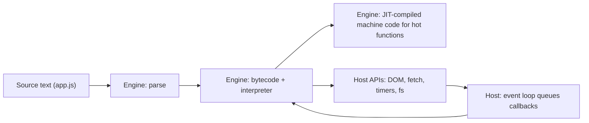

## Introduction

Open any web page and click a button that opens a menu, validates a form or loads more results without reloading the page. The code reacting to that click is almost certainly **JavaScript**. It is the only programming language every web browser runs natively, which makes it the language of the web's user interfaces. It also runs servers (Node.js, Deno, Bun), command-line tools, desktop apps (Electron, as in VS Code and Slack), mobile apps (React Native), database scripts, and edge functions that execute in data centres close to users.

A one-sentence definition: JavaScript is a **high-level**, **dynamically typed**, **garbage-collected**, **multi-paradigm** programming language that runs inside a **host environment**. Each of those terms explains something you will notice as you write code:

- *High-level* — you never manage memory addresses or CPU registers; you work with values, objects and functions.
- *Dynamically typed* — variables have no fixed type; a variable that holds a number can later hold a string.
- *Garbage-collected* — you create objects freely and the engine frees the ones you can no longer reach.
- *Multi-paradigm* — you can write step-by-step procedural code, object-oriented code with classes and prototypes, and functional code that passes functions around, all in one file.
- *Runs inside a host* — the language by itself cannot draw on the screen, read a file or open a network connection. The browser or Node.js gives it those abilities.

That last point is the one beginners most often miss, and it shapes the rest of this module. When you ask "can JavaScript do X?", the honest answer is often "the language cannot, but this host can". Understanding the split saves you from bugs like `document is not defined` and from interview answers such as "`setTimeout` is a JavaScript keyword".

## Before you start

You do not need prior JavaScript experience. It helps to have:

- **A rough idea of what a program is** — instructions a computer follows, values stored in variables, and functions that take inputs and return outputs.
- **A way to run code** — either the browser's developer console (press F12 or Cmd+Option+J in Chrome) or Node.js installed on your machine (`node file.js`). Every snippet in this lesson runs in Node.js 22; the output shown is what it prints.

The next lessons build directly on this one: [[b1-ecmascript]] explains the standard that defines the language, and [[b1-runtimes]] explains the hosts it runs in.

## The intuition

Think of JavaScript as a **guest language living in a house**. The guest speaks a well-defined language — it knows how to do arithmetic, build lists, define functions and make decisions. But the guest owns nothing in the house. To talk to the outside world it uses doors the house provides: a browser house has doors labelled "page" (the DOM), "network" (`fetch`) and "timer" (`setTimeout`); a Node.js house has doors labelled "files" (`fs`), "process" and "network sockets".

The same guest can move between houses and still speak the same language, which is why a sorting function you write works in Chrome, Firefox, Node.js and a Cloudflare Worker alike. What changes between houses is the set of doors. Code that walks up to a door that does not exist in the current house — `document` in Node.js, `fs` in a browser — fails.

The analogy has a limit: the house does more than provide doors. It also decides *when* the guest gets to act, by running the **event loop** that hands the guest one job at a time. You will meet that in [[b1-event-loop]].

## The language's defining traits

### Dynamic typing

In JavaScript, **types belong to values, not to variables**. A variable is a name pointing at a value, and you can point it at a value of a different type at any time. The engine checks types while the program runs rather than before it starts.

```javascript title="dynamic.js"
let value = 42;
console.log(typeof value);
value = 'forty-two';
console.log(typeof value);
```

```output
number
string
```

`typeof` asks the engine for the type of the value currently stored. Nothing complained when `value` switched from a number to a string, because nothing ever declared that `value` must be a number. This makes small scripts quick to write and large programs easier to break: a function that expects numbers will happily receive a string and do something unexpected. That trade-off is the main reason [[b2-what-is-typescript|TypeScript]] exists — it adds a type checker *before* the code runs, then strips the types away so ordinary JavaScript executes.

### Weak typing and implicit conversion

JavaScript is also **weakly typed**: when an operator receives operands of the "wrong" type, it converts them instead of raising an error. The conversions follow precise rules, but they are not always the rules you would guess.

```javascript title="coercion.js"
console.log('5' * 2);
console.log('5' + 2);
```

```output
10
52
```

`*` only means multiplication, so it converts the string `'5'` to the number `5`. `+` means both addition and string concatenation; if either side is a string, concatenation wins, so `2` becomes `'2'` and the result is the string `'52'`. This behaviour — called **type coercion** — is covered in depth in [[b1-type-coercion]]. For now, the lesson is that JavaScript prefers producing *some* answer over stopping, which is why real bugs often show up as strange values (`NaN`, `'[object Object]'`, `'0105'`) rather than as errors.

### First-class functions

A function in JavaScript is a value like any other. You can store it in a variable, pass it to another function, return it from a function and keep it in an array. Languages with this property are said to have **first-class functions**.

```javascript title="functions.js"
const double = (n) => n * 2;
const apply = (fn, x) => fn(x);
console.log(apply(double, 21));
```

```output
42
```

`apply` does not know what `fn` does; it calls whatever function it is given. This is the foundation of callbacks, event handlers (`button.addEventListener('click', handler)`), array methods such as `map` and `filter`, and React components. Combined with [[b1-closures|closures]] — functions remembering the variables around where they were created — it is the single most powerful feature of the language.

### Prototype-based objects

Most object-oriented languages build objects from classes. JavaScript builds objects from **other objects**: every object has a hidden link to a **prototype** object, and when you read a property the object does not have, the engine follows that link and looks there.

```javascript title="prototypes.js"
const animal = { speak() { return `${this.name} makes a sound`; } };
const dog = Object.create(animal);
dog.name = 'Rex';
console.log(dog.speak());
console.log(Object.getPrototypeOf(dog) === animal);
```

```output
Rex makes a sound
true
```

`dog` has no `speak` method of its own. The lookup falls through to `animal`, finds `speak`, and runs it with `this` set to `dog`. The `class` syntax added in 2015 is a more familiar way to write the same mechanism, not a different object model. Prototypes are taught fully in [[b1-prototypes]].

### Garbage collection

You never free memory by hand. Objects are allocated on a **heap**, and the engine's **garbage collector** periodically finds objects that no running code can reach any more and reclaims their memory. This removes a whole class of bugs (freeing memory twice, using freed memory) but not all memory problems: if your code keeps a reference to something it no longer needs — a growing cache, a forgotten event listener — the collector must keep it. See [[b1-garbage-collection]] and [[b1-memory-leaks]].

### One thread, one task at a time

Your JavaScript code runs on a **single thread** per environment: at any moment, exactly one piece of your code is executing. Work that takes time — waiting for a network response, a timer or a file — is handed to the host, which notifies your code later by queuing a callback. The event loop runs queued callbacks one after another, each to completion.

```javascript title="order.js"
console.log('start');
setTimeout(() => console.log('timer fired'), 0);
Promise.resolve().then(() => console.log('promise callback'));
console.log('end');
```

```output
start
end
promise callback
timer fired
```

Even with a delay of `0`, the timer callback runs last: the current script must finish first, and promise callbacks (microtasks) are processed before the next timer task. The reasons are explained in [[b1-event-loop]] and [[b1-microtasks]]. The practical consequence for now is that a long-running loop blocks *everything* else — in a browser that includes clicks and screen updates.

## Language versus host

Everything in the previous section belongs to the **language** itself, which is defined by a standard called **ECMAScript** (ECMA-262). That standard specifies syntax, types, operators, functions, objects, `Array`, `Map`, `Promise`, `JSON`, `Math`, classes and modules. It deliberately says nothing about web pages, files, networks or timers.

Those capabilities come from the **host**:

| Capability | Who provides it | Example |
|---|---|---|
| Variables, functions, loops, classes | Language (ECMAScript) | `const`, `for`, `class` |
| `Array`, `Map`, `Promise`, `JSON`, `Math` | Language | `JSON.parse(text)` |
| Reading and changing the page | Browser host (DOM) | `document.querySelector('h1')` |
| HTTP requests | Browser, and Node.js 18+ | `fetch(url)` |
| Timers | Browser and Node.js | `setTimeout(fn, 100)` |
| Files, processes | Node.js host | `fs.readFile`, `process.argv` |
| Printing for developers | Host | `console.log` |

A useful rule of thumb: **if it touches pixels, the network, the clock or the operating system, it is a host API.** Even `console.log` is not part of ECMAScript; every mainstream host happens to provide it.

You can see the split from inside a program:

```javascript title="host-check.js"
console.log(typeof Promise);    // defined by the language
console.log(typeof fetch);      // provided by the host (Node.js 18+, browsers)
console.log(typeof document);   // only in a browser page
```

```output
function
function
undefined
```

Run in Node.js 22, `Promise` and `fetch` exist but `document` does not, because Node.js has no page. In a browser tab the third line prints `object` instead, because the page's document exists there. The engine — the component that actually executes JavaScript — is the same V8 in Chrome and Node.js; the doors differ. [[b1-runtimes]] expands on this, and [[b1-engine-vs-host]] looks at it from the engine's side.

> [!WARNING] The classic interview trap
> "`setTimeout`, `fetch` and `document` are JavaScript features" is wrong. They are host APIs. A bare engine embedded in another program — for example V8 inside a database or a game — has none of them unless the embedder adds them.

## Where JavaScript came from

The history explains several quirks, so it is worth a few paragraphs.

In 1995 Netscape wanted a lightweight language that page authors could use to react to user input — validate a form, respond to a click — without a round trip to the server. Brendan Eich wrote the first version in about ten days. It was called Mocha, then LiveScript, and was renamed **JavaScript** shortly before release as a marketing move to ride on the popularity of Java. The two languages are unrelated in design: Java is statically typed, class-based and compiled ahead of time to bytecode; JavaScript is dynamically typed, prototype-based and was originally interpreted directly from source.

Microsoft shipped its own compatible implementation, JScript, in Internet Explorer. With two vendors implementing the language differently, Netscape submitted it to the standards body **Ecma International**, which published the first **ECMAScript** standard in 1997. "ECMAScript" is the name of the standard; "JavaScript" became the everyday name for the language and its implementations (and remains a trademark, now held by Oracle). The relationship is the subject of [[b1-ecmascript]].

The early design choices that were made in a hurry — loose equality (`==`), implicit global variables, automatic semicolon insertion — could not be removed later without breaking existing web pages. The web's rule is "don't break the web", so the language grows by **adding** features and opt-in modes rather than changing old behaviour. That is why [[b1-strict-mode]] exists as a switch, and why `let` and `const` were added alongside `var` instead of replacing it.

Two turning points made JavaScript the general-purpose language it is today. In 2008 Google released Chrome with the **V8** engine, which compiled JavaScript to machine code at run time and made it dramatically faster. In 2009 Ryan Dahl embedded V8 in **Node.js**, giving JavaScript file, network and process access on servers. Since 2015 (the edition known as ES6 or ES2015) the language has received a new edition every year, adding classes, modules, promises, `async`/`await`, optional chaining and more.

## How it works internally

When a browser or Node.js runs your file, three components cooperate:



1. The **engine** (V8 in Chrome, Edge and Node.js; SpiderMonkey in Firefox; JavaScriptCore in Safari) parses the source into a tree, reporting any `SyntaxError` before a single line runs.
2. It compiles the tree to compact **bytecode** and starts interpreting it. Functions that run often are recompiled by a **just-in-time (JIT) compiler** into optimised machine code. So JavaScript is neither "purely interpreted" nor "compiled ahead of time"; modern engines do both, at run time. [[b1-parsing-jit]] covers the details.
3. Whenever your code calls a host API — `fetch`, `setTimeout`, `addEventListener` — the host does the slow work outside your thread and later queues a callback. The event loop runs callbacks one at a time on the single JavaScript thread.

Each environment also has a **global object** that holds the host's APIs: `window` in a browser page, `global` in Node.js, and `globalThis` as the portable name that works everywhere (standardised in ES2020).

## Worked example: reading behaviour you did not expect

Here is a small function a beginner might write to total a shopping cart. It shows dynamic and weak typing interacting with real data.

```javascript title="cart.js"
function total(items) {
  return items.reduce((sum, item) => sum + item.price, 0);
}
console.log(total([{ price: 10 }, { price: 5 }]));
console.log(total([{ price: 10 }, { cost: 5 }]));
console.log(total([{ price: '10' }, { price: 5 }]));
```

```output
15
NaN
0105
```

The first call works. The second has an item with no `price` property. Reading a missing property does not throw in JavaScript; it gives `undefined`, and `10 + undefined` converts `undefined` to the number `NaN` ("Not a Number"). The third call receives a price as a string, perhaps from a form field or JSON. `0 + '10'` concatenates to `'010'`, then `'010' + 5` concatenates again to `'0105'`.

Nothing threw an error. A statically typed language would have rejected both bad inputs before running. In JavaScript you defend against this by validating data at boundaries (`Number(item.price)`, checking `Number.isFinite`), by using TypeScript, and by learning the conversion rules so that a value like `'0105'` immediately suggests "a string got into an addition". That habit — reading strange values as clues — is the basis of [[b1-basic-debugging]].

## In real systems

**Frontend applications.** Every interactive web interface runs JavaScript in the browser, usually written in TypeScript, organised with a framework such as React, and bundled into a few files by a build tool. How the browser loads those files is the subject of [[b1-script-loading]].

**Backend services.** Node.js, Deno and Bun run JavaScript on servers. Teams choose them for I/O-heavy services (APIs, real-time chat, proxies) where the event loop handles many concurrent connections on one thread, and because one language across frontend and backend lets them share validation code and types.

**Edge and serverless.** Cloudflare Workers, Vercel Edge Functions and similar platforms run JavaScript in lightweight V8 isolates close to users. They expose Web-style APIs (`fetch`, `Request`, `Response`) but no file system.

**Tooling.** Much of the frontend toolchain — ESLint, Prettier, webpack, Vite — is written in or scripted with JavaScript, though performance-critical tools are increasingly written in Rust or Go.

## Trade-offs and alternatives

| Strength | Cost |
|---|---|
| Runs in every browser with no install | You cannot choose the engine version your users have; code must target what their browsers support |
| Dynamic typing makes prototypes fast to write | Type errors appear at run time, often as odd values rather than errors |
| Single thread with an event loop avoids most locking bugs | CPU-heavy work blocks everything unless moved to a worker |
| Huge ecosystem (npm) | Dependency sprawl and supply-chain risk |
| Backward compatibility keeps old pages working | Old quirks (`==`, `var`, ASI) can never be removed |

For the browser, JavaScript has no true replacement: TypeScript compiles to it, and **WebAssembly** lets languages such as Rust and C++ run in the browser for compute-heavy work, but WebAssembly still calls JavaScript (or host bindings) to reach the DOM. On the server, JavaScript competes with Java, Go, Python and others, and is a reasonable choice when I/O dominates and the team already knows it.

## Common mistakes

> [!MISTAKE] Treating host APIs as language features
> Writing `document.querySelector` in a Node.js script, or importing `fs` in browser code, fails because that host does not provide the API. Before using a global, ask which host your code runs in. Shared code should use only ECMAScript features plus APIs both hosts provide, or check with `typeof document !== 'undefined'`.

**Assuming JavaScript is "Java for the web".** The name is marketing. Knowledge of Java syntax helps with braces and `if` statements, but types, objects, `this` and concurrency work differently.

**Expecting errors where JavaScript returns values.** Missing properties give `undefined`, failed arithmetic gives `NaN`, and `+` with a string concatenates. When output looks wrong rather than crashing, suspect a type problem first.

**Thinking JavaScript is slow because it is "interpreted".** Modern engines JIT-compile hot code to machine code. Performance problems usually come from algorithms, excessive DOM work or blocking the main thread, not from the language being interpreted.

**Believing `async` code runs in parallel.** Your callbacks still run one at a time on one thread; only the waiting happens elsewhere.

## Interview perspective

Interviewers open with this topic to check that you have an accurate mental model, not a list of buzzwords.

> [!INTERVIEW] A strong 30-second answer
> "JavaScript is a high-level, dynamically typed, garbage-collected language with first-class functions and prototype-based objects, standardised as ECMAScript. It always runs inside a host — a browser, Node.js, an edge runtime — which pairs an engine like V8 with APIs such as the DOM, `fetch` or `fs`, and an event loop. My code runs on one thread; the host does I/O and queues callbacks."

Questions to be ready for:

- **Is JavaScript compiled or interpreted?** Both: engines parse to bytecode, interpret it, and JIT-compile hot functions to machine code at run time.
- **Is `setTimeout` part of JavaScript?** No; it is a host API present in browsers and Node.js.
- **What does "single-threaded" mean if `fetch` runs in the background?** Your JavaScript runs on one thread; the host performs the network request elsewhere and queues your callback.
- **Dynamic versus weak typing?** Dynamic: types are checked at run time and variables can change type. Weak: operators convert mismatched operands implicitly. JavaScript is both; Python is dynamic but stronger (`'5' + 2` raises an error).
- **Why can't JavaScript remove its old quirks?** Removing them would break existing websites; the language evolves by adding features and opt-in modes.

## Practice

1. In your browser console and in Node.js, run `typeof window`, `typeof document`, `typeof process`, `typeof fetch` and `typeof globalThis`. Record which exist where and explain each difference.
2. Predict, then check, the output of `'3' - 1`, `'3' + 1`, `true + 1` and `[] + {}`. For each, write one sentence on which conversion happened.
3. Fix the `total` function from the worked example so that it ignores items without a numeric price and converts numeric strings. Decide whether a non-numeric string should be skipped or should throw, and justify the choice.
4. Write a function `makeCounter()` that returns another function which counts how many times it has been called. Which language trait makes this possible?

```quiz
Q: Which of these is defined by the ECMAScript language standard rather than by a host?
- [ ] `document.querySelector`
- [ ] `setTimeout`
- [x] `Promise`
- [ ] `fs.readFile`
> `Promise` is a built-in object specified in ECMA-262, so it exists in every modern engine. `document` comes from the browser, `fs` from Node.js, and `setTimeout`, although present in both, is a host API defined by the HTML standard and Node.js — not by the language.

Q: What does `'5' + 2` evaluate to, and why?
- [ ] `7`, because `+` converts strings to numbers
- [x] `'52'`, because when either operand of `+` is a string, `+` concatenates
- [ ] A `TypeError`, because the types differ
- [ ] `NaN`, because `'5'` is not a number
> `+` is both addition and concatenation. If either operand is a string after conversion to a primitive, the other is converted to a string and they are joined. JavaScript is weakly typed, so it converts rather than throwing; `'5' * 2` would give `10` because `*` is numeric only.

Q: A colleague says "JavaScript is interpreted, so it is always slower than compiled languages". What is the most accurate correction?
- [ ] JavaScript is compiled ahead of time to native code like C
- [x] Modern engines interpret bytecode and JIT-compile frequently run functions to optimised machine code at run time
- [ ] JavaScript is compiled to Java bytecode and run on the JVM
- [ ] Interpretation and compilation make no difference to speed
> Engines such as V8 start by interpreting bytecode for fast startup, then recompile hot functions with an optimising JIT compiler. JavaScript has no relation to the JVM, and it is not compiled ahead of time in normal use.
```

## Quick revision {#quick-revision}

- JavaScript: high-level, dynamically typed, weakly typed, garbage-collected, multi-paradigm, prototype-based, first-class functions.
- Types belong to values; `typeof` reports the current value's type.
- Weak typing: operators coerce (`'5' * 2` → `10`, `'5' + 2` → `'52'`); bugs often appear as `NaN` or odd strings, not errors.
- Always runs inside a host: browser, Node.js, Deno, Bun, edge isolates, embedded engines.
- Language (ECMAScript): syntax, `Array`, `Map`, `Promise`, `JSON`, classes, modules. Host: DOM, `fetch`, timers, `fs`, `console`.
- One JavaScript thread per environment; the host does I/O and queues callbacks for the event loop.
- Engines (V8, SpiderMonkey, JavaScriptCore) parse, interpret bytecode and JIT-compile hot code.
- Created at Netscape in 1995; standardised as ECMAScript in 1997; unrelated to Java beyond the name.
- "Don't break the web": features are added, quirks are never removed.

## Key takeaways {#key-takeaways}

- JavaScript is a dynamically and weakly typed language whose surprises usually come from implicit conversions and missing values producing results instead of errors.
- Functions are values and objects inherit from other objects through prototypes; these two traits underpin callbacks, closures, classes and frameworks.
- The language never runs alone: a host supplies the event loop and every API that touches the page, network, clock or operating system.
- Separating language features from host APIs is the first step to understanding runtimes, debugging "is not defined" errors, and answering interview questions accurately.
- Modern engines JIT-compile JavaScript, so it is fast enough for servers and complex apps; blocking the single thread is the usual performance problem.
