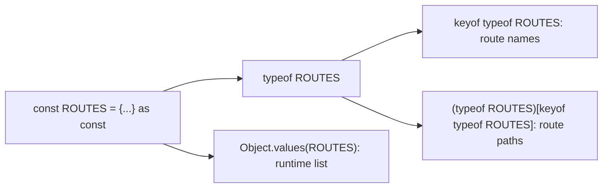

## Introduction

Applications are full of fixed lookup objects: a table of route paths, a set of event names, design tokens for colours and spacing, a map of status codes to messages. They are written once and only ever read. You would like TypeScript to know exactly what is in them — that `ROUTES.about` is `"/about"`, not merely "some string" — so that it can build precise types from them and catch typos in the values that flow out of them.

By default, TypeScript does not keep that precision. When it infers the type of `{ about: "/about" }`, it records the property as `string`, because object properties can be reassigned and it assumes you might want to put a different string there later. This is called **literal widening**, and it throws away exactly the information a lookup table is for.

The **`as const` assertion** tells the compiler: this value will not change, so keep the types exactly as written. Combined with `typeof` and `keyof`, it lets you write a value once and derive types from it — key unions, value unions, enum-like types — with a single source of truth. This lesson explains what `as const` does, how to derive types from the result, how `satisfies` adds shape checking, and where the pattern fits next to enums.

## Before you start

- **Literal types** — `"/about"` and `3` as types. See [[b2-literal-types]].
- **The `as const` assertion in general** — on strings, numbers and arrays. See [[b2-as-const]]; this lesson focuses on objects.
- **readonly properties** — what `readonly` prevents and that it is shallow. See [[b2-readonly-properties]].
- **`typeof`, `keyof` and indexed access types** — `typeof value`, `keyof T` and `T[K]` in type positions. See [[b2-typeof]], [[b2-keyof]] and [[b2-indexed-access]].

## The intuition

TypeScript's inference is like a clerk recording what kind of thing is stored in each drawer of a cabinet. For an ordinary object, the clerk writes the category — "a string", "a number" — because the drawers can be refilled. For an object marked `as const`, you have told the clerk the cabinet is sealed, so the clerk writes down the exact contents instead: "the string `/about`", "the number `3`", and labels every drawer *do not open*.

The seal is only on paper. At runtime the cabinet is an ordinary JavaScript object. `as const` changes what the compiler records, not what the program does.

## Literal widening

Here is what TypeScript infers for the same object literal with and without `as const`. The types in the comments are the compiler's own output from `tsc --declaration`:

```typescript title="widening.ts"
export const plain = {
  home: "/",
  about: "/about",
  retries: 3,
  tags: ["a", "b"],
  nested: { on: true },
};
// { home: string; about: string; retries: number; tags: string[];
//   nested: { on: boolean } }

export const fixed = {
  home: "/",
  about: "/about",
  retries: 3,
  tags: ["a", "b"],
  nested: { on: true },
} as const;
// { readonly home: "/"; readonly about: "/about"; readonly retries: 3;
//   readonly tags: readonly ["a", "b"]; readonly nested: { readonly on: true } }
```

Without `as const`, every literal widens to its general type: `"/"` to `string`, `3` to `number`, `true` to `boolean`, and the array to `string[]`. Note that `const plain` does not prevent this — `const` stops the *variable* `plain` from being reassigned, but the object's properties remain writable, so their types are widened.

With `as const`, three things happen, **recursively through every level**:

1. **No widening.** Every string, number and boolean literal keeps its literal type.
2. **readonly properties.** Every property becomes `readonly`, including those of nested objects.
3. **Arrays become readonly tuples.** `["a", "b"]` becomes `readonly ["a", "b"]`: a fixed length, a known type at each position, and no mutating methods.

The recursive behaviour has been part of `as const` since it was introduced in TypeScript 3.4; it is not a recent change. It is the main difference from `Readonly<T>` and `Object.freeze`, both of which are shallow.

## What `as const` prevents

Because properties are readonly at every level, the compiler rejects any attempt to change the object:

```typescript title="readonly-deep.ts"
const theme = {
  colours: { primary: "#2563eb" },
  spacing: [4, 8, 16],
} as const;

theme.colours = { primary: "red" };   // error TS2540
theme.colours.primary = "red";        // error TS2540
theme.spacing.push(32);               // error TS2339
```

```output
readonly-deep.ts(6,7): error TS2540: Cannot assign to 'colours' because it is a read-only property.
readonly-deep.ts(7,15): error TS2540: Cannot assign to 'primary' because it is a read-only property.
readonly-deep.ts(8,15): error TS2339: Property 'push' does not exist on type 'readonly [4, 8, 16]'.
```

The output is from `tsc --noEmit`. Line 7 is the important one. With a plain `readonly` property or `Readonly<T>`, `theme.colours.primary = "red"` would compile, because those are shallow. `as const` reaches the nested object too.

### Not a runtime freeze

`as const` is a type assertion, and every assertion is erased when the code is compiled. The emitted JavaScript for `theme` is exactly the object literal, with `as const` deleted. Nothing stops untyped code, or typed code that casts to `any`, from mutating it:

```typescript title="runtime.ts"
const limits = { maxUsers: 10 } as const;
(limits as { maxUsers: number }).maxUsers = 99; // compiles: the cast drops readonly
console.log(limits.maxUsers);

const frozen = Object.freeze({ maxUsers: 10 });
try {
  (frozen as { maxUsers: number }).maxUsers = 99;
} catch (e) {
  console.log((e as Error).constructor.name);
}
console.log(frozen.maxUsers);
```

```output
99
TypeError
10
```

If you also need runtime protection — for example, a configuration object exported by a library that untyped code might modify — wrap it in `Object.freeze`. In strict-mode code (all ES modules and classes) a write to a frozen property throws a `TypeError`, as the output shows. `Object.freeze` is shallow at runtime, and its TypeScript type is shallow as well: it keeps top-level literals but widens nested ones, which is why the two are often combined (`Object.freeze({ … } as const)`) when both guarantees matter. See [[b1-object-freeze-seal]].

## Deriving types from the object

The real power of `as const` comes from turning the value into types. Two type operators do the work: `typeof x` produces the type of a value, and `keyof T` produces the union of a type's keys. Indexed access `T[K]` then looks up the type of a property.

```typescript title="derive.ts"
const ROUTES = {
  home: "/",
  about: "/about",
  post: "/posts/:id",
} as const;

type Routes = typeof ROUTES;           // the object's type
type RouteName = keyof typeof ROUTES;  // "home" | "about" | "post"
type RoutePath = (typeof ROUTES)[RouteName]; // "/" | "/about" | "/posts/:id"

function navigate(path: RoutePath): string {
  return `navigating to ${path}`;
}

function pathFor(name: RouteName): RoutePath {
  return ROUTES[name];
}

console.log(navigate(ROUTES.about));
console.log(navigate("/"));
console.log(pathFor("post"));
```

```output
navigating to /about
navigating to /
/posts/:id
```

Read `(typeof ROUTES)[RouteName]` from the inside out: take the type of the `ROUTES` value, then look up the property types for every key in `RouteName`. Because `RouteName` is a union of all the keys, the result is the union of all the values. The parentheses are needed because `typeof ROUTES[RouteName]` would try to evaluate `ROUTES[RouteName]` as a value expression first. A commonly seen shorthand writes the whole thing in one line: `(typeof ROUTES)[keyof typeof ROUTES]`.

Now `navigate("/contact")` is a compile error, and adding a route to `ROUTES` automatically adds it to both unions. Without `as const`, `RoutePath` would be plain `string`, and the function would accept anything.

### Arrays: `(typeof X)[number]`

For a list of values with no names, use an `as const` array and index it with `number`:

```typescript title="roles.ts"
const ROLES = ["admin", "editor", "viewer"] as const;
type Role = (typeof ROLES)[number]; // "admin" | "editor" | "viewer"

function isRole(value: string): value is Role {
  return (ROLES as readonly string[]).includes(value);
}

console.log(ROLES.length, isRole("editor"), isRole("owner"));
```

```output
3 true false
```

`(typeof ROLES)[number]` means "the type you get by indexing the tuple with any number" — the union of its elements. The cast in `isRole` is needed because `includes` on a `readonly Role[]` accepts only `Role` arguments; calling `ROLES.includes(value)` with a `string` is a compile error. Widening the array's type for the check is safe because it only reads.

## `as const` objects as an enum replacement

Put the pieces together and you get the pattern many teams now use instead of `enum`:

```typescript title="status.ts"
export const OrderStatus = {
  Pending: "PENDING",
  Paid: "PAID",
  Shipped: "SHIPPED",
} as const;

export type OrderStatus = (typeof OrderStatus)[keyof typeof OrderStatus];
// "PENDING" | "PAID" | "SHIPPED"

function describe(status: OrderStatus): string {
  switch (status) {
    case OrderStatus.Pending:
      return "Awaiting payment";
    case OrderStatus.Paid:
      return "Preparing";
    case OrderStatus.Shipped:
      return "On its way";
  }
}

console.log(describe(OrderStatus.Paid), "/", describe("SHIPPED"));
console.log(Object.values(OrderStatus));
```

```output
Preparing / On its way
[ 'PENDING', 'PAID', 'SHIPPED' ]
```

The value `OrderStatus` and the type `OrderStatus` share a name. That is legal because TypeScript keeps values and types in separate namespaces, and it means call sites read exactly as they would with an enum: `OrderStatus.Paid` as a value, `OrderStatus` as a type. The differences from a string enum are deliberate. A plain `"SHIPPED"` is accepted, because the type is an ordinary union. `Object.values` returns exactly the values, with no reverse mapping. And the declaration is plain JavaScript plus erasable types, so it works with Node's type stripping and the `erasableSyntaxOnly` compiler option, which reject enums. The trade-offs are compared in full in [[b2-literal-unions-vs-enums]].

One thing an `as const` object cannot do is serve as a type for a single member: with an enum, `OrderStatus.Paid` can appear in a type position; here you write the literal `"PAID"` or `typeof OrderStatus.Paid`.

```quiz
Q: What is the inferred type of `config.port` in `const config = { port: 8080 };`?
- [ ] `8080`
- [x] `number`
- [ ] `readonly 8080`
- [ ] `const number`
> Object properties are mutable, so TypeScript widens the literal `8080` to `number`. The `const` keyword only fixes the variable `config`, not its properties. With `as const` on the literal, the property's type would be `readonly port: 8080`.

Q: Given `const ROUTES = { home: "/", about: "/about" } as const`, what is `(typeof ROUTES)[keyof typeof ROUTES]`?
- [ ] `"home" | "about"`
- [x] `"/" | "/about"`
- [ ] `string`
- [ ] `{ home: "/"; about: "/about" }`
> `keyof typeof ROUTES` is the union of keys, `"home" | "about"`. Indexing the object type with that union gives the union of the property types, which are the literal values because of `as const`. Without `as const` the result would be `string`.
```

## Checking the shape with `satisfies`

`as const` keeps the literals, but it does not check that the object has the shape you intended. A route table might accidentally contain a number or a path without a leading slash, and nothing would complain. The obvious fix — annotating the variable — destroys the literal types:

```typescript title="annotation-loses.ts"
const ROUTES: Record<string, string> = { home: "/", about: "/about" };

type RouteName = keyof typeof ROUTES; // string, not "home" | "about"
console.log(ROUTES.cotnact.length);   // compiles, then crashes at runtime
```

An annotation **replaces** the inferred type. `ROUTES` is now `Record<string, string>`, so its keys are `string`, every lookup is assumed to succeed, and the typo `cotnact` compiles. (Running this program throws `TypeError: Cannot read properties of undefined`.)

The **`satisfies` operator** (TypeScript 4.9 and later) solves this. `expr satisfies T` checks that the expression is assignable to `T`, reports an error if not, and then leaves the expression's own inferred type unchanged. Combined with `as const`, you get validation *and* literal types:

```typescript title="satisfies.ts"
const ROUTES = {
  home: "/",
  about: "/about",
  contact: "contact",                 // error TS2322
} as const satisfies Record<string, `/${string}`>;

type RouteName = keyof typeof ROUTES; // "home" | "about" | "contact"
console.log(ROUTES.cotnact);          // error TS2551
```

```output
satisfies.ts(4,3): error TS2322: Type '"contact"' is not assignable to type '`/${string}`'.
satisfies.ts(8,20): error TS2551: Property 'cotnact' does not exist on type '{ readonly home: "/"; readonly about: "/about"; readonly contact: "contact"; }'. Did you mean 'contact'?
```

The constraint `` Record<string, `/${string}`> `` uses a template literal type meaning "any string that starts with `/`" ([[b2-template-literal-types]]). `"contact"` fails it. Meanwhile the type of `ROUTES` is still the precise `as const` type, so the misspelled lookup is caught too.

The order matters: write `as const satisfies T`. The const assertion must be applied directly to the literal, and the constraint is then checked against the already-narrowed type. And `satisfies` alone is not a replacement for `as const`: `{ home: "/" } satisfies Record<string, string>` still widens `home` to `string`, because the property is mutable. You need both when you want both effects.

A union key type makes `satisfies` check completeness as well:

```typescript title="complete.ts"
type Locale = "en" | "fr" | "de";

const GREETINGS = {
  en: "Hello",
  fr: "Bonjour",
} as const satisfies Record<Locale, string>; // error TS1360
```

```output
complete.ts(6,12): error TS1360: Type '{ readonly en: "Hello"; readonly fr: "Bonjour"; }' does not satisfy the expected type 'Record<Locale, string>'.
  Property 'de' is missing in type '{ readonly en: "Hello"; readonly fr: "Bonjour"; }' but required in type 'Record<Locale, string>'.
```

Now adding `"es"` to `Locale` produces an error until a Spanish greeting is added. The pattern is explored further in [[b2-satisfies]] and [[b2-variant-map-satisfies]].

## How it works internally

`as const` is a **const assertion**. When the checker sees it, it type-checks the expression in a *const context*. In a const context, literal expressions are not widened, object literal properties are given the `readonly` modifier, and array literals are typed as readonly tuples. The context propagates into nested object and array literals, which is why the effect is deep. It applies only to literal expressions written inside the asserted expression: `{ list: existingArray } as const` makes the `list` property readonly but does not change the type `existingArray` already has.

Because it is an assertion, nothing remains at runtime. `tsc` deletes the `as const` text and emits the object literal unchanged, as does every other TypeScript transpiler. That makes it fully compatible with type stripping, unlike `enum`.

Derived types are computed lazily by the checker. `typeof ROUTES` refers to the variable's inferred type; `keyof` and indexed access operate on that type. When you add a property to the object, every type derived from it updates at the next compile — there is no code generation step and nothing to keep in sync.

A related feature works on function arguments: TypeScript 5.0 added **`const` type parameters**. Declaring `function pick<const T extends readonly string[]>(xs: T)` makes the compiler infer the argument as if it had been written with `as const`, so `pick(["a", "b"])` infers `T` as `readonly ["a", "b"]` without the caller writing `as const`. Libraries use this so that callers get literal types automatically.



## Worked example: design tokens

This example builds a small design-token module of the kind used by component libraries: a nested `as const` object validated with `satisfies`, types derived from it, and a helper that only accepts valid token paths.

```typescript title="tokens.ts"
type Scale = Record<string, string>;

const TOKENS = {
  colour: {
    primary: "#2563eb",
    danger: "#dc2626",
    text: "#111827",
  },
  space: {
    sm: "4px",
    md: "8px",
    lg: "16px",
  },
} as const satisfies Record<string, Scale>;

type Category = keyof typeof TOKENS;                     // "colour" | "space"
type TokenName<C extends Category> = keyof (typeof TOKENS)[C];
type ColourName = TokenName<"colour">;                   // "primary" | "danger" | "text"

function token<C extends Category>(category: C, name: TokenName<C>): string {
  const scale: Scale = TOKENS[category];
  return scale[name as string];
}

function buttonStyle(variant: Extract<ColourName, "primary" | "danger">): string {
  return `background: ${token("colour", variant)}; padding: ${token("space", "md")}`;
}

console.log(buttonStyle("primary"));
console.log(buttonStyle("danger"));
console.log(Object.keys(TOKENS.space).join(", "));
```

```output
background: #2563eb; padding: 8px
background: #dc2626; padding: 8px
sm, md, lg
```

Walk through it. `TOKENS` is declared once. `as const` keeps every value literal and makes the whole tree readonly, so no component can overwrite a token at compile time. `satisfies Record<string, Scale>` checks that every category maps names to strings — writing `md: 8` by mistake would be an error — without replacing the precise type.

The type `TokenName<C>` is a small generic: given a category, it returns the keys of that category. That is what lets `token("colour", "primary")` compile while `token("space", "primary")` fails — the compiler checks the second argument against the first. `ColourName` is the same thing for one category, and `Extract<ColourName, "primary" | "danger">` limits buttons to two of the colours. Adding a new colour to `TOKENS` makes it available everywhere at once; removing one makes every use of it a compile error.

Inside `token`, the generic lookup is widened to the plain `Scale` type to read the value; this is a common, safe compromise because the function's signature already guarantees `name` belongs to `category`. Generics are covered in [[b2-generics]].

## In real systems

**Routes and API endpoints.** Route tables written `as const` give typed navigation helpers: `navigate(ROUTES.settings)` compiles, a removed route does not. Frameworks such as TanStack Router take this further, but the core idea is the same.

**Design tokens and theme objects.** Component libraries define colour, spacing and typography scales as `as const` objects and derive prop types such as `size: keyof typeof TOKENS.space` from them, so the allowed props always match the tokens.

**Enum replacement.** Codebases that enable `erasableSyntaxOnly` or run TypeScript through Node's type stripping use `as const` objects wherever they would have used enums.

**Action types and event names.** Redux-style action names, analytics event names and feature-flag keys are kept in `as const` objects or arrays so that handlers can be typed against the exact set.

**Variant maps.** `Record<Variant, ClassName>` tables written with `as const satisfies` keep styles exhaustive as variants are added. See [[b2-variant-map-satisfies]].

## Trade-offs and alternatives

| Approach | Literal types kept | Deep readonly (compile time) | Runtime protection | Shape checked |
|---|---|---|---|---|
| Plain object literal | No (widened) | No | No | No |
| Annotated (`const x: T = …`) | No (type replaced by `T`) | Only if `T` says so | No | Yes |
| `as const` | Yes | Yes | No | No |
| `as const satisfies T` | Yes | Yes | No | Yes |
| `Object.freeze(…)` | Top level only | Top level only | Yes (shallow) | No |
| `enum` | Yes (as enum members) | Members are readonly | Members are writable at runtime | n/a |

`as const` is the right tool for data that is fixed in the source code and only read. It is the wrong tool for data that will be modified — application state, form values, anything built up at runtime — because readonly tuples and literal types make ordinary updates fail to compile. It also adds nothing for data that comes from outside (API responses, user input): those values are not literals in your source, so there is nothing for `as const` to preserve. Validate them instead.

## Common mistakes

> [!MISTAKE] Forgetting `as const` and getting `string`
> `const EVENTS = { click: "click", focus: "focus" }` makes `(typeof EVENTS)[keyof typeof EVENTS]` equal to `string`, so every function typed with it accepts any string. Add `as const`, or the derived union is meaningless.

**Annotating instead of using `satisfies`.** `const ROUTES: Record<string, string> = …` checks the shape but throws away the keys and literal values. Use `as const satisfies Record<string, string>`.

**Writing `satisfies` before `as const`.** `{ … } satisfies T as const` does not compile: a const assertion can only be applied directly to a literal, and TypeScript reports error TS1355. Write `as const satisfies T`.

**Calling `includes` with a `string` on an `as const` array.** `ROLES.includes(value)` fails because the parameter type is the literal union. Widen the array for the check: `(ROLES as readonly string[]).includes(value)`.

**Expecting runtime immutability.** `as const` is erased. Use `Object.freeze` when untyped code might mutate the object.

**Passing an `as const` array to a function that expects a mutable array.** `readonly ["a", "b"]` is not assignable to `string[]`, because the function could push into it. Declare the parameter as `readonly string[]` when the function only reads.

## Interview perspective

> [!INTERVIEW] "What does `as const` do?"
> A complete answer names three compile-time effects — literal types are not widened, every property becomes `readonly`, and arrays become readonly tuples — says they apply at every depth, and adds that nothing happens at runtime. Then show the payoff: `(typeof X)[keyof typeof X]` to derive a union of values, and `as const satisfies T` to validate shape without losing literals.

Questions to be ready for:

- **Why does `const x = { a: "b" }` give `a` the type `string`?** Properties are mutable, so literals widen; `const` applies to the binding, not the object.
- **`as const` vs `Object.freeze`?** Compile-time and deep versus runtime and shallow. Combine them for both.
- **`satisfies` vs a type annotation?** An annotation replaces the inferred type; `satisfies` checks it and keeps the inferred type.
- **How would you replace an enum?** `as const` object plus `type X = (typeof X)[keyof typeof X]`; mention it accepts plain literals and survives type stripping.
- **What are `const` type parameters?** A TypeScript 5.0 feature that infers arguments as if they were `as const`.

## Practice

1. Declare an `as const` object of HTTP methods (`GET`, `POST`, `PUT`, `DELETE`) and derive a `Method` union. Write `request(method: Method, url: string)` and confirm `request("PATCH", "/x")` fails.
2. Write a `BREAKPOINTS` object (`sm: 640`, `md: 768`, `lg: 1024`) with `as const satisfies Record<string, number>`. Derive `Breakpoint` (the names) and write `minWidth(bp: Breakpoint): string` that returns a media query.
3. Explain why `type Px = (typeof BREAKPOINTS)[keyof typeof BREAKPOINTS]` is `640 | 768 | 1024` and what it becomes if you remove `as const`.
4. Convert `enum Level { Low = "low", High = "high" }` to the `as const` object pattern. List what call sites (if any) need to change.
5. Add a fourth locale to the `GREETINGS` example and read the resulting error. Then annotate `GREETINGS` as `Record<Locale, string>` instead of using `satisfies`, and explain what type information is lost.

## Quick revision {#quick-revision}

- Object literal properties widen: `"/about"` → `string`, `3` → `number`, arrays → `T[]`. `const` does not stop this.
- `as const`: no widening, all properties `readonly`, arrays → readonly tuples — **recursively**.
- Compile-time only; erased in the output. `Object.freeze` gives shallow runtime protection.
- Keys: `keyof typeof OBJ`. Values: `(typeof OBJ)[keyof typeof OBJ]`. Array elements: `(typeof ARR)[number]`.
- Enum replacement: `const X = {…} as const; type X = (typeof X)[keyof typeof X];` — accepts plain literals, iterable, type-strippable.
- `satisfies T` (TS 4.9+): checks against `T`, keeps the inferred type. Annotation replaces the type.
- Use `as const satisfies T` for literal types plus shape checks; `satisfies` alone still widens mutable properties.
- `Record<Union, V>` with `satisfies` enforces completeness.
- `ROLES.includes(str)` needs `(ROLES as readonly string[])`.
- `const` type parameters (TS 5.0+) give callers `as const` inference automatically.

## Key takeaways {#key-takeaways}

- TypeScript widens literals in object properties because they could be reassigned; `as const` tells it the object is fixed.
- `as const` makes literal types, readonly properties and readonly tuples at every level, but has no runtime effect.
- Writing the value once and deriving key and value unions from it keeps types and data in sync automatically.
- `as const satisfies T` validates a configuration object's shape while keeping its precise types.
- An `as const` object plus a derived union does what most enums do, accepts plain literals, and works with type-stripping tools.
- Use `as const` for fixed source-code data; use ordinary types for state that changes and validation for data from outside.
