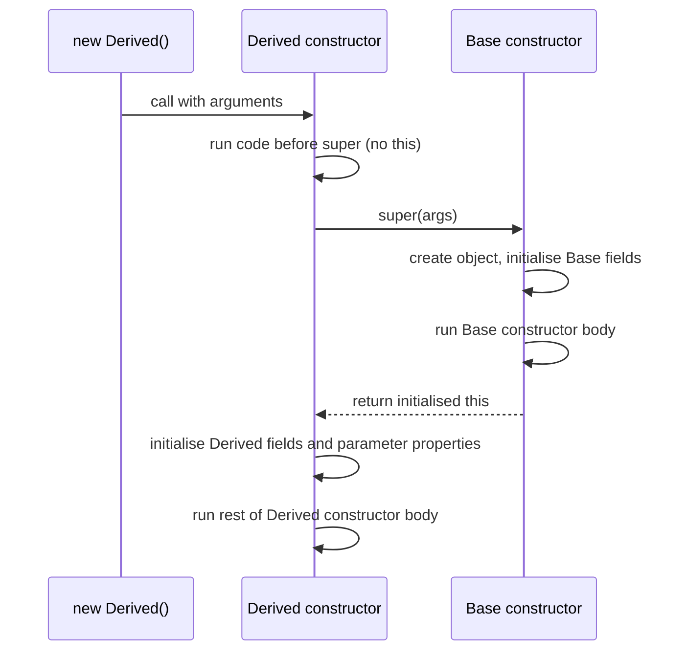

## Introduction

JavaScript has had `class` syntax since ES2015: a class bundles a constructor function, methods on a shared prototype and, since ES2022, field declarations. What JavaScript does not have is any way to say what *type* each field holds, what a constructor expects, or which members outsiders may touch. A `User` class whose `email` field is sometimes a string and sometimes `undefined` is just as valid as one that is always a string.

**TypeScript classes** add exactly that layer. You declare the type of each field, annotate constructor and method parameters, mark members as `private`, `protected` or `readonly`, and TypeScript then checks that every field is initialised, that every `new` call passes the right arguments, that subclasses override methods compatibly and that derived constructors call `super` correctly. After checking, the class is emitted as an ordinary JavaScript class.

Classes matter in TypeScript code for domain models (an `Order` with methods that keep its totals consistent), services with injected dependencies (common in Angular and NestJS), custom `Error` types, data structures, and older React class components. Even code bases that prefer plain functions and objects meet classes through libraries and the DOM — every `HTMLElement` is a class instance. This lesson teaches the core; two nested sections cover [[b2-class-inheritance|inheritance]] and [[b2-super-constructor|super and derived constructors]]. Access modifiers and parameter properties are covered in detail in [[b2-public-private-protected]] and [[b2-parameter-properties]].

## Before you start

- **JavaScript classes** — `class`, `constructor`, methods, `new`, `extends`. See [[b1-classes]] and [[b1-class-constructor]].
- **Prototypes** — methods live on the prototype and are shared; fields live on each instance. See [[b1-prototypes]].
- **`this` in JavaScript** — how a method loses `this` when detached. See [[b1-this]].
- **Typed functions and interfaces** — parameter and return annotations; object shapes. See [[b2-typed-functions]] and [[b2-interfaces]].

Examples use `"strict": true`, `target: "es2022"` and TypeScript 6.0. Where behaviour depends on the target or a flag, the text says so.

## The intuition

A class is a blueprint plus a factory. The **blueprint** says what every object built from it looks like: these fields, of these types, and these methods. The **factory** — the constructor — builds objects to that blueprint, taking certain inputs.

TypeScript gives each of these a type. Writing `class User {}` creates:

1. **The instance type `User`** — the blueprint: the shape of objects that `new User(...)` returns. You use it in annotations like `let u: User`.
2. **The value `User`** — the factory: the constructor function itself, whose type is written `typeof User`. You use it with `new`, and it holds static members.

Most confusion about classes in TypeScript comes from mixing these up, so keep the two in mind throughout.

## Fields

### Declaring fields

In TypeScript every field must be declared in the class body with its type. Assigning to an undeclared `this.x` is an error, unlike in JavaScript:

```typescript title="fields.ts"
class Product {
  name: string;
  price: number;
  tags: string[] = [];          // type inferred from the initialiser
  discount?: number;            // optional: number | undefined

  constructor(name: string, price: number) {
    this.name = name;
    this.price = price;
  }

  finalPrice(): number {
    return this.price * (1 - (this.discount ?? 0));
  }
}

const p = new Product("Desk", 200);
p.discount = 0.1;
p.tags.push("office");
console.log(p.finalPrice(), p.tags);
```

```output
180 [ 'office' ]
```

`name` and `price` are declared with types and assigned in the constructor. `tags` has an **initialiser**, so its type `string[]` is inferred. `discount?` is an **optional field** whose type includes `undefined`, so `finalPrice` must handle the missing case — here with `??`.

### Strict property initialisation

With `strictPropertyInitialization` (part of `strict`, and it requires `strictNullChecks`), TypeScript checks that every non-optional field is assigned either by an initialiser or **definitely** in the constructor, on every path:

```typescript title="init-check.ts"
class Session {
  token: string;
  userId: string;
  expiresAt: number = Date.now() + 3_600_000;

  constructor(token: string, remember: boolean) {
    this.token = token;
    if (remember) {
      this.userId = "u1";
    }
  }
}
```

```output
init-check.ts(3,3): error TS2564: Property 'userId' has no initializer and is not definitely assigned in the constructor.
```

`userId` is only assigned when `remember` is true, so on the other path the object would have `userId: undefined` while its type claims `string`. The fixes, depending on intent: assign it on every path, give it a default, mark it optional (`userId?: string`), or — when a framework or a separate `init()` step assigns it — use a **definite assignment assertion**, `userId!: string`, which switches the check off for that field. See [[b2-non-null-assertion]] for that `!`.

The check analyses only the constructor body. Assigning a field inside a helper method called from the constructor does not count, which is a common reason teams see TS2564 even though the field *is* set.

### readonly fields

`readonly` fields can be assigned only in their declaration or in the constructor:

```typescript title="readonly-field.ts"
class Order {
  readonly id: string;
  readonly createdAt = new Date(0);

  constructor(id: string) {
    this.id = id;
  }

  rename(newId: string) {
    this.id = newId;
  }
}
```

```output
readonly-field.ts(10,10): error TS2540: Cannot assign to 'id' because it is a read-only property.
```

`readonly` is compile-time only and shallow — `createdAt.setFullYear(2030)` would still mutate the `Date`. See [[b2-readonly-class-members]].

## Constructors, methods and accessors

Constructor parameters are annotated like any function's, and every `new` call is checked against them. TypeScript also offers **parameter properties**, a shorthand that declares and assigns a field in one go — `constructor(private readonly id: string) {}` — which is covered in [[b2-parameter-properties]] and used in some examples below. Constructors can have overloads; see [[b2-function-overloading]].

Methods are typed functions on the prototype. Inside them, `this` has the class instance type, so `this.price` is checked. **Accessors** (`get` and `set`) let a property be computed or validated:

```typescript title="accessors.ts"
class Temperature {
  private celsius = 0;

  get fahrenheit(): number {
    return this.celsius * 1.8 + 32;
  }

  set fahrenheit(value: number) {
    if (!Number.isFinite(value)) throw new RangeError("not a number");
    this.celsius = (value - 32) / 1.8;
  }
}

const t = new Temperature();
t.fahrenheit = 212;
console.log(t.fahrenheit);
```

```output
212
```

A property with only a `get` is inferred as `readonly`. Since TypeScript 5.1, a getter and setter may even have unrelated types (for example a setter that accepts `string | number` and a getter that returns `number`), mirroring DOM properties like `style.width`. See [[b1-getters-setters]].

## Static members

`static` members belong to the class value (the factory), not to instances:

```typescript title="static.ts"
class IdGenerator {
  static prefix = "id";
  private static next = 1;

  static create(): string {
    return `${IdGenerator.prefix}-${IdGenerator.next++}`;
  }
}

console.log(IdGenerator.create(), IdGenerator.create());
console.log(typeof new IdGenerator().constructor);
```

```output
id-1 id-2
function
```

Static members can be `private`, `protected` and `readonly` too. They are typed on `typeof IdGenerator`, not on `IdGenerator`, which is the first concrete appearance of the two-types idea. Static fields are often used for factories, caches and constants; a module-level function or constant is usually an equally good and simpler choice.

## Visibility at a glance

Members are `public` by default. TypeScript adds `private` (only inside the class) and `protected` (inside the class and subclasses), and JavaScript itself has `#private` fields. The essential difference:

```typescript title="private-kinds.ts"
class Account {
  private balance = 100;   // TypeScript-only check
  #pin = "1234";           // JavaScript runtime privacy

  checkPin(pin: string) {
    return pin === this.#pin;
  }
}

const acc = new Account();
console.log(acc["balance"], JSON.stringify(acc), Object.keys(acc));
console.log(acc.checkPin("1234"));
```

```output
100 {"balance":100} [ 'balance' ]
true
```

`acc.balance` would be a compile error, but `private` is erased at emit, so at runtime `balance` is an ordinary property: it shows up in `JSON.stringify` and `Object.keys`, and TypeScript even allows bracket access `acc["balance"]` as a deliberate escape hatch. `#pin` is enforced by the JavaScript engine — invisible to `Object.keys`, `JSON.stringify` and any code outside the class body. Use `private` for design-time encapsulation; use `#` when privacy must hold at runtime. Full coverage, including `protected` rules, is in [[b2-public-private-protected]].

## A class is a type — a structural one

The instance type of a class is an ordinary object type, and TypeScript compares object types **structurally**. So an object literal that happens to have the same public members is assignable to a class type, even though it was never constructed with `new`:

```typescript title="structural-class.ts"
class Point {
  constructor(public x: number, public y: number) {}
}

const literal: Point = { x: 1, y: 2 };
console.log(literal instanceof Point, literal.x);

class Secret {
  private code = 1;
}
const fake: Secret = { code: 1 };
```

```output
structural-class.ts(11,7): error TS2322: Type '{ code: number; }' is not assignable to type 'Secret'.
false 1
```

`literal` passes the type check yet is **not** an instance of `Point` at runtime, so `instanceof` is `false`. Code that relies on `instanceof` checks, or on methods that the literal lacks, should not accept arbitrary objects typed as a class. `private` and `protected` members change the rule: a type with a private member is only compatible with instances that got that member from the same declaration, so the literal cannot imitate `Secret` (the compiler's elaboration says "Property 'code' is private in type 'Secret' but not in type '{ code: number; }'"). That makes classes with private members behave **nominally** — a useful property for domain types. See [[b2-structural-typing]].

### The constructor type: typeof and construct signatures

To accept a class itself (not an instance) — for a factory, a registry or a dependency-injection container — use `typeof ClassName` or a **construct signature**:

```typescript title="constructor-type.ts"
class EmailSender {
  send(to: string) {
    return `email to ${to}`;
  }
}
class SmsSender {
  send(to: string) {
    return `sms to ${to}`;
  }
}

type Sender = { send(to: string): string };
type SenderClass = new () => Sender;

function make(Ctor: SenderClass): Sender {
  return new Ctor();
}

const senders: SenderClass[] = [EmailSender, SmsSender];
console.log(senders.map((S) => make(S).send("ada")));
console.log(typeof EmailSender);
```

```output
[ 'email to ada', 'sms to ada' ]
function
```

`new () => Sender` reads "something you can call with `new` and no arguments to get a `Sender`". `typeof EmailSender` is the more specific type of that one class's constructor, including its static members. Generic factories write `new (...args: any[]) => T`, which is also the basis of mixins — see [[b2-mixins]].

## implements: checking a class against a contract

`implements` checks that a class's instance type satisfies an interface (or object type). It is only a check; it does not add anything to the class:

```typescript title="implements.ts"
interface Shape {
  area(scale: number): number;
  readonly name: string;
}

class Square implements Shape {
  readonly name = "square";
  constructor(private side: number) {}

  area(scale) {
    return this.side * this.side * scale;
  }
}
```

```output
implements.ts(10,8): error TS7006: Parameter 'scale' implicitly has an 'any' type.
```

This surprises many people. Because `implements` does not change the class's type, the interface does **not** contextually type the method parameter, so `scale` is implicitly `any`. Annotate class members fully even when an interface describes them. A class can implement several interfaces (`implements A, B`), while it can extend only one class — see [[b2-implements-vs-extends]].

## How it works internally

`tsc` erases every type annotation, `implements` clause, access modifier and `readonly` keyword, and keeps the class as JavaScript. In a plain class, the only TypeScript feature that generates code is the parameter property. With `target: "es2022"` this source:

```typescript title="emit.ts"
class Counter {
  private count = 0;
  static instances = 0;
  constructor(public readonly label: string) {
    Counter.instances++;
  }
  increment(by: number = 1): number {
    return (this.count += by);
  }
}
```

compiles to:

```javascript title="emit.js"
class Counter {
    label;
    count = 0;
    static instances = 0;
    constructor(label) {
        this.label = label;
        Counter.instances++;
    }
    increment(by = 1) {
        return (this.count += by);
    }
}
```

The parameter property `public readonly label` became a field declaration plus an assignment at the top of the constructor; everything else is ordinary JavaScript. For targets below ES2022, fields are instead emitted as assignments inside the constructor, and for ES5 the class becomes a constructor function with prototype assignments.

### Field semantics: useDefineForClassFields and declare

There is one compile option you need to know about because it changes runtime behaviour. JavaScript class fields (ES2022) are created with **define** semantics: each field declaration creates the property on the instance with `Object.defineProperty`, *after* the base constructor has run, and a declaration with no initialiser sets the property to `undefined`. Older TypeScript instead emitted plain assignments and ignored declarations without initialisers.

The flag `useDefineForClassFields` selects the behaviour. It defaults to `true` when the target is ES2022 or later (including ESNext), matching JavaScript. The case where it bites is **redeclaring a field in a subclass** just to give it a narrower type:

```typescript title="redeclare.ts"
class Message {
  body: unknown;
  constructor(body: unknown) {
    this.body = body;
  }
}

class TextMessage extends Message {
  body!: string;                 // intended only to narrow the type
}
class SafeTextMessage extends Message {
  declare body: string;          // type-only redeclaration
}

console.log(new TextMessage("hi").body, new SafeTextMessage("hi").body);
```

```output
redeclare.ts(9,3): error TS2612: Property 'body' will overwrite the base property in 'Message'. If this is intentional, add an initializer. Otherwise, add a 'declare' modifier or remove the redundant declaration.
undefined hi
```

In `TextMessage`, the field declaration runs after `Message`'s constructor and redefines `body` as `undefined`, wiping out the value. TypeScript warns with TS2612. The **`declare` modifier** (TypeScript 3.7+) says "this is a type annotation only — emit nothing", so `SafeTextMessage` keeps the value. This is why field declarations can behave differently in projects compiled by older TypeScript configurations: the difference is define-versus-assign semantics, controlled by the target and `useDefineForClassFields`, not by the TypeScript version alone.

## Class Inheritance {#b2-class-inheritance}

**Class inheritance** lets one class, the **subclass** or **derived class**, build on another, the **base class** or **superclass**, with `extends`. The subclass gets every member of the base — fields, methods, accessors and statics — can add its own, and can **override** inherited methods with new implementations. In TypeScript the subclass's instance type is a subtype of the base's, so a subclass instance can be used wherever the base type is expected, and the compiler checks that every override stays compatible with what it replaces. Runtime inheritance is JavaScript's prototype chain; see [[b1-class-inheritance]] and [[b1-prototype-chain]].

### extends and polymorphism

```typescript title="inheritance.ts"
class Notifier {
  constructor(protected readonly recipient: string) {}

  format(message: string): string {
    return `To ${this.recipient}: ${message}`;
  }

  send(message: string): string {
    return this.format(message);
  }
}

class UrgentNotifier extends Notifier {
  override format(message: string): string {
    return super.format(message.toUpperCase()) + " [URGENT]";
  }
}

const notifiers: Notifier[] = [new Notifier("ada"), new UrgentNotifier("grace")];
for (const n of notifiers) console.log(n.send("server down"));
```

```output
To ada: server down
To grace: SERVER DOWN [URGENT]
```

Several ideas meet here:

- `UrgentNotifier` inherits the constructor, `recipient` and `send` without restating them.
- **Overriding:** `UrgentNotifier.format` replaces the base method for its instances. `send`, written in the base class, calls `this.format(...)`, and because method lookup happens on the actual object at runtime, an `UrgentNotifier` uses its own `format`. That is **polymorphism**: one call site, behaviour chosen by the object.
- **`super.format(...)`** calls the base class's version from inside the override, so the subclass extends rather than duplicates the behaviour.
- **`protected`** lets the subclass read `recipient` while code outside the hierarchy cannot.
- The array is typed `Notifier[]`; an `UrgentNotifier` fits because its type is a subtype of `Notifier`.

### Overrides must be compatible

Because a subclass instance may be used as a base instance, an override must accept what the base accepts and return something the base's callers can use. TypeScript checks this and reports TS2416 otherwise:

```typescript title="override-compat.ts"
class Repository {
  find(id: string): { id: string } | undefined {
    return undefined;
  }
}

class UserRepository extends Repository {
  // OK: returns a more specific type (covariant return)
  override find(id: string): { id: string; name: string } | undefined {
    return { id, name: "Ada" };
  }
}

class BrokenRepository extends Repository {
  override find(id: number): { id: string } | undefined {
    return undefined;
  }
}
```

```output
override-compat.ts(15,12): error TS2416: Property 'find' in type 'BrokenRepository' is not assignable to the same property in base type 'Repository'.
```

`UserRepository` returns a type with *more* members — every caller expecting `{ id: string }` is still satisfied. `BrokenRepository` takes a `number` where the base promises to accept a `string`, so code holding it as a `Repository` would pass a string it cannot handle. One caveat: methods are compared with *bivariant* parameter checking, so an override whose parameter is a narrower subtype of the base parameter (say `Dog` where the base takes `Animal`) is accepted even though it is unsound. [[b2-function-variance]] explains why. More on overriding in [[b2-method-overriding]].

### The override keyword and noImplicitOverride

The `override` modifier (TypeScript 4.3+) marks a member that is meant to replace a base member. The compiler then reports an error if no such base member exists — catching typos and base-class renames:

```typescript title="override-keyword.ts"
class Widget {
  render(): string {
    return "<widget>";
  }
}

class Button extends Widget {
  override rendr(): string {
    return "<button>";
  }
}
```

```output
override-keyword.ts(8,12): error TS4117: This member cannot have an 'override' modifier because it is not declared in the base class 'Widget'. Did you mean 'render'?
```

Without `override`, `rendr` would silently be a new method and `render` would never be replaced. When the name is close to an existing member, as here, the error is TS4117 with a "Did you mean" hint; otherwise it is TS4113 without one. The compiler flag **`noImplicitOverride`** (not part of `strict`; enable it explicitly) completes the picture by *requiring* `override` on every overriding member, so an accidental override — a subclass method that happens to share a name with a base method added later — is reported as TS4114. Together they make the inheritance relationship explicit in both directions.

### Fields, accessors and abstract members

Fields are inherited like methods, and a subclass can give a field a new initial value. It cannot turn a base *field* into an *accessor* or vice versa — TypeScript reports TS2610/TS2611, because under define semantics the field would shadow the accessor. And remember the redeclaration trap shown earlier: to narrow an inherited field's type without re-initialising it, use `declare`.

A base class marked `abstract` cannot be instantiated and can declare `abstract` methods that every concrete subclass must implement. This is how you write a template whose details subclasses fill in — see [[b2-abstract-classes]].

### Extending built-ins: custom errors

The most common inheritance in application code is extending `Error`, so that callers can distinguish failures with `instanceof`:

```typescript title="custom-error.ts"
class HttpError extends Error {
  constructor(
    readonly status: number,
    message: string,
  ) {
    super(message);
    this.name = "HttpError";
  }
}

class NotFoundError extends HttpError {
  constructor(resource: string) {
    super(404, `${resource} not found`);
    this.name = "NotFoundError";
  }
}

try {
  throw new NotFoundError("user u9");
} catch (e) {
  if (e instanceof HttpError) {
    console.log(e.name, e.status, e.message, e instanceof NotFoundError);
  }
}
```

```output
NotFoundError 404 user u9 not found true
```

`instanceof` narrows `e` from `unknown` to `HttpError`, so `e.status` is typed (see [[b2-instanceof-narrowing]]). Setting `name` makes logs and stack traces readable. With targets of ES2015 or later this works out of the box. With an ES5 target, extending built-ins like `Error` and `Array` breaks `instanceof` unless you add `Object.setPrototypeOf(this, new.target.prototype)` in the constructor — a fix you will still see in older code bases.

### When not to inherit

Inheritance couples a subclass to its base's implementation details: a change to how the base calls its own methods can break subclasses (the "fragile base class" problem). JavaScript also allows only one base class. Prefer **composition** — holding a collaborator in a field and delegating to it — when the relationship is "uses" rather than "is a", when you would need several bases, or when the hierarchy would grow deeper than two or three levels. Interfaces with `implements` give you substitutability without shared implementation, and [[b2-mixins]] cover the rare cases where several reusable behaviours must be combined.

## super & Constructor {#b2-super-constructor}

In a derived class, `super` has two jobs. **`super(...)`** in the constructor calls the base class constructor, which is what actually creates and initialises the object; **`super.method(...)`** inside methods calls the base class's version of a method. JavaScript requires a derived constructor to call `super(...)` before it touches `this`, and TypeScript enforces that at compile time and checks the arguments you pass against the base constructor's parameters. Understanding why the rule exists also explains the order in which fields are initialised — the source of several subtle bugs.

### Why super() must come first

In JavaScript, a derived class does not create its own object. When you write `new Derived()`, the object is created by the **base** constructor, and `this` inside the derived constructor is uninitialised until `super(...)` returns it. Touching `this` earlier is impossible at runtime, so the engine throws a `ReferenceError`. TypeScript reports the same mistakes at compile time:

```typescript title="super-rules.ts"
class Base {
  constructor(readonly id: string) {}
}

class MissingSuper extends Base {
  constructor() {}
}

class ThisBeforeSuper extends Base {
  tag: string;
  constructor(id: string) {
    this.tag = "x";
    super(id);
  }
}

class WrongArgs extends Base {
  constructor() {
    super(42);
  }
}
```

```output
super-rules.ts(6,3): error TS2377: Constructors for derived classes must contain a 'super' call.
super-rules.ts(12,5): error TS17009: 'super' must be called before accessing 'this' in the constructor of a derived class.
super-rules.ts(19,11): error TS2345: Argument of type 'number' is not assignable to parameter of type 'string'.
```

If the emitted JavaScript for `ThisBeforeSuper` ran, `new ThisBeforeSuper("a")` would throw `ReferenceError: Must call super constructor in derived class before accessing 'this' or returning from derived constructor` (V8's wording). The third error shows that `super(...)` is type-checked like any call: its parameters are the base constructor's.

Code that does not touch `this` may appear before `super(...)` — validating or transforming arguments, for example. TypeScript 4.6 and later allow this even when the class has field initialisers or parameter properties:

```typescript title="before-super.ts"
class Base {
  constructor(readonly id: string) {}
}

class Slugged extends Base {
  constructor(title: string, readonly draft = false) {
    const slug = title.trim().toLowerCase().replace(/\s+/g, "-");
    if (slug.length === 0) throw new Error("empty title");
    super(slug);
  }
}

console.log(new Slugged("  Hello World ").id, new Slugged("x", true).draft);
```

```output
hello-world true
```

### The implicit constructor

If a derived class does not declare a constructor, JavaScript gives it one that forwards every argument: `constructor(...args) { super(...args); }`. TypeScript types it as the base constructor's signature, so `new Derived(...)` is checked against the base's parameters:

```typescript title="implicit-ctor.ts"
class Shape {
  constructor(readonly name: string, readonly sides: number) {}
}
class Triangle extends Shape {
  area = 0;
}

const t = new Triangle("tri", 3);
console.log(t.name, t.sides, t.area);
const bad = new Triangle("tri");
```

```output
implicit-ctor.ts(10,13): error TS2554: Expected 2 arguments, but got 1.
tri 3 0
```

Write an explicit constructor only when the subclass needs different parameters or extra setup.

### Initialisation order

When `new Derived(args)` runs, the steps happen in this order:



The consequence: **while the base constructor runs, the derived class's fields do not exist yet.** If the base constructor calls a method that the subclass overrides, the override runs too early:

```typescript title="init-order.ts"
class Component {
  constructor() {
    console.log("Component constructor");
    this.render();
  }
  render(): void {
    console.log("Component render");
  }
}

class Greeting extends Component {
  text = "hello";
  constructor() {
    super();
    console.log("Greeting constructor, text =", this.text);
  }
  override render(): void {
    console.log("Greeting render, text =", this.text);
  }
}

new Greeting();
```

```output
Component constructor
Greeting render, text = undefined
Greeting constructor, text = hello
```

`Greeting.render` runs from inside `Component`'s constructor, before `text = "hello"` has been initialised — so it sees `undefined`, even though `text` is typed `string`. TypeScript does **not** detect this. The rule of thumb that prevents it: **do not call overridable methods from a constructor**. Move such work to an explicit `init()` or `mount()` step that callers invoke after construction, or pass the needed data to the base constructor as an argument.

### Passing configuration to super

A clean way to let subclasses customise a base class is to pass typed values up through `super(...)`, rather than having the base call back into the subclass:

```typescript title="config-super.ts"
type CacheOptions = { ttlMs: number; maxEntries: number };

abstract class Cache<V> {
  private entries = new Map<string, V>();
  constructor(protected readonly options: CacheOptions) {}

  set(key: string, value: V): void {
    if (this.entries.size >= this.options.maxEntries) {
      const oldest = this.entries.keys().next().value!;
      this.entries.delete(oldest);
    }
    this.entries.set(key, value);
  }

  get size(): number {
    return this.entries.size;
  }
}

class SessionCache extends Cache<string> {
  constructor(maxEntries = 2) {
    super({ ttlMs: 60_000, maxEntries });
  }
}

const cache = new SessionCache();
cache.set("a", "1");
cache.set("b", "2");
cache.set("c", "3");
console.log(cache.size);
```

```output
2
```

`SessionCache` fixes the time-to-live and exposes only `maxEntries`, and `super({...})` is checked against `CacheOptions` — misspelling `ttlMs` would be a compile error. The base is `abstract` (so `new Cache(...)` is not allowed) and generic over the value type; see [[b2-abstract-classes]] and [[b2-generic-classes]]. The `!` after `.value` asserts the map is non-empty, which the size check just above guarantees.

### super in methods

Inside methods, `super.name(...)` calls the base class's implementation with `this` still bound to the current object. It works in normal methods, accessors and in arrow functions defined inside methods (arrows capture `super` lexically, like `this`). It does **not** reach arrow functions stored in base class *fields*, because those live on the instance, not the prototype — another cost of the arrow-field pattern described in [[b2-arrow-functions-ts]]. Static methods can call `super.staticMethod()` to reach the base class's statics.

## Worked example: a typed shape hierarchy with a registry

This example combines fields, an abstract base, overrides, `super` and the constructor type, and shows polymorphism through a shared interface.

```typescript title="shapes.ts"
abstract class Shape {
  private static created = 0;
  readonly id: number;

  constructor(readonly label: string) {
    this.id = ++Shape.created;
  }

  abstract area(): number;

  describe(): string {
    return `#${this.id} ${this.label}: ${this.area().toFixed(2)}`;
  }
}

class Circle extends Shape {
  constructor(private readonly radius: number) {
    super("circle");
  }
  area(): number {
    return Math.PI * this.radius ** 2;
  }
}

class Rect extends Shape {
  constructor(protected readonly w: number, protected readonly h: number, label = "rect") {
    super(label);
  }
  area(): number {
    return this.w * this.h;
  }
}

class Square extends Rect {
  constructor(side: number) {
    super(side, side, "square");
  }
  override describe(): string {
    return super.describe() + ` (side ${this.w})`;
  }
}

const factories: Record<string, new (size: number) => Shape> = {
  circle: Circle,
  square: Square,
};

const shapes: Shape[] = [new Circle(1), new Rect(2, 3), new factories.square(2)];
shapes.forEach((s) => console.log(s.describe()));
console.log(shapes.reduce((sum, s) => sum + s.area(), 0).toFixed(2));
```

```output
#1 circle: 3.14
#2 rect: 6.00
#3 square: 4.00 (side 2)
13.14
```

Walk through the construction of `new Square(2)`: `Square`'s constructor calls `super(2, 2, "square")`; `Rect`'s constructor calls `super("square")`; `Shape`'s constructor assigns `label` (a parameter property) and `id` from the static counter; control returns to `Rect`, which assigns `w` and `h`; then to `Square`. Only after all of that does `describe()` run, so calling `area()` from `describe` is safe — unlike calling it from a constructor.

The type-level details: `Shape` is abstract, so `area()` must be implemented by `Circle` and `Rect` (and `Square` inherits `Rect`'s). `Square` uses `override` and reaches `w` because it is `protected`. The `factories` record holds constructor types, `new (size: number) => Shape`; `Circle` and `Square` both fit, while `Rect` would not, because its constructor needs two numbers. Every element of `shapes` is used through the `Shape` type, and each call to `describe` and `area` dispatches to the right subclass.

## In real systems

- **Angular and NestJS** are built around classes: services and controllers are classes whose constructor parameters (usually parameter properties) are injected by the framework, and decorators annotate classes and members. See [[b2-decorators]].
- **ORMs** such as TypeORM and MikroORM map database rows to entity classes, whose fields are set by the library rather than a constructor — the main legitimate home of `field!: Type`.
- **Error hierarchies** (`AppError` → `HttpError` → `NotFoundError`) let `catch` blocks and error middleware branch with `instanceof`.
- **React** codebases now use function components, but class components and error boundaries (which must still be classes as of React 19) appear in older and library code.
- **Domain models** use classes to keep invariants together with data — an `Order` whose `addItem` updates its total — with `private` or `#` fields guarding internal state.

## Trade-offs and alternatives

Classes give you a familiar structure, `instanceof` checks, shared methods on a prototype (memory-efficient for many instances), private state, and good tooling for dependency injection. Their costs are coupling through inheritance, the `this`-binding pitfalls of methods passed as callbacks, and initialisation-order subtleties.

The common alternative in TypeScript is **plain objects plus functions**: a `type User = {...}` and functions that take a `User`. That is easier to serialise (no methods, no prototype), works naturally with immutable updates in React and Redux, and has no `this`. Factory functions with closures provide private state without classes (see [[b1-classes-vs-factories]]). A reasonable rule: use classes when you have long-lived objects with behaviour and internal invariants, or a framework that expects them; use types and functions for data that is passed around, transformed and serialised.

## Common mistakes

**Forgetting to declare fields.** Assigning `this.total = 0` in a constructor without a `total: number` declaration is an error in TypeScript. Declare every field in the class body (or use a parameter property).

**Silencing TS2564 with `!` by habit.** The definite assignment assertion is for fields set by frameworks or a guaranteed init step. If the constructor can leave a field unset, model it as optional or initialise it.

**Expecting `implements` to type method parameters.** It does not; annotate them.

**Redeclaring an inherited field to narrow its type.** Under modern field semantics this resets it to `undefined` (TS2612). Use `declare field: NarrowerType`.

**Calling overridable methods from a constructor.** The override runs before the subclass's fields are initialised. Move the call out of the constructor.

**Accessing `this` before `super()`.** A compile error (TS17009) and a runtime `ReferenceError`. Compute what you need in local variables, then call `super(...)`.

**Treating `private` as security.** It is erased; the value is visible at runtime and in JSON. Use `#private` when runtime privacy matters, and never put secrets in client-side objects in either case.

**Misspelling an override.** Without `override`, a typo creates a new method silently. Use `override` and enable `noImplicitOverride`.

## Interview perspective

**"What does a class declaration create in TypeScript?"** A value (the constructor function, typed `typeof C`, holding statics) and a type (the instance type `C`). Strong answers show using `new () => T` to accept classes as arguments.

**"Are TypeScript classes nominal?"** No — instance types are structural, so an object literal with the same public members is assignable, though `instanceof` will be false. Private and protected members make them effectively nominal.

**"`private` versus `#private`?"** Compile-time check versus runtime-enforced privacy; `private` appears in `Object.keys` and JSON and can be bracket-accessed.

**"Why must `super()` come before `this` in a derived constructor?"** Because the base constructor creates and initialises the object; until it returns, `this` does not exist. Follow-up: describe the initialisation order and the bug of calling an overridden method from a base constructor.

**"What does `override` give you?"** Errors when the base member does not exist (TS4113, or TS4117 with a spelling suggestion); with `noImplicitOverride`, errors when an override is not marked (TS4114). Mention override compatibility checks (TS2416) and that parameters are checked bivariantly for methods.

**"When would you avoid inheritance?"** Deep hierarchies, "uses-a" relationships, need for multiple bases, fragile base classes. Prefer composition and interfaces.

## Practice

1. Write a `BankAccount` class with a `#balance`, a `readonly owner`, `deposit` and `withdraw` methods that reject invalid amounts, and a `balance` getter. Confirm that `Object.keys` and `JSON.stringify` do not reveal the balance.
2. Write `class Timer` whose `start()` uses `setInterval(this.tick, 1000)`. Explain the bug, then fix it with an arrow class field and with an arrow at the call site.
3. Create `abstract class Report` with an abstract `rows(): string[][]` and a concrete `toCsv()`. Write two subclasses, mark overrides with `override`, enable `noImplicitOverride`, and introduce a misspelt override to see the error.
4. Predict the output of a three-level hierarchy where each constructor and each field initialiser logs a line. Then run it.
5. Write a function `createAll<T>(classes: (new () => T)[]): T[]` and call it with two classes that share an interface.
6. Refactor a subclass that redeclares `data: User` over a base `data: unknown` so that the value is not lost, and explain why the original lost it.

```quiz
Q: A base class constructor calls `this.setup()`, which a subclass overrides to read `this.config`, a field initialised in the subclass as `config = { debug: true }`. What does the override see?
- [ ] `{ debug: true }`, because field initialisers run before any constructor
- [x] `undefined`, because subclass fields are initialised only after `super()` returns
- [ ] A compile error stops this pattern
- [ ] A `ReferenceError`, because `this` is not yet available
> The base constructor runs inside `super()`, before the derived class's field initialisers.
> The overridden method runs with `this` available but `config` not yet set. TypeScript does not
> detect this, so the type says the field is an object while the value is `undefined`. Avoid
> calling overridable methods from constructors.
```

```quiz
Q: Why can an object literal `{ x: 1, y: 2 }` be assigned to a variable of type `Point` (a class with public `x` and `y`)?
- [ ] Because TypeScript calls the `Point` constructor implicitly
- [x] Because class instance types are structural, and the literal has all of `Point`'s public members
- [ ] Because `Point` has no methods
- [ ] It cannot; class types only accept instances created with `new`
> TypeScript compares the literal's shape with the instance type and finds every required member.
> No constructor runs, so `literal instanceof Point` is `false` at runtime. Adding a `private`
> or `protected` member to `Point` would make the assignment fail.
```

```quiz
Q: A subclass declares `body!: string;` to narrow a base field `body: unknown` that the base constructor sets. With `target: "es2022"`, what is `new Sub("hi").body`?
- [ ] `"hi"`, because the declaration only changes the type
- [x] `undefined`, because the field declaration redefines the property after the base constructor ran
- [ ] A runtime `TypeError`
- [ ] `null`
> With ES2022 class-field (define) semantics — the default for that target — each field
> declaration creates the property after `super()` returns, and a declaration with no
> initialiser sets it to `undefined`. The `!` only silences a type check. Writing
> `declare body: string;` makes it a type-only declaration that emits nothing.
```

```quiz
Q: What does the `override` modifier do?
- [ ] It is required for every overriding method in strict mode
- [ ] It makes the base method inaccessible through `super`
- [x] It makes the compiler report an error if the base class has no member with that name
- [ ] It changes how the method is dispatched at runtime
> `override` is a compile-time marker (TypeScript 4.3+) with no runtime effect. It catches typos
> and base-class renames (TS4113/TS4117). It is only *required* when `noImplicitOverride` is enabled,
> which is not part of `strict`.
```

## Quick revision {#quick-revision}

- A class creates a value (`typeof C`, constructor + statics) and a type (`C`, the instance shape).
- Fields must be declared; `strictPropertyInitialization` requires initialisation in the declaration or definitely in the constructor (TS2564); `?` for optional, `field!:` for framework-set fields.
- `readonly` fields: assign only in declaration or constructor; compile-time and shallow.
- `private`/`protected` are compile-time only (erased, visible in JSON, bracket access allowed); `#field` is runtime-private.
- Instance types are structural; private/protected members make them effectively nominal. `instanceof` checks the prototype, not the shape.
- Constructor types: `typeof C` or `new (...args) => T`.
- `implements` only checks; it does not type method parameters.
- ES2022+ targets use define semantics for fields (`useDefineForClassFields`); redeclaring an inherited field resets it — use `declare` (TS2612).
- `extends`: one base; overrides must be compatible (TS2416); covariant returns OK; method parameters checked bivariantly.
- `override` (TS 4.3+) errors when nothing is overridden (TS4113, or TS4117 with a suggestion); `noImplicitOverride` requires it (TS4114).
- Derived constructors must call `super(...)` (TS2377) before `this` (TS17009); arguments checked against the base constructor; non-`this` code may precede `super` (TS 4.6+).
- No constructor in a subclass → implicit `constructor(...args) { super(...args) }` with the base's signature.
- Order: base fields → base constructor body → derived fields/parameter properties → derived constructor body. Don't call overridable methods from constructors.
- Extending `Error`: call `super(message)`, set `this.name`; ES5 targets need `Object.setPrototypeOf`.

## Key takeaways {#key-takeaways}

- TypeScript classes are JavaScript classes with typed members and compile-time checks for initialisation, visibility, overriding and construction; almost all of it is erased at emit.
- Every class introduces an instance type and a constructor value, and instance types are compared structurally unless private members make them nominal.
- Field initialisation follows JavaScript's define semantics on modern targets, which makes `declare` the right tool for narrowing an inherited field's type.
- Inheritance gives substitutability and polymorphism; `override` and `noImplicitOverride` keep the relationship explicit, and compatibility checks keep overrides safe for callers.
- A derived object is built base-first: `super(...)` must run before `this` is used, and derived fields do not exist while the base constructor runs.
- Use classes for long-lived objects with behaviour and invariants or where frameworks expect them; prefer composition over deep hierarchies.
