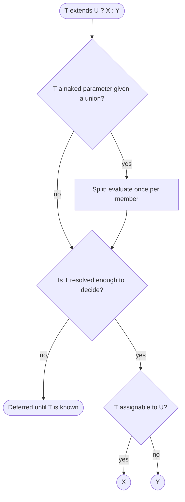

## Introduction

Ordinary generics let a type *flow through* a function: `identity<T>(x: T): T` returns whatever type it was given. What they cannot do on their own is *decide*. Suppose you want a helper `ensureArray(value)` that returns `string[]` when given a `string`, and returns the array unchanged when given an array. The output type depends on a question about the input type — "is it already an array?" — and a plain generic has no way to ask a question.

A **conditional type** is TypeScript's way of asking that question. It has the shape of a ternary expression, but it works on types instead of values:

```typescript title="first-look.ts"
type IsString<T> = T extends string ? true : false;

type A = IsString<"hi">;   // true
type B = IsString<number>; // false
```

Read `T extends string ? true : false` as "if `T` is assignable to `string`, the result is the type `true`; otherwise it is the type `false`". The compiler evaluates this while type-checking. Nothing of it exists when the program runs — TypeScript erases all types, so a conditional type can never inspect a runtime value.

Conditional types are the foundation of most of the "clever" types you meet in real code. The standard library's `Exclude`, `Extract`, `NonNullable`, `ReturnType`, `Parameters` and `Awaited` are all conditional types. Library typings — React's prop helpers, Zod's inferred schemas, tRPC's router types — use them to compute output types from input types. You will rarely write very complex ones in application code, but you need to be able to read them, and a few small ones genuinely remove duplication.

## Before you start

- **Generics** — declaring and passing type parameters such as `<T>`. See [[b2-generics]].
- **Generic constraints** — `T extends Something` in a type parameter list, which uses the same assignability idea. See [[b2-generic-constraints]].
- **Union and literal types** — `"a" | "b"`, and why `"hi"` is a type. See [[b2-unions]] and [[b2-literal-types]].
- **`never`** — the empty type with no values. See [[b2-never]].
- **Structural typing** — TypeScript compares types by shape, not by name. See [[b2-structural-typing]].

## The intuition

Think of a sorting machine at a parcel depot. Each parcel passes a gauge: "does it fit through this slot?". Parcels that fit go down one chute, parcels that do not fit go down the other. The gauge does not look at what is inside the parcel; it only checks the shape.

A conditional type is that gauge for types. `T extends U` is the slot test — "does every value of `T` also fit the shape `U`?" — and the two branches are the chutes. When a whole union arrives, the machine does what a real depot would do: it unloads the union and sends **each member** through the gauge separately, then collects the results. That last behaviour, called distribution, is the source of most surprises, so it gets its own section below.

The analogy stops working in one place: a real gauge always gives an answer, but the compiler sometimes cannot answer yet, because `T` is still an unknown type parameter. In that case it leaves the whole conditional unevaluated until `T` is known.

## The `extends` check is assignability

In a conditional type, `extends` means **assignable to** — the same relation that decides whether `let u: U = t` compiles. It does not mean class inheritance. Because TypeScript is structural, an object type "extends" another whenever it has at least the required properties with compatible types:

```typescript title="assignability.ts"
type HasId<T> = T extends { id: string } ? T : never;

type A = HasId<{ id: string; name: string }>; // { id: string; name: string }
type B = HasId<{ name: string }>;             // never — no id
type C = HasId<{ id: number }>;               // never — id has the wrong type
```

A literal type is assignable to its base type (`"hi" extends string` is true), a narrower union is assignable to a wider one (`"a" extends "a" | "b"` is true), and every type is assignable to `unknown`. The reverse directions are false: `string extends "hi"` is false, because not every string is `"hi"`.

That gives a reliable way to predict any conditional: ask "could I assign a value of the left type to a variable of the right type?" If yes, take the first branch.

### Chaining conditionals

There is no `else if` keyword, but the false branch can itself be a conditional, which gives a multi-way branch that is checked top to bottom:

```typescript title="type-name.ts"
type TypeName<T> =
  T extends string ? "string" :
  T extends number ? "number" :
  T extends boolean ? "boolean" :
  T extends undefined ? "undefined" :
  T extends Function ? "function" :
  "object";

type N1 = TypeName<42>;         // "number"
type N2 = TypeName<() => void>; // "function"
type N3 = TypeName<Date>;       // "object"
```

Order matters exactly as in an `if`/`else if` chain: the first matching branch wins. Format long chains one condition per line like this; written on a single line they quickly become unreadable.

## Distribution over unions

Now feed a union into `IsString`:

```typescript title="distribution.ts"
type IsString<T> = T extends string ? true : false;

type C = IsString<string | number>; // boolean
```

You might expect `false`, because `string | number` as a whole is not assignable to `string`. Instead you get `boolean`, which is TypeScript's name for `true | false`. What happened is **distribution**: when the checked type is a **naked type parameter** — `T` on its own, not wrapped in an array, tuple or object — and it is instantiated with a union, the conditional is applied to each member separately and the results are joined into a union:

```text
IsString<string | number>
= IsString<string> | IsString<number>
= true | false
= boolean
```

Distribution is deliberate and usually what you want. It is what makes "filter this union" types possible:

```typescript title="to-array.ts"
type ToArray<T> = T extends unknown ? T[] : never;

type D = ToArray<string | number>; // string[] | number[]
```

`T extends unknown` is always true, so this conditional exists only to trigger distribution. Each member is wrapped separately, producing "an array of strings or an array of numbers" — not an array that mixes both.

### When distribution does not happen

Distribution only applies when the type being checked is a bare type parameter that receives a union. Three situations look similar but do not distribute:

- The union is written directly, not passed through a type parameter. `boolean extends true ? 1 : 0` evaluates to `0`, because `true | false` as a whole is not assignable to `true`.
- The parameter is wrapped: `[T] extends [string]`, `T[] extends string[]` or `{ v: T } extends ...`. The checked type is now a tuple, array or object, not a naked `T`.
- The union appears only in the *branches*, not in the checked position.

### Turning distribution off

Wrapping both sides in one-element tuples is the standard way to compare the union as a whole:

```typescript title="no-distribution.ts"
type IsStringWhole<T> = [T] extends [string] ? true : false;
type E = IsStringWhole<string | number>; // false

type ToArrayWhole<T> = [T] extends [unknown] ? T[] : never;
type F = ToArrayWhole<string | number>; // (string | number)[]
```

The brackets do not change the meaning of the check — `[A]` is assignable to `[B]` exactly when `A` is assignable to `B` — they only hide the union from the distribution rule. Wrap both sides, not just one, or you change what is being compared.

> [!IMPORTANT] Decide distribution on purpose
> Whenever you write `T extends ...` with a naked `T`, ask: "if someone passes a union, do I want an answer per member, or one answer for the whole union?" Per member: leave it naked. Whole union: wrap in `[T] extends [...]`.

## The special cases: `never`, `any` and `boolean`

Three inputs produce results that look wrong until you apply the distribution rule.

```typescript title="special-cases.ts"
type IsString<T> = T extends string ? true : false;
type IsTrue<T> = T extends true ? "yes" : "no";

type G = IsString<never>;  // never
type H = IsString<any>;    // boolean
type I = IsTrue<boolean>;  // "no" | "yes"
```

**`never` gives `never`.** `never` is the empty union — a union with zero members. Distributing over zero members produces zero results, and an empty union is `never`. This trips people up when writing an "is this `never`?" check: `T extends never ? true : false` returns `never` for `never`, not `true`. The fix is the tuple wrapper:

```typescript title="is-never.ts"
type IsNever<T> = [T] extends [never] ? true : false;

type J = IsNever<never>;  // true
type K = IsNever<string>; // false
```

**`any` gives both branches.** `any` is both assignable to everything and a stand-in for anything, so the compiler cannot pick a side and returns the union of both branches. This is one way `any` leaking into your types quietly weakens them: a conditional that should give a precise answer gives a vague union instead. (`unknown` behaves normally: `IsString<unknown>` is `false`, because not every unknown value is a string.)

**`boolean` distributes.** Because `boolean` is really `true | false`, a naked conditional over `boolean` runs twice.

## Filtering unions with `never`

Because a union with `never` in it drops the `never` (`string | never` is `string`), returning `never` from a branch *removes* that member. Combined with distribution, this is how the standard library filters unions. These are the real definitions from `lib.es5.d.ts`:

```typescript title="lib.ts"
type Exclude<T, U> = T extends U ? never : T;
type Extract<T, U> = T extends U ? T : never;
```

Trace `Exclude<"a" | "b" | "c", "a">` member by member:

| Member | `member extends "a"`? | Result |
|---|---|---|
| `"a"` | yes | `never` |
| `"b"` | no | `"b"` |
| `"c"` | no | `"c"` |

The union of the results is `never | "b" | "c"`, which simplifies to `"b" | "c"`. `Extract` keeps instead of dropping: `Extract<string | number | (() => void), Function>` is `() => void`. Without distribution neither would work; that is why their `T` is left naked.

`NonNullable<T>` used to be written `T extends null | undefined ? never : T`. Since TypeScript 4.8 it is defined as `T & {}`, which removes `null` and `undefined` with an intersection instead, and narrows better in generic code. The result for concrete types is the same: `NonNullable<string | null | undefined>` is `string`. Utility types in general are covered in [[b2-utility-types]].

## Conditional types inside generic functions

A common first attempt is to use a conditional type as a function's return type and expect the body to type-check:

```typescript title="label.ts"
function label<T extends string | number>(x: T): T extends string ? "text" : "num" {
  return typeof x === "string" ? "text" : "num"; // error
}
```

```output
error TS2322: Type '"text"' is not assignable to type 'T extends string ? "text" : "num"'.
error TS2322: Type '"num"' is not assignable to type 'T extends string ? "text" : "num"'.
```

Inside the function, `T` is still an unknown type parameter, so the compiler cannot decide which branch applies. It keeps the conditional **deferred** — an unevaluated type that only resolves when a caller supplies a concrete `T`. And `typeof x === "string"` narrows the *value* `x`, not the type parameter `T`, so the check inside the function does not help either. (Checked with TypeScript 6.0. A change to narrow conditional return types was planned for 5.8 but withdrawn before release.)

The two practical fixes are a type assertion inside the body, which keeps the precise type for callers, or overloads, which avoid the conditional entirely:

```typescript title="label-fixed.ts"
function label(x: string): "text";
function label(x: number): "num";
function label(x: string | number): "text" | "num" {
  return typeof x === "string" ? "text" : "num";
}

const a = label("hi"); // "text"
const b = label(7);    // "num"
console.log(a, b);
```

```output
text num
```

Overloads are easier to read when there are two or three cases. A conditional return type with an assertion scales better when the mapping is systematic — for example, one rule for every array type. Overloads are taught in [[b2-function-overloading]].

## Worked example: `ensureArray`

Here is the helper from the introduction, written with a conditional type and run with Node.js 22 (which strips the types before running).

```typescript title="ensure-array.ts"
type ArrayOf<T> = T extends readonly unknown[] ? T : T[];

function ensureArray<T>(value: T): ArrayOf<T> {
  // ArrayOf<T> is deferred here, so the body needs an assertion;
  // callers still see the precise type.
  return (Array.isArray(value) ? value : [value]) as ArrayOf<T>;
}

const tags = ensureArray("urgent");     // string[]
const ids = ensureArray([101, 102]);    // number[]
const mixed = ensureArray<string | number[]>("x"); // string[] | number[]

console.log(tags, ids, mixed);
```

```output
[ 'urgent' ] [ 101, 102 ] [ 'x' ]
```

Walk through it. `ArrayOf<T>` asks whether `T` is already an array; `readonly unknown[]` is used so that read-only arrays and tuples also count, since a mutable array is assignable to a read-only one but not the other way round. For `"urgent"`, `T` is inferred as `string`, which is not an array, so the result is `string[]`. For `[101, 102]`, `T` is `number[]`, which is an array, so it is returned unchanged.

The third call shows distribution in a realistic setting. `T` is the union `string | number[]`, so `ArrayOf` runs once per member and gives `string[] | number[]`: "either we wrapped a string, or we passed the array through". That is exactly the right answer. With `[T] extends [readonly unknown[]]` the union as a whole would fail the check and you would get `(string | number[])[]`, which is wrong for the array case.

The assertion `as ArrayOf<T>` is the honest cost of this pattern. The compiler cannot prove the body matches the conditional, so the runtime check (`Array.isArray`) and the type-level check (`extends readonly unknown[]`) must be kept in agreement by you. If they disagree, the types lie.

## Recursive conditional types

A branch may refer back to the type being defined, which lets you process nested structures:

```typescript title="deep-readonly.ts"
type DeepReadonly<T> =
  T extends (...args: any[]) => any ? T :
  T extends object ? { readonly [K in keyof T]: DeepReadonly<T[K]> } :
  T;

type Config = DeepReadonly<{ db: { host: string; ports: number[] } }>;
// { readonly db: { readonly host: string; readonly ports: readonly number[] } }
```

Functions are excluded first because they are objects too, and making a function's properties read-only is not what anyone means. The `{ readonly [K in keyof T]: ... }` part is a mapped type, taught in [[b2-mapped-types]].

Recursion has limits. The compiler stops expanding at a fixed depth and reports **TS2589: Type instantiation is excessively deep and possibly infinite**. In TypeScript 6.0 a recursive conditional that wraps its recursive call inside another type (for example inside a template string or a tuple spread) fails at around 50 levels. Since TypeScript 4.5, a **tail-recursive** conditional — one whose branch is *only* the recursive call — is optimised and can run about 1,000 levels. For type-level work on short strings and small tuples neither limit matters; for anything that grows with input size, it does.

## How it works internally

When the checker meets `Check extends Extends ? True : False` it follows a fixed procedure:

1. **Instantiate.** Substitute any known type arguments. If the check type is a naked type parameter that was given a union, split the union and run the rest of the procedure once per member.
2. **Infer.** If the `extends` side contains `infer` declarations, try to infer them from the check type (see [[b2-infer]]).
3. **Decide.** If the check type is definitely assignable to the extends type, take the true branch. If it is definitely not assignable — and could not become assignable for any instantiation of remaining type parameters — take the false branch.
4. **Defer.** If neither can be decided because unresolved type parameters are involved, keep the conditional as a deferred type and try again when more is known.
5. **Combine.** Join the per-member results into a union, dropping `never`.

Two consequences follow. First, every evaluation is work for the compiler: large unions multiplied through nested conditionals can noticeably slow down `tsc` and editor autocompletion. Second, deferral is why conditional types are hard to use *inside* generic code and easy to use *at call sites*.



## In real systems

**Standard utilities.** `Exclude`, `Extract`, `NonNullable`, `ReturnType`, `Parameters`, `InstanceType` and `Awaited` are all conditional types. Before writing your own, check whether one of these already does the job.

**Library typings.** Form libraries compute "the type at this field path" with recursive conditionals; validation libraries such as Zod compute the TypeScript type of a schema with `z.infer`; API clients compute response types from route definitions. As a user of these libraries you mostly read the results in editor tooltips, but knowing the mechanism helps when an error message shows a half-evaluated conditional.

**Dependent return types.** A function whose result depends on an argument — `get(key)` returning a different type per key, or a parser returning `string[]` for `{ multiple: true }` and `string` otherwise — is a natural fit.

**Filtering unions.** Removing `null` from a union, picking only the event types that carry a payload, or excluding internal action types from a public API are all `Exclude`/`Extract`-style filters.

## Trade-offs and alternatives

| Need | Conditional type | Function overloads | Plain union return |
|---|---|---|---|
| Two or three fixed input→output pairs | Works, but needs an assertion in the body | Clearer | Loses precision |
| A systematic rule over many types | Best fit | Becomes a long list | Loses precision |
| Readability for teammates | Hardest | Good | Best |
| Compile-time cost | Grows with union size and nesting | Low | Lowest |

Conditional types buy precision at the cost of readability and compile time. A good rule is to keep them in shared type utilities with descriptive names and short example comments, not inline in component props. If a plain union or two overloads express the API well enough, prefer them. And remember they are compile-time only: they never replace a runtime check on data that arrives from a network or user.

## Common mistakes

> [!MISTAKE] Expecting `IsX<A | B>` to answer for the union as a whole
> A naked `T` distributes, so `IsString<string | number>` is `boolean`, not `false`. If you want one answer for the whole union, write `[T] extends [string]`.

**Checking for `never` with a naked parameter.** `T extends never ? true : false` returns `never` when given `never`. Use `[T] extends [never]`.

**Reading `extends` as inheritance.** It means assignability. `{ id: string; name: string }` "extends" `{ id: string }` without any `class` or `interface ... extends` declaration.

**Expecting the function body to narrow `T`.** `typeof x === "string"` narrows `x`, not `T`. Use overloads, or one assertion at the return with a comment explaining why it is sound.

**Letting `any` in.** A conditional evaluated with `any` returns both branches, so precision silently disappears. Find the `any` at its source rather than working around the result.

**Unbounded recursion.** A recursive conditional with no base case, or one applied to a very long tuple or string, ends in TS2589. Add a base case first, and keep recursive calls in tail position where you can.

## Interview perspective

Interviewers use conditional types to see whether you understand the type system as a set of rules rather than a set of memorised utilities. Expect "implement `Exclude`", "what does `IsString<string | number>` give and why?", and a follow-up on turning distribution off.

> [!INTERVIEW] What a strong answer sounds like
> "`T extends U ? X : Y` checks whether `T` is assignable to `U` at compile time. When `T` is a naked type parameter and receives a union, it's evaluated per member and the results are unioned — that's what makes `Exclude<T, U> = T extends U ? never : T` work, since `never` disappears from a union. To compare the whole union instead, I'd wrap both sides: `[T] extends [U]`. Also worth knowing: `never` produces `never`, and `any` produces both branches."

Questions to prepare:

- **Is a conditional type a runtime `if`?** No. It is evaluated by the compiler and erased; it cannot look at values.
- **Implement `Extract` and `NonNullable`.** `T extends U ? T : never`; `T extends null | undefined ? never : T` (or `T & {}` in modern TypeScript).
- **Why does a conditional return type not type-check inside the function?** It is deferred while `T` is unresolved, and narrowing a value does not narrow the type parameter.
- **What does `infer` add?** The ability to capture part of the matched type — the next lesson, [[b2-infer]].

## Practice

1. Write `IsArray<T>` and predict `IsArray<string[] | number>` before checking it in your editor. Then write a non-distributive version and compare.
2. Implement `MyExclude` and `MyExtract`, then use them to derive `"POST" | "PUT"` from `"GET" | "POST" | "PUT" | "DELETE"` in two different ways.
3. Write `IsNever<T>` and explain in one sentence why the naked version fails.
4. Write `Nullable<T>` that adds `null` to non-array types but leaves arrays unchanged, and test it on a union.
5. Rewrite `label` from this lesson as a conditional return type with a single assertion, then list one advantage and one disadvantage compared with overloads.

```quiz
Q: Given `type IsString<T> = T extends string ? true : false`, what is `IsString<"a" | 1>`?
- [ ] `false`, because the union is not assignable to `string`
- [ ] `true`, because one member is a string
- [x] `boolean`, because the check runs once per member and `true | false` is `boolean`
- [ ] A compile error
> `T` is a naked type parameter receiving a union, so the conditional distributes: `"a"` gives `true`, `1` gives `false`, and the union of the results is `boolean`. The tempting answer `false` describes the non-distributive form `[T] extends [string]`.

Q: Why does `Exclude<T, U> = T extends U ? never : T` remove members from a union?
- [ ] `never` is converted to `undefined` and then dropped
- [x] It distributes over `T`, and `never` disappears when the per-member results are combined
- [ ] `Exclude` is a compiler intrinsic, not a real conditional type
- [ ] It only works on string literal unions
> Each member of `T` is checked separately; members assignable to `U` become `never`, others stay. A union containing `never` simplifies by dropping it. `Exclude` is an ordinary type alias in `lib.es5.d.ts` and works on any union.

Q: What does `type IsNever<T> = T extends never ? true : false` give for `IsNever<never>`?
- [ ] `true`
- [ ] `false`
- [x] `never`
- [ ] `boolean`
> `never` is the empty union, so distribution runs over zero members and produces the empty union, `never`. Writing `[T] extends [never]` stops distribution and gives `true`.

Q: Inside `function f<T>(x: T): T extends string ? 1 : 2`, why does `return typeof x === "string" ? 1 : 2` fail to compile?
- [ ] Conditional types are not allowed as return types
- [ ] `typeof` does not work on generic values
- [x] The return type is deferred while `T` is unresolved, and narrowing `x` does not narrow `T`
- [ ] The literal types `1` and `2` widen to `number`
> Conditional return types are allowed and resolve correctly at call sites. Inside the body the compiler cannot choose a branch for an unknown `T`, so neither `1` nor `2` is assignable to the deferred type. Use overloads or one assertion.
```

## Quick revision {#quick-revision}

- Syntax: `T extends U ? X : Y` — compile-time choice based on whether `T` is **assignable** to `U`; erased at runtime.
- Chain conditionals in the false branch for multi-way choices; the first match wins.
- **Distribution:** a naked type parameter given a union is evaluated per member, then results are unioned.
- Disable distribution with `[T] extends [U]` (wrap both sides).
- Special inputs: `never` → `never`; `any` → union of both branches; `boolean` → evaluated for `true` and `false`.
- Returning `never` from a branch removes that member: `Exclude<T, U> = T extends U ? never : T`; `Extract<T, U> = T extends U ? T : never`; `NonNullable<T> = T & {}` (TS 4.8+).
- Conditionals over unresolved type parameters are **deferred**; a conditional return type needs an assertion or overloads in the function body.
- Recursion is allowed; too deep → TS2589. Tail-recursive conditionals (TS 4.5+) go to about 1,000 levels; others about 50.
- Pair with `infer` to extract parts of the matched type.

## Key takeaways {#key-takeaways}

- A conditional type is a compile-time if/else over types, decided by assignability, not inheritance.
- A naked type parameter distributes over unions; this is a feature that powers `Exclude` and `Extract`, and `[T] extends [U]` turns it off.
- `never` disappears from unions, so returning `never` from a branch filters members out.
- `never` and `any` give surprising results; know why so you can recognise them in error messages.
- Conditional types resolve at call sites but stay deferred inside generic bodies, so implementations need overloads or a deliberate assertion.
- Keep complex conditionals in named, documented utility types, and prefer simpler unions or overloads when they express the API well enough.
