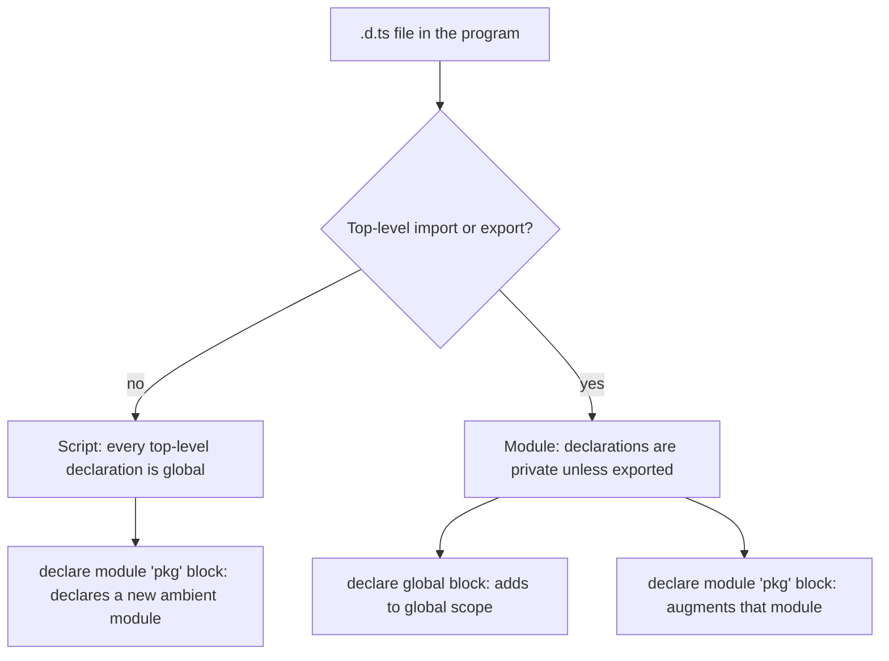

## Introduction

TypeScript checks your code against the types of everything it uses — including code that is not TypeScript. React, Express and Lodash are shipped to npm as JavaScript. The browser's `document` and Node.js's `process` are not written in TypeScript at all. For the compiler to check a call like `document.querySelector("#app")` or `express().listen(3000)`, it needs a description of those APIs: which functions exist, what parameters they take, what they return. That description lives in a **declaration file**, a file ending in `.d.ts`.

A declaration file contains only types: function signatures without bodies, class shapes without method code, interfaces, type aliases and variable types. The usual analogy is a restaurant menu. It tells you what dishes exist and what is in them, so you can order correctly, but it contains no cooking. The kitchen — the JavaScript — is somewhere else. The compiler reads the menu; the runtime eats from the kitchen. This is also where the analogy's warning lies: nothing forces the menu to match the kitchen. A wrong declaration file makes TypeScript confidently check your code against a lie.

Declaration files matter to every TypeScript developer in three roles. As a **consumer**, every typed npm package you use reaches you through `.d.ts` files, either bundled in the package or from the DefinitelyTyped project's `@types/*` packages. As an **application developer**, you write small declaration files for build-time globals, untyped dependencies and additions to `Window`. As a **library author**, you generate `.d.ts` files so that your users get types without your source.

Examples were compiled with TypeScript 6.0 and run with Node.js 22.

## Before you start

- **Modules, ambient module declarations and module resolution** — [[b2-ts-modules]].
- **`tsconfig.json`**, especially `include`, `types` and `declaration` — [[b2-tsconfig]].
- **Interfaces and declaration merging** — [[b2-interfaces]] and [[b2-declaration-merging]].
- **Namespaces**, which appear often inside declaration files — [[b2-namespaces]].

## The intuition

When you compile a `.ts` file, two things come out: the JavaScript with types removed, and — if you ask — the types with the JavaScript removed. Those are the two halves of one file. The `.js` is what runs; the `.d.ts` is what other TypeScript code checks against. A library ships both halves so its users can run it and type-check against it without ever seeing the original `.ts` source.

When the code was never TypeScript to begin with, there is no first half to strip: someone writes the types half by hand, to sit beside existing JavaScript.

## What goes in a declaration file

Everything in a `.d.ts` file is **ambient**: it states that something exists at runtime, without creating it. Values are introduced with the **`declare`** keyword (implicit for exported declarations in a module-style `.d.ts`, but often written anyway), and types are written as usual:

```ts title="example.d.ts"
declare const VERSION: string;                       // a variable that exists somewhere
declare function greet(name: string): string;        // a function, no body
declare class Point {                                 // a class shape, no method code
  constructor(x: number, y: number);
  readonly x: number;
  distanceTo(other: Point): number;
}
interface Options { verbose?: boolean }               // types need no `declare`
type Id = string | number;
declare namespace Utils { function noop(): void }    // a namespace object
```

What may *not* appear is anything that would produce JavaScript:

```ts title="bad.d.ts"
export declare function f(): number { return 1; }
export const x: number = 1;
```

```output
src/bad.d.ts(1,37): error TS1183: An implementation cannot be declared in ambient contexts.
src/bad.d.ts(2,26): error TS1039: Initializers are not allowed in ambient contexts.
```

The one exception is that a `const` with a literal type may be written with its literal value, as in `export declare const DEFAULT_OWNER = "me";`, because that is still only a type.

## Generating declaration files from TypeScript

For your own TypeScript, never write `.d.ts` files by hand: let the compiler emit them, so they cannot drift from the code. Set **`declaration: true`**:

```ts title="src/index.ts"
export interface Todo {
  id: number;
  title: string;
  done: boolean;
}

let nextId = 1;

export function createTodo(title: string) {
  return { id: nextId++, title, done: false } satisfies Todo;
}

export class TodoList {
  #items: Todo[] = [];
  private readonly owner: string;

  constructor(owner: string) {
    this.owner = owner;
  }

  add(title: string): Todo {
    const todo = createTodo(title);
    this.#items.push(todo);
    return todo;
  }

  get remaining() {
    return this.#items.filter((t) => !t.done).length;
  }

  /** @internal */
  debugDump(): string {
    return JSON.stringify(this.#items);
  }
}

export const DEFAULT_OWNER = "me";
```

With `"declaration": true` and `"stripInternal": true`, `tsc` writes `dist/index.d.ts` next to `dist/index.js`:

```ts title="dist/index.d.ts"
export interface Todo {
    id: number;
    title: string;
    done: boolean;
}
export declare function createTodo(title: string): {
    id: number;
    title: string;
    done: false;
};
export declare class TodoList {
    #private;
    private readonly owner;
    constructor(owner: string);
    add(title: string): Todo;
    get remaining(): number;
}
export declare const DEFAULT_OWNER = "me";
```

Read this output as a consumer would, because it is now your **public API**. Several things happened:

- `nextId` is gone: it was not exported, so it is not part of the API.
- Function bodies are gone; inferred types were written out. `createTodo`'s return type was inferred from the object literal, and because of `satisfies`, `done` kept the literal type `false`. Every consumer now sees a function that returns todos whose `done` can only ever be `false`. That is technically accurate but almost certainly not the intended contract. Writing `: Todo` as the return type would publish the right one. **Inferred types leak into your API**, which is why library authors annotate exported functions.
- The ES private field `#items` is reduced to the marker `#private;` so that the class is not structurally compatible with lookalikes, without revealing the field.
- The TypeScript-`private` field `owner` keeps its name but loses its type: consumers cannot access it, but the name must stay because private members affect assignability.
- `debugDump` was removed because of the `@internal` JSDoc tag and `stripInternal`, a way to hide methods that must be public for your own packages but are not part of the supported API.

Related options: **`emitDeclarationOnly`** writes only `.d.ts` files, used when another tool (esbuild, Rolldown, SWC) produces the JavaScript. **`declarationDir`** puts declarations in a separate folder. **`declarationMap`** emits `.d.ts.map` files so that "go to definition" in an editor jumps to the original `.ts` source instead of the `.d.ts`, which matters in monorepos (see [[b2-source-maps-ts]]).

### `isolatedDeclarations`

Generating declarations normally requires the type checker, because inferred types such as `createTodo`'s return type must be computed. That makes declaration emit slow and impossible for single-file tools. TypeScript 5.5 added **`isolatedDeclarations`**, which requires every exported API to have explicit enough types that its declaration can be produced from that file alone:

```output
src/index.ts(9,17): error TS9007: Function must have an explicit return type annotation with --isolatedDeclarations.
src/index.ts(27,7): error TS9009: At least one accessor must have an explicit type annotation with --isolatedDeclarations.
```

With those annotations added, faster tools can emit `.d.ts` files in parallel, file by file. It also enforces the good habit just described: explicit types on public functions.

## Writing declarations for JavaScript

### A JavaScript file in your own project

Suppose a TypeScript project still contains a JavaScript module:

```js title="src/legacy/currency.js"
export function formatCents(cents, symbol = "$") {
  return symbol + (cents / 100).toFixed(2);
}
```

A declaration file with the same base name next to it describes it:

```ts title="src/legacy/currency.d.ts"
/** Formats an integer number of cents, e.g. 1999 -> "$19.99". */
export declare function formatCents(cents: number, symbol?: string): string;
```

When `main.ts` imports `"./legacy/currency.js"`, TypeScript maps the specifier to `currency.ts`, `currency.tsx` and then `currency.d.ts` before considering the `.js` file, so the declaration file supplies the types:

```ts title="src/main.ts"
import { formatCents } from "./legacy/currency.js";

console.log(formatCents(1999));
console.log(formatCents(500, "€"));
formatCents("1999");
```

```output
src/main.ts(5,13): error TS2345: Argument of type 'string' is not assignable to parameter of type 'number'.
```

After removing the last line and compiling with `allowJs` (so that `currency.js` is copied to `dist`), the program prints:

```output
$19.99
€5.00
```

Notice what the declaration added: a parameter default became an optional parameter (`symbol?: string`), and the JSDoc comment appears in editor hovers. The alternative for JavaScript you control is to add JSDoc types to the `.js` file itself and enable `checkJs`; then `tsc` can generate the `.d.ts` for you.

### An npm package without types

For a package in `node_modules` with no types and no `@types` package, write an **ambient module declaration** — `declare module "package-name" { ... }` — in a `.d.ts` file inside your `include`. That technique, the `any`-typed shorthand `declare module "pkg";` and wildcard declarations like `declare module "*.svg"` are covered in [[b2-ts-modules]]. Before writing one, check whether `@types/package-name` exists (see [[b2-definitely-typed]]).

## Global declarations versus module declarations

The single most important rule about `.d.ts` files is the same rule that applies to `.ts` files: **a file with a top-level `import` or `export` is a module; a file without one is a script.** In a script, top-level declarations are global. In a module, they are local and must be imported.

A global declaration file is how you describe values that exist without being imported: constants injected by a bundler, properties added to `window` by a script tag, or globals from a test runner:

```ts title="src/globals.d.ts"
// Injected at build time by the bundler's `define` option.
declare const __APP_VERSION__: string;

interface Window {
  analytics?: { track(event: string): void };
}
```

```ts title="src/version.ts"
export function banner(): string {
  return `v${__APP_VERSION__}`;
}
```

The `interface Window` block does not replace the DOM's `Window`; it **merges** with it (see [[b2-declaration-merging]]), adding an optional `analytics` property, so `window.analytics?.track("signup")` type-checks.

Now suppose you want `Window` to reference a type from your code, and add an import to the file:

```ts title="src/globals.d.ts"
import type { User } from "./user.js";

declare const __APP_VERSION__: string;
// ...
```

```output
src/version.ts(2,14): error TS2304: Cannot find name '__APP_VERSION__'.
```

The `import` turned the file into a module, so `__APP_VERSION__` is now a private declaration of that module and no longer global — and the `Window` interface became a new local interface that merges with nothing. The fix is **`declare global`**, which places declarations into the global scope from inside a module:

```ts title="src/globals.d.ts"
import type { User } from "./user.js";

declare global {
  // Injected at build time by the bundler's `define` option.
  const __APP_VERSION__: string;

  interface Window {
    currentUser?: User;
  }
}
```

A `declare global` block is only allowed in a module. If a global declaration file has nothing to import, add `export {};` before using `declare global`, or keep it a plain script.



## Module augmentation

The same scripts-versus-modules distinction changes the meaning of `declare module "pkg" { }`. In a script it **declares** a module from scratch. In a module it **augments** an existing module, merging new members into its declarations. Augmentation is how libraries let you extend their types. Here a settings library declares which keys exist:

```ts title="node_modules/tiny-settings/index.d.ts"
export interface Settings {
  theme: "dark" | "light";
}
export declare function getSetting<K extends keyof Settings>(key: K): Settings[K];
export declare function setSetting<K extends keyof Settings>(key: K, value: Settings[K]): void;
```

Your app adds its own key by augmenting the interface:

```ts title="src/settings-types.ts"
import "tiny-settings";

declare module "tiny-settings" {
  interface Settings {
    locale: string;
  }
}
```

```ts title="src/use-settings.ts"
import { getSetting, setSetting } from "tiny-settings";

setSetting("locale", "en-GB");
console.log(getSetting("theme"), getSetting("locale"));
setSetting("fontSize", 14);
```

```output
src/use-settings.ts(6,12): error TS2345: Argument of type '"fontSize"' is not assignable to parameter of type 'keyof Settings'.
```

Without the last line, the program prints `light en-GB`. The augmentation applies to the whole program as long as `settings-types.ts` is included in it; no other file needs to import it. You can add members to interfaces and namespaces this way, but not add new top-level exports to a module or change existing types. Libraries such as Vue Router, i18next and styled-components document an interface you are expected to augment. [[b2-module-augmentation]] covers the patterns in depth.

## How TypeScript finds declaration files

The compiler looks for declarations in three places.

**Inside the program.** Any `.d.ts` file matched by `include`/`files`, or reached by an import, is part of the program. Global declarations in it apply everywhere.

**Next to imported JavaScript.** As shown above, an import of `x.js` finds `x.d.ts` (or `x.d.mts`/`x.d.cts` for `.mjs`/`.cjs`). For packages, TypeScript reads `package.json`: the `"types"` condition in `"exports"` if there is an `"exports"` map; otherwise the `"types"` (or `"typings"`) field; otherwise a `.d.ts` beside `"main"`; otherwise `index.d.ts`.

**In `@types`.** If a package has no types of its own, TypeScript looks for `node_modules/@types/<name>` when the package is imported. Separately, `@types` packages that declare *globals* (like `@types/node` or `@types/jest`) are loaded without an import only if listed in the `types` compiler option. In TypeScript 6.0 that list is empty by default, so you write `"types": ["node"]` explicitly (see [[b2-tsconfig]]). A `/// <reference types="node" />` directive at the top of a file does the same for one file's program, and is how one declaration package depends on another.

## Publishing types with a library

A library built with `declaration: true` points consumers at its declarations in `package.json`:

```json title="package.json"
{
  "name": "@acme/todo",
  "version": "2.0.0",
  "type": "module",
  "exports": {
    ".": {
      "types": "./dist/index.d.ts",
      "default": "./dist/index.js"
    }
  },
  "files": ["dist"]
}
```

`"types"` must come first inside each condition object, because conditions are matched in order and `"default"` matches everything. For packages that also support CommonJS, each format needs its own declaration file (`.d.ts` for ESM and `.d.cts` for CJS), as explained in [[b2-esm-vs-cjs-ts]]. Tools such as "Are the Types Wrong?" (`@arethetypeswrong/cli`) check a packed library for mismatches between its JavaScript and its declarations under each resolution mode, and are worth running before publishing.

Bundled libraries often need declarations bundled too. Tools such as `vite-plugin-dts`, `tsup`'s `dts` option, `rollup-plugin-dts` and API Extractor combine the per-file `.d.ts` output into one file per entry point and can report accidental API changes.

## How it works internally

To the checker, a `.d.ts` file is an ordinary source file in which every declaration is ambient. During binding, its declarations create symbols exactly as `.ts` declarations would; they simply have no value-producing code attached, and the emitter skips the file. Merging works across `.ts` and `.d.ts` files alike, which is why a `.d.ts` can add members to `Window` from `lib.dom.d.ts`.

The built-in library is itself a set of declaration files: `lib.es2025.d.ts`, `lib.dom.d.ts` and others in `node_modules/typescript/lib`. The `lib` option chooses which of them are in the program. When you "go to definition" on `Array.prototype.map`, the editor opens one of those files.

Declaration emit runs in the same pass as JavaScript emit. For each exported declaration, it prints the declared type if there is an annotation, or asks the checker for the inferred type and prints that. Printing an inferred type sometimes needs a name that the file does not import — TypeScript then writes an import type such as `import("./models.js").Todo`, or reports error TS2742 when the type can only be named through a path inside another package's `node_modules`. Adding an explicit annotation fixes both.

Finally, `skipLibCheck: true` tells the checker not to report errors *inside* `.d.ts` files. Their declarations are still used to check your code. Most projects enable it because conflicting or outdated declarations in dependencies are common and not yours to fix.

## In real systems

**Vite apps** contain a `src/vite-env.d.ts` with `/// <reference types="vite/client" />`, which pulls in types for `import.meta.env`, asset imports and CSS modules. Teams add their own environment variables by merging into `ImportMetaEnv` in that file.

**Node.js services** declare environment variable types with `declare global { namespace NodeJS { interface ProcessEnv { DATABASE_URL: string } } }`, and extend framework request objects through module augmentation.

**Library teams** publish generated declarations, review the `.d.ts` diff as the API diff, use `stripInternal` or API Extractor to hide internals, and test types. Type tests use `// @ts-expect-error` lines that must fail to compile, or helpers like `expectTypeOf` from Vitest, so that a change that accidentally widens or breaks a public type fails CI.

**DefinitelyTyped** hosts community-written declarations for thousands of JavaScript packages, published as `@types/*` (see [[b2-definitely-typed]]).

## Trade-offs and alternatives

| Approach | Use when | Risk |
|---|---|---|
| Generated `.d.ts` (`declaration: true`) | The source is TypeScript | Inferred types leak; annotate exports |
| JSDoc in `.js` + `checkJs` + generated `.d.ts` | You want to stay in JavaScript but publish types | JSDoc is more verbose than TypeScript syntax |
| Hand-written `.d.ts` beside JavaScript | Legacy or third-party JavaScript you cannot convert | Drifts from the implementation silently |
| `@types/*` from DefinitelyTyped | Popular untyped package | Version lag between package and types |
| Shorthand `declare module "x";` | Emergency unblocking | Everything is `any` |

## Common mistakes

**Hand-writing declarations that drift.** If `formatCents` is changed to take dollars instead of cents, the `.d.ts` keeps promising cents and TypeScript keeps approving wrong calls. Generate declarations from source wherever possible; where not, keep the `.d.ts` next to the `.js`, review them together, and add a few type tests.

**Accidentally turning a global declaration file into a module.** Adding an `import` makes every global in the file private. Use `declare global { }` inside the module.

**Putting a global `.d.ts` outside `include`.** A declaration file that is not in the program does nothing. If globals "do not exist", check with `tsc --listFilesOnly` whether the file is there.

**Expecting `@types/node` globals without listing them in TypeScript 6.0.** Global type packages need `"types": ["node"]`.

**Putting `"types"` after `"default"` in an `"exports"` condition.** `"default"` matches first, and TypeScript never sees the declarations. Put `"types"` first.

**Publishing inferred internal types.** An exported function returning an un-annotated object literal publishes that literal's exact shape, sometimes including literal types like `done: false`. Annotate exported return types, or enable `isolatedDeclarations` to make the compiler insist.

## Interview perspective

**"What is a `.d.ts` file?"** A file of ambient declarations describing the types of JavaScript that exists elsewhere. It contains no implementation and produces no output. Good answers mention the two sources (generated with `declaration: true`, or hand-written/DefinitelyTyped for JavaScript libraries) and that types are only as correct as the declarations.

**"How do you add a property to `window` in TypeScript?"** Merge into the `Window` interface: in a script `.d.ts`, `interface Window { x: T }`; in a module, inside `declare global { }`. Follow-up: why does it break when I add an import? Because the file becomes a module.

**"How does TypeScript find types for a package?"** `"exports"` with the `"types"` condition, `"types"` field, sibling `.d.ts`, `@types/<name>`. Mention the `types` option for global `@types` packages and its TypeScript 6.0 default.

**"What is `isolatedDeclarations` for?"** It requires explicit types on exports so declaration files can be generated per file without the type checker, enabling faster, parallel builds.

## Practice

1. Compile a small library with `declaration: true` and review the `.d.ts` as if it were someone else's API. Annotate anything whose inferred type is wider or narrower than intended.
2. Enable `isolatedDeclarations` on that library and fix every error.
3. Write `src/env.d.ts` declaring `__BUILD_TIME__: number` and an optional `window.featureFlags: Record<string, boolean>`. Then make it import a type from your code and keep it working with `declare global`.
4. Write a declaration file for a JavaScript function `debounce(fn, ms)` that preserves the parameter types of `fn`. (Hint: generics over `Parameters<F>`.)
5. Create a package with `"exports"` and `"types"`, pack it with `npm pack`, install it into another project, and confirm that "go to definition" reaches its declarations.

```quiz
Q: A global declaration file declares `declare const __APP_VERSION__: string;` and works. After adding `import type { User } from "./user.js"` at the top, other files report "Cannot find name '__APP_VERSION__'". Why?
- [ ] Declaration files cannot contain imports
- [x] The import makes the file a module, so its top-level declarations are no longer global
- [ ] `import type` is not allowed in `.d.ts` files
- [ ] The file must be renamed to `globals.ts`
> A file with a top-level `import` or `export` is a module, and module declarations are private unless exported. Wrap the globals in `declare global { }` to keep them global while importing types. Imports, including `import type`, are allowed in declaration files.
```

```quiz
Q: A library exports `function makeUser(name: string) { return { name, admin: false as const }; }` without a return type and builds with `declaration: true`. What do consumers see?
- [ ] `makeUser(name: string): any`
- [x] `makeUser(name: string): { name: string; admin: false; }`, so the inferred literal becomes part of the public API
- [ ] `makeUser(name: string): User`
- [ ] An error, because declaration emit requires return types
> Declaration emit writes the inferred type, including the literal `false`, into the `.d.ts`. Consumers cannot then have an admin user without a cast. Annotating the return type publishes the intended contract. Explicit return types are only required with `isolatedDeclarations`.
```

```quiz
Q: In a module file, you write `declare module "tiny-settings" { interface Settings { locale: string } }`. What does it do?
- [ ] Declares a brand-new module that replaces the package's types
- [x] Augments the existing `tiny-settings` module, merging `locale` into its `Settings` interface
- [ ] Nothing until every file that uses `tiny-settings` imports this file
- [ ] Causes a duplicate declaration error
> Inside a module, `declare module "name"` is a module augmentation: it merges into the declarations TypeScript already resolved for that package. In a script file the same block would declare an ambient module instead. Augmentations apply program-wide as long as the file is part of the program.
```

## Quick revision {#quick-revision}

- `.d.ts` = types only, all ambient; no bodies (TS1183) and no initialisers (TS1039) except literal `const`s.
- `declaration: true` emits `.d.ts` beside `.js`; `emitDeclarationOnly` when another tool emits JS; `declarationDir`; `declarationMap` for go-to-source; `stripInternal` removes `@internal` members.
- Inferred types are published as-is; annotate exported functions. `isolatedDeclarations` (5.5+) enforces this and enables per-file declaration emit.
- `#private` fields become `#private;`; TS `private` members keep names, lose types.
- Importing `x.js` finds `x.d.ts` (and `.d.mts`/`.d.cts`) before the JavaScript.
- Script `.d.ts` (no top-level import/export) = global declarations. Module `.d.ts` = private unless exported; use `declare global { }` for globals.
- `interface Window { ... }` merges into the DOM's `Window`.
- `declare module "pkg" { }`: in a script declares an ambient module; in a module augments the existing one (add members to interfaces/namespaces only).
- Package types: `"exports"` → `"types"` condition (first!), `"types"` field, sibling `.d.ts`, `@types/<name>`. Global `@types` need the `types` option (default `[]` in 6.0).
- `skipLibCheck` skips errors inside `.d.ts` files but still uses them.

## Key takeaways {#key-takeaways}

- Declaration files are how TypeScript knows the shape of JavaScript it cannot see; they describe, they never implement.
- Generate declarations from TypeScript source and read them as your public API; annotate exports so inferred details do not leak.
- Hand-written declarations are promises nobody checks against the implementation, so keep them small, close to the code and tested.
- Whether a `.d.ts` file is a script or a module decides whether its declarations are global and whether `declare module` declares or augments.
- Library types reach consumers through `package.json` `"exports"` with a `"types"` condition, or through `@types` packages.
