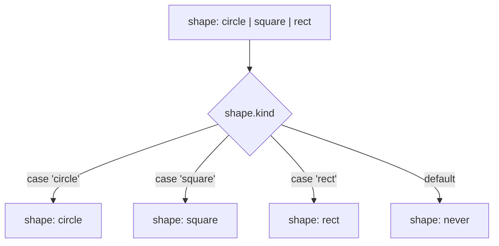

## Introduction

Suppose you are modelling shapes for a drawing app. A first attempt often looks like this:

```typescript
interface Shape {
  kind: string;
  radius?: number; // only for circles
  side?: number;   // only for squares
  width?: number;  // only for rectangles
  height?: number; // only for rectangles
}
```

Every property except `kind` is optional, because each one applies to only some shapes. The type therefore accepts `{ kind: "circle" }` with no radius, `{ kind: "square", radius: 3 }` with the wrong measurement, and `{ kind: "cirlce", radius: 3 }` with a typo. Code that reads `shape.radius` gets `number | undefined` and must either check it every time or reach for the `!` operator and hope.

The comments in that interface are carrying information the type system cannot see: "radius goes with circle". A **discriminated union** moves that information into the type:

```typescript
type Shape =
  | { kind: "circle"; radius: number }
  | { kind: "square"; side: number }
  | { kind: "rect"; width: number; height: number };
```

Now there are three separate shapes, each with exactly the properties it needs, all required. The `kind` property — the **discriminant**, also called the tag — tells the compiler which one it is looking at. After `if (shape.kind === "circle")`, TypeScript knows `shape.radius` exists and is a `number`. A circle without a radius, or a square with one, no longer compiles.

This pattern is one of the most useful in TypeScript. It types Redux actions, API responses, WebSocket messages, form states, parser output and the nodes of every JavaScript syntax tree. It also comes with a powerful guarantee, taught in the second half of this lesson: when someone adds a fourth shape, the compiler can point to every `switch` that has not been updated.

## Before you start

- **Literal types** — `"circle"` as a type with one value, and why `{ kind: "circle" }` sometimes infers `kind: string`. See [[b2-literal-types]].
- **Union types** — `A | B` and why you can only use members common to both until you know which one you have. See [[b2-unions]].
- **Object types** — required and optional properties. See [[b2-object-types]].
- **The `never` type** — the empty type with no values. See [[b2-never]]. It matters for the exhaustiveness section.

Narrowing in general — `typeof`, `instanceof`, `in` and custom guards — is the subject of [[b2-narrowing]]. This lesson needs only one kind of narrowing: comparing a property with a literal.

## The intuition: envelopes with labels

Imagine a mail room that receives three kinds of envelope: invoices, complaints and job applications. Each kind contains different papers. If envelopes arrived unlabelled, a clerk would have to open each one and guess from the contents. If every envelope has a printed label on the outside — `INVOICE`, `COMPLAINT`, `APPLICATION` — the clerk reads the label and knows exactly which papers are inside before opening it.

A discriminated union is a set of labelled envelopes. The tag property is the label; the other properties are the contents. Checking the tag tells the compiler which contents to expect.

The analogy has a limit worth stating early: the compiler trusts the label. If something at runtime produces an envelope labelled `INVOICE` that contains a complaint — for example a malformed JSON response that you cast to your type — TypeScript cannot notice. Labels are checked when your own code creates values; data from outside must be validated, as shown later in this lesson.

## What makes a union discriminated

A union is **discriminated** when three things are true:

1. **Every member is an object type with the same property name** — `kind` in the example. Common names are `kind`, `type`, `status` and `tag`; the name itself has no special meaning to the compiler.
2. **That property has a literal type in each member** — `"circle"`, `"square"`, `"rect"`. A literal type is a type with exactly one value. `null`, `undefined` and `true`/`false` also work as tags, because each of them is a single value too.
3. **The literal values differ between members**, so each value identifies one member (or a known subset).

When all three hold, comparing the property with a value lets TypeScript **narrow** the union — throw away the members whose tag cannot match — and give you the precise member type in that branch.

```typescript title="area.ts"
type Shape =
  | { kind: "circle"; radius: number }
  | { kind: "square"; side: number }
  | { kind: "rect"; width: number; height: number };

function area(shape: Shape): number {
  switch (shape.kind) {
    case "circle":
      return Math.PI * shape.radius ** 2; // shape: { kind: "circle"; radius: number }
    case "square":
      return shape.side ** 2;             // shape: { kind: "square"; side: number }
    case "rect":
      return shape.width * shape.height;  // shape: { kind: "rect"; ... }
  }
}

console.log(area({ kind: "circle", radius: 1 }).toFixed(4));
console.log(area({ kind: "rect", width: 2, height: 5 }));
```

```output
3.1416
10
```

Before the `switch`, the only property you can safely read is `kind`, because it is the only property every member has. Inside `case "circle"`, the compiler has discarded the square and the rectangle, so `shape.radius` is allowed. Writing `shape.side` in that branch would be a compile error — exactly the mistake the optional-field version allowed.

### Why the tag must be a literal type

Narrowing works by asking, for each member, "could this member's `kind` equal `"circle"`?" If every member declares `kind: string`, the answer is always "yes", so nothing is discarded:

```typescript title="wide-tag.ts"
type Loose =
  | { kind: string; radius: number }
  | { kind: string; side: number };

function radiusOf(shape: Loose) {
  if (shape.kind === "circle") return shape.radius;
}
```

```output
wide-tag.ts(6,45): error TS2339: Property 'radius' does not exist on type 'Loose'.
  Property 'radius' does not exist on type '{ kind: string; side: number; }'.
```

The same failure happens more quietly when values are built outside a context that expects the union. In the snippet below, `action` is inferred as `{ type: string }`, because object properties widen their literal types:

```typescript title="widen-action.ts"
type Action = { type: "reset" } | { type: "add"; amount: number };
function dispatch(action: Action) {}

const action = { type: "reset" };
dispatch(action);
```

```output
widen-action.ts(5,10): error TS2345: Argument of type '{ type: string; }' is not assignable to parameter of type 'Action'.
  Property 'amount' is missing in type '{ type: string; }' but required in type '{ type: "add"; amount: number; }'.
```

The message is confusing at first: the compiler tried each member, found that `{ type: string }` is not `{ type: "reset" }` (the tag is too wide), and reported its complaint about the closest other member. The root cause is the widened `type`. The fixes are the ones from [[b2-literal-types]]: write the object inline in the call (`dispatch({ type: "reset" })`), annotate it (`const action: Action = ...`), or build it with a small typed factory function such as `const reset = (): Action => ({ type: "reset" })`.

## Narrowing on the tag

The `switch` is the most common way to narrow, but any comparison of the tag with a literal works, and the compiler follows the logic of your code.

**`if` and `else`.** After `if (shape.kind === "circle") { ... }`, the `else` branch has `Shape` minus the circle — a union of the square and the rectangle. Early returns work the same way: after `if (shape.kind === "circle") return ...;`, the rest of the function sees only the remaining two members.

**Grouped cases.** Several `case` labels that fall through to the same body narrow to the union of those members:

```typescript
switch (shape.kind) {
  case "square":
  case "rect":
    // shape: { kind: "square"; side: number } | { kind: "rect"; width: number; height: number }
    return "has straight edges";
}
```

**Aliased conditions (TypeScript 4.4+).** You can store the comparison in a `const` and test it later; the compiler remembers what it meant:

```typescript
const isCircle = shape.kind === "circle";
if (isCircle) {
  console.log(shape.radius); // OK: narrowed through the alias
}
```

**Destructured tags (TypeScript 4.6+).** If you destructure the tag into a `const`, checking that variable still narrows the original object:

```typescript
const { kind } = shape;
if (kind === "square") {
  console.log(shape.side); // OK
}
```

Both of the last two forms need `const` bindings and an object that is not reassigned in between, because the compiler must be sure the alias still describes the same value. Older code bases that target an earlier TypeScript version may still need the plain `shape.kind === "..."` form.

## Making impossible states unrepresentable

The phrase **"make impossible states unrepresentable"** describes the main design benefit of discriminated unions. Consider how a request's state is often modelled:

```typescript
interface RequestState {
  isLoading: boolean;
  data?: User;
  error?: string;
}
```

Three independent pieces give 2 × 2 × 2 = 8 combinations of "loading or not", "data or not", "error or not". Only four of them make sense: not started, loading, succeeded with data, failed with an error. The other four — loading *and* failed, succeeded *and* failed, and so on — are bugs waiting for an unlucky sequence of events. Every component that reads this state has to decide what to show when `error` and `data` are both set, and different components will decide differently.

The discriminated-union version allows exactly the four sensible states:

```typescript
type RequestState =
  | { status: "idle" }
  | { status: "loading" }
  | { status: "success"; data: User }
  | { status: "error"; error: string };
```

There is no way to write "loading with an error" — the type cannot hold it. And the `data` property exists only in the member where it is guaranteed to be present, so a component that has checked `status === "success"` reads `state.data` as a `User`, not `User | undefined`. This particular union is so common that it has its own name and lesson: [[b2-remote-data-pattern]].

The same thinking applies to small cases. A function result is often written `{ success: boolean; value?: T; error?: string }`. Use a boolean tag instead:

```typescript
type Result<T> = { ok: true; value: T } | { ok: false; error: string };
```

After `if (result.ok)`, the compiler knows `result.value` is a `T`; in the `else` branch it knows `result.error` is a `string`.

## Exhaustiveness and assertNever {#b2-exhaustiveness-assertnever}

**Exhaustiveness checking** means getting a compile error when code that handles a union does not handle every member of it. Its most common form is a helper called `assertNever`. The problem it solves is change over time: a `switch` that covered every case when it was written silently stops doing so the day someone adds a new member to the union. Without a check, the new case falls through the `switch`, the function returns `undefined` or does nothing, and the bug appears far from its cause.

The technique rests on the `never` type ([[b2-never]]), the type with no values. As each `case` of a `switch` over a discriminated union narrows away one member, what remains in the `default` branch shrinks. After every member has been handled, nothing is left, and the remaining type is `never`. So "this value is `never` here" is a way of saying "all cases were handled". If a member is missing, the value is that member instead, and any code that demands `never` fails to compile.

### Four ways to get the check

**1. A declared return type and no `default`.** With `strictNullChecks` on, a function whose return type does not include `undefined` must return on every path. If a case is missing, the end of the `switch` is reachable, and the compiler objects:

```typescript title="no-default.ts"
type Shape =
  | { kind: "circle"; radius: number }
  | { kind: "square"; side: number }
  | { kind: "rect"; width: number; height: number };

function area(shape: Shape): number {
  switch (shape.kind) {
    case "circle":
      return Math.PI * shape.radius ** 2;
    case "square":
      return shape.side ** 2;
  }
}
```

```output
no-default.ts(6,30): error TS2366: Function lacks ending return statement and return type does not include 'undefined'.
```

This costs nothing, but the message does not name the missing case, and it only works for functions that return a value. A `switch` that performs side effects needs one of the next options.

**2. Assign the leftover to a `never` variable.** In the `default` branch, assign the narrowed value to a variable of type `never`:

```typescript title="never-var.ts"
type Shape =
  | { kind: "circle"; radius: number }
  | { kind: "square"; side: number }
  | { kind: "rect"; width: number; height: number };

function area(shape: Shape): number {
  switch (shape.kind) {
    case "circle":
      return Math.PI * shape.radius ** 2;
    case "square":
      return shape.side ** 2;
    default: {
      const unhandled: never = shape;
      return unhandled;
    }
  }
}
```

```output
never-var.ts(13,13): error TS2322: Type '{ kind: "rect"; width: number; height: number; }' is not assignable to type 'never'.
```

Now the error names the missing member. Adding `case "rect"` makes `shape` truly `never` in `default`, and the assignment compiles.

**3. The `assertNever` helper.** Writing a throwaway variable in every `switch` gets repetitive, so most code bases define one helper:

```typescript title="assert-never.ts"
export function assertNever(value: never, message = "Unhandled case"): never {
  throw new Error(`${message}: ${JSON.stringify(value)}`);
}
```

and call it from `default`:

```typescript
default:
  return assertNever(shape);
```

The parameter type `never` gives the same compile-time check as option 2, with the missing member named in the error. The return type `never` tells the compiler the call does not return normally, so `return assertNever(shape)` satisfies any return type. The body adds something the other options lack: a **runtime** failure. That matters because types describe what your code *expects*, not what actually arrives. If a server running a newer version sends `{ kind: "triangle" }` to an older client, the compiler had no chance to catch it; `assertNever` turns a silent wrong result into a clear error naming the unexpected value.

**4. `satisfies never`.** Since TypeScript 4.9 you can write the check as an expression with no helper and no variable:

```typescript
default:
  shape satisfies never;
  throw new Error("unreachable");
```

When a case is missing, the error reads `Type '{ kind: "rect"; ... }' does not satisfy the expected type 'never'.` It is a compile-time check only, so you still decide what happens at runtime.

### Exhaustive maps instead of switches

A `switch` is not the only exhaustive construct. When each variant maps to a value or a handler, a `Record` keyed by the tag gives the same guarantee — a missing key is a compile error:

```typescript
const LABELS = {
  circle: "Circle",
  square: "Square",
  rect: "Rectangle",
} satisfies Record<Shape["kind"], string>;
```

`Shape["kind"]` is the union `"circle" | "square" | "rect"`, taken from the union itself so it can never drift. Remove `rect` from the object and the compiler reports that the property is missing. This pattern is developed further in [[b2-variant-map-satisfies]].

### What defeats the check

Exhaustiveness is only as strong as the types flowing into it. Four things quietly switch it off:

- **Typing the helper's parameter as `any`.** `function assertNever(x: any): never` accepts everything, so a missing case compiles. The parameter must be `never`. The same happens if the call site casts: `assertNever(shape as any)`.
- **A `default` that returns a fallback.** `default: return 0;` handles "everything else", including variants added next year. If you want a fallback for unknown runtime data, put it *after* an exhaustiveness check, or keep the check in a separate branch.
- **A wide tag.** If the discriminant is `string`, the leftover in `default` is never `never`, and the compiler cannot help. Exhaustiveness needs literal tags.
- **Code outside a `switch`.** An `if`/`else if` chain ending in a plain `else` has the same problem as a fallback `default`. End it with `else { assertNever(shape); }` instead.

### Throwing or degrading at runtime

Should the runtime branch throw? For internal data such as reducer actions that your own code creates, yes: an unhandled action is a programming error, and failing loudly in development is right. For data from a server or another service, a client that crashes whenever the backend adds a variant is fragile. A common compromise is to keep the compile-time check with `satisfies never` or a `never` variable, then log the unexpected value and render a neutral fallback. The type check protects you while you write code; the runtime branch decides how gracefully you fail when reality disagrees with the types.

Linters can add a further net: the `typescript-eslint` rule `switch-exhaustiveness-check` reports a `switch` over a union that misses cases even when there is no `default` at all. See [[b2-eslint-typescript]].

## How it works internally

There is no special runtime machinery. The emitted JavaScript for `area` is an ordinary `switch` on an ordinary string property; the types, the narrowing and the `never` checks all disappear. Everything happens in the compiler's **control-flow analysis**.

When the compiler meets a condition such as `shape.kind === "circle"`, it recognises a **discriminant property access**: a property that exists in every member of the union and has a literal (unit) type in at least some of them. It then filters the union. In the true branch it keeps members whose `kind` could be `"circle"`; in the false branch it keeps members whose `kind` could be something else. A `switch` is treated as a series of such comparisons, with each `case` also removing its members from the cases that follow — which is how `default` ends up with whatever is left.



Two consequences follow. First, narrowing is about the *variable you checked*. If you check `a.kind` and then read `b.radius`, where `b` is another reference to the same object, the compiler does not connect them. Second, narrowing is reset when the variable is assigned again: after `shape = getNextShape()`, the compiler goes back to the declared type `Shape`.

Members may share a tag value. With `{ kind: "rect"; w: number } | { kind: "rect"; h: number }`, checking `kind === "rect"` narrows to both members, and you would need another check to tell them apart. That is legal, but usually a sign the two members should be one.

## Worked example: a typed cart reducer

A **reducer** is a function `(state, action) => newState`. React's `useReducer` and Redux are built around it ([[b4-usereducer]], [[b4-redux]]). Actions are the textbook discriminated union. The following program is framework-free so it runs in Node, but the reducer would work unchanged inside `useReducer`.

```typescript title="cart.ts"
type CartItem = { id: string; price: number; qty: number };

type CartAction =
  | { type: "add"; item: CartItem }
  | { type: "remove"; id: string }
  | { type: "setQty"; id: string; qty: number }
  | { type: "clear" };

function assertNever(value: never): never {
  throw new Error(`Unhandled action: ${JSON.stringify(value)}`);
}

function cartReducer(state: readonly CartItem[], action: CartAction): CartItem[] {
  switch (action.type) {
    case "add": {
      const existing = state.find((i) => i.id === action.item.id);
      if (!existing) return [...state, action.item];
      return state.map((i) =>
        i.id === action.item.id ? { ...i, qty: i.qty + action.item.qty } : i,
      );
    }
    case "remove":
      return state.filter((i) => i.id !== action.id);
    case "setQty":
      // a quantity of zero means the item should disappear
      if (action.qty <= 0) return state.filter((i) => i.id !== action.id);
      return state.map((i) => (i.id === action.id ? { ...i, qty: action.qty } : i));
    case "clear":
      return [];
    default:
      return assertNever(action);
  }
}

const total = (items: readonly CartItem[]) =>
  items.reduce((sum, i) => sum + i.price * i.qty, 0);

const actions: CartAction[] = [
  { type: "add", item: { id: "pen", price: 2, qty: 3 } },
  { type: "add", item: { id: "book", price: 15, qty: 1 } },
  { type: "add", item: { id: "pen", price: 2, qty: 2 } },
  { type: "setQty", id: "book", qty: 0 },
];

let cart: CartItem[] = [];
for (const action of actions) {
  cart = cartReducer(cart, action);
  console.log(action.type.padEnd(7), JSON.stringify(cart), "total", total(cart));
}
```

```output
add     [{"id":"pen","price":2,"qty":3}] total 6
add     [{"id":"pen","price":2,"qty":3},{"id":"book","price":15,"qty":1}] total 21
add     [{"id":"pen","price":2,"qty":5},{"id":"book","price":15,"qty":1}] total 25
setQty  [{"id":"pen","price":2,"qty":5}] total 10
```

Each `case` reads only the properties its action has. In `case "add"`, `action.item` is available; in `case "remove"`, it is not, and `action.id` is. The `{ ... }` braces around the `"add"` body give `existing` its own block scope, which is needed because `const` declarations in different `case` clauses otherwise share one scope.

Here is the state after each step:

| Step | Action | Branch taken | Cart afterwards | Total |
|---|---|---|---|---|
| 1 | add pen ×3 | `existing` is `undefined`, append | pen×3 | 6 |
| 2 | add book ×1 | `existing` is `undefined`, append | pen×3, book×1 | 21 |
| 3 | add pen ×2 | `existing` is pen, `map` adds quantities | pen×5, book×1 | 25 |
| 4 | setQty book 0 | `qty <= 0`, so `filter` removes it | pen×5 | 10 |

The reducer never mutates `state`; every branch returns a new array, and changed items are copied with `{ ...i, qty }`. That matters in React, which detects changes by comparing references: mutating the old array in place would leave the reference unchanged and skip the re-render. The parameter type `readonly CartItem[]` enforces the habit — `state.push(...)` would not compile.

Finally, suppose a teammate adds `{ type: "applyCoupon"; code: string }` to `CartAction`. The `default` branch now receives that member instead of `never`, and the call `assertNever(action)` fails to compile with a message naming `applyCoupon`. The reducer cannot ship until it handles coupons.

## Validating JSON into a discriminated union

Values your own code creates are checked by the compiler. Values parsed from JSON are not: `JSON.parse` returns `any`, and `JSON.parse(text) as Shape` is a promise, not a check. The safe approach is to start from `unknown` ([[b2-unknown]]) and prove each property before building the typed value:

```typescript title="parse-shape.ts"
type Shape =
  | { kind: "circle"; radius: number }
  | { kind: "square"; side: number };

function parseShape(text: string): Shape | null {
  const value: unknown = JSON.parse(text);
  if (typeof value !== "object" || value === null || !("kind" in value)) return null;

  switch (value.kind) {
    case "circle":
      return "radius" in value && typeof value.radius === "number"
        ? { kind: "circle", radius: value.radius }
        : null;
    case "square":
      return "side" in value && typeof value.side === "number"
        ? { kind: "square", side: value.side }
        : null;
    default:
      return null; // an unknown kind from the outside world is data, not a bug
  }
}

console.log(parseShape('{"kind":"circle","radius":2}'));
console.log(parseShape('{"kind":"circle","side":2}'));
console.log(parseShape('{"kind":"hexagon","side":2}'));
```

```output
{ kind: 'circle', radius: 2 }
null
null
```

Each check teaches the compiler something: `typeof value === "object" && value !== null` makes `value` an `object`, `"kind" in value` adds a `kind` property of type `unknown`, and `typeof value.radius === "number"` narrows that property. The returned object is built fresh, so extra properties from the input do not leak through. Here `default` returns `null` rather than calling `assertNever`, because `value.kind` is `unknown`, not a union — an unexpected value is a normal input, not a programming error. These narrowing tools are taught in [[b2-narrowing]]; in larger applications a schema library such as Zod generates the same checks from one declaration ([[b2-type-safe-apis]]).

## In real systems

**State management.** Redux and `useReducer` actions are discriminated on `type`. Redux Toolkit generates action creators whose `type` fields are literal strings, so `switch` statements and `builder.addCase` calls narrow the payload.

**API results and errors.** Many teams return `{ ok: true; data } | { ok: false; error }` from data-access functions instead of throwing, so callers cannot forget the failure path. Code generators for OpenAPI can turn a `oneOf` schema with a `discriminator` into a discriminated union in the generated client.

**UI state machines.** Form steps, upload progress, authentication (`{ status: "anonymous" } | { status: "authenticated"; user: User }`) and async data ([[b2-remote-data-pattern]]) are all unions where each state carries only the data valid in it.

**Syntax trees.** The ESTree specification used by ESLint, Babel and Prettier describes every JavaScript syntax node with a `type` field such as `"Identifier"` or `"CallExpression"`, and the TypeScript compiler's own nodes carry a numeric `kind`. Tools that walk code are long `switch` statements over these tags.

**Messages across boundaries.** `postMessage` between a page and a worker, WebSocket events and server-sent events usually carry a `type` field. Typing them as a union gives both ends one shared definition — but, as with JSON, the receiving side must validate.

## Trade-offs and alternatives

| Approach | Invalid states possible | Exhaustiveness | Runtime cost | Fits best |
|---|---|---|---|---|
| One object with optional fields | Yes | No | None | Data where fields really are independent |
| Discriminated union | No | Yes, with `never` checks | None | Variants with different data |
| Class hierarchy with `instanceof` | No | Not checked | Classes and prototypes | Behaviour attached to each variant, OOP-style code |
| Union without a tag, narrowed with `in` | No | Limited | None | Third-party shapes you cannot change |

The costs of discriminated unions are real but modest. Each variant repeats the tag. Adding a variant means updating every `switch` — which is precisely what exhaustiveness checks are for, but it still means touching many files. JSON payloads must always include the tag, which needs agreement with the backend. And deeply shared fields (an `id` on every variant) have to be repeated or factored out with an intersection such as `Base & ({ kind: "a" } | { kind: "b" })` ([[b2-intersections]]).

Do not reach for a union when there is only one shape and an optional property is honest: `{ name: string; nickname?: string }` describes a person whose nickname is genuinely independent of everything else. Use a union when properties come and go *together*.

## Common mistakes

**Using a boolean flag where states are really separate.** `{ isError: boolean; data?: T; error?: string }` lets `isError: false` coexist with an `error`. Replace the flag with a tag whose values are the states.

**Declaring the tag as `string`.** `kind: string` in the member types means nothing narrows. Each member needs its own literal value.

**Building actions in a variable without a type.** `const a = { type: "reset" }` widens `type` to `string` and fails at `dispatch(a)`. Pass the object inline, annotate it, or use a typed action creator.

**Reading variant properties before narrowing.** `shape.radius` on a `Shape` is an error, because squares have no radius. Check the tag first; do not silence the error with `as` or `!`.

**A catch-all `default` that hides new variants.** `default: return null;` compiles forever, including after a new member is added. Put `assertNever` (or `satisfies never`) in `default`, and handle truly unknown runtime data in a separate validation step.

**Casting parsed JSON to the union.** `JSON.parse(text) as Shape` skips every check. Parse to `unknown` and validate, or use a schema library.

**Narrowing one variable and reading another.** Checking `event.kind` and then reading `this.event.payload` does not narrow `this.event`. Narrow the reference you will use, or copy it to a `const` first.

## Interview perspective

**"What is a discriminated union, and why use one?"** Define the three ingredients — shared property, literal types, distinct values — and show a two- or three-member example. The strong part of the answer is the *why*: the type cannot represent contradictory states, each branch sees exactly its own data, and the compiler can enforce that every case is handled.

**"How do you make a switch exhaustive?"** Show `assertNever(value: never): never` in `default`, explain that the leftover type is `never` only when every member is handled, and mention that the helper's throw covers runtime data the compiler cannot see. Follow-ups often ask what breaks the check: `any`, a fallback `default`, or a `string` tag.

**"Model the state of a data fetch."** The expected answer is the four-state union from this lesson, compared with the three-flag object. Good candidates count the states (eight combinations, four valid) and mention keeping previous data during a refetch as an extension ([[b2-remote-data-pattern]]).

**"How do you get from JSON to this type?"** Interviewers want to hear that a cast is not validation, then either a hand-written check starting from `unknown` or a schema library.

```quiz
Q: Why does `if (x.kind === "a") x.onlyOnA` fail when every member declares `kind: string`?
- [ ] Discriminated unions only work inside `switch` statements
- [x] Every member's `kind` could equal `"a"`, so no member can be ruled out
- [ ] The property must be named `type`, not `kind`
- [ ] `strictNullChecks` must be turned off
> Narrowing removes members whose tag type cannot match the compared value. When all tags are `string`, every member could match, so the union stays whole and `onlyOnA` is not available on all members. Any property name works, and `if` narrows as well as `switch` does.
```

```quiz
Q: In `default: return assertNever(action);`, what produces the compile error when a case is missing?
- [ ] The `throw` inside `assertNever`
- [ ] The return type `never` of `assertNever`
- [x] The parameter type `never`, because the leftover member is not assignable to it
- [ ] The `default` keyword itself
> In `default`, `action` has been narrowed to whatever members the cases did not handle. If that is anything other than `never`, passing it to a `never` parameter is a type error that names the member. The `throw` only acts at runtime, and the `never` return type is what lets `return assertNever(...)` satisfy the function's return type.
```

```quiz
Q: A server may add new message kinds before the client is updated. What is the best handling in the client's `switch`?
- [ ] Remove the `default` branch so nothing can throw
- [ ] Type the tag as `string` so new kinds are accepted
- [x] Keep a compile-time `never` check, but log and fall back at runtime instead of crashing
- [ ] Cast every incoming message to the known union
> The compile-time check still forces you to handle every kind you know about. At runtime, an unknown kind from the outside is expected data, so logging it and degrading gracefully is kinder than throwing. Widening the tag to `string` or casting would throw away the type safety the union provides.
```

## Practice

1. Add a `{ type: "increment"; id: string }` action to the cart reducer. Before writing the new `case`, read the compile error, then implement it and print the cart after incrementing the pen.
2. Rewrite `{ isOpen: boolean; selectedId?: string; error?: string }` for a modal dialog as a discriminated union. List the states the old type allowed that the new one forbids.
3. Add a `"triangle"` member with `base` and `height` to `Shape`. Before writing the new `case`, compile and read the error in each function that uses `assertNever`, `satisfies never` or a declared return type.
4. Write `type Result<T, E = string>`, a function `divide(a, b): Result<number>` that fails on division by zero, and code that prints either the value or the error without using `!` or `as`.
5. Extend `parseShape` to accept a `"rect"` with `width` and `height`, and reject negative measurements.
6. Write a `Record<Shape["kind"], (s: Shape) => string>` of describers. Explain why each handler receives the full `Shape` rather than its own member, and how you could type it so each handler receives only its member (hint: a mapped type, [[b2-mapped-types]]).

## Quick revision {#quick-revision}

- Discriminated union = union of object types + shared property + a distinct literal type in each member.
- Tags may be string, number or boolean literals, or `null`/`undefined`. A `string` tag does not narrow.
- Narrowing works with `switch`, `if`/`else`, early returns, grouped `case`s, aliased `const` conditions (TS 4.4+) and destructured `const` tags (TS 4.6+).
- Before narrowing, only properties common to every member are accessible.
- Objects built in untyped variables widen their tag to `string`: pass inline, annotate, or use typed creators.
- "Make impossible states unrepresentable": 3 booleans/optionals = 8 combinations; a 4-member union allows exactly 4.
- Exhaustiveness: after all cases, the leftover type is `never`.
- Checks: declared return type without `default` (TS2366); `const x: never = value`; `assertNever(value: never): never`; `value satisfies never`; `satisfies Record<Union["tag"], ...>`.
- `assertNever` also throws at runtime, naming the unexpected value.
- `any`, fallback `default`s, wide tags and plain `else` branches defeat exhaustiveness.
- JSON is untyped: parse to `unknown`, validate each property, build a fresh value.

## Key takeaways {#key-takeaways}

- A literal tag shared by every member lets the compiler tell the members of a union apart, so each branch sees exactly the properties its variant has.
- Prefer a discriminated union whenever properties come and go together; it turns contradictory states from runtime bugs into compile errors.
- Exhaustiveness checking uses the fact that a fully handled union narrows to `never`; `assertNever` makes the check reusable and adds a runtime failure for data the compiler never saw.
- The check is only as strong as its inputs: literal tags, no `any`, and no catch-all fallback in `default`.
- The compiler trusts tags it did not create, so data from outside must be validated before it becomes a discriminated union.
- Discriminated unions are the basis for typed reducers, API results and UI state machines, including the async-state pattern in [[b2-remote-data-pattern]].
