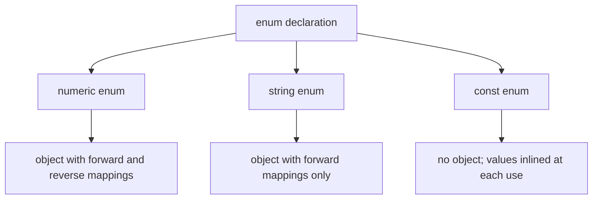

## Introduction

Many values in a program come from a small, fixed set. An order is `pending`, `paid`, `shipped` or `cancelled`. A log message is `debug`, `info`, `warn` or `error`. An arrow key points up, down, left or right. If you write these as bare strings or numbers scattered through the code — `if (order.status === "shiped")` — a typo is a silent bug, and nobody reading `setLevel(2)` knows what `2` means.

An **enum** (short for *enumeration*) solves this by giving each allowed value a name and grouping the names together:

```typescript title="first-enum.ts"
enum OrderStatus {
  Pending = "pending",
  Paid = "paid",
  Shipped = "shipped",
}

const status: OrderStatus = OrderStatus.Paid;
console.log(status);
```

```output
paid
```

Enums are unusual in TypeScript. Almost every TypeScript feature is a pure type annotation that disappears when the code is compiled. An enum declaration is different: it produces a **real JavaScript object** at runtime *and* a type. That double life explains both why enums are useful and why some teams avoid them. This lesson teaches numeric enums, string enums, `const enum`, what each compiles to, how the type checker treats them, and how they interact with modern tooling. Whether to use an enum or a union of string literals is the subject of the next lesson, [[b2-literal-unions-vs-enums]].

## Before you start

- **Literal and union types** — `"paid"` as a type, and `"paid" | "shipped"`. See [[b2-literal-types]] and [[b2-unions]].
- **Object types** — enums compile to objects, and you will read their keys and values. See [[b2-object-types]].
- **How TypeScript compiles** — that types are erased and JavaScript is emitted. See [[b2-tsc-compilation]].
- **`switch` and narrowing** — used for exhaustive handling. See [[b2-narrowing]].

## The intuition

Think of an enum as a printed menu with numbered dishes. The kitchen ticket says "dish 4", which is short and unambiguous for the kitchen. The menu tells a human that dish 4 is "Mushroom risotto". An enum is that menu for your code: `OrderStatus.Shipped` is the human-readable name; the value stored and compared at runtime is whatever the menu maps it to — a number for numeric enums, a string for string enums.

The analogy holds in one more way: the menu exists in the restaurant. An enum is not only a compile-time idea; the mapping from names to values is an object you can look at, loop over and import while the program runs.

## Numeric enums

The simplest enum lists names without values. TypeScript then numbers them from zero:

```typescript title="numeric.ts"
enum Direction {
  Up,
  Down,
  Left,
  Right,
}

console.log(Direction.Up, Direction.Down, Direction.Right);

function move(d: Direction): string {
  return d === Direction.Up ? "moving up" : `moving ${Direction[d]}`;
}
console.log(move(Direction.Up), "/", move(Direction.Left));
```

```output
0 1 3
moving up / moving Left
```

`Direction.Up` is `0`, `Down` is `1`, and so on. The expression `Direction[d]` maps a number back to its name; this is the **reverse mapping**, explained below.

You can set values explicitly. A member without an initializer takes the previous member's value plus one, so numbering continues from any explicit number:

```typescript title="initializers.ts"
enum Priority {
  Low = 1,
  Medium,      // 2
  High = 10,
  Urgent,      // 11
}

enum HttpStatus {
  Ok = 200,
  NotFound = 404,
  Teapot = Ok + 218, // constant expression, computed at compile time
}

console.log(Priority.Medium, Priority.Urgent, HttpStatus.Teapot);
```

```output
2 11 418
```

Initializers can be numeric literals, references to earlier members, or simple arithmetic on them — these are **constant members**, and the compiler works out their values. An initializer can also be an arbitrary expression such as `"abc".length`; that is a **computed member**, evaluated at runtime. A computed member has an unknown value at compile time, so the member after it must have an explicit initializer (otherwise TypeScript reports *Enum member must have initializer*). Computed members are rare in practice and best avoided.

> [!WARNING] Never rely on implicit numbers for stored data
> If an enum without explicit values is persisted — written to a database, sent over the network, stored in `localStorage` — then inserting a new member in the middle renumbers every member after it. Old data now means something different. Give every member an explicit value whenever the number leaves the program, or use a string enum.

### What a numeric enum compiles to

Here is the JavaScript `tsc` emits for `Direction`:

```javascript title="numeric.js"
var Direction;
(function (Direction) {
    Direction[Direction["Up"] = 0] = "Up";
    Direction[Direction["Down"] = 1] = "Down";
    Direction[Direction["Left"] = 2] = "Left";
    Direction[Direction["Right"] = 3] = "Right";
})(Direction || (Direction = {}));
```

Read the inner line from the inside out. `Direction["Up"] = 0` sets the forward mapping, name to value; an assignment expression evaluates to the assigned value, `0`. The outer assignment then performs `Direction[0] = "Up"`, the reverse mapping, value to name. The surrounding function is an IIFE (Immediately Invoked Function Expression), and `Direction || (Direction = {})` lets several declarations of the same enum merge into one object.

So the runtime object has **both** directions:

```typescript title="reverse.ts"
enum Direction { Up, Down, Left, Right }

console.log(Direction[0], Direction[Direction.Right]);
console.log(Object.keys(Direction));
console.log(Object.values(Direction).filter((v) => typeof v === "number"));
```

```output
Up Right
[
  '0',    '1',
  '2',    '3',
  'Up',   'Down',
  'Left', 'Right'
]
[ 0, 1, 2, 3 ]
```

The reverse mapping is handy for logging (`Direction[d]` prints `"Left"` instead of `2`), but it surprises anyone who iterates the enum: `Object.keys` returns eight entries for four members, numeric keys first because JavaScript orders integer-like keys before string keys. To list the members of a numeric enum you must filter, as the last line does. String enums have no reverse mapping, which is one reason they are easier to work with.

### How numeric enums are type-checked

An enum name is also a type. `d: Direction` accepts only `Direction` members. Since TypeScript 5.0, every enum is a **union enum**: the type `Direction` is treated as the union `Direction.Up | Direction.Down | Direction.Left | Direction.Right`, and each member has its own **enum member type**. That is what allows exhaustiveness checks and narrowing.

```typescript title="numeric-types.ts"
enum Priority { Low = 1, Medium, High = 10, Urgent }

let p: Priority = Priority.Low;
p = 2;                // fine: 2 is the value of Priority.Medium
p = 3;                // error TS2322

const fromServer: number = 3;
p = fromServer;       // allowed: any number type is assignable to a numeric enum
```

```output
numeric-types.ts(5,1): error TS2322: Type '3' is not assignable to type 'Priority'.
```

The output is from `tsc --noEmit`. A numeric literal that matches a member's value is accepted, and one that matches no member is rejected. But a value of the general type `number` is still assignable to a numeric enum, so `p = fromServer` compiles even though `3` is not a valid priority. Numeric enums therefore give weaker guarantees than they appear to whenever the number comes from outside the program. String enums close this gap, at the cost of strictness in the other direction.

## String enums {#b2-string-enums}

A **string enum** is an enum in which every member is initialised with a string literal. The value stored and compared at runtime is that string, so it reads well in logs, JSON payloads, database rows and the browser's developer tools — unlike a numeric enum, whose values show up as unexplained numbers.

```typescript title="string-enum.ts"
enum Theme {
  Light = "light",
  Dark = "dark",
  System = "system",
}

console.log(Theme.Dark);
console.log(JSON.stringify({ theme: Theme.Dark }));
console.log(Object.keys(Theme), Object.values(Theme));
```

```output
dark
{"theme":"dark"}
[ 'Light', 'Dark', 'System' ] [ 'light', 'dark', 'system' ]
```

The compiled JavaScript is simpler than for a numeric enum — one assignment per member, and **no reverse mapping**:

```javascript title="string-enum.js"
var Theme;
(function (Theme) {
    Theme["Light"] = "light";
    Theme["Dark"] = "dark";
    Theme["System"] = "system";
})(Theme || (Theme = {}));
```

Because there is no reverse mapping, `Object.keys` and `Object.values` return exactly the members, which makes it straightforward to build a dropdown from the enum or to validate input against it.

String enums have no auto-increment: every member must have an explicit string. That is a feature. The value is visible right next to the name, nothing renumbers when you add a member, and the string can be chosen to match what an API or database already uses. The usual convention is PascalCase member names with whatever casing the external system expects for values (`Pending = "PENDING"` or `Pending = "pending"`).

### String enums are nominal

String enums behave differently from almost everything else in TypeScript's structural type system. A plain string — even one equal to a member's value — is **not** assignable to the enum type:

```typescript title="string-enum-types.ts"
enum Theme { Light = "light", Dark = "dark" }
enum Mode { Light = "light", Dark = "dark" }

function css(theme: Theme): string {
  return theme === Theme.Dark ? "color-scheme: dark" : "color-scheme: light";
}

css(Theme.Light);            // fine
css("light");                // error TS2345
css(Mode.Light);             // error TS2345

const asText: string = Theme.Dark; // fine: enum values are strings
console.log(asText);
```

```output
string-enum-types.ts(9,5): error TS2345: Argument of type '"light"' is not assignable to parameter of type 'Theme'.
string-enum-types.ts(10,5): error TS2345: Argument of type 'Mode.Light' is not assignable to parameter of type 'Theme'.
```

The only way to obtain a `Theme` is through the `Theme` object. Even `Mode.Light`, with an identical value, is rejected — two enums are different types regardless of their contents. This is called **nominal** typing: identity by name, not by shape. Assignability in the other direction is fine: a `Theme` value is a string, so it can go anywhere a `string` is expected.

This strictness is the main argument for and against string enums. *For*: you cannot accidentally pass an arbitrary string where a status is expected, and renaming a value means changing one line. *Against*: every call site must import the enum, test code cannot write `"light"`, and data that arrives as plain strings — from JSON, URL parameters, a form — must be converted explicitly.

### Member types

Each member also has its own type. A `const` initialised with a member gets the member type, not the whole enum:

```typescript title="member-types.ts"
enum Theme { Light = "light", Dark = "dark" }

const current = Theme.Light;     // type: Theme.Light
const other: Theme.Dark = current; // error TS2322
```

```output
member-types.ts(4,7): error TS2322: Type 'Theme.Light' is not assignable to type 'Theme.Dark'.
```

`Theme.Light` as a type is a subtype of `Theme` and corresponds to the value `"light"`, but it is still not the literal type `"light"` — that is why `css("light")` above fails. If you need the literal string types themselves, you want a union of string literals or an `as const` object instead ([[b2-as-const-objects]]).

### Converting untrusted strings

Because the compiler will not turn a `string` into a `Theme` for you, data from outside the program needs a validation step. The idiomatic way uses the fact that a string enum's runtime object lists exactly its values:

```typescript title="parse-theme.ts"
enum Theme { Light = "light", Dark = "dark", System = "system" }

const themeValues: readonly string[] = Object.values(Theme);

function parseTheme(input: string): Theme | undefined {
  return themeValues.includes(input) ? (input as Theme) : undefined;
}

console.log(parseTheme("dark"), parseTheme("blue"));
```

```output
dark undefined
```

The `as Theme` assertion is safe here only because the line checks membership first. Writing `localStorage.getItem("theme") as Theme` without the check compiles too, but then nothing stops `"blue"` from flowing through the program typed as a `Theme`. Assertions are covered in [[b2-type-assertions]]; the type-guard form of this function (`input is Theme`) in [[b2-custom-type-guards]].

> [!TIP] Prefer string enums over numeric ones
> If your team uses enums, default to string enums. They print meaningfully, they survive reordering, they have no reverse mapping to trip over, and a plain `string` cannot sneak in through the type system the way a plain `number` can with numeric enums. Use numeric enums only when the numbers themselves are meaningful (bit flags, protocol codes).

### Heterogeneous enums

TypeScript also allows mixing string and numeric members in one enum — `enum Answer { No = 0, Yes = "YES" }`. These are called heterogeneous enums. They compile, but they combine the quirks of both kinds and have no practical advantage. Avoid them.

## Exhaustive handling

Because an enum type is a union of its members, TypeScript can check that a `switch` handles every one. The standard technique assigns the value to a variable of type `never` in the `default` branch; if any member was not handled, its type is still possible there and the assignment fails:

```typescript title="exhaustive.ts"
enum OrderStatus {
  Pending = "pending",
  Paid = "paid",
  Shipped = "shipped",
  Cancelled = "cancelled",
}

function label(status: OrderStatus): string {
  switch (status) {
    case OrderStatus.Pending:
      return "Awaiting payment";
    case OrderStatus.Paid:
      return "Preparing your order";
    case OrderStatus.Shipped:
      return "On its way";
    default: {
      const unhandled: never = status; // error TS2322
      return unhandled;
    }
  }
}
```

```output
exhaustive.ts(17,13): error TS2322: Type 'OrderStatus.Cancelled' is not assignable to type 'never'.
```

`Cancelled` has no `case`, so in the `default` branch `status` has been narrowed to `OrderStatus.Cancelled` — and the error message names exactly that missing member. Add the missing case and the error disappears. This is the most valuable thing enums (and literal unions) give you: adding a member to the enum makes the compiler list every `switch` that needs updating. The `never` technique is covered in depth in [[b2-exhaustiveness-assertnever]].

```quiz
Q: What does `Object.keys(Direction)` return for `enum Direction { Up, Down }`?
- [ ] `['Up', 'Down']`
- [x] `['0', '1', 'Up', 'Down']`
- [ ] `[0, 1]`
- [ ] `[]`, because enums are erased at runtime
> Numeric enums compile to an object with both forward (`Up → 0`) and reverse (`0 → 'Up'`) mappings, so it has four keys. Integer-like keys are listed first. String enums have no reverse mapping, and enums are not erased — they are real objects.

Q: Given `enum Theme { Light = "light" }` and `function f(t: Theme)`, why is `f("light")` a compile error?
- [ ] Because enum values are numbers at runtime
- [ ] Because `"light"` is spelled differently from `Light`
- [x] Because string enum types are nominal: only values obtained through `Theme` count as `Theme`
- [ ] It is not an error; string literals are assignable to string enums
> Even though `Theme.Light` is the string `"light"` at runtime, the type `Theme` only accepts its own members. A string literal, or a member of a different enum with the same value, is rejected. Going the other way — a `Theme` where `string` is expected — is allowed.
```

## `const enum`

A `const enum` is an enum that the compiler erases entirely. Every use is replaced by the literal value, and no object is emitted:

```typescript title="const-enum.ts"
const enum Flag {
  Read = 1,
  Write = 2,
  Execute = 4,
}

const permissions = Flag.Read | Flag.Write;
console.log(permissions, Flag.Execute);
```

```output
3 4
```

The JavaScript `tsc` emits for this file contains no `Flag` object at all:

```javascript title="const-enum.js"
const permissions = 1 /* Flag.Read */ | 2 /* Flag.Write */;
console.log(permissions, 4 /* Flag.Execute */);
```

That removes the runtime cost and keeps the readable names in the source. But it comes with real restrictions. All members must be constant (no computed members), because the values must be known at compile time. You cannot iterate a const enum or look a value up by a computed key, because there is no object. And inlining across files requires the compiler to read the file that declares the enum while compiling the file that uses it.

That last point is the serious one. Most modern build pipelines — Vite, esbuild, SWC, Babel, Node's built-in TypeScript support — transpile **each file on its own**, without type information about other files. They cannot inline a value they cannot see. TypeScript's `isolatedModules` option (turned on in Vite's TypeScript templates, directly or through `verbatimModuleSyntax`, which implies it) exists to flag code that is unsafe under single-file transpilation, and it rejects uses of const enums declared in `.d.ts` files (*Cannot access ambient const enums when 'isolatedModules' is enabled*). Depending on the tool, a `const enum` declared in your own source is either compiled as a regular enum or inlined only within the file that declares it. In practice, `const enum` is safe inside one project compiled by `tsc`, and a source of subtle bugs elsewhere — especially in libraries, where the inlined value is frozen into the consumer's build.

## How it works internally

Putting the pieces together, an enum declaration does two things during compilation.

**At the type level**, it declares a type with the enum's name, plus one member type per member. The enum type is the union of its member types. For string members, the checker treats member types as distinct from string literal types, which gives string enums their nominal behaviour; for numeric members, a numeric literal with a matching value is accepted and the general `number` type is also assignable.

**At the value level**, a regular enum emits the IIFE shown above, creating an object bound to the enum's name. Because it is a real value, you can import it, pass it around (`Object.values(Theme)`), and it adds bytes to your bundle — a few dozen per enum. Bundlers generally cannot remove unused members, because the IIFE mutates an object and looks like a side effect. A `const enum` emits nothing and inlines its values instead.

This value-level emit is what makes enums incompatible with a growing part of the ecosystem. Enums are one of the few TypeScript features that cannot be handled by **type stripping** — deleting the types and leaving valid JavaScript. Node.js 22.18 and later (and 23.6 and later) run `.ts` files directly by stripping types, and they reject enums: running a file containing `enum E { A = "a" }` with Node 22 fails with `ERR_UNSUPPORTED_TYPESCRIPT_SYNTAX: TypeScript enum is not supported in strip-only mode` (Node offers an experimental `--experimental-transform-types` flag for this). TypeScript 5.8 added the compiler option `erasableSyntaxOnly`, which reports enums, namespaces with values, and parameter properties as errors so that a codebase stays compatible with type stripping. Teams that enable it replace enums with `as const` objects ([[b2-as-const-objects]]); recent Vite TypeScript templates turn it on by default.



## Worked example: order statuses end to end

This example follows an order status from an API response, through validation, into application logic and back out to JSON — the full lifecycle a status enum has in a real frontend.

```typescript title="orders.ts"
enum OrderStatus {
  Pending = "PENDING",
  Paid = "PAID",
  Shipped = "SHIPPED",
  Cancelled = "CANCELLED",
}

type Order = { id: string; status: OrderStatus };

const statusValues: readonly string[] = Object.values(OrderStatus);

function isOrderStatus(value: string): value is OrderStatus {
  return statusValues.includes(value);
}

// Raw data as it arrives from JSON: the status is just a string
const raw = [
  { id: "o1", status: "PAID" },
  { id: "o2", status: "SHIPPED" },
  { id: "o3", status: "LOST" },
];

const orders: Order[] = [];
for (const r of raw) {
  if (isOrderStatus(r.status)) {
    orders.push({ id: r.id, status: r.status });
  } else {
    console.log(`skipping ${r.id}: unknown status ${r.status}`);
  }
}

function canCancel(order: Order): boolean {
  switch (order.status) {
    case OrderStatus.Pending:
    case OrderStatus.Paid:
      return true;
    case OrderStatus.Shipped:
    case OrderStatus.Cancelled:
      return false;
  }
}

function cancel(order: Order): Order {
  return canCancel(order) ? { ...order, status: OrderStatus.Cancelled } : order;
}

console.log(orders.map((o) => `${o.id}:${canCancel(o)}`).join(" "));
console.log(JSON.stringify(orders.map(cancel)));
```

```output
skipping o3: unknown status LOST
o1:true o2:false
[{"id":"o1","status":"CANCELLED"},{"id":"o2","status":"SHIPPED"}]
```

Walk through it. The enum values are the exact strings the API uses, so no translation layer is needed in either direction: `JSON.stringify` writes `"CANCELLED"`, and the server understands it. The raw data has `status: string`, which the compiler will not accept as an `OrderStatus`. `isOrderStatus` is a **type guard**: it checks membership against the enum's runtime values and tells the compiler that, inside the `if`, `r.status` is an `OrderStatus`. Unknown values such as `"LOST"` are caught at the boundary instead of travelling through the app.

`canCancel` has no `default` branch and no final `return`, yet compiles under `strict`. TypeScript knows the `switch` covers every member of the union, so the end of the function is unreachable. If someone adds `Refunded = "REFUNDED"` to the enum, this function immediately fails with *Function lacks ending return statement and return type does not include 'undefined'*, pointing at exactly the code that needs a decision. `cancel` uses the enum member to build a new object rather than mutating the old one.

## In real systems

**API and database values.** String enums are commonly used to mirror status columns and API fields, with values matching the wire format exactly. Code generators for OpenAPI and GraphQL can emit either enums or string-literal unions; many teams configure them for unions to avoid the import and conversion friction.

**Bit flags.** Numeric enums with power-of-two values (`Read = 1, Write = 2, Execute = 4`) combine with `|` and test with `&`.

**Legacy and team conventions.** Many large codebases, especially those written by teams coming from C# or Java, use enums throughout. You need to read them fluently even if you prefer the alternatives.

**Modern tooling choices.** Projects that run TypeScript directly in Node or that enable `erasableSyntaxOnly` do not use enums at all, and replace them with `as const` objects plus a derived union type.

## Trade-offs and alternatives

| Option | Runtime object | Plain string accepted? | Iterable | Works with type stripping |
|---|---|---|---|---|
| Numeric `enum` | Yes, with reverse map | Any `number` accepted | Yes, with filtering | No |
| String `enum` | Yes | No (nominal) | Yes | No |
| `const enum` | No (inlined) | Numbers: yes; strings: no | No | No |
| Union of string literals | No | Yes, if it is one of the literals | Only with a separate array | Yes |
| `as const` object + derived union | Yes (an ordinary object) | Yes | Yes | Yes |

Enums give you a namespace of named constants, a type, and a runtime list in one declaration, plus nominal safety for string enums. Their costs are runtime emit, friction converting plain strings, numeric-enum quirks, and incompatibility with type stripping and `erasableSyntaxOnly`. The literal-union and `as const` alternatives give the same exhaustiveness checking without those costs; the comparison is worked through in [[b2-literal-unions-vs-enums]].

## Common mistakes

> [!MISTAKE] Iterating a numeric enum without filtering
> `Object.keys(Direction)` includes `"0"`, `"1"`… as well as the names, because of the reverse mapping. A dropdown built from it shows every option twice. Filter with `typeof v === "number"`, or use a string enum, which has no reverse mapping.

**Casting strings into enums without checking.** `value as OrderStatus` compiles for any string. Validate against `Object.values(OrderStatus)` first.

**Relying on implicit numbering for persisted data.** Inserting a member renumbers the rest. Use explicit values or string enums for anything stored or transmitted.

**Assuming a numeric enum rejects invalid numbers.** Literal numbers are checked; values typed as `number` are not.

**Using `const enum` in a library or a Vite/esbuild project.** Values may not be inlined across files, and ambient const enums are rejected under `isolatedModules`. Use a regular enum or an `as const` object.

**Mixing an enum and string literals for the same concept.** Some code passes `OrderStatus.Paid`, other code passes `"PAID"`, and the two do not type-check against each other. Pick one representation per domain concept.

## Interview perspective

Enums are a favourite interview topic because they expose whether you know which TypeScript features exist at runtime.

> [!INTERVIEW] "What does an enum compile to?"
> A strong answer: a regular enum compiles to an IIFE that builds an object; numeric members get a reverse mapping from value to name, string members do not; a `const enum` emits no object and inlines values, which breaks with single-file transpilers. Mention that enums cannot be type-stripped, so Node's built-in TypeScript support and `erasableSyntaxOnly` reject them.

Other questions to prepare:

- **Why prefer string enums over numeric ones?** Readable runtime values, no reverse mapping, no renumbering, and a plain `string` cannot be assigned to them.
- **Why can't I pass `"light"` to a parameter of type `Theme`?** String enums are nominal; convert through validation.
- **How do you make a `switch` over an enum exhaustive?** Assign to `never` in `default`, or rely on missing-return errors with explicit return types.
- **Enum or union?** Discuss runtime presence, import friction, tooling compatibility, and team convention; see the next lesson.

## Practice

1. Declare `enum LogLevel { Debug, Info, Warn, Error }`. Predict the output of `Object.keys(LogLevel)` and `LogLevel[2]`, then check by compiling and running.
2. Rewrite `LogLevel` as a string enum. Write `shouldLog(level: LogLevel, minimum: LogLevel): boolean` — and explain why comparing string enum values with `<` no longer works and what you would use instead.
3. Write `parseLogLevel(input: string): LogLevel | undefined` as a type guard–based function and test it with valid and invalid strings.
4. Add a member to an enum used in an exhaustive `switch`. Record the exact compiler error and where it appears.
5. Create a file with a `const enum`, compile it with `tsc`, and read the emitted JavaScript. Then explain what would happen if a second file used the enum and each file were transpiled separately.

## Quick revision {#quick-revision}

- `enum` creates a **type** and a **runtime object**; it is not erased (except `const enum`).
- Numeric enums start at 0 and auto-increment; after an explicit number, numbering continues from it.
- Numeric enums emit a **reverse mapping** (`E[0] === "Up"`), so `Object.keys` lists numbers and names.
- Numeric enums: matching numeric literals and any `number` are assignable — weak at boundaries.
- String enums: every member needs a string; no reverse mapping; values readable in JSON and logs.
- String enums are **nominal**: `"light"` and other enums' members are not assignable; enum values are assignable to `string`.
- Each member has its own type (`Theme.Light`), distinct from the literal `"light"`.
- All enums are union enums (TS 5.0+), enabling exhaustive `switch` checks with `never`.
- Convert untrusted strings with a membership check against `Object.values(Enum)`.
- `const enum` inlines values, emits nothing, cannot be iterated, and is unsafe with single-file transpilers / `isolatedModules`.
- Enums cannot be type-stripped: Node's built-in TS support and `erasableSyntaxOnly` (TS 5.8+) reject them.

## Key takeaways {#key-takeaways}

- An enum names a fixed set of values and is one of the few TypeScript features that emits JavaScript.
- Numeric enums carry a reverse mapping and accept any `number`; string enums are stricter, clearer and the better default.
- String enum types are nominal, so plain strings must be validated into enum values at the program's boundaries.
- Because an enum type is a union of its members, the compiler can find every `switch` that misses a member.
- `const enum` trades away the runtime object for inlining and breaks under single-file build tools.
- Enum emit is why modern setups that rely on type stripping avoid enums in favour of literal unions and `as const` objects.
