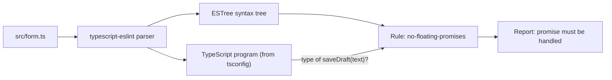

## Introduction

Here is a function that compiles under the strictest TypeScript settings:

```ts title="unhandled.ts"
async function saveDraft(text: string): Promise<void> {
  await new Promise((resolve) => setTimeout(resolve, 10));
  if (text.length === 0) throw new Error('cannot save an empty draft');
  console.log('saved', text);
}

function onSubmit(text: string): void {
  saveDraft(text); // floating promise: nobody awaits it or handles failure
  console.log('form closed');
}

onSubmit('');
```

`tsc` reports nothing. Run it with Node.js 22 and the form "closes" before the save has even started, then the process crashes (stack frames trimmed):

```output
form closed
/app/unhandled.js:5
        throw new Error('cannot save an empty draft');
              ^

Error: cannot save an empty draft

Node.js v22.22.3
```

Since Node.js 15, an unhandled promise rejection terminates the process by default. In a browser the same bug shows as an "Uncaught (in promise)" console error while the user sees a form that claims to have saved. The types are all correct: `saveDraft` returns `Promise<void>`, and calling a function without using its result is legal. What is wrong is a *pattern*: a promise was created and then ignored.

Catching patterns is what a **linter** does. **ESLint** is the standard JavaScript linter: it parses code into a syntax tree and runs rules over it. **typescript-eslint** is the project that makes ESLint understand TypeScript syntax and, crucially, lets rules ask the TypeScript compiler what type an expression has. With that, a rule called `no-floating-promises` sees that `saveDraft(text)` has type `Promise<void>` and that nothing handles it, and reports it before the code ever runs.

## Before you start

- **Promises and async/await** — what an unhandled rejection is and why `forEach` does not wait. See [[b1-promises]] and [[b1-async-await]].
- **tsconfig.json** — the linter reuses your compiler configuration. See [[b2-tsconfig]].
- **`any` and why to avoid it** — several rules exist to contain it. See [[b2-avoiding-any]].
- **How `tsc` compiles** — what type checking does and does not cover. See [[b2-tsc-compilation]].

## The intuition: a type checker and a code reviewer

Think of `tsc` as a proof-checker. It answers one question: *can these values flow into those places without breaking the declared types?* It does not care whether the program is sensible, only whether it is consistent.

ESLint is closer to an experienced code reviewer with a checklist: "you created a promise and never handled it", "this `any` is being assigned to a typed variable", "this import is only used as a type". Plain ESLint is a reviewer who reads code but cannot see types. typescript-eslint's **type-aware rules** give that reviewer access to the compiler, so the checklist can include items like "this expression is a promise" or "this value is `any`" that are invisible from syntax alone.

The analogy holds in one more way: the reviewer does not repeat the proof-checker's job. ESLint does not report type errors. You run both tools, and each catches what the other cannot.

## What ESLint catches that `tsc` does not

Three families of bugs pass type checking but are reliably caught by type-aware lint rules.

### Promises nobody handles

The introduction showed a **floating promise**: a promise-valued expression used as a statement, without `await`, `.then`/`.catch`, or a `return`. `@typescript-eslint/no-floating-promises` reports it. A related bug is passing an async function somewhere that ignores its returned promise:

```ts title="floating.ts"
const delay = (ms: number) => new Promise((resolve) => setTimeout(resolve, ms));

async function fetchName(id: number): Promise<string> {
  await delay(id * 10);
  return `user${id}`;
}

async function buggy(ids: number[]) {
  const names: string[] = [];
  // forEach ignores the promises the async callback returns.
  ids.forEach(async (id) => {
    names.push(await fetchName(id));
  });
  console.log('buggy:', names);
}

async function fixed(ids: number[]) {
  const names = await Promise.all(ids.map((id) => fetchName(id)));
  console.log('fixed:', names);
}

async function main() {
  await buggy([3, 1, 2]);
  await fixed([3, 1, 2]);
}

void main();
```

```output
buggy: []
fixed: [ 'user3', 'user1', 'user2' ]
```

`forEach` expects a callback returning `void`. An async callback returns a promise, which `forEach` throws away, so `buggy` logs before any name has arrived. TypeScript allows this because a function returning something is assignable to a function type returning `void` (see [[b2-void-ts]]). `@typescript-eslint/no-misused-promises` reports exactly this: a promise-returning function passed where a void-returning one is expected. It also reports a promise used as a condition, as in `if (user.isAdmin())` when `isAdmin` is async, which is always truthy. The fix, as in `fixed`, is to map to promises and await them together with `Promise.all` (see [[b1-promise-all]]).

The final line, `void main();`, shows the accepted way to say "I am deliberately not awaiting this". `no-floating-promises` allows `void` by default, so the intention is explicit and searchable.

### `any` leaking into typed code

`any` disables checking, and it spreads: a value of type `any` can be assigned to a `string` variable, called as a function, or have any property read, all without errors. `JSON.parse`, some `@types` declarations and older libraries return `any`. The `no-unsafe-*` rules track where `any` flows:

| Rule | Reports |
|---|---|
| `no-unsafe-assignment` | Assigning an `any` value to a variable or property |
| `no-unsafe-member-access` | Reading a property of an `any` value |
| `no-unsafe-call` | Calling an `any` value |
| `no-unsafe-argument` | Passing `any` as an argument to a typed parameter |
| `no-unsafe-return` | Returning `any` from a function with a declared return type |

Together they push you to convert untyped data to `unknown` and narrow it, as shown in [[b2-third-party-types]]. `no-explicit-any` complements them by flagging `any` you write yourself.

### Other type-aware checks

`await-thenable` reports `await` on a value that is not a promise, which is usually a sign that something you thought was async is not. `restrict-template-expressions` reports objects and other non-string values inside template literals, catching `"Hello [object Object]"`. `switch-exhaustiveness-check` reports a `switch` over a union that misses a member, as an alternative to the `assertNever` technique in [[b2-exhaustiveness-assertnever]]. In the stricter presets, `no-unnecessary-condition` reports conditions the types prove are always true or always false, which often reveals a wrong type rather than redundant code.

## How the pieces fit together

ESLint's default parser understands only JavaScript. typescript-eslint provides several pieces, now published together as the single `typescript-eslint` package (version 8 at the time of writing):

- **The parser** (`@typescript-eslint/parser`) uses the TypeScript compiler's own parser to read `.ts` and `.tsx` files, then converts the result into the tree format (ESTree) that every ESLint rule understands. Type annotations, interfaces and generics become extra node types.
- **The plugin** (`@typescript-eslint/eslint-plugin`) contains the TypeScript-specific rules, all prefixed `@typescript-eslint/`.
- **Shared configs** bundle sensible rule sets: `recommended`, `strict` and `stylistic`, each with a `-type-checked` variant that adds type-aware rules.



The important arrow is the one from the TypeScript program. For type-aware rules, the parser creates (or reuses) a full compiler **program** for the file, using your `tsconfig.json`, and maps each ESLint node to the matching compiler node. A rule can then ask "what is the type of this expression?" through the parser's services. That is the same type information `tsc` computes, which is why typed linting knows that `saveDraft(text)` is a `Promise<void>`.

It is also why typed linting is slower than plain linting: building a program means reading and type-checking the files each linted file depends on, including declarations in `node_modules`.

## Configuring typed linting

ESLint 9 made the **flat config** file, `eslint.config.js` (or `.mjs`/`.ts`), the default and deprecated the older `.eslintrc.*` format. A flat config is a JavaScript module exporting an array of config objects; later objects override earlier ones for the files they match.

Install the packages:

```bash title="terminal"
npm install --save-dev eslint @eslint/js typescript typescript-eslint
```

Then create the config:

```js title="eslint.config.js"
// @ts-check
import eslint from '@eslint/js';
import { defineConfig } from 'eslint/config';
import tseslint from 'typescript-eslint';

export default defineConfig(
  { ignores: ['dist/', 'coverage/'] },
  eslint.configs.recommended,
  tseslint.configs.recommendedTypeChecked,
  {
    languageOptions: {
      parserOptions: {
        projectService: true,
        tsconfigRootDir: import.meta.dirname,
      },
    },
  },
  {
    // Plain JS config files are not in any tsconfig; lint them without types.
    files: ['**/*.js', '**/*.mjs'],
    extends: [tseslint.configs.disableTypeChecked],
  },
  {
    rules: {
      '@typescript-eslint/consistent-type-imports': 'error',
    },
  },
);
```

Walk through it in order. The first object tells ESLint which output folders to skip. `eslint.configs.recommended` turns on ESLint's core rules for JavaScript. `tseslint.configs.recommendedTypeChecked` sets the typescript-eslint parser for TypeScript files, turns off core rules that TypeScript makes redundant or wrong (for example, core `no-undef` and `no-unused-vars`, replaced by a TypeScript-aware version), and enables the recommended rules including the type-aware ones above.

The `parserOptions` object is what makes type-aware rules work. **`projectService: true`** asks typescript-eslint to find the nearest `tsconfig.json` for each file the same way an editor does, using TypeScript's project service. It is the recommended setting in typescript-eslint 8. The older alternative is `project: true` (find the nearest `tsconfig.json`) or `project: ['./tsconfig.app.json', './tsconfig.node.json']` (explicit list), which you will still see in many codebases. `tsconfigRootDir` anchors relative paths to the config file's folder; `import.meta.dirname` requires Node.js 20.11 or later.

The fourth object turns type-aware rules off for JavaScript files that no `tsconfig` includes, such as `eslint.config.js` itself; without it, typed linting fails on those files. The last object adds a rule not in any preset: `consistent-type-imports` requires `import type` for imports used only as types. That matters when `verbatimModuleSyntax` or `isolatedModules` is on, because single-file transpilers such as Vite's cannot otherwise tell which imports to erase (see [[b2-vite-typescript]]).

The `// @ts-check` comment at the top lets your editor type-check the config file itself against the types ESLint ships.

### When type information is missing

If a type-aware rule runs on a file without type information, typescript-eslint does not quietly skip it; it throws an error saying the rule requires type information and that `parserOptions` are not set to provide it. The usual causes are forgetting `projectService`/`project`, or linting a file that no `tsconfig` includes. The related "file was not found in any of the provided project(s)" error means the file exists but is outside every listed `tsconfig`'s `include`; fix the `include`, add the file to a `tsconfig`, or disable typed rules for it as the config above does for `.js` files.

### The legacy format

Older projects still use `.eslintrc.cjs`. The equivalent of the config above, which you need to recognise when maintaining such projects, looks like this:

```js title=".eslintrc.cjs"
module.exports = {
  root: true,
  parser: '@typescript-eslint/parser',
  parserOptions: { project: true, tsconfigRootDir: __dirname },
  plugins: ['@typescript-eslint'],
  extends: [
    'eslint:recommended',
    'plugin:@typescript-eslint/recommended-type-checked',
  ],
};
```

The concepts are identical; only the configuration shape differs. Migrate to flat config when you next upgrade ESLint.

### Choosing a preset

| Preset | Adds | Use when |
|---|---|---|
| `recommended` | Rules that need no types (`no-explicit-any`, `no-unused-vars`, …) | You cannot afford typed linting yet |
| `recommendedTypeChecked` | The above plus type-aware rules (`no-floating-promises`, `no-unsafe-*`, …) | The default for application code |
| `strictTypeChecked` | Stricter, more opinionated rules (`no-unnecessary-condition`, `no-non-null-assertion`, …) | Teams comfortable with TypeScript who want maximum strictness |
| `stylisticTypeChecked` | Consistency rules (`prefer-nullish-coalescing`, …) | Combined with one of the above, for uniform style |

Start with `recommendedTypeChecked`. Moving straight to `strictTypeChecked` on an existing codebase produces hundreds of reports and is better done rule by rule.

## How ESLint and `tsc` share the work

Run both in continuous integration, as separate steps:

```json title="package.json"
{
  "scripts": {
    "typecheck": "tsc --noEmit",
    "lint": "eslint . --cache"
  }
}
```

`tsc --noEmit` reports type errors. ESLint reports lint problems and never type errors, even with typed linting enabled. Do not try to make one replace the other. Where they overlap, pick one owner: TypeScript's `noUnusedLocals`/`noUnusedParameters` and `@typescript-eslint/no-unused-vars` report the same thing; many teams keep the lint rule (it can be configured to allow names starting with `_` and shows as a warning while you type) and switch the compiler options off, or the reverse.

Formatting is a separate job again. ESLint's core formatting rules are deprecated and typescript-eslint 8 removed its formatting rules, so use Prettier (or another formatter) for layout. If you also use a shared ESLint config that still enables formatting rules, add `eslint-config-prettier` last to turn them off so the two tools do not fight.

## Escape hatches

Sometimes a rule is wrong for one line. Disable it there, with a reason:

```ts title="startup.ts"
// eslint-disable-next-line @typescript-eslint/no-floating-promises -- fire-and-forget; errors are logged by the reporter
reporter.flush();
```

The text after `--` is a comment ESLint ignores, but reviewers read it. Prefer narrower fixes when they exist: `void reporter.flush()` documents intent without disabling anything. ESLint's `--report-unused-disable-directives` option (or `linterOptions.reportUnusedDisableDirectives` in flat config) reports disable comments that no longer suppress anything, so they do not pile up.

## Keeping it fast

Typed linting is usually the slowest step in a JavaScript CI pipeline because it builds TypeScript programs. Several habits keep it manageable:

- Use `projectService`, which reuses programs the way an editor does, instead of long `project` arrays or broad globs that create many programs.
- Keep `tsconfig` `include` patterns tight so programs do not pull in build output or generated files.
- Lint with `--cache` so unchanged files are skipped locally.
- In editors, the ESLint extension keeps programs warm between edits, so reports appear while you type.
- If one rule is very slow on your codebase, the `TIMING=1` environment variable makes ESLint print the time spent in each rule.

## In real systems

Most production TypeScript repositories run `recommendedTypeChecked` plus a handful of project rules: `consistent-type-imports`, `no-restricted-imports` to enforce facades and layer boundaries (for example "UI components may not import from `server/`"), and sometimes `switch-exhaustiveness-check`. Pre-commit hooks run ESLint on changed files only, and CI runs the full lint and `tsc --noEmit` in parallel. Teams adopting typed linting on a large codebase typically enable new rules as warnings, fix them module by module, then promote them to errors, the same incremental approach used for strictness in [[b2-migration-js-to-ts]].

## Trade-offs and alternatives

Typed linting catches real production bugs, especially around async code, but it costs CI time and some configuration effort. Untyped linting (`recommended` only) is fast and easy and still catches unused variables and explicit `any`, but it cannot see promises or `any` flowing from libraries. Faster linters written in Rust or Go, such as Biome and Oxlint, cover many syntax-only rules at a fraction of the time; at the time of writing, type-aware coverage like typescript-eslint's is still limited or experimental in those tools, so teams that adopt them often keep ESLint for the type-aware rules.

## Common mistakes

- **Using `recommendedTypeChecked` without `projectService` or `project`.** Type-aware rules throw a configuration error. Add the parser options.
- **Linting files outside every `tsconfig`.** Config files and scripts trigger "not found in any of the provided project(s)". Include them in a `tsconfig` or apply `disableTypeChecked` to them.
- **Expecting ESLint to report type errors.** It does not. Keep `tsc --noEmit` in CI.
- **Fixing `no-floating-promises` by adding `await` blindly.** Adding `await` in a non-async callback is not possible, and in a handler you may not want to wait. Decide: `await` it, handle with `.catch`, or mark it `void` if failure is handled elsewhere.
- **`async` callbacks in `forEach`.** `no-misused-promises` reports it; use `for...of` with `await` for sequential work or `Promise.all` with `map` for parallel work.
- **Running Prettier through ESLint rules.** Slow and conflicting; run the formatter separately and use `eslint-config-prettier` if needed.

> [!TIP] Make the editor and CI agree
> If ESLint reports a problem in CI but not in your editor, the two are probably using different configs or different `tsconfig` files. Restart the ESLint server in the editor after changing `tsconfig.json`; it caches programs.

## Interview perspective

> [!INTERVIEW] What a strong answer sounds like
> "`tsc` checks that types are consistent; ESLint with typescript-eslint checks patterns, and with type information it can see things like unhandled promises and `any` leaking from libraries. I'd use flat config with `recommendedTypeChecked` and `projectService`, run `tsc --noEmit` and `eslint` as separate CI steps, and use Prettier for formatting."

Questions to be ready for:

- **Why does `no-floating-promises` need type information?** From syntax alone, `saveDraft(text)` is a call; only the type checker knows it returns a promise.
- **Why does `arr.forEach(async x => ...)` compile but misbehave?** A promise-returning function is assignable to a void-returning callback type; `forEach` discards the promise.
- **What is `projectService` vs `project`?** Both give rules access to a TypeScript program; `projectService` locates the right `tsconfig` per file like an editor, `project` uses explicit or nearest config files.
- **Follow-up: "Lint is slow in CI. What do you check?"** Programs being created (broad `project` globs), oversized `include`, caching, and per-rule timing with `TIMING=1`.

```quiz
Q: A codebase compiles with `strict: true`. Which bug can type-aware ESLint catch that `tsc` cannot?
- [ ] Passing a `string` where a `number` parameter is declared
- [x] Calling an async function as a statement without awaiting or handling the returned promise
- [ ] Reading a property that does not exist on an object type
- [ ] Returning `undefined` from a function declared to return `string`
> The other three are type errors that `tsc` already reports. An ignored promise is type-correct, because discarding a return value is legal, so only a rule that knows the expression's type is a promise and checks how it is used (`no-floating-promises`) can report it.

Q: You enable `tseslint.configs.recommendedTypeChecked` but omit `parserOptions.projectService` and `parserOptions.project`. What happens when you lint a `.ts` file?
- [ ] The type-aware rules are skipped silently
- [ ] ESLint falls back to running `tsc`
- [x] ESLint errors, because a rule that requires type information has no program to ask
- [ ] All rules pass because there are no types to check
> Type-aware rules cannot work without a TypeScript program, and typescript-eslint reports that as a configuration error rather than skipping them, so the misconfiguration is visible immediately.

Q: Why is `@typescript-eslint/consistent-type-imports` especially useful in a Vite project with `verbatimModuleSyntax`?
- [ ] It makes the bundle smaller by removing unused code
- [x] It makes type-only imports explicit, so a single-file transpiler knows they can be erased
- [ ] It converts CommonJS `require` calls to imports
- [ ] It is required for Hot Module Replacement to work
> Vite transpiles each file on its own and cannot look up whether an imported name is a type. `import type` tells it the import disappears at runtime. With `verbatimModuleSyntax` the compiler also requires that, and the lint rule enforces it consistently with an automatic fix.
```

## Practice

1. Set up `eslint.config.js` in a small TypeScript project with `recommendedTypeChecked` and `projectService`. Paste in `floating.ts` from this lesson and confirm which rule reports the `forEach` line.
2. Remove `projectService` and observe the error. Then add a `scripts/seed.js` file outside your `tsconfig` and fix the "not found in any project" error two different ways.
3. Find three uses of `JSON.parse` in a codebase and see what the `no-unsafe-*` rules report. Rewrite one to parse into `unknown` and narrow.
4. Turn on `switch-exhaustiveness-check`, add a new member to a union used in a `switch`, and compare the report with an `assertNever` default branch.

## Quick revision {#quick-revision}

- `tsc` checks type consistency; ESLint checks patterns. Run both; ESLint never reports type errors.
- typescript-eslint = parser (TS → ESTree) + plugin (`@typescript-eslint/*` rules) + shared configs; published together as `typescript-eslint` (v8).
- Type-aware rules ask a TypeScript program built from your `tsconfig` for types; slower than plain linting.
- Flat config (`eslint.config.js`, ESLint 9 default): `defineConfig(eslint.configs.recommended, tseslint.configs.recommendedTypeChecked, { languageOptions: { parserOptions: { projectService: true, tsconfigRootDir: import.meta.dirname } } })`.
- `disableTypeChecked` for JS files outside any `tsconfig`.
- Missing type info + type-aware rule = configuration error, not a silent skip.
- Key rules: `no-floating-promises` (allow `void`), `no-misused-promises` (async callback to `forEach`, promise in `if`), `await-thenable`, `no-unsafe-*`, `no-explicit-any`, `restrict-template-expressions`, `consistent-type-imports`, `switch-exhaustiveness-check`.
- Presets: `recommended` → `recommendedTypeChecked` → `strictTypeChecked`; `stylisticTypeChecked` for consistency.
- Formatting: Prettier, plus `eslint-config-prettier` if a shared config enables formatting rules.
- Speed: `projectService`, tight `include`, `--cache`, `TIMING=1`.

## Key takeaways {#key-takeaways}

- Type-correct code can still drop promises and leak `any`; type-aware lint rules catch those bugs by combining syntax with the compiler's types.
- typescript-eslint parses TypeScript for ESLint and gives rules access to a TypeScript program built from your `tsconfig`.
- Configure typed linting with flat config, a type-checked preset and `projectService`, and switch type-aware rules off for files no `tsconfig` covers.
- Keep responsibilities separate: `tsc --noEmit` for types, ESLint for patterns, a formatter for layout.
- Typed linting costs time, so keep programs small, cache results, and adopt stricter rules incrementally.
