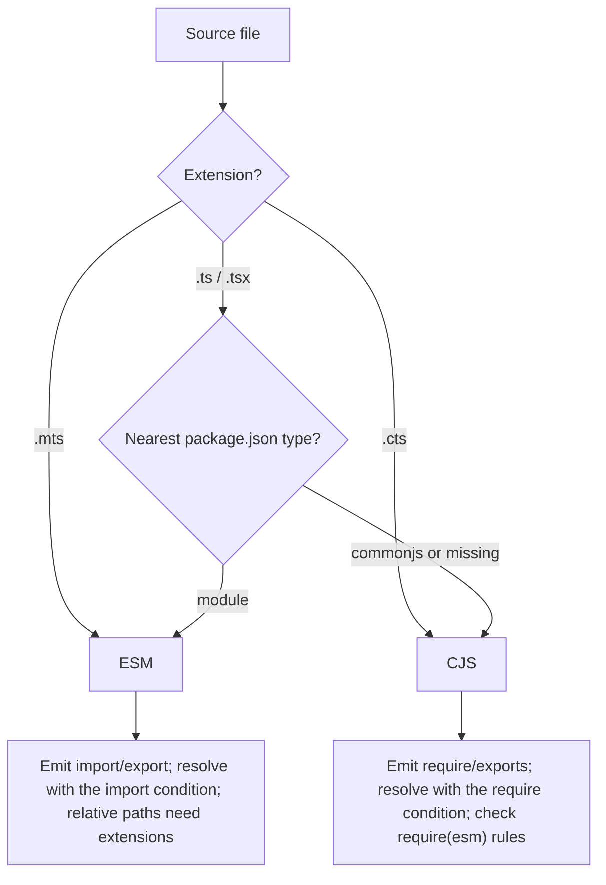

## Introduction

JavaScript has two module systems in daily use. **CommonJS (CJS)** is the one Node.js invented in 2009: `require()` to import, `module.exports` to export. **ES modules (ESM)** are the language standard from ES2015: `import` and `export` statements. Browsers only understand ESM. Node.js understands both, and the npm registry holds millions of packages written in each.

TypeScript code is almost always written with `import`/`export` syntax, whichever system will run it. That is the source of the confusion this lesson clears up: the same `import` line in a `.ts` file can compile to an ESM `import` or to a CJS `require()`, depending on configuration. If the configuration disagrees with what Node.js will do, the program type-checks cleanly and then crashes with errors such as `require is not defined in ES module scope`, `Cannot use import statement outside a module`, `ERR_REQUIRE_ESM` or "Named export not found".

The fix is never to try settings at random. Each file has a **module format** — ESM or CJS — decided by rules you can read off the file system, and TypeScript's job is to know that format and emit and check accordingly. Once you can predict the format, every setting in this lesson follows. [[b2-ts-modules]] covered imports, exports and resolution in general; this lesson is about the two runtime formats and the bridge between them.

Examples were compiled with TypeScript 6.0 and run with Node.js 22.

## Before you start

- **TypeScript modules** — `import type`, `verbatimModuleSyntax` and `moduleResolution`. See [[b2-ts-modules]].
- **JavaScript's two module systems** at the language level. See [[b1-esm-vs-cjs]] and [[b1-modules]].
- **`tsc` and `tsconfig.json`** basics: `module`, `outDir`, `rootDir`. See [[b2-tsc-compilation]].
- **Node.js** as a runtime and `package.json` basics. See [[b1-runtime-nodejs]].

## The intuition

Think of two plug shapes. ESM and CJS modules each fit one kind of socket, and Node.js provides both sockets with an adapter that works in some directions better than others. TypeScript's `module` setting decides which plug the compiler moulds for each file. The rule for choosing it is not "which plug do I like" but "which socket will this file be plugged into". Node.js decides the socket from the file's extension and the nearest `package.json`; TypeScript, under `"module": "nodenext"`, reads the same signals and moulds the matching plug.

The analogy stops at one point: some adapters fit physically but do not carry current. TypeScript can accept an import between the two systems that Node.js then rejects at runtime. Those gaps are covered in the interop sections.

## How the two systems differ at runtime

The differences are not cosmetic. They come from the fact that `require` is an ordinary function call while `import` is a declaration the engine processes before running any code.

| | CommonJS | ES modules |
|---|---|---|
| Import / export | `require("x")`, `module.exports = ...`, `exports.y = ...` | `import`, `export` |
| When dependencies load | Synchronously, when `require` runs | Whole graph is parsed and linked before any module runs |
| Imported values | A copy of whatever `module.exports` held at that moment | **Live bindings** to the exporter's variables |
| Top-level `await` | Not allowed | Allowed |
| `__dirname`, `__filename`, `require` | Available | Not defined; use `import.meta.dirname`, `import.meta.filename` (Node.js 20.11+) |
| Strict mode | Opt-in with `"use strict"` | Always on |
| Specifier extensions | Optional (`require("./util")` finds `util.js`) | Required for relative paths in Node.js |

The bindings row surprises people. Here is the same counter written both ways:

```js title="counter.mjs"
export let count = 0;
export function increment() { count++; }
```

```js title="main.mjs"
import { count, increment } from "./counter.mjs";
increment();
increment();
console.log("ESM sees", count);
console.log(typeof __dirname, typeof require);
```

```js title="counter.cjs"
let count = 0;
function increment() { count++; }
module.exports = { count, increment };
```

```js title="main.cjs"
const { count, increment } = require("./counter.cjs");
increment();
increment();
console.log("CJS sees", count);
```

```output
ESM sees 2
undefined undefined
CJS sees 0
```

The ESM `count` is a live view of the variable inside `counter.mjs`, so it shows `2`. The CJS version copied the number `0` into a new object at export time and destructured it again at import time; later increments change the private variable, not the copy. The second ESM line also shows that CommonJS's injected variables simply do not exist in an ES module.

## How Node.js decides a file's format

Node.js decides per file, using these rules in order:

1. A `.mjs` file is ESM. A `.cjs` file is CommonJS.
2. A `.js` file takes its format from the `"type"` field of the **nearest** `package.json` walking up the directory tree: `"module"` means ESM, `"commonjs"` or no field means CommonJS.
3. Since Node.js 22.7, a `.js` file with no `"type"` field that fails to parse as CommonJS because it contains `import`/`export` is retried as ESM ("syntax detection"). This is a convenience for scripts; packages should set `"type"` explicitly, which is clearer and avoids the double parse.

TypeScript mirrors these rules with its own extensions. A `.mts` file compiles to `.mjs` and is always ESM; a `.cts` file compiles to `.cjs` and is always CJS; a `.ts` file compiles to `.js` and follows the nearest `package.json`. Declaration files follow suit: `.d.mts`, `.d.cts`, `.d.ts`.

## The `module` option: what TypeScript emits

The `module` compiler option chooses the output format and, with it, which interop rules the checker enforces. The main values:

| `module` | Output | Use for |
|---|---|---|
| `nodenext` (also `node16`, `node18`, `node20`) | ESM or CJS **per file**, by Node.js's rules above | Code that Node.js runs directly: services, CLIs, published libraries |
| `commonjs` | Always CJS | Older Node.js projects that are entirely CJS |
| `es2015` … `es2022`, `esnext` | Always ESM | Browser code or tools that expect ESM input |
| `preserve` (TypeScript 5.4+) | Imports and exports left exactly as written | Bundled apps (Vite, webpack, esbuild) |

`node16`, `node18` and `node20` are fixed snapshots of Node.js behaviour; `nodenext` tracks the newest Node.js and changes as TypeScript is updated. The legacy formats `amd`, `umd`, `system` and `none` are deprecated in TypeScript 6.0 and reported as errors unless you set `"ignoreDeprecations": "6.0"`.

With no `module` setting, the default follows `target`. TypeScript 6.0's default target is `es2025`, which gives `"module": "es2022"`, so a bare configuration emits ESM. In 5.x the default target was `es5`, which gave `commonjs`.

### CommonJS emit, step by step

Given this source:

```ts title="src/math.ts"
export const PI = 3.14159;
export function area(r: number): number {
  return PI * r * r;
}
export default function circumference(r: number): number {
  return 2 * PI * r;
}
```

```ts title="src/main.ts"
import circumference, { area } from "./math";
console.log(area(2).toFixed(2), circumference(1).toFixed(2));
```

`"module": "commonjs"` produces:

```js title="dist/math.js"
"use strict";
Object.defineProperty(exports, "__esModule", { value: true });
exports.PI = void 0;
exports.area = area;
exports.default = circumference;
exports.PI = 3.14159;
function area(r) {
    return exports.PI * r * r;
}
function circumference(r) {
    return 2 * exports.PI * r;
}
```

```js title="dist/main.js (helpers omitted)"
"use strict";
Object.defineProperty(exports, "__esModule", { value: true });
const math_1 = __importStar(require("./math"));
console.log((0, math_1.area)(2).toFixed(2), (0, math_1.default)(1).toFixed(2));
```

```output
12.57 6.28
```

Several details are worth reading carefully. Each `export` becomes an assignment to a property of `exports`, and the default export is simply the property named `default`. The flag `__esModule: true` records "this CJS file was compiled from ES module syntax", which interop helpers check later. Inside `area`, the reference to `PI` becomes `exports.PI` so that the live-binding behaviour of ESM is imitated. And calls go through `(0, math_1.area)(2)` rather than `math_1.area(2)`: the comma expression calls the function without `math_1` as `this`, matching what a real ESM call would do.

Under `nodenext`, by contrast, a `.ts` file in a `"type": "module"` package is emitted with its `import` and `export` statements unchanged.

## Interop: CommonJS modules seen from TypeScript

Many CJS packages export a single function or class by replacing `module.exports`:

```js title="node_modules/legacy-greet/index.js"
function greet(name) {
  return "Hello, " + name;
}
greet.version = "1.2.0";
module.exports = greet;
```

ES modules have no syntax for "the module itself is a function", so TypeScript has a dedicated form for describing it, **`export =`**:

```ts title="node_modules/legacy-greet/index.d.ts"
declare function greet(name: string): string;
declare namespace greet {
  const version: string;
}
export = greet;
```

The `namespace` merged with the function adds the `version` property; this pattern is one of the few places namespaces still appear (see [[b2-namespaces]]).

### Three ways to import it

The TypeScript-only syntax **`import greet = require("legacy-greet")`** is the exact counterpart of `export =` and compiles to a plain `require` call. The ES-style **default import** `import greet from "legacy-greet"` is what most code writes. And a namespace import `import * as greet from "legacy-greet"` is the trap:

```ts title="src/main.ts"
import * as greet from "legacy-greet";
console.log(greet("star"));
```

```output
src/main.ts(2,13): error TS2349: This expression is not callable.
  Type 'typeof greet' has no call signatures.
```

By the ES module specification a namespace object is a plain object, never a function, and TypeScript enforces that. If you compile anyway, the program fails with `TypeError: greet is not a function`.

### `esModuleInterop` and `__importDefault`

How can a default import work when the CJS module has no `default` property? In CJS output, TypeScript wraps the `require` call in a helper:

```js title="dist/main.js (excerpt)"
var __importDefault = (this && this.__importDefault) || function (mod) {
    return (mod && mod.__esModule) ? mod : { "default": mod };
};
const legacy_greet_1 = __importDefault(require("legacy-greet"));
console.log((0, legacy_greet_1.default)("CJS"), legacy_greet_1.default.version);
```

```output
Hello, CJS 1.2.0
```

The helper says: if this CJS module was compiled from ESM (it has `__esModule`), use it as is, because it already has a real `default`. Otherwise, it is a plain CJS module, so wrap it as `{ default: module.exports }`. This is the behaviour the **`esModuleInterop`** option switches on, together with `allowSyntheticDefaultImports`, which lets the checker accept the default import. Before `esModuleInterop` (added in TypeScript 2.7), default imports of CJS modules compiled to `require(...).default`, which was `undefined` for packages like the one above. TypeScript 6.0 always behaves as if `esModuleInterop` were on; setting it to `false` is a deprecation error.

## Interop in Node.js: ESM importing CommonJS

When the importing file is ESM, Node.js itself does the interop, and its rules differ from TypeScript's helpers. A default import always gives you `module.exports`. Named imports work only for names Node.js can find by **statically scanning** the CJS source for patterns such as `exports.name = ...` or `module.exports = { name }` (using a parser called cjs-module-lexer). It does not run the code to see what gets attached.

```js title="node_modules/cjs-utils/index.js"
exports.double = (n) => n * 2;
exports.half = (n) => n / 2;
```

```js title="main.mjs"
import utils, { double } from "cjs-utils";
console.log(double(21), utils.half(10), Object.keys(utils));
```

```output
42 5 [ 'double', 'half' ]
```

Both `double` and `half` are detectable, so the named import works. Now import `version` by name from `legacy-greet` in a `"type": "module"` project compiled with `nodenext`:

```ts title="src/main.ts"
import greet from "legacy-greet";
import { version } from "legacy-greet";
console.log(greet("ESM"), version);
```

`tsc` reports no error — the declaration file says `version` exists — but Node.js disagrees:

```output
SyntaxError: Named export 'version' not found. The requested module 'legacy-greet' is a CommonJS module, which may not support all module.exports as named exports.
CommonJS modules can always be imported via the default export, for example using:

import pkg from 'legacy-greet';
const { version } = pkg;
```

The assignment `greet.version = ...` is not a pattern the lexer recognises. TypeScript cannot know what a static scanner will detect in someone else's JavaScript, so this is a gap between type-checking and runtime. The safe habit, which Node.js's own message suggests: **from an ESM file, import CJS packages with a default import** and destructure from it.

## Interop in Node.js: CommonJS importing ESM

For years, a CJS file could not `require()` an ES module at all; it threw `ERR_REQUIRE_ESM`, and the only way in was `await import(...)`. Node.js 22.12 and 20.19 enabled **`require(esm)`** by default: `require` can now load an ES module synchronously, provided its module graph contains no top-level `await`.

TypeScript tracks this. Under `nodenext` (TypeScript 5.8+) or `node20` (5.9+), a `.cts` file may import a `.mts` file:

```ts title="src/esm-only.mts"
export const answer = 42;
```

```ts title="src/main.cts"
import { answer } from "./esm-only.mjs";
console.log("answer is", answer);
```

```js title="dist/main.cjs"
"use strict";
Object.defineProperty(exports, "__esModule", { value: true });
const esm_only_mjs_1 = require("./esm-only.mjs");
console.log("answer is", esm_only_mjs_1.answer);
```

```output
answer is 42
```

With `"module": "node18"`, which models a Node.js version without `require(esm)`, the same import is rejected:

```output
src/main.cts(1,24): error TS1479: The current file is a CommonJS module whose imports will produce 'require' calls; however, the referenced file is an ECMAScript module and cannot be imported with 'require'. Consider writing a dynamic 'import("./esm-only.mjs")' call instead.
```

If the ES module uses top-level `await`, `require` fails at runtime even on new Node.js versions:

```output
Error [ERR_REQUIRE_ASYNC_MODULE]: require() cannot be used on an ESM graph with top-level await. Use import() instead.
```

Dynamic `import()` works from both formats. Under `nodenext` TypeScript leaves `import("./x.js")` untouched in CJS output, so it really loads ESM; under `"module": "commonjs"` it is rewritten to `Promise.resolve().then(() => require(...))`, which cannot load ESM on older Node.js versions. This is one reason to prefer `nodenext` for anything Node.js runs.

Under `nodenext`, `import x = require("...")` is also allowed in an ESM file. TypeScript then emits `createRequire(import.meta.url)` from `node:module` to build a `require` function, which is occasionally handy for loading JSON or a CJS-only tool.

## `module: "preserve"` for bundled code

When a bundler builds the app, Node.js's per-file rules do not apply: the bundler accepts ESM, CJS and mixtures, and decides the final format itself. For that case TypeScript 5.4 added `"module": "preserve"`. It implies `moduleResolution: "bundler"`, permits both `import` and `import x = require()`, and emits every import and export exactly as written (in practice `tsc` usually runs with `noEmit` here, and the bundler does the transforming). Combined with `verbatimModuleSyntax`, it is the most faithful model of a Vite or webpack build.

## Packages that support both formats

A library can publish separate ESM and CJS builds and let `package.json` `"exports"` route each consumer to the right one with **conditions**:

```json title="package.json"
{
  "name": "@acme/dates",
  "type": "module",
  "exports": {
    ".": {
      "import": { "types": "./dist/index.d.ts", "default": "./dist/index.js" },
      "require": { "types": "./dist/index.d.cts", "default": "./dist/index.cjs" }
    }
  }
}
```

An ESM importer matches `"import"`, a CJS `require` matches `"require"`, and within each branch `"types"` gives TypeScript a declaration file in the *same* format as the JavaScript it describes. Pointing both branches at one `.d.ts` is a common bug: TypeScript then believes the CJS build is ESM (or the reverse), and checks interop wrongly.

Dual publishing has a cost, the **dual package hazard**: if one part of an app loads the ESM build and another loads the CJS build, two separate copies of the library run, with separate state, and `instanceof` checks between them fail. Now that `require(esm)` works in all supported Node.js release lines, many libraries are moving to ESM-only packages instead.

## How it works internally

For every file in the program, TypeScript computes an **implied module format**: from the extension (`.mts`/`.cts` force it), otherwise from the nearest `package.json` `"type"`, exactly as Node.js does. That format then drives three things.



First, **emit**: `import`/`export` statements are kept for ESM files and transformed to `require`/`exports` for CJS files. Second, **resolution**: imports from ESM files resolve `"exports"` with the `"import"` condition and require extensions; imports from CJS files use the `"require"` condition. Third, **checking**: the checker models how Node.js will present each imported module — for example, a CJS module imported from ESM is typed with `module.exports` as its default export, and importing ESM from CJS is checked against the target Node.js version's `require(esm)` support.

Under `commonjs`, `esnext` or `preserve`, the format is the same for every file and only the first two steps apply in simplified form, which is why those settings cannot catch the per-file mistakes `nodenext` catches.

## Choosing a configuration

| Project | `module` | Notes |
|---|---|---|
| Node.js service or CLI, new | `nodenext` | `"type": "module"` in `package.json`; `.js` extensions in relative imports |
| Node.js service, existing CJS | `nodenext` | No `"type"` field; output stays CJS; `.mts` files can opt in to ESM |
| Published library | `nodenext` | Format-correct `.d.ts`/`.d.cts`; check with a tool such as "Are the Types Wrong?" |
| Vite / webpack / Next.js app | `preserve` or `esnext` | `moduleResolution: "bundler"`, `noEmit`, `verbatimModuleSyntax` |
| Legacy CJS-only codebase | `commonjs` | Works, but `import()` is rewritten to `require` and per-file errors are missed |

## In real systems

Most framework starters pick the configuration for you: Vite templates use `bundler` resolution, NestJS historically used `commonjs`, and newer Node.js templates use `nodenext` with `"type": "module"`. Migrating a large service from CJS to ESM is usually done by first switching `module` to `nodenext` (which keeps CJS output while enabling accurate checking), then adding `"type": "module"`, then fixing the `.js` extensions and `__dirname` uses that the compiler reports.

Testing tools are a frequent source of format trouble. Jest historically ran everything as CJS through Babel or `ts-jest`, so ESM-only dependencies needed extra configuration; Vitest runs ESM natively. When tests fail with `Cannot use import statement outside a module` while the app works, the test runner's format differs from the app's.

## Trade-offs and alternatives

| Choice | Advantages | Costs |
|---|---|---|
| ESM everywhere | Standard, works in browsers, top-level `await`, static analysis and tree-shaking | Extensions in imports; no `__dirname`; some old tooling assumes CJS |
| CJS | Synchronous loading, no extension rules, mature ecosystem | Not standard; no top-level `await`; cannot be tree-shaken reliably; browsers cannot run it |
| Dual package | Works for every consumer | Two builds, two type sets, dual package hazard |
| `module: commonjs` vs `nodenext` for CJS output | Simpler mental model | Misses per-file format errors; rewrites `import()` to `require` |

## Common mistakes

**`"type": "module"` with `"module": "commonjs"`.** The compiler emits `require` and `exports` into `.js` files that Node.js loads as ESM, which fails with `ReferenceError: exports is not defined in ES module scope`. Use `nodenext` so the emit follows the package type.

**Named imports from CJS packages in ESM files.** They type-check but fail if the package attaches exports in ways the lexer cannot see. Use a default import and destructure.

**`import * as fn from "cjs-package"` and then calling it.** A namespace object cannot be called. Use a default import (or `import fn = require(...)`).

**Using `__dirname` in ESM.** It does not exist. Use `import.meta.dirname` (Node.js 20.11+) or `fileURLToPath(new URL(".", import.meta.url))`.

**One `.d.ts` for both builds of a dual package.** Consumers get wrong interop checks. Emit a `.d.cts` for the CJS build and route it under the `"require"` condition.

**Assuming `require(esm)` works everywhere.** It needs Node.js 20.19+ or 22.12+, and fails for modules with top-level `await`. Libraries that support older Node.js versions must keep a CJS entry point or document the requirement.

## Interview perspective

**"What is the difference between ESM and CommonJS?"** Strong answers go beyond syntax: CJS loads synchronously at `require` time and exports a value; ESM links the whole graph first and exports live bindings, supports top-level `await` and enables static analysis. Mention how Node.js picks a format (`.mjs`/`.cjs`, `"type"`).

**"What does `esModuleInterop` do?"** It makes default imports of CJS modules mean "the whole `module.exports`" by wrapping `require` in `__importDefault`, which checks the `__esModule` flag. Follow-up: TypeScript 6.0 always enables it.

**"Why choose `nodenext` over `commonjs` for a Node.js project that outputs CJS?"** `nodenext` checks each file against Node.js's real rules: format by extension and package type, the `"exports"` conditions, `require(esm)` support, and it leaves `import()` intact so ESM-only dependencies load.

**"A package works with `require` but `import { x } from` fails at runtime. Why?"** Node.js detects CJS named exports by static analysis; dynamically attached exports are invisible. Use the default import.

## Practice

1. Reproduce the live-binding demo, then change the CJS version so that `main.cjs` sees `2`. (Hint: export a getter or read through the module object.)
2. Create a package with no `"type"` field, add one `.ts`, one `.mts` and one `.cts` file, compile with `nodenext`, and predict the extension and format of each output before checking.
3. Compile `import greet from "legacy-greet"` under `"module": "commonjs"` and under `nodenext` with `"type": "module"`. Compare the emitted code and explain why both run.
4. Write a CJS file that requires an `.mjs` file. Run it, then add a top-level `await` to the `.mjs` file and explain the new error.
5. Design the `"exports"` map for a library that ships ESM and CJS builds plus a `./testing` subpath, with correct `"types"` conditions for each.

```quiz
Q: A project has `"type": "module"` in `package.json`. Which TypeScript setting produces output Node.js can run?
- [ ] `"module": "commonjs"`, because Node.js understands CommonJS
- [x] `"module": "nodenext"`, which emits ESM for `.ts` files in a `"type": "module"` package
- [ ] Any `module` value, since `"type"` only affects `.mjs` files
- [ ] `"module": "commonjs"` with `esModuleInterop`
> With `"type": "module"`, Node.js loads every `.js` file as ESM. CommonJS output uses `exports` and `require`, which do not exist in ES module scope, so it fails at runtime. `nodenext` reads the same `"type"` field and emits ESM. `esModuleInterop` changes how default imports are compiled, not the output format.
```

```quiz
Q: In an ESM file, `import { version } from "legacy-greet"` type-checks but Node.js throws "Named export 'version' not found". What is the best fix?
- [ ] Switch to `import * as greet from "legacy-greet"`
- [ ] Turn off `esModuleInterop`
- [x] Use `import greet from "legacy-greet"` and read `greet.version`
- [ ] Add `"type": "commonjs"` to the app's `package.json`
> Node.js finds named exports of CommonJS modules by statically scanning their source, and `greet.version = ...` is not a recognised pattern. The default import always gives `module.exports`, so `greet.version` works. A namespace import also exposes only detected names, and turning the whole app into CJS is a much larger change than the problem requires.
```

```quiz
Q: What does the `__importDefault` helper return for a CommonJS module whose `module.exports` is a function and which has no `__esModule` flag?
- [ ] The function itself
- [x] `{ default: theFunction }`, so `.default` refers to the function
- [ ] `undefined`, because the module has no `default` export
- [ ] A namespace object with all of the function's properties
> Without `__esModule` the helper assumes a plain CommonJS module and wraps it so that the compiled default import, which reads `.default`, gets the whole `module.exports`. Modules compiled from ESM carry `__esModule: true` and are returned unchanged because they already have a real `default` property.
```

## Quick revision {#quick-revision}

- **CJS**: `require`/`module.exports`, synchronous, exports copied values, has `__dirname`/`require`, no top-level `await`.
- **ESM**: `import`/`export`, graph linked before running, **live bindings**, top-level `await`, strict, `import.meta.dirname` (20.11+), relative specifiers need extensions in Node.js.
- Node.js format: `.mjs` ESM, `.cjs` CJS, `.js` follows nearest `package.json` `"type"`. TypeScript: `.mts`→`.mjs`, `.cts`→`.cjs`, `.ts`→`.js`.
- `module`: `nodenext`/`node16`/`node18`/`node20` per-file like Node.js; `commonjs` always CJS; `esnext` always ESM; `preserve` (5.4+) for bundlers. TypeScript 6.0 default follows `target` (`es2022` for the default `es2025` target); `amd`/`umd`/`system`/`none` deprecated.
- CJS emit: `exports.x = ...`, `exports.default`, `__esModule` flag, `(0, m.fn)()` calls.
- `export =` describes `module.exports = value`; import with `import x = require()` or a default import.
- `__importDefault`: `__esModule ? mod : { default: mod }`; that is `esModuleInterop`, always on in 6.0.
- Namespace imports are never callable (TS2349).
- ESM importing CJS in Node.js: default = `module.exports`; named exports only if statically detectable.
- CJS importing ESM: `require(esm)` in Node.js 20.19+/22.12+, not with top-level `await` (`ERR_REQUIRE_ASYNC_MODULE`); TypeScript allows it under `nodenext` (5.8+)/`node20`, TS1479 under `node18`.
- Dual packages: `"exports"` with `"import"`/`"require"` branches, each with its own `"types"`; beware the dual package hazard.

## Key takeaways {#key-takeaways}

- Every file has a module format, decided by its extension and the nearest `package.json`; predict it first and the configuration follows.
- ESM and CJS differ in loading, bindings and available globals, not only in syntax.
- Use `nodenext` for code that Node.js runs, `preserve` or `esnext` with `bundler` resolution for code a bundler builds.
- Default imports of CJS work through `__importDefault`; namespace imports of a function export never do.
- TypeScript cannot verify Node.js's static detection of CJS named exports, so import CJS packages into ESM with a default import.
- `require(esm)` makes CJS-to-ESM imports possible on current Node.js, except across top-level `await`.
