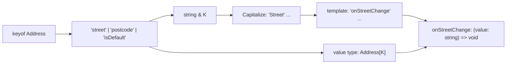

## Introduction

Form components grow a family of callbacks: an `email` field needs `onEmailChange`, an `age` field needs `onAgeChange`, a `newsletter` checkbox needs `onNewsletterChange`. Written by hand, that props type repeats the form model in a different spelling. When someone adds a `phone` field to the model, nothing reminds them to add `onPhoneChange`, and when someone renames `age` to `birthYear`, the old handler quietly stays behind with the wrong name and the wrong type.

The fix is to **derive** the handler types from the model, so there is one source of truth. The exercise asks you to write a generic type `ChangeHandlers<T>` such that, for

```typescript
interface SignupForm { email: string; age: number; newsletter: boolean }
```

`ChangeHandlers<SignupForm>` is

```typescript
{
  onEmailChange: (value: string) => void;
  onAgeChange: (value: number) => void;
  onNewsletterChange: (value: boolean) => void;
}
```

It looks like a one-liner, and it is — but the one line combines three features (mapped types, key remapping with `as`, and template literal types), and interviewers follow up on each. The general naming pattern is discussed in [[b2-change-handlers-pattern]]; this page builds it step by step and puts it to work.

## Before you start

- **Mapped types** — `{ [K in keyof T]: ... }` builds an object type with one property per key of `T`. See [[b2-mapped-types]].
- **Key remapping** — the `as` clause in a mapped type renames keys (TypeScript 4.1+). See [[b2-key-remapping]].
- **Template literal types** — `` `on${X}Change` `` builds string literal types from other string types. See [[b2-template-literal-types]].
- **`satisfies`** — checks a value against a type without changing the value's inferred type (TypeScript 4.9+). See [[b2-satisfies]].
- **Indexed access** — `T[K]` is the type of property `K`. See [[b2-indexed-access]].

## The intuition

Think of a mail-merge. The form model is the spreadsheet: one row per field, with a name and a type. The handler type is the letter template: "on*Name*Change takes a *Type*". A mapped type runs the merge, producing one property per row, filling the name into the key and the type into the parameter. Because the output is generated, adding a row to the spreadsheet adds a letter, and renaming a row renames the letter.

## Building the type, one feature at a time

Start with a plain mapped type that keeps the original keys:

```typescript
type Step1<T> = { [K in keyof T]: (value: T[K]) => void };
// Step1<SignupForm> = { email: (value: string) => void; age: ...; newsletter: ... }
```

`K` walks through `keyof T` — `'email' | 'age' | 'newsletter'` — and for each key the property type is a function taking `T[K]`, the field's own type. This already gives each handler the right parameter type. Only the names are wrong.

**Key remapping** changes the name. After `in keyof T`, an `as` clause computes the new key from `K`:

```typescript
type ChangeHandlers<T> = {
  [K in keyof T as `on${Capitalize<string & K>}Change`]: (value: T[K]) => void;
};
```

Three things happen in the `as` clause:

1. `string & K` keeps only string keys. `keyof T` can include `number` and `symbol` keys, and template literal types and `Capitalize` accept only string-like types.
2. `Capitalize<...>` is an **intrinsic** string type — built into the compiler, not written in TypeScript — that uppercases the first character: `'email'` becomes `'Email'`.
3. The template literal type wraps it: `` `on${'Email'}Change` `` is the literal type `'onEmailChange'`.

Note that the property *value* still uses the original `K`: `(value: T[K]) => void`. Remapping changes the outer key, not the variable you use in the body, so the link between handler and field type is preserved.

## Why `string & K`

Leaving it out is the first thing that goes wrong:

```typescript
type Bad<T> = { [K in keyof T as `on${Capitalize<K>}Change`]: (value: T[K]) => void };
```

```output
error TS2344: Type 'K' does not satisfy the constraint 'string'.
  Type 'keyof T' is not assignable to type 'string'.
    Type 'string | number | symbol' is not assignable to type 'string'.
      Type 'number' is not assignable to type 'string'.
```

For a generic `T`, the compiler must assume `keyof T` can contain any `PropertyKey`. Intersecting with `string` filters it: for a string key, `string & 'email'` is `'email'`; for a number or symbol key, the intersection is `never`. And in a mapped type, **a key remapped to `never` is dropped**. So numeric and symbol keys vanish from the output rather than causing errors. You can see that on a deliberately odd model:

```typescript
type Mixed = { 0: string; [Symbol.iterator]: number; name: string; 'first-name': string };
type Keys = keyof ChangeHandlers<Mixed>;
// "onNameChange" | "onFirst-nameChange"
```

The numeric key `0` and the symbol key are gone, which is what you want for form fields. The kebab-case key produces `onFirst-nameChange`, a valid property name that has to be written in quotes — a sign that form models for this pattern should use camelCase field names. `Capitalize` only touches the first character; it does not convert case styles.

## Checking a handlers object with `satisfies`

With the type in place, write the handlers for the form and check them:

```typescript title="signup-handlers.ts"
type ChangeHandlers<T> = {
  [K in keyof T as `on${Capitalize<string & K>}Change`]: (value: T[K]) => void;
};

interface SignupForm {
  email: string;
  age: number;
  newsletter: boolean;
}

type SignupHandlers = ChangeHandlers<SignupForm>;

const form: SignupForm = { email: '', age: 0, newsletter: false };

const handlers = {
  onEmailChange: (value) => { form.email = value.trim(); },
  onAgeChange: (value) => { form.age = Math.max(0, value); },
  onNewsletterChange: (value) => { form.newsletter = value; },
} satisfies SignupHandlers;

handlers.onEmailChange('  ada@example.com ');
handlers.onAgeChange(-3);
handlers.onNewsletterChange(true);
console.log(form);
```

```output
{ email: 'ada@example.com', age: 0, newsletter: true }
```

Notice that the handler parameters have no annotations. `satisfies` provides a **contextual type**, so `value` in `onEmailChange` is inferred as `string` and `value.trim()` type-checks; in `onAgeChange` it is `number`, so `Math.max(0, value)` is fine. The age is clamped from `-3` to `0`, and the email is trimmed.

`satisfies` then checks three kinds of mistake. All three errors below were produced by TypeScript 6 in strict mode:

```typescript
// 1. A misspelled handler name
const typo = {
  onEmailChange: (v: string) => {},
  onAgeChnage: (v: number) => {},
  onNewsletterChange: (v: boolean) => {},
} satisfies ChangeHandlers<SignupForm>;
```

```output
error TS2561: Object literal may only specify known properties, but 'onAgeChnage' does not exist in type 'ChangeHandlers<SignupForm>'. Did you mean to write 'onAgeChange'?
```

```typescript
// 2. A handler with the wrong value type
const wrongType = {
  onEmailChange: (v: string) => {},
  onAgeChange: (v: string) => {},
  onNewsletterChange: (v: boolean) => {},
} satisfies ChangeHandlers<SignupForm>;
```

```output
error TS2322: Type '(v: string) => void' is not assignable to type '(value: number) => void'.
  Types of parameters 'v' and 'value' are incompatible.
    Type 'number' is not assignable to type 'string'.
```

The third mistake — a missing handler — is reported as `Property 'onNewsletterChange' is missing`, because every key of the mapped type is required.

Why `satisfies` rather than an annotation (`const handlers: SignupHandlers = { ... }`)? Both check the object. The difference is what the variable's type becomes afterwards. An annotation replaces the inferred type with `SignupHandlers`; `satisfies` keeps the object's own, more specific type. If the object has extra helpers, or a handler returns something useful, `satisfies` preserves that information for later code. For a handlers map, either is acceptable; `satisfies` is the common idiom because it validates without widening.

## The silent typo

The notes for this exercise warn that without a check, a misspelled handler is not an error but a handler that is never called. Here is where that really bites: components usually accept handlers as **optional** props, and the handlers object is built separately and passed in.

```typescript title="silent-typo.ts"
type ChangeHandlers<T> = {
  [K in keyof T as `on${Capitalize<string & K>}Change`]: (value: T[K]) => void;
};
interface SignupForm { email: string; age: number; newsletter: boolean }

function renderSignupForm(props: Partial<ChangeHandlers<SignupForm>>) {
  props.onAgeChange?.(30);
  console.log('age handler wired:', props.onAgeChange !== undefined);
}

const handlers = {
  onEmailChange: (v: string) => console.log('email', v),
  onAgeChnage: (v: number) => console.log('age', v),
};
renderSignupForm(handlers);
```

```output
age handler wired: false
```

This compiles cleanly. Excess property checking applies only to an object literal written directly where the type is expected; `handlers` is a variable, so its extra `onAgeChnage` key is simply ignored, and `onAgeChange` is optional, so its absence is fine. At runtime the age field never reports changes. Adding `satisfies Partial<ChangeHandlers<SignupForm>>` to the object literal catches the typo at the place it was written. The broader lesson: **check an object against its intended type where it is created**, not only where it is used.

## Variations

**Optional handlers.** A form component rarely needs every handler. Add the `?` modifier inside the mapped type, or wrap with `Partial`:

```typescript
type OptionalChangeHandlers<T> = {
  [K in keyof T as `on${Capitalize<string & K>}Change`]?: (value: T[K]) => void;
};
```

**Reversing the mapping with `infer`.** Given a handler name, a conditional type can recover the field:

```typescript
type FieldOf<H extends string> = H extends `on${infer F}Change` ? Uncapitalize<F> : never;
type F = FieldOf<'onPostcodeChange'>;   // "postcode"
```

The template literal pattern matches the string, `infer F` captures the middle (`'Postcode'`), and `Uncapitalize` reverses `Capitalize`. This is useful for a generic dispatcher that receives a handler name and must update the matching field. See [[b2-infer]].

**Other templates.** The same shape produces `getEmail`/`setEmail` accessors, `emailError` validation messages, or event maps keyed `` `${K}Changed` ``. Only the template changes.

## Worked example: generating handlers at runtime

A type alone does not create functions. A form hook usually wants to *generate* the handlers from the field list, so that each one updates its field. This factory does that and returns a precisely typed result:

```typescript title="make-change-handlers.ts"
type ChangeHandlers<T> = {
  [K in keyof T as `on${Capitalize<string & K>}Change`]: (value: T[K]) => void;
};

interface Address { street: string; postcode: string; isDefault: boolean }

function capitalize<S extends string>(s: S): Capitalize<S> {
  return (s.charAt(0).toUpperCase() + s.slice(1)) as Capitalize<S>;
}

function makeChangeHandlers<T extends object>(
  initial: T,
  onFieldChange: <K extends keyof T & string>(field: K, value: T[K]) => void,
): ChangeHandlers<T> {
  const handlers: Record<string, (value: unknown) => void> = {};
  // Object.keys returns string[]; the fields of `initial` are the keys of T.
  for (const field of Object.keys(initial) as (keyof T & string)[]) {
    handlers[`on${capitalize(field)}Change`] = (value) =>
      onFieldChange(field, value as T[typeof field]);
  }
  return handlers as ChangeHandlers<T>;
}

let state: Address = { street: '', postcode: '', isDefault: false };
const h = makeChangeHandlers(state, (field, value) => {
  state = { ...state, [field]: value };
  console.log(`${field} ->`, value);
});
h.onStreetChange('221B Baker Street');
h.onIsDefaultChange(true);
console.log(state);
console.log(Object.keys(h));
```

```output
street -> 221B Baker Street
isDefault -> true
{ street: '221B Baker Street', postcode: '', isDefault: true }
[ 'onStreetChange', 'onPostcodeChange', 'onIsDefaultChange' ]
```

Walk through it. The runtime `capitalize` mirrors the type-level `Capitalize`, and its signature says so: given `'street'` it returns the type `'Street'`. The loop builds the names with the same template the type uses, so runtime keys and type keys match — that correspondence is the one thing the compiler cannot verify, which is why the function contains assertions. There are three: `Object.keys` returns `string[]` (TypeScript deliberately does not narrow it, because an object may have more keys at runtime than its type lists), the handler's `unknown` value is asserted to the field type, and the finished record is asserted to `ChangeHandlers<T>`. All three are confined to one small, testable function. The caller gets `h.onStreetChange` typed `(value: string) => void` and `h.onIsDefaultChange` typed `(value: boolean) => void`, with no casts at the call site.

The constraint is `T extends object`, not `T extends Record<string, unknown>`. An `interface` such as `Address` has no index signature and is not assignable to `Record<string, unknown>`, so the stricter-looking constraint would reject ordinary form models (`Index signature for type 'string' is missing in type 'Address'`).



## How it works internally

A mapped type with an `as` clause is evaluated per key. For each `K` in `keyof T`, the compiler computes the remapped name; if it is `never`, the property is skipped; if several keys remap to the same name, their value types are combined into a union. The property's value type is computed with the *original* `K`, which is what keeps `T[K]` correct. Template literal types distribute over unions, so `` `on${'A' | 'B'}Change` `` is `'onAChange' | 'onBChange'`. All of this happens at compile time and is erased; the emitted JavaScript contains only your runtime code, which is why the factory has to rebuild the names itself.

## In real systems

Design systems derive callback props from value types so that a `<DateRangePicker>` with `start` and `end` values exposes `onStartChange` and `onEndChange` automatically. Form libraries such as React Hook Form take the related approach of typing field *paths* from the form model, so `register('email')` is checked against the model. State stores generate setters (`setEmail`, `setAge`) from a state shape using the same mapped-type template. The idea parallels typed event maps, where `Extract<Action, { type: K }>` gives each event handler its own payload type ([[b2-variant-map-satisfies]]).

## Trade-offs and alternatives

**A single generic handler** — `onChange<K extends keyof T>(field: K, value: T[K])` — needs no key remapping, is easy to implement, and works with any number of fields. It is often the better API for large forms. Per-field handlers read better in JSX and let consumers wire only the fields they care about.

**Writing handler props by hand** is fine for two or three fields and gives the clearest error messages. Derived types pay off when the model changes often or many components share it.

The cost of derived types is readability: hovering a prop shows `ChangeHandlers<SignupForm>` until expanded, and errors mention mapped types. Keep the helper small and named.

## Common mistakes

- **Omitting `string & K`.** `Capitalize<K>` fails because `keyof T` may include numbers and symbols.
- **Expecting `Capitalize` to convert case styles.** It uppercases the first character only; `'first-name'` becomes `'First-name'`.
- **Typing handlers objects without a check.** A misspelled key on an object passed to optional props compiles and is never called. Use `satisfies` where the object is written.
- **Using `T extends Record<string, unknown>` for form models.** Interfaces are rejected; use `T extends object`.
- **Assuming the type creates functions.** Types are erased; generating handlers needs runtime code that mirrors the type.

## Interview perspective

A typical prompt: "Given a form type, produce the type of its change-handler props." Lead with the plain mapped type, add the `as` clause, explain `string & K`, then demonstrate `satisfies` catching a typo. Follow-ups usually include:

- **"What does `as` do in a mapped type?"** It renames each key; mapping to `never` removes the key.
- **"Why `string & K`?"** `keyof` can include number and symbol keys; the intersection filters to string keys so the template literal is valid.
- **"How would you go from `onEmailChange` back to `email`?"** A conditional type with `infer` and `Uncapitalize`.
- **"Annotation or `satisfies`?"** Both check; `satisfies` keeps the narrower inferred type.

## Practice

1. Write `Setters<T>` that maps `{ email: string }` to `{ setEmail: (value: string) => void }` and test it with `satisfies`.
2. Change `ChangeHandlers<T>` so each handler also receives the field name: `(value: T[K], field: K) => void`.
3. Write `HandlerName<T>` that is the union of all handler names of `T`, using `keyof ChangeHandlers<T>`, and use it to type a `wired: HandlerName<SignupForm>[]` list.
4. Add a `fullName` field to `SignupForm` and list every compile error that appears in the code from this lesson. Explain why each one is helpful.

```quiz
Q: In the remapped key ``K in keyof T as `on${Capitalize<string & K>}Change` ``, what happens to a numeric key such as `0`?
- [ ] It becomes `on0Change`
- [ ] It causes a compile error in the mapped type
- [x] `string & 0` is `never`, and a key remapped to `never` is dropped
- [ ] It is converted to the string `'0'` and capitalised
> The intersection of `string` with a number literal type is empty, so it is `never`, and mapped types skip keys remapped to `never`. A compile error only appears if you remove the `string &` filter, because then `Capitalize` receives a key that may not be a string.
```

```quiz
Q: A handlers object with the key `onAgeChnage` is stored in a variable and passed to a prop typed `Partial<ChangeHandlers<SignupForm>>`. What happens?
- [ ] A compile error for the excess property
- [x] It compiles; the age handler is undefined at runtime and never called
- [ ] TypeScript renames the key to `onAgeChange`
- [ ] A runtime error is thrown when the component renders
> Excess property checking applies only to object literals written where the type is expected. A variable with extra keys is accepted, and because the handler props are optional, the missing `onAgeChange` is fine too. Adding `satisfies` where the object literal is written turns the typo into error TS2561.
```

## Quick revision {#quick-revision}

- ``ChangeHandlers<T> = { [K in keyof T as `on${Capitalize<string & K>}Change`]: (value: T[K]) => void }``.
- `as` in a mapped type renames keys; remapping to `never` drops the key.
- `string & K` filters out number and symbol keys so `Capitalize` and template literals accept it.
- `Capitalize` uppercases the first character only; use camelCase field names.
- The value type uses the original `K`, so each handler's parameter is the field's type.
- `satisfies ChangeHandlers<Form>` catches typos (TS2561), wrong value types and missing handlers, and gives parameters contextual types.
- A non-literal object passed to optional handler props is not excess-checked: typos compile silently.
- Reverse with ``H extends `on${infer F}Change` ? Uncapitalize<F> : never``.
- Runtime factories must rebuild names themselves; use `T extends object`, not `Record<string, unknown>`.

## Key takeaways {#key-takeaways}

- Deriving handler types from the form model keeps one source of truth: adding or renaming a field updates every handler type.
- The one-line type combines three features — mapped types, key remapping and template literal types — and each is worth being able to explain.
- `satisfies` is the right tool for checking a handlers object where it is written, without widening its type.
- Types are erased, so generating handlers at runtime needs code that mirrors the type, with its assertions kept in one small function.
- For large forms, a single generic `onChange(field, value)` can be a simpler API than per-field handlers.
