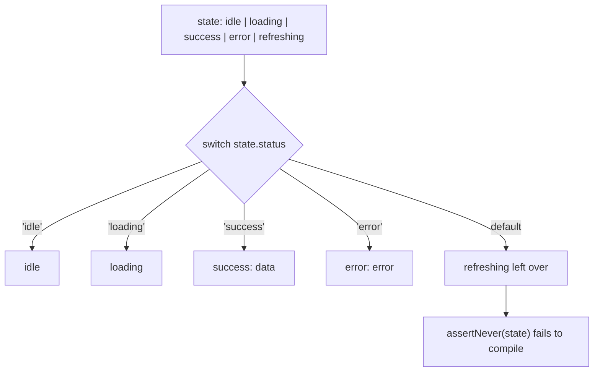

## Introduction

Every screen that loads data has to answer four questions: has the request started, is it still running, did it succeed, did it fail? A common first attempt stores the answers in separate fields — `isLoading: boolean`, `error: string | null`, `data: User[] | null` — and that design quietly permits nonsense. Nothing stops `isLoading: true` and `error: 'timeout'` from being set together, or `data` from being `null` after a "successful" request. Each component then has to guess which combination it is looking at.

**RemoteData** replaces those fields with one value that is always in exactly one state. In TypeScript it is written as a **discriminated union**: a union of object types that all share one property — the **discriminant** — whose literal value says which variant you have. Checking that property *narrows* the value, so inside `case 'success'` the compiler knows `data` exists, and inside `case 'error'` it knows `error` exists.

This lesson is an implementation exercise of the kind interviewers set: write the type, write a function that consumes it exhaustively, then add a new state and show how the compiler forces you to handle it. The pattern itself — state transitions, out-of-order responses, React usage — is covered in depth in [[b2-remote-data-pattern]]. Here the goal is to produce a correct implementation and to explain each line of it.

## Before you start

- **Union and literal types** — `'idle' | 'loading'` is a type with exactly two values. See [[b2-unions]] and [[b2-literal-types]].
- **Discriminated unions** — unions of object types tagged by a shared literal property. See [[b2-discriminated-unions]].
- **Narrowing** — how `if`, `switch` and `in` make a value's type more specific inside a branch. See [[b2-narrowing]].
- **`never`** — the type with no values, which is what a fully narrowed union becomes. See [[b2-never]].

## The intuition

Picture a traffic light that can show only one colour at a time. You do not ask "is red on? is green on?" separately; you ask "which colour is on?" and act on the answer. RemoteData is that light for a request. The `status` field is the colour, and each colour carries the data that makes sense for it: `success` carries the result, `error` carries the failure, and `idle` and `loading` carry nothing.

**Exhaustiveness** is the second half of the idea. If the light gains a new colour, every driver needs to learn what it means. With a discriminated union, adding a variant makes the compiler flag every `switch` that does not handle it — a guided refactor instead of a hunt for bugs in production.

## Step 1: define the type

```typescript
type RemoteData<T, E = string> =
  | { status: 'idle' }
  | { status: 'loading' }
  | { status: 'success'; data: T }
  | { status: 'error'; error: E };
```

Several decisions are visible here. `T` is the type of the loaded data, so `RemoteData<User[]>` and `RemoteData<Invoice>` share all the handling code. `E` is the error type with a default of `string`; a real app might use a typed error object instead. The discriminant is called `status` and its values are string literals, which read well in logs and debuggers. And `data` exists **only** on the success variant — it is not `data: T | null` on every variant — so there is no way to read data that has not arrived.

`idle` and `loading` are separate on purpose. "Not requested yet" and "requested, waiting" need different UI: one shows a button or nothing, the other shows a spinner. Merging them is a common simplification that comes back as a bug when a screen briefly shows a spinner for a request that never started.

## Step 2: consume it with an exhaustive switch

```typescript title="describe.ts"
type RemoteData<T, E = string> =
  | { status: 'idle' }
  | { status: 'loading' }
  | { status: 'success'; data: T }
  | { status: 'error'; error: E };

function assertNever(value: never): never {
  throw new Error(`Unhandled variant: ${JSON.stringify(value)}`);
}

interface User { id: number; name: string }

function describe(state: RemoteData<User[]>): string {
  switch (state.status) {
    case 'idle':
      return 'Press load to fetch users';
    case 'loading':
      return 'Loading...';
    case 'success':
      return `Loaded ${state.data.length} users`;
    case 'error':
      return `Failed: ${state.error}`;
    default:
      return assertNever(state);
  }
}

const states: RemoteData<User[]>[] = [
  { status: 'idle' },
  { status: 'loading' },
  { status: 'success', data: [{ id: 1, name: 'Ada' }] },
  { status: 'error', error: 'HTTP 503' },
];
for (const s of states) console.log(describe(s));

const fromServer = JSON.parse('{"status":"refreshing"}') as RemoteData<User[]>;
try {
  describe(fromServer);
} catch (e) {
  console.log((e as Error).message);
}
```

```output
Press load to fetch users
Loading...
Loaded 1 users
Failed: HTTP 503
Unhandled variant: {"status":"refreshing"}
```

Follow the type of `state` as the switch runs. At the top it is the full four-member union. Inside `case 'success'` the compiler has removed every member whose `status` is not `'success'`, so `state.data` is allowed and typed `User[]`. Each `case` removes one more member from what can reach the `default`. After all four cases, nothing is left, so in `default` the type of `state` is `never`.

`assertNever` takes a parameter of type `never`. Passing `state` compiles only when `state` really is `never` — that is, when every variant was handled. This makes the `default` branch a **compile-time** check. It is also a **runtime** check: types are erased when TypeScript compiles to JavaScript, and the last part of the example shows a server sending a status the client does not know about (the `as` cast is the lie that let it in). Instead of silently returning `undefined`, `assertNever` throws with the offending value, which is far easier to debug.

## Step 3: add a variant and follow the errors

The core of this exercise is the next step. Product asks for "keep showing the old list while refreshing". That is a new state, so add it:

```typescript
type RemoteData<T, E = string> =
  | { status: 'idle' }
  | { status: 'loading' }
  | { status: 'success'; data: T }
  | { status: 'error'; error: E }
  | { status: 'refreshing'; data: T };
```

Without touching `describe`, run `tsc`:

```output
describe.ts(25,26): error TS2345: Argument of type '{ status: "refreshing"; data: User[]; }' is not assignable to parameter of type 'never'.
```

The error names the missing variant and points at the exact `switch` that does not handle it. In a real codebase you would get one such error per consumer — the compiler has produced your to-do list for the refactor. You add a `case 'refreshing':` branch that returns a message using `state.data` and the error disappears. Nothing was found by searching for strings or by a failing test in production.



## Three ways to get exhaustiveness

`assertNever` is the classic, but not the only, technique. All three below were checked with TypeScript 6 in strict mode against the five-variant type, with `refreshing` left unhandled.

**1. Return-type checking.** If a function declares a return type and has no `default`, an unhandled variant means some path falls off the end:

```typescript
function label(state: RemoteData<number>): string {
  switch (state.status) {
    case 'idle': return 'idle';
    case 'loading': return 'loading';
    case 'success': return 'ok';
    case 'error': return 'err';
  }
}
```

```output
error TS2366: Function lacks ending return statement and return type does not include 'undefined'.
```

It works with no helper, but the message does not say *which* variant is missing, it only works when every branch returns, and it gives no runtime protection.

**2. `satisfies never`** (TypeScript 4.9 and later). Writing `state satisfies never;` in the `default` branch checks the type without needing a helper function:

```output
error TS1360: Type '{ status: "refreshing"; data: number; }' does not satisfy the expected type 'never'.
```

It names the missing variant like `assertNever` does. Pair it with a `throw` in the same branch if you want runtime protection too.

**3. `assertNever(state)`** — as above. It gives the clearest message, works in `switch` statements that do not return, and throws at runtime. For an interview, this is the answer to lead with; mention the others to show range.

## Step 4: constructors, `map` and `match`

Writing `{ status: 'success', data }` everywhere is noisy and easy to mistype. Small constructor functions centralise the shapes, and a typed `match` helper makes exhaustiveness an expression rather than a statement.

```typescript title="remote-data.ts"
type RemoteData<T, E = string> =
  | { status: 'idle' }
  | { status: 'loading' }
  | { status: 'success'; data: T }
  | { status: 'error'; error: E };

type Status = RemoteData<unknown>['status'];

type Handlers<T, E, R> = {
  [S in Status]: (state: Extract<RemoteData<T, E>, { status: S }>) => R;
};

function match<T, E, R>(state: RemoteData<T, E>, handlers: Handlers<T, E, R>): R {
  // TypeScript cannot link handlers[state.status] to state's variant,
  // so this one assertion is needed; Handlers already checked each entry.
  const handler = handlers[state.status] as (s: RemoteData<T, E>) => R;
  return handler(state);
}

const RemoteData = {
  idle: (): RemoteData<never, never> => ({ status: 'idle' }),
  loading: (): RemoteData<never, never> => ({ status: 'loading' }),
  success: <T>(data: T): RemoteData<T, never> => ({ status: 'success', data }),
  failure: <E>(error: E): RemoteData<never, E> => ({ status: 'error', error }),
};

function map<T, U, E>(state: RemoteData<T, E>, fn: (data: T) => U): RemoteData<U, E> {
  return state.status === 'success' ? { status: 'success', data: fn(state.data) } : state;
}

const view = {
  idle: () => '-',
  loading: () => '...',
  success: ({ data }: { data: number }) => `Total: ${data}`,
  error: ({ error }: { error: string }) => `Error: ${error}`,
};

const prices: RemoteData<number[], string> = RemoteData.success([12, 30, 8]);
const total = map(prices, (xs) => xs.reduce((a, b) => a + b, 0));
console.log(match(total, view));

const failed: RemoteData<number, string> = RemoteData.failure('HTTP 500');
console.log(match(failed, view));
```

```output
Total: 50
Error: HTTP 500
```

Walk through the pieces in order.

`Status` extracts the union of discriminant values, `'idle' | 'loading' | 'success' | 'error'`, from the type itself, so it can never drift out of sync with the variants.

`Handlers<T, E, R>` is a **mapped type**: one property per status, and each handler receives *that* variant only. `Extract<RemoteData<T, E>, { status: 'success' }>` picks out `{ status: 'success'; data: T }`, so the success handler can destructure `data` and the error handler can destructure `error`. Because the mapped type has no `?` modifier, every key is required: leaving out `loading` is a compile error. Adding a `refreshing` variant would add a required `refreshing` key, so every `match` call with a missing handler fails — the same guided refactor as `assertNever`, but for expression-style code such as JSX.

Inside `match`, one assertion is unavoidable. TypeScript checks `handlers[state.status]` as "a handler for *some* status" and cannot prove that it is the handler for *this* state's status. The `Handlers` type has already verified that each handler matches its own variant, so the cast is safe. (Patterns for removing even this cast are discussed in [[b2-variant-map-satisfies]].)

The constructors live in a `const` named `RemoteData`, the same name as the type. TypeScript keeps types and values in separate namespaces, so this **companion object** pattern is legal and reads naturally: `RemoteData.success(x)` produces a `RemoteData`. Their return types use `never` for the parameter that is not involved — `RemoteData<never, E>` for a failure — and because `never` is assignable to everything, the result fits any `RemoteData<T, E>`.

`map` transforms the data only in the success state and passes every other state through unchanged. The non-success branch can return `state` directly because, once `success` has been excluded, the remaining variants do not mention `T` at all, so they are already valid `RemoteData<U, E>` values.

## Boolean discriminants and `Result`

The notes for this exercise also use a two-variant **Result** type tagged by a boolean:

```typescript title="result.ts"
type Result<T, E = string> =
  | { ok: true; value: T }
  | { ok: false; error: E };

function unwrapOr(r: Result<number>, fallback: number): number {
  if (r.ok) return r.value;
  console.log('falling back because:', r.error);
  return fallback;
}
console.log(unwrapOr({ ok: true, value: 42 }, 0));
console.log(unwrapOr({ ok: false, error: 'timeout' }, 0));
```

```output
42
falling back because: timeout
0
```

`true` and `false` are literal types, so `ok` is a valid discriminant. After `if (r.ok) return ...`, the compiler knows the rest of the function only sees the `ok: false` variant, so `r.error` is allowed **without** an `else`. (The original notes claimed the false branch might not narrow; that is incorrect for this shape in any modern TypeScript version.)

Where narrowing really does get lost is when the discriminant is copied into a mutable variable. `const isOk = r.ok; if (isOk) ...` narrows `r` (aliased-condition narrowing, TypeScript 4.4+), and so does `const { ok } = r`. But `let isOk = r.ok; if (isOk) return r.value;` fails with `Property 'value' does not exist on type 'Result<number, string>'`, because a `let` could be reassigned between the check and the use, so TypeScript does not trust it.

## In real systems

Data-fetching libraries expose the same idea. TanStack Query's `useQuery` returns a `status` field (`'pending' | 'error' | 'success'` in v5) and, when you check it, narrows `data` and `error`. Redux Toolkit's slices commonly store `status: 'idle' | 'loading' | 'succeeded' | 'failed'`. Elm popularised the exact `RemoteData` name and four variants. In each case the benefit is the same: components handle every state explicitly, and impossible combinations cannot be represented.

Exhaustiveness checking earns its keep during change. A team that adds an `'unauthorized'` variant to a shared API state type gets a compiler error in every screen that renders it. Teams typically also enable the `@typescript-eslint/switch-exhaustiveness-check` lint rule, which reports a non-exhaustive `switch` even when there is no `default` branch or return type to trigger an error.

## Trade-offs and alternatives

A discriminated union costs a little ceremony: every consumer must switch or match, and simple "show data if present" code becomes longer. For a value that is genuinely just `T | undefined`, optional chaining is fine.

The `match` helper is concise and works as an expression, which suits JSX, but it allocates a handlers object on every call and adds one indirection when debugging. A `switch` with `assertNever` is plain JavaScript that every reader understands. Both enforce exhaustiveness; pick one style per codebase.

Separate boolean flags (`isLoading`, `isError`) are simpler to set in a hurry and are what many older APIs expose. Their cost is that every consumer must know which combinations are legal; the union moves that knowledge into the type.

## Common mistakes

- **Putting `data?: T` on every variant.** That brings back the "data might be missing" check everywhere and defeats narrowing. Put fields only on the variants where they exist.
- **Using a non-literal discriminant.** `status: string` cannot narrow anything; the discriminant must be a union of literal types.
- **A `default` that returns a fallback.** `default: return ''` silently swallows new variants. Use `assertNever` (or `satisfies never`) so the compiler reports them.
- **Trusting server data through `as`.** `JSON.parse(text) as RemoteData<T>` is an unchecked claim. Validate unknown input with a type guard ([[b2-impl-type-guard]]); `assertNever` is the last line of defence, not the first.
- **Copying the discriminant into a `let`.** Narrowing through an alias only works with `const`.

## Interview perspective

A typical prompt: "Model the state of a fetch and render it. Then add a 'refreshing' state." A strong answer defines the union, writes the switch with `assertNever`, then *adds the variant and reads out the compiler error* — demonstrating the workflow rather than just describing it.

Likely follow-ups and the reasoning behind good answers:

- **"Why `never` in `assertNever`?"** Because a fully narrowed union is `never`; any remaining variant is not assignable to `never`, so an unhandled case is a type error.
- **"Why throw at runtime if the types are exhaustive?"** Types are erased; data from the network, local storage or an older client version may hold a status the code never saw.
- **"How would you make the handlers in `match` precise?"** A mapped type over the status union with `Extract` to select each variant.
- **"What is wrong with `isLoading` plus `error` plus `data`?"** It allows states the UI cannot represent, such as loading and failed at once.

## Practice

1. Add a `refreshing` variant that keeps the previous `data`, then fix `describe`, `Handlers` and `map` so that everything compiles. Decide whether `map` should transform data in the refreshing state.
2. Write `fromPromise<T>(p: Promise<T>, onChange: (s: RemoteData<T, Error>) => void)` that reports `loading`, then `success` or `error`.
3. Replace `assertNever` in `describe` with `satisfies never` plus a `throw`, and confirm the error message still names the missing variant.
4. Write `combine(a, b)` that returns `success` with a tuple only when both inputs succeeded. Decide which state wins when one is loading and the other failed, and explain why.

```quiz
Q: In `default: return assertNever(state);`, why does adding a new variant to the union cause a compile error there?
- [ ] `assertNever` checks the variant list at runtime and the compiler reads its body
- [x] The new variant is not handled by any `case`, so `state` is not `never` in `default`, and it cannot be passed to a `never` parameter
- [ ] `switch` statements must list every member of a union by language rule
- [ ] The `default` branch is only allowed when the union has four members
> Each `case` removes its variant from the type of `state`. If all are handled, nothing remains and `state` is `never`. An unhandled variant remains, and no type except `never` itself is assignable to `never`. `switch` has no built-in exhaustiveness rule; the check comes entirely from the `never` parameter.
```

```quiz
Q: Given `type Result = { ok: true; value: number } | { ok: false; error: string }`, what happens after `if (r.ok) return r.value;`?
- [ ] `r.error` is an error because there is no `else` branch
- [ ] `r` is still the full union, so `r.error` must be checked with `in`
- [x] `r` is narrowed to `{ ok: false; error: string }`, so `r.error` is allowed
- [ ] Narrowing works only for string discriminants, not booleans
> `true` and `false` are literal types, so `ok` is a valid discriminant. Control-flow analysis knows the `true` case returned, so only the `false` variant reaches the following lines; no `else` is required. Narrowing is lost only when the discriminant is copied into a mutable `let`.
```

## Quick revision {#quick-revision}

- `RemoteData<T, E>` = `idle | loading | success(data: T) | error(error: E)`, tagged by a literal `status`.
- Put each field only on the variant where it exists; never `data?: T` everywhere.
- `switch (state.status)` narrows each `case`; after all cases, `state` is `never`.
- `assertNever(x: never): never` — compile-time exhaustiveness plus a runtime throw for unexpected data.
- Add a variant, run `tsc`, fix each `not assignable to parameter of type 'never'` error.
- Alternatives: declared return type (TS2366, does not name the variant), `x satisfies never` (TS 4.9+).
- `match` helper: mapped type `[S in Status]: (s: Extract<RemoteData<T, E>, { status: S }>) => R`, all keys required.
- Boolean discriminants (`ok: true | false`) narrow fine, including after an early `return`; narrowing via a `let` alias does not.

## Key takeaways {#key-takeaways}

- A discriminated union makes impossible request states unrepresentable and lets the compiler narrow each variant's fields.
- `assertNever` turns "did I handle every case?" into a compile error and also guards against unexpected runtime data.
- The real power shows when the type changes: adding a variant yields a precise list of every place that must be updated.
- Typed constructors, `map` and a mapped-type `match` helper make RemoteData pleasant to use without giving up exhaustiveness.
- Types describe the data you expect; values from outside the program still need runtime validation before they can be trusted.
