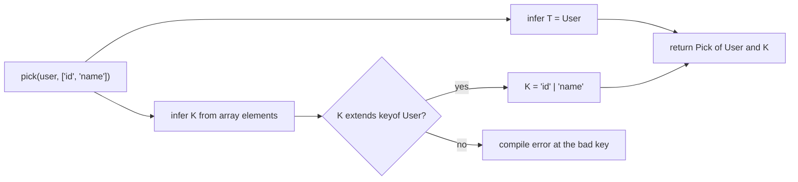

## Introduction

"Write a function `pick(obj, keys)` that returns a new object containing only the given keys — and make it type-safe." This is one of the most common TypeScript prompts in frontend interviews, because it is small enough to finish in fifteen minutes yet touches almost every core idea of the type system: generics, `keyof`, constraints, indexed access, mapped utility types and the boundary between what the compiler knows and what happens at runtime.

The runtime part is three lines of JavaScript. The typing is the real exercise. A version typed with `any` "works" but tells the caller nothing: a typo in a key name is accepted, and the result can be read as if it had every property. A correct version gives the caller three guarantees, all at compile time:

1. Only keys that exist on the object can be requested.
2. The result has exactly the requested properties, each with its original type.
3. Reading a property that was not picked is an error.

This lesson treats `pick` as an implementation exercise: start from tests, write the signature, write the body, then attack it with edge cases. The concepts behind it — why `Pick<T, K>` is built the way it is, and the companion `omit` and `Patch` helpers — are taught in [[b2-generic-pick-helper]]. This page focuses on getting a correct implementation out of your hands under interview conditions.

## Before you start

- **Generics** — functions with type parameters such as `<T>`, and how TypeScript infers them from arguments. See [[b2-generics]].
- **`keyof` and generic constraints** — `keyof T` is the union of a type's keys; `K extends keyof T` limits `K` to those keys. See [[b2-keyof]] and [[b2-generic-constraints]].
- **Indexed access types** — `T[K]` is the type of property `K` on `T`. See [[b2-indexed-access]].
- **The `Pick` utility type** — `Pick<T, K>` builds an object type with only the keys `K` of `T`. See [[b2-pick]].

## The intuition

Think of `pick` as a stencil laid over an object: only the cut-out shapes show through. The stencil is the list of keys. For the function to be type-safe, the compiler must know the *exact* shape of the stencil — not "some strings" but `"id" | "name"` — because the output type is computed from it.

That is the whole trick. If TypeScript sees the keys as `string[]`, it cannot know which properties survive, so it cannot type the result precisely. If it sees them as the literal union `"id" | "name"`, it can compute `Pick<User, "id" | "name">` and give the result exactly two properties. Everything in the signature exists to make TypeScript infer that literal union and to stop it from widening to `string`.

## Step 0: write the tests first

In an interview, stating what "type-safe" means before writing code shows you know what you are aiming at. Runtime behaviour is tested with assertions; type behaviour is tested with code that must compile and code that must *not* compile.

Two small tools make type tests possible. `@ts-expect-error` is a comment that tells the compiler "the next line must contain an error"; if the line compiles cleanly, the comment itself becomes an error, so a regression is caught. The `Equal` helper checks that two types are identical, not merely assignable:

```typescript title="pick-types.ts"
import { pick } from './pick.ts';

type Equal<X, Y> =
  (<G>() => G extends X ? 1 : 2) extends (<G>() => G extends Y ? 1 : 2) ? true : false;
type Expect<T extends true> = T;

const account = { id: 7, plan: 'pro' as 'free' | 'pro', owner: 'Ada' };

const a = pick(account, ['id', 'plan']);
type _a = Expect<Equal<typeof a, { id: number; plan: 'free' | 'pro' }>>;

const keys = ['owner'] as const;
const b = pick(account, keys);
type _b = Expect<Equal<typeof b, { owner: string }>>;

// @ts-expect-error -- unknown key is rejected
pick(account, ['plna']);

// @ts-expect-error -- a picked object has no unpicked fields
a.owner;
```

The odd-looking `Equal` compares two generic function types. TypeScript considers them the same only when `X` and `Y` are identical, which is stricter than the usual "is assignable to" check — `{ id: number }` is assignable to `{}`, but not equal to it. `Expect<...>` then fails to compile when `Equal` produces `false`. The same idea powers libraries such as `expect-type` and Vitest's `expectTypeOf`. Running `tsc --noEmit` over this file is the type test: no output means every expectation held.

## Step 1: the version that "works"

Most candidates first write the JavaScript and patch types on afterwards:

```typescript title="pick-any.ts"
function pickAny(obj: any, keys: string[]) {
  const out: any = {};
  for (const k of keys) out[k] = obj[k];
  return out;
}

const user = { id: 'u1', name: 'Ada' };
const r = pickAny(user, ['id', 'nmae']);
console.log(r.nmae.length);
```

```output
TypeError: Cannot read properties of undefined (reading 'length')
```

This compiles without a single error. The typo `'nmae'` is accepted because keys are `string[]`. The return type is inferred from `out`, which is `any`, so `r.nmae.length` is accepted too — and crashes at runtime. This is the trap the notes for this exercise warn about: **an `any` accumulator leaks into the return type and erases all information at the call site.** The fix is not "add more annotations inside" but "declare the return type from the parameters".

Two other tempting return types are also wrong. `Partial<T>` makes every property optional, so callers must null-check fields they definitely picked, and they can still read fields they did not pick. `Record<string, unknown>` forces callers to narrow every value. Neither describes what the function actually does.

## Step 2: the signature

The return type must depend on *which* keys were passed, so the keys need their own type parameter:

```typescript
function pick<T extends object, K extends keyof T>(
  obj: T,
  keys: readonly K[],
): Pick<T, K>
```

Each part has a job:

| Piece | Why it is there |
|---|---|
| `T extends object` | Rejects primitives such as `pick(42, [])`, which have no meaningful keys to pick. |
| `K extends keyof T` | Only real keys of `T` are allowed, so typos fail. The constraint also makes inference keep literal types. |
| `readonly K[]` | Accepts both ordinary arrays and `as const` arrays. A mutable `K[]` parameter would reject a `readonly ['id']` tuple. |
| `Pick<T, K>` | The result has exactly the keys in `K`, each typed as `T[K]`. |

The constraint is doing more than validation. When TypeScript infers a type parameter from a string literal such as `'id'`, it normally widens it to `string`. But when the type parameter is constrained to a union of literal types — and `keyof T` is exactly that — inference keeps the literal. So `pick(user, ['id', 'name'])` infers `K = "id" | "name"` with no `as const` needed at the call site.

Widening still happens when the array is created *before* the call:

```typescript title="widened-keys.ts"
const user = { id: 'u1', name: 'Ada' };
const loose = ['id', 'name'];   // inferred as string[]
pick(user, loose);
```

```output
error TS2345: Argument of type 'string[]' is not assignable to parameter of type 'readonly ("name" | "id")[]'.
  Type 'string' is not assignable to type '"name" | "id"'.
```

The variable `loose` was typed when it was declared, long before `pick` constrained anything. Declaring it with `as const` (a readonly tuple of literals) or with an explicit type such as `(keyof typeof user)[]` fixes it — and that is exactly why the parameter is `readonly K[]`.

## Step 3: the body

Inside the function, TypeScript knows `obj: T` and `key: K`, so `obj[key]` has type `T[K]`. The accumulator is the hard part: it starts empty and only becomes a full `Pick<T, K>` after the loop. No type expresses "an object that grows into `Pick<T, K>` one key at a time", so one assertion is unavoidable. The question is where to put it.

```typescript title="pick-short.ts"
function pick<T extends object, K extends keyof T>(
  obj: T,
  keys: readonly K[],
): Pick<T, K> {
  const out = {} as Pick<T, K>;
  for (const key of keys) {
    out[key] = obj[key];
  }
  return out;
}
```

This compiles and is a fine first answer. Its weakness is that the assertion sits at the *start*: from line one the compiler believes `out` is complete, so if you later deleted the loop by mistake, nothing would complain. A more honest version types the accumulator as `Partial<Pick<T, K>>` — which is true at every step — and asserts once at the end, at the point where the claim has become true:

```typescript
const out: Partial<Pick<T, K>> = {};
for (const key of keys) out[key] = obj[key];
return out as Pick<T, K>;
```

A `Record<PropertyKey, unknown>` accumulator, which the notes also mention, compiles too, but it throws away the link between `key` and `obj[key]`; you could write `out[key] = 42` and the compiler would accept it. `Partial<Pick<T, K>>` keeps that check. Whichever you choose, the key point for an interviewer is that the assertion is **inside** the function, where you can reason about it once, and the **public signature** is precise, so callers never need a cast.

## Step 4: attack the edge cases

A working `pick` is the start of the interview, not the end. These are the follow-ups that come next.

### Missing optional keys

If a key is optional and absent, the simple loop still creates it:

```typescript
interface Profile { id: string; nickname?: string }
const ada: Profile = { id: 'u1' };
pick(ada, ['id', 'nickname']);  // simple loop gives { id: 'u1', nickname: undefined }
```

For many uses this is harmless, but `'nickname' in result` is now `true`, `Object.keys` reports it, and a serialiser that sends the result as a PATCH body might interpret `undefined` as "clear this field". Copying only keys the object owns, with `Object.hasOwn(obj, key)` (ES2022), keeps absent properties absent. It also stops `pick` from copying inherited properties from the prototype chain, which `obj[key]` would otherwise read.

### The empty key list and variadic signatures

Some designs take keys as rest parameters: `pick(user, 'id', 'name')`. That reads well but hides a trap. With `...keys: K[]` and no keys passed, there is nothing to infer `K` from, so TypeScript falls back to the constraint `keyof T`:

```typescript title="zero-keys.ts"
function pickV<T extends object, K extends keyof T>(obj: T, ...keys: K[]): Pick<T, K> {
  // body as before
}
const ada = { id: 'u1', name: 'Ada', age: 36 };
const e1 = pickV(ada);
const n: string = e1.name;   // compiles, but e1 is {} at runtime
```

The type claims every property is present; the runtime object is empty. The array version does not have this problem — `pick(ada, [])` infers `K = never` and the result has no properties. If you prefer the variadic style, require at least one key with a non-empty tuple type, `...keys: [K, ...K[]]`; then `pickV(ada)` fails with `Expected at least 2 arguments, but got 1`.

### `__proto__` as a key

When data comes from `JSON.parse`, a key named `__proto__` is an ordinary own property of the parsed object. But assigning `out['__proto__'] = value` on a normal object does not create a property — it calls the inherited `__proto__` setter and **replaces the prototype of `out`**. A `pick` over untrusted input can therefore produce an object that inherits attacker-chosen properties. In this lesson's tests, picking `'__proto__'` from `{"__proto__": {"isAdmin": true}}` with the simple loop produced an object whose `isAdmin` read as `true`. This does not pollute `Object.prototype` globally, but it is still a result that lies about its contents. Skipping `__proto__` (and, defensively, `constructor` and `prototype`) closes the hole. Building the result with `Object.fromEntries` also avoids the setter, because it defines properties directly instead of assigning them.

## Worked example: the final implementation

Here is a complete version with the edge cases handled and runtime tests using Node's built-in `assert`:

```typescript title="pick.ts"
import assert from 'node:assert/strict';

const BLOCKED_KEYS = new Set<PropertyKey>(['__proto__', 'constructor', 'prototype']);

export function pick<T extends object, K extends keyof T>(
  obj: T,
  keys: readonly K[],
): Pick<T, K> {
  // Partial: while the loop runs, only some of the picked keys exist yet.
  const out: Partial<Pick<T, K>> = {};
  for (const key of keys) {
    if (BLOCKED_KEYS.has(key)) continue;
    if (Object.hasOwn(obj, key)) {
      out[key] = obj[key];
    }
  }
  // The one assertion: every key in `keys` that obj owns has been copied.
  return out as Pick<T, K>;
}

interface User {
  id: string;
  name: string;
  email: string;
  passwordHash: string;
  nickname?: string;
}

const user: User = {
  id: 'u1',
  name: 'Ada',
  email: 'ada@example.com',
  passwordHash: '$2b$10$abc',
};

const publicUser = pick(user, ['id', 'name', 'nickname']);
console.log(publicUser);

assert.deepEqual(publicUser, { id: 'u1', name: 'Ada' });
assert.equal('nickname' in publicUser, false);
assert.equal('passwordHash' in publicUser, false);

const hostile = JSON.parse('{"__proto__": {"isAdmin": true}, "name": "x"}');
const safe = pick(hostile as Record<string, unknown>, ['__proto__', 'name']);
assert.equal(Object.getPrototypeOf(safe), Object.prototype);
console.log(safe);
console.log('all tests passed');
```

```output
{ id: 'u1', name: 'Ada' }
{ name: 'x' }
all tests passed
```

Walking through it: `publicUser` has type `Pick<User, "id" | "name" | "nickname">`, so hovering it in an editor shows `{ id: string; name: string; nickname?: string }` — note the `?` survives, because `Pick` copies modifiers. At runtime `nickname` is absent rather than `undefined` thanks to `Object.hasOwn`. `passwordHash` cannot leak because it was not listed, and listing it by mistake would be visible in code review because it is spelled out. The hostile input keeps its normal prototype because `__proto__` was skipped. The snippet was run with Node 22 (which strips TypeScript types natively) and checked with `tsc --strict`.



## In real systems

`pick` appears wherever a large object must be turned into a smaller one with a known shape. API layers use it to build response DTOs (Data Transfer Objects) from database rows, so internal columns such as password hashes are never serialised by accident — an **allow-list** is safer than deleting forbidden keys, because a column added later is excluded by default. Form libraries use it to extract the fields for one step of a multi-step form. State-management selectors use it to subscribe a component to a few fields of a large store.

Utility libraries ship their own. In `@types/lodash`, `_.pick` has an overload that, for keys known to exist on the object, returns `Pick<T, U>` — the same idea as here — plus looser overloads for deep property paths such as `'a.b.c'`, which return a much less precise type. That is the trade-off of deep paths: they are convenient but the compiler can say less about the result. Modern codebases often write the small typed helper themselves rather than depend on a whole library for it.

## Trade-offs and alternatives

**Destructuring** is the zero-helper alternative: `const { id, name } = user; const card = { id, name };`. It is fully typed and needs no assertion, but the keys must be written at the place of use; it cannot take a dynamic list.

**`omit`** is the opposite operation, and is the better choice when you want "everything except a few". Its type, `Omit<T, K>`, is looser — `Omit` accepts any key, even ones that do not exist — so a typed `omit` usually constrains `K extends keyof T` itself. See [[b2-omit]].

**Schema validators** such as Zod offer `.pick({ id: true })` on schemas. That is the right tool when the input is untrusted, because it validates values at runtime; a typed `pick` only selects keys and trusts that the values already match `T`.

The cost of the generic `pick` is small: one assertion inside, and error messages that mention `Pick<...>` types rather than plain shapes.

## Common mistakes

- **Returning `any` from the accumulator.** `const out: any = {}` with no declared return type makes the whole result `any`. Always declare the return type `Pick<T, K>`.
- **Typing keys as `string[]` or `(keyof T)[]` without a separate `K`.** With `keys: (keyof T)[]` the return type cannot depend on which keys were passed, so the best you can write is `Pick<T, keyof T>` — the whole object. The separate `K` is what carries the information.
- **Mutable array parameter.** `keys: K[]` rejects `as const` arrays, because a readonly tuple is not assignable to a mutable array. Use `readonly K[]`.
- **Variadic keys with no non-empty requirement.** `pick(obj)` infers `K = keyof T` and lies about the result. Use an array parameter or `[K, ...K[]]`.
- **Thinking the types validate data.** `pick` trusts that `obj` really is a `T`. If `obj` came from `JSON.parse` with an `as` cast, the picked values are as unverified as before. Validate first — see [[b2-impl-type-guard]].

## Interview perspective

**"Why do you need two type parameters?"** Because the result depends on two independent things: the object's shape (`T`) and the chosen subset of keys (`K`). With only `T`, the compiler cannot know which keys were requested.

**"Why is there an `as` in your implementation — isn't that unsafe?"** It is a local, justified assertion: TypeScript cannot track an object being built key by key, and the loop guarantees the claim. The public signature is precise, so no caller ever casts. Typing the accumulator as `Partial<Pick<T, K>>` and asserting at the return is the most honest placement.

**"What happens with `pick(user, [])`?"** `K` is inferred as `never`, so the result is `{}`, which is correct. Contrast the variadic signature, where zero keys infers `keyof T`.

**"How would you test the types?"** Show `@ts-expect-error` for calls that must fail and an `Equal`-based assertion for exact result types, run with `tsc --noEmit` in CI.

**Strong signals** are naming the compile-time versus runtime boundary unprompted ("the types guarantee key names, not that values from the network are valid"), mentioning `Object.hasOwn` for optional keys, and knowing about `__proto__`.

## Practice

1. Implement `omit<T extends object, K extends keyof T>(obj: T, keys: readonly K[]): Omit<T, K>` and write two `@ts-expect-error` tests for it.
2. Change the variadic `pickV` so that `pickV(obj)` is a compile error, and add a type test that proves it.
3. Write `pickDefined(obj, keys)` that skips keys whose value is `undefined`, and decide what its return type should be. (Hint: the picked keys become optional.)
4. Explain in two sentences why `keys: (keyof T)[]` cannot produce a precise return type.

```quiz
Q: Why does `pick(user, ['id', 'name'])` infer `K` as `"id" | "name"` rather than `string`, even without `as const`?
- [ ] Array literals are always inferred as tuples of literals
- [x] `K` is constrained to `keyof T`, a union of literal types, so inference keeps the literals
- [ ] The `readonly` modifier on the parameter forces literal inference
- [ ] `Pick<T, K>` in the return type tells the compiler to narrow the argument
> When a type parameter's constraint is a union of literal types, TypeScript does not widen string literals inferred for it. The `readonly` modifier only allows readonly arrays to be passed; it does not change inference. Array literals on their own are inferred as `string[]`, which is why a pre-declared `const loose = ['id']` fails.
```

```quiz
Q: A teammate's helper is declared `function pick(obj: any, keys: string[]) { const out: any = {}; ...; return out; }`. What is the effect at the call site?
- [ ] Unknown keys are rejected but the result is untyped
- [ ] The result is typed as `Partial<T>`
- [x] Typos in keys compile, and every property of the result is readable as `any`
- [ ] The compiler infers `Pick<T, K>` from the loop
> The return type is inferred from `out`, which is `any`, and keys are plain strings, so neither the keys nor the result is checked. TypeScript never infers a mapped type like `Pick` from a loop body; the return type has to be declared.
```

## Quick revision {#quick-revision}

- Signature: `function pick<T extends object, K extends keyof T>(obj: T, keys: readonly K[]): Pick<T, K>`.
- `K extends keyof T` both rejects unknown keys and makes inference keep literal key types.
- `readonly K[]` accepts `as const` tuples; a pre-declared `string[]` still fails — use `as const`.
- Body needs one assertion: accumulate into `Partial<Pick<T, K>>`, return `out as Pick<T, K>`.
- `any` accumulator with no declared return type erases all call-site types.
- Use `Object.hasOwn` so absent optional keys stay absent and inherited properties are not copied.
- Assigning `out['__proto__']` changes the prototype; skip it or build with `Object.fromEntries`.
- Variadic `...keys: K[]` with zero keys infers `keyof T`; use `[K, ...K[]]` or an array parameter.
- Type tests: `@ts-expect-error` for must-fail lines, `Expect<Equal<A, B>>` for exact types.

## Key takeaways {#key-takeaways}

- A type-safe `pick` needs a second type parameter for the keys, because the result type depends on which keys were passed.
- The constraint `K extends keyof T` validates keys and preserves literal key types during inference.
- One assertion inside the function is acceptable; the public signature must be precise so callers never cast.
- Runtime details matter: own-property checks, the `__proto__` setter and the zero-keys inference fallback are the follow-up questions that separate good answers from great ones.
- `pick` selects keys; it does not validate values. Untrusted data still needs a runtime check.
