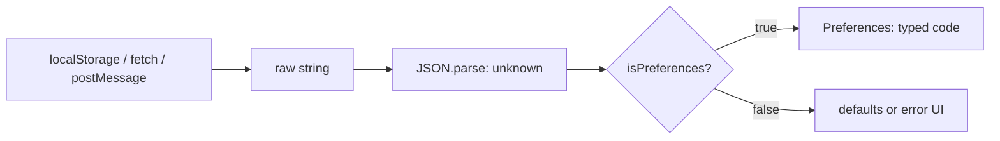

## Introduction

TypeScript checks the code you write, but much of the data a frontend handles was not written by you: JSON from an API, a value saved in `localStorage` by an older version of the app, a message posted from another window, a URL query string. At the point it enters the program, the honest type of such data is **`unknown`** — "some value, nothing known about it yet". The compiler will not let you read properties from `unknown` until you prove what it is.

The tempting shortcut is a cast: `JSON.parse(raw) as Preferences`. That line compiles, and it is a lie the compiler cannot catch. If the stored value is from last year's format, or a user edited it in DevTools, the app reads `prefs.notifications.email` from an object that has no `notifications`, and crashes far from the line that caused it.

A **custom type guard** replaces the lie with a check. It is a function whose return type is a **type predicate**, such as `value is Preferences`: it returns a boolean at runtime, and when it returns `true` the compiler narrows the argument to `Preferences`. This lesson implements one for a user-preferences object — the kind of guard every app with saved settings needs — and then uses it the three ways it appears in practice. Type guards in general are introduced in [[b2-custom-type-guards]]; this page is the hands-on exercise.

## Before you start

- **`unknown`** — the safe top type that must be narrowed before use. See [[b2-unknown]].
- **Narrowing with `typeof` and `in`** — the built-in checks a guard is made of. See [[b2-typeof-narrowing]] and [[b2-in-operator]].
- **Literal unions and `as const`** — a theme is one of a fixed set of strings. See [[b2-literal-types]] and [[b2-as-const]].
- **JSON in JavaScript** — what `JSON.parse` can and cannot produce. See [[b1-json-stringify-parse]].

## The intuition

A type guard is a bouncer checking IDs at a door. Inside the venue, staff assume everyone is over eighteen and never ask again — that assumption is the narrowed type. The assumption is only as good as the bouncer: one who glances at the photo but skips the date of birth lets everyone in, and the staff inside are now confidently wrong. The compiler is the staff. It trusts the predicate completely and **never checks whether the guard's body actually proves what the predicate claims**.

## The target type

```typescript
const THEMES = ['light', 'dark', 'system'] as const;
type Theme = (typeof THEMES)[number];   // 'light' | 'dark' | 'system'

interface Preferences {
  theme: Theme;
  fontSize: number;
  notifications: { email: boolean; push: boolean };
  language?: string;
}
```

The shape is small but has every feature that makes guards hard: a **literal union** (`theme`), a number with a sensible range (`fontSize`), a **nested object** (`notifications`) and an **optional field** (`language`). Defining `THEMES` as a runtime array and deriving `Theme` from it means the list of valid themes exists once and is available to both the type checker and the runtime check. A type alone could not be checked at runtime, because types are erased.

## Building the guard

A guard is easiest to write — and to review — as a set of small guards composed together.

```typescript
function isRecord(value: unknown): value is Record<string, unknown> {
  return typeof value === 'object' && value !== null && !Array.isArray(value);
}
```

`isRecord` is the foundation. `typeof value === 'object'` is true for objects, arrays **and `null`** — a famous JavaScript quirk — so `null` must be excluded explicitly. Arrays are excluded because a preferences object is never an array. Once narrowed to `Record<string, unknown>`, any property can be read, and each read is `unknown`, so it must be checked in turn. That is the point: reading is allowed, trusting is not.

```typescript
function isTheme(value: unknown): value is Theme {
  return typeof value === 'string' && (THEMES as readonly string[]).includes(value);
}

function isNotifications(value: unknown): value is Preferences['notifications'] {
  return isRecord(value) && typeof value.email === 'boolean' && typeof value.push === 'boolean';
}
```

`isTheme` checks membership in the runtime list. The cast on `THEMES` is needed because `includes` on a `readonly ['light', 'dark', 'system']` only accepts those three literals as its argument, and we are asking about an arbitrary string — widening the array's element type to `string` for this one call is safe. `isNotifications` checks the nested object with the same building blocks; `Preferences['notifications']` is an indexed access type that reuses the nested shape instead of repeating it.

```typescript
function isPreferences(value: unknown): value is Preferences {
  if (!isRecord(value)) return false;
  return (
    isTheme(value.theme) &&
    typeof value.fontSize === 'number' &&
    Number.isFinite(value.fontSize) &&
    value.fontSize >= 8 &&
    value.fontSize <= 72 &&
    isNotifications(value.notifications) &&
    (value.language === undefined || typeof value.language === 'string')
  );
}
```

Each line maps to one field. A few details are deliberate:

- `Number.isFinite` rejects `NaN` and `Infinity`, which are `typeof 'number'` but break layout code. The range check encodes a business rule the type cannot express.
- The optional `language` accepts `undefined` (absent) or a string, and nothing else. Forgetting optional fields is a common gap: a guard that ignores `language` would accept `language: 42`.
- There is no `as Preferences` anywhere. The body never asserts; it only checks. The predicate in the return type does the narrowing.

Running the guard over a set of samples shows what it accepts:

```typescript title="is-preferences.ts"
const samples: unknown[] = [
  { theme: 'dark', fontSize: 16, notifications: { email: true, push: false } },
  { theme: 'dark', fontSize: 16, notifications: { email: true, push: false }, language: 'fr' },
  { theme: 'blue', fontSize: 16, notifications: { email: true, push: false } },
  { theme: 'light', fontSize: '16', notifications: { email: true, push: false } },
  { theme: 'light', fontSize: 16, notifications: null },
  { theme: 'light', fontSize: 500, notifications: { email: true, push: true } },
  null,
  [],
  JSON.parse('{"theme":"system","fontSize":14,"notifications":{"email":false,"push":true},"extra":1}'),
];
for (const s of samples) console.log(isPreferences(s), JSON.stringify(s));

const valid = samples.filter(isPreferences);
console.log(valid.length, valid.map((p) => p.theme));
```

```output
true {"theme":"dark","fontSize":16,"notifications":{"email":true,"push":false}}
true {"theme":"dark","fontSize":16,"notifications":{"email":true,"push":false},"language":"fr"}
false {"theme":"blue","fontSize":16,"notifications":{"email":true,"push":false}}
false {"theme":"light","fontSize":"16","notifications":{"email":true,"push":false}}
false {"theme":"light","fontSize":16,"notifications":null}
false {"theme":"light","fontSize":500,"notifications":{"email":true,"push":true}}
false null
false []
true {"theme":"system","fontSize":14,"notifications":{"email":false,"push":true},"extra":1}
3 [ 'dark', 'dark', 'system' ]
```

Two results deserve attention. The string `'16'` is rejected — a guard does not coerce, it only checks. And the last sample, with an `extra` key, is **accepted**. That matches TypeScript's structural typing, where an object with extra properties is still a valid `Preferences`. If extra keys must not survive (for example, before saving the object back), copy the known fields into a new object, as the parse function later in this lesson does.

The last line shows the guard passed directly to `filter`. Because `Array.prototype.filter` has an overload that accepts a type predicate, `samples.filter(isPreferences)` returns `Preferences[]`, not `unknown[]`, and `p.theme` type-checks without a cast.

## The compiler trusts the predicate

The most important fact about type guards is what the compiler does *not* do. It checks that the function returns a boolean. It does not check that the boolean means what the predicate says:

```typescript
function wrong(value: unknown): value is string {
  return typeof value === 'number';   // compiles without complaint
}
```

So a guard that checks too little is accepted, and everything downstream trusts it:

```typescript title="lying-guard.ts"
interface Preferences { theme: 'light' | 'dark'; notifications: { email: boolean } }

function isPreferencesLying(value: unknown): value is Preferences {
  return typeof value === 'object' && value !== null && 'theme' in value;
}
const stored: unknown = JSON.parse('{"theme":"dark"}');
if (isPreferencesLying(stored)) {
  try {
    console.log(stored.notifications.email);
  } catch (e) {
    console.log((e as Error).message);
  }
}
```

```output
Cannot read properties of undefined (reading 'email')
```

This is the trap the notes call a **partial-validation lie**: the guard checked one field and claimed the whole shape. It is worse than an `as` cast, because a cast at least looks suspicious in code review, while a function named `isPreferences` looks trustworthy. The rule is simple: **a guard must check every field of the type it claims, recursively**. When the type gains a field, the guard must gain a check — which is a strong reason to keep the guard next to the type, and to test it with invalid samples, not only valid ones.

## Narrowing without `Record<string, unknown>`

Since TypeScript 4.9, the `in` operator also narrows objects that do not declare the key: after `'theme' in value`, an `object` becomes `object & Record<'theme', unknown>`, so `value.theme` can be read as `unknown`:

```typescript
function hasStringTheme(value: unknown): boolean {
  if (typeof value === 'object' && value !== null && 'theme' in value) {
    return typeof value.theme === 'string';
  }
  return false;
}
```

This avoids the `isRecord` helper, at the cost of an `in` check per field. Both styles are sound; `isRecord` reads better for objects with many fields.

## Worked example: loading preferences from storage

The most common use is at a storage or network boundary: parse, check, and fall back to defaults when the data is missing or invalid. The guard functions from above are assumed to be in the same file.

```typescript title="load-preferences.ts"
const DEFAULT_PREFERENCES: Preferences = {
  theme: 'system',
  fontSize: 16,
  notifications: { email: true, push: false },
};

function loadPreferences(raw: string | null): Preferences {
  if (raw === null) return DEFAULT_PREFERENCES;
  let parsed: unknown;
  try {
    parsed = JSON.parse(raw);
  } catch {
    return DEFAULT_PREFERENCES;   // corrupted storage: not JSON at all
  }
  return isPreferences(parsed) ? parsed : DEFAULT_PREFERENCES;
}

const inputs = [
  null,
  '{"theme":"dark","fontSize":18,"notifications":{"email":false,"push":true}}',
  '{"theme":"dark","fontSize":18}',
  '{"theme":"neon","fontSize":18,"notifications":{"email":false,"push":true}}',
  'not json',
];
for (const raw of inputs) {
  const prefs = loadPreferences(raw);
  console.log(prefs.theme, prefs.fontSize, prefs.notifications.push);
}
```

```output
system 16 false
dark 18 true
system 16 false
system 16 false
system 16 false
```

The parameter is `string | null` because that is what `localStorage.getItem` returns; in a browser you would call `loadPreferences(localStorage.getItem('prefs'))` (this example runs in Node, so the strings are passed directly). Each failure mode is handled: nothing stored, malformed JSON (`JSON.parse` throws a `SyntaxError`), an old format missing `notifications`, and an unknown theme. `parsed` is declared `unknown`, not left as the `any` that `JSON.parse` returns, so the compiler forces the guard before use. After `isPreferences(parsed)` is true, the conditional expression returns `parsed` as `Preferences` with no cast.

A real app might merge valid fields into the defaults instead of discarding everything, so one bad field does not reset all settings. That needs per-field checks, which leads to the next technique.



## Guards, assertion functions and parse functions

A type guard answers yes or no. Two related shapes are worth knowing, and interviewers often ask for the comparison.

**Assertion functions** throw instead of returning `false`, and narrow the variable for the rest of the scope:

```typescript
function assertPreferences(value: unknown): asserts value is Preferences {
  if (!isPreferences(value)) throw new TypeError('Invalid preferences');
}
const v: unknown = loadFromSomewhere();
assertPreferences(v);
v.theme;   // Preferences from here on
```

They suit places where invalid data is a programming error and there is nothing sensible to do but stop. One restriction catches people out: an assertion function declared as an arrow function must be called through a name with an explicit type annotation, otherwise the call fails with error TS2775, "Assertions require every name in the call target to be declared with an explicit type annotation." Declaring it with `function` avoids the issue.

**Parse functions** return a result with either the value or the reasons it was rejected. A boolean guard cannot say *why* data was invalid, which matters for logging and for forms:

```typescript title="parse-preferences.ts"
type ParseResult = { ok: true; value: Preferences } | { ok: false; errors: string[] };

function parsePreferences(value: unknown): ParseResult {
  if (!isRecord(value)) return { ok: false, errors: ['expected an object'] };
  const errors: string[] = [];
  const { theme, fontSize, notifications, language } = value;
  if (typeof theme !== 'string' || !(THEMES as readonly string[]).includes(theme)) {
    errors.push(`theme: expected one of ${THEMES.join(', ')}`);
  }
  if (typeof fontSize !== 'number' || !Number.isFinite(fontSize)) {
    errors.push('fontSize: expected a finite number');
  }
  if (!isRecord(notifications)) {
    errors.push('notifications: expected an object');
  } else {
    if (typeof notifications.email !== 'boolean') errors.push('notifications.email: expected boolean');
    if (typeof notifications.push !== 'boolean') errors.push('notifications.push: expected boolean');
  }
  if (language !== undefined && typeof language !== 'string') {
    errors.push('language: expected a string');
  }
  if (errors.length > 0) return { ok: false, errors };
  // Every field was checked above; build a fresh object so unknown extra keys are dropped.
  const n = notifications as Record<string, boolean>;
  const result: Preferences = {
    theme: theme as Theme,
    fontSize: fontSize as number,
    notifications: { email: n.email, push: n.push },
  };
  if (language !== undefined) result.language = language as string;
  return { ok: true, value: result };
}

console.log(parsePreferences({ theme: 'neon', fontSize: '16', notifications: { email: 1 } }));
console.log(parsePreferences({ theme: 'dark', fontSize: 16, notifications: { email: true, push: false }, admin: true }));
```

```output
{
  ok: false,
  errors: [
    'theme: expected one of light, dark, system',
    'fontSize: expected a finite number',
    'notifications.email: expected boolean',
    'notifications.push: expected boolean'
  ]
}
{
  ok: true,
  value: {
    theme: 'dark',
    fontSize: 16,
    notifications: { email: true, push: false }
  }
}
```

Two differences from the guard stand out. It collects *all* errors instead of stopping at the first, and it builds a fresh object, so the unexpected `admin` key is dropped rather than passed along. The price is a few assertions: the compiler cannot connect "no error was pushed for `theme`" with "`theme` is a `Theme`", so the final object needs casts that the error checks justify. This "parse, don't validate" shape is exactly what schema libraries generate for you.

| Shape | Returns | Narrows | Best for |
|---|---|---|---|
| Type guard `value is T` | `boolean` | Inside the `if` / `filter` | Branching, filtering lists |
| Assertion `asserts value is T` | `void` or throws | Rest of the scope | Invariants that should never fail |
| Parse function | `{ ok, value } \| { ok, errors }` | Via the result's discriminant | Boundaries needing error messages or cleaned data |

## In real systems

Production code rarely hand-writes guards for large API payloads. Schema libraries such as Zod, Valibot and ArkType let you declare a schema once, derive the TypeScript type from it (`z.infer<typeof schema>` in Zod), and call `schema.safeParse(data)` to get a result object like `parsePreferences` above. Because the type is derived from the schema, the "guard checks less than the type claims" bug cannot happen. Hand-written guards remain common for small shapes, for hot paths where a dependency is unwanted, and in libraries that must stay dependency-free — and they are what interviewers ask for, because they show you understand what the library does.

Typical boundaries that deserve a guard or schema: responses from `fetch` (a `200` response can still contain an unexpected shape), values from `localStorage` and `sessionStorage`, `postMessage` events from iframes or workers, URL search parameters, and feature-flag or configuration payloads.

TypeScript 5.5 added **inferred type predicates**: a simple arrow function such as `x => x != null` is now inferred as a predicate, so `[1, null, 2].filter(x => x != null)` has type `number[]` without an explicit guard. This only works for checks the compiler can see directly in the function body; a full shape check like `isPreferences` still needs an explicit predicate.

## Trade-offs and alternatives

Hand-written guards have no dependencies and are easy to read for small types, but they duplicate the type's structure, can drift out of sync with it, and give no error messages. Schema libraries remove the drift and give structured errors at the cost of a dependency and some bundle size. An `as` cast costs nothing and checks nothing; it is acceptable only for data your own code produced moments earlier, never for data that crossed a boundary.

Strictness is a choice too. A guard that requires `fontSize` between 8 and 72 rejects old data saved before that rule existed. For persisted data, consider versioning the stored object (`{ version: 2, ... }`) and migrating old versions instead of discarding them.

## Common mistakes

- **Checking only some fields.** The predicate claims the whole type; the compiler will not notice the gap. Check every field, recursively, and test with invalid samples.
- **Forgetting `null`.** `typeof null === 'object'`, so `typeof value === 'object'` alone accepts `null`, and the next property read throws.
- **Ignoring optional fields.** An unchecked optional field accepts any value. Check "absent or the right type".
- **Using `as` inside the guard to skip checks.** `return (value as Preferences).theme !== undefined` asserts instead of checking. Narrow step by step instead.
- **Treating `typeof x === 'number'` as enough.** `NaN` and `Infinity` pass it. Use `Number.isFinite` when a real number is required.
- **Leaving `JSON.parse` results as `any`.** Assign to a variable typed `unknown` so the compiler forces a check.

## Interview perspective

A typical prompt: "Given this `Preferences` type and a value from `localStorage`, write `isPreferences` and use it." A strong answer starts from `unknown`, writes a small `isRecord` helper, checks each field including the nested object and the literal union, handles the optional field, and then uses the guard both in an `if` and in `filter`. Saying unprompted that "the compiler trusts the predicate, so the guard must be complete" is a strong signal.

Common follow-ups:

- **"What is the difference between `value is T` and `asserts value is T`?"** One returns a boolean and narrows inside the branch; the other throws on failure and narrows the rest of the scope.
- **"Why not `JSON.parse(raw) as Preferences`?"** It checks nothing; invalid data crashes later and far away.
- **"How would you report which field was wrong?"** Return a result object with errors, or use a schema library's `safeParse`.
- **"Does the guard accept extra keys?"** Yes, consistent with structural typing; copy known fields into a new object if extra keys must be removed.

## Practice

1. Add `density: 'compact' | 'comfortable'` to `Preferences`. Update the guard, and write one sample that the old guard would have wrongly accepted.
2. Change `loadPreferences` so that each valid field is kept and only invalid fields fall back to defaults.
3. Write `isArrayOf<T>(guard: (v: unknown) => v is T)` returning a guard for `T[]`, and use it to check a list of saved preference profiles.
4. Write `assertPreferences` as an arrow function, reproduce error TS2775, and fix it with a type annotation on the variable.

```quiz
Q: `function isPrefs(v: unknown): v is Preferences { return typeof v === 'object' && v !== null && 'theme' in v; }` compiles. What is the problem?
- [ ] It does not compile, because the body must check every property of `Preferences`
- [x] The compiler trusts the predicate without checking the body, so objects missing other fields are narrowed to `Preferences` and later reads can crash
- [ ] `'theme' in v` is not allowed on `unknown`
- [ ] Type predicates only work with `typeof` checks
> TypeScript verifies only that a guard returns a boolean; it never checks that the body proves the predicate. This guard checks one field and claims the whole shape, so code after `if (isPrefs(x))` will read `x.notifications.email` from objects that have no `notifications`. The `in` check on an object narrowed from `unknown` is valid since TypeScript 4.9.
```

```quiz
Q: Why does `isRecord` include `value !== null` after `typeof value === 'object'`?
- [ ] To exclude arrays
- [ ] Because `typeof undefined === 'object'`
- [x] Because `typeof null === 'object'`, and reading a property of `null` throws
- [ ] It is only there for older browsers
> `typeof null` returns `'object'` for historical reasons, so the first check alone lets `null` through. Arrays are excluded by the separate `Array.isArray` check, and `typeof undefined` is `'undefined'`, so neither is the reason for this line.
```

## Quick revision {#quick-revision}

- Untrusted data (JSON, storage, messages, URLs) starts as `unknown`; keep `JSON.parse` results typed `unknown`.
- Guard signature: `function isPreferences(value: unknown): value is Preferences`.
- Compose small guards: `isRecord` (object, not `null`, not array), `isTheme` (membership in an `as const` array), `isNotifications` (nested).
- Check every field, recursively; optional fields must be `undefined` or the right type.
- Use `Number.isFinite` for real numbers; `typeof` accepts `NaN` and `Infinity`.
- The compiler does not verify a guard's body — an incomplete guard is a lie that spreads.
- `array.filter(isPreferences)` returns `Preferences[]`; TS 5.5 infers simple predicates like `x => x != null`.
- Guards accept extra keys (structural typing); copy known fields to drop them.
- `asserts value is T` throws and narrows the rest of the scope; arrow-function assertions need an explicitly typed name (TS2775).
- Parse functions return `{ ok: true, value } | { ok: false, errors }`; schema libraries (Zod `safeParse`) generate these and derive the type.

## Key takeaways {#key-takeaways}

- A custom type guard is the honest bridge from `unknown` to a typed value: a runtime check that the compiler uses for narrowing.
- The compiler trusts the predicate completely, so the guard must check every field the type claims, including nested objects, literal unions and optional fields.
- Use guards at every boundary where data enters the app, with a fallback or error path for invalid data.
- Choose the shape that fits: guards for branching and filtering, assertion functions for invariants, parse functions when you need error messages or cleaned data.
- For large or frequently changing shapes, a schema library removes the risk of the guard and the type drifting apart.
