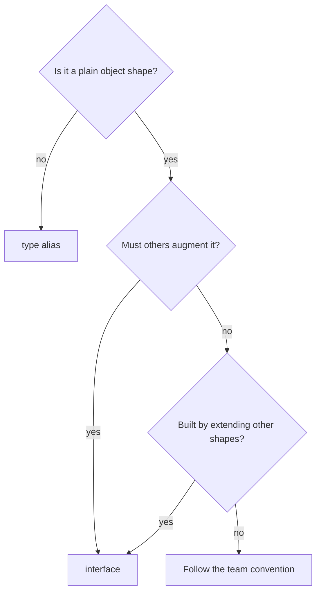

## Introduction

Both of these declarations describe the same thing — an object with a numeric `x` and `y`:

```typescript title="two-ways.ts"
interface PointI {
  x: number;
  y: number;
}

type PointT = {
  x: number;
  y: number;
};
```

You can annotate a variable with either, pass either to a function, extend either, and implement either in a class. For a beginner, that overlap is confusing: why does the language have two ways to say the same thing, and which one should you write?

The short answer is that they are not two ways to say the same thing. An **interface** is a declaration specifically for object shapes, with features designed for building and extending object contracts. A **type alias** is a name for *any* type expression — a union, a tuple, a function type, a mapped type, or an object shape. They overlap only on that last case, and even there they differ in a few precise ways that occasionally matter.

This is one of the most common questions in TypeScript interviews and code reviews. A good answer is not "always use X"; it is knowing the actual differences and having a convention that follows from them. This lesson gives you both.

## Before you start

- **Interfaces** — declaring them, `extends`, declaration merging. See [[b2-interfaces]] and [[b2-extending-interfaces]].
- **Type aliases** — the `type Name = ...` syntax. This lesson uses only basic aliases; [[b2-type-aliases]] teaches them fully, and you can read it first or after.
- **Unions and intersections** — `A | B` and `A & B`, at the level of "one of" and "all of". See [[b2-unions]] and [[b2-intersections]].

## The intuition

A useful mental model: an interface is a **blueprint for objects**, a type alias is a **label you can stick on any type**.

A blueprint is a specialised document. It only describes buildings, but it has features for that job: you can create a new blueprint that builds on an existing one, and an architect can add pages to a blueprint later (declaration merging). A label is general-purpose. You can stick one on a union of string literals, on a tuple, on a function signature, on the output of a type-level computation — or on an object shape, at which point it does most of what a blueprint does.

So the choice only arises when you are describing an **object shape**. For everything else, there is no choice: only a type alias can do it.

## What both can do

It is worth seeing how large the overlap is, so the differences are not overstated. For object shapes, all of the following work with both forms:

```typescript title="overlap.ts"
interface WithIdI { id: string }
type WithIdT = { id: string };

// Optional, readonly, methods, index and call signatures: both
type ConfigT = { readonly name: string; debug?: boolean; log(msg: string): void };

// Generics: both
interface BoxI<T> { value: T }
type BoxT<T> = { value: T };

// Each can extend the other
interface LabelledI extends WithIdT { label: string }
type LabelledT = WithIdI & { label: string };

// Classes can implement either (as long as the alias is an object type)
class Thing implements WithIdT { id = "x"; }

// Recursion: both
interface TreeI { value: number; children: TreeI[] }
type TreeT = { value: number; children: TreeT[] };
```

Both are erased completely at compile time, so there is **no runtime difference** of any kind. Structural typing applies equally: a `PointI` and a `PointT` with the same members are assignable to each other.

## The real differences

### 1. What they can name

An interface can only describe an object type (including callable and constructable objects). A type alias can name anything:

```typescript title="alias-only.ts"
type Status = "draft" | "published" | "archived";       // union of literals
type Coordinates = [lat: number, lng: number];           // tuple
type Listener = (event: string) => void;                 // function type
type Id = string | number;                               // union of primitives
type Nullable<T> = T | null;                             // generic union
type ReadonlyUser = { readonly [K in keyof User]: User[K] };   // mapped type
type ElementOf<T> = T extends (infer E)[] ? E : never;        // conditional type
interface User { id: string; name: string }
```

None of the first seven can be written as an interface. Trying to put mapped-type syntax inside an interface body is simply a syntax error. This difference alone decides most cases: **if the type is not a plain object shape, use `type`**.

There is a workaround in one direction — an interface can extend a computed object type, as in `interface Draft extends Omit<Article, "id"> {}` — because `extends` accepts any object type with statically known members. It cannot extend a union.

### 2. Declaration merging

Two interfaces with the same name in the same scope **merge**. Two type aliases with the same name are an error:

```typescript title="merge.ts"
type Settings = { theme: string };
type Settings = { fontSize: number };
```

```output
error TS2300: Duplicate identifier 'Settings'.
error TS2300: Duplicate identifier 'Settings'.
```

Merging is essential in one situation: **augmenting a type you do not own**. Adding a field to the global `Window`, to Express's `Request`, or to a library's theme type all rely on re-opening an existing interface ([[b2-declaration-merging]], [[b2-module-augmentation]]). If you publish a library and want consumers to be able to extend a type, that type must be an interface.

In your own application code, merging is rarely wanted and can occasionally bite: a second `interface Comment` in a global script silently merges with the DOM's built-in `Comment`. An alias would have produced an error instead. This is the one place where the alias behaviour is arguably safer.

### 3. Extension: errors now versus `never` later

`extends` checks compatibility when the interface is declared. Intersection, the alias way of combining shapes, does not:

```typescript title="extend-vs-intersect.ts"
type A = { x: number };
type B = { x: string };

interface C extends A, B {}       // error TS2320, reported here

type AB = A & B;                  // no error here...
const ab: AB = { x: 1 };          // ...the problem shows up only on use
```

```output
error TS2320: Interface 'C' cannot simultaneously extend types 'A' and 'B'.
  Named property 'x' of types 'A' and 'B' are not identical.
error TS2322: Type 'number' is not assignable to type 'never'.
```

With the intersection, `x` silently becomes `string & number`, which is `never`, and the error appears far from the cause. When you are building object hierarchies, `extends` gives clearer, earlier feedback. (Intersections still have their place — see [[b2-intersections]] — especially for combining types you do not control.)

### 4. Implicit index signatures

This difference surprises even experienced developers. A type alias for an object literal type is assignable to an index-signature type such as `Record<string, unknown>`. An identical interface is not:

```typescript title="index-compat.ts"
interface IPoint { x: number; y: number }
type TPoint = { x: number; y: number };

function logKeys(obj: Record<string, unknown>) {
  console.log(Object.keys(obj));
}

const tp: TPoint = { x: 1, y: 2 };
const ip: IPoint = { x: 1, y: 2 };

logKeys(tp);   // fine
logKeys(ip);   // error
```

```output
error TS2345: Argument of type 'IPoint' is not assignable to parameter of type 'Record<string, unknown>'.
  Index signature for type 'string' is missing in type 'IPoint'.
```

The reason is merging again. An alias's members are fixed forever, so the compiler can see that every property fits `unknown` and treat the alias as if it had an index signature. An interface could be augmented later — somewhere else in the program — with members the compiler has not seen, so it does not get that implicit index signature. You meet this when passing typed objects to generic helpers that accept `Record<string, unknown>` (loggers, query-string builders, analytics `track` calls). Fixes: use an alias, widen the parameter to `object`, or make the helper generic (`<T extends object>(obj: T)`).

### 5. Classes can only implement object-shaped aliases

`implements` works with an interface or with an alias that resolves to an object type. It fails on a union, for the same reason `extends` does — a class has one fixed shape:

```typescript title="implements-union.ts"
type Shape = { kind: "circle"; r: number } | { kind: "square"; s: number };
class Circle implements Shape { kind = "circle" as const; r = 1; }
```

```output
error TS2422: A class can only implement an object type or intersection of object types with statically known members.
```

### 6. Compiler performance on large hierarchies

The TypeScript team's performance guidance (the "Performance" page of the TypeScript wiki) recommends **interfaces over intersections** for composing object types. An interface that extends others is resolved once into a single flat object type, and the compiler caches assignability results between named interfaces. An intersection is re-examined each time it is checked. In a small app the difference is unmeasurable; in a large codebase with deep, heavily-used intersections, switching to `interface ... extends` can noticeably reduce type-checking time. Note that this is about **intersections** versus `extends`, not about `type X = { ... }` versus `interface X { ... }` for a single flat shape, where there is no meaningful difference.

### 7. How they appear in tooltips and errors

Interfaces are always shown by name in hovers and error messages (`IPoint`). Aliases of simple object types are usually shown by name too, but aliases built from intersections, mapped types or utility types are often displayed expanded into their full structure, which makes long error messages harder to read. This is a convenience difference, not a correctness one, and it changes between compiler versions.

## A decision guide

The differences collapse into a short rule set:

| Situation | Use | Why |
|---|---|---|
| Union, tuple, function type, primitive alias | `type` | Interfaces cannot express these |
| Mapped, conditional or template literal type | `type` | Same |
| Object shape that others must be able to augment (library API, global) | `interface` | Only interfaces merge |
| Object hierarchy built by extension | `interface` + `extends` | Early conflict errors, better performance |
| Object shape passed to `Record<string, unknown>` helpers | `type` (or a generic helper) | Implicit index signature |
| Plain object shape, none of the above | Team convention | Either works |



The last row is where the debate lives, and where it should end quickly. The TypeScript handbook suggests using `interface` until you need a feature only `type` has. Many teams instead use `type` everywhere for uniformity, since it covers every case. Both are defensible. What matters is **consistency**, because mixed styles make readers wonder whether a difference is intentional. The typescript-eslint rule `@typescript-eslint/consistent-type-definitions` enforces whichever style you pick for object shapes (its default is `interface`); see [[b2-eslint-typescript]].

## Worked example: a module that uses both

Here is a small, realistic module written with the guide above. It runs as-is with Node 22.18 or later, which strips TypeScript syntax natively.

```typescript title="articles.ts"
// Unions, tuples and function types: only a type alias can name these
type Status = "draft" | "published" | "archived";
type Coordinates = [lat: number, lng: number];
type Listener = (event: string) => void;

// Object contracts: interfaces, built up with extends
interface Entity {
  readonly id: string;
}

interface Article extends Entity {
  title: string;
  status: Status;
  location?: Coordinates;
}

// A derived type made with a utility type: also an alias
type ArticleDraft = Omit<Article, "id" | "status">;

function publish(draft: ArticleDraft, nextId: () => string): Article {
  return { ...draft, id: nextId(), status: "published" };
}

const listeners: Listener[] = [(e) => console.log("event:", e)];

let counter = 0;
const article = publish(
  { title: "Interfaces vs types", location: [51.5, -0.12] },
  () => `a-${++counter}`,
);

listeners.forEach((fn) => fn(`${article.id} is ${article.status}`));
console.log(article);
```

```output
event: a-1 is published
{
  title: 'Interfaces vs types',
  location: [ 51.5, -0.12 ],
  id: 'a-1',
  status: 'published'
}
```

Each choice has a reason. `Status`, `Coordinates` and `Listener` are a union, a tuple and a function type, so they must be aliases. `Entity` and `Article` are object contracts in a small hierarchy, so they are interfaces joined by `extends`; if someone later adds `status: boolean` to `Article`, nothing conflicts with `Entity`, but if `Entity` gained a conflicting `status`, the error would appear on `Article`'s declaration. `ArticleDraft` is computed from `Article` with the `Omit` utility type ([[b2-omit]]), so it is an alias — there is no interface syntax for "Article without these keys" other than an empty `interface ArticleDraft extends Omit<...> {}`, which adds nothing.

Notice what is *not* driving the decisions: runtime behaviour (there is none), or a belief that one form is "more correct". The module would type-check identically if `Entity` and `Article` were aliases joined with `&`, apart from where a conflict would be reported.

## In real systems

**Libraries** publish their extensible object types as interfaces precisely so users can augment them: Express's `Request`, Vue's `ComponentCustomProperties`, styled-components' `DefaultTheme`, and the DOM types in `lib.dom.d.ts`.

**React applications** commonly use either `interface ButtonProps` or `type ButtonProps = { ... }`; both are idiomatic. Teams that need unions in props (for mutually exclusive variants, see [[b2-mutually-exclusive-props]]) often settle on `type` everywhere so all props look alike.

**State and API result types** are almost always aliases, because they are discriminated unions: `type RemoteData<T> = { status: "loading" } | { status: "success"; data: T } | ...` ([[b2-remote-data-pattern]]).

**Large monorepos** that hit slow type-checking sometimes run a pass converting heavy intersection chains into `interface ... extends`, following the compiler team's performance advice.

## Trade-offs

Preferring interfaces for object shapes gives you merging when you need it, earlier errors in hierarchies, slightly better performance and named display in errors. The cost is two syntaxes in the codebase (aliases are still needed for unions) and the small risk of accidental merging.

Preferring aliases everywhere gives one uniform syntax, no accidental merging, and the implicit index signature. The cost is losing merging (rarely needed in app code, essential in library code), and conflicts in `&`-combined shapes surfacing as `never` instead of an error at the declaration.

Neither choice affects runtime behaviour, bundle size or type safety for ordinary code.

## Common mistakes

> [!MISTAKE] Treating the choice as a correctness issue
> Rewriting a codebase from interfaces to aliases (or back) "because it is better" changes nothing at runtime and churns every file. Pick a convention, enforce it with a lint rule, and spend review time on real issues.

**Using an alias for a type that consumers need to augment.** If a library exports `type Theme = { ... }`, users cannot add their own theme tokens through declaration merging. Public, extensible object types should be interfaces.

**Combining conflicting shapes with `&` and missing the `never`.** If an intersected object ends up with a property nothing can be assigned to, check whether two parts declare the same key with different types. Switching to `interface ... extends` will point at the conflict directly.

**Being puzzled by the `Record<string, unknown>` error.** The interface is not "missing" anything; it lacks an *implicit* index signature because it could be merged. Use an alias or a generic parameter for such helpers.

**Assuming aliases create a new, distinct type.** `type UserId = string` is just another name for `string`; any string is accepted. The same is true for interfaces: two interfaces with identical members are interchangeable. Distinct types need branding ([[b2-branded-types]]).

## Interview perspective

**"What is the difference between `interface` and `type`?"** Structure a strong answer in three parts. What overlaps: object shapes, generics, extension, `implements`, zero runtime cost. What only aliases can do: unions, tuples, function types, mapped and conditional types. What only interfaces do: declaration merging, and `extends` with early conflict errors and cached checking. Then state your convention and why.

**"When would you be forced to use an interface?"** When a type must be augmentable: global types like `Window`, module augmentation of a library's types, or a library API you want consumers to extend.

**"When would you be forced to use a type alias?"** Any non-object type: a union of literals for a status, a tuple, a function signature, a mapped or conditional type.

**Follow-up: "Why can't I pass my interface to a function that takes `Record<string, unknown>`?"** Explain implicit index signatures and that interfaces do not get one because they are open to merging.

## Practice

1. For each of these, decide between `interface` and `type` and write it: a theme that plugin authors can extend; `"sm" | "md" | "lg"`; a `[min, max]` range; props for a `Card` component; the parameters of an `onChange` callback.
2. Write `type A = { id: string }` and `type B = { id: number }`, then `type C = A & B`. Hover `C["id"]`. Rewrite with interfaces and `extends`, and compare where the error appears.
3. Write a function `toQuery(params: Record<string, unknown>): string`. Call it with a value typed by an interface, read the error, then fix it in two different ways.
4. Add `analytics: { track(event: string): void }` to the global `Window` type in a `global.d.ts` file. Explain why this could not be done with a type alias.

```quiz
Q: Which of these can only be written as a type alias, not an interface?
- [ ] An object with an optional method
- [ ] A generic object shape `{ value: T }`
- [x] `"draft" | "published" | "archived"`
- [ ] An object with a call signature
> Interfaces describe object types only, including callable objects and generic ones. A union of string literals is not an object type, so it needs a type alias.
```

```quiz
Q: Two declarations named `Settings` appear in the same module. When does this compile?
- [x] When both are interfaces; their members merge
- [ ] When both are type aliases; the second overrides the first
- [ ] When one is an interface and one is a type alias
- [ ] Never; duplicate names are always an error
> Interfaces support declaration merging, so both bodies combine into one `Settings`. Two aliases with the same name give TS2300 "Duplicate identifier", and mixing an interface with an alias of the same name is also a duplicate-identifier error.
```

```quiz
Q: `interface P { x: number }` is rejected where `Record<string, unknown>` is expected, but `type Q = { x: number }` is accepted. Why?
- [ ] Interfaces are stricter about `unknown`
- [x] Aliases get an implicit index signature because their members are fixed; interfaces could be augmented later
- [ ] `Record` is itself an interface and cannot accept other interfaces
- [ ] Only aliases are erased at runtime
> The compiler can only infer that every property fits the index signature when it knows all the properties. An interface is open to declaration merging, so it is not given that implicit index signature.
```

## Quick revision {#quick-revision}

- Interface: object shapes only (including callable/constructable objects). Alias: any type.
- Overlap: object shapes, optional/readonly, methods, generics, recursion, `implements`, extending each other. Both erased, zero runtime difference.
- Only aliases: unions, tuples, function types, primitives, mapped, conditional, template literal types.
- Only interfaces: declaration merging (augmenting `Window`, library types). Duplicate aliases → TS2300.
- `interface C extends A, B` reports conflicts (TS2320) at the declaration; `A & B` silently makes the property `never`.
- Aliases of object literal types get an implicit index signature (assignable to `Record<string, unknown>`); interfaces do not, because they can be merged.
- Classes cannot implement a union alias (TS2422).
- Compiler performance: prefer `interface ... extends` over large intersections.
- Rule: non-object → `type`; must be augmentable or built by extension → `interface`; otherwise follow the team convention and enforce it with `@typescript-eslint/consistent-type-definitions`.

## Key takeaways {#key-takeaways}

- The choice only exists for object shapes; every other kind of type needs an alias.
- Declaration merging is the one capability only interfaces have, and it is why public, extensible types should be interfaces.
- `extends` reports conflicts where they are declared, while intersections defer them as `never`, which matters for object hierarchies.
- The implicit index signature on aliases explains a confusing class of `Record<string, unknown>` errors.
- For plain object shapes the difference is style, so a consistent, lint-enforced convention matters more than which one you pick.
