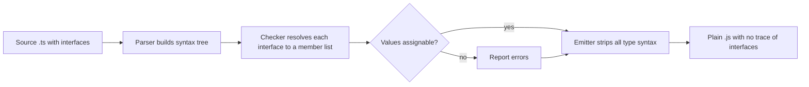

## Introduction

Most of the data a frontend touches is made of objects: a user returned by an API, the props of a component, the options passed to a library, an item in a shopping cart. In plain JavaScript, a function that receives one of those objects has no written record of what it expects. If a caller passes `{ name: "Ada" }` to a function that reads `user.email.toLowerCase()`, nothing complains until that line runs and throws a `TypeError`.

TypeScript lets you write the expected shape down once and give it a name. The most common way to do that is an **interface**:

```typescript title="first-interface.ts"
interface User {
  id: number;
  name: string;
  email: string;
}

function greet(user: User): string {
  return `Hello, ${user.name}`;
}
```

From now on, every place that says "this is a `User`" is checked by the compiler. A caller that forgets `email`, misspells `name`, or passes a number for `id` gets an error in the editor, before the code ever runs. The interface also works as documentation: a teammate reading `greet(user: User)` can jump to `User` and see exactly what a user looks like.

Interfaces are among the first things you write in any TypeScript codebase. Component props in React, request and response bodies for an API client, configuration objects, the browser's own DOM types in `lib.dom.d.ts` and most `@types/*` packages are all described with interfaces. This lesson teaches the full syntax, how the compiler decides whether a value "fits", and how to grow interfaces from one another with `extends`. The next lesson, [[b2-interface-vs-type-when]], compares interfaces with type aliases.

## Before you start

- **Object types** — writing an inline shape such as `{ id: number; name: string }`. An interface is a named version of exactly this. See [[b2-object-types]].
- **Optional and readonly properties** — the `?` and `readonly` modifiers. This lesson recaps them; [[b2-optional-properties]] and [[b2-readonly-properties]] go deeper.
- **Type annotations** — the `: Type` syntax on variables and parameters. See [[b2-type-annotations]].
- **JavaScript objects and classes** — object literals, methods, `class`. See [[b1-object-literals]] and [[b1-classes]].

## The intuition

Think of an interface as a **checklist that a value is held against**, not as a thing that produces values. A building inspector does not build houses; they arrive with a list ("two exits, smoke detector in every bedroom, railings on stairs") and check whether a given house meets it. Any house that ticks every box passes, whoever built it and whatever else it contains.

An interface works the same way. `interface User { id: number; name: string; email: string }` is the checklist. Any object with a numeric `id`, a string `name` and a string `email` passes, whether it came from a `fetch` response, an object literal or a class instance. TypeScript does not ask "was this object declared as a `User`?"; it asks "does this object have what a `User` needs?" That rule is called **structural typing**, and it is the most important thing to understand about interfaces.

Where the analogy stops working: an inspector checks a real house at a real moment. TypeScript checks your *source code* at compile time and then throws the checklist away. When the program runs, there is no `User` anywhere, so the check cannot catch bad data that arrives at runtime (for example, a malformed JSON response). That limitation comes back several times in this lesson.

## Declaring an interface

An interface declaration is the keyword `interface`, a name, and a body listing **members** in braces:

```typescript title="declare.ts"
interface Product {
  sku: string;
  title: string;
  priceCents: number;
  tags: string[];
}

const mug: Product = {
  sku: "MUG-01",
  title: "Coffee mug",
  priceCents: 1250,
  tags: ["kitchen", "gift"],
};
```

A few rules about the syntax. Members can be separated by semicolons, commas, or line breaks alone; semicolons are the common convention and what most formatters produce. Names are written in PascalCase by convention. The old habit of prefixing interfaces with `I` (`IProduct`) comes from C# and is discouraged in modern TypeScript style guides, because it adds noise and leaks an implementation detail (whether a type is an interface or an alias) into every use.

Once declared, the name can be used anywhere a type can: in variable annotations, parameters, return types, array element types (`Product[]`), inside other interfaces, and as a type argument (`Promise<Product>`).

### Required, optional and readonly properties

By default every property is **required**: a value without it is rejected. Two modifiers change that.

A `?` after the property name makes it **optional**: the value may leave it out. Inside your code, the property's type then includes `undefined`, so the compiler makes you handle the missing case. A `readonly` before the name forbids assignment to that property through this type.

```typescript title="modifiers.ts"
interface User {
  readonly id: number;
  name: string;
  email?: string;
}

const missing: User = { id: 3 };              // error: name is required

const ada: User = { id: 1, name: "Ada" };     // fine: email is optional
ada.id = 5;                                   // error: id is readonly

function domain(user: User): string {
  return user.email.split("@")[1];            // error: email may be undefined
}
```

The compiler reports, in order:

```output
error TS2741: Property 'name' is missing in type '{ id: number; }' but required in type 'User'.
error TS2540: Cannot assign to 'id' because it is a read-only property.
error TS18048: 'user.email' is possibly 'undefined'.
```

The third error is the one that saves you in practice. Because `email` is optional, `user.email` has the type `string | undefined`, and calling `.split` on `undefined` would crash. The fix is to handle that case: `user.email?.split("@")[1] ?? "unknown"`, or an `if (user.email)` check. This only happens with `strictNullChecks` on (it is part of `strict`), which every new project should use; see [[b2-strict-null-checks]].

Two precise points about `readonly`. It is **shallow**: `readonly tags: string[]` stops you from reassigning `tags` but still lets you call `tags.push(...)`; use `readonly string[]` for the array itself. And it is **compile-time only**: the emitted JavaScript has no freeze, so code that bypasses the type (for example through `any`) can still change the value. If you need runtime immutability, use `Object.freeze` ([[b1-object-freeze-seal]]).

### Methods

Interfaces can describe functions that live on the object. There are two ways to write them:

```typescript title="methods.ts"
interface Logger {
  log(message: string): void;              // method syntax
  flush: () => Promise<void>;              // property holding a function
}
```

Both describe "an object with a callable `log` and a callable `flush`", and for everyday use they behave the same. They differ in one subtle rule. Under the `strictFunctionTypes` option (on with `strict`), parameters of **function-typed properties** are checked strictly, while parameters of **method-syntax** members are checked more loosely (bivariantly), for compatibility with existing JavaScript patterns such as DOM event handlers:

```typescript title="method-variance.ts"
interface Animal { name: string }
interface Dog extends Animal { bark(): void }

interface Handlers {
  onMethod(a: Animal): void;
  onProp: (a: Animal) => void;
}

const h: Handlers = {
  onMethod(d: Dog) { d.bark(); },          // accepted
  onProp: (d: Dog) => { d.bark(); },       // error
};
```

```output
error TS2322: Type '(d: Dog) => void' is not assignable to type '(a: Animal) => void'.
  Types of parameters 'd' and 'a' are incompatible.
    Property 'bark' is missing in type 'Animal' but required in type 'Dog'.
```

The error is correct: `onProp` promises to accept any `Animal`, but the implementation calls `bark`, which a plain `Animal` does not have. The method-syntax version has exactly the same bug and is let through. If you want the stricter check, write callbacks as function-typed properties. [[b2-function-variance]] explains the rule in depth.

### Index signatures

Sometimes you do not know the property names in advance — a map of translation keys, a cache keyed by ID, HTTP headers. An **index signature** describes "any property name of this kind, with values of this type":

```typescript title="index-signature.ts"
interface Translations {
  [key: string]: string;
}

const fr: Translations = { hello: "bonjour", bye: "au revoir" };
const word = fr["thanks"];   // type string, but undefined at runtime
```

Two consequences follow. First, any named property you add alongside a string index signature must have a type compatible with it, because a named property is also "a string key":

```typescript title="index-conflict.ts"
interface Counters {
  [key: string]: number;
  total: number;      // fine
  label: string;      // error
}
```

```output
error TS2411: Property 'label' of type 'string' is not assignable to 'string' index type 'number'.
```

Second, by default the compiler assumes every key exists, so `fr["thanks"]` is typed `string` even though it is `undefined` at runtime. The `noUncheckedIndexedAccess` compiler option makes such reads `string | undefined` and forces a check. Index signatures, and when to prefer `Record` or `Map`, are covered in [[b2-index-signatures]].

### Call, construct and generic signatures

Because JavaScript functions are objects, an interface can also describe something callable. A **call signature** is a parameter list and return type with no name; it can sit alongside ordinary properties, which is how you type a function that also carries data:

```typescript title="call-signature.ts"
interface Formatter {
  (value: number, digits?: number): string;   // the object can be called
  locale: string;                             // and also has a property
}

interface PointConstructor {
  new (x: number, y: number): { x: number; y: number };  // used with `new`
}
```

The second form, a **construct signature**, describes something used with `new`, such as a class passed around as a value. Both appear mostly in library type definitions; in application code a function type alias ([[b2-type-aliases]]) is usually easier to read.

Interfaces can also take **type parameters**, which makes one declaration describe a family of shapes:

```typescript title="generic-interface.ts"
interface ApiResponse<T> {
  data: T;
  status: number;
}

const users: ApiResponse<string[]> = { data: ["ada", "lin"], status: 200 };
```

`ApiResponse<string[]>` is an `ApiResponse` whose `data` is a `string[]`. Generics are the subject of [[b2-generics]]; for now, read `<T>` as "a blank to be filled in by whoever uses the interface".

## How values are checked against an interface

### Structural typing

TypeScript decides whether a value is a `User` by comparing **shapes**, never names. A value is assignable to an interface if it has every required member, with compatible types. It may have more. Nothing needs to "declare" that it is a `User`:

```typescript title="structural.ts"
interface HasName { name: string }

class Robot {
  constructor(public name: string, public model: string) {}
}

function label(x: HasName): string {
  return x.name.toUpperCase();
}

console.log(label(new Robot("r2", "astromech")));   // a class instance
console.log(label({ name: "ada" }));                 // a literal
```

```output
R2
ADA
```

`Robot` never mentions `HasName`, and yet a `Robot` is accepted, because it has a `name: string`. Languages such as Java and C# use **nominal typing**, where a class only satisfies an interface if it says `implements`. TypeScript chose structural typing because JavaScript code is full of objects built on the fly — literals, `JSON.parse` results, spread copies — that have no declared type to point at. [[b2-structural-typing]] covers the consequences in more detail.

### Excess property checks on fresh literals

Structural typing allows extra properties. There is one deliberate exception. When you write an object literal *directly* where an interface is expected, the compiler also rejects properties the interface does not know about. This is called **excess property checking**, and it exists to catch typos:

```typescript title="excess.ts"
interface User {
  readonly id: number;
  name: string;
  email?: string;
}

const a: User = { id: 1, name: "Ada", emial: "a@x.io" };   // error

const raw = { id: 2, name: "Lin", emial: "l@x.io" };
const b: User = raw;                                        // no error
```

```output
error TS2561: Object literal may only specify known properties, but 'emial' does not exist in type 'User'. Did you mean to write 'email'?
```

Without this check, `emial` would be silently accepted (extra properties are allowed) and `email` would silently be missing (it is optional), so the bug would compile cleanly. The check only applies to **fresh** object literals — ones written in place. Once the object is stored in `raw`, it might legitimately be used for other purposes too, so assigning it to `User` only checks that the required members are present. Knowing this difference explains a lot of "why does this error here but not there?" moments.

## Classes that implement an interface

A class can promise to satisfy an interface with `implements`. The compiler then checks the class's instance side against the interface and reports anything missing or mismatched at the class declaration, which is where you want to see the error:

```typescript title="implements.ts"
interface Clock {
  now(): Date;
  tick(ms: number): void;
}

class SystemClock implements Clock {
  now(): Date {
    return new Date();
  }
  tick(ms: number): void {
    console.log(`waited ${ms}ms`);
  }
}
```

Two things `implements` does **not** do surprise people. It does not change the class's type or add anything to it: because of structural typing, `SystemClock` would be usable as a `Clock` even without the clause. And it does not give the class's methods their parameter types: if you write `tick(ms) { ... }`, the parameter is not inferred from `Clock`, and under `strict` you get `error TS7006: Parameter 'ms' implicitly has an 'any' type.` You still annotate parameters in the class. The difference between `implements` and class `extends` is covered in [[b2-implements-vs-extends]].

## Declaration merging

If two interface declarations with the same name appear in the same scope, TypeScript **merges** them into one interface containing the members of both:

```typescript title="merging.ts"
interface Settings { theme: string }
interface Settings { fontSize: number }

const s: Settings = { theme: "dark" };   // error: fontSize is missing
```

```output
error TS2741: Property 'fontSize' is missing in type '{ theme: string; }' but required in type 'Settings'.
```

In your own code, writing the same interface twice by accident is a bug, and merging can make it hard to spot. The feature exists for a different reason: it lets you **add members to types you do not own**. The browser's `Window` interface, for instance, is declared in TypeScript's `lib.dom.d.ts`. If your app puts an analytics object on `window`, you can declare `interface Window { analytics: Analytics }` in a global declaration file and the compiler merges it in. Library authors use the same mechanism to let plugins extend a library's types. Type aliases cannot do this, which is one of the real differences discussed in [[b2-interface-vs-type-when]]. The full rules are in [[b2-declaration-merging]] and [[b2-module-augmentation]].

## Extending interfaces {#b2-extending-interfaces}

**Extending** an interface means declaring a new interface that contains all the members of an existing one plus some of its own. You write it with the `extends` keyword: `interface Admin extends User { ... }` reads as "an `Admin` is everything a `User` is, and also ...". It is the main way to build specialised shapes from general ones without copying fields.

### Why extend instead of copying

Imagine an app with users, admins and guests. All have an `id` and a `name`; admins also have permissions. You could write three interfaces with the shared fields repeated, but then adding `avatarUrl` to every account means editing three places, and forgetting one creates a subtle mismatch. Extending keeps the shared part in one place:

```typescript title="extends-basic.ts"
interface Entity {
  readonly id: string;
  createdAt: Date;
}

interface User extends Entity {
  name: string;
  email: string;
}

interface Admin extends User {
  permissions: string[];
}

const root: Admin = {
  id: "u1",
  createdAt: new Date(0),
  name: "Root",
  email: "root@example.com",
  permissions: ["users:write", "billing:read"],
};

function greet(user: User): string {
  return `Hello, ${user.name}`;
}

console.log(greet(root));
console.log(Object.keys(root).length);
```

```output
Hello, Root
5
```

`Admin` ends up with five members: `id` and `createdAt` from `Entity`, `name` and `email` from `User`, and its own `permissions`. The compiler treats it as if all five had been written in one body; it does not keep a "chain" to walk at runtime. And because of structural typing, an `Admin` is automatically acceptable wherever a `User` is expected, which is why `greet(root)` compiles: it has everything a `User` needs.

### Extending several interfaces at once

An interface can extend more than one base, separated by commas. This is how you combine independent "capabilities":

```typescript title="extends-multiple.ts"
interface Timestamped { createdAt: Date; updatedAt: Date }
interface SoftDeletable { deletedAt: Date | null }

interface Order extends Timestamped, SoftDeletable {
  id: string;
  totalCents: number;
}
```

`Order` has all five members. Unlike classes in JavaScript, which can only extend one parent, interfaces can extend any number of bases, because there is no runtime inheritance to resolve — only property lists to combine.

You can also extend generic interfaces, filling in or passing on the type parameter:

```typescript title="extends-generic.ts"
interface ApiResponse<T> { data: T; status: number }

interface Page<T> extends ApiResponse<T[]> {
  nextCursor: string | null;
}

const page: Page<number> = { data: [1, 2], status: 200, nextCursor: null };
```

### Redeclaring a property: narrowing is allowed, conflicts are not

A sub-interface may redeclare a property it inherits, but only with a type that is **assignable to** the original — the same or narrower. That rule keeps the guarantee that a sub-interface value is always usable as a base value:

```typescript title="extends-override.ts"
interface Base { status: string | number }

interface Narrow extends Base { status: string }    // fine: string fits string | number
interface Bad extends Base { status: boolean }      // error
```

```output
error TS2430: Interface 'Bad' incorrectly extends interface 'Base'.
  Types of property 'status' are incompatible.
    Type 'boolean' is not assignable to type 'string | number'.
```

When two *bases* disagree about the same property, the compiler also refuses:

```typescript title="extends-conflict.ts"
interface A { x: number }
interface B { x: string }

interface AB extends A, B {}    // error
```

```output
error TS2320: Interface 'AB' cannot simultaneously extend types 'A' and 'B'.
  Named property 'x' of types 'A' and 'B' are not identical.
```

This early error is a real advantage of `extends`. The intersection type `A & B`, which also combines shapes and is taught in [[b2-intersections]], does not report anything here; it silently gives `x` the type `string & number`, which is `never`, and you only find out later when nothing can be assigned to it.

### What you can extend

An interface can extend another interface, or any type alias that names an object type (or an intersection of object types). It cannot extend a union, because "all the members of one of several shapes" is not a fixed list of properties:

```typescript title="extends-alias.ts"
type Timestamps = { createdAt: Date; updatedAt: Date };
interface Post extends Timestamps { title: string }      // fine

type Shape = { kind: "circle" } | { kind: "square" };
interface Labelled extends Shape { label: string }       // error
```

```output
error TS2312: An interface can only extend an object type or intersection of object types with statically known members.
```

Less commonly, an interface can extend a class, which copies the class's instance members (including private and protected ones) into the interface. This is mostly seen in library code.

### Extends is compile-time only

`interface Admin extends User` creates no prototype chain and no runtime relationship. Compiling an interface hierarchy produces no JavaScript at all for the interfaces; an `Admin` object at runtime is a plain object with five properties. This is the key difference from `class Admin extends User`, which *does* set up a prototype chain and runs the parent constructor through `super()` (see [[b1-class-inheritance]]). It also means you cannot ask at runtime "is this value an `Admin`?" via `instanceof`; you need a runtime check on its properties, covered in [[b2-custom-type-guards]].

Use extension to model genuine "is a more specific kind of" relationships — `Admin` is a `User`, `Page<T>` is an `ApiResponse<T[]>`. Keep chains shallow (two or three levels); deep hierarchies of interfaces have the same readability cost as deep class hierarchies, and they make it hard to see which file a property comes from.

## How it works internally

The TypeScript compiler (`tsc`) does two separate jobs: it **type-checks** your code and it **emits** JavaScript. Interfaces take part only in the first.



During checking, the compiler builds a **symbol** for each interface, collects the members from every declaration with that name (this is how merging works), adds members from every `extends` base, and checks that redeclared members are compatible. Each assignment, argument or return is then checked by comparing members one by one. The compiler caches the results of these comparisons by interface identity, which is part of why the TypeScript team recommends interfaces for large object hierarchies (more on that in [[b2-interface-vs-type-when]]).

During emitting, every interface declaration, every `implements` clause and every annotation is deleted. Compiling this:

```typescript title="erase.ts"
interface Point { x: number; y: number }
interface Point3D extends Point { z: number }
const p: Point3D = { x: 1, y: 2, z: 3 };
console.log(p);
```

produces exactly this JavaScript:

```javascript title="erase.js"
"use strict";
const p = { x: 1, y: 2, z: 3 };
console.log(p);
```

That is why an interface has zero runtime cost, and also why it offers zero runtime protection. Data that crosses a boundary your compiler cannot see — a `fetch` response, `localStorage`, a message from another window — must be validated at runtime (by hand, or with a schema library such as Zod) before you can trust the interface you assign to it.

## Worked example: typing a shopping cart

Here is a complete program that uses most of what this lesson covered: nested interfaces, `readonly`, an optional property, an optional method-bearing object and a literal-union property. It runs as-is with Node 22.18 or later, which strips TypeScript types natively; on older Node versions, compile it with `tsc` first.

```typescript title="cart.ts"
interface Money {
  readonly amountCents: number;
  readonly currency: "USD" | "EUR";
}

interface LineItem {
  sku: string;
  title: string;
  unitPrice: Money;
  quantity: number;
  giftNote?: string;
}

interface Discount {
  code: string;
  apply(subtotalCents: number): number;
}

interface Cart {
  readonly id: string;
  items: LineItem[];
  discount?: Discount;
}

function subtotal(cart: Cart): number {
  return cart.items.reduce(
    (sum, item) => sum + item.unitPrice.amountCents * item.quantity,
    0,
  );
}

function total(cart: Cart): number {
  const base = subtotal(cart);
  // discount is optional, so the compiler makes us handle "no discount"
  return cart.discount ? cart.discount.apply(base) : base;
}

function describe(item: LineItem): string {
  const note = item.giftNote ?? "no note";
  return `${item.quantity} x ${item.title} (${note})`;
}

const tenPercentOff: Discount = {
  code: "TEN",
  apply: (cents) => Math.round(cents * 0.9),
};

const cart: Cart = {
  id: "cart-42",
  items: [
    { sku: "MUG", title: "Mug", unitPrice: { amountCents: 1250, currency: "USD" }, quantity: 2 },
    {
      sku: "TEE",
      title: "T-shirt",
      unitPrice: { amountCents: 1999, currency: "USD" },
      quantity: 1,
      giftNote: "Happy birthday",
    },
  ],
  discount: tenPercentOff,
};

for (const item of cart.items) console.log(describe(item));
console.log("subtotal:", subtotal(cart));
console.log("total:", total(cart));
```

```output
2 x Mug (no note)
1 x T-shirt (Happy birthday)
subtotal: 4499
total: 4049
```

Walk through what the interfaces are doing. `Money` stores prices as integer cents with a currency restricted to two literal values, so a typo like `"usd"` is a compile error. `LineItem` nests a `Money`, and its `giftNote?` forces `describe` to supply a fallback with `??`; deleting the `?? "no note"` would still compile here (template literals accept `undefined`) but would print `(undefined)`, which shows that the compiler protects you from *crashes* on optional values, not from every bad output. `Discount` uses method syntax for `apply`, and the arrow function assigned in `tenPercentOff` gets its parameter type (`cents: number`) from the interface — this is **contextual typing**, and it is why you did not need to annotate `cents`. Finally, `Cart.discount` is optional, so `total` must check it before calling `apply`; remove the check and you get `'cart.discount' is possibly 'undefined'`.

Try these edits to see the checks in action: add `quantity: "2"` to an item, write `cart.id = "x"`, or add `colour: "red"` to the mug literal. Each is rejected with a different error from this lesson.

## In real systems

**Component props.** In React codebases, `interface ButtonProps { variant: "primary" | "ghost"; onClick(): void; children: React.ReactNode }` is the most common interface anyone writes. Extending built-in prop types — `interface ButtonProps extends React.ButtonHTMLAttributes<HTMLButtonElement>` — gives a custom button every native attribute for free. See [[b2-react-component-props]].

**API contracts.** Frontend teams describe request and response bodies with interfaces (often generated from an OpenAPI schema), shared by the API client and the components. A base `ApiResponse<T>` extended by paginated variants is a typical hierarchy.

**The DOM and platform types.** TypeScript's own library files are built from interface hierarchies: `HTMLInputElement extends HTMLElement`, which `extends Element`, which `extends Node`. That is why an `HTMLInputElement` can be passed to any function expecting an `Element`.

**Library extension points.** Express, Vue, Pinia, styled-components and many others ask you to add your own fields to their types through declaration merging, for example adding a `user` property to Express's `Request`. This only works because those libraries expose interfaces.

## Trade-offs and alternatives

Interfaces give you named, documented object contracts with good editor support, readable error messages that mention the interface by name, early errors on incompatible extension, and the ability to be augmented by declaration merging. They cost nothing at runtime.

Their limits follow from what they are. An interface can only describe an object shape (including callable objects); it cannot name a union such as `"light" | "dark"`, a tuple on its own terms, or the result of a mapped or conditional type — those need a type alias ([[b2-type-aliases]]). Merging, so useful for library augmentation, can surprise you if two files accidentally declare the same global name. And no type, interface or alias, validates data at runtime.

The alternatives are a **type alias** of an object type (`type User = { ... }`), which is interchangeable with an interface for most purposes; a **class**, which gives you a type and a runtime constructor together (useful when you need `instanceof` or behaviour); and a **runtime schema** (Zod, Valibot) from which the static type is inferred, which is the right tool when data comes from outside the program.

## Common mistakes

> [!MISTAKE] Using an interface as a value
> `if (x instanceof User)` fails with `error TS2693: 'User' only refers to a type, but is being used as a value here.` Interfaces are erased, so there is nothing to test against at runtime. Check for the properties instead, ideally inside a type-guard function ([[b2-custom-type-guards]]), or use a class if you really need `instanceof`.

**Assuming the interface validates API data.** `const user: User = await res.json()` compiles because `res.json()` returns `any` (or `unknown` behind a helper), not because the data was checked. If the server sends `{ "name": null }`, your "string" is `null` at runtime. Validate at the boundary.

**Confusing "extra properties are fine" with "excess property error".** If a literal gets an excess-property error, the fix is almost always to correct the typo or add the property to the interface. Silencing it by assigning to an intermediate variable or casting with `as User` hides the bug the check was trying to show you.

**Expecting `readonly` to freeze nested data.** `readonly items: LineItem[]` still allows `cart.items.push(...)` and `cart.items[0].quantity = 9`. Use `readonly LineItem[]` and `readonly` on the nested fields, or `Readonly<T>` ([[b2-readonly-utility]]), and remember it is compile-time only.

**Expecting `implements` to type method parameters.** It checks the class; it does not infer from the interface. Annotate parameters in the class.

**Accidental merging.** Declaring `interface Config` in a global script file that already has a `Config` (or a DOM type with the same name, such as `Comment` or `Event`) merges the two silently. Keep your files as modules (any `import` or `export` makes a file a module), so their interfaces are scoped to the file.

## Interview perspective

**"What is an interface in TypeScript, and does it exist at runtime?"** A good answer: it names an object shape that the compiler checks values against structurally; it is erased during compilation, so it has no runtime cost and no runtime validation. Mention that this is why `instanceof` cannot be used with it.

**"Why does this object literal error, but the same object in a variable does not?"** This tests excess property checking. Explain fresh literals versus already-stored values and why the check exists (to catch typos that structural typing would otherwise let through).

**"What does `extends` do for interfaces, and how is it different from `&`?"** `extends` copies the base's members into the new interface and checks compatibility of redeclared properties at declaration time; `&` combines types without that check, so conflicts become `never` silently. Neither creates any runtime relationship, unlike class inheritance.

**"What does `implements` guarantee?"** It checks at the class declaration that instances satisfy the interface. Strong answers add that it does not change the class type and does not contextually type parameters, and that structural typing makes it optional for compatibility.

A frequent follow-up is "interface or type?" — that is the whole of [[b2-interface-vs-type-when]].

## Practice

1. Write an interface `Book` with a readonly `isbn`, a `title`, an optional `subtitle`, and `authors: string[]`. Write `formatTitle(book: Book): string` that returns `"Title: Subtitle"` when a subtitle exists and `"Title"` otherwise. Confirm the compiler forces you to handle the missing subtitle.
2. Add an index signature to an interface `Inventory` mapping SKU strings to quantities. Then try to add a property `warehouse: string` and explain the error.
3. Create `interface Media { id: string; title: string }`, then `Video extends Media` with `durationSec: number`, and `Podcast extends Media` with `episode: number`. Write a function that takes a `Media[]` and prints titles; pass it a mixed array.
4. Make a deliberate conflict: `interface Bad extends Media { id: number }`. Read the error and explain which rule it enforces.
5. Write a class `ConsoleLogger implements Logger` for the `Logger` interface above. Remove a method and see where the error appears.

```quiz
Q: `interface User { name: string; email?: string }`. Which statement compiles without errors?
- [ ] `const u: User = { name: "Ada", emial: "a@x.io" };`
- [x] `const raw = { name: "Ada", emial: "a@x.io" }; const u: User = raw;`
- [ ] `const u: User = { email: "a@x.io" };`
- [ ] `const u: User = { name: 42 };`
> Assigning a stored variable only checks that required members are present with compatible types, and `raw` has `name: string`; extra properties are allowed. The first option is a fresh literal, so excess property checking rejects `emial`. The third is missing the required `name`, and the fourth has the wrong type for it.
```

```quiz
Q: What JavaScript does `tsc` emit for `interface Point { x: number; y: number }`?
- [ ] A class `Point` with `x` and `y` fields
- [ ] An object used to validate values at runtime
- [x] Nothing at all
- [ ] A frozen prototype object
> Interfaces exist only for the type checker and are erased during emit. That is why they have no runtime cost, and also why they cannot be used with `instanceof` or to validate incoming data.
```

```quiz
Q: `interface A { x: number }` and `interface B { x: string }`. What happens with `interface C extends A, B {}`?
- [ ] `C.x` becomes `number | string`
- [ ] `C.x` becomes `never` and no error is reported
- [x] The compiler reports an error at the declaration of `C`
- [ ] The later base, `B`, wins and `C.x` is `string`
> When bases disagree on a property, `extends` refuses with TS2320. The silent `never` result is what you get from the intersection `A & B`, which is exactly why `extends` gives earlier, clearer feedback.
```

## Quick revision {#quick-revision}

- `interface Name { ... }` names an object shape; members separated by `;`, `,` or newlines.
- Properties are required by default; `?` makes them optional (type includes `undefined`); `readonly` blocks reassignment, shallowly and only at compile time.
- Methods: `m(x: T): R` (parameters checked bivariantly) or `m: (x: T) => R` (checked strictly under `strictFunctionTypes`).
- Index signature `[key: string]: V` — every named property must fit `V`; reads are not `undefined`-checked unless `noUncheckedIndexedAccess` is on.
- Call signature `(x: T): R` and construct signature `new (x: T): R` describe callable objects; `interface Box<T>` is generic.
- Structural typing: a value fits if it has every required member; extras allowed.
- Excess property checks apply only to fresh object literals; they catch typos.
- `class C implements I` checks the class at its declaration; it does not change the class type or infer parameter types.
- Same-name interfaces merge; used to augment library and global types such as `Window`.
- `interface B extends A, C` copies members; redeclared properties must be assignable to the base type; conflicting bases give TS2320; unions cannot be extended (TS2312).
- `A & B` combines shapes without conflict errors — conflicts become `never`.
- Interfaces are erased: no runtime cost, no runtime validation, no `instanceof`.

## Key takeaways {#key-takeaways}

- An interface is a named checklist for object shapes, checked by structure rather than by name.
- Optional and readonly modifiers change what the compiler allows, but neither changes runtime behaviour.
- Excess property checking is a typo-catcher for fresh object literals, not a general rule about extra properties.
- `extends` builds specific interfaces from general ones and reports incompatible redeclarations immediately, which makes it safer than an intersection for object hierarchies.
- Declaration merging is what lets you extend types you do not own, and a reason to keep your own files as modules.
- Because interfaces are erased, data from outside the program must still be validated at runtime.
