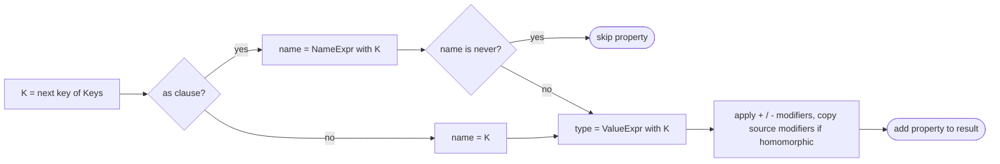

## Introduction

Real applications have many types that are *variations* of one shape. A `User` has a `UserUpdate` where every field is optional, a `FormErrors<User>` where every field is an error message, a `Touched<User>` where every field is a boolean, and a read-only `FrozenUser` for cached data. Writing each of these by hand means listing the same field names four times. Add a field to `User` and you must remember to update three other types — and nothing tells you if you forget.

A **mapped type** removes that duplication. It says "for every key in this set, produce a property computed like this", and the compiler generates the object type:

```typescript title="first-look.ts"
type User = { id: string; name: string; age: number };

type Touched<T> = { [K in keyof T]: boolean };

type UserTouched = Touched<User>; // { id: boolean; name: boolean; age: boolean }
```

`[K in keyof T]` is a loop over the property names of `T`. For each one, `K` is bound to that name, and the expression after the colon — here `boolean` — becomes that property's type. When `User` gains an `email` field, `Touched<User>` gains `email: boolean` automatically.

Mapped types are how the standard library implements `Partial`, `Required`, `Readonly`, `Pick` and `Record`. Combined with conditional types and template literal types, they produce most of the advanced typing you see in form libraries, state managers and design systems.

## Before you start

- **`keyof`** — the union of an object type's property names. See [[b2-keyof]].
- **Indexed access types** — `T[K]`, the type of property `K` in `T`. See [[b2-indexed-access]].
- **Generics** — type parameters such as `<T>`. See [[b2-generics]].
- **Optional and readonly properties** — `name?: string`, `readonly id: string`. See [[b2-optional-properties]] and [[b2-readonly-properties]].
- **Conditional types** (for the later sections) — `T extends U ? X : Y`. See [[b2-conditional-types]].

## The intuition

Think of a spreadsheet with one row per property of `User`: `id`, `name`, `age`. A mapped type is a formula you fill down a new column. For each row, the formula can read the row's key (`K`) and the original value type (`T[K]`) and compute something new — "make it optional", "turn it into a boolean", "wrap it in a function". The result is a new table with the same rows and a computed column.

The `as` clause, covered later, adds the ability to change the row labels (rename `name` to `getName`) or to delete rows (filter out `id`) while filling the column.

The analogy has one gap: a spreadsheet formula runs on data, while a mapped type runs on *types*, in the compiler. It produces no object at runtime. If you need an actual object with these keys, you still have to build it with ordinary code.

## The syntax, piece by piece

The general form is:

```text
{ [K in Keys]: ValueType }
```

- `Keys` is a union of property-key types — string literals, number literals, symbols, or `string`/`number` for index signatures.
- `K` is a type variable bound to each member of `Keys` in turn. You can name it anything; `K` and `P` are conventional.
- `ValueType` is any type expression, and it may use `K`.

### Looping over a literal union

The simplest key set is a union you write yourself:

```typescript title="literal-keys.ts"
type Flags = { [K in "darkMode" | "compact"]: boolean };
// { darkMode: boolean; compact: boolean }
```

That is precisely how `Record` is defined in the standard library:

```typescript title="record.ts"
type Record<K extends keyof any, T> = { [P in K]: T };

type Pages = Record<"home" | "about", { title: string }>;
// { home: { title: string }; about: { title: string } }
```

`keyof any` is `string | number | symbol`, the set of all possible property-key types, so `K` may be any of them. See [[b2-record-utility]] for how `Record` is used in practice.

### Looping over another type's keys

The more common form takes keys from an existing type and reads the original property type with `T[K]`:

```typescript title="identity.ts"
type Copy<T> = { [K in keyof T]: T[K] };

type Nullable<T> = { [K in keyof T]: T[K] | null };

type U = Nullable<{ name: string; age?: number }>;
// { name: string | null; age?: number | null | undefined }
```

`Copy<T>` returns an equivalent type — it is the "identity" mapped type, and a useful starting point when writing a new one. `Nullable` changes only the value: each property's original type, plus `null`. Notice that `age` stayed optional. That is the first sign of *homomorphic* behaviour, explained below.

## Modifiers: `readonly` and `?`

A mapped type can add or remove the two property modifiers. Put `readonly` before the brackets and `?` after them. Prefix either with `+` to add it (the default if you write no sign) or `-` to remove it:

```typescript title="modifiers.ts"
type User = { id: string; name: string; age?: number; readonly createdAt: Date };

type MyPartial<T> = { [K in keyof T]?: T[K] };
type MyRequired<T> = { [K in keyof T]-?: T[K] };
type MyReadonly<T> = { readonly [K in keyof T]: T[K] };
type Mutable<T> = { -readonly [K in keyof T]: T[K] };

type R = MyRequired<User>;
// { id: string; name: string; age: number; readonly createdAt: Date }
type M = Mutable<User>;
// { id: string; name: string; age?: number | undefined; createdAt: Date }
```

These four are exactly how `Partial`, `Required` and `Readonly` are defined in `lib.es5.d.ts`; `Mutable` is not built in, but it is a common helper. Look closely at `MyRequired`: removing `?` with `-?` also removed the `| undefined` that the optional marker had added, so `age` became plain `number`. Without the `-`, writing `[K in keyof T]: T[K]` would keep `age` optional, because homomorphic mapping copies modifiers from the source.

Remember that `readonly` is a compile-time rule. `MyReadonly<User>` stops *your code* from assigning to properties; it does not freeze the object at runtime the way `Object.freeze` does. Each built-in is taught on its own in [[b2-partial]], [[b2-required]] and [[b2-readonly-utility]].

## `Pick`: mapping over a subset of keys

`Pick<T, K>` keeps only some properties. It loops over `K`, which is constrained to be a subset of `T`'s keys:

```typescript title="pick.ts"
type MyPick<T, K extends keyof T> = { [P in K]: T[P] };

type User = { id: string; name: string; age?: number; readonly createdAt: Date };
type Preview = MyPick<User, "name" | "age">;
// { name: string; age?: number | undefined }
```

The constraint `K extends keyof T` is what makes `MyPick<User, "nmae">` a compile error. And because `K` is constrained to `keyof T`, the compiler treats this map as homomorphic too, so `age` keeps its `?`. `Pick` is covered in depth in [[b2-pick]], and its counterpart `Omit` — which is built from `Pick` and `Exclude` — in [[b2-omit]].

## What "homomorphic" means

A mapped type of the form `{ [K in keyof T]: ... }` — where the key set is literally `keyof` of a type parameter — is called **homomorphic**, meaning "same shape". The compiler knows each output property corresponds to an input property, and that gives it several special behaviours:

```typescript title="homomorphic.ts"
type MyPartial<T> = { [K in keyof T]?: T[K] };

type P1 = MyPartial<string[]>;        // (string | undefined)[]
type P2 = MyPartial<[string, number]>; // [(string | undefined)?, (number | undefined)?]
type P3 = MyPartial<string>;          // string
```

- **Modifiers are copied.** Optional stays optional and `readonly` stays `readonly` unless you add or remove them explicitly.
- **Arrays and tuples stay arrays and tuples.** The map is applied to the element types, instead of turning `length`, `push` and every other array member into object properties.
- **Primitives pass through unchanged.** `MyPartial<string>` is `string`. (An older note claims mapping over a non-object gives `never`; that is not how TypeScript behaves.)
- **Unions distribute.** `MyPartial<A | B>` becomes `MyPartial<A> | MyPartial<B>`, so mapping a discriminated union keeps each variant separate.

The last point has a practical consequence:

```typescript title="union-map.ts"
type MyPartial<T> = { [K in keyof T]?: T[K] };
type Shape = { kind: "circle"; radius: number } | { kind: "square"; side: number };

const s: MyPartial<Shape> = { kind: "circle", side: 2 }; // error
```

```output
error TS2353: Object literal may only specify known properties, and 'side' does not exist in type 'MyPartial<{ kind: "circle"; radius: number; }>'.
```

Each variant was mapped on its own, so the compiler still knows a circle has no `side`.

These behaviours are easy to lose by accident. `{ [K in keyof T & string]: T[K] }` looks almost the same, but because the key set is no longer exactly `keyof T`, it is not homomorphic: modifiers are dropped and arrays become plain objects. Keep `keyof T` on its own, and use the `as` clause (next section) if you need to transform the keys.

## Transforming values with conditional types

The value expression can be a conditional type that inspects `T[K]`, which lets one map treat different property types differently:

```typescript title="value-conditional.ts"
type Serialized<T> = {
  [K in keyof T]: T[K] extends Date ? string : T[K];
};

type CalendarEvent = { id: number; title: string; startsAt: Date };
type EventJson = Serialized<CalendarEvent>;
// { id: number; title: string; startsAt: string }
```

That describes what `JSON.stringify` then `JSON.parse` does to `Date` values — they come back as ISO strings. The conditional is checked once per property, so only `startsAt` changes. Recursive versions (such as a `DeepPartial` that calls itself for object-valued properties) follow the same idea; keep them shallow where you can, because each level multiplies the work the compiler does.

## Key Remapping (as) {#b2-key-remapping}

**Key remapping** lets a mapped type change property *names*, not only their types. Added in TypeScript 4.1, it puts an `as` clause after the key loop:

```text
{ [K in keyof T as NewKey]: ValueType }
```

`K` still loops over the original keys, and `T[K]` still refers to the original property, but the property is written to the output under the name `NewKey`. If `NewKey` evaluates to `never`, the property is left out entirely. Those two abilities — **rename** and **filter** — cover almost every use.

### Renaming with template literal types

The most common rename builds the new key with a template literal type (see [[b2-template-literal-types]]):

```typescript title="getters.ts"
type Getters<T> = {
  [K in keyof T as `get${Capitalize<string & K>}`]: () => T[K];
};

type User = { name: string; age: number };
type UserGetters = Getters<User>;
// { getName: () => string; getAge: () => number }

const g: UserGetters = { getName: () => "Ada", getAge: () => 36 };
console.log(g.getName(), g.getAge());
```

```output
Ada 36
```

Read the key expression from the inside out. `K` is `"name"`, then `"age"`. `Capitalize` upper-cases the first character, and the template wraps the result in `get...`. The value type uses the *original* `K`, so `getName` returns `T["name"]`, which is `string`.

The `string & K` is needed because `keyof T` can include `number` and `symbol` keys, and `Capitalize` only accepts strings. Without it you get:

```output
error TS2344: Type 'K' does not satisfy the constraint 'string'.
  Type 'keyof T' is not assignable to type 'string'.
```

Intersecting with `string` turns any non-string key into `never`, which — as the next section shows — drops it. So a symbol-keyed property is silently omitted from `Getters`. If you need symbol keys preserved, map them in a separate branch rather than through a template.

### Filtering with `never`

Mapping a key to `never` removes it. Combined with a conditional type, this filters properties by name or by value type:

```typescript title="filter.ts"
// Drop the listed keys — this is Omit written directly.
type MyOmit<T, K extends PropertyKey> = {
  [P in keyof T as P extends K ? never : P]: T[P];
};

// Keep only properties whose value is a string.
type StringProps<T> = {
  [K in keyof T as T[K] extends string ? K : never]: T[K];
};

// Drop methods, keep data.
type DataOnly<T> = {
  [K in keyof T as T[K] extends Function ? never : K]: T[K];
};

type User = { id: string; name: string; age?: number; readonly createdAt: Date };
type A = MyOmit<User, "age" | "createdAt">; // { id: string; name: string }
type B = StringProps<User>;                 // { id: string; name: string }

class Account { id = 1; owner = "Ada"; save() {} }
type C = DataOnly<Account>;                 // { id: number; owner: string }
```

The conditional in the `as` clause runs once per key. Keys that should stay map to themselves (`K`); keys that should go map to `never`. The built-in `Omit` reaches the same result differently (`Pick<T, Exclude<keyof T, K>>`), but the `as` form is often easier to read and lets you filter on value types, which `Omit` cannot.

### Remapping over a union of objects

The loop variable does not have to range over string keys. It can range over a union of *object* types, and the `as` clause can pick a key out of each one. This builds a lookup table from a discriminated union:

```typescript title="union-remap.ts"
type AppEvent =
  | { kind: "click"; x: number; y: number }
  | { kind: "key"; code: string };

type EventHandlers = {
  [E in AppEvent as E["kind"]]: (event: E) => void;
};
// { click: (event: { kind: "click"; x: number; y: number }) => void;
//   key: (event: { kind: "key"; code: string }) => void }
```

Each handler receives exactly its own variant. Without the `as` clause you would have to loop over `AppEvent["kind"]` and then use `Extract<AppEvent, { kind: K }>` to get the matching variant back.

### Rules worth knowing

**Modifiers are still copied** when you loop over `keyof T` with an `as` clause. For `{ readonly id: string; nickname?: string }`, a `Getters` map produces `readonly getId` and an optional `getNickname`. If that is not what you want, add `-readonly` or `-?` explicitly.

**Arrays are no longer preserved.** With an `as` clause, a mapped type over `string[]` maps every array member — `length`, `push`, `map` and so on — into ordinary object properties. Remapping is meant for object types.

**Colliding names merge.** If two source keys map to the same new name, there is no error: the property's type becomes the union of both values. With `{ a: 1; A: 2 }`, a map that uppercases keys gives `{ A: 1 | 2 }`. Choose renames that cannot collide, or you will get unexpectedly wide types.

**Recursion still has limits.** A remapped type that calls itself on nested values is fine for a few levels; one that builds ever-longer keys (for example, every dotted path through a deep object) can hit the compiler's depth limit and report TS2589.

## Worked example: deriving form types from a model

A form needs several types that all follow the shape of the data model. Here they are derived from one `Signup` type, used by a small validation function, and run with Node.js 22.

```typescript title="signup-form.ts"
type Signup = { email: string; password: string; age: number; newsletter: boolean };

type FormErrors<T> = { [K in keyof T]?: string };
type Touched<T> = { [K in keyof T]: boolean };
type Validators<T> = { [K in keyof T]: (value: T[K]) => string | undefined };

const validators: Validators<Signup> = {
  email: (v) => (v.includes("@") ? undefined : "Enter a valid email"),
  password: (v) => (v.length >= 8 ? undefined : "At least 8 characters"),
  age: (v) => (v >= 13 ? undefined : "You must be 13 or older"),
  newsletter: () => undefined,
};

function validate<T>(values: T, rules: Validators<T>): FormErrors<T> {
  const errors: FormErrors<T> = {};
  for (const key of Object.keys(rules) as (keyof T)[]) {
    const message = rules[key](values[key]);
    if (message) errors[key] = message;
  }
  return errors;
}

const values: Signup = { email: "ada.example.com", password: "lovelace1815", age: 12, newsletter: true };
const touched: Touched<Signup> = { email: true, password: true, age: false, newsletter: false };

const errors = validate(values, validators);
console.log(errors);
console.log(Object.keys(errors).filter((k) => touched[k as keyof Signup]));
```

```output
{ email: 'Enter a valid email', age: 'You must be 13 or older' }
[ 'email' ]
```

Start with the three derived types. `FormErrors` makes every key optional with a `string` value, because a valid field has no message. `Touched` keeps every key and makes it a `boolean`. `Validators` is the most interesting: each property is a function whose parameter is `T[K]`, the *original* type of that field. That is why, inside `validators`, `v` is a `string` for `email` and a `number` for `age` without any annotations — the mapped type gives each arrow function its contextual parameter type.

Inside `validate`, `Object.keys` returns `string[]` at the type level, because at runtime an object may have more keys than its type lists (see [[b2-keyof]] for why). The `as (keyof T)[]` assertion is a deliberate choice: we built `rules` from `Validators<T>`, so its keys are exactly `T`'s keys. `rules[key](values[key])` then type-checks for every key at once, because both sides are indexed by the same `key`.

The output shows the runtime result: two fields fail, but only `email` has been touched, so a form would show only that message for now. If you add `phone: string` to `Signup`, the compiler immediately reports that `validators` and `touched` are missing `phone` — which is the whole point. The full typed-handler version of this idea is the [[b2-change-handlers-pattern]].

## How it works internally

When the compiler meets `{ [K in Keys as NameExpr]?: ValueExpr }` with known type arguments, it:

1. Resolves `Keys` to a union. If it is `keyof T` for a type parameter `T`, it notes the map as homomorphic; if `T` is then a union, array, tuple or primitive, the special rules above apply before anything else.
2. For each member `K` of the union, evaluates `NameExpr` (or uses `K` if there is no `as`). If the result is `never`, skips this member; if it is a union, creates one property per member.
3. Evaluates `ValueExpr` with `K` bound, and applies modifiers: the explicit `+`/`-` ones, plus, for homomorphic maps, the modifiers copied from the source property.
4. Merges properties that ended up with the same name into one property whose type is the union.

While `T` is still an unresolved type parameter — inside a generic function — the mapped type stays **deferred**, much like a conditional type. That is why generic code that builds a mapped-type value usually needs one assertion at the boundary, as in `validate` above.



## In real systems

**Utility types everywhere.** `Partial<User>` for PATCH payloads, `Readonly<State>` for store snapshots, `Pick<User, "id" | "name">` for list items and `Record<Status, Colour>` for lookup tables are mapped types you use daily. [[b2-utility-types]] surveys them.

**Form libraries.** Form state is naturally "one entry per field": values, errors, touched flags, dirty flags, validators. Libraries type these as mapped types over your values type, exactly as in the worked example.

**Design systems and event props.** Key remapping generates `onXChange` handler props, `data-*` attribute maps, or `getX`/`setX` accessors from a single source type.

**API layers.** Mapped types with value conditionals describe serialisation (`Date` → `string`), and remapping converts between naming conventions when the server's field names differ from the client's.

## Trade-offs and alternatives

Mapped types keep variants of a type in sync by construction, which is their main benefit. The cost is indirection: a reader sees `FormErrors<Signup>` and has to work out what it expands to, and error messages mention the mapped type rather than a flat list of fields. Editors help by showing the expanded type on hover.

| Situation | Better choice |
|---|---|
| A variant that follows the source exactly (optional, read-only, subset) | Built-in utility (`Partial`, `Readonly`, `Pick`, `Omit`) |
| A systematic transformation the built-ins do not cover | A named mapped type |
| Two types that merely look similar but change independently | Separate hand-written types |
| A type shared with other languages or services | Code generation from a schema |

Two cautions. Very large key unions or deep recursion slow the compiler and the editor. And mapped types never create runtime objects: `Touched<Signup>` does not give you an object with four `false` values — you still have to construct it.

## Common mistakes

> [!MISTAKE] Expecting a mapped type to build an object
> `type Defaults = { [K in keyof Signup]: false }` is only a type. Code that needs an actual object with those keys must create it, for example with `Object.fromEntries`, and usually needs an assertion because `Object.fromEntries` returns a loosely typed record.

**Forgetting the `-` when removing a modifier.** `{ [K in keyof T]?: T[K] }` *adds* optionality; to remove it you need `-?`. Writing `?` where you meant `-?` produces the opposite of what you intended.

**Breaking homomorphism by accident.** `[K in keyof T & string]` or `[K in Extract<keyof T, string>]` drops modifiers and the array/tuple handling. Use `[K in keyof T as K & string]` if you need string keys but want modifiers kept.

**Using `Capitalize<K>` directly in an `as` clause.** It fails with TS2344 because `K` may be a number or symbol key. Use `Capitalize<string & K>`.

**Accidental key collisions.** Remapping that can produce the same name twice (case changes, prefix stripping) merges the properties into a union instead of reporting an error.

## Interview perspective

"Implement `Partial`, `Readonly` and `Pick`" is a classic warm-up, and "rename keys with a prefix" is the usual follow-up. Interviewers look for the syntax, the modifiers and an understanding that the result is compile-time only.

> [!INTERVIEW] What a strong answer sounds like
> "`type MyPartial<T> = { [K in keyof T]?: T[K] }` — it loops over `T`'s keys and copies each value type with `?` added. `Pick` loops over a constrained subset: `{ [P in K]: T[P] }` with `K extends keyof T`. Because they map over `keyof T`, they're homomorphic, so existing modifiers are kept and arrays stay arrays. To rename keys I'd use the 4.1 `as` clause with a template literal type such as `get${Capitalize<string & K>}`, and to drop keys I'd map them to `never`."

Other questions to prepare:

- **How do you make every property required and mutable?** `{ -readonly [K in keyof T]-?: T[K] }`.
- **Write `Omit` without using `Omit` or `Pick`.** `{ [P in keyof T as P extends K ? never : P]: T[P] }`.
- **Keep only function-valued properties.** `as T[K] extends (...args: any[]) => any ? K : never`.
- **What happens if two keys are remapped to the same name?** They merge, and the value type becomes a union.
- **Does a mapped type exist at runtime?** No; it is erased like every other type.

## Practice

1. Implement `MyRecord`, `MyPartial`, `MyRequired`, `MyReadonly` and `MyPick` without looking, then compare them with `lib.es5.d.ts`.
2. Write `Mutable<T>` and `DeepReadonly<T>` (recursing into object properties but not into functions).
3. Write `Setters<T>` that produces `setName(value: string): void` for each property, skipping `readonly` properties. Hint: you cannot read modifiers directly; compare `{ [K]: T[K] }` with `{ readonly [K]: T[K] }` using a conditional type, or keep a separate list of read-only keys.
4. Write `PickByValue<T, V>` that keeps only properties whose type is assignable to `V`, and use it to get all `number` fields of a type.
5. Extend the signup example with a `Dirty<T>` type and a function that returns the list of changed fields between two value objects.

```quiz
Q: What is `{ [K in keyof T]-?: T[K] }` applied to `{ a?: number }`?
- [ ] `{ a?: number }`
- [x] `{ a: number }`
- [ ] `{ a: number | undefined }`
- [ ] `{ a?: number | undefined }`
> `-?` removes the optional modifier, and when it does, the `undefined` that the `?` had added is removed too. This is exactly how `Required<T>` is defined.

Q: Which mapped type keeps `readonly` and `?` from the source type without mentioning them?
- [x] `{ [K in keyof T]: T[K] }`
- [ ] `{ [K in keyof T & string]: T[K] }`
- [ ] `{ [K in "a" | "b"]: T[K] }`
- [ ] None — modifiers are always dropped
> Mapping directly over `keyof T` (or over a `K extends keyof T`) makes the type homomorphic, so modifiers are copied. Intersecting the keys with `string`, or listing literal keys, breaks that link and drops them.

Q: What does `[K in keyof T as T[K] extends string ? K : never]: T[K]` do?
- [ ] Renames every key to `string`
- [ ] Makes every property a string
- [x] Keeps only the properties whose value type is assignable to `string`
- [ ] Causes a compile error, because `as` must produce a template literal
> The `as` clause computes the output key for each original key. Keys whose value is a string map to themselves; all others map to `never`, which removes them. The `as` clause can be any type that produces property keys.

Q: A key remapping over `keyof T` builds names with `Capitalize<K>` directly. Why does the compiler report TS2344?
- [ ] Template literal types are not allowed in `as` clauses
- [x] `K` may be a `number` or `symbol` key, and `Capitalize` only accepts strings
- [ ] `Capitalize` needs two type arguments
- [ ] `get` is a reserved word
> `keyof T` is a subtype of `string | number | symbol`. Writing `Capitalize<string & K>` narrows `K` to its string members; non-string keys become `never` and are dropped.
```

## Quick revision {#quick-revision}

- Syntax: `{ [K in Keys]: Value }`; `K` loops over `Keys`, `T[K]` reads the original value type.
- `Record<K, T> = { [P in K]: T }`; `Pick<T, K extends keyof T> = { [P in K]: T[P] }`.
- Modifiers: `readonly`/`?`, with `+` to add (default) and `-` to remove. `Partial` = `?`, `Required` = `-?` (also removes `undefined`), `Readonly` = `readonly`, `Mutable` = `-readonly`.
- **Homomorphic** (`[K in keyof T]`): copies modifiers, maps arrays/tuples element-wise, passes primitives through, distributes over unions.
- `[K in keyof T & string]` is *not* homomorphic — modifiers and array handling are lost.
- Value conditionals: `T[K] extends Date ? string : T[K]`.
- **Key remapping (TS 4.1+)**: `[K in keyof T as NewKey]` — rename with template literals, filter by mapping to `never`.
- Use `Capitalize<string & K>`; non-string keys become `never` and are dropped.
- With `as`: modifiers still copied from `keyof T`; arrays become plain objects; colliding names merge into a union.
- Loop over a union of objects: `[E in Events as E["kind"]]: (e: E) => void`.
- Compile-time only; deferred inside generic functions.

## Key takeaways {#key-takeaways}

- A mapped type is a loop over keys that computes each property, so variants of a type stay in sync with their source automatically.
- `Partial`, `Required`, `Readonly`, `Pick` and `Record` are short mapped types you should be able to write from memory.
- `+` and `-` add or remove `readonly` and `?`; homomorphic maps copy modifiers unless told otherwise.
- Homomorphic mapping also keeps arrays as arrays, passes primitives through and distributes over unions — and is easy to break by changing the key expression.
- The `as` clause renames keys (usually with template literal types) and filters them by mapping to `never`.
- Mapped types describe shapes; they never create objects at runtime.
