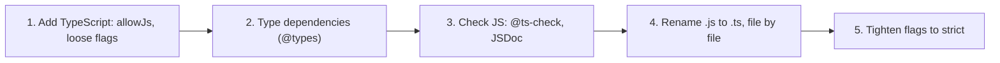

## Introduction

Most teams that adopt TypeScript already have a JavaScript codebase: tens or hundreds of thousands of lines, in production, changing every week. Rewriting it all in TypeScript at once is rarely possible. The rewrite would take months, the product cannot freeze for that long, and a giant branch that touches every file conflicts with everyone else's work the moment it is opened.

TypeScript was designed for the alternative. The compiler can read JavaScript and TypeScript files in the same project, infer types from plain JavaScript, check JavaScript files using type annotations written in comments, and tighten its rules one flag at a time. That makes **incremental migration** possible: the codebase is converted file by file, each step is small enough to review and ship, and the type coverage rises steadily while features continue to land.

This lesson is the plan for doing that well. The first half covers the mechanics that make mixing possible: `allowJs`, `checkJs` and JSDoc types. The second half covers the strategy: what to convert first, what breaks when you rename a file, and how to reach `strict` without a week of red builds.

## Before you start

- **tsconfig.json** — `include`, `compilerOptions` and how the compiler picks files. See [[b2-tsconfig]].
- **The strict flags** — especially `noImplicitAny` and `strictNullChecks`. See [[b2-strict-compiler-options]], [[b2-noimplicitany]] and [[b2-strict-null-checks]].
- **Type inference** — much of a migration relies on the compiler inferring types you have not written. See [[b2-type-inference]].
- **`@types` packages** — your JavaScript dependencies will need types. See [[b2-definitely-typed]].

## The intuition: renovating a house you live in

Migrating a codebase is like renovating a house while living in it. You do not demolish it and live in a tent until the new one is finished. You renovate one room at a time, keeping the plumbing and electricity working through every stage, and each finished room is immediately usable.

`allowJs` is what keeps the plumbing connected between old rooms and new ones: TypeScript files can import JavaScript files and the other way round. `checkJs` and JSDoc let you inspect an old room for problems before you renovate it. The strictness flags are the building code, which you raise gradually once most rooms meet the current standard.

The analogy breaks in one useful way: in software, unlike in a house, you can measure exactly how much is left. Counting `.js` files, `any` types and suppressed errors turns "the migration" into a number that should go down every week.

## allowJs and checkJs {#b2-allowjs-checkjs}

`allowJs` and `checkJs` are two `tsconfig` options that let TypeScript work with JavaScript files. **`allowJs`** adds `.js` (and `.jsx`, `.mjs`, `.cjs`) files to the compilation, so TypeScript files can import them with inferred types. **`checkJs`** goes further and reports type errors inside those JavaScript files, using types written in JSDoc comments. Together they let a team get type checking on JavaScript before renaming a single file, which is why they are the first step of almost every migration.

### allowJs: JavaScript joins the program

Without `allowJs`, the compiler ignores `.js` files, so a `.ts` file that imports one gets TS7016, "Could not find a declaration file for module", the same error as for an untyped npm package. With `allowJs`, the JavaScript file becomes part of the program. The compiler infers types from its code and from any JSDoc comments, and TypeScript files that import it get those types.

Consider a JavaScript module and a new TypeScript file that uses it:

```js title="src/greet.js"
/** @import { User } from './types.js' */

/** @param {User} user */
export function greet(user) {
  return `Hello, ${user.name.toUpperCase()}`;
}

export function shout(text) {
  return text.toUpperCase();
}
```

```ts title="src/main.ts"
import { greet, shout } from './greet.js';
const message: number = greet({ id: 1, name: 'Ada' });
shout(42);
```

With `"allowJs": true` and no `checkJs`, the compiler reports only:

```output
src/main.ts(2,7): error TS2322: Type 'string' is not assignable to type 'number'.
```

Two things are worth noticing. The compiler inferred that `greet` returns `string` from a JavaScript template literal, and it used the JSDoc `@param` to type `user`. And `shout(42)` passed, because `text` has no annotation, so it is `any`, and `allowJs` alone never reports problems *inside* JavaScript files.

`allowJs` also matters for builds that use `tsc` to emit JavaScript: with it on, `.js` files are copied (and downlevelled) into `outDir` alongside compiled `.ts` files. When a bundler such as Vite produces the output, `tsc` only checks, so this does not apply.

### checkJs: errors inside JavaScript

Turning on **`"checkJs": true`** makes the compiler report errors in JavaScript files as well. In TypeScript 6, `checkJs` implies `allowJs`, so setting `checkJs` alone is enough (`tsc --showConfig` shows `allowJs` switched on). Adding it to the project above produces:

```output
src/greet.js(8,23): error TS7006: Parameter 'text' implicitly has an 'any' type.
src/main.ts(2,7): error TS2322: Type 'string' is not assignable to type 'number'.
```

The new error comes from `noImplicitAny`, which is part of `strict`, which is on by default in TypeScript 6. The strictness flags apply to checked JavaScript too, so enabling `checkJs` on a large project with `strict` on can produce thousands of errors at once. That is why most migrations start with `checkJs` off and opt in per file.

### Per-file control with comments

Four comments give file-level and line-level control:

| Comment | Where | Effect |
|---|---|---|
| `// @ts-check` | Top of a `.js` file | Check this file even though `checkJs` is off |
| `// @ts-nocheck` | Top of a `.js` (or `.ts`) file | Do not report errors in this file, even with `checkJs` on |
| `// @ts-expect-error` | Line above a statement | Suppress the error on the next line; *itself an error* if the next line has no error |
| `// @ts-ignore` | Line above a statement | Suppress the error on the next line, silently, forever |

A common rollout is to keep `checkJs` off and add `// @ts-check` to files as they are cleaned up; another is to turn `checkJs` on and add `// @ts-nocheck` to every file that currently fails, then delete those comments one by one. Either way, the comments double as a progress list.

Prefer `@ts-expect-error` to `@ts-ignore`, and give it a reason. When someone fixes the underlying problem, an `@ts-expect-error` with nothing to suppress becomes error TS2578, "Unused '@ts-expect-error' directive", so stale suppressions are removed rather than accumulating:

```js title="src/legacy-call.js"
// @ts-check
import { greet } from './greet.js';

// @ts-expect-error -- legacy callers still pass ids as strings; fixed in ticket 412
greet({ id: '7', name: 'Ada' });
```

### Writing types in JSDoc

In a checked JavaScript file, types come from **JSDoc** comments: `/** ... */` blocks with tags. The type expressions inside the braces use TypeScript's own syntax, so unions, generics and object types all work. Here is a file using the most common tags, with two real bugs in it:

```js title="src/price.js"
// @ts-check

/**
 * @typedef {Object} LineItem
 * @property {string} sku
 * @property {number} unitPrice
 * @property {number} quantity
 */

/**
 * @param {LineItem[]} items
 * @returns {number}
 */
export function total(items) {
  return items.reduce((sum, item) => sum + item.unitPrice * item.qty, 0);
}

/** @type {LineItem} */
const sample = { sku: 'A1', unitPrice: '9.99', quantity: 2 };

console.log(total([sample]));
```

`tsc` reports both bugs:

```output
src/price.js(15,66): error TS2339: Property 'qty' does not exist on type 'LineItem'.
src/price.js(19,29): error TS2322: Type 'string' is not assignable to type 'number'.
```

Running the file anyway shows what the bugs do at runtime: `item.qty` is `undefined`, so the product is `NaN`, and the total is too.

```output
NaN
```

The tags map directly onto TypeScript syntax. `@typedef` with `@property` declares an object type (like an `interface`). `@param` and `@returns` annotate a function. `@type` annotates a variable. Other useful tags are `@template T` for generic functions, `/** @type {HTMLInputElement} */ (expr)` (with the parentheses) as a cast, and, since TypeScript 5.5, `/** @import { User } from './types.js' */` to import a type from a `.ts` file without a runtime import. Before 5.5, the same was written inline as `{import('./types.js').User}`, which still works.

Generics in JSDoc look like this, and are checked just like TypeScript:

```js title="src/util.js"
// @ts-check

/**
 * @template T
 * @param {T[]} items
 * @returns {T | undefined}
 */
export function last(items) {
  return items[items.length - 1];
}

const n = last([1, 2, 3]);
/** @type {string} */
const s = n;
```

```output
src/util.js(14,7): error TS2322: Type 'number | undefined' is not assignable to type 'string'.
  Type 'undefined' is not assignable to type 'string'.
```

JSDoc types are also a publishing tool: running `tsc` with `allowJs`, `declaration` and `emitDeclarationOnly` on `util.js` generates `export function last<T>(items: T[]): T | undefined;` in a `.d.ts` file. Some libraries stay in JavaScript permanently and ship types this way.

> [!WARNING] JSDoc can lie
> The compiler trusts JSDoc annotations the same way it trusts `.d.ts` files. If `@returns {number}` is on a function that sometimes returns a string, every caller is checked against the wrong type and the runtime bug remains. When you add JSDoc to old code, read the implementation; do not guess from the function's name.

### When to use which

`allowJs` alone is right when you need TypeScript files to import JavaScript and nothing more. `checkJs` (globally or via `// @ts-check`) is right when you want type safety in JavaScript files you are not ready to rename, or that will stay JavaScript. Moving from checked JavaScript to `.ts` is then mostly mechanical: the JSDoc types become annotations.

## Planning the migration

With the mechanics in place, the plan has five stages. They overlap in practice, but the order matters.



### Stage 1: add TypeScript without breaking anything

Install TypeScript and add a `tsconfig.json` that accepts the codebase as it is:

```json title="tsconfig.json"
{
  "compilerOptions": {
    "allowJs": true,
    "checkJs": false,
    "strict": false,
    "noEmit": true,
    "module": "esnext",
    "moduleResolution": "bundler",
    "target": "es2022",
    "skipLibCheck": true
  },
  "include": ["src"]
}
```

`"strict": false` must be written explicitly in TypeScript 6, because `strict` now defaults to `true`. Without it, every new `.ts` file you add is held to the full strict standard while it still imports loosely typed JavaScript, which produces a flood of errors on the first converted file. `noEmit` assumes your existing bundler handles `.ts` files (Vite, webpack with a TypeScript loader, or Babel with the TypeScript preset); if `tsc` builds your code, set `outDir` instead. Add `tsc --noEmit` to continuous integration now, so the baseline stays clean from day one.

### Stage 2: type your dependencies

Install `@types` packages for JavaScript dependencies that lack bundled types, matched to their major versions, and write `declare module` shims for the rest (see [[b2-third-party-types]]). Doing this early means converted files get real types from libraries instead of `any`.

### Stage 3: check before you convert

Add `// @ts-check` to files that matter and fix what it finds, adding JSDoc at function boundaries. This often finds real bugs, as in `price.js` above, and it is cheap: no renames, no build changes, no review of large diffs.

### Stage 4: convert file by file

Choose an order. Two strategies work, and teams usually mix them:

- **Leaves first.** Convert modules that import nothing else from your code (utilities, formatters, constants), then modules that depend only on converted ones, moving up the dependency graph. Each converted file then imports only typed code, so its types are accurate.
- **Boundaries first.** Convert the modules where data enters the system (API clients, storage wrappers, event payloads) because types there protect the most code. A typed API client gives every caller checked data, even callers still in JavaScript.

Whichever you choose, new files are written in TypeScript from the start, and every file touched for a feature is a candidate for conversion.

### Stage 5: tighten strictness

Once most files are `.ts`, turn strict flags on one at a time, in roughly this order: `noImplicitAny` (find every untyped parameter), `strictNullChecks` (the biggest change and the most bugs found), then the rest of `strict` (`strictFunctionTypes`, `strictBindCallApply`, `strictPropertyInitialization`, `useUnknownInCatchVariables`, and others). Each flag can be its own project: enable it, count errors, fix them by module, then commit. When all are on, replace the individual flags with `"strict": true`.

> [!TIP] Make progress visible
> Track a few numbers in CI or a weekly report: the count of `.js` files, `@ts-nocheck`/`@ts-expect-error` comments, explicit `any` (an ESLint rule such as `no-explicit-any` in warning mode can count them), and errors under the next flag you plan to enable. A migration that is measured finishes; one that is not tends to stall at 80%.

## Worked example: converting a module

Here is a realistic JavaScript file from a settings feature. It builds an object step by step, a pattern JavaScript developers use constantly:

```js title="src/settings.js"
// @ts-check
const settings = {};
settings.theme = 'dark';
settings.fontSize = 14;
console.log(settings.theme.toUpperCase(), settings.fontSize + 1);
```

```output
DARK 15
```

With `// @ts-check`, this file has no errors: in JavaScript files, TypeScript treats properties assigned to an empty object literal declared in the same scope as part of its type, because the pattern is so common. Now rename it to `settings.ts` (use `git mv` so version control keeps the file's history) and remove `// @ts-check`:

```output
settings.ts(2,10): error TS2339: Property 'theme' does not exist on type '{}'.
settings.ts(3,10): error TS2339: Property 'fontSize' does not exist on type '{}'.
settings.ts(4,22): error TS2339: Property 'theme' does not exist on type '{}'.
settings.ts(4,52): error TS2339: Property 'fontSize' does not exist on type '{}'.
```

In a `.ts` file, `{}` means "an object with no known properties", and adding properties later is an error. The fix is to say up front what the object is:

```ts title="src/settings.ts"
interface Settings {
  theme: 'light' | 'dark';
  fontSize: number;
}

const settings: Settings = { theme: 'dark', fontSize: 14 };
console.log(settings.theme.toUpperCase(), settings.fontSize + 1);
```

```output
DARK 15
```

The output is unchanged, which is the point: a conversion changes what the compiler knows, not what the program does. The new version is also more precise than the original, because `theme` is now limited to two values.

This is the typical shape of conversion errors. The common ones, and their fixes, are:

| JavaScript pattern | Error in `.ts` | Fix |
|---|---|---|
| Object built up property by property | TS2339 on `{}` | Declare an interface; initialise all at once or type as `Partial<T>` while building |
| Function parameters with no types | TS7006 (with `noImplicitAny`) | Annotate parameters; return types are usually inferred |
| `require()` / `module.exports` | Weak or `any` types | Convert to `import`/`export` (see [[b2-esm-vs-cjs-ts]]) |
| Value that may be `null` used directly | TS18047/TS2531 under `strictNullChecks` | Narrow with a check, or fix the type if it is never null |
| `catch (e)` then `e.message` | TS18046: `e` is `unknown` (strict) | Narrow with `e instanceof Error` |
| Constructor-function "classes" using `this` | Errors on `this` and prototype properties | Convert to a `class` (see [[b2-classes-ts]]) |

## How it works internally

With `allowJs`, a JavaScript file is parsed by the same parser as TypeScript and becomes a source file in the same **program**, the compiler's in-memory graph of every file and its imports. The checker treats JavaScript files with a few relaxations that match how JavaScript is written. JSDoc tags are read as type annotations. Properties assigned in a constructor function or to an object literal in the same scope are added to its type. Parameters without JSDoc types are treated as optional and typed `any`. CommonJS patterns (`module.exports = ...`, `require(...)`) are understood as modules.

Without `checkJs` or `// @ts-check`, those files are still type-checked internally, which is how `main.ts` received `string` from `greet`, but their diagnostics are discarded. Turning checking on does not change the types, only whether you see the errors.

Because every file shares one program, converting a file can create errors in *other* files. If `format.js` returned `any` and becomes `format.ts` returning `string`, callers that used the result as a number now fail. That is the migration working: the errors were bugs or inconsistencies that `any` was hiding.

## In real systems

Large public migrations (Airbnb, Slack, Stripe and others have written about theirs) share a pattern: a short phase to get the build and CI accepting TypeScript, a long phase of file-by-file conversion done mostly as part of normal feature work, and a tightening phase. Very large codebases sometimes use automated tools such as Airbnb's `ts-migrate`, which renames files and inserts `any` and `@ts-expect-error` comments so everything compiles immediately; the team then removes those markers over time. That trades a fast switch for a long cleanup, and only works if the cleanup is tracked. Linting helps keep new code clean during the transition; typed lint rules such as `no-unsafe-*` show where `any` from unconverted modules flows into converted ones (see [[b2-eslint-typescript]]).

## Trade-offs and alternatives

| Approach | Strengths | Risks |
|---|---|---|
| Big-bang rewrite | Clean result, one-time effort | Freezes features; huge conflicting branch; often abandoned |
| Incremental with `allowJs` (this lesson) | Ships continuously; small reviews; finds bugs early | Long tail; mixed codebase for months |
| Automated conversion (`ts-migrate`) then cleanup | Whole codebase in `.ts` quickly | Many `any` and suppressions that can become permanent |
| Stay in JavaScript with `checkJs` and JSDoc | No build changes; types where needed | Verbose annotations; some TypeScript features awkward in JSDoc |

The last row is a legitimate end state, not only a stepping stone. Some libraries and tools deliberately stay JavaScript and use JSDoc plus `checkJs` to get type safety without a compile step.

## Common mistakes

- **Enabling `strict` on day one.** Thousands of errors appear, the team adds suppressions or gives up. Start loose and tighten flag by flag.
- **Forgetting that TypeScript 6 defaults to `strict: true`.** A migration `tsconfig` must set `"strict": false` explicitly for the early stages.
- **Converting by adding `any` everywhere.** The file is `.ts` but nothing is checked. Prefer `unknown` plus narrowing, or leave the file as checked JavaScript until it can be typed properly.
- **`@ts-ignore` instead of `@ts-expect-error`.** Ignored errors never resurface; expected errors announce when they are fixed.
- **Guessing JSDoc types.** Wrong annotations are worse than none. Read the code paths.
- **Changing behaviour while converting.** Keep conversion commits behaviour-free so reviews can focus on types; fix the bugs the compiler finds in separate commits with tests.

## Interview perspective

> [!INTERVIEW] What a strong answer sounds like
> "I'd migrate incrementally. First add a `tsconfig` with `allowJs`, `strict` off and `tsc --noEmit` in CI, plus `@types` for dependencies. Then turn on `// @ts-check` in important files and add JSDoc at boundaries. New code is TypeScript, and files are converted leaves-first or boundaries-first as we touch them. Finally I enable `noImplicitAny`, then `strictNullChecks`, then full `strict`, tracking counts of `.js` files and suppressions so it actually finishes."

Questions to be ready for:

- **What is the difference between `allowJs` and `checkJs`?** `allowJs` includes JavaScript in the program so TypeScript can import it; `checkJs` also reports errors inside JavaScript files.
- **How do you type JavaScript without converting it?** JSDoc tags in checked files: `@param`, `@returns`, `@type`, `@typedef`, `@template`, `@import`.
- **Why not convert everything with `any` and fix later?** `any` hides the very errors the migration should surface, and "later" often never comes without tracking.
- **Follow-up: "Converting one file created errors in five others. Is that bad?"** No: those callers relied on `any`; the new errors show real inconsistencies to fix.

```quiz
Q: A project has `"allowJs": true` and no `checkJs`. A `.js` file contains `function shout(text) { return text.toUpperCase(); }`, and a `.ts` file calls `shout(42)`. What does `tsc` report?
- [ ] An error in the `.js` file: `text` implicitly has an `any` type
- [ ] An error in the `.ts` file: `42` is not assignable to `string`
- [x] Nothing: `text` is `any`, and errors inside JavaScript files are not reported without `checkJs`
- [ ] TS7016, because JavaScript files have no declarations
> `allowJs` brings the file into the program, so there is no TS7016. Without JSDoc the parameter is `any`, so `shout(42)` type-checks. The implicit-any error exists only when the JavaScript file is checked (`checkJs` or `// @ts-check`).

Q: Why is `// @ts-expect-error` usually preferred over `// @ts-ignore` during a migration?
- [ ] It suppresses more kinds of errors
- [ ] It works in JavaScript files and `@ts-ignore` does not
- [x] It becomes an error itself when the line below no longer has an error, so fixed problems do not leave stale suppressions behind
- [ ] It is faster for the compiler
> Both suppress the next line's error. `@ts-expect-error` additionally fails with "Unused '@ts-expect-error' directive" once the problem is gone, which keeps the suppression list accurate. `@ts-ignore` stays forever and may hide a new, unrelated error on that line later.

Q: A team upgrades to TypeScript 6 and starts a migration with `{"allowJs": true, "noEmit": true}`. Their first converted `.ts` file reports dozens of implicit-`any` and null errors. Why?
- [ ] `allowJs` turns on strict checking
- [x] `strict` defaults to `true` in TypeScript 6, so the new `.ts` file is checked with every strict flag
- [ ] `.ts` files cannot import `.js` files
- [ ] `noEmit` enables additional checks
> Before TypeScript 6, omitting `strict` meant it was off. From 6.0 it defaults to on, so a migration config must set `"strict": false` explicitly and enable flags gradually.
```

## Practice

1. Take a JavaScript file of 100–200 lines from a real project, add `// @ts-check`, and fix every error by adding JSDoc. Note any real bugs found.
2. Convert the same file to `.ts`. List each new error, classify it using the table in the worked example, and fix it.
3. Draw the import graph of a small JavaScript project (five to ten modules) and write down a leaves-first conversion order. Then choose the one module you would convert first under a boundaries-first strategy, and justify it.
4. In a mostly converted project, enable `strictNullChecks`, count the errors per folder, and write a plan to fix them over three pull requests.

## Quick revision {#quick-revision}

- Migrate incrementally; big-bang rewrites stall features and usually fail.
- `allowJs`: JS files join the program; TS can import JS with inferred/JSDoc types; errors inside JS not reported.
- `checkJs`: report errors in JS too (implies `allowJs` in TypeScript 6). Strict flags apply to checked JS.
- Per file: `// @ts-check` (opt in), `// @ts-nocheck` (opt out). Per line: `// @ts-expect-error -- reason` (fails when unused, TS2578) over `// @ts-ignore`.
- JSDoc: `@param {T} x`, `@returns {T}`, `@type {T}`, `@typedef {Object} X` + `@property`, `@template T`, cast `/** @type {T} */ (expr)`, `/** @import { X } from './x.js' */` (TS 5.5+) or `import('./x.js').X`.
- JSDoc is trusted like `.d.ts`; wrong annotations hide bugs.
- Stages: add TS with `allowJs`, `"strict": false` (explicit in TS 6), `tsc --noEmit` in CI → `@types` → `@ts-check` + JSDoc → rename leaves-first or boundaries-first → enable `noImplicitAny`, `strictNullChecks`, then `strict`.
- Typical conversion errors: `{}` built up later (TS2339), untyped params (TS7006), nullable values, `unknown` in `catch`, CommonJS, constructor functions.
- Measure: `.js` count, suppressions, `any` count, errors under the next flag.

## Key takeaways {#key-takeaways}

- TypeScript is built for gradual adoption: JavaScript and TypeScript can share one program while the codebase is converted file by file.
- `allowJs` lets TypeScript import JavaScript; `checkJs` or `// @ts-check` adds type checking to JavaScript using JSDoc types.
- Check JavaScript before converting it: it is cheap, finds real bugs, and makes the later rename mostly mechanical.
- Convert leaves or boundaries first, keep conversion commits free of behaviour changes, and treat new errors in callers as hidden bugs surfacing.
- Reach `strict` one flag at a time, remembering that TypeScript 6 turns it on by default, and track the numbers so the migration finishes.
