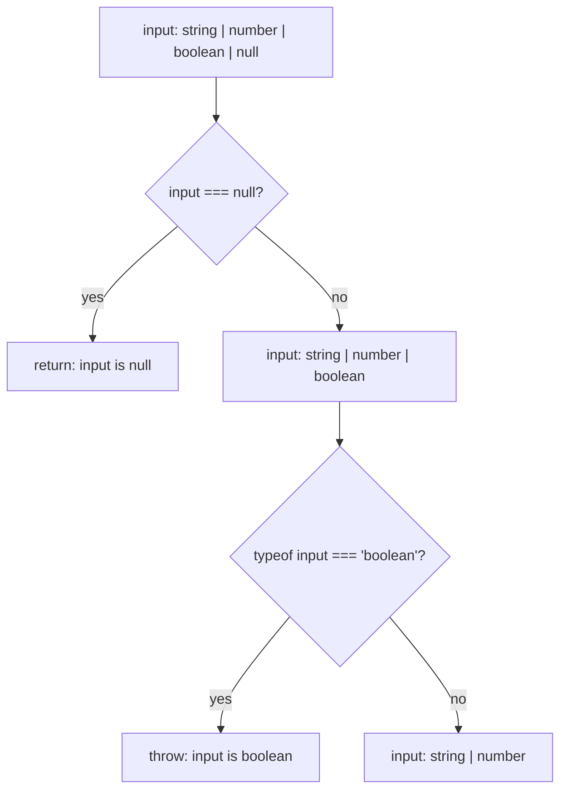

## Introduction

A **union type** says a value may be one of several types: `string | number | null`. That is honest, but it is also limiting. On a value of that type you may only do what is valid for *every* member, which is almost nothing — you cannot call `.toUpperCase()` because it might be a number, and you cannot call `.toFixed()` because it might be a string. The same is true, more strongly, for `unknown`, the type of values you know nothing about yet.

In plain JavaScript you handle this with runtime checks:

```typescript title="format.ts"
function format(value: string | number | null): string {
  if (value === null) return "N/A";
  if (typeof value === "string") return value.trim();
  return value.toFixed(2);
}

console.log(format(null));
console.log(format("  hello "));
console.log(format(3.14159));
```

```output
N/A
hello
3.14
```

What makes this compile is **narrowing**: TypeScript reads your checks and, inside each branch, uses a more specific type than the one you declared. After `value === null` has returned, `value` can no longer be `null`. Inside the `typeof value === "string"` branch it is a `string`, so `.trim()` is allowed. On the last line, both other possibilities have been eliminated, so it must be a `number`.

You did not write any type-level code to get this; the compiler worked it out from ordinary JavaScript. That is the design goal of narrowing — JavaScript developers already write these checks, so TypeScript understands them rather than inventing new syntax. When the built-in checks are not enough, you can teach the compiler new ones with **type guards** and **assertion functions**.

Narrowing is how TypeScript code works with unions, optional values, errors in `catch` blocks, DOM events and JSON. Every topic that follows in this track relies on it.

## Before you start

- **Union types** — `A | B` and why only shared members are usable. See [[b2-unions]].
- **`unknown`** — the safe "could be anything" type that must be narrowed before use. See [[b2-unknown]].
- **Strict null checks** — why `null` and `undefined` are separate types that must be ruled out. See [[b2-strict-null-checks]].
- **JavaScript's `typeof` operator and truthiness** — what `typeof` returns at runtime and which values are falsy. See [[b1-typeof]] and [[b1-truthy-falsy]].

Comparing a literal-typed tag, such as `shape.kind === "circle"`, is also narrowing; it gets its own lesson in [[b2-discriminated-unions]].

## The intuition: eliminating suspects

Think of a detective with a list of suspects. Each piece of evidence rules some of them out: "the culprit was tall" removes the short ones. By the end, one name is left, and the detective can act on everything known about that person.

A union type is the list of suspects. Each runtime check in your code is a piece of evidence, and the compiler crosses off every member that the check rules out. In the branch where `typeof value === "string"` is true, everything that is not a string has been crossed off; in the branch where it is false, the strings have been crossed off. When nothing is left, the type is `never`, the empty type: the compiler has proven the branch cannot be reached.

The analogy holds up well with one caveat. The detective's evidence is real, but the compiler only knows the evidence *it can see* and assumes it stays true. If another part of the program changes a value after the check, the compiler will not notice. Most of the "when narrowing is reset" rules later in this lesson are about that gap.

## Declared type and narrowed type

Every variable has a **declared type** — the type in its annotation, or the one inferred when it was declared. At each point in the code, the compiler also tracks a **narrowed type**: the declared type minus whatever the checks above that point have ruled out. When you hover over a variable in your editor, you see the narrowed type for that position.

The analysis that computes it is called **control-flow analysis**. The compiler follows every path your code can take — through `if`/`else`, `switch`, `return`, `throw`, `&&`, `||`, `?:` and loops — and asks at each point "which members could the value still be here?"

```typescript
function describe(input: string | number | boolean | null) {
  // input: string | number | boolean | null
  if (input === null) {
    return "nothing";
  }
  // input: string | number | boolean   (null returned above)
  if (typeof input === "boolean") {
    throw new Error("booleans are not supported");
  }
  // input: string | number             (boolean threw above)
  return typeof input === "string" ? input.length : input;
  //                                  string ^      ^ number
}
```

Notice that the narrowing after `return` and `throw` happens *outside* the `if`. Because those branches leave the function, the code after them can only be reached when the condition was false. This "early exit" style is usually the clearest way to write narrowing code: handle the special cases first, then write the main logic against a simple type.

**Assignment narrows too.** When you assign to a variable whose declared type is a union, its narrowed type becomes the type of what you assigned:

```typescript
let id: string | number = "abc";
id.toUpperCase(); // OK: narrowed to string by the assignment
id = 42;
id.toFixed(1);    // OK: now narrowed to number
```

The declared type still limits what you can assign — `id = true` is an error — but between assignments, the compiler uses the narrower type.



## Equality and truthiness

The simplest checks are comparisons.

**Equality with a value.** `x === null`, `x !== undefined`, `x === "auto"` and `x === y` all narrow. Comparing with a literal keeps only the members that could equal it in the true branch and removes that literal from the false branch. Comparing two variables narrows both to what they have in common.

**Loose equality with `null`.** `x == null` is true for both `null` and `undefined` (and nothing else), and TypeScript narrows accordingly: in `if (v == null)` the type is `null | undefined`, and in the `else` branch both are removed. This is the one place where `==` is idiomatic in TypeScript code.

**Truthiness.** In `if (x)`, `x && ...` or `x ? ... : ...`, TypeScript removes `null`, `undefined` and other types whose values are all falsy in the true branch. It is convenient for optional objects:

```typescript
function greet(user?: { name: string }) {
  if (user) {
    return `Hello, ${user.name}`; // user: { name: string }
  }
  return "Hello, guest";
}
```

The trap is that `0`, `""` and `NaN` are also falsy. For `count: number | undefined`, `if (count)` treats `0` like "missing". The type in the false branch is still `number | undefined` — TypeScript is accurate about it — but the logic is probably wrong. Use `count !== undefined` (or `count != null`) when zero or the empty string are valid values. The same applies to `||` defaults: `count || 10` replaces a real `0` with `10`, while `count ?? 10` replaces only `null` and `undefined` ([[b1-nullish-coalescing]]).

## typeof narrowing {#b2-typeof-narrowing}

**`typeof` narrowing** is TypeScript's use of JavaScript's `typeof` operator to narrow a union of primitive types. At runtime, `typeof x` returns one of eight strings: `"string"`, `"number"`, `"bigint"`, `"boolean"`, `"symbol"`, `"undefined"`, `"function"` or `"object"`. When you compare the result with one of those strings, TypeScript keeps only the members of the union that would produce it.

```typescript title="pad.ts"
function pad(input: string | number, width: number): string {
  const text = typeof input === "number" ? String(input) : input;
  return text.padStart(width, "0");
}

console.log(pad(7, 3));
console.log(pad("42", 5));
```

```output
007
00042
```

In the true branch of the conditional, `input` is `number`; in the false branch, the only remaining member is `string`. `typeof` also works in a `switch`, where each `case` narrows to the matching members and `default` gets whatever is left:

```typescript
function kindOf(v: string | number | boolean) {
  switch (typeof v) {
    case "string": return `text of length ${v.length}`;
    case "number": return `number ${v.toFixed(1)}`;
    default:       return `flag ${v}`;          // v: boolean
  }
}
```

### The blind spots

`typeof` is precise for primitives and blurry for everything else. Three cases catch people out.

**`typeof null` is `"object"`.** This is a bug from the first version of JavaScript that can never be fixed without breaking the web. TypeScript models it faithfully: for `x: string[] | null`, the branch `typeof x === "object"` still contains `null`.

```typescript title="typeof-null.ts"
function firstItem(x: string[] | null) {
  if (typeof x === "object") {
    return x[0];
  }
}
```

```output
typeof-null.ts(3,12): error TS18047: 'x' is possibly 'null'.
```

The compiler caught it. Check `x !== null` explicitly, either instead of the `typeof` test or together with it: `typeof x === "object" && x !== null` narrows `unknown` to `object`.

**Arrays, dates, maps and class instances are all `"object"`.** `typeof` cannot tell them apart. Use `Array.isArray(x)` for arrays (TypeScript narrows on it) and `instanceof` for class instances such as `Date` and `Map` (next section).

**Functions are `"function"`, not `"object"`.** That is useful: `typeof callback === "function"` is the standard way to narrow `string | (() => string)`. On a value of type `unknown`, it narrows to the broad `Function` type, which you can call only loosely; prefer a more specific union where you can.

Finally, do not confuse this runtime operator with `typeof` in a *type* position, such as `type Config = typeof defaultConfig`. That form asks the compiler for the type of a variable and has nothing to do with narrowing; see [[b2-typeof]].

## instanceof narrowing {#b2-instanceof-narrowing}

**`instanceof` narrowing** uses JavaScript's `instanceof` operator to narrow a value to an instance of a particular class. At runtime, `x instanceof C` walks `x`'s prototype chain and returns `true` if it finds `C.prototype` there ([[b1-instanceof]], [[b1-prototype-chain]]). TypeScript narrows `x` to `C` in the true branch and removes `C` from the union in the false branch.

It is the right tool for built-in classes (`Date`, `Error`, `Map`, `RegExp`, DOM classes such as `HTMLInputElement`) and for your own classes. A very common use is the `catch` block. With `strict` on, a caught error has type `unknown`, because JavaScript lets you `throw` anything:

```typescript title="errors.ts"
class HttpError extends Error {
  constructor(public status: number, message: string) {
    super(message);
    this.name = "HttpError";
  }
}

function toMessage(err: unknown): string {
  if (err instanceof HttpError) return `[${err.status}] ${err.message}`;
  if (err instanceof Error) return err.message;
  return String(err);
}

for (const thrown of [new HttpError(404, "Not found"), new TypeError("bad input"), "oops"]) {
  try {
    throw thrown;
  } catch (err) {
    console.log(toMessage(err));
  }
}
```

```output
[404] Not found
bad input
oops
```

The order of the checks matters. `HttpError` extends `Error`, so every `HttpError` is also an `instanceof Error`. Checking the more specific class first gives it its own branch; checking `Error` first would swallow it. In the browser, the same pattern handles events: `if (event.target instanceof HTMLInputElement)` narrows `EventTarget | null` so you can read `.value`.

### Where instanceof does not work

**Interfaces and type aliases.** They exist only at compile time, so there is nothing to check at runtime:

```typescript title="interface-instanceof.ts"
interface User { name: string }

function isUser(x: unknown) {
  return x instanceof User;
}
```

```output
interface-instanceof.ts(4,23): error TS2693: 'User' only refers to a type, but is being used as a value here.
```

Use the `in` operator or a custom type guard (below) for structural types.

**Plain objects from JSON.** `JSON.parse` produces plain objects whose prototype is `Object.prototype`. Even if the data has every field of your `Order` class, `parsed instanceof Order` is `false`. Either construct an instance from the parsed data, or check its shape.

**Values from another realm.** Each iframe, worker and Node `vm` context has its own set of built-in constructors. An array created in an iframe is not `instanceof` the parent page's `Array`. `Array.isArray` works across realms, which is one reason to prefer it over `instanceof Array`.

**Primitives.** `"abc" instanceof String` is `false`, and TypeScript rejects `instanceof` when the left side is a primitive type. Use `typeof` for primitives.

A class can customise `instanceof` with a static `Symbol.hasInstance` method; JavaScript calls it instead of walking the prototype chain. Since TypeScript 5.3, if that method is declared as a type predicate (`static [Symbol.hasInstance](v: unknown): v is Point`), the compiler narrows using the predicate's type. This is rare in application code but explains why `instanceof` is ultimately a runtime convention, not a type-level fact.

## The in operator {#b2-in-operator}

**`in` narrowing** uses JavaScript's `"key" in obj` check — "does this object, or anything on its prototype chain, have a property named `key`?" — to narrow a union of object types that differ in which properties they have. It is the structural counterpart to `instanceof`: it works for interfaces and type aliases, because it checks shape rather than class.

```typescript title="in-pets.ts"
type Cat = { name: string; meow(): string };
type Dog = { name: string; bark(): string };

function speak(pet: Cat | Dog): string {
  if ("meow" in pet) {
    return pet.meow(); // pet: Cat
  }
  return pet.bark();   // pet: Dog
}

console.log(speak({ name: "Tom", meow: () => "Meow" }));
console.log(speak({ name: "Rex", bark: () => "Woof" }));
```

```output
Meow
Woof
```

In the true branch, TypeScript keeps the members that declare `meow` (as required or optional). In the false branch, it keeps the members that do not declare it as required. That rule produces a subtlety with **optional properties**: if `meow` were optional on `Cat` (`meow?(): string`), a cat could lack it at runtime, so `Cat` would stay in *both* branches and the false branch would be `Cat | Dog`. `in` narrowing works best when the distinguishing property is required on one side and absent on the other.

### Narrowing unknown objects

Since TypeScript 4.9, `in` also narrows objects whose type does not mention the property. This is what makes it useful for validating data of unknown shape:

```typescript
function hasName(x: unknown): boolean {
  if (typeof x === "object" && x !== null && "name" in x) {
    // x: object & Record<"name", unknown>
    return typeof x.name === "string";
  }
  return false;
}
```

After the `in` check, TypeScript knows `x` has a `name` property of type `unknown`, so `x.name` is allowed and can be narrowed further with `typeof`. The `typeof x === "object" && x !== null` guard comes first because `in` throws a `TypeError` at runtime if its right-hand side is a primitive, and TypeScript rejects that case at compile time too.

### Limits and when to prefer a tag

- `in` is true for **inherited** properties as well as own ones: `"toString" in {}` is `true`. Pick a property that is specific to the member you are looking for. `Object.hasOwn(obj, key)` checks own properties only, but TypeScript does not narrow on it.
- On arrays, `in` checks indices: `0 in ["a"]` is `true`, `1 in ["a"]` is `false`. Use `.length` instead; it is clearer.
- A property can be present with the value `undefined`. `"email" in contact` tells you the key exists, not that it holds a string.

For unions you design yourself, a shared literal tag ([[b2-discriminated-unions]]) is more robust than checking for property names: it survives a property being renamed, made optional or added to several members. Use `in` for types you do not control, such as third-party library shapes, and for validating unknown objects.

## Custom type guards {#b2-custom-type-guards}

A **custom type guard** is a function you write whose return type is a **type predicate** of the form `param is Type`. It returns a boolean at runtime, and when a call to it returns `true`, TypeScript narrows the argument to `Type` at the call site. Guards let you package a check the compiler cannot infer by itself — "this `unknown` value is a valid `User`" — and reuse it everywhere.

Why is a guard needed? A check written inside a helper function does not affect the caller's types unless the function says what it proves. Consider validating API data:

```typescript title="guards.ts"
type User = { id: number; name: string; email?: string };

function isUser(value: unknown): value is User {
  if (typeof value !== "object" || value === null) return false;
  if (!("id" in value) || typeof value.id !== "number") return false;
  if (!("name" in value) || typeof value.name !== "string") return false;
  // email is optional, but if present it must be a string
  return !("email" in value) || typeof value.email === "string";
}

const payload: unknown = JSON.parse(
  '[{"id":1,"name":"Ada"},{"id":"2","name":"Bob"},{"id":3,"name":"Cy","email":"c@x.io"}]',
);

if (Array.isArray(payload)) {
  const users = payload.filter(isUser); // users: User[]
  console.log(users.map((u) => u.name).join(", "));
}
```

```output
Ada, Cy
```

`isUser` checks every property the `User` type requires and the optional one if present. Because its return type is `value is User`, `payload.filter(isUser)` is typed `User[]` — `Array.prototype.filter` has an overload that accepts a type predicate. Bob's record is dropped because its `id` is a string.

### The compiler trusts the predicate

TypeScript does **not** check that the body of a guard actually proves what the signature claims. The predicate is a promise from you to the compiler, just like a type assertion with `as` ([[b2-type-assertions]]), and arguably more dangerous, because it is reused in many places and looks like a real check. This guard compiles:

```typescript
function isUser(value: unknown): value is User {
  return typeof value === "object"; // also true for null and for { foo: 1 }
}
```

Every caller now believes `null` is a `User`. The crash will happen far away, in code that trusted the narrowing. Write guards that check every property the rest of the code relies on, test them with bad inputs, and keep them close to the type they describe. For large or nested shapes, a schema library such as Zod generates both the check and the type from one definition, which removes the chance of the two disagreeing ([[b2-type-safe-apis]]).

### The false branch narrows too

A predicate narrows in both directions: when the guard returns `false`, TypeScript *removes* the type from the union. That is a trap when a guard checks more than the type:

```typescript
function isNonEmptyString(x: unknown): x is string {
  return typeof x === "string" && x.length > 0;
}

function label(v: string | number) {
  if (isNonEmptyString(v)) return v;
  return v.toFixed(2); // v: number — but v could be ""!
}
```

At compile time, the `else` path thinks `v` is a `number`. At runtime, `label("")` reaches `"".toFixed(2)` and throws a `TypeError`. A predicate should mean exactly "the value is of this type". Express extra conditions separately: `typeof v === "string" && v.length > 0`, or a branded type ([[b2-branded-types]]) when "non-empty string" is a concept worth naming.

The compiler does enforce one rule: the predicate's type must be assignable to the parameter's type. `function f(x: string): x is number` is an error (TS2677), because a string can never be a number.

### Inferred type predicates (TypeScript 5.5+)

Since TypeScript 5.5, the compiler infers a type predicate for simple functions that return a narrowing check of their parameter and nothing else. `const isString = (x: unknown) => typeof x === "string"` is inferred as `(x: unknown) => x is string`, and `[1, null, 2].filter((x) => x !== null)` is typed `number[]` with no annotation. Before 5.5 that `filter` call returned `(number | null)[]`, which is why older code is full of explicit guards such as `(x): x is number => x !== null`. Inference only happens when the predicate is exact in both directions, so `isNonEmptyString` above would not get one.

### Assertion functions

An **assertion function** is the throwing cousin of a type guard. Instead of returning a boolean, it returns normally when the check passes and throws when it fails, and its return type uses the `asserts` keyword:

```typescript title="asserts.ts"
function assertIsString(value: unknown, name: string): asserts value is string {
  if (typeof value !== "string") {
    throw new TypeError(`${name} must be a string, got ${typeof value}`);
  }
}

function assert(condition: unknown, message: string): asserts condition {
  if (!condition) throw new Error(message);
}

function connect(env: Record<string, unknown>) {
  assertIsString(env.DATABASE_URL, "DATABASE_URL");
  const url = env.DATABASE_URL; // url: string
  assert(url.startsWith("postgres://"), "DATABASE_URL must be a postgres URL");
  return `connecting to ${url}`;
}

console.log(connect({ DATABASE_URL: "postgres://localhost/app" }));
try {
  connect({ DATABASE_URL: 5432 });
} catch (e) {
  console.log((e as Error).message);
}
```

```output
connecting to postgres://localhost/app
DATABASE_URL must be a string, got number
```

After `assertIsString(env.DATABASE_URL, ...)`, the rest of the function sees `env.DATABASE_URL` as a `string` — there is no `if`, because the only way to reach the next line is for the check to pass. The second form, `asserts condition`, narrows using whatever expression you pass, like Node's `assert` module. Assertion functions suit start-up configuration, test code and invariants that indicate a programming error when broken.

One requirement surprises people: an assertion function must be called through a name with an **explicit type annotation**. `const assertIsString = (v: unknown): asserts v is string => {...}` fails at the call site with error TS2775, "Assertions require every name in the call target to be declared with an explicit type annotation." Use a `function` declaration, or annotate the `const` with a function type.

Guards can also be methods: a return type of `this is Folder` on a method of a `FileSystemItem` class narrows the object the method was called on.

## How narrowing works internally

The compiler builds a **control-flow graph** for each function: a node for every assignment, condition and branch point, linked in the order code can run. When you use a variable, the compiler walks backwards from that use through the graph, applying each condition it passes ("on this edge, `typeof x === "string"` was true"), and merges the results where paths join. The answer is the narrowed type at that position. This is done lazily, per use, which is why narrowing is cheap even in long functions.

Narrowing applies to **references**: variables, parameters, and property-access paths such as `user.address.city` or `obj["key"]` with a literal key. It does not apply to arbitrary expressions. Checking `getUser() !== null` says nothing about the *next* call to `getUser()`, which might return something else; store the result in a `const` and check that.

### What resets narrowing

**Assignment.** Assigning to a variable replaces its narrowed type with the type of the new value. Assigning to `obj.prop` resets narrowing of that path.

**Callbacks and closures.** A callback might run later, after the variable has changed. For a `const` or a parameter that is never reassigned, narrowing carries into the callback. For a `let` that is assigned again *after* the callback is created, it does not:

```typescript
function demo(value: string | number) {
  let current = value;
  if (typeof current === "string") {
    setTimeout(() => {
      current.toUpperCase(); // error: current is string | number here
    });
  }
  current = 1; // this later assignment is why the callback cannot trust the check
}
```

Since TypeScript 5.4, if there are no assignments after the closure is created, the narrowing is kept. The fix in older versions, and the clearest fix in any version, is to copy the narrowed value into a `const` before the callback.

### What does not reset narrowing — and why that is a risk

Function calls do **not** reset narrowing of property paths, and neither does `await`:

```typescript
async function save(form: { email: string | null }, validate: () => Promise<void>) {
  if (form.email !== null) {
    await validate();          // could set form.email = null
    form.email.toLowerCase();  // still narrowed to string
  }
}
```

The compiler keeps `form.email` narrowed to `string` across the `await`, even though `validate` could set it back to `null`. Re-checking after every call would make narrowing almost useless, so TypeScript deliberately trades soundness for usability here. The practical defence is the same as above: copy the value into a local `const` right after checking it (`const email = form.email`), so that later code uses a value nobody else can change.

## Worked example: formatting unknown values for a log

Logging and error reporting code receives values of every type. The function below uses each kind of narrowing in one place. Read the comments for which check narrows what.

```typescript title="log-format.ts"
type Tagged = { kind: "money"; cents: number } | { kind: "percent"; ratio: number };

function isTagged(v: object): v is Tagged {
  if (!("kind" in v)) return false;
  if (v.kind === "money") return "cents" in v && typeof v.cents === "number";
  if (v.kind === "percent") return "ratio" in v && typeof v.ratio === "number";
  return false;
}

function formatForLog(value: unknown): string {
  if (value == null) return String(value);                     // null | undefined
  if (typeof value === "string") return JSON.stringify(value); // string
  if (typeof value === "number" || typeof value === "bigint" || typeof value === "boolean") {
    return String(value);
  }
  if (typeof value === "function") return `[function ${value.name || "anonymous"}]`;
  if (typeof value !== "object") return value.toString();      // symbol is all that is left
  // from here on, value: object
  if (Array.isArray(value)) return `[${value.map(formatForLog).join(", ")}]`;
  if (value instanceof Date) return value.toISOString();
  if (value instanceof Error) return `${value.name}: ${value.message}`;
  if (isTagged(value)) {
    switch (value.kind) {
      case "money": return `$${(value.cents / 100).toFixed(2)}`;
      case "percent": return `${(value.ratio * 100).toFixed(1)}%`;
    }
  }
  return JSON.stringify(value);
}

const samples: unknown[] = [
  null,
  "hi",
  42n,
  Symbol("id"),
  function retry() {},
  [1, "two", undefined],
  new Date(Date.UTC(2024, 0, 15)),
  new RangeError("too big"),
  { kind: "money", cents: 1999 },
  { kind: "percent", ratio: 0.075 },
  { kind: "money", cents: "free" },
];

for (const s of samples) console.log(formatForLog(s));
```

```output
null
"hi"
42
Symbol(id)
[function retry]
[1, "two", undefined]
2024-01-15T00:00:00.000Z
RangeError: too big
$19.99
7.5%
{"kind":"money","cents":"free"}
```

Walk through the narrowing in order:

1. `value == null` removes both `null` and `undefined`. After this line, `value` is still `unknown` to the compiler, but every later check now runs on a value that is safe to inspect.
2. The `typeof` checks peel off the primitives. After the `typeof value !== "object"` line returns, the only thing that could have reached it is a `symbol`; everything below works with `object`.
3. `Array.isArray` narrows to `any[]`. The recursive call `value.map(formatForLog)` formats each element, which is why `undefined` inside the array appears in the output.
4. `instanceof` distinguishes `Date` and `Error`. `RangeError` is a subclass of `Error`, so it matches the `Error` branch and its `name` property supplies `"RangeError"`.
5. `isTagged` is a custom guard that uses `in` and `typeof` to validate the shape, then the `switch` on `value.kind` is ordinary discriminated-union narrowing.
6. The last sample has `kind: "money"` but a string for `cents`. The guard rejects it, so it falls through to `JSON.stringify` instead of producing `$NaN`.

The `isTagged` guard takes `object` rather than `unknown` because the caller has already proven that much — a guard's parameter type should be as narrow as the call sites allow.

## In real systems

**Catch blocks.** With `strict` on, `useUnknownInCatchVariables` makes caught errors `unknown`. Every error handler in a modern codebase starts with `instanceof` checks, as in `toMessage` above.

**API and storage boundaries.** `fetch(...).then((r) => r.json())`, `localStorage.getItem`, `postMessage` and URL parameters all produce data the compiler cannot vouch for. Teams parse it to `unknown` and narrow with guards or a schema library before the rest of the application sees it.

**DOM events.** `event.target` is `EventTarget | null`. Narrowing with `instanceof HTMLInputElement` or `instanceof HTMLElement` is how you read `.value` or call `.closest()` without a cast.

**Optional values everywhere.** `Map.prototype.get`, `Array.prototype.find`, optional props in React components and optional config fields all return `T | undefined`. Equality and truthiness narrowing are the everyday tools for them.

**Lint rules.** `typescript-eslint` rules such as `no-unnecessary-condition` flag checks that cannot fail given the narrowed type, which often reveals a type that is wrong ([[b2-eslint-typescript]]).

## Trade-offs and alternatives

| Technique | Works on | Runtime check | Main risk |
|---|---|---|---|
| Equality / truthiness | Literals, `null`, `undefined` | Yes | Truthiness treats `0` and `""` as missing |
| `typeof` | Primitives, functions | Yes | `null` reports `"object"` |
| `instanceof` | Class instances | Yes | Fails for interfaces, JSON and other realms |
| `in` | Object unions, unknown objects | Yes | Inherited and optional properties |
| Discriminant tag | Unions you design | Yes | Tag must be a literal type |
| Type predicate / assertion function | Anything | Whatever you write | A wrong predicate lies to the compiler |
| `as` assertion | Anything | None | Nothing is checked at all |
| Schema library | External data | Yes, generated | Extra dependency and bundle size |

The general rule is to prefer the most specific built-in check that fits, because the compiler verifies it; use a custom guard when the check is about shape; and keep `as` for cases where you genuinely know more than the compiler and can say why in a comment.

## Common mistakes

**Using `typeof x === "object"` to exclude `null`.** It does not. Add `x !== null`.

**Truthiness checks on numbers and strings.** `if (count)` drops `0`; `if (name)` drops `""`. Compare with `undefined` or `null` explicitly.

**`instanceof` with an interface or on JSON data.** Interfaces do not exist at runtime, and parsed JSON is never an instance of your class. Use `in`, a guard or a schema.

**A guard that does not check what it claims.** `return (pet as Fish).swim !== undefined` checks one property and trusts the rest. If other code reads more properties, check them too.

**A guard that checks more than its type.** `x is string` returning `false` for `""` makes the `else` branch believe the value is not a string. Keep predicates exact.

**Expecting narrowing to survive a reassignment or a later callback.** Copy narrowed values into a `const` before using them in a closure or after an `await`.

**Checking one expression and using another.** `if (map.get(k)) map.get(k).x` fails, because the second call is a new expression. Write `const v = map.get(k); if (v) v.x`.

**Silencing the compiler with `!` or `as` instead of narrowing.** `value!.trim()` compiles, and crashes when the value is `null`. A one-line check documents the assumption and enforces it.

## Interview perspective

**"What is type narrowing?"** Define it as control-flow analysis refining a declared union type inside branches, list the built-in checks, and give one example where `return` or `throw` narrows the code that follows. Distinguishing the declared type from the narrowed type is a sign of a solid mental model.

**"Why is `typeof null` a problem in TypeScript?"** It returns `"object"`, so `typeof x === "object"` keeps `null` in the union. The compiler reports it, and the fix is an explicit `x !== null`.

**"`instanceof` versus `in` versus a discriminant?"** `instanceof` is nominal and runtime-class based; `in` is structural; a discriminant is the most reliable for your own unions. Mention that interfaces cannot be used with `instanceof` and why.

**"Write `isUser(x: unknown): x is User`."** Interviewers watch for the `null` check, `in` before property access, `typeof` on each field, and handling optional fields. The follow-up is usually "what if the guard is wrong?" — the answer is that the compiler trusts it completely, so it must be tested.

**"Does narrowing survive an `await`?"** Yes for property paths, and that is unsound by design; a strong answer explains the trade-off and the `const` copy defence.

```quiz
Q: For `x: string[] | null`, what is the type of `x` inside `if (typeof x === "object") { ... }`?
- [ ] `string[]`
- [x] `string[] | null`
- [ ] `object`
- [ ] `never`
> At runtime, `typeof null` is `"object"`, so a `null` value would enter this branch. TypeScript models that faithfully and keeps `null` in the union. Add `x !== null` to remove it. `string[]` would be the answer only if `typeof` could tell `null` apart from objects, which it cannot.
```

```quiz
Q: Why does `payload instanceof Order` return false for data from `JSON.parse`, even when every field matches?
- [ ] `instanceof` only works on built-in classes
- [ ] TypeScript removes `instanceof` checks when compiling
- [x] Parsed JSON objects have `Object.prototype` as their prototype, so `Order.prototype` is not on their chain
- [ ] JSON numbers are stored as strings
> `instanceof` asks whether the constructor's `prototype` object appears on the value's prototype chain. `JSON.parse` creates plain objects, so the class's prototype is never there, regardless of the fields. Use a structural guard, or construct an `Order` from the validated data.
```

```quiz
Q: `function isPositive(x: unknown): x is number { return typeof x === "number" && x > 0; }` — what goes wrong in `if (isPositive(v)) {...} else { ... }` for `v: number | string`?
- [ ] The guard does not compile because of the `> 0` check
- [ ] The true branch is typed `unknown`
- [x] The else branch is typed `string`, even though `v` might be the number `-1`
- [ ] Nothing; the predicate is exact
> When a guard returns `false`, TypeScript removes the predicate's type from the union, so the else branch believes `v` is a `string`. But `-1` is a number for which the guard returns `false`. Predicates must mean exactly "is this type"; express extra conditions separately.
```

## Practice

1. Rewrite a function that takes `value: string | string[] | undefined` and returns a `string[]`, using early returns so that each line after a check works with a simpler type.
2. For `count: number | undefined`, write two versions of `display(count)`, one with `if (count)` and one with `count !== undefined`, and find the input where they differ.
3. Write `isRecord(x: unknown): x is Record<string, unknown>` and use it to implement `getPath(obj: unknown, path: string[]): unknown`, which walks nested objects safely.
4. Create a class hierarchy `AppError` → `NotFoundError`, `ValidationError` (with a `fields: string[]` property), and write `toHttpStatus(err: unknown): number` using `instanceof` in the right order.
5. Write an assertion function `assertNonNull<T>(value: T, message: string): asserts value is NonNullable<T>` and use it on the result of `document.querySelector`. Then try declaring it as an arrow function assigned to an unannotated `const`, and read the error.
6. Take the `save(form, validate)` example and change it so that a `validate` that clears `form.email` cannot cause a crash.

## Quick revision {#quick-revision}

- Narrowing = control-flow analysis refining a declared type into a narrower type at each position, based on runtime checks.
- Narrowing flows through `if`/`else`, `switch`, `return`, `throw`, `&&`, `||`, `?:` and assignments; an emptied union is `never`.
- `x == null` covers `null` and `undefined`. Truthiness also removes `0`, `""` and `NaN` in practice — use explicit comparisons for numbers and strings.
- `typeof`: `"string" | "number" | "bigint" | "boolean" | "symbol" | "undefined" | "function" | "object"`. `typeof null === "object"`; arrays need `Array.isArray`.
- `instanceof`: prototype-chain check for classes and built-ins; order subclasses first; fails for interfaces (TS2693), JSON and other realms; `Symbol.hasInstance` predicates narrow since TS 5.3.
- `in`: structural; keeps members that declare the property; optional properties stay in both branches; narrows unknown objects to `object & Record<"key", unknown>` (TS 4.9+); right side must be an object.
- Type predicate `x is T`: compiler trusts it; narrows the false branch by removing `T`; predicate type must be assignable to the parameter (TS2677).
- TS 5.5 infers predicates for exact checks, so `filter((x) => x !== null)` drops `null` from the type.
- `asserts x is T` / `asserts cond`: throw on failure; call target needs an explicit type annotation (TS2775).
- Reset: assignment; `let` captured in callbacks when reassigned later. Not reset: function calls and `await` on property paths — copy to a `const`.

## Key takeaways {#key-takeaways}

- Narrowing lets ordinary JavaScript checks refine a union or `unknown` into a precise type, so you rarely need casts.
- Each built-in check has a blind spot: `typeof` and `null`, `instanceof` and interfaces or JSON, `in` and optional or inherited properties, truthiness and `0` or `""`.
- Custom type guards and assertion functions extend narrowing to any shape, but the compiler trusts them completely, so they must check exactly what they claim.
- Narrowing follows the variable or property path you checked; assignments and later-reassigned closures reset it, while calls and `await` do not — copy checked values into a `const` when it matters.
- Data from outside the program starts as `unknown` and becomes typed only after narrowing; that boundary is where most real TypeScript safety is won or lost.
