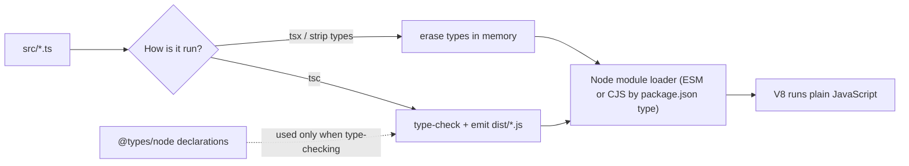

## Introduction

TypeScript started as a browser story — typed DOM access, typed React components — but most TypeScript code today also runs on the server: API servers, command-line tools, build scripts, serverless functions. The language is identical. What changes is the **host**: instead of `window` and `document`, the program talks to `process`, the file system, sockets and `Buffer`s, and instead of a bundler deciding how modules work, Node.js's own module loader does.

Those differences cause most of the friction people hit when they first write Node code in TypeScript. `Cannot find name 'process'`. `Relative import paths need explicit file extensions`. `__dirname is not defined in ES module scope`. A `tsconfig.json` copied from a frontend project that happily type-checks `document.title` in server code that will crash. None of these are hard once you know what is going on, and this lesson explains each one.

The lesson has two parts. The first sets up and runs a Node.js TypeScript project and types the Node-specific parts of a program. The second, a nested topic, types an **Express** server — the most common Node web framework and a staple of backend interviews.

## Before you start

- **Node.js as a runtime** — what Node provides beyond the JavaScript language. See [[b1-runtime-nodejs]].
- **`tsconfig.json` and compilation** — how `tsc` reads its configuration and emits JavaScript. See [[b2-tsconfig]] and [[b2-tsc-compilation]].
- **Modules, ESM and CommonJS** — `import`/`export` versus `require`. See [[b2-ts-modules]] and [[b2-esm-vs-cjs-ts]].
- **Declaration files and module augmentation** — where `@types/*` come from and how to add to existing types. See [[b2-declaration-files]] and [[b2-module-augmentation]].
- **`unknown` and narrowing** — for errors and environment variables. See [[b2-unknown]] and [[b2-narrowing]].

## The intuition: same language, different host types

TypeScript itself knows nothing about browsers or servers. It knows the JavaScript language (described by the `lib` option: `es2023` gives you `Array.prototype.findLast`, `Promise`, `Map` and so on) and whatever **ambient declarations** you load. In the browser, the `dom` library declares `window`, `document` and `fetch`. On Node, the `@types/node` package declares `process`, `Buffer`, `require`, and every built-in module such as `node:fs` and `node:http`.

So a TypeScript project is "for Node" or "for the browser" only because of which host types it loads. Load the wrong set and the compiler checks your code against the wrong world: with `dom` in a server project, `document.title = "x"` compiles and then throws `ReferenceError` at runtime; without `@types/node`, perfectly valid `process.env` code does not compile. Configuring a Node project is mostly about loading exactly the right host types and telling the compiler how Node loads modules.

## Setting up a project

A minimal Node.js TypeScript project needs two development dependencies: `typescript` (the compiler) and `@types/node` (the host types). Pick the `@types/node` major version that matches the Node.js major version you deploy — `@types/node@22` for Node 22 — so the compiler does not offer APIs your runtime lacks.

A sound `tsconfig.json` for a Node 22 service that uses ES modules:

```json title="tsconfig.json"
{
  "compilerOptions": {
    "target": "es2023",
    "module": "nodenext",
    "lib": ["es2023"],
    "types": ["node"],
    "strict": true,
    "rootDir": "src",
    "outDir": "dist",
    "sourceMap": true,
    "skipLibCheck": true
  },
  "include": ["src"]
}
```

Each option has a job:

- **`module: "nodenext"`** tells TypeScript to model Node's real module loader: whether each file is ESM or CommonJS, how imports are resolved, and what syntax is allowed. It also sets `moduleResolution` to `nodenext`. For Node code this is the correct choice; `"node16"` is the same idea pinned to older Node behaviour.
- **`target: "es2023"`** controls which syntax is downlevelled. Node 22 supports everything up to ES2023 and beyond natively, so nothing needs rewriting; a lower target only makes the output bigger and slower.
- **`lib: ["es2023"]`** — note: *no* `"dom"`. This is what makes `document` a compile error in server code.
- **`types: ["node"]`** loads `@types/node`. This option matters more than it used to: in TypeScript 6.0 its default changed to an empty list, so a project with no `types` setting reports `Cannot find name 'process'` even when `@types/node` is installed. (TypeScript 5.x and earlier loaded every installed `@types/*` package automatically.) Listing exactly what you need is also faster and avoids type packages for test runners leaking into production code.
- **`rootDir` and `outDir`** map `src/server.ts` to `dist/server.js`. Production runs the compiled files in `dist`.
- **`sourceMap: true`** emits `.js.map` files so stack traces can point at TypeScript lines when Node runs with `--enable-source-maps` ([[b2-source-maps-ts]]).
- **`skipLibCheck: true`** skips type-checking other packages' `.d.ts` files, which saves time and avoids errors from conflicting third-party declarations.

## Modules: ESM, CommonJS and the `.js` extension

Node.js supports two module systems. **CommonJS** (`require`/`module.exports`) is the original; **ES modules** (ESM, `import`/`export`) are the language standard. Node decides which one a `.js` file is by looking at the nearest `package.json`: `"type": "module"` means ESM, absent or `"commonjs"` means CommonJS. The extensions `.mjs` and `.cjs` force one or the other regardless.

With `module: "nodenext"`, TypeScript applies the same rules to your *source* files — `.ts` follows `package.json`, `.mts` is always ESM, `.cts` always CommonJS — and emits each file in the matching format. The details and interoperability rules are in [[b2-esm-vs-cjs-ts]]; three consequences show up immediately in day-to-day code.

### Relative imports need the `.js` extension

In ESM, Node does not guess file extensions: `import "./config"` fails at runtime with `ERR_MODULE_NOT_FOUND`. TypeScript therefore requires the extension in ESM files — and the extension you write is the one that will exist *at runtime*, `.js`, even though the file on disk is `config.ts`:

```typescript
import { loadConfig } from "./config";
```

```output
error TS2835: Relative import paths need explicit file extensions in ECMAScript imports when '--moduleResolution' is 'node16' or 'nodenext'. Did you mean './config.js'?
```

TypeScript does not rewrite import paths by default; it resolves `./config.js` to `config.ts` during type-checking and emits the path unchanged. Writing `.js` in a `.ts` file looks odd at first, but it is the accurate description of the emitted program. TypeScript 5.7 added `rewriteRelativeImportExtensions`, which lets you write `./config.ts` and rewrites it to `.js` on emit — useful for code that is also run directly by Node's type stripping, described below.

### `__dirname` does not exist in ESM

CommonJS modules receive `__dirname` and `__filename` from Node's module wrapper. ES modules do not, and `@types/node` still declares them globally, so TypeScript will not save you:

```output
ReferenceError: __dirname is not defined in ES module scope
```

Use `import.meta.dirname` and `import.meta.filename` (Node 20.11 and later), or derive the path from `import.meta.url` with `fileURLToPath` on older versions.

### Top-level `await` works in ESM

ES modules may use `await` at the top level, which makes startup scripts much simpler. CommonJS files may not. The worked example below uses it.

## Typing Node APIs

`@types/node` types every built-in module, often with overloads that react to your arguments. The worked example shows the patterns you meet most.

```typescript title="src/config.ts"
import { readFile } from "node:fs/promises";
import path from "node:path";

export type AppConfig = { port: number; logLevel: "info" | "debug" };

export async function loadConfig(dir: string): Promise<AppConfig> {
  const file = path.join(dir, "config.json");
  let text: string;
  try {
    text = await readFile(file, "utf8");          // Promise<string> because of "utf8"
  } catch (err: unknown) {
    if (err instanceof Error && (err as NodeJS.ErrnoException).code === "ENOENT") {
      return { port: 3000, logLevel: "info" };     // no file: use defaults
    }
    throw err;
  }
  const raw: unknown = JSON.parse(text);
  const o = (typeof raw === "object" && raw !== null ? raw : {}) as Record<string, unknown>;
  return {
    port: typeof o.port === "number" ? o.port : 3000,
    logLevel: o.logLevel === "debug" ? "debug" : "info",
  };
}
```

```typescript title="src/main.ts"
import { writeFile, mkdtemp } from "node:fs/promises";
import { tmpdir } from "node:os";
import path from "node:path";
import { loadConfig } from "./config.js";

console.log(import.meta.dirname === path.dirname(import.meta.filename));

const dir = await mkdtemp(path.join(tmpdir(), "cfg-"));
console.log(await loadConfig(dir));
await writeFile(path.join(dir, "config.json"), JSON.stringify({ port: 8080, logLevel: "debug" }));
console.log(await loadConfig(dir));
```

Built with `npx tsc` and run with `node dist/main.js` on Node 22 (with `"type": "module"` in `package.json`):

```output
true
{ port: 3000, logLevel: 'info' }
{ port: 8080, logLevel: 'debug' }
```

Walk through the Node-specific parts:

- **`node:` specifiers** (`node:fs/promises`) name built-in modules unambiguously; `@types/node` declares both the prefixed and unprefixed forms.
- **Overloads follow arguments.** `readFile(file, "utf8")` returns `Promise<string>`. Without the encoding it returns a `Buffer` (shown in current `@types/node` as `NonSharedBuffer`), and `const s: string = await readFile(file)` is a compile error. The type tells you the truth about the bytes.
- **Errors are `unknown`.** In strict mode a `catch` variable is `unknown` ([[b2-unknown]]), because JavaScript can throw anything. System errors from Node carry a `code` such as `"ENOENT"` (file not found) or `"EACCES"` (permission denied); the `NodeJS.ErrnoException` interface describes them. Check `instanceof Error` first, then read `code`. Handling only `ENOENT` and rethrowing everything else is the honest pattern: a missing file means "use defaults", a permissions error should crash loudly.
- **Configuration is parsed, not cast.** `JSON.parse` returns `any`; assigning it to `unknown` and checking each field keeps the boundary rule from [[b2-type-safe-apis]]. A wrong `logLevel` in the file falls back to `"info"` instead of becoming an invalid string typed as `"info" | "debug"`.
- **Top-level `await`** in `main.ts` works because the file is an ES module.

## Typing `process.env`

`@types/node` types `process.env` as `NodeJS.ProcessEnv`, essentially `Record<string, string | undefined>`: any key may be missing, and every value is a string. That is accurate — environment variables are strings set by whatever launched the process.

A common shortcut augments the interface so that particular keys look present:

```typescript
declare global {
  namespace NodeJS {
    interface ProcessEnv {
      DATABASE_URL: string;
    }
  }
}
```

This is [[b2-declaration-merging]], and it compiles, but it is a type assertion in disguise: `process.env.DATABASE_URL` is now typed `string` even when the variable is unset, and the crash happens at the first database call instead of at startup. The robust pattern parses the environment **once, at startup**, into a typed object, and fails fast with every problem listed:

```typescript title="env.ts"
type Env = { PORT: number; DATABASE_URL: string; NODE_ENV: "development" | "production" | "test" };

function loadEnv(source: NodeJS.ProcessEnv): Env {
  const problems: string[] = [];
  const port = Number(source.PORT ?? "3000");
  if (!Number.isInteger(port) || port <= 0) problems.push("PORT must be a positive integer");
  const url = source.DATABASE_URL;
  if (!url) problems.push("DATABASE_URL is required");
  const mode = source.NODE_ENV ?? "development";
  if (mode !== "development" && mode !== "production" && mode !== "test") {
    problems.push(`NODE_ENV has unexpected value "${mode}"`);
  }
  if (problems.length > 0) throw new Error("Invalid environment:\n  " + problems.join("\n  "));
  return { PORT: port, DATABASE_URL: url!, NODE_ENV: mode as Env["NODE_ENV"] };
}

try {
  console.log(loadEnv({ PORT: "8080", DATABASE_URL: "postgres://localhost/app" }));
  loadEnv({ PORT: "eighty", NODE_ENV: "staging" });
} catch (e) {
  console.log((e as Error).message);
}
```

```output
{
  PORT: 8080,
  DATABASE_URL: 'postgres://localhost/app',
  NODE_ENV: 'development'
}
Invalid environment:
  PORT must be a positive integer
  DATABASE_URL is required
  NODE_ENV has unexpected value "staging"
```

The function takes the environment as a parameter, which makes it testable with plain objects as above; in the application you call `loadEnv(process.env)` once and import the result everywhere. The `url!` and `as` at the end are justified by the checks above them — the compiler cannot connect "the problems list is empty" to "`url` is defined". A schema library such as Zod expresses the same rules declaratively, including `z.coerce.number()` for numeric strings. Either way, the rest of the program reads `env.PORT` as a `number` and never touches `process.env` again.

## Running TypeScript on Node

There are three ways to get from `.ts` files to a running process, and most projects use more than one.

| Approach | What happens | Type-checks? | Typical use |
|---|---|---|---|
| `tsc` then `node dist/main.js` | `tsc` type-checks and emits JavaScript; Node runs the output | Yes, at build time | Production builds, libraries |
| `tsx src/main.ts` (or `ts-node`) | A loader transpiles each file in memory with esbuild, then runs it | No (`tsx`) | Fast development loop, scripts |
| `node src/main.ts` | Node's built-in **type stripping** erases type annotations and runs the rest | No | Scripts and tools on recent Node versions |

**Type stripping** is the newest option. Node.js 22.6 added it behind `--experimental-strip-types`, and Node 23.6 and 22.18 enabled it by default. Node replaces type annotations with whitespace and runs the remaining JavaScript, so this file runs directly:

```typescript title="greet.ts"
type Greeting = { name: string; times: number };

function greet({ name, times }: Greeting): string {
  return `Hello, ${name}`.concat("!".repeat(times));
}

const g: Greeting = { name: "Ada", times: 2 };
console.log(greet(g));
```

```output
Hello, Ada!!
```

Two limits follow from "strip, don't compile". First, only **erasable syntax** is supported: TypeScript features that generate runtime code — `enum`, `namespace` with values, constructor parameter properties — are rejected with `ERR_UNSUPPORTED_TYPESCRIPT_SYNTAX`. TypeScript 5.8's `erasableSyntaxOnly` compiler option reports those constructs at compile time (`error TS1294: This syntax is not allowed when 'erasableSyntaxOnly' is enabled.`), so editor and runtime agree. Second, and more important, **nothing is type-checked**. A file containing `const port: number = "8080"; console.log(port + 1);` runs and prints `80801`. Neither `tsx` nor type stripping replaces `tsc`; run `tsc --noEmit` in your editor, pre-commit hook or Continuous Integration (CI) pipeline.

A common, robust setup: `tsx watch src/main.ts` (or `node --watch src/main.ts`) during development, `tsc --noEmit` in CI, and `tsc` to build `dist/` for production — or bundle with esbuild when deploying to serverless platforms that benefit from a single file.

## How it works internally

The pieces fit together as a pipeline. Type information exists only on the left side of it.



`@types/node` is never loaded at runtime: it is a set of `.d.ts` files that describe what Node provides. If the declarations and the runtime disagree — types for Node 24 while you deploy Node 20 — the compiler will approve calls that fail in production. That is why the `@types/node` major version should match the runtime. Similarly, `module: "nodenext"` does not change how Node loads files; it makes the compiler *predict* how Node will load them, which is why the predictions (extensions, `__dirname`) are enforced so strictly.

## Express Request/Response Typing {#b2-express-typing}

**Express** is a minimal web framework for Node.js: you register **handlers** — functions `(req, res, next)` — for HTTP methods and paths, and **middleware** that runs before them. Express is written in JavaScript, so its types come from `@types/express`. Typing an Express app means three things: knowing what those types say about `req` and `res`, narrowing the deliberately loose parts (`req.body`, `req.params`) into trustworthy types, and adding your own fields (such as the authenticated user) in a way the compiler understands.

The examples below were type-checked with TypeScript 6 against `@types/express` 5 and Zod 4. Express itself was not available in the environment used for this lesson, so they were not executed; the behaviour described comes from the Express 5 documentation. Keep `@types/express` on the same major version as `express`.

### The basic types

```typescript title="src/app.ts"
import express from "express";

const app = express();
app.use(express.json());           // parses JSON bodies into req.body

app.get("/users/:userId/posts/:postId", (req, res) => {
  const { userId, postId } = req.params;     // both string, inferred from the path
  res.json({ userId, postId });
});

app.post("/echo", (req, res) => {
  const b = req.body;                        // any
  b.anything.goes;                           // compiles: no checking at all
  res.json(b);
});
```

The inline handlers need no annotations: `app.get` contextually types `req` as `Request` and `res` as `Response`. Two details are important.

**Route parameters are inferred from the path string.** `@types/express` parses `"/users/:userId/posts/:postId"` at the type level (with [[b2-template-literal-types]]) and types `req.params` as `{ userId: string; postId: string }`; `req.params.nope` is an error. The values are always `string` — Express does not convert `"42"` to a number — so parse and validate numeric IDs yourself.

**`req.body` is `any`.** This is the most important fact about Express typing, and many tutorials get it wrong by saying it is `unknown`. The default type parameter for the body is `any`, so `req.body.anything.goes` compiles. Whatever arrives over the network is accepted by the compiler without question. Treat `req.body` as untrusted input and validate it before use.

### The generic parameters

`Request` and `Response` are generic, so a handler can state its contract:

```typescript
Request<Params, ResBody, ReqBody, ReqQuery, Locals>
Response<ResBody, Locals>
RequestHandler<Params, ResBody, ReqBody, ReqQuery, Locals>
```

Annotating `res: Response<UserDto | ErrorBody>` makes `res.json(…)` check its argument against the response type — `res.json({ id: 1 })` fails with `Type 'number' is not assignable to type 'string'` when `UserDto.id` is a string. That guards the *output* of your API. Annotating `req: Request<{ id: string }, …, CreateUserBody>` types the *input*, but note that this is a claim, exactly like a cast: Express does not check that the body matches. Only pair a typed `ReqBody` with middleware that has validated it.

### Validating the body with middleware

The standard pattern is a small generic middleware that runs a schema and either responds with `400 Bad Request` or replaces `req.body` with the parsed value:

```typescript title="src/app.ts (continued)"
import type { Request, Response, RequestHandler } from "express";
import { z } from "zod";

const CreateUser = z.object({ name: z.string().min(1), email: z.string() });
type CreateUserBody = z.infer<typeof CreateUser>;
type UserDto = { id: string; name: string; email: string };
type ErrorBody = { error: string; issues?: string[] };

function validateBody<S extends z.ZodType>(
  schema: S,
): RequestHandler<Record<string, string>, ErrorBody, z.infer<S>> {
  return (req, res, next) => {
    const result = schema.safeParse(req.body);
    if (!result.success) {
      res.status(400).json({
        error: "Invalid body",
        issues: result.error.issues.map((i) => `${i.path.join(".")}: ${i.message}`),
      });
      return;
    }
    req.body = result.data;                  // replace with the parsed, stripped value
    next();
  };
}

const users = new Map<string, UserDto>();

app.post(
  "/users",
  validateBody(CreateUser),
  (req: Request<{}, UserDto | ErrorBody, CreateUserBody>, res: Response<UserDto | ErrorBody>) => {
    const id = String(users.size + 1);
    const user: UserDto = { id, ...req.body };
    users.set(id, user);
    res.status(201).json(user);
  },
);

app.get("/users/:id", (req: Request<{ id: string }>, res: Response<UserDto | ErrorBody>) => {
  const user = users.get(req.params.id);
  if (!user) {
    res.status(404).json({ error: "Not found" });
    return;
  }
  res.json(user);
});
```

The schema is the single source of truth: `CreateUserBody` is inferred from it, the middleware enforces it at runtime, and the handler's `ReqBody` type is honest because the middleware runs first. Replacing `req.body` with `result.data` matters, because Zod strips unknown keys — a client cannot sneak an `isAdmin` field through to `{ id, ...req.body }`.

Notice the `return;` after sending an error response. Handlers that send a response and then fall through to a second `res.json` throw `ERR_HTTP_HEADERS_SENT` at runtime. `return res.status(404).json(…)` also compiles with `@types/express` 5, but it returns the `Response` object from a function whose result Express ignores; a separate `return;` states the intent (stop here) without suggesting the value matters.

### Adding fields to `Request`

Authentication middleware typically attaches the current user to the request. To make `req.user` exist in the type system, augment the global `Express.Request` interface, which `@types/express` deliberately exposes for this purpose ([[b2-module-augmentation]]):

```typescript title="src/types.ts"
export type AuthUser = { id: string; role: "admin" | "member" };

declare global {
  namespace Express {
    interface Request {
      user?: AuthUser;          // set by the auth middleware
    }
  }
}
```

```typescript title="src/app.ts (continued)"
import "./types.js";

const requireUser: RequestHandler = (req, res, next) => {
  const header = req.get("authorization");
  if (header !== "Bearer demo") {
    res.status(401).json({ error: "Unauthenticated" });
    return;
  }
  req.user = { id: "u1", role: "admin" };
  next();
};

app.get("/me", requireUser, async (req, res) => {
  const user = req.user;                     // AuthUser | undefined
  if (!user) throw new Error("requireUser did not run");
  res.json({ id: user.id, role: user.role });
});
```

Make the field **optional**. The augmentation applies to *every* request in the program, including routes where the middleware never ran, and `user?: AuthUser` makes the compiler insist on a check (`'req.user' is possibly 'undefined'`). Declaring it as required would be a global lie. The file must be part of the compilation (included by `tsconfig.json` or imported, as here) for the augmentation to apply.

For values that only make sense within one request pipeline, `res.locals` is an alternative; its type comes from the `Locals` type parameter of `Response`, so a middleware chain can share a typed `Response<Body, { user: AuthUser }>`.

### Async handlers and errors

The `/me` handler is `async` and may throw. What happens to a rejected promise depends on the Express version:

- **Express 5** (stable since late 2024) catches rejected promises returned by handlers and middleware and passes the error to `next(err)`, so it reaches your error middleware.
- **Express 4** ignores the returned promise. A rejection becomes an unhandled rejection and the request hangs until it times out. The standard fix is a wrapper:

```typescript title="src/async-handler.ts"
import type { Request, Response, NextFunction, RequestHandler } from "express";

// Express 4 only: forward rejected promises to the error middleware.
export function asyncHandler<P, ResBody, ReqBody>(
  fn: (req: Request<P, ResBody, ReqBody>, res: Response<ResBody>, next: NextFunction) => Promise<void>,
): RequestHandler<P, ResBody, ReqBody> {
  return (req, res, next) => {
    fn(req, res, next).catch(next);
  };
}
```

Error middleware is recognised by Express because it takes **four** parameters. Type it with `ErrorRequestHandler`, and treat the error as `unknown`:

```typescript
import type { ErrorRequestHandler } from "express";

const onError: ErrorRequestHandler = (err: unknown, _req, res, _next) => {
  const message = err instanceof Error ? err.message : "Unknown error";
  res.status(500).json({ error: message });
};
app.use(onError);      // registered after all routes
```

Keep the unused `_next` parameter: removing it makes the function a three-argument handler, and Express would no longer treat it as error middleware. In production, log the full error with a request ID and send clients a generic message rather than `err.message`, which can leak internals.

### What Express types cannot do

Express's types describe each handler in isolation. They do not know that `requireUser` runs before `/me`, that `validateBody` ran before the handler that declares `CreateUserBody`, or that two routers mount at the paths you think. That is why the patterns above combine types with runtime checks. Frameworks such as Fastify (with JSON-schema type providers), Hono and tRPC infer handler types from route schemas end to end; if strong typing of the whole request pipeline matters to you, they are worth comparing ([[b2-type-safe-apis]]).

## In real systems

- **Service templates** pin a Node LTS version, a matching `@types/node`, `module: "nodenext"`, and a CI step running `tsc --noEmit` plus tests.
- **Configuration** is parsed at startup from `process.env` into a typed object; services refuse to start with a clear message rather than failing on the first request.
- **Express APIs** validate every body, query string and path parameter at the edge, attach the authenticated user via augmentation, and centralise error handling in one four-argument middleware.
- **Monorepos** often share Zod schemas between the Express server and the frontend so the request types are identical on both sides.
- **Scripts and tooling** increasingly run `.ts` files directly with Node's type stripping, with `erasableSyntaxOnly` enabled to keep them compatible.

## Trade-offs and alternatives

TypeScript on Node costs a build step (or a loader), configuration that must match the runtime's module system, and the discipline to keep `@types/node` in step with the deployed version. In return it catches wrong API usage (`readFile` returning a `Buffer`), missing error handling, and contract drift between services, which on a server can mean data corruption rather than a broken page.

For running code, `tsc` output is the most predictable for production — plain JavaScript with source maps, no loader at startup. `tsx` is the most convenient in development. Native type stripping removes dependencies but supports only erasable syntax and checks nothing. Bundlers such as esbuild produce a single file, which suits serverless cold starts, at the cost of a less transparent output.

For web frameworks, Express has the largest ecosystem and the loosest types; schema-first frameworks give stronger end-to-end typing with a smaller ecosystem.

## Common mistakes

- **Copying a frontend `tsconfig.json`.** `lib: ["dom"]` lets browser globals compile in server code. Fix: `lib: ["es2023"]`, `types: ["node"]`.
- **No `types` entry on TypeScript 6.** `Cannot find name 'process'`. Fix: `"types": ["node"]`.
- **Extensionless relative imports in ESM.** Fix: write `./file.js` (or use `rewriteRelativeImportExtensions` with `.ts`).
- **Using `__dirname` in ESM.** Compiles, crashes. Fix: `import.meta.dirname`.
- **Typing `process.env` by augmentation.** Missing variables become runtime crashes far from startup. Fix: parse once at startup.
- **Trusting `req.body`.** It is `any`. Fix: validation middleware, typed via the schema.
- **Required `req.user` in an augmentation.** It claims every request is authenticated. Fix: make it optional and check.
- **Relying on `tsx` or type stripping for type safety.** Neither type-checks. Fix: `tsc --noEmit` in CI.
- **Async handlers on Express 4 without a wrapper.** Rejections hang requests. Fix: `asyncHandler` or upgrade to Express 5.

## Interview perspective

**"How do you set up a Node.js project with TypeScript?"** List the dependencies, then explain the key `tsconfig` choices: `module: "nodenext"` to match Node's loader, `lib` without `dom`, `types: ["node"]`, `outDir`, `strict`. Mention matching `@types/node` to the runtime and how you run code in development versus production.

**"Why do I have to write `.js` in imports of `.ts` files?"** Because ES modules in Node require full paths, TypeScript does not rewrite specifiers by default, and the path must be correct for the emitted `.js` files.

**"How do you type `process.env`?"** Explain why augmentation is unsafe and show parse-at-startup with fail-fast errors.

**"How do you type an Express request body?"** `req.body` is `any`; validate with a schema in middleware; type the handler's `ReqBody` from `z.infer`. Follow-ups: adding `req.user` via `declare global { namespace Express { interface Request … } } }`, why it should be optional, Express 4 versus 5 async error handling, and why error middleware needs four parameters.

**"Can Node run TypeScript now?"** Yes — type stripping, enabled by default since Node 23.6 and 22.18 — but only erasable syntax and with no type checking.

## Practice

1. Create a project with the `tsconfig.json` above, add a `src/util.ts`, and import it from `src/main.ts` with and without the `.js` extension. Run both through `tsc` and `node`.
2. Write `readJsonFile<T>(file: string, parse: (raw: unknown) => T): Promise<T>` that maps `ENOENT` to a typed `NotFoundError` and rethrows other errors.
3. Extend `loadEnv` with `LOG_LEVEL` (a literal union with a default) and `ALLOWED_ORIGINS` (a comma-separated list parsed into `string[]`).
4. Add `validateQuery` middleware for `GET /users?limit=10&cursor=abc` that coerces `limit` to a number between 1 and 100.
5. Write an Express error middleware that maps a custom `HttpError` class to its status code and logs everything else as a 500 with a request ID from `res.locals`.

```quiz
Q: A Node ESM project uses `module: "nodenext"`. Why does `import { x } from "./util"` fail to compile?
- [ ] `nodenext` only supports CommonJS
- [x] Node's ESM loader requires explicit file extensions, so TypeScript requires them too, and the specifier must name the emitted `.js` file
- [ ] TypeScript cannot import from files without a default export
- [ ] Relative imports are not allowed in Node
> In ES modules Node does not try extensions, so `./util` would fail at runtime with `ERR_MODULE_NOT_FOUND`. TypeScript models that and asks for `./util.js`, which it resolves to `util.ts` while checking and leaves unchanged in the output.
```

```quiz
Q: What is the type of `req.body` in an Express handler with default type parameters?
- [ ] `unknown`
- [x] `any`
- [ ] `Record<string, unknown>`
- [ ] `object | undefined`
> `@types/express` defaults the request body type parameter to `any`, so any property access compiles. That is why bodies must be validated in middleware; the type gives no protection by itself.
```

```quiz
Q: You run `node src/server.ts` on Node 22.18 and the file assigns a string to a `number` variable. What happens?
- [ ] Node reports a type error and exits
- [x] Node strips the type annotations and runs the code without type-checking
- [ ] Node converts the string to a number
- [ ] Node refuses to run any `.ts` file without `--experimental-strip-types`
> Type stripping only erases annotations; it does not run the type checker. Since Node 22.18 (and 23.6) it is on by default. Type errors must be caught by `tsc --noEmit` in the editor or CI.
```

## Quick revision {#quick-revision}

- Same language, different host types: `@types/node` (match Node's major), `lib` without `dom`.
- TypeScript 6.0: `types` defaults to `[]` — list `"node"`; 5.x auto-included all `@types/*`.
- `module: "nodenext"` models Node's loader; ESM vs CJS from `package.json` `"type"`, `.mts`/`.cts` force it.
- ESM: relative imports need `.js` (or `rewriteRelativeImportExtensions`, TS 5.7); no `__dirname` (use `import.meta.dirname`, Node 20.11+); top-level `await` allowed.
- Node API overloads: `readFile(f, "utf8")` → `string`, `readFile(f)` → `Buffer`.
- `catch (err: unknown)`; check `instanceof Error`, then `(err as NodeJS.ErrnoException).code === "ENOENT"`.
- `process.env`: values are `string | undefined`; parse once at startup, fail fast; augmentation is a disguised cast.
- Run: `tsc` → `dist` for production; `tsx` for dev; Node type stripping (22.6 flag, default in 23.6/22.18) — erasable syntax only (`erasableSyntaxOnly`, TS 5.8), no type checking.
- Express: `req.params` inferred from the path (strings only); `req.body` is `any`; `Request<P, ResBody, ReqBody, Query, Locals>`, `Response<ResBody, Locals>`.
- Validate bodies in middleware with a schema; type `ReqBody` with `z.infer`.
- `declare global { namespace Express { interface Request { user?: AuthUser } } }` — keep it optional.
- Express 5 forwards rejected promises to error middleware; Express 4 needs `asyncHandler`. Error middleware has four parameters (`ErrorRequestHandler`).

## Key takeaways {#key-takeaways}

- A Node.js TypeScript project is defined by its host types and module settings: `@types/node`, `lib` without `dom`, and `module: "nodenext"`.
- ES modules on Node require `.js` extensions in imports and replace `__dirname` with `import.meta.dirname`; TypeScript enforces the first but cannot catch the second.
- Treat everything entering a server — environment variables, files, request bodies — as `unknown` until parsed; the types for `process.env` and `req.body` will not protect you.
- `tsx` and Node's type stripping make running TypeScript fast, but only `tsc` checks types, so keep it in CI.
- Typed Express code combines `Request`/`Response` generics for contracts, schema-validating middleware for bodies, optional global augmentation for request fields, and four-argument error middleware.
