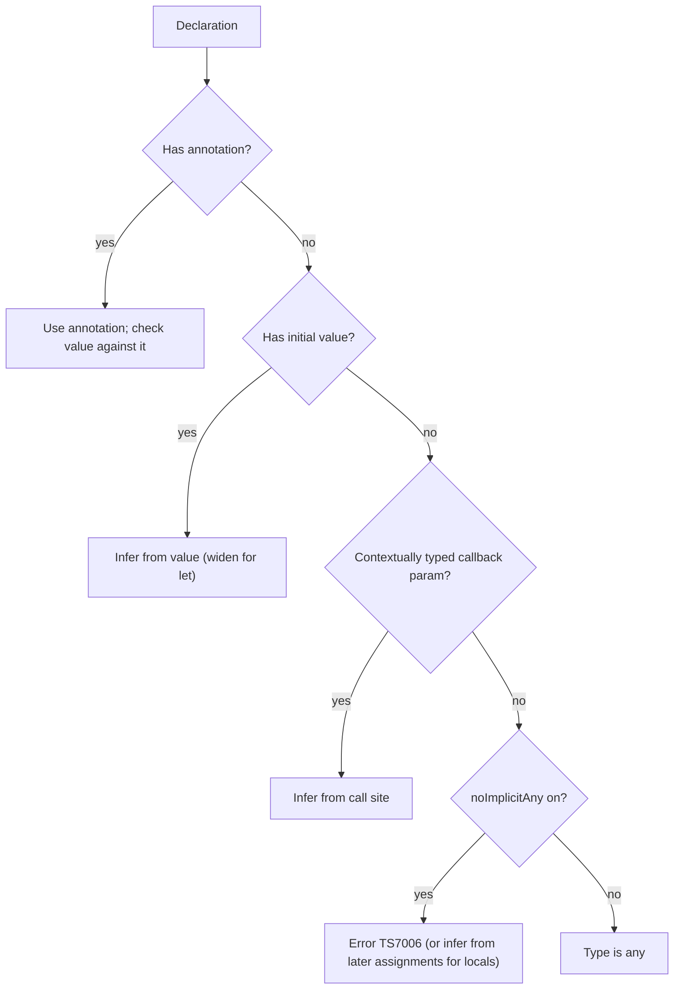

## Introduction

Languages such as Java (before `var`) and C made you write a type for every variable: `int count = 42;`, `String name = "Ada";`. JavaScript asks for no types at all. TypeScript sits deliberately between them. Its types are **static** — checked before the program runs — but writing them is **optional**: you can leave most of them out and the compiler works them out for you, and the parts of a program that have no type information can still compile alongside the parts that do.

That combination is called **optional static typing** (closely related to the academic term **gradual typing**). It was the decision that made TypeScript succeed. If adopting TypeScript had required annotating every line of an existing JavaScript project before it compiled, almost nobody would have adopted it. Because annotations are optional, a team can rename one `.js` file to `.ts`, get useful checking immediately from inference alone, and add precision over time where it pays off.

This lesson explains how that works: what the compiler infers by itself, where it cannot and you must help, how compiler strictness changes the rules, and how to use these mechanics in a migration. It is the bridge between the conceptual lessons before it and the detailed lessons on [[b2-type-annotations]] and [[b2-type-inference]] that follow later in the track.

## Before you start

- **What TypeScript is** and the idea of a checker that runs before the code — [[b2-what-is-typescript]].
- **JavaScript functions and arrays**, including callbacks such as `map` and `forEach`. See [[b1-what-is-javascript]].
- **`null` and `undefined`** in JavaScript and why reading a property of them throws. See [[b1-type-null]] and [[b1-type-undefined]].

## The intuition

Think of an experienced colleague reviewing your code. You do not have to explain that `const total = 0` is a number; they can see it. You do have to explain what a function expects to receive, because the function body alone does not say who will call it or with what. And for a public API you might explain the return value explicitly, so nobody has to read the implementation.

TypeScript's checker behaves like that reviewer. It reads values and expressions and works out the obvious types itself — this is **type inference**. You add **type annotations** (`: number`, `: User`) where intent cannot be deduced from the code: mostly at the edges of functions and modules. The reviewer analogy stops at one point: a human reviewer guesses generously, whereas the checker follows fixed rules, so it helps to know those rules.

## What "optional" does and does not mean

Optional means *you are not required to write the type*. It does not mean *the value has no type*. Consider:

```typescript title="infer.ts"
let count = 42;
const greeting = "hello";
const mixed = [1, "two", 3];
const prices = [9.99, 19.5];
const doubled = prices.map((p) => p * 2);

function total(values: number[]) {
  return values.reduce((sum, v) => sum + v, 0);
}
```

There is exactly one annotation here, yet every name has a precise static type. Asking the compiler to print them (by emitting a declaration file with `tsc --declaration --emitDeclarationOnly`) shows what it inferred:

```typescript title="infer.d.ts (generated)"
declare let count: number;
declare const greeting = "hello";
declare const mixed: (string | number)[];
declare const doubled: number[];
declare function total(values: number[]): number;
```

Each line shows an inference rule worth knowing:

- `let count = 42` is `number`. A `let` can be reassigned, so the compiler **widens** the literal `42` to the general type `number`.
- `const greeting = "hello"` has the type `"hello"` — a **literal type** containing exactly one value — because a `const` can never change. (Hovering over it in an editor shows `const greeting: "hello"`.)
- `[1, "two", 3]` becomes `(string | number)[]`. For array literals the compiler computes a **best common type** that every element fits.
- In `prices.map((p) => p * 2)`, nobody annotated `p`. The compiler knows `map` on a `number[]` passes a `number` to the callback, so `p` is `number`. Inferring a callback's parameter types from where it is used is called **contextual typing**.
- `total` has an annotated parameter but no return annotation; the return type `number` is inferred from the `return` expression.

Hover over any identifier in VS Code and you see the same types. Inferred types are checked exactly as strictly as annotated ones: `count = "many"` later would be an error. The only difference is who wrote the type down.

## Where inference cannot help: parameters

Inference works from values. A function parameter has no value at the point it is declared — its value comes from whoever calls the function, possibly in another file written next year. So, apart from callbacks that get contextual typing, the compiler cannot infer parameter types from the function body.

What happens then depends on a compiler option:

```typescript title="params.ts"
function double(x) {
  return x * 2;
}

function triple(x: number) {
  return x * 3;
}

const nums = [1, 2, 3].map((n) => n * 10);
console.log(double(4), triple(4), nums);
console.log(triple("4"));
```

With `strict` on (the default in TypeScript 6.0), `tsc` reports:

```output
params.ts(1,17): error TS7006: Parameter 'x' implicitly has an 'any' type.
params.ts(11,20): error TS2345: Argument of type 'string' is not assignable to parameter of type 'number'.
```

The first error comes from **`noImplicitAny`**, part of `strict`. Without an annotation, `x` would silently get the type **`any`** — the type that switches checking off — and `noImplicitAny` refuses to let that happen without you asking for it. The `map` callback's `n` is fine because contextual typing supplied `number`. The second error is ordinary checking against `triple`'s annotation.

Run the same file with `--strict false` and only the second error remains: `double`'s parameter quietly becomes `any`, so `double("4")` would also compile. This is the "gradual" in gradual typing: `any` marks the places where typed and untyped code meet. It is essential during migration and harmful as a permanent state, because `any` spreads — anything computed from an `any` is also `any` (see [[b2-noimplicitany]] and [[b2-avoiding-any]]).

> [!MISTAKE] "No annotation means `any`"
> Under `strict`, an unannotated *variable* gets a precise inferred type, not `any`. Only unannotated *parameters* without contextual typing would become `any`, and `noImplicitAny` reports those as errors.

## Where to annotate, and where not to

Given that inference handles most things, the practical question is where annotations earn their place. A good rule is: **annotate boundaries, infer internals**.

**Function parameters.** Required (except contextually typed callbacks), and they are the contract callers must meet.

**Return types of exported or important functions.** Optional, but valuable. Compare these two versions of the same mistake:

```typescript title="discount.ts"
export function discountRate(code: string) {
  if (code === "VIP") return 0.2;
  if (code === "STAFF") return "0.3";
  return 0;
}

export function discountRateChecked(code: string): number {
  if (code === "VIP") return 0.2;
  if (code === "STAFF") return "0.3";
  return 0;
}

const r = discountRate("STAFF");
console.log(100 * (1 - r));
```

```output
discount.ts(9,25): error TS2322: Type 'string' is not assignable to type 'number'.
discount.ts(14,24): error TS2363: The right-hand side of an arithmetic operation must be of type 'any', 'number', 'bigint' or an enum type.
```

Both versions are caught, but in different places. Without a return annotation, the compiler infers `number | "0.3"` as the return type, accepts the function, and reports a confusing error at the *call site* (line 14), possibly in a different file. With `: number`, the error is reported at the exact `return` that is wrong (line 9). An explicit return type pins the function's contract, so a mistake inside the function cannot silently change what callers see. That matters most for exported functions in shared code and libraries.

**Empty collections and values assigned later.** `const ids = []` gives the compiler nothing to infer from. Write `const ids: number[] = []`. The same applies to `let result;` that is assigned in branches, and to `useState(null)` in React, where you need `useState<User | null>(null)`.

**Data from outside.** Values from `JSON.parse`, `fetch` or `localStorage` have type `any` or `unknown` because the compiler cannot know their shape. Declare the type you expect and validate it at runtime (see [[b2-unknown]]).

**Where not to annotate:** locals initialised with a clear value (`const total = 0`, `const user = await getUser()`), callback parameters that are contextually typed, and anything where the annotation just repeats what the editor already shows. Redundant annotations are noise, and they make refactors longer because each one must be updated by hand.

| Situation | Annotate? | Reason |
|---|---|---|
| `const total = items.length` | No | Inferred `number` is exact |
| Function parameter | Yes | No value to infer from |
| `arr.map((x) => …)` callback | No | Contextual typing supplies `x` |
| Exported function return | Usually | Pins the contract; errors appear at the source |
| `const list = []` | Yes | Empty literal gives nothing to infer |
| Parsed JSON or API data | Yes, with validation | Compiler cannot see runtime data |

## How strictness changes the meaning of unannotated code

"Optional typing" behaves differently depending on compiler options, so the same unannotated code can be checked loosely or strictly. Two flags matter most.

**`noImplicitAny`** decides whether the compiler may fall back to `any` silently, as shown above.

**`strictNullChecks`** decides whether `null` and `undefined` are part of every type. With it off, `string` secretly also allows `null` and `undefined`, so the commonest JavaScript crash goes unchecked. With it on, they must be included explicitly (`string | null`) and handled before use:

```typescript title="nulls.ts"
const users = [{ id: 1, name: "Ada" }, { id: 2, name: "Alan" }];

const found = users.find((u) => u.id === 3);
console.log(found.name);

if (found) {
  console.log(found.name);
} else {
  console.log("No user with id 3");
}
```

```output
nulls.ts(4,13): error TS18048: 'found' is possibly 'undefined'.
```

Nothing was annotated, yet the compiler knows that `find` returns `{ id: number; name: string } | undefined` and refuses the unchecked access on line 4 — which really would crash with `TypeError: Cannot read properties of undefined (reading 'name')`. Inside `if (found)`, the type is **narrowed** to exclude `undefined`, so line 7 is accepted. Inference plus strict null checking catches this bug with zero annotations. See [[b2-strict-null-checks]] for the full treatment.

Both flags are included in `strict`, which `tsc --init` and TypeScript 6.0's defaults enable. When you read older code or tutorials, check which mode they assume; "it compiled" means much less without `strict`.

## How the checker decides a type



The flowchart is a simplification but captures the order: an annotation always wins and becomes the contract the value is checked against; otherwise the compiler infers from the initial value; failing that, from context; and only as a last resort does it fall back to `any` — which strict mode turns into an error. (For a local `let x;` declared without a value, the compiler actually tracks the types of later assignments, a feature called control-flow analysis; parameters have no such fallback.)

## Gradual adoption in a JavaScript project

Optional typing is what makes migration incremental. A typical path through a real codebase:

1. **Add TypeScript without changing files.** Install `typescript`, add a `tsconfig.json` with `allowJs: true` so `.js` files are part of the project. Nothing is type-checked yet, but tooling works.
2. **Check JavaScript where you can.** Turn on `checkJs` (or add `// @ts-check` to individual files) and add JSDoc types such as `/** @param {number} price */` where the checker needs help. See [[b2-ts-vs-javascript]] for an example.
3. **Convert files one at a time.** Rename a `.js` file to `.ts`. Inference immediately types most of it; add parameter annotations to fix `noImplicitAny` errors. Start with modules that have many callers — utilities, API clients, shared models — because their types benefit every importer.
4. **Tighten.** If the project started with `strict` off, enable its flags one by one (`noImplicitAny`, then `strictNullChecks`, and so on), fixing errors folder by folder.

At each step the project builds and ships. Typed and untyped files import each other freely; at the boundary, untyped values arrive as `any`, and they get stricter as their source files are converted.

## In real systems

Mature TypeScript codebases look surprisingly light on annotations. You will see types on component props, function parameters, exported return types, API and database models, and generic utilities, and almost none inside function bodies. Many teams enforce explicit return types only on exported functions (typescript-eslint's `explicit-module-boundary-types` rule does this) while letting inference handle the rest. This keeps code close to plain JavaScript in readability while giving strict checking everywhere.

## Common mistakes

**Annotating everything.** `const name: string = "Ada"` adds nothing and, for `const`, even loses precision (the inferred type is the literal `"Ada"`). Annotate boundaries.

**Leaving `strict` off permanently.** Without `noImplicitAny` and `strictNullChecks`, optional typing quietly becomes no typing in many places.

**Initialising an empty array without a type.** `const ids = []` followed by pushes can end up inferred in ways you did not intend. Write `const ids: number[] = []`.

**Annotating to silence an error.** Writing `const user: User = data` where `data` is `any` compiles but proves nothing. Validate the data, then assign.

**Assuming inferred return types are a stable API.** If a function's implementation changes, its inferred return type changes too, and callers elsewhere break with confusing errors. Annotate return types on exported functions.

## Interview perspective

**"What is optional static typing?"** Types are checked statically, but annotations are not required: the compiler infers most types, and code without type information can coexist with typed code via `any`. Contrast it with dynamic typing (no static check) and with mandatory typing (annotations everywhere).

**"When do you add type annotations?"** Parameters, exported return types, empty collections, and external data — boundaries. Rely on inference for locals and callbacks. Explain why an explicit return type moves errors to the right place.

**"What does `noImplicitAny` do?"** It turns the silent fallback to `any` into an error, mainly for parameters. Follow-up: strict null checks make `null` and `undefined` explicit, and both are in `strict`.

## Practice

1. Without running anything, write down the inferred type of: `let a = 3.5`, `const b = true`, `const c = [1, null]`, `const d = ["x", "y"].map((s) => s.length)`. Then check by hovering in an editor.
2. Take a JavaScript file with five functions, rename it to `.ts`, and fix only the errors `strict` reports. Count how many annotations you needed.
3. Write an exported function with no return annotation that returns `number` in one branch and `string` in another. Observe where the error appears when a caller does arithmetic. Add a return annotation and compare.

```quiz
Q: Under `strict`, what type does TypeScript give `const label = "Save"`?
- [ ] `any`, because there is no annotation
- [ ] `string`
- [x] The literal type `"Save"`
- [ ] `unknown`
> The value is known and a `const` can never change, so the compiler infers the narrowest type, the literal `"Save"`. A `let` would be widened to `string`. Unannotated variables with initialisers are never `any`.
```

```quiz
Q: Why does `function area(w, h) { return w * h; }` produce an error in strict mode while `[1, 2].map((n) => n * 2)` does not?
- [ ] Arrow functions do not need annotations but function declarations do
- [x] The callback's parameter is contextually typed by `map`; `area`'s parameters have no source to infer from, and `noImplicitAny` rejects the `any` fallback
- [ ] Multiplication is only allowed on annotated values
- [ ] `map` disables type checking for its callback
> Contextual typing gives `n` the type `number` from `map`'s signature. A standalone function's parameters receive values from unknown future callers, so nothing can be inferred and they would become `any`, which `noImplicitAny` forbids. It is about context, not arrow versus declaration syntax.
```

```quiz
Q: Why is it useful to annotate the return type of an exported function even though it can be inferred?
- [ ] Inferred return types are not checked
- [ ] It makes the emitted JavaScript faster
- [x] A mistake inside the function is then reported at the wrong `return`, instead of changing the inferred type and failing at distant call sites
- [ ] Exported functions are required to have explicit return types
> Inferred return types are checked, but they follow the implementation. An explicit type is a fixed contract, so errors surface where the bug is. Annotations are erased and never affect runtime speed.
```

## Quick revision {#quick-revision}

- Optional static typing: static checking, optional annotations; inference fills in most types; `any` marks the typed/untyped boundary.
- Inference rules: `let` widens (`42` → `number`), `const` keeps literals (`"hello"`), arrays get a best common type, callbacks get contextual types, return types come from `return` expressions.
- Parameters cannot be inferred (except contextually typed callbacks); `noImplicitAny` makes the `any` fallback an error.
- Annotate: parameters, exported return types, empty collections, external data. Infer: locals and callbacks.
- Explicit return types move errors to the faulty `return` instead of distant call sites.
- `strictNullChecks`: `null`/`undefined` must be in the type and handled; narrowing with `if` removes them.
- `strict` (default in TypeScript 6.0) includes both flags.
- Migration: `allowJs` → `checkJs` + JSDoc → rename files to `.ts` → tighten flags.

## Key takeaways {#key-takeaways}

- Optional does not mean untyped: unannotated values still get precise inferred types.
- The compiler infers from values; you annotate where no value is available, chiefly parameters.
- Annotate boundaries and infer internals; this keeps code readable and checking strict.
- Strictness settings decide whether gaps silently become `any`; keep `strict` on.
- Optional typing is what lets a JavaScript project become TypeScript gradually while it keeps shipping.
