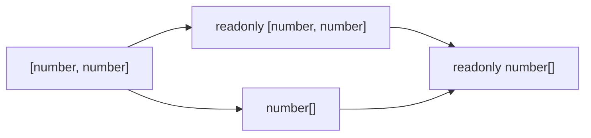

## Introduction

A tuple fixes the length and the type of each position of an array — `[string, number]` is exactly a string followed by a number ([[b2-tuples]]). But an ordinary tuple can still be changed. Code can assign `pair[0] = "other"`, and it can even call `pair.push(99)`, which the compiler allows and which silently breaks the length the type promised.

A **readonly tuple** removes those abilities. `readonly [string, number]` has the same fixed shape, but every position is read-only and the mutating methods (`push`, `pop`, `splice`, `sort`, `reverse`) do not exist on it. That makes it the right type for values that should not change after they are created: configuration rows, constant lookup tables, coordinates you hand to other code, and pairs returned from functions.

Readonly tuples also appear whenever you write **`as const`** after an array literal. That is how TypeScript code turns a list of strings like `["admin", "editor", "viewer"]` into both a constant value and a union type `"admin" | "editor" | "viewer"` from a single source. This lesson covers both: the readonly modifier itself, and the `as const` patterns built on it.

## Before you start

- **Tuples** — fixed-length arrays with a type per position, labels, optional and rest elements. See [[b2-tuples]].
- **Readonly arrays** — `readonly T[]`, why mutable-to-readonly assignment is allowed but not the reverse, and why readonly is shallow and compile-time only. See [[b2-typed-arrays]], section on readonly arrays.
- **Literal types** — `"admin"` as a type, and how literals are widened to `string`. See [[b2-literal-types]].
- **`typeof` in type positions** — getting the type of a value. See [[b2-typeof]].

Examples were compiled with TypeScript 6.0 (`tsc --strict`) and run with Node.js 22.

## The intuition

A museum displays an antique pair of candlesticks in a glass case. Visitors can see that there are exactly two, see where each one stands, and read the label on each — but they cannot move them, swap them or add a third. The museum may still lend the case's contents to another exhibition, and that exhibition gets the same rule.

A readonly tuple is that glass case: the shape is known and visible, and nothing can be rearranged through this view. Like the readonly arrays you have already met, it is a property of the *view* (the type), not of the objects. If you hold the candlesticks through some other, mutable reference, you can still move them — and `readonly` disappears entirely when the code is compiled, so it does not stop JavaScript code that ignores the types.

## Writing readonly tuples

Put the `readonly` modifier in front of the tuple type:

```typescript title="span.ts"
type Span = readonly [start: number, end: number];

const r: Span = [1, 5];
r[0] = 2;                          // error: read-only
r.push(6);                         // error: no push on a readonly tuple

const editable: [number, number] = [1, 5];
const view: Span = editable;      // mutable → readonly: fine
const back: [number, number] = r;  // readonly → mutable: error
const asArray: readonly number[] = r;   // a readonly tuple is a readonly array
```

```output
span.ts(4,3): error TS2540: Cannot assign to '0' because it is a read-only property.
span.ts(5,3): error TS2339: Property 'push' does not exist on type 'Span'.
span.ts(9,7): error TS4104: The type 'Span' is 'readonly' and cannot be assigned to the mutable type '[number, number]'.
```

The rules are the same as for readonly arrays, plus the tuple's fixed shape:

- **Positions are read-only properties.** `r[0] = 2` fails with TS2540. You can still read `r[0]`, destructure `const [start, end] = r`, and use non-mutating methods such as `map`, `slice` and `includes`.
- **Mutating methods are gone.** A readonly tuple is built on `ReadonlyArray`, which never declares `push`, `pop`, `splice`, `sort` or `reverse`. This closes the length hole that mutable tuples have.
- **Mutable to readonly is allowed; readonly to mutable is not.** Treating a changeable pair as unchangeable only hides abilities, which is safe. The reverse would hand out mutation rights that the original type withheld.
- **A readonly tuple is also a readonly array.** `readonly [number, number]` can be used wherever `readonly number[]` is expected, because it is a more specific version of it. The reverse is not true: `ReadonlyArray<number>` is *wider* — it says nothing about the length — so it cannot be assigned to a tuple type.

An equivalent spelling is `Readonly<[number, number]>`, using the `Readonly` utility type ([[b2-readonly-utility]]). The keyword form is more common. As with arrays, `readonly` can only be written directly on tuple or array syntax.

## as const: readonly literal tuples

You will write the `readonly` keyword less often than you will get readonly tuples for free from a **const assertion**. Writing `as const` after a literal tells the compiler to infer the narrowest type it can:

- array literals become **readonly tuples**, not arrays;
- every string, number and boolean keeps its **literal type** instead of widening to `string`, `number` or `boolean`;
- and both rules apply **recursively** to everything nested inside, including object properties, which become `readonly`.

```typescript title="as-const.ts"
const server = ["api.example.com", 443] as const;
// readonly ["api.example.com", 443]

const roles = ["admin", "editor", "viewer"] as const;
type UserRole = (typeof roles)[number];          // "admin" | "editor" | "viewer"

function isRole(value: string): value is UserRole {
  return (roles as readonly string[]).includes(value);
}

const nested = [{ id: 1, tags: ["a"] }] as const;
nested[0].tags.push("b");                    // error: as const is deep

function connect(host: string, port: number) {
  return `${host}:${port}`;
}
console.log(connect(...server));
console.log(isRole("editor"), isRole("owner"));
```

```output
as-const.ts(12,16): error TS2339: Property 'push' does not exist on type 'readonly ["a"]'.
```

When run, it prints `api.example.com:443` and then `true false`.

Read the example in four parts.

**`server`** is inferred as `readonly ["api.example.com", 443]`. Without `as const` it would be `(string | number)[]`, and `connect(...server)` would fail: spreading an array of unknown length into a two-parameter function is an error, because the compiler cannot prove there are exactly two arguments of the right types. With the tuple type, it knows.

**`roles` and `UserRole`** show the most useful `as const` pattern. The indexed access type `(typeof roles)[number]` means "the type you get by indexing `roles` with any number" — the union of all element types. Because the elements kept their literal types, that union is `"admin" | "editor" | "viewer"`. The list of values and the union type now come from **one source**: add `"owner"` to the array and the type updates itself. Compare an enum ([[b2-literal-unions-vs-enums]]) — this gives a similar result with plain JavaScript values and no extra emitted code.

**`isRole`** shows a friction point with that pattern. `roles.includes(value)` with a `value: string` is an error, because `includes` on a `readonly ["admin", "editor", "viewer"]` only accepts those three literals — which is exactly the thing you are trying to check. Widening the array to `readonly string[]` for the call is safe (it only loses information) and makes the check compile. The function is a type predicate, so callers get a narrowed `UserRole` back ([[b2-custom-type-guards]]).

**`nested`** shows that `as const` is deep. The object inside the tuple gets `readonly` properties, and its `tags` array becomes `readonly ["a"]`, so `push` does not exist on it.

`as const` has its own lesson, [[b2-as-const]], including its use on objects ([[b2-as-const-objects]]).

### Shallow annotation versus deep as const

The two ways of getting a readonly tuple differ in depth, and mixing them up is a common source of surprise:

```typescript title="depth.ts"
type Pair = readonly [label: string, meta: { hits: number }];
const p: Pair = ["home", { hits: 1 }];
p[1].hits++;                         // allowed: readonly is shallow here
console.log(p);
```

```output
[ 'home', { hits: 2 } ]
```

The annotation `readonly [...]` protects the tuple's two slots, but the object in slot 1 is an ordinary `{ hits: number }`, so its property can change. `as const` would have made `hits` readonly too. If you need deep immutability from an annotation, make the element types readonly as well (`readonly [string, Readonly<{ hits: number }>]`) or use a recursive `DeepReadonly` helper ([[b2-mapped-types]]).

## Readonly tuples and functions

### Passing them in

Sooner or later you will pass an `as const` list to a function and see an error like this:

```typescript title="params.ts"
const sizes = ["sm", "md", "lg"] as const;

function joinAll(items: string[]) {
  return items.join("/");
}
function joinAllRo(items: readonly string[]) {
  return items.join("/");
}
joinAll(sizes);                      // error: readonly into mutable
console.log(joinAllRo(sizes));       // fine

const copy = [...sizes];             // ("sm" | "md" | "lg")[] — mutable copy
copy.push("md");

function tuple<const T extends readonly unknown[]>(...items: T): T {
  return items;
}
const t = tuple("GET", 200, true);   // readonly ["GET", 200, true]
```

```output
params.ts(9,9): error TS2345: Argument of type 'readonly ["sm", "md", "lg"]' is not assignable to parameter of type 'string[]'.
  The type 'readonly ["sm", "md", "lg"]' is 'readonly' and cannot be assigned to the mutable type 'string[]'.
```

When run, `joinAllRo(sizes)` prints `sm/md/lg`.

The compiler is right to complain: `joinAll` declares a mutable `string[]` parameter, so as far as the type says, it might `push` into the array — which would break the constant. There are two fixes, and the first is almost always the better one:

1. **Fix the function.** If it does not mutate, make the parameter `readonly string[]`, as `joinAllRo` does. That accepts readonly tuples, readonly arrays and ordinary arrays alike. This is why the general advice for any function that only reads an array is to take a readonly parameter.
2. **Copy at the call site.** If you cannot change the function (it comes from a library) or it really does mutate, pass a copy: `[...sizes]` is a fresh mutable array of type `("sm" | "md" | "lg")[]`, and changes to it do not affect the original.

Avoid the third "fix", a type assertion such as `sizes as unknown as string[]`. It compiles and allows the function to mutate your constant.

### Const type parameters

Sometimes a generic function wants callers' arguments inferred as narrowly as `as const` would infer them, without asking every caller to write `as const`. Since **TypeScript 5.0**, a `const` modifier on a type parameter does exactly that, as in `tuple` above: `tuple("GET", 200, true)` infers `readonly ["GET", 200, true]`. The constraint `readonly unknown[]` matters — with a mutable `unknown[]` constraint, TypeScript 6.0 still keeps the literal types but infers a *mutable* tuple, `["GET", 200, true]`. Library authors use this for route definitions, event names and schema builders.

### Returning them

When a function returns a pair or triple, a readonly tuple is usually the right return type. It keeps the per-position types (an array literal alone would infer a union array) and stops callers from pushing into the result. The shortest way is `as const` on the returned literal:

```typescript
function useToggle(initial: boolean) {
  let on = initial;
  const toggle = () => { on = !on; };
  return [on, toggle] as const;     // readonly [boolean, () => void]
}
```

Note that `as const` on a *returned* literal keeps the element types it already has: `on` is a `boolean` variable, so the first element is `boolean`, not the literal `false`. Literal types are preserved only for literal expressions written directly in the array. Many React custom hooks are written exactly this way ([[b2-hooks-typing]]).

## as const with satisfies

`as const` gives you narrow types but no checking: a typo in a constant list goes unnoticed until something uses it. Combining it with **`satisfies`** ([[b2-satisfies]]) adds a check without widening the result:

```typescript
type Method = "GET" | "POST" | "PUT" | "DELETE";
const allowed = ["GET", "POST"] as const satisfies readonly Method[];
// type stays readonly ["GET", "POST"]; a typo such as "GTE" is a compile error
```

Write `readonly Method[]`, not `Method[]`. With a mutable target, the inline form `["GET", "POST"] as const satisfies Method[]` still compiles, but the mutable contextual type makes the compiler infer a mutable tuple `["GET", "POST"]` — the readonly half of `as const` is silently lost. And checking an existing `as const` variable against a mutable type (`roles satisfies Method[]`) fails with TS1360, because a readonly value does not fit a mutable array type.

## How it works internally

There is no readonly tuple at runtime. `const server = ["api.example.com", 443] as const` compiles to `const server = ["api.example.com", 443]` — an ordinary, mutable JavaScript array. `readonly`, `as const` and tuple labels are all erased. The protection is that **TypeScript code** cannot express a mutation without an error; plain JavaScript, `any` values or assertions can still change the array.

In the type system, a readonly tuple is a tuple type whose numeric properties are marked `readonly` and whose base type is `ReadonlyArray<T>` rather than `Array<T>`. Mutating methods are missing because `ReadonlyArray` never declares them, not because they are blocked. That gives the assignability chain you saw:



Each arrow means "is assignable to". Moving right always removes information (mutability, or the fixed length), never adds it. There is no arrow back from any readonly type to a mutable one.

If you need runtime immutability as well, `Object.freeze(["sm", "md"] as const)` freezes the array itself (shallowly), and its type stays readonly. Freezing is rarely necessary for module-level constants, but it is a reasonable defence when values are shared with code you do not control ([[b1-object-freeze-seal]]).

## Worked example: breakpoints from one source of truth

Responsive web apps define screen-width breakpoints once and use them in JavaScript (to pick a layout) and in generated CSS media queries. A readonly tuple of `[name, minWidth]` pairs gives you the data, the union of names, and immutability in one declaration.

```typescript title="breakpoints.ts"
// One source of truth: names and minimum widths, in ascending order.
const BREAKPOINTS = [
  ["sm", 640],
  ["md", 768],
  ["lg", 1024],
] as const;

type Breakpoint = (typeof BREAKPOINTS)[number][0];   // "sm" | "md" | "lg"
type BreakpointEntry = (typeof BREAKPOINTS)[number]; // readonly ["sm", 640] | ...

function breakpointFor(width: number): Breakpoint | "xs" {
  let result: Breakpoint | "xs" = "xs";
  for (const [name, minWidth] of BREAKPOINTS) {
    if (width >= minWidth) result = name;
  }
  return result;
}

function mediaQuery(bp: Breakpoint): string {
  const entry: BreakpointEntry | undefined = BREAKPOINTS.find(([name]) => name === bp);
  if (!entry) throw new Error(`Unknown breakpoint ${bp}`);
  return `(min-width: ${entry[1]}px)`;
}

console.log([320, 700, 800, 1440].map(breakpointFor));
console.log(mediaQuery("md"));
```

```output
[ 'xs', 'sm', 'md', 'lg' ]
(min-width: 768px)
```

Step by step:

1. `as const` makes `BREAKPOINTS` a readonly tuple of three readonly tuples, each with literal types: `readonly [readonly ["sm", 640], readonly ["md", 768], readonly ["lg", 1024]]`.
2. `(typeof BREAKPOINTS)[number]` is the union of the three entries, and adding `[0]` picks position 0 of each — the union of names. Adding `"xl"` to the array would update `Breakpoint` automatically.
3. In `breakpointFor`, destructuring each entry gives `name` the union of names and `minWidth` the union `640 | 768 | 1024`, so `result = name` type-checks without any assertion. Because the entries are ascending, the last one that matches wins.
4. `mediaQuery` uses `find`, which returns `BreakpointEntry | undefined`; the check handles the missing case so that `entry[1]` is safe ([[b2-strict-null-checks]]).

Now add two lines to the end of the file:

```typescript
mediaQuery("xl");
BREAKPOINTS[0][1] = 600;
```

```output
breakpoints.ts(27,12): error TS2345: Argument of type '"xl"' is not assignable to parameter of type '"sm" | "md" | "lg"'.
breakpoints.ts(28,16): error TS2540: Cannot assign to '1' because it is a read-only property.
```

The first error comes from the derived union: `"xl"` is not a breakpoint. The second comes from deep readonly: no code can quietly change a breakpoint at runtime through this constant. If you emitted and ran the file anyway, the first call would throw `Error: Unknown breakpoint xl` — the runtime check exists because types are erased.

```quiz
Q: What is the type of `const x = ["a", 1] as const`?
- [ ] `(string | number)[]`
- [ ] `[string, number]`
- [x] `readonly ["a", 1]`
- [ ] `readonly (string | number)[]`
> `as const` infers a readonly tuple and keeps literal types for each element. Without it, the literal widens to the array `(string | number)[]`.

Q: `const tags = ["new", "sale"] as const;` and `function f(t: string[]) {}`. Why does `f(tags)` fail, and what is the best fix if `f` only reads its argument?
- [ ] `as const` arrays cannot be passed to functions; use an enum
- [x] A readonly type cannot be assigned to a mutable one; change the parameter to `readonly string[]`
- [ ] The literal types do not match `string`; widen them with `as string[]`
- [ ] `f` needs a generic parameter
> Literal types are assignable to `string`, so that is not the problem. The problem is readonly to mutable. If `f` does not mutate, a readonly parameter accepts both readonly and ordinary arrays. An assertion would compile but would allow `f` to mutate the constant.

Q: How deep is the protection from `type P = readonly [string, { n: number }]`?
- [ ] Fully deep: `p[1].n = 2` is an error
- [x] Shallow: the slots are read-only, but `p[1].n = 2` is allowed
- [ ] None: `readonly` has no effect on tuples
- [ ] Runtime only: the tuple is frozen
> A `readonly` annotation applies only to the tuple's own positions and length. `as const` on a literal is the form that applies readonly recursively. Neither has any runtime effect.
```

## In real systems

**Constant lists and derived unions.** Supported locales, feature flags, user roles, HTTP methods and status names are commonly declared as `[...] as const`, with `(typeof list)[number]` providing the union used in function signatures. Validation code then uses the same array at runtime (`list.includes(value)` behind a type guard), so the runtime list and the compile-time type cannot drift apart.

**Hooks and utilities that return pairs.** Custom React hooks return `[value, setter] as const` so that destructuring keeps separate types and callers cannot mutate the returned array.

**Route and schema builders.** Libraries use `const` type parameters (TypeScript 5.0+) so that users' literal arguments — path segments, column names, event names — keep their literal types without `as const` at every call.

**Shared configuration.** Configuration modules export readonly tuples and objects so that one consumer cannot silently change a value that other modules depend on.

## Trade-offs and alternatives

| Option | Gives you | Cost |
|---|---|---|
| `readonly [A, B]` annotation | Fixed shape, no mutation of slots, shallow | Must write the types yourself |
| `[...] as const` | Literal types, deep readonly, union derivation | Values cannot be passed to mutable-array parameters; `includes` with a wider argument needs widening |
| `as const satisfies readonly T[]` | All of the above plus a check against a known type | Slightly longer declaration |
| `const` type parameter | Narrow inference without callers writing `as const` | Only for generic function authors; needs a `readonly` constraint |
| String enum | Named constants with a type | Emits runtime code; not plain values; see [[b2-enums]] |
| `Object.freeze` | Runtime immutability | Shallow; small runtime cost; still needs readonly types for compile-time checks |

The main friction with readonly tuples is at boundaries with code that takes mutable arrays. The fix is almost always to make that code accept `readonly` parameters, which improves it for every caller.

## Common mistakes

> [!MISTAKE] Asserting readonly away
> `sizes as unknown as string[]` silences the readonly error and lets the callee mutate your constant. Change the parameter to `readonly string[]`, or pass a copy with `[...sizes]`.

**Forgetting `as const` on a constant list.** Without it, `["admin", "editor"]` is `string[]` and `(typeof roles)[number]` is plain `string`, so the derived "union" checks nothing.

**Expecting an annotation to be deep.** `readonly [string, User]` leaves the `User` object mutable. Use `as const` for literals, or readonly element types.

**`satisfies Method[]` after `as const`.** Inline, it quietly turns the result into a mutable tuple; on an existing `as const` variable, it is an error. Write `satisfies readonly Method[]`.

**Expecting `as const` on variables to keep literals.** `[on, toggle] as const` keeps the *variables'* types (`boolean`), not the literal they happened to start with.

**Assuming readonly survives compilation.** It is erased. JavaScript callers or `any` values can still mutate the array; freeze it if that matters.

## Interview perspective

> [!INTERVIEW] What does as const do to an array?
> "It infers a readonly tuple instead of an array, keeps each element's literal type instead of widening it, and applies that recursively, so nested objects get readonly properties too. The common use is a constant list like `const roles = ['admin', 'viewer'] as const`, from which `(typeof roles)[number]` gives the union type — one source of truth for the runtime values and the compile-time type."

Questions to prepare:

- **Readonly tuple versus readonly array?** The tuple fixes length and per-position types; the array only fixes the element type. A readonly tuple is assignable to the readonly array of its element union, not the reverse.
- **Why can't you pass an `as const` array to `(items: string[]) => void`?** Readonly to mutable is not allowed; fix the parameter type.
- **How do you get a union type from an array of strings?** `as const` plus `(typeof arr)[number]`.
- **What is a `const` type parameter?** TypeScript 5.0 syntax `<const T>` that infers arguments as if written with `as const`.
- **Is a readonly tuple immutable at runtime?** No; it is a plain array. Mention `Object.freeze` for runtime protection.

## Practice

1. **Derive a union.** Declare `const LOCALES = ["en-GB", "fr-FR", "de-DE"] as const`, derive `Locale`, and write `isLocale(value: string): value is Locale`. Test it with a valid and an invalid locale.
2. **Fix the boundary.** Write a function `average(values: number[])`, try to call it with `[1, 2, 3] as const`, read the error, and fix the function rather than the call.
3. **Shallow versus deep.** Write a type `readonly [string, { count: number }]`, show that `count` can be changed, then make it deep two different ways.
4. **Readonly hook.** Write `useCounter(start: number)` that returns `readonly [count: number, increment: () => void]` using a type annotation rather than `as const`, and check that callers cannot `push` into the result.
5. **Checked constants.** Declare a list of allowed HTTP methods with `as const satisfies readonly Method[]`, introduce a typo, and read the error.

## Quick revision {#quick-revision}

- `readonly [A, B]` (or `Readonly<[A, B]>`): fixed shape, read-only positions (TS2540), no `push`/`pop`/`splice`/`sort`/`reverse`.
- Mutable tuple → readonly tuple: OK. Readonly → mutable: error TS4104. Readonly tuple → `readonly (A | B)[]`: OK; `ReadonlyArray` → tuple: not OK.
- `as const` on an array literal: readonly tuple + literal element types + recursive readonly.
- Union from a list: `(typeof list)[number]`; for tuple-of-pairs, `(typeof list)[number][0]`.
- `list.includes(stringValue)` on an `as const` list errors; widen with `(list as readonly string[]).includes(...)` inside a type guard.
- Annotation `readonly [...]` is shallow; `as const` is deep.
- Passing to `T[]` parameters fails: make the parameter `readonly T[]`, or pass `[...list]`.
- `<const T extends readonly unknown[]>` (TS 5.0+) infers literal readonly tuples from arguments.
- Return pairs as `[a, b] as const` or with a readonly tuple annotation.
- `as const satisfies readonly T[]` checks constants without widening.
- All erased at runtime; `Object.freeze` for runtime immutability (shallow).

## Key takeaways {#key-takeaways}

- A readonly tuple keeps a tuple's fixed shape and removes every way to change it through that type, closing the `push` hole of mutable tuples.
- `as const` is the usual way to create readonly tuples: it keeps literal types and applies readonly all the way down.
- Deriving a union with `(typeof list)[number]` gives one source of truth for runtime values and compile-time types.
- When a readonly tuple will not pass to a function, the function usually should take a `readonly` parameter; copying is the fallback, and assertions are a mistake.
- Readonly is a compile-time view of an ordinary JavaScript array; use `Object.freeze` when runtime immutability matters.
