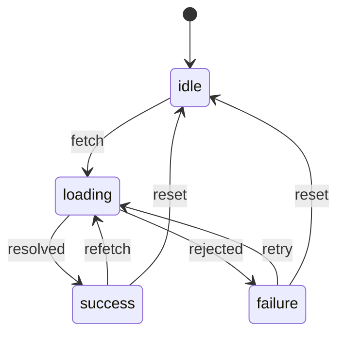

## Introduction

Almost every screen in a web application loads something: a user profile, a list of orders, search results. And almost every one of those screens has to show the same four situations — nothing requested yet, waiting for the response, the data, or an error.

The first version is usually written with flags:

```typescript
interface UserState {
  isLoading: boolean;
  data?: User;
  error?: string;
}
```

It looks harmless, and it produces a recognisable family of bugs. A request fails, the error is stored, the user clicks "Retry", `isLoading` becomes `true` — and the old error is still there, so the screen shows a spinner and an error message at the same time. A search box shows "No results" before the first search has even been sent, because `data` is `undefined` and `isLoading` is `false`, which looks exactly like an empty answer. A developer forgets to clear `data` when a new request fails, and the page shows yesterday's data under today's error.

None of these are typos. They come from the shape of the type: three independent fields allow 2 × 2 × 2 = 8 combinations, and only four of them mean anything. Every component has to decide what the other four mean, and each one decides a little differently.

The **RemoteData pattern** replaces the flags with a single discriminated union that has exactly four members:

```typescript
type RemoteData<T, E = Error> =
  | { status: "idle" }
  | { status: "loading" }
  | { status: "success"; data: T }
  | { status: "failure"; error: E };
```

The value is in exactly one state at a time, the data exists only in the success state, and the error exists only in the failure state. The pattern was popularised in the Elm community by Kris Jenkins's 2016 article "How Elm Slays a UI Antipattern" and his `RemoteData` package, and it has since become a standard answer to the interview question "how would you type the state of a fetch?". This lesson builds it from scratch in TypeScript, then looks at the problems real applications add: retries, refetches and responses that arrive in the wrong order.

## Before you start

- **Discriminated unions** — a union whose members share a literal tag, and why checking the tag narrows the type. See [[b2-discriminated-unions]].
- **Exhaustiveness checks** — getting a compile error when a `switch` misses a case. See [[b2-exhaustiveness-assertnever]].
- **Generics** — writing `RemoteData<T>` once and using it for users, orders and anything else. See [[b2-generics]].
- **Promises and async/await** — how a request resolves or rejects. See [[b1-promises]] and [[b1-async-await]].

## The intuition: one light on at a time

Think of a traffic light. It has three lamps, but it is never correct for two to be lit at once, and the meaning of the light is "which lamp is on", not "which combination of lamps is on". A traffic light built from three independent switches would occasionally show red and green together, and every driver would have to guess what that meant.

The flag-based state is the three-switch traffic light. RemoteData is the real one: a single dial that points at exactly one state. The analogy stops at the data: a traffic light's states carry nothing, while RemoteData's success state carries the response and its failure state carries the error. That is the part TypeScript adds — each state is allowed to carry only what is true in it.

## Defining the type

Here is the full definition with small constructor functions. The file name matters only for the React example later, which imports from it.

```typescript title="remote-data.ts"
export type RemoteData<T, E = Error> =
  | { status: "idle" }
  | { status: "loading" }
  | { status: "success"; data: T }
  | { status: "failure"; error: E };

export const idle = <T, E = Error>(): RemoteData<T, E> => ({ status: "idle" });
export const loading = <T, E = Error>(): RemoteData<T, E> => ({ status: "loading" });
export const success = <T, E = Error>(data: T): RemoteData<T, E> => ({ status: "success", data });
export const failure = <T, E = Error>(error: E): RemoteData<T, E> => ({ status: "failure", error });
```

A few design decisions are worth explaining.

**Why `idle` is separate from `loading`.** "Not asked yet" and "waiting for an answer" look the same if you only have `isLoading`, but users experience them differently. A search page before the first search should show a prompt ("Type to search"), not a spinner and not "No results". Lazy content — a tab that loads when opened, a dialog that fetches on demand — sits in `idle` until something triggers it. Some code bases call this state `notAsked`, following the Elm original.

**Why the error type is a parameter.** `E` defaults to `Error`, which suits most `fetch` code. Making it a parameter lets an API layer use a richer type, such as `{ code: "NOT_FOUND" } | { code: "RATE_LIMITED"; retryAfter: number }`, which is itself a discriminated union the UI can switch on.

**Why constructor functions.** An object literal stored in a variable widens its tag: `const s = { status: "loading" }` has type `{ status: string }`, which is not assignable to `RemoteData<User>` (the widening rule from [[b2-literal-types]]). The constructors have declared return types, so the tag is always the literal. They also make call sites read like the states they create: `set(success(user))`.

**Why `status` and `failure`.** Any tag name and state names work; the important thing is consistency across an application. This lesson uses `failure` rather than `error` so that the state name and the property `error` inside it are not the same word.

## Consuming RemoteData

### An exhaustive switch

The most direct way to use the value is a `switch` on `status`. Inside each `case`, only that state's properties exist:

```typescript title="render.ts"
type RemoteData<T, E = Error> =
  | { status: "idle" }
  | { status: "loading" }
  | { status: "success"; data: T }
  | { status: "failure"; error: E };

type User = { name: string; email: string };

function assertNever(value: never): never {
  throw new Error(`Unhandled state: ${JSON.stringify(value)}`);
}

function renderUser(state: RemoteData<User>): string {
  switch (state.status) {
    case "idle":
      return "Select a user";
    case "loading":
      return "Loading...";
    case "success":
      return `${state.data.name} <${state.data.email}>`;
    case "failure":
      return `Could not load user: ${state.error.message}`;
    default:
      return assertNever(state);
  }
}

console.log(renderUser({ status: "idle" }));
console.log(renderUser({ status: "success", data: { name: "Ada", email: "ada@example.com" } }));
console.log(renderUser({ status: "failure", error: new Error("HTTP 404") }));
```

```output
Select a user
Ada <ada@example.com>
Could not load user: HTTP 404
```

Compare this with the flag version. There is no `data!` and no `data?.name ?? ""`: in the `success` branch, `state.data` is a `User`, guaranteed. There is no question about what to show when both `error` and `data` are set, because that value cannot exist. And if someone adds a fifth state, `assertNever` turns every unupdated `switch` into a compile error.

### A match helper

Writing the same `switch` in many components is repetitive, so many code bases add a `match` (or `fold`) function that takes one handler per state:

```typescript title="match.ts"
type RemoteData<T, E = Error> =
  | { status: "idle" }
  | { status: "loading" }
  | { status: "success"; data: T }
  | { status: "failure"; error: E };

type Handlers<T, E, R> = {
  idle: () => R;
  loading: () => R;
  success: (data: T) => R;
  failure: (error: E) => R;
};

function match<T, E, R>(rd: RemoteData<T, E>, h: Handlers<T, E, R>): R {
  switch (rd.status) {
    case "idle": return h.idle();
    case "loading": return h.loading();
    case "success": return h.success(rd.data);
    case "failure": return h.failure(rd.error);
  }
}

function loadedOrders(): RemoteData<number[]> {
  return { status: "success", data: [40, 15, 5] };
}

const orders = loadedOrders();

const text = match(orders, {
  idle: () => "-",
  loading: () => "...",
  success: (list) => `${list.length} orders, total ${list.reduce((a, b) => a + b, 0)}`,
  failure: (e) => e.message,
});
console.log(text);
```

```output
3 orders, total 60
```

The helper is exhaustive by construction: `Handlers` requires all four properties, so leaving one out is a compile error at the call site, and the `switch` inside `match` needs no `default` because its declared return type `R` forces every path to return. Each handler receives only what its state has, so `success` gets the data directly instead of the whole union.

### Transforming and combining

Two more helpers come up often enough to know.

**`map`** transforms the data of a successful value and leaves every other state alone. It lets you derive values without unpacking:

```typescript
function map<T, U, E>(rd: RemoteData<T, E>, f: (data: T) => U): RemoteData<U, E> {
  return rd.status === "success" ? { status: "success", data: f(rd.data) } : rd;
}

// RemoteData<User> -> RemoteData<string>
const displayName = map(userState, (u) => u.name.toUpperCase());
```

The `: rd` branch compiles because, after the check, `rd` is `idle`, `loading` or `failure` — none of which mention `T`, so they are valid `RemoteData<U, E>` values as they are.

**`combine`** merges two independent requests, such as a user and their settings, into one state for a page that needs both:

```typescript
function combine<A, B, E>(a: RemoteData<A, E>, b: RemoteData<B, E>): RemoteData<[A, B], E> {
  if (a.status === "failure") return a;
  if (b.status === "failure") return b;
  if (a.status === "success" && b.status === "success") {
    return { status: "success", data: [a.data, b.data] };
  }
  if (a.status === "loading" || b.status === "loading") return { status: "loading" };
  return { status: "idle" };
}
```

The order of the checks is a product decision encoded in code: any failure wins (the page cannot render without both), then success only when both have succeeded, then loading if either is in flight. A different screen might prefer to show whatever has arrived; then you would not combine at all, and render the two states separately.

## Transitions: a small state machine

RemoteData is a **state machine**: a fixed set of states and rules for moving between them. Writing the rules down prevents the "stale error during retry" bug from the introduction, because each transition produces a whole new state rather than editing one field.



The arrow from `failure` to `loading` is the retry. Because the new state is `{ status: "loading" }`, there is no `error` property left over to display — the old error disappears by construction, not because someone remembered to clear it.

The rules can be written as a reducer, which plugs directly into React's `useReducer` ([[b4-usereducer]]):

```typescript
type FetchEvent<T, E = Error> =
  | { type: "start" }
  | { type: "resolve"; data: T }
  | { type: "reject"; error: E }
  | { type: "reset" };

function remoteReducer<T, E = Error>(
  state: RemoteData<T, E>,
  event: FetchEvent<T, E>,
): RemoteData<T, E> {
  switch (event.type) {
    case "start":
      return { status: "loading" };
    case "resolve":
      // a result that arrives after a reset belongs to a request nobody wants any more
      return state.status === "loading" ? { status: "success", data: event.data } : state;
    case "reject":
      return state.status === "loading" ? { status: "failure", error: event.error } : state;
    case "reset":
      return { status: "idle" };
  }
}
```

The guards on `resolve` and `reject` enforce the diagram: only a `loading` state may become `success` or `failure`. That catches one kind of stale response — one that lands after a reset. It does not catch the harder kind, described next.

## Out-of-order responses

Suppose a user clicks user 1, then quickly clicks user 2. Two requests are in flight. Networks do not promise order, so user 2's response may arrive first and user 1's later. With a naive implementation, the screen shows user 2 for a moment and then switches to user 1 — the wrong user, under user 2's heading.

The status guard in the reducer cannot solve this, because it does not know which request a response belongs to. In the order just described it happens to work: user 2's response turns `loading` into `success`, and user 1's late response is ignored because the state is no longer `loading`. But if the responses arrive in the order they were sent, user 1's response is stored first, and user 2's — the one the user actually wants — is the one ignored.

There are two standard fixes, and real code often uses both.

**Ignore results from superseded requests.** Give each request a number and remember the latest. When a response arrives, apply it only if it belongs to the latest request.

**Cancel superseded requests.** Pass an `AbortSignal` to `fetch` and call `abort()` when a newer request starts or the component unmounts. The aborted `fetch` rejects with an `AbortError`, which you must recognise and ignore rather than display as a failure. Cancellation also saves bandwidth, but not every data source can be cancelled, so the request-number check is the more general safety net.

## Worked example: a resource with stale-response protection

The following program builds a tiny framework-free "resource" around RemoteData and simulates the fast-click scenario with timers. It runs in Node; the order of the output depends only on the timer delays chosen, which are far enough apart to be deterministic.

```typescript title="resource.ts"
type RemoteData<T, E = Error> =
  | { status: "idle" }
  | { status: "loading" }
  | { status: "success"; data: T }
  | { status: "failure"; error: E };

type User = { id: number; name: string };

// Simulated network: negative ids fail, and each call takes `ms` milliseconds.
function fetchUser(id: number, ms: number): Promise<User> {
  return new Promise((resolve, reject) =>
    setTimeout(() => {
      if (id < 0) reject(new Error(`User ${id} not found`));
      else resolve({ id, name: `User ${id}` });
    }, ms),
  );
}

function createResource<T>(onChange: (state: RemoteData<T>) => void) {
  let state: RemoteData<T> = { status: "idle" };
  let latest = 0;

  const set = (next: RemoteData<T>) => {
    state = next;
    onChange(state);
  };

  return {
    get: () => state,
    async load(request: () => Promise<T>) {
      const requestId = ++latest;
      set({ status: "loading" });
      try {
        const data = await request();
        if (requestId !== latest) {
          console.log(`  (dropped stale response from request ${requestId})`);
          return;
        }
        set({ status: "success", data });
      } catch (err) {
        if (requestId !== latest) return;
        set({ status: "failure", error: err instanceof Error ? err : new Error(String(err)) });
      }
    },
  };
}

function describe(state: RemoteData<User>): string {
  switch (state.status) {
    case "idle": return "idle";
    case "loading": return "loading";
    case "success": return `success: ${state.data.name}`;
    case "failure": return `failure: ${state.error.message}`;
  }
}

const user = createResource<User>((s) => console.log(describe(s)));
console.log(describe(user.get()));

async function main() {
  // Fast double click: request 1 is slow, request 2 is fast.
  const first = user.load(() => fetchUser(1, 60));
  const second = user.load(() => fetchUser(2, 10));
  await Promise.all([first, second]);

  // A failing request, then a retry that succeeds.
  await user.load(() => fetchUser(-7, 5));
  await user.load(() => fetchUser(7, 5));
}

main();
```

```output
idle
loading
loading
success: User 2
  (dropped stale response from request 1)
loading
failure: User -7 not found
loading
success: User 7
```

Trace the first scenario. Request 1 starts and sets `loading`; request 2 starts immediately, increments `latest` to 2 and sets `loading` again. After 10 ms user 2 arrives; `requestId` (2) equals `latest` (2), so the state becomes `success: User 2`. After 60 ms user 1 arrives; its `requestId` is 1, no longer the latest, so the result is dropped and the screen keeps showing the user that was asked for last.

Notice that the dropped-response line is printed *after* `success: User 2`, even though request 1 was started first. That is the race the request id exists for: without the check, the final state would be `success: User 1` while the user is looking at user 2's page. Notice also that request 1 is not cancelled — its timer still runs and its promise still resolves. The check only stops the result from being stored. Cancellation, shown in the React version below, stops the work as well.

The retry illustrates the state-machine point. The state goes from `failure` straight to `loading`, which has no `error` property, so a UI rendering this state cannot show the old error next to the new spinner.

## Using it in React

In a React component the same ideas fit into a hook. This code type-checks against React 19's type definitions but was not run here, since it needs a browser and a real API.

```tsx title="useRemoteData.tsx"
import { useEffect, useReducer } from "react";
import type { RemoteData } from "./remote-data";

type FetchEvent<T> =
  | { type: "start" }
  | { type: "resolve"; data: T }
  | { type: "reject"; error: Error };

function reducer<T>(state: RemoteData<T>, event: FetchEvent<T>): RemoteData<T> {
  switch (event.type) {
    case "start": return { status: "loading" };
    case "resolve": return { status: "success", data: event.data };
    case "reject": return { status: "failure", error: event.error };
  }
}

export function useRemoteData<T>(url: string, parse: (json: unknown) => T): RemoteData<T> {
  const [state, dispatch] = useReducer(reducer<T>, { status: "idle" });

  useEffect(() => {
    const controller = new AbortController();
    dispatch({ type: "start" });
    fetch(url, { signal: controller.signal })
      .then((res) => {
        if (!res.ok) throw new Error(`HTTP ${res.status}`);
        return res.json();
      })
      .then((json: unknown) => {
        if (!controller.signal.aborted) dispatch({ type: "resolve", data: parse(json) });
      })
      .catch((err: unknown) => {
        // an aborted request was superseded or unmounted, which is not a failure
        if (controller.signal.aborted) return;
        dispatch({ type: "reject", error: err instanceof Error ? err : new Error(String(err)) });
      });
    return () => controller.abort();
  }, [url, parse]);

  return state;
}

type User = { name: string };

function parseUser(json: unknown): User {
  if (typeof json === "object" && json !== null && "name" in json && typeof json.name === "string") {
    return { name: json.name };
  }
  throw new Error("Malformed user");
}

export function UserCard({ id }: { id: number }) {
  const user = useRemoteData(`/api/users/${id}`, parseUser);
  switch (user.status) {
    case "idle":
    case "loading":
      return <p>Loading...</p>;
    case "success":
      return <h2>{user.data.name}</h2>;
    case "failure":
      return <p role="alert">{user.error.message}</p>;
  }
}
```

The effect re-runs whenever `url` changes. Its cleanup function aborts the previous request before the next one starts, which is the cancellation fix from the previous section; the `aborted` checks make sure a request that was cancelled never dispatches. `parseUser` is defined outside the component on purpose: if it were an inline arrow function, it would be a new function on every render, the effect's dependency would change every time, and the component would fetch in a loop. Parsing with a real check rather than `res.json() as User` keeps the `success` state honest — a malformed response becomes a `failure`, not a crash three components later. `idle` and `loading` share one `case` here because the effect starts a request on mount, so `idle` is visible only for the first render.

## Refetching without losing data

The four-state union has one practical gap. When a user presses "Refresh" on a list they are already looking at, moving from `success` to `loading` throws the list away, and the screen flashes to a spinner. Most interfaces would rather keep the old list visible, perhaps dimmed, while the new one loads. This is often called **stale-while-revalidate**.

There are two common ways to model it.

```typescript
// Option A: loading may carry the previous data
type RemoteDataA<T, E = Error> =
  | { status: "idle" }
  | { status: "loading"; previous?: T }
  | { status: "success"; data: T }
  | { status: "failure"; error: E; previous?: T };

// Option B: success carries a refreshing flag
type RemoteDataB<T, E = Error> =
  | { status: "idle" }
  | { status: "loading" }
  | { status: "success"; data: T; refreshing: boolean }
  | { status: "failure"; error: E };
```

Option A keeps the four states and adds optional old data, so a component can show a spinner over the previous list, or an error banner above it. Option B treats "has data, fetching newer data" as a kind of success, which is closer to how users see it. Both reintroduce one carefully chosen optional field, which is acceptable because the combination it allows — old data plus a request in flight — is a real state the interface needs. The rule is not "never use optional fields", it is "only allow combinations that mean something".

Data-fetching libraries make the same split more explicitly. TanStack Query version 5 reports two separate values: `status` (`"pending"`, `"error"` or `"success"`) describes *whether you have data*, and `fetchStatus` (`"fetching"`, `"paused"` or `"idle"`) describes *whether a request is running right now*. A refetch of a successful query is `status: "success"` with `fetchStatus: "fetching"`. Version 5 renamed the earlier `"loading"` status to `"pending"` partly to make this distinction clearer.

## In real systems

**Libraries implement the pattern for you.** TanStack Query, SWR and RTK Query all expose request state as a status plus data and error, and they also handle caching, deduplication, retries, refetch on window focus and cancellation. In TanStack Query v5, the query result type is itself a union discriminated by `status`, so after checking `status === "success"` (or `isSuccess`), `data` is typed as present. If your project uses one of these libraries, you rarely need a hand-written RemoteData for server data. See [[b4-data-fetching]].

**Hand-written RemoteData still has a place.** State that is not a simple cached GET — a multi-step upload, a payment submission, a WebSocket subscription, a request driven by a state-machine library — often lives in a reducer or store, and there the union is the cleanest model. Teams also use it at the boundary of an API client so that every caller handles failure explicitly.

**Server rendering and Suspense.** React's Suspense moves the loading state out of the component: the component reads data as if it were already there, and a `<Suspense>` boundary higher up shows the fallback ([[b4-suspense]]). Errors go to an error boundary. In that style, an individual component never sees `loading` or `failure`, and RemoteData is used less. The underlying states still exist — they have moved into the framework.

## Trade-offs and alternatives

| Approach | Impossible states | Boilerplate | Extras (cache, retry, dedupe) | Use when |
|---|---|---|---|---|
| Boolean flags and optional fields | Possible | Low at first | None | Throwaway prototypes |
| Hand-written `RemoteData<T, E>` | Unrepresentable | Moderate | Write your own | Custom async flows, reducers, no data library |
| Data-fetching library | Mostly prevented | Low | Built in | Server data in a typical app |
| Suspense and error boundaries | Handled by the framework | Low per component | Depends on the data source | Frameworks and data sources that support Suspense |

The costs of the hand-written pattern are a few helper functions, the discipline to always go through them, and some extra code when two requests need to be shown together. The benefit is that every consumer is forced, by the compiler, to handle loading and failure — the two states that are easiest to forget and that users notice most.

Do not wrap something in RemoteData that is not remote or not asynchronous. A synchronous calculation that can fail is better served by a `Result` type (`{ ok: true; value } | { ok: false; error }`), shown in [[b2-discriminated-unions]].

## Common mistakes

**Keeping flags next to the union.** Adding `isLoading` alongside a `status` field reintroduces the contradictions the union removed. Derive booleans when a component needs them: `const isLoading = state.status === "loading"`.

**Writing state objects by hand in variables.** `const next = { status: "loading" }` widens to `{ status: string }` and fails to type-check. Use the constructor functions or annotate the variable.

**Treating an aborted request as a failure.** When a component unmounts or a newer request starts, the old `fetch` rejects with an `AbortError`. Showing "Request failed" for that is wrong; check `signal.aborted` (or the error's `name`) and ignore it.

**Applying responses in arrival order.** Without a request-id check or cancellation, a slow old response overwrites a fast new one. Always ask "is this result still wanted?" before storing it.

**Collapsing `idle` into `loading`.** A search page that starts in `loading` shows a spinner before the user has typed anything. Keep `idle` when requests are triggered by the user.

**Casting the response.** `success(await res.json() as User)` puts unvalidated data in the one state your components trust completely. Parse it and turn a malformed body into a `failure`.

## Interview perspective

**"How would you type the state of a data fetch?"** Start from the problem — flags allow eight combinations, four meaningful — then present the four-member union and show a `switch` where `data` is available only in `success`. Mentioning the compile-time exhaustiveness check is expected at senior level.

**"What happens if the user clicks quickly between two items?"** This tests whether you think about time, not only types. Explain out-of-order responses, then the two fixes: a request-id check and `AbortController` cancellation, including ignoring the abort rejection.

**"How do you show old data while refetching?"** Present one of the extended shapes and justify the optional field. Knowing that TanStack Query separates `status` from `fetchStatus` shows you have seen the problem in production.

**"Would you hand-write this in a real project?"** A strong answer is nuanced: for cached server data, use a library; for custom async workflows and reducers, the hand-written union is clear and cheap.

```quiz
Q: The state `{ isLoading: true, error: "Timeout" }` appears after the user clicks Retry. What change prevents it by design?
- [ ] Clearing `error` at the start of the retry handler
- [x] Replacing the flags with a union in which `loading` has no `error` property
- [ ] Making `error` a required property
- [ ] Adding a `useEffect` that resets `error` when `isLoading` changes
> Clearing the error by hand fixes this handler but not the next one someone writes. With a discriminated union, moving to `loading` creates a value that has no `error` property at all, so the contradictory state cannot be represented. Making `error` required makes things worse, and an effect only patches the symptom after a render with the wrong state.
```

```quiz
Q: Requests A and then B are started for the same resource, and their responses may arrive in either order. Which check always ends with B's result stored?
- [ ] Only accepting a response while the state is `loading`
- [ ] Wrapping the request in `try`/`catch`
- [x] Applying a response only if its request id equals the latest request id
- [ ] Using `Promise.all` on both requests
> A status check does not know which request a response belongs to: if A happens to arrive first, A is stored and B is rejected because the state is no longer `loading`. Remembering which request is the latest and dropping any other result handles every ordering. `try`/`catch` deals with failures, not ordering, and `Promise.all` waits for both without choosing between them.
```

```quiz
Q: In TanStack Query v5, a successful query is being refetched in the background. Which combination describes it?
- [ ] `status: "pending"`, `fetchStatus: "fetching"`
- [x] `status: "success"`, `fetchStatus: "fetching"`
- [ ] `status: "loading"`, `fetchStatus: "idle"`
- [ ] `status: "success"`, `fetchStatus: "idle"`
> `status` describes whether data is available, and the query already has data, so it stays `"success"`. `fetchStatus` describes whether a request is running, which it is. `"pending"` means no data yet, and `"loading"` is no longer a `status` value in v5.
```

## Practice

1. Write `isSuccess<T, E>(rd: RemoteData<T, E>): rd is { status: "success"; data: T }` and use it with `Array.prototype.filter` to count how many of several RemoteData values have loaded.
2. Remove the `requestId !== latest` checks from the worked example and predict the new output before running it. Which line changes, and what would a user see?
3. Add a `reset()` method to `createResource` and make sure a response for a request started before the reset is ignored.
4. Implement Option A from the refetching section: when `load` is called while the state is `success`, the new `loading` state should carry the previous data, and a failure should keep it too.
5. Write `combineAll` for an array of `RemoteData<T>` values returning `RemoteData<T[]>`, with the same precedence as `combine`.
6. Change `E` to a discriminated union of API errors (`NOT_FOUND`, `RATE_LIMITED` with `retryAfter`, `NETWORK`) and render a different message for each in `renderUser`.

## Quick revision {#quick-revision}

- Flags (`isLoading`, `data?`, `error?`) allow 8 combinations; only 4 are meaningful.
- `RemoteData<T, E = Error>` = `idle` | `loading` | `success` with `data: T` | `failure` with `error: E`.
- `idle` (not asked) differs from `loading` (in flight); keep both when requests are user-triggered.
- Constructor functions keep the tag literal and make call sites readable.
- Consume with an exhaustive `switch` plus `assertNever`, or a `match` helper that requires all four handlers.
- `map` transforms success data; `combine` merges two states with a chosen precedence (failure, then success-when-both, then loading).
- Transitions form a state machine; a retry creates a fresh `loading` value, so stale errors disappear by construction.
- Out-of-order responses: drop results whose request id is not the latest, and cancel superseded requests with `AbortController`; ignore abort rejections.
- Refetch with stale data: add `previous?: T` to `loading`/`failure`, or `refreshing` to `success`.
- TanStack Query v5 splits `status` (`pending`/`error`/`success`) from `fetchStatus` (`fetching`/`paused`/`idle`).

## Key takeaways {#key-takeaways}

- RemoteData turns the four moments of every request into four union members, so contradictory combinations such as "loading with an error" cannot be represented.
- Each state carries only what is true in it, so components read `data` without `!` or `?.`, and the compiler makes them handle loading and failure.
- Treat the states as a state machine: every transition builds a new value, which is why retries cannot leak old errors.
- Types do not order network responses; protect against stale results with request ids and cancellation.
- Extend the union deliberately, for example with previous data during a refetch, allowing only combinations the interface really needs.
- For cached server data, prefer a data-fetching library that already exposes this shape; hand-write RemoteData for custom asynchronous workflows.
