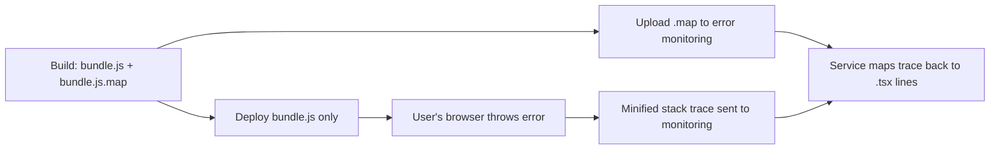

## Introduction

When `tsc` compiles a file, the output is not a line-for-line copy of the input. Interfaces and type aliases disappear, so every line below them moves up. Newer syntax may be rewritten for an older `target`, enums become objects, and a bundler later merges hundreds of files into one and minifies them onto a handful of very long lines. The program that actually runs is therefore a different text from the one you wrote.

That difference hurts at the worst moment: when something breaks. A stack trace that says `cart.js:5:19` is pointing at a file you never edit, on a line that does not match your source. In a minified production bundle it might say `index-3f9a2c.js:1:48213`, which is useless. Breakpoints have the same problem — you want to click on line 11 of `cart.ts`, not hunt for its compiled equivalent.

A **source map** solves this. It is a JSON file, produced alongside the compiled JavaScript, that records for each position in the output which file, line and column of the original source it came from. Debuggers, browsers, Node.js and error-monitoring services read the map and translate positions back, so stack traces, breakpoints and step-through debugging all work in terms of your TypeScript. The format is not TypeScript-specific; it is shared by Babel, esbuild, Vite, webpack, CSS preprocessors and minifiers. The JavaScript side of the story is introduced in [[b1-source-maps]].

Examples were compiled with TypeScript 6.0 and run with Node.js 22.

## Before you start

- **How `tsc` compiles and emits**, including `outDir`, `rootDir` and `target`. See [[b2-tsc-compilation]] and [[b2-tsconfig]].
- **Reading a stack trace**: frames, file names, line and column numbers. See [[b1-stack-traces]].
- **Browser DevTools basics**, for the browser section. See [[b1-devtools]].

## The intuition

Think of a translated book with a concordance at the back. The concordance says "page 40, paragraph 2 of this translation corresponds to page 57, paragraph 1 of the original". You read the translation, but whenever you need to quote the original precisely, you look up the concordance. A source map is that concordance, at the level of individual tokens: "column 19 of line 5 in `cart.js` is column 13 of line 11 in `cart.ts`". The runtime reads the translation; humans and tools consult the concordance.

The analogy has one limit: a concordance cannot restore what the translation dropped. Types were erased, so a source map can tell you *where* in `cart.ts` the error happened, but the running program still has no types, and variable values in the debugger are JavaScript values.

## Producing a source map with `tsc`

Turn on `sourceMap` in `tsconfig.json`:

```json title="tsconfig.json"
{
  "compilerOptions": {
    "target": "es2017",
    "module": "nodenext",
    "rootDir": "src",
    "outDir": "dist",
    "strict": true,
    "sourceMap": true
  },
  "include": ["src"]
}
```

Here are two source files. The error is thrown on line 11 of `cart.ts`:

```ts title="src/cart.ts"
interface Item {
  name: string;
  price: number;
  qty: number;
}

export function total(items: Item[]): number {
  let sum = 0;
  for (const item of items) {
    if (item.qty < 0) {
      throw new RangeError(`Negative quantity for ${item.name}`);
    }
    sum += item.price * item.qty;
  }
  return sum;
}
```

```ts title="src/main.ts"
import { total } from "./cart.js";

type Order = { id: string; items: { name: string; price: number; qty: number }[] };

const order: Order = {
  id: "A-17",
  items: [
    { name: "pen", price: 1.5, qty: 2 },
    { name: "ink", price: 4, qty: -1 },
  ],
};

console.log(`Order ${order.id} total:`, total(order.items));
```

`tsc` writes `dist/cart.js` and `dist/cart.js.map`:

```js title="dist/cart.js"
export function total(items) {
    let sum = 0;
    for (const item of items) {
        if (item.qty < 0) {
            throw new RangeError(`Negative quantity for ${item.name}`);
        }
        sum += item.price * item.qty;
    }
    return sum;
}
//# sourceMappingURL=cart.js.map
```

The six lines of the `Item` interface vanished, so the `throw` moved from line 11 to line 5. The last line is a special comment, **`//# sourceMappingURL=`**, which tells any tool that loads this file where its map is. The URL is resolved relative to the JavaScript file.

## Inside a `.map` file

The map is a small JSON document in the **Source Map Revision 3** format, which became the ECMA-426 standard in 2024:

```json title="dist/cart.js.map"
{"version":3,"file":"cart.js","sourceRoot":"","sources":["../src/cart.ts"],"names":[],"mappings":"AAMA,MAAM,UAAU,KAAK,CAAC,KAAa;IACjC,IAAI,GAAG,GAAG,CAAC,CAAC;IACZ,KAAK,MAAM,IAAI,IAAI,KAAK,EAAE,CAAC;QACzB,IAAI,IAAI,CAAC,GAAG,GAAG,CAAC,EAAE,CAAC;YACjB,MAAM,IAAI,UAAU,CAAC,yBAAyB,IAAI,CAAC,IAAI,EAAE,CAAC,CAAC;QAC7D,CAAC;QACD,GAAG,IAAI,IAAI,CAAC,KAAK,GAAG,IAAI,CAAC,GAAG,CAAC;IAC/B,CAAC;IACD,OAAO,GAAG,CAAC;AACb,CAAC"}
```

| Field | Meaning |
|---|---|
| `version` | Always `3` |
| `file` | The generated file this map describes |
| `sources` | Original files, relative to the map (after prepending `sourceRoot`) |
| `sourceRoot` | Optional prefix for every entry in `sources` |
| `names` | Original identifier names, used by minifiers that rename variables (empty here: `tsc` renames nothing) |
| `mappings` | The position table, compactly encoded |
| `sourcesContent` | Optional full text of each original file, so tools need not fetch it |

### How `mappings` is encoded

The `mappings` string is where all the information lives, and it is designed to be small. It is read in three levels:

1. **`;` separates generated lines.** The first group describes line 1 of `cart.js`, the fifth group line 5, and so on.
2. **`,` separates segments** within a line. Each segment maps one position in the generated line to a position in a source file.
3. **Each segment is 1, 4 or 5 numbers**: generated column, source file index, source line, source column, and optionally an index into `names`.

Two tricks keep it short. First, every number is a **delta** from the previous segment's value rather than an absolute position — small differences are cheaper to write than large positions. The generated column resets to zero at each new line; the other fields carry over across lines. Second, the numbers are written in **Base64 VLQ** (variable-length quantity): each Base64 character carries 5 bits of data plus a "more digits follow" bit, and the lowest bit of the decoded value is the sign. Small numbers fit in one character.

Take the fifth line's second segment, `MAAM`. In the Base64 alphabet `A` is 0 and `M` is 12. Twelve in binary is `01100`: the continuation bit is 0, so this is one complete number; the lowest bit is 0, so it is positive; the remaining bits give 6. So `MAAM` decodes to the deltas `[6, 0, 0, 6]`: move 6 columns right in the generated line, stay in the same source file, stay on the same source line, move 6 columns right in the source.

Applying all the deltas for line 5 is tedious by hand, so here is a short decoder that does it:

```js title="decode.mjs"
import { readFileSync } from "node:fs";

const B64 = "ABCDEFGHIJKLMNOPQRSTUVWXYZabcdefghijklmnopqrstuvwxyz0123456789+/";

// Decode one Base64 VLQ segment such as "YAEjB" into an array of integers.
function decodeSegment(segment) {
  const values = [];
  let value = 0, shift = 0;
  for (const ch of segment) {
    const digit = B64.indexOf(ch);
    const continues = digit & 32;          // bit 6: more digits follow
    value += (digit & 31) << shift;        // low 5 bits carry data
    if (continues) { shift += 5; continue; }
    const negative = value & 1;            // lowest bit of the result is the sign
    values.push(negative ? -(value >> 1) : value >> 1);
    value = 0; shift = 0;
  }
  return values;
}

const map = JSON.parse(readFileSync(process.argv[2], "utf8"));
const wanted = Number(process.argv[3]);   // 1-based generated line to show
let src = 0, srcLine = 0, srcCol = 0;     // these deltas carry across lines
map.mappings.split(";").forEach((line, i) => {
  let genCol = 0;                          // the column delta resets each line
  for (const seg of line.split(",").filter(Boolean)) {
    const [dCol, dSrc, dLine, dSrcCol] = decodeSegment(seg);
    genCol += dCol; src += dSrc; srcLine += dLine; srcCol += dSrcCol;
    if (i + 1 === wanted) {
      console.log(`${seg.padEnd(6)} -> js ${i + 1}:${genCol + 1}  ` +
        `${map.sources[src]} ${srcLine + 1}:${srcCol + 1}`);
    }
  }
});
```

Running `node decode.mjs dist/cart.js.map 5` prints (first five segments shown):

```output
YACjB  -> js 5:13  ../src/cart.ts 11:7
MAAM   -> js 5:19  ../src/cart.ts 11:13
IAAI   -> js 5:23  ../src/cart.ts 11:17
UAAU   -> js 5:33  ../src/cart.ts 11:27
CAAC   -> js 5:34  ../src/cart.ts 11:28
```

The internal arithmetic is zero-based; the output adds 1 to match how editors and stack traces count. The first segment, `YACjB`, decodes to `[12, 0, 1, -17]`: it moves to the next source line (line 10 to 11) and *back* 17 columns, because the `throw` is less indented than the end of the previous mapped token. The second segment says that column 19 of line 5 in `cart.js` — where `new RangeError` starts — is column 13 of line 11 in `cart.ts`. Remember that pair; it is exactly the translation the next section relies on. Notice also that the mapping is per token, not per character: positions between segments map to the closest segment to their left.

## Using maps in Node.js

Node.js does **not** apply source maps by default, because loading and parsing maps has a cost. Run the compiled program as is:

```output
file:///app/dist/cart.js:5
            throw new RangeError(`Negative quantity for ${item.name}`);
                  ^

RangeError: Negative quantity for ink
    at total (file:///app/dist/cart.js:5:19)
    at file:///app/dist/main.js:9:41
```

Every position refers to compiled files. Now add the **`--enable-source-maps`** flag (available since Node.js 12.12):

```output
/app/src/cart.ts:11
      throw new RangeError(`Negative quantity for ${item.name}`);
            ^

RangeError: Negative quantity for ink
    at total (/app/src/cart.ts:11:13)
    at <anonymous> (/app/src/main.ts:13:41)
```

Node.js found the `sourceMappingURL` comment, loaded the map, and rewrote `cart.js:5:19` to `cart.ts:11:13` — the same pair you decoded by hand — and even printed the TypeScript source line. You can set the flag for every process through the environment, `NODE_OPTIONS=--enable-source-maps`, or switch it on from code with `process.setSourceMapsEnabled(true)` before the affected modules load:

```js title="dist/run.mjs"
process.setSourceMapsEnabled(true);
const { total } = await import("./cart.js");
try { total([{ name: "ink", price: 4, qty: -1 }]); } catch (e) {
  console.log(e.stack.split("\n").slice(0, 2).join("\n"));
}
```

```output
RangeError: Negative quantity for ink
    at total (/app/src/cart.ts:11:13)
```

The rewritten positions are in `error.stack` itself, so they also reach your logs. The cost is mostly paid when a stack trace is created and when maps are first loaded; for services that create many errors, measure before turning it on everywhere in production.

> [!NOTE] Running `.ts` directly
> Node.js 22.18+ and 23.6+ can run `.ts` files directly by stripping types (see [[b2-node-typescript]]). Type stripping replaces type annotations with whitespace instead of deleting them, so every remaining token keeps its line and column. Running `node main.ts` on the files above reports `cart.ts:11:13` with no source map at all. Tools that rewrite code, such as `tsx` (which uses esbuild), generate maps internally instead.

## Debugging in editors and browsers

**VS Code** uses source maps automatically when you debug Node.js: set a breakpoint in `src/cart.ts`, launch `dist/main.js`, and execution stops on the TypeScript line. The debugger needs to find the compiled files, which it does through the `outFiles` setting in `launch.json` (by default, every `.js` file in the workspace outside `node_modules`). If breakpoints stay grey ("unbound"), the usual causes are that `sourceMap` is off, that `outFiles` does not cover the output folder, or that the map's `sources` paths do not lead back to the file you clicked in.

**Browser DevTools** load the map when DevTools is open, show the original files in the Sources panel under their original paths, and let you set breakpoints and step through TypeScript. In development, Vite serves maps for every transformed module without configuration. The DevTools side is covered in [[b3-devtools-source-maps]].

## The `tsc` options

| Option | Effect | When to use |
|---|---|---|
| `sourceMap` | Writes `x.js.map` and a `sourceMappingURL` comment | Default choice for compiled Node.js code |
| `inlineSourceMap` | Embeds the map in the `.js` file as a Base64 `data:` URL; no separate file | Tools that cannot find separate map files; quick scripts |
| `inlineSources` | Copies the original TypeScript into the map's `sourcesContent` | When the debugger or error service cannot reach your source files |
| `sourceRoot` | Sets a prefix for `sources`, such as a URL where sources are hosted | Sources served from a different location than the maps |
| `mapRoot` | Changes the location written in `sourceMappingURL` | Maps deployed to a different location than the JavaScript |
| `declarationMap` | Writes `x.d.ts.map` mapping declarations back to source | Monorepos and libraries: "go to definition" opens the `.ts`, not the `.d.ts` |

`sourceMap` and `inlineSourceMap` are mutually exclusive. Inlining is convenient but has a real cost: in the example, `cart.js` grew from 284 bytes to 858 bytes, and with `inlineSources` it would also contain a copy of the TypeScript. Never ship inline maps to browsers in production, because every user downloads them.

`declarationMap` deserves a word. In a monorepo using project references (see [[b2-tsconfig]]), one package consumes another through its generated `.d.ts` files. Without declaration maps, "go to definition" on an imported function lands in a `.d.ts` file with no implementation; with them, the editor follows the map to the real source. It is cheap to enable for any package that others in the repository depend on.

## Source maps through a build pipeline

In a real frontend, TypeScript is only the first transformation. Vite (or webpack) transpiles each file, bundles modules together, and minifies the result, and each step moves code around. Each tool in the chain must read the incoming map and produce a combined map from the final output back to the original `.ts` — maps are **composed**. Bundlers do this for you, which is why application code configures maps in the bundler, not in `tsc`: in a Vite project `tsc` usually runs with `noEmit` and its `sourceMap` setting has no effect on what ships.

For production builds, Vite's `build.sourcemap` option takes `false` (the default), `true`, `"inline"` or `"hidden"`. **Hidden** source maps are generated as separate files but the `sourceMappingURL` comment is left out of the bundle, so browsers never request them. Webpack has the same idea under `devtool: "hidden-source-map"`.

## Source maps in production

Production errors are where source maps pay for themselves. An error-monitoring service such as Sentry receives a stack trace like `index-3f9a2c.js:1:48213` from a user's browser and needs the map for that exact build to turn it into `CheckoutForm.tsx:87:14`. The standard setup:

1. Generate hidden source maps during the production build.
2. Upload the maps, tagged with the release version (or matched by debug IDs that the build injects), to the monitoring service as a CI step.
3. Delete the `.map` files from the deploy output, or block them from public access.



Why not simply publish the maps? A public source map, especially with `sourcesContent`, hands anyone your original source: file structure, comments, internal names and sometimes forgotten secrets or internal URLs. Frontend code is visible to users anyway, so this is not a reason to rely on obscurity for security — never put real secrets in frontend code — but there is no reason to publish more than necessary. Some open-source projects do publish maps deliberately, to help users debug. For Node.js services, which do not send code to users, keeping `.map` files next to the deployed JavaScript and running with `--enable-source-maps` is the simple and safe default. Error reporting architecture is discussed further in [[b4-error-reporting]].

## How it works internally

While emitting, `tsc` keeps a **source map generator** alongside the text writer. Every time the emitter writes a token that came from a source node, it records a segment: current output line and column, plus the node's original position. Nodes that the compiler synthesised (helper functions, downlevelled loops) are mapped to the closest original node or left unmapped. When a file is finished, the generator sorts the segments, converts them to deltas and Base64 VLQ, and writes the JSON.

A consumer — Node.js, a browser, a debugger — parses `mappings` into a table and, for a generated position, binary-searches the segments of that line for the last segment at or before the column. That is why a stack-trace column that falls between two segments still maps sensibly. Node.js caches parsed maps per file, which is why the cost of `--enable-source-maps` is front-loaded.

## In real systems

A Node.js API compiled with `tsc` ships `dist/**/*.js` and `.js.map` files and starts with `node --enable-source-maps dist/server.js` so logs and error monitors receive TypeScript positions. A React app built with Vite generates hidden maps in CI, uploads them with the monitoring vendor's Vite plugin or CLI, and deploys without them. A component library in a monorepo enables `declarationMap` so application developers jump from usage straight into the library's source. Teams that report "the stack trace points to the wrong line" usually find a step in the pipeline that did not pass its incoming map along — for example a custom post-processing script that rewrote the bundle without updating its map.

## Trade-offs and alternatives

| Choice | Benefit | Cost |
|---|---|---|
| Separate `.map` files | Small JavaScript; maps loaded only when needed | More files to deploy or upload |
| Inline maps | One file, nothing to lose | Much larger JavaScript; never for production browsers |
| `inlineSources` | Debugging works without access to source files | Source code is embedded in the map |
| Hidden maps + upload | Readable production traces without public source | Extra CI step; maps must match the exact build |
| No maps | Smallest build, nothing to leak | Production stack traces are nearly useless |
| `--enable-source-maps` in production | Readable logs | Some extra cost when creating stack traces |

## Common mistakes

**Expecting Node.js to use maps automatically.** It does not; add `--enable-source-maps` or `process.setSourceMapsEnabled(true)`.

**Setting `sourceMap` in a Vite project and expecting production maps.** Vite does the emitting; configure `build.sourcemap`. `tsc` with `noEmit` writes nothing.

**Deploying public maps with `sourcesContent`.** Your original source becomes downloadable. Use hidden maps and upload them privately, or remove the files after upload.

**Uploading maps from a different build.** Maps are only valid for the exact output they were generated with. Rebuilding — even with identical source — can change the bundle. Upload in the same CI job that produced the deployed files, tagged with the release.

**Moving output files without their maps.** Copying `dist/*.js` elsewhere breaks the relative `sourceMappingURL` and `sources` paths. Move maps together with their JavaScript, or set `sourceRoot` and `mapRoot` for the deployed layout.

## Interview perspective

**"What is a source map and how does it work?"** A JSON file mapping positions in generated code back to original sources. The `mappings` field lists segments per generated line, each a set of deltas — generated column, source index, source line, source column, optional name — encoded as Base64 VLQ. A `sourceMappingURL` comment links the code to its map.

**"How would you get readable stack traces from a minified production frontend without exposing your source?"** Hidden source maps, uploaded to the error monitoring service per release, not deployed publicly. Mention that maps must match the exact build.

**"Why do my Node.js stack traces point to `dist/*.js`?"** Node.js only applies maps with `--enable-source-maps` (or `process.setSourceMapsEnabled`), and `sourceMap` must be on in `tsconfig.json`.

**"What does `declarationMap` do?"** It maps `.d.ts` files to their `.ts` sources so editors navigate to implementations across package boundaries.

## Practice

1. Compile the `cart.ts` example with `sourceMap`, run it with and without `--enable-source-maps`, and match each stack frame to a segment printed by the decoder.
2. Decode `YACjB` by hand, digit by digit, and confirm the result `[12, 0, 1, -17]`.
3. Change `target` to `es5` with `"ignoreDeprecations": "6.0"`, recompile, and observe how the downlevelled `for...of` loop changes line numbers in `cart.js` while the mapped stack trace stays the same.
4. Compare the size of `cart.js` with `sourceMap`, `inlineSourceMap`, and `inlineSourceMap` plus `inlineSources`.
5. In a Vite app, build with `build.sourcemap: "hidden"` and confirm that the bundle has no `sourceMappingURL` comment while `.map` files are present in `dist`.

```quiz
Q: A compiled Node.js service logs `at total (file:///app/dist/cart.js:5:19)` although `sourceMap: true` is set. What is missing?
- [ ] `inlineSources: true`
- [x] Running Node.js with `--enable-source-maps` (or calling `process.setSourceMapsEnabled(true)`)
- [ ] A `declarationMap`
- [ ] Moving the `.map` files into `src`
> Node.js does not apply source maps unless asked. `inlineSources` only embeds the original text in the map, `declarationMap` is for `.d.ts` navigation, and the maps belong next to the JavaScript, where the `sourceMappingURL` comment points.
```

```quiz
Q: Why are the numbers in a source map's `mappings` field stored as deltas from the previous segment?
- [ ] Browsers cannot parse large numbers in JSON
- [x] Differences between neighbouring positions are small, so they encode in fewer Base64 VLQ characters
- [ ] Deltas make the map independent of the original file
- [ ] Deltas allow the map to work after the code is reformatted
> VLQ uses one character per 5 bits of value, so small numbers are short. Consecutive tokens are close together, so storing differences keeps most fields to one character. The map still depends on the exact generated and original files; reformatting either invalidates it.
```

```quiz
Q: A team wants readable production stack traces for a Vite React app but does not want the original source downloadable by users. Which setup fits?
- [ ] `build.sourcemap: "inline"`
- [ ] `build.sourcemap: true` and deploy everything in `dist`
- [x] `build.sourcemap: "hidden"`, upload the maps to the error monitoring service in CI, and do not deploy the `.map` files
- [ ] No source maps; read minified traces directly
> Hidden maps are generated without the `sourceMappingURL` comment, so browsers never request them, and uploading them privately lets the monitoring service translate traces. Inline maps ship the mapping to every user, and deploying `.map` files publicly exposes the source.
```

## Quick revision {#quick-revision}

- Compiled JavaScript differs from TypeScript (types removed, syntax downlevelled, bundled, minified), so positions shift.
- A **source map** (Revision 3, ECMA-426) is JSON: `version`, `file`, `sources`, `sourceRoot`, `names`, `mappings`, optional `sourcesContent`. Linked by `//# sourceMappingURL=`.
- `mappings`: `;` per generated line, `,` per segment; segment = generated column, source index, source line, source column[, name]; all **deltas**, **Base64 VLQ** (5 data bits + continuation bit; lowest bit is the sign). Generated column resets per line.
- `tsc`: `sourceMap` (separate file), `inlineSourceMap` (data URL, bigger), `inlineSources` (adds `sourcesContent`), `sourceRoot`, `mapRoot`, `declarationMap` (`.d.ts.map` for go-to-source).
- Node.js: `--enable-source-maps` (12.12+), `NODE_OPTIONS`, or `process.setSourceMapsEnabled(true)`; rewrites `error.stack`.
- Node.js type stripping keeps positions by replacing types with whitespace, so no map is needed.
- VS Code uses maps automatically; `outFiles` must cover the output. DevTools loads maps when open.
- Bundlers compose maps; configure maps in Vite (`build.sourcemap`: `false`/`true`/`"inline"`/`"hidden"`), not `tsc`.
- Production: hidden maps, upload per release to error monitoring, do not deploy publicly.

## Key takeaways {#key-takeaways}

- Source maps translate positions in generated JavaScript back to the TypeScript you wrote, for stack traces and breakpoints.
- A map is a compact table of deltas encoded in Base64 VLQ; with a small decoder you can verify any mapping yourself.
- Node.js needs `--enable-source-maps`; editors and browser DevTools use maps automatically.
- In bundled apps, the bundler owns source maps; `tsc`'s settings matter for code `tsc` itself emits.
- In production, generate hidden maps and give them only to your error monitoring service.
