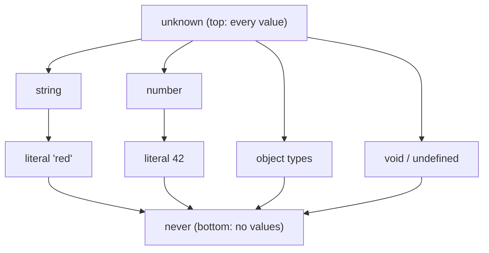

## Introduction

Most TypeScript types describe ordinary data. `string` is every piece of text, `number` is every number, `{ id: number }` is every object with a numeric `id`. But programs also need to talk about situations that are not "a value of some shape":

- a value whose shape you do not know yet, because it came from a network response, `JSON.parse` or a `postMessage` event;
- a function that never finishes normally, because it always throws;
- a branch of code that should be impossible to reach;
- a function that is called for what it *does*, not for what it returns.

TypeScript has four **special types** for these situations: **`any`**, **`unknown`**, **`never`** and **`void`**. They look small, but they decide how safe a codebase really is. A single `any` in the wrong place switches type checking off for everything it touches. A well-placed `unknown` forces validation exactly where untrusted data enters. `never` lets the compiler tell you when a new case was added and not handled. `void` documents that a callback's result is ignored.

This lesson teaches all four, and the discipline of avoiding `any`, which is the most important habit of the four. Each has its own section that can be read on its own. The related types `null` and `undefined` have their own lesson, [[b2-null-undefined-ts]], and how the compiler treats them depends on [[b2-strict-null-checks]].

## Before you start

- **What TypeScript is and what it erases** — types exist only at compile time; at runtime only JavaScript runs. See [[b2-what-is-typescript]].
- **Type annotations and inference** — writing `x: string` and letting the compiler infer types. See [[b2-type-annotations]] and [[b2-type-inference]].
- **Union types** — `string | number` means "either". See [[b2-unions]]. You will meet unions in every section.
- **JavaScript's `typeof`** — what it reports at runtime. See [[b1-typeof]].

The examples were compiled with TypeScript 6.0 (`tsc --strict`) and run with Node.js 22. Compiler errors are shown in the same `file.ts(line,col)` format `tsc` prints.

## The intuition: types are sets of values

The cleanest way to understand the special types is to think of every type as a **set of possible values**. `boolean` is the set `{true, false}`. The literal type `"red"` is a set with one member. `string` is the infinite set of all strings. Saying "`x` has type `T`" means "`x` holds some member of the set `T`", and assigning `a` to `b` is allowed when `a`'s set fits inside `b`'s set.

With that picture, three of the four special types are easy to place:

| Type | As a set | Consequence |
|---|---|---|
| `unknown` | Every value that exists | Anything can be assigned *to* it; you can do almost nothing *with* it until you check what it is |
| `never` | The empty set — no values at all | It can be assigned to anything (an empty set fits inside every set); nothing except `never` can be assigned to it |
| `void` | "No useful value" — in practice `undefined` | Used for function results that the caller should ignore |
| `any` | Not a set at all — an instruction to stop checking | Assignable to and from almost everything; no operations are checked |

`unknown` is called the **top type** because it sits above every other type: every type is a subset of it. `never` is the **bottom type** because it sits below every other type. `any` does not fit into the picture, and that is exactly the problem with it: it is an escape hatch from the type system rather than a member of it.



The arrows point from a wider type to a narrower one. Assignment is allowed in the direction "narrower into wider" — a `"red"` can go into a `string` variable, and a `string` can go into an `unknown` variable. `any` is drawn nowhere, because the compiler lets it go in both directions.

## any and why to avoid it {#b2-avoiding-any}

`any` is TypeScript's way of saying "do not check this value". A value of type `any` can be assigned to a variable of almost any type, can receive a value of any type, and allows every operation: property access, method calls, arithmetic, calling it as a function. The compiler reports nothing. **Avoiding `any`** means writing precise types instead — `unknown` at boundaries, generics, unions, interfaces and validation — so that mistakes are caught at compile time rather than in production.

### What any actually does

`any` exists for a good historical reason. TypeScript had to work with existing JavaScript code, much of which was never typed. `any` lets typed and untyped code meet without the compiler refusing to build. The cost is that the checker stops caring about that value entirely:

```typescript title="any-spread.ts"
const raw = '{"user": {"name": "Ada"}}';
const data = JSON.parse(raw);          // data: any

const userName = data.user.name;       // any — no error
const upper = userName.toUpperCase();  // any — no error
const city = data.user.address.city;   // any — no error, but crashes at runtime

console.log(upper, city);
```

```output
/app/any-spread.js:6
const city = data.user.address.city; // any — no error, but crashes at runtime
                               ^
TypeError: Cannot read properties of undefined (reading 'city')
```

The file compiles with zero errors under `--strict`. `JSON.parse` is declared in the standard library as returning `any`, so `data` is `any`. Every property read from an `any` is also `any`, so `userName`, `upper` and `city` are all `any` too, and none of them are checked. The typo-free but wrong assumption that a user has an `address` goes straight to runtime.

This is the most dangerous property of `any`: **it spreads**. It is not limited to the variable you declared — every value derived from it, every function that returns it and every caller of that function becomes unchecked. People describe `any` as contagious for this reason. One `any` returned from a utility module can silently remove checking from dozens of call sites.

### any goes in both directions

Ordinary types only allow assignment from narrower to wider. `any` allows both:

```typescript title="any-both-ways.ts"
let a: any = "hello";
let n: number = a;        // any flows into number without complaint
let s: string = a;
let v: never = a;         // the one place any is rejected
a = 42;
a = { anything: true };
console.log(n.toFixed(2));
```

```output
any-both-ways.ts(4,5): error TS2322: Type 'any' is not assignable to type 'never'.
```

Line 2 puts a string into a `number` variable and the compiler accepts it. If you delete line 4 and run the program, it crashes with `TypeError: n.toFixed is not a function`, because `n` really holds `"hello"`. You will sometimes read that `any` is "both the top and the bottom type". That is close but not exact: anything can be assigned to `any` (like a top type) and `any` can be assigned to everything *except* `never` (almost like a bottom type). What makes it unsound is the combination.

### Implicit any and noImplicitAny

You do not have to write `any` to get it. A parameter without an annotation and without context to infer from is **implicitly `any`**. The compiler flag `noImplicitAny` turns that into an error:

```typescript title="implicit.ts"
function double(x) {
  return x * 2;
}
console.log(double(4));
```

```output
implicit.ts(1,17): error TS7006: Parameter 'x' implicitly has an 'any' type.
```

`noImplicitAny` is part of the `strict` family of flags (see [[b2-noimplicitany]] and [[b2-strict-compiler-options]]). With it on, every `any` in your code is one somebody wrote on purpose, which makes them easy to find and review. The fix here is to say what `x` is: `function double(x: number)`.

### What to write instead of any

Most uses of `any` fall into a handful of situations, and each has a precise replacement.

**Data from outside the program** — JSON, `fetch` responses, `localStorage`, message events, files. Type it as `unknown` and check it before use, as described in [[b2-unknown|the next section]]. For anything larger than a couple of fields, a schema library such as Zod validates the data and gives you a static type from the same definition, so the check and the type cannot drift apart.

**A function that works for any type but preserves it** — use a **generic** instead. `function first(items: any[]): any` loses all information; `function first<T>(items: T[]): T | undefined` returns exactly the element type the caller passed in. See [[b2-generics]].

**A value that is one of several known shapes** — use a **union** such as `string | number` or a discriminated union of object types. See [[b2-unions]] and [[b2-discriminated-unions]].

**An object used as a dictionary with unknown keys** — use `Record<string, unknown>` (or `Record<string, number>` if the values are known). Unlike `any`, it still requires you to check each value before using it. See [[b2-record-utility]].

**A third-party library with missing or poor types** — write a small declaration or a typed wrapper function at the boundary so that `any` stops there instead of leaking into your application. See [[b2-third-party-types]] and [[b2-declaration-files]].

**A genuinely impossible-to-type situation** — rare, but it happens with some dynamic metaprogramming. Keep the `any` inside one small function with a precise signature, and add a comment saying why.

### Type assertions are not a fix

A **type assertion**, written `value as User`, tells the compiler "trust me, this is a `User`". It does not check anything at runtime; it is erased like every other type. That means `JSON.parse(text) as User` is exactly as unsafe as `any` — the compiler stops complaining, but nothing has verified that the data is a `User`. The double assertion `value as unknown as User`, which forces any type into any other, is a stronger version of the same lie. Assertions have legitimate uses (see [[b2-type-assertions]]), but they are a statement of knowledge you already have, not a substitute for checking.

### Keeping any out of a codebase

Teams that care about type safety enforce it with tools rather than willpower:

- `"strict": true` in `tsconfig.json`, which includes `noImplicitAny`. TypeScript 6.0 enables `strict` by default; older versions need it set explicitly.
- The typescript-eslint rules `no-explicit-any` (flags written `any`) and the `no-unsafe-*` family (`no-unsafe-assignment`, `no-unsafe-member-access`, `no-unsafe-call`, `no-unsafe-return`), which flag places where an `any` from a library spreads into your code. See [[b2-eslint-typescript]].
- `// @ts-expect-error` with a comment, instead of `any`, for the rare line that truly cannot be typed. It suppresses one error on the next line only, and it becomes an error itself if the problem goes away, so it never goes stale.

When migrating a JavaScript codebase ([[b2-migration-js-to-ts]]), `any` is a reasonable *temporary* step. The order that works is: fix `any` at the source (the function that returns it) rather than at each caller, start with boundaries such as API clients, and tighten one module at a time.

> [!WARNING] any on security-sensitive objects
> Typing a session, token or permissions object as `any` hides missing checks. If `user.isAdmin` is misspelled `user.isAdmn`, an `any` gives you `undefined` — falsy — with no compiler error, and a permission check silently changes meaning.

## unknown {#b2-unknown}

`unknown` is the type of a value you know nothing about yet. Any value can be stored in an `unknown` variable — a string, an object, `null`, a function — but you cannot *use* it for anything until you have checked what it is. In that sense it is the type-safe counterpart of `any`: both accept everything, but `unknown` keeps the checker switched on.

### Everything goes in, nothing comes out unchecked

```typescript title="unknown-rules.ts"
let value: unknown;
value = 42;
value = "text";
value = { id: 1 };

value.toUpperCase();          // error: must narrow first
const s: string = value;      // error: unknown is not assignable to string
const copy: unknown = value;  // fine: unknown to unknown
const loose: any = value;     // fine: unknown to any
```

```output
unknown-rules.ts(6,1): error TS18046: 'value' is of type 'unknown'.
unknown-rules.ts(7,7): error TS2322: Type 'unknown' is not assignable to type 'string'.
```

Lines 2–4 show the "everything goes in" half: `unknown` is the top type, so every value is assignable to it. Lines 6–7 show the other half. You cannot call a method on it, read a property, do arithmetic or assign it to a more specific type, because the compiler cannot prove any of those are safe. The only types an `unknown` can be assigned to without a check are `unknown` itself and `any`.

### Narrowing: proving what the value is

To use an `unknown`, you **narrow** it — you write a runtime check that the compiler understands, and inside the branch where the check passed, the compiler treats the value as the narrower type. This is called control flow analysis: the checker follows your `if` statements and tracks what each branch has proved. ([[b2-narrowing]] covers it in full.)

```typescript title="describe.ts"
function describe(input: unknown): string {
  if (typeof input === "string") {
    return `string of length ${input.length}`;
  }
  if (typeof input === "number") {
    return `number ${input.toFixed(1)}`;
  }
  if (input instanceof Date) {
    return `date ${input.toISOString().slice(0, 10)}`;
  }
  if (Array.isArray(input)) {
    return `array of ${input.length}`;
  }
  if (typeof input === "object" && input !== null && "id" in input) {
    return `object with id ${String(input.id)}`;
  }
  return "something else";
}

console.log(describe("hello"));
console.log(describe(3.14159));
console.log(describe(new Date("2024-05-01")));
console.log(describe([1, 2, 3]));
console.log(describe({ id: 7 }));
console.log(describe(null));
```

```output
string of length 5
number 3.1
date 2024-05-01
array of 3
object with id 7
something else
```

Each `if` uses a different narrowing tool:

- `typeof input === "string"` narrows to `string` ([[b2-typeof-narrowing]]).
- `input instanceof Date` narrows to `Date` ([[b2-instanceof-narrowing]]).
- `Array.isArray(input)` narrows to `any[]`. Notice that: the standard library's declaration returns an array of `any`, so the elements need checking before you trust them.
- `typeof input === "object" && input !== null` narrows to `object`. The `null` check is required because `typeof null` is `"object"` in JavaScript. Then `"id" in input` (TypeScript 4.9 and later) narrows further to `object & Record<"id", unknown>`, so `input.id` is readable — but it is itself `unknown`, which is why the code wraps it in `String()`.

### Custom type guards for real shapes

Checking a full object field by field in every function would be tiresome. A **type predicate** packages the checks into a reusable function. Its return type `value is User` tells the compiler: "if this returns `true`, treat the argument as a `User`".

```typescript title="parse-user.ts"
interface User {
  id: number;
  name: string;
}

function isUser(value: unknown): value is User {
  return (
    typeof value === "object" &&
    value !== null &&
    "id" in value &&
    typeof value.id === "number" &&
    "name" in value &&
    typeof value.name === "string"
  );
}

function parseUser(json: string): User {
  const data: unknown = JSON.parse(json);
  if (!isUser(data)) {
    throw new Error(`Not a user: ${json}`);
  }
  return data; // narrowed to User
}

console.log(parseUser('{"id": 1, "name": "Ada"}').name.toUpperCase());

try {
  parseUser('{"id": "1", "name": "Ada"}');
} catch (err) {
  // err is unknown under strict (useUnknownInCatchVariables)
  if (err instanceof Error) {
    console.log("Rejected:", err.message);
  }
}
```

```output
ADA
Rejected: Not a user: {"id": "1", "name": "Ada"}
```

Three details are worth reading slowly. First, `JSON.parse` returns `any`, and the annotation `const data: unknown` deliberately throws that away — from this line on, the compiler insists on a check. Second, after `if (!isUser(data)) throw …`, the compiler knows that the only way to reach `return data` is if `isUser` returned `true`, so `data` is a `User` there. Third, the second call has `"id": "1"` — a string where a number was expected. A cast (`as User`) would have let that through and broken some later arithmetic; the guard rejects it at the door.

A type predicate is only as trustworthy as its body. The compiler does not check that `isUser` really verifies every field; if you forget the `name` check, it will still narrow. That is why larger projects generate these guards from a schema (Zod, Valibot, io-ts) instead of writing them by hand. See [[b2-custom-type-guards]].

### unknown in catch clauses

The `catch (err)` above shows another place `unknown` appears. JavaScript lets you `throw` any value — a string, a number, `undefined` — so the caught value really could be anything. Since TypeScript 4.4, the flag `useUnknownInCatchVariables` (included in `strict`) types `err` as `unknown` instead of `any`, so you must check `err instanceof Error` before reading `err.message`.

### When to choose unknown

Use `unknown` wherever a value crosses a **trust boundary** into your code: `JSON.parse`, `await response.json()` (also declared as returning `any`), `event.data` from a `MessageEvent`, values read from storage, caught errors, and parameters of functions whose job is to validate. Inside your program, after validation, use precise types. `unknown` is a door with a lock, not a type you pass around everywhere.

> [!MISTAKE] Casting unknown away
> Writing `const user = data as User` right after declaring `data: unknown` gives up the safety you chose `unknown` for. If you catch yourself doing this, write the check (or a schema parse) instead.

## never {#b2-never}

`never` is the type with no values. No variable can ever hold a `never`, because there is nothing to hold. That sounds useless, but it is how TypeScript describes two real situations: **code that cannot finish normally** (a function that always throws or loops forever) and **cases that cannot happen** (a branch the compiler has proved unreachable). Because it is the empty set, `never` is the bottom type: it is assignable to every type, and no type except `never` is assignable to it.

### Functions that never return

A function whose end can never be reached has the return type `never`:

```typescript title="never-functions.ts"
function fail(message: string): never {
  throw new Error(message);
}

const failArrow = (message: string) => {
  throw new Error(message);
};

function failDecl(message: string) {
  throw new Error(message);
}

type A = ReturnType<typeof failArrow>;  // never
type B = ReturnType<typeof failDecl>;   // void
const a: A extends never ? "never" : "other" = "never";
const b: [B] extends [void] ? "void" : "other" = "void";

type Impossible = string & number;   // never
type Same = string | never;          // string
const x: Impossible = "a";

function parsePort(text: string): number {
  const n = Number(text);
  if (Number.isNaN(n)) fail(`Bad port: ${text}`);
  return n;
}
console.log(parsePort("8080"));
```

```output
never-functions.ts(20,7): error TS2322: Type '"a"' is not assignable to type 'never'.
8080
```

(The first line is the compiler's report; `8080` is what the emitted JavaScript prints.)

Notice the inference difference between `failArrow` and `failDecl`. For arrow functions and function expressions that always throw, TypeScript infers `never`. For a function *declaration* with no return statement, it infers `void` instead, because a declaration might be a stub that a subclass or later edit fills in. If you want a declaration to be `never`, annotate it, as `fail` does. The two `const a`/`const b` lines exist only to prove those inferred types: each would be a compile error if the type were different.

The annotation matters for more than documentation. In `parsePort`, after `if (Number.isNaN(n)) fail(...)`, the compiler knows that a call to a `never` function ends that path. This only works when the function has an **explicit** `never` annotation — the checker does not use inferred types for this purpose, so that analysing one function does not require analysing all the others first:

```typescript title="never-narrowing.ts"
function fail(message: string): never {
  throw new Error(message);
}
const failArrow = (message: string) => {
  throw new Error(message);
};
function len1(s: string | null) {
  if (s === null) fail("missing");
  return s.length;
}
function len2(s: string | null) {
  if (s === null) failArrow("missing");
  return s.length;
}
```

```output
never-narrowing.ts(13,10): error TS18047: 's' is possibly 'null'.
```

`len1` compiles: the explicitly annotated `fail` ends the `null` path, so `s` is a `string` afterwards. `len2` does not, even though `failArrow` also always throws.

### never in type algebra

`never` also appears when types combine. An **intersection** of types that share no values is empty: `string & number` is `never`, which is why `const x: Impossible = "a"` failed above. In a **union**, `never` disappears, because adding the empty set to a set changes nothing: `string | never` is just `string`.

That second rule is how conditional types filter unions. The built-in `Exclude<T, U>` maps each member of `T` either to itself or to `never`, and the `never` members vanish from the result:

```typescript
type Primitive = string | number | boolean;
type NotString = Exclude<Primitive, string>;   // number | boolean
```

[[b2-conditional-types]] explains the mechanism.

### Exhaustiveness checking

The most valuable everyday use of `never` is making the compiler tell you when you forgot a case. Take a discriminated union — a union of object types that share a literal `kind` field ([[b2-discriminated-unions]]). In each `case`, TypeScript narrows the union. After every member has been handled, what is left is the empty set: `never`. If you pass the leftover to a function that accepts only `never`, the code compiles exactly when all cases are handled.

```typescript title="area.ts"
type Shape =
  | { kind: "circle"; radius: number }
  | { kind: "square"; side: number }
  | { kind: "triangle"; base: number; height: number };

function assertNever(value: never): never {
  throw new Error(`Unhandled case: ${JSON.stringify(value)}`);
}

function area(shape: Shape): number {
  switch (shape.kind) {
    case "circle":
      return Math.PI * shape.radius ** 2;
    case "square":
      return shape.side ** 2;
    default:
      return assertNever(shape);
  }
}

console.log(area({ kind: "square", side: 3 }));
```

```output
area.ts(17,26): error TS2345: Argument of type '{ kind: "triangle"; base: number; height: number; }' is not assignable to parameter of type 'never'.
```

Somebody added `"triangle"` to `Shape` without updating `area`. In the `default` branch, `shape` has been narrowed to just the triangle, which is not `never`, so the call fails to compile — and the error message names the missing case. Add `case "triangle": return (shape.base * shape.height) / 2;` and the error disappears, because now `shape` really is `never` in `default`.

`assertNever` also throws at runtime. That covers the case the compiler cannot see: data from a server that sends a `kind` your client version does not know. The pattern is taught in depth in [[b2-exhaustiveness-assertnever]].

### Where never shows up uninvited

Sometimes `never` appears in an error message without you writing it. The usual cause is an impossible combination: an intersection of incompatible object properties, a `switch` narrowed past its last case, or an empty array literal whose type could not be inferred (`never[]`, covered in [[b2-typed-arrays]]). When you see `never` unexpectedly, ask "which earlier step proved this set empty?".

One misuse to avoid: typing a parameter as `never` to mean "unused". A function with a `never` parameter cannot be called with any argument, since no value is a `never`. For an ignored parameter, use `unknown` and an underscore prefix such as `_event: unknown`.

## void {#b2-void-ts}

`void` is the return type of a function whose result is not meant to be used — a function called for its side effect, such as logging, updating the DOM or saving to a database. At runtime such a function returns `undefined` (every JavaScript function without a `return` value does). `void` is the type-level way of saying "do not rely on what comes back".

### void as a return type

```typescript title="void-rules.ts"
function logMessage(msg: string): void {
  console.log(msg);
}
function bad(): void {
  return 42;
}
function ok(): void {
  return undefined;
}
const result = logMessage("hi");
if (result) {
  console.log("truthy");
}

type Callback = (item: number) => void;
const collected: number[] = [];
const push: Callback = (n) => collected.push(n);   // returns number, still allowed
[1, 2, 3].forEach(push);
const r = push(4);
console.log(collected, r);

function noReturn(): undefined {}
let v: void = undefined;
let u: undefined = v;
```

```output
void-rules.ts(5,3): error TS2322: Type 'number' is not assignable to type 'void'.
void-rules.ts(11,5): error TS1345: An expression of type 'void' cannot be tested for truthiness.
void-rules.ts(24,5): error TS2322: Type 'void' is not assignable to type 'undefined'.
```

When the errors are ignored and the emitted JavaScript runs, it prints:

```output
hi
[ 1, 2, 3, 4 ] 4
```

There is a lot in this example; take it piece by piece.

**Declaring `: void` forbids returning a value.** `bad` fails because `42` is not `void`. `ok` compiles because `undefined` is assignable to `void`. A function declaration with no `return` at all is inferred as `void`, so `logMessage` would not even need the annotation.

**You cannot use a `void` result as if it meant something.** Line 11 tests `result` for truthiness and the compiler refuses, because a `void` value carries no information worth testing.

**A *function type* returning `void` is more relaxed.** `push` is typed `Callback`, which returns `void`, yet the arrow function returns `collected.push(n)` — a number (the array's new length). The compiler accepts it. This is deliberate and called **substitutability**: a callback type ending in `void` means "the caller will ignore the result", not "the function must return nothing". Without this rule, `[1, 2, 3].forEach(n => collected.push(n))` would be an error, because `forEach` expects `(value) => void` and `push` returns a number. Ignoring a value is always safe, so TypeScript allows it.

The flip side shows on the next lines: `r` is typed `void`, but at runtime it holds `4`. The `void` type does not guarantee that the value is `undefined`; it guarantees only that the compiler will stop you using it. So the relaxed rule is safe only as long as nobody casts the result back to something useful.

**`void` and `undefined` are not the same type.** `undefined` can go into `void`, but `void` cannot go into `undefined` (line 24), precisely because a `void` result might be some ignored value. When you *store* or *pass* an absent value, use `undefined`. When a function's result is meaningless, use `void`. Since TypeScript 5.1, a function annotated `: undefined` may also omit the `return` statement entirely, as `noReturn` does.

### void with async functions

An `async` function always returns a Promise, even when its body returns nothing. Its return type is therefore `Promise<void>`, not `void`, and the compiler enforces that:

```typescript title="async-void.ts"
async function save(id: number): Promise<void> {
  await new Promise((resolve) => setTimeout(resolve, 10));
  console.log(`saved ${id}`);
}

async function wrong(): void {}

const onClick: () => void = async () => {
  await save(1);
};

onClick();             // returns a Promise, but the type says void
void save(2);          // explicit "fire and forget"
```

```output
async-void.ts(6,25): error TS1064: The return type of an async function or method must be the global Promise<T> type. Did you mean to write 'Promise<void>'?
```

When it runs, `saved 1` and `saved 2` print about 10 milliseconds later, in that order because the two timers were scheduled in that order.

The `onClick` line is a trap worth recognising. Because of substitutability, an async function can be assigned to `() => void` — the Promise it returns is simply ignored. That is common with event handlers (`button.addEventListener("click", async () => {...})`), and it means any rejection of that Promise is unhandled: nobody `await`s it, so an error becomes an "unhandled promise rejection" instead of reaching your error handling. Handle errors inside such handlers with `try`/`catch`.

The last line uses the JavaScript **`void` operator**, which is unrelated to the type: `void expr` evaluates `expr` and produces `undefined`. Writing `void save(2)` marks a deliberately un-awaited Promise; the typescript-eslint rule `no-floating-promises` accepts it as an intentional choice. You may also see `void 0` in older or minified code as a short way to write `undefined`.

### When to use void

Use `void` for return types of callbacks and handlers whose result is ignored (`onClick: () => void`, `subscribe(listener: (value: T) => void)`), and `Promise<void>` for async functions with no meaningful result. Do not use `void` for variables, parameters or object properties; use `undefined` or an optional property there ([[b2-null-undefined-ts]]).

## How the compiler treats the four types

All four types follow from two rules: what can be **assigned to** each type, and what you can **do with** a value of each type.

| | Can receive | Can be assigned to | Operations allowed |
|---|---|---|---|
| `any` | everything | everything except `never` | all, unchecked |
| `unknown` | everything | only `unknown` and `any` | equality checks and narrowing; nothing else |
| `never` | only `never` | everything | none needed — the code is unreachable |
| `void` | `undefined` (and, in callback types, any ignored result) | `unknown`, `any` | none on the value |

None of this survives compilation. Like all types, these four are erased: `function f(x: unknown)` and `function f(x: any)` produce identical JavaScript. The difference is entirely in which mistakes the compiler stops before the code ships. That is why `unknown` has to be paired with *runtime* checks — the checks are the part that still exists when the program runs.

## Worked example: a typed message handler

Real code uses the four types together. Here is a handler for messages arriving over a WebSocket or `postMessage` channel. The raw data is untrusted (`unknown`), it is validated into a discriminated union, the handler exists for its side effects (`void`), and an exhaustiveness check (`never`) guards against forgotten cases.

```typescript title="messages.ts"
type Message =
  | { type: "chat"; text: string }
  | { type: "typing"; userId: number }
  | { type: "leave"; userId: number };

function assertNever(value: never): never {
  throw new Error(`Unhandled message: ${JSON.stringify(value)}`);
}

// Trust boundary: anything could arrive here.
function parseMessage(raw: string): Message | null {
  let data: unknown;
  try {
    data = JSON.parse(raw);
  } catch {
    return null;
  }
  if (typeof data !== "object" || data === null || !("type" in data)) {
    return null;
  }
  if (data.type === "chat" && "text" in data && typeof data.text === "string") {
    return { type: "chat", text: data.text };
  }
  if (
    (data.type === "typing" || data.type === "leave") &&
    "userId" in data &&
    typeof data.userId === "number"
  ) {
    return { type: data.type, userId: data.userId };
  }
  return null;
}

// Side effects only: the caller never uses a return value.
function handle(message: Message): void {
  switch (message.type) {
    case "chat":
      console.log(`chat: ${message.text}`);
      break;
    case "typing":
      console.log(`user ${message.userId} is typing`);
      break;
    case "leave":
      console.log(`user ${message.userId} left`);
      break;
    default:
      assertNever(message);
  }
}

const incoming = [
  '{"type":"chat","text":"hi"}',
  '{"type":"typing","userId":7}',
  '{"type":"leave","userId":"7"}',
  "not json",
];

for (const raw of incoming) {
  const message = parseMessage(raw);
  if (message === null) {
    console.log(`ignored: ${raw}`);
    continue;
  }
  handle(message);
}
```

```output
chat: hi
user 7 is typing
ignored: {"type":"leave","userId":"7"}
ignored: not json
```

Walk through it in order.

1. `parseMessage` declares `data` as `unknown`, so the `any` from `JSON.parse` never escapes. The `try`/`catch` handles text that is not JSON at all.
2. The first `if` proves `data` is a non-null object with a `type` key. After it, `data.type` is readable but still `unknown`.
3. Each later check compares `data.type` with a literal and checks the type of the payload field. Only when everything matches does the function build a `Message`. The third input has `"userId":"7"` — a string — and is rejected, which is the bug a cast would have let through.
4. `handle` is `void`: it logs and returns nothing. Its `switch` narrows `message` in each `case`, so `message.text` is available only in the `"chat"` branch.
5. In `default`, `message` is `never`. If someone adds `{ type: "join"; userId: number }` to `Message`, this line stops compiling until `handle` deals with it.

Edge cases to notice: `JSON.parse("null")` succeeds and returns `null`, which the `data === null` check rejects; an array such as `[1]` is an object but has no `type`, so the `in` check rejects it.

```quiz
Q: A function receives data from `await response.json()`. Which parameter type keeps the compiler checking how the data is used?
- [ ] `any`, because the shape is not known
- [x] `unknown`, then narrow or validate before use
- [ ] `never`, because the shape cannot be known
- [ ] `void`, because the value is not used yet
> `unknown` accepts any value but blocks every operation until a runtime check proves what it is. `any` also accepts any value, but it turns checking off, so mistakes reach production. `never` would make the function impossible to call, and `void` describes ignored results, not incoming data.

Q: Why does `const push: (n: number) => void = (n) => arr.push(n)` compile, even though `arr.push` returns a number?
- [ ] Because `number` is a subtype of `void`
- [ ] Because the compiler infers `any` for the arrow function
- [x] Because a function type returning `void` only promises the caller will ignore the result, so returning a value is safe
- [ ] It does not compile under `--strict`
> This is substitutability for callbacks. Ignoring a result never causes a bug, so TypeScript lets a value-returning function stand in for a void-returning one. A function *declaration* annotated `: void` is different: there, `return 42` is an error. `number` is not a subtype of `void`.

Q: In a `switch` over a discriminated union, the `default` branch calls `assertNever(shape)`. What makes this a compile-time check?
- [ ] `assertNever` runs during compilation
- [x] If every case is handled, `shape` is narrowed to `never` there; any unhandled member makes the argument a non-`never` type, which is an error
- [ ] `never` disables the `default` branch in the emitted JavaScript
- [ ] The compiler checks that `assertNever` throws
> Narrowing removes one union member per handled case. When nothing is left, the type is the empty set, `never`, which is the only type assignable to a `never` parameter. The function also throws at runtime, but that is a separate safety net for data the compiler never saw.
```

## In real systems

**API layers.** Teams put a validation step between `fetch` and the rest of the application: the response body is `unknown` until a schema (Zod, Valibot, a hand-written type predicate) has checked it. Downstream components receive precise types and never deal with `unknown`. This is the main idea of [[b2-type-safe-apis]].

**Reducers and state machines.** Redux-style reducers, XState-style machines and React `useReducer` handlers switch over an action's `type`. An `assertNever` in the `default` branch makes adding a new action type a compile error until every reducer handles it. See [[b2-impl-discriminated-union]].

**Error handling.** With `strict` on, every `catch (err)` gives `unknown`, and production code usually has a small helper such as `function toError(e: unknown): Error` that wraps non-`Error` throws.

**Event APIs.** Library types for listeners, React event props and observables use `void` returns (`onChange?: (value: string) => void`) so that callers may pass any function, including ones that return something.

**Lint policy.** Most professional codebases run typescript-eslint's `no-explicit-any` as an error and allow exceptions only with an inline disable comment explaining why, which makes every remaining `any` a reviewed decision.

## Trade-offs and alternatives

| Need | Type to use | Why not the others |
|---|---|---|
| Untrusted input whose shape you will check | `unknown` | `any` skips checking; a concrete type would be a lie until validated |
| A value whose type the caller decides | A generic `T` | `unknown` would lose the caller's type; `any` loses all checking |
| A function that always throws | `never` (annotated) | `void` hides the fact that the code after the call is unreachable |
| A callback whose result is ignored | `void` | `undefined` would reject callbacks that happen to return something |
| An absent value you store or pass | `undefined` or `null` | `void` is for results that should not be used at all |
| Code that truly cannot be typed | A contained `any` with a comment | Better than spreading assertions everywhere, but keep it in one small function |

The cost of `unknown` is that you have to write the checks. That is real work, and it is the point: the checks are what make the program safe at runtime. Doing them once, at the boundary, is cheaper than defending against bad data in every function that touches it.

## Common mistakes

> [!MISTAKE] Using any because the type is "too hard"
> `any` turns the problem off instead of solving it, and it spreads to every value derived from it. Start with `unknown` and narrow, use a generic, or write a union. If one spot really needs `any`, contain it in a function with a precise signature.

**Casting instead of checking.** `JSON.parse(text) as Config` compiles but verifies nothing. Use a type guard or schema validation; reserve assertions for facts you know but the compiler cannot see.

**Typing async functions as `void`.** An async function returns a Promise; annotate it `Promise<void>`. And remember that passing an async function where `() => void` is expected means its rejections are not awaited by anyone.

**Expecting `void` to mean `undefined` at runtime.** A value typed `void` may hold anything a substitutable callback returned. Do not cast it to something useful.

**Forgetting the `null` check when narrowing objects.** `typeof x === "object"` is true for `null`. Always pair it with `x !== null`.

**Relying on inferred `never` for narrowing.** A helper that always throws must be *annotated* `: never` for the compiler to treat the code after the call as unreachable; a function declaration without the annotation is even inferred as `void`.

**Using `never` for "unused".** A `never` parameter makes a function impossible to call. Use `_param: unknown`.

## Interview perspective

Interviewers use these types to test whether you understand TypeScript as a system rather than as annotations. The most common question by far is "`any` versus `unknown`".

> [!INTERVIEW] any versus unknown
> "Both accept any value. `any` also switches off checking, so I can call anything on it and it spreads into everything derived from it. `unknown` keeps checking on: I have to narrow it with `typeof`, `instanceof`, `in` or a type guard before using it. I use `unknown` at trust boundaries — JSON, network responses, caught errors — and precise types everywhere else."

Questions to prepare:

- **What is the top type and the bottom type?** `unknown` (every value) and `never` (no value). Explain them as sets: everything fits into `unknown`; `never` fits into everything.
- **Why is `any` unsound?** It is assignable to and from nearly every type, so a value can enter as one type and leave as another with no check.
- **When does a function return `never` rather than `void`?** When its end cannot be reached — it always throws or never terminates. Mention that function declarations need the annotation.
- **Show exhaustiveness checking.** Write a discriminated union, a `switch`, and `assertNever` in `default`; explain why the leftover type is `never`.
- **Why can a `() => void` callback return a value?** Substitutability: ignoring a result is safe. Contrast with a declared `: void` function, where `return value` is an error.
- **How would you type `JSON.parse` results?** As `unknown`, then validate with a type predicate or a schema, and explain why `as T` is not validation.

A likely follow-up: *"Is a type predicate safe?"* Only as safe as its body — the compiler trusts the predicate's answer without checking its logic, which is why schema-generated guards are preferred for large shapes.

## Practice

1. **Remove the `any`.** Rewrite `function getField(obj: any, key: string): any` so that it accepts any object and returns `unknown`, and a second version using generics (`<T, K extends keyof T>`) that returns the exact property type.
2. **Guard a config file.** Write `isConfig(value: unknown): value is { port: number; host: string; debug?: boolean }` and use it in `loadConfig(text: string)`. Test it with valid JSON, a wrong field type and invalid JSON.
3. **Exhaustive reducer.** Define three actions for a counter (`increment`, `decrement`, `reset`) as a discriminated union, write a reducer with `assertNever`, then add a fourth action and read the compiler error.
4. **void versus undefined.** Explain why `let x: undefined = someVoidFunction()` fails, and rewrite the function's return type so it compiles.
5. **Spot the floating Promise.** Write a click handler `async () => { await save(); }` passed to a `() => void` prop, then make a `save` that rejects. Explain where the error goes and fix it with `try`/`catch`.

## Quick revision {#quick-revision}

- Types are sets of values: `unknown` = every value (top type), `never` = no values (bottom type).
- `any` switches checking off; assignable to and from everything except `never`; spreads to every derived value.
- `noImplicitAny` (part of `strict`) turns unannotated parameters that would be `any` into errors.
- Replace `any` with `unknown` + narrowing (boundaries), generics (pass-through types), unions, `Record<string, unknown>` (dictionaries), typed wrappers (bad library types).
- `as T` is not validation; `as unknown as T` is worse.
- `unknown` can be assigned only to `unknown`/`any`; narrow with `typeof`, `instanceof`, `Array.isArray` (gives `any[]`), `in`, type predicates.
- `catch (err)` is `unknown` under `strict` (`useUnknownInCatchVariables`, TS 4.4+).
- `never`: functions that always throw (annotate declarations), impossible intersections (`string & number`), disappears in unions; `assertNever` in `default` gives exhaustiveness checking.
- `void`: ignored result. Declared `: void` functions cannot return a value; `() => void` callbacks may (substitutability).
- `void` is not `undefined`: use `undefined` for stored values. `: undefined` functions may omit `return` (TS 5.1+).
- Async functions return `Promise<void>`; an async function passed as `() => void` creates an un-awaited Promise.

## Key takeaways {#key-takeaways}

- `unknown` and `any` both accept everything, but only `unknown` keeps the compiler checking how the value is used — choose it at every trust boundary.
- `any` is contagious: fix it where it originates, enforce `strict` and lint rules, and never confuse a type assertion with validation.
- `never` is the empty set; it lets the compiler prove code unreachable and turns forgotten union cases into compile errors.
- `void` means "do not use the result"; that is why callbacks returning values are allowed where `void` is expected, and why `void` is not the same as `undefined`.
- All four types are erased at runtime, so safety for external data always comes from runtime checks that the types then describe.
