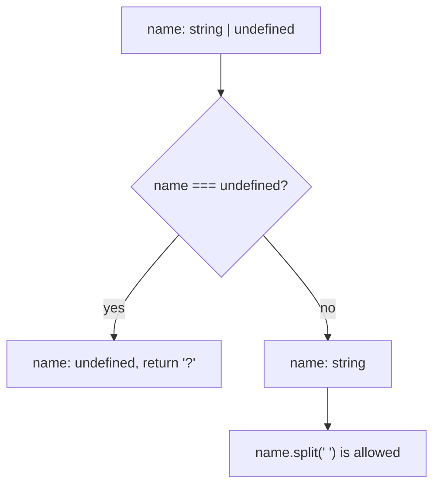

## Introduction

The single most common runtime error in JavaScript applications is some form of `TypeError: Cannot read properties of undefined (reading 'name')`. A value you assumed was there — a user from a lookup, an element from the page, a field from an API response — turned out not to be.

TypeScript can catch most of those errors before the code runs, but only when one compiler option is on: **`strictNullChecks`**. With it off, TypeScript pretends that `null` and `undefined` belong to every type, so a function that "returns a `User`" is allowed to return nothing, and the compiler never warns you. With it on, `null` and `undefined` are separate types, a value that might be missing has a type that says so, and the compiler refuses to let you use it until you have checked.

This lesson explains what the flag changes, the mechanism the compiler uses to know when a value has been checked (**control flow analysis**), the related checks the flag unlocks, and how teams turn it on in code that was written without it. How to model absence in your own types — optional properties, `| null`, `??` and `?.` — is covered in [[b2-null-undefined-ts]]; this lesson focuses on the compiler's side.

## Before you start

- **`null` and `undefined` in TypeScript** — the two absence values and how to write them in types. See [[b2-null-undefined-ts]].
- **`tsconfig.json`** — where compiler options live. See [[b2-tsconfig]].
- **Narrowing** — how an `if` check changes a variable's type inside the branch. See [[b2-narrowing]]; this lesson explains the part that concerns absence.
- **Union types** — `A | B`. See [[b2-unions]].

Examples were compiled with TypeScript 6.0 (`tsc`) and run with Node.js 22.

## The intuition

Imagine a warehouse system where every shelf label says what it contains — "bolts", "screws" — but any shelf might secretly be empty. Workers learn to stop trusting labels and check every shelf before reaching in, or they get hurt. Now imagine the rule changes: a shelf that *might* be empty must be labelled "bolts, or empty". Unlabelled shelves are guaranteed full. Workers check only the shelves whose labels say "or empty", and they never get surprised.

`strictNullChecks` is that labelling rule. Without it, every type silently means "this, or nothing". With it, `string` means a string, and `string | undefined` is the label that says "check first". The value of the flag comes from both halves: the warnings on the `| undefined` types, and the guarantee that every other type really holds a value.

## What the flag changes

Here is one program compiled twice, once with the flag off and once with it on:

```typescript title="greeting.ts"
interface User {
  id: number;
  name: string;
}

const users: User[] = [
  { id: 1, name: "Ada" },
  { id: 2, name: "Lin" },
];

function findUser(id: number) {
  return users.find((u) => u.id === id);
}

function greeting(id: number): string {
  const user = findUser(id);
  return `Hello, ${user.name.toUpperCase()}`;
}

console.log(greeting(1));
console.log(greeting(3));
```

With `strictNullChecks: false`, it compiles without a single error, and then fails at runtime:

```output
Hello, ADA
/app/greeting.js:11
    return `Hello, ${user.name.toUpperCase()}`;
                          ^
TypeError: Cannot read properties of undefined (reading 'name')
```

With `strictNullChecks: true`, the compiler reports the bug before anything runs:

```output
greeting.ts(17,20): error TS18048: 'user' is possibly 'undefined'.
```

Why the difference? `Array.prototype.find` is declared as returning `T | undefined`. With the flag on, that union is kept, `user` has type `User | undefined`, and reading `.name` from a value that might be `undefined` is an error. With the flag off, the compiler **erases** `null` and `undefined` from every union, so the same declaration produces plain `User`, and nothing looks wrong.

More precisely, turning the flag on changes three things:

1. **`null` and `undefined` stop being assignable to other types.** `let s: string = null` is an error (TS2322). Without the flag it compiles.
2. **Types that include absence keep it.** Optional properties, optional parameters, `find`, `Map.get`, `getElementById` and every `| null` you write in your own types now carry the absence through to the variable's type.
3. **Using a possibly-absent value is an error until it is narrowed.** Property access, method calls, calling a possibly-undefined function and passing the value where a non-nullable type is expected all report errors such as TS18047 ("possibly 'null'") and TS18048 ("possibly 'undefined'").

### How to turn it on

The flag lives in `compilerOptions`. It is part of the **`strict`** family — setting `"strict": true` turns on `strictNullChecks` along with `noImplicitAny`, `strictFunctionTypes`, `strictPropertyInitialization`, `useUnknownInCatchVariables` and the other strict checks ([[b2-strict-compiler-options]]).

```json title="tsconfig.json"
{
  "compilerOptions": {
    "strict": true
  }
}
```

The default changed recently. Up to TypeScript 5.x, a project with no `strict` setting had `strictNullChecks` **off**. TypeScript 6.0 made `strict` default to `true`, so new projects get the flag even without asking for it. Older projects that never set `strict` keep their behaviour only if they set it to `false` explicitly — which is worth checking when you upgrade the compiler, because new errors will appear otherwise. Projects created by tools such as Vite or Next.js have set `"strict": true` for years.

You can also set `"strictNullChecks": true` on its own, or keep `"strict": true` and opt out of this one check with `"strictNullChecks": false`. A specific flag always overrides what `strict` implies.

## Control flow analysis: how the compiler knows you checked

Making absence visible would be unbearable if you had to rewrite types by hand after every check. Instead, the compiler follows the structure of your code and tracks, at every point, what each variable could hold. This is **control flow analysis**, and it is the engine behind all narrowing.

```typescript
function initials(name: string | undefined): string {
  // here: string | undefined
  if (name === undefined) {
    return "?";
    // this branch ends, so undefined cannot reach the code below
  }
  // here: string
  return name
    .split(" ")
    .map((part) => part[0])
    .join("");
}
```

The compiler builds a graph of the possible paths through the function. On the path that reaches the final `return`, the `name === undefined` test was false, so `undefined` has been removed. You did not write a new type; the compiler worked it out.



The checks the compiler understands for removing absence include `=== null`, `=== undefined`, `== null` (removes both), truthiness (`if (x)`, `x &&`), `typeof`, `instanceof`, `in`, `Array.isArray`, type-predicate functions, and early exits through `return`, `throw`, `break`, `continue` or a call to a function explicitly annotated as returning `never`. Assignments also count: after `x = "hi"`, `x` is a `string` until the next assignment.

### Where narrowing is lost

Narrowing is a statement about one point in the program. The compiler has to decide whether it still holds later, and it is conservative in some places and optimistic in others. Knowing which is which explains most confusing errors.

```typescript title="closures.ts"
declare function findUser(id: number): { name: string } | undefined;
declare function later(cb: () => void): void;

function a(id: number) {
  let user = findUser(id);
  if (!user) return;
  later(() => console.log(user.name));   // let, never reassigned after narrowing
}

function b(id: number) {
  let user = findUser(id);
  if (!user) return;
  later(() => console.log(user.name));   // let, reassigned later
  user = findUser(id + 1);
}
```

```output
closures.ts(13,27): error TS18048: 'user' is possibly 'undefined'.
```

A callback may run later, after the variable has changed. In `b`, `user` is reassigned after the callback is created, so when the callback eventually runs it might see the new, possibly-`undefined` value; the compiler drops the narrowing inside it. In `a`, there is no assignment after the check, so the narrowing is safe and kept. That precision arrived in **TypeScript 5.4**; earlier versions dropped narrowing in callbacks for every `let`, which is why older code often copies a narrowed value into a `const` first. Using `const` for the variable is still the simplest way to make narrowing survive in callbacks.

In the other direction, the compiler is **optimistic about object properties**: it does not forget a property's narrowing when you call a function, even though the function might change the property.

```typescript title="optimistic.ts"
const config: { port?: number } = { port: 80 };
function reset() {
  delete config.port;
}
if (config.port !== undefined) {
  reset();
  console.log(config.port.toFixed(0));
}
```

```output
/app/optimistic.js:8
    console.log(config.port.toFixed(0));
                            ^
TypeError: Cannot read properties of undefined (reading 'toFixed')
```

This compiles cleanly and crashes. Invalidating every narrowed property after every function call would make the flag almost unusable, so TypeScript accepts this gap as a deliberate trade-off. The defence is to copy the value into a local `const` right after checking it (`const port = config.port`) — locals cannot be changed by other functions.

## Related checks that come with it

Several checks only make sense once absence is tracked, so they are tied to `strictNullChecks`.

**Definite assignment of variables.** A `let` declared without a value starts as `undefined`. With the flag on, reading it before every path has assigned it is an error:

```typescript
function c() {
  let total: number;
  console.log(total);   // error TS2454: Variable 'total' is used before being assigned.
}
```

**Property initialisation in classes.** The `strictPropertyInitialization` flag (part of `strict`) requires every non-optional class property to be assigned in its declaration or in the constructor, and it has no effect unless `strictNullChecks` is on:

```typescript
class Account {
  owner: string;          // error TS2564: Property 'owner' has no initializer and is
  balance: number = 0;    // not definitely assigned in the constructor.
}
```

The fixes are to initialise the property, assign it in the constructor, make it optional (`owner?: string`), or — when a framework assigns it later, as with some dependency-injection and ORM decorators — use the **definite assignment assertion** `owner!: string`, which, like every `!`, is an unchecked promise.

**Indexed access (opt-in).** By default, reading `list[i]` or `record[key]` gives the element type with no `undefined`, even though the index may be out of range. The separate flag **`noUncheckedIndexedAccess`** (TypeScript 4.1+, *not* included in `strict`) adds `| undefined` to such reads:

```typescript
const list = ["a", "b"];
const third = list[2];        // string by default; string | undefined with the flag
const t: string = third;      // error only with noUncheckedIndexedAccess
```

It catches real out-of-range bugs, at the cost of extra checks in loops that index arrays by position. `for...of` loops and array methods such as `map` are unaffected, because they never produce an out-of-range element. Many teams enable it for new code; see [[b2-typed-arrays]].

**`exactOptionalPropertyTypes`** (also opt-in) goes one step further for optional properties and is explained in [[b2-null-undefined-ts]].

## Fixing strictNullChecks errors well

When the compiler reports "possibly undefined", it is asking a design question: *what should happen when the value is missing?* There are four honest answers, and choosing one is better than silencing the error.

| The missing case means… | Fix | Example |
|---|---|---|
| Use a sensible default | `??` | `const size = options.size ?? 16;` |
| Skip this work | Early return or optional chaining | `if (!user) return;` or `user?.notify()` |
| A bug — it should never happen | Check and throw a descriptive error | `if (!root) throw new Error("#app not found");` |
| The type was wrong — it is never missing | Fix the type at the source | Make the function return `User`, not `User \| undefined` |

The non-null assertion `user!.name` is a fifth option, and it is the one to use least. It removes the error without handling anything, so if the value can in fact be missing, you are back to a runtime crash — now with a type annotation that claims it cannot happen. Reserve it for cases where an invariant the compiler cannot see guarantees presence, and prefer a check that throws when the invariant is broken ([[b2-non-null-assertion]]).

### A helper that throws

The "should never happen" row is common enough that many codebases have one small helper. Because its return type removes `null` and `undefined`, callers get a definite value and a clear message instead of a vague crash later.

```typescript title="must.ts"
function must<T>(value: T | null | undefined, what: string): T {
  if (value == null) {
    throw new Error(`Expected ${what} to be present`);
  }
  return value;
}

const settings = new Map<string, number>([["fontSize", 14]]);

const fontSize = must(settings.get("fontSize"), "fontSize setting");
console.log(fontSize + 2);

try {
  must(settings.get("lineHeight"), "lineHeight setting");
} catch (err) {
  console.log(err instanceof Error ? err.message : err);
}
```

```output
16
Expected lineHeight setting to be present
```

`must` is generic ([[b2-generics]]): passing a `number | undefined` returns a `number`. Inside, `value == null` removes both absence types, so `return value` has type `T`. Compared with `settings.get("fontSize")!`, it costs one function call and turns a silent assumption into a checked one.

## Migrating an existing codebase

Turning the flag on in a large codebase that was written without it can produce hundreds or thousands of errors at once. The flag is project-wide — there is no per-file switch in `tsconfig.json` — so teams use one of these approaches:

1. **Measure first.** Run `tsc --noEmit --strictNullChecks` on the project without changing the config, and count errors per directory. This tells you the size of the job and where the hot spots are.
2. **Fix the sources, not the symptoms.** Many errors trace back to a few functions with wrong return types: a `getUser()` that can return `undefined` produces one error at every call site. Fixing the type or behaviour at the source removes many errors at once, and often reveals real bugs.
3. **Split the project.** With project references ([[b2-tsconfig]]), a monorepo can turn the flag on package by package. Some teams also use community tools that apply strict checks only to files listed in an allow-list until the whole project passes; these are outside the TypeScript compiler itself.
4. **Avoid mass `!`.** Adding `!` everywhere makes the errors disappear and keeps every bug. If you must defer some errors, `// @ts-expect-error` with a comment is easier to find and remove later, and it reports an error itself once the underlying problem is fixed.
5. **Lock it in.** Once clean, keep the flag on in CI. Turning it off to "get the build green" brings back the whole category of bugs at once.

> [!TIP] Enable it from day one
> For a new project, turning `strict` on before writing code costs nothing. Retrofitting it later is a multi-week project in a large codebase. TypeScript 6.0 does this for you by default.

```quiz
Q: With `strictNullChecks` off, what type does `[1, 2, 3].find(n => n > 5)` have?
- [ ] `number | undefined`
- [x] `number`
- [ ] `undefined`
- [ ] `any`
> With the flag off, `null` and `undefined` are erased from every union, so the declared `T | undefined` becomes plain `number`. The runtime value is still `undefined`, which is exactly the bug the flag exists to catch.

Q: Why does this report "possibly undefined" inside the callback? `let u = find(); if (!u) return; later(() => u.name); u = find();`
- [ ] Callbacks always lose narrowing
- [x] `u` is reassigned after the callback is created, so when the callback runs it may see the new, possibly-undefined value
- [ ] `later` is not annotated as returning `never`
- [ ] The `!u` check does not narrow objects
> Since TypeScript 5.4, narrowing is kept in closures created after the last assignment to a `let`. Here an assignment follows, so the compiler cannot trust the earlier check. Making `u` a `const`, or removing the reassignment, fixes it.

Q: A value is "possibly undefined", and if it really is missing that indicates a bug elsewhere. Which fix is best?
- [ ] `value!`
- [ ] `value ?? ({} as Value)`
- [x] Check it and throw an error that names what was missing
- [ ] Turn off `strictNullChecks` for the file
> A check that throws keeps the type precise and makes the failure loud and descriptive. `!` hides the case and crashes later with a vague message. A fake default hides the bug entirely. There is no per-file switch for the flag, and turning it off would hide every similar bug.
```

## In real systems

**Frameworks assume it.** React's types, DOM types, and most library type definitions are written for `strictNullChecks`. With it off, a `useRef<HTMLDivElement>(null)` or `useContext` value looks non-nullable, and the warnings that library authors designed into their types disappear.

**API boundaries.** Generated clients for REST and GraphQL mark optional and nullable fields with `?` and `| null`. With the flag on, every screen that displays such a field has to decide what to show when it is missing — which is a product decision the compiler surfaces rather than leaves to a crash.

**Code review.** Teams with the flag on treat new `!` assertions as review items: each one needs a reason. Linters can enforce this with typescript-eslint's `no-non-null-assertion` rule.

**Upgrades.** Moving an older project to TypeScript 6.0 without an explicit `strict` setting turns the flag on. Teams pin `"strict": false` temporarily if they need the upgrade without the migration, then follow the migration steps above.

## Trade-offs and alternatives

| Choice | Benefit | Cost |
|---|---|---|
| `strictNullChecks: true` | Catches most "cannot read properties of undefined" bugs at compile time; types tell the truth | You must handle absence explicitly; migration effort in old code |
| `strictNullChecks: false` | Fewer compiler errors in legacy code | Every type silently includes `null` and `undefined`; library types lose their warnings |
| `+ noUncheckedIndexedAccess` | Catches out-of-range index reads | Extra checks in index-based loops; some false alarms |
| `+ exactOptionalPropertyTypes` | Distinguishes "missing" from "explicitly `undefined`" | Stricter object literals; some library types need updating |

The flag does not make a program null-safe at runtime. Data from outside — JSON, `any` values, type assertions — can still bring `null` into a variable typed as non-nullable. The compiler's guarantee holds only for values whose types are true, which is why validation at boundaries ([[b2-unknown]]) and avoiding `any` ([[b2-avoiding-any]]) are part of the same discipline.

## Common mistakes

> [!MISTAKE] Silencing every error with !
> A migration that adds `!` at each error compiles cleanly and fixes nothing. Each `!` is a place where the type now lies. Handle the missing case or fix the type at its source.

**Disabling the flag to get the build green.** One `false` in `tsconfig.json` removes the checking from the whole project. Use targeted `// @ts-expect-error` comments if you need to defer specific errors.

**Trusting property narrowing across function calls.** The compiler keeps `obj.prop` narrowed after a call that could have changed it. Copy the value into a `const` after checking.

**Narrowing with truthiness when zero or empty is valid.** `if (count)` removes `undefined`, and also `0`. Use `count !== undefined`.

**Assuming the flag validates runtime data.** It checks your code against your types. If an API returns `null` where your type says `string`, only a runtime check will notice.

**Forgetting the upgrade change.** Upgrading to TypeScript 6.0 in a project with no `strict` setting enables the flag and may produce a wave of new errors. Read them as bugs found, not as compiler noise.

## Interview perspective

> [!INTERVIEW] Why strictNullChecks matters
> "Without it, `null` and `undefined` are assignable to every type, so a type like `User` silently means 'User or nothing' and the compiler can't warn about the most common runtime crash. With it on, they're separate types, `find` returns `User | undefined`, and control flow analysis makes me narrow before use. I'd turn it on in every project and handle absence with narrowing, defaults or a throwing check rather than `!`."

Questions to prepare:

- **What changes when you enable it?** Absence is no longer part of every type; nullable values must be narrowed; related checks (definite assignment, property initialisation) activate.
- **What is control flow analysis?** The compiler tracks the possible types of each variable along every path, narrowing after checks and early exits.
- **When is narrowing lost?** In callbacks for variables reassigned later; and it is *not* lost (unsafely) for object properties after function calls.
- **How would you migrate a large codebase?** Measure, fix sources first, split by package, avoid mass `!`, lock it in CI.
- **What does `noUncheckedIndexedAccess` add?** `| undefined` on index reads; not part of `strict`.

A good follow-up answer: when asked "is TypeScript null-safe?", say that it is null-safe only to the extent that types are true — `any`, assertions and unvalidated external data can all break the guarantee.

## Practice

1. **Turn it on.** Take the `greeting.ts` example, enable the flag, and fix the error three different ways: a default greeting, an early return of `"Unknown user"`, and a thrown error. Say which fits a real login screen.
2. **Narrowing in callbacks.** Write a function with `let` that loses narrowing in a `setTimeout` callback, then fix it two ways.
3. **Class initialisation.** Write a class with three properties that triggers TS2564, and fix each property differently (initialiser, constructor assignment, optional).
4. **Indexed access.** Turn on `noUncheckedIndexedAccess`, write a function that returns the last element of an array, and make it compile without `!`.
5. **Plan a migration.** For a project with 600 errors after enabling the flag, half of them in calls to one `getCurrentUser()` function, describe the first three changes you would make.

## Quick revision {#quick-revision}

- Off: `null` and `undefined` are assignable to every type and erased from unions — `find` returns `T`.
- On: they are separate types; `find` returns `T | undefined`; use requires narrowing (TS18047 / TS18048).
- Part of `"strict": true`; TypeScript 6.0 defaults `strict` to `true` (off by default in 5.x and earlier). Specific flags override `strict`.
- Control flow analysis narrows after `===`, `== null`, truthiness, `typeof`, `instanceof`, `in`, predicates, `return`/`throw`, explicit `never` calls and assignments.
- Callbacks keep narrowing of a `let` only if there are no later assignments (TS 5.4+); `const` always keeps it.
- Property narrowing is not reset after function calls — an accepted unsoundness; copy to a `const`.
- Enables definite assignment (TS2454) and `strictPropertyInitialization` (TS2564); `owner!: string` asserts definite assignment.
- Opt-in extras: `noUncheckedIndexedAccess` (index reads include `undefined`), `exactOptionalPropertyTypes`.
- Fix errors with a default, an early return, a throwing check, or a corrected type; use `!` rarely.
- Migration: measure, fix sources, split by project, avoid mass `!`, enforce in CI.

## Key takeaways {#key-takeaways}

- `strictNullChecks` is what makes TypeScript's types honest about absence: without it, every type silently includes `null` and `undefined`.
- Control flow analysis lets the compiler see your checks, so you narrow with ordinary code instead of rewriting types.
- Narrowing can be lost in callbacks and is optimistically kept for object properties; local `const` copies avoid both problems.
- Every "possibly undefined" error is a design question — default, skip, throw or fix the type — and `!` answers none of them.
- The flag checks code against types; runtime validation at boundaries is still needed for data from outside.
