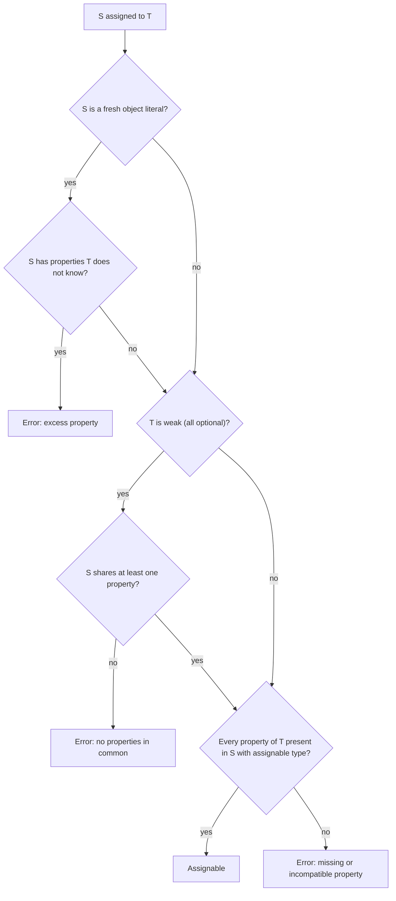

## Introduction

In Java, a class is a `Person` only if it says so: it must be declared `class Employee implements Person` or extend a class that does. Two classes with identical fields are still unrelated types. This is **nominal typing** — compatibility is decided by names and declared relationships.

TypeScript works differently:

```typescript title="structural.ts"
interface Person {
  name: string;
}

class Employee {
  constructor(public name: string, public salary: number) {}
}

function greet(p: Person) {
  return `Hello, ${p.name}`;
}

console.log(greet(new Employee("Ada", 100)));      // never mentions Person
console.log(greet({ name: "Lin" }));
```

```output
Hello, Ada
Hello, Lin
```

`Employee` never mentions `Person`, yet the call compiles. TypeScript asks only one question: **does the value have the shape the target requires?** `Person` requires a `name` of type `string`; an `Employee` has one, so it is a `Person` as far as the type system is concerned. This is **structural typing**: compatibility is decided by structure — the properties and their types — not by names or declarations.

TypeScript chose this because it describes JavaScript, where objects are created ad hoc — object literals, JSON from a server, results of `{ ...spread }` — and code has always relied on "duck typing": if it has the properties you use, it works. A nominal type system would force casts or wrapper classes onto all of that code. Understanding the structural rules explains a whole family of behaviours that otherwise look inconsistent: why extra properties are allowed in one place and rejected in another, why `Object.keys` returns `string[]`, and why two `string` IDs can be mixed up.

## Before you start

- **Object types and interfaces.** See [[b2-object-types]] and [[b2-interfaces]].
- **Classes in TypeScript**, including `private`. See [[b2-classes-ts]] and [[b2-public-private-protected]].
- **Function types.** See [[b2-typed-functions]].
- **Union and intersection types.** See [[b2-unions]] and [[b2-intersections]].

## The intuition

Think of a type as a **checklist**, not a name badge. `Person` is the checklist "has `name`, and it is a string". When you pass a value where a `Person` is expected, the compiler walks down the checklist and ticks each item against the value's type. Extra things the value has are not on the checklist, so they do not matter. The value's own name — `Employee` — is never consulted.

This is the "duck test" — if it walks like a duck and quacks like a duck — with one difference from runtime duck typing in plain JavaScript: the check happens at compile time against *types*, not at runtime against actual objects. A value whose type lacks a required property is rejected before the program runs.

The analogy needs one correction, which the rest of the lesson builds on: for **fresh object literals**, the compiler does object to unknown extras, and a few features (private members, enums) behave like name badges. Those exceptions are deliberate.

## Assignability rules for objects

"`S` is assignable to `T`" means a value of type `S` can be used where `T` is expected. For object types, the rule is:

> `S` is assignable to `T` if, for every property of `T`, `S` has a property with the same name whose type is assignable to `T`'s property type. Optional properties of `T` may be missing from `S`; if present, their type must still match.

Three consequences follow directly.

**Extra properties are fine.** A type with more properties is a **subtype** of a type with fewer — `{ name: string; salary: number }` is assignable to `{ name: string }`. This is sometimes called **width subtyping**: more width (properties) means a more specific type.

**Names are irrelevant.** Two interfaces with the same members are interchangeable:

```typescript title="same-shape.ts"
interface Point2D { x: number; y: number }
interface Vector2D { x: number; y: number }

const p: Point2D = { x: 1, y: 2 };
const v: Vector2D = p; // fine: identical structure
```

**Property types are compared recursively.** `{ address: { city: string; zip: string } }` is assignable to `{ address: { city: string } }`, because the nested object passes the same check.

Classes follow the same rules. A class instance type is just an object type with the class's public members, so an object literal or an unrelated class with the right members is assignable to it:

```typescript title="class-structure.ts"
class Money {
  constructor(public amount: number, public currency: string) {}
}

const fake: Money = { amount: 5, currency: "EUR" }; // fine: not a Money instance
console.log(fake instanceof Money);
```

```output
false
```

The type check passes, but `instanceof` — a *runtime* check of the prototype chain — returns `false`. TypeScript types describe shape; JavaScript's `instanceof` checks construction. If code depends on `instanceof Money`, a structurally valid object will still fail it.

## Excess property checking: the fresh-literal exception

If extra properties are always fine, the second line here should compile. It does not:

```typescript title="excess.ts"
interface Named { name: string }

const ada = { name: "Ada", role: "dev" };
const n1: Named = ada;                          // fine
const n2: Named = { name: "Ada", role: "dev" }; // error
```

```output
error TS2353: Object literal may only specify known properties, and 'role' does not exist in type 'Named'.
```

The difference is **freshness**. An object literal written directly where a type is expected is "fresh": nothing else can ever see it, so any property the target type does not know about can never be read through that type. That is almost always a typo or a misunderstanding — `{ colour: "red" }` passed to options expecting `color`. TypeScript therefore runs an extra **excess property check** on fresh literals only.

Once a literal is stored in a variable (`ada`), it is no longer fresh: the variable might be used elsewhere where `role` matters, so the extra property is legitimate and normal structural rules apply.

This explains a common confusion in code review: "Why did my typo compile?" Usually because the object passed through an intermediate variable, a spread, or a function return before reaching the typed parameter. Excess property checking is a **lint-like safety net, not part of the assignability rule**. If you need to genuinely forbid extra keys, you need a runtime check.

> [!NOTE] Escape hatches
> Excess property checks can be bypassed with a variable, a type assertion (`as Named`), or an index signature on the target (`[key: string]: unknown`). Prefer fixing the literal; reach for these only when extras are intended.

### Weak type detection

A **weak type** is an object type whose properties are all optional, such as an options bag. Structurally, *any* object is assignable to it — none of its properties is required. That would make it useless as a check, so TypeScript adds one more rule: assigning a type that shares **no** properties with a weak type is an error, even for non-fresh values:

```typescript title="weak.ts"
interface RequestOptions { timeout?: number; retries?: number }

const settings = { delay: 5 };
const opts: RequestOptions = settings; // error
```

```output
error TS2559: Type '{ delay: number; }' has no properties in common with type 'RequestOptions'.
```

At least one overlapping property makes it valid again.

### The empty type `{}`

At the other extreme, `{}` (or an empty interface) has no requirements at all, so every value except `null` and `undefined` is assignable to it — including `42` and `"hello"`. `{}` therefore does not mean "an object"; use `object` for non-primitive values or `Record<string, unknown>` for an object with unknown keys ([[b2-special-types]]).

## Functions

Function types are compared structurally too, by their parameters and return type.

**Fewer parameters are fine.** A function that ignores some arguments can be used where more are supplied — which is why callbacks can omit parameters:

```typescript title="fewer-params.ts"
const nums = [10, 20, 30];
nums.forEach(n => console.log(n));   // forEach passes (value, index, array)
```

```output
10
20
30
```

JavaScript ignores extra arguments, so a `(n) => ...` callback is assignable to `(value, index, array) => void`. The reverse — a function that *requires* more parameters than the caller provides — is an error.

**Return types are covariant.** A function returning a more specific type (`() => Dog`) can be used where a more general return type is expected (`() => Animal`).

**Parameter types are checked contravariantly — mostly.** Under `strictFunctionTypes` (part of `strict`), a function that only accepts `Dog` cannot be used where any `Animal` might be passed, because it would receive cats:

```typescript title="variance.ts"
type Animal = { name: string };
type Dog = Animal & { bark(): void };

const onlyDogs = (d: Dog) => d.bark();

type FnProp = { handle: (a: Animal) => void };
type MethodProp = { handle(a: Animal): void };

const f: FnProp = { handle: onlyDogs };     // error
const m: MethodProp = { handle: onlyDogs }; // allowed: method parameters are bivariant
```

```output
error TS2322: Type '(d: Dog) => void' is not assignable to type '(a: Animal) => void'.
  Types of parameters 'd' and 'a' are incompatible.
    Type 'Animal' is not assignable to type 'Dog'.
      Property 'bark' is missing in type 'Animal' but required in type '{ bark(): void; }'.
```

The second line is a deliberate hole. Parameters of members declared with **method syntax** (`handle(a): void`) are compared **bivariantly** — either direction is accepted — because strict checking would break common patterns such as `Array<Dog>` being assignable to `Array<Animal>` (arrays' methods take `T` parameters). Properties declared with a function type get the strict check. If you want the safety, declare callbacks as function-typed properties. The full story is in [[b2-function-variance]].

## Where TypeScript is not purely structural

Several features add name-like behaviour on purpose.

**Private and protected members.** A class with a `private` or `protected` member is only compatible with instances of that class (or its subclasses), even if another class has an identical private member:

```typescript title="private.ts"
class UserId { private readonly brand = "user"; constructor(public value: string) {} }
class OrderId { private readonly brand = "user"; constructor(public value: string) {} }

const id: UserId = new OrderId("o1"); // error
```

```output
error TS2322: Type 'OrderId' is not assignable to type 'UserId'.
  Types have separate declarations of a private property 'brand'.
```

The rule exists because private members are implementation details tied to *one* declaration; treating two of them as interchangeable would let code from one class reach into another's internals. ECMAScript `#private` fields behave the same way at the type level.

**Enums.** Each enum is its own type. A string enum member is not assignable from a plain string (`const s: Status = "active"` is an error), and members of two different enums are incompatible even with the same values. Numeric enums are looser — they accept numbers — though since TypeScript 5.0 an out-of-range numeric literal is rejected ([[b2-enums]]).

**`unique symbol`** types are each distinct, which libraries use for nominal keys.

## Branded types: opting into nominal safety

Structural typing has a real cost. All of these are just `string` or `number`, so the compiler cannot stop you mixing them up:

```typescript title="mixup.ts"
function chargeCustomer(customerId: string, orderId: string, cents: number) {}

const orderId = "ord_42";
const customerId = "cus_7";
chargeCustomer(orderId, customerId, 1999); // arguments swapped: compiles
```

A **branded type** (also called an opaque or tagged type) adds a phantom property that no real value has, making otherwise identical types structurally different:

```typescript title="brands.ts"
type Brand<T, B extends string> = T & { readonly __brand: B };

type CustomerId = Brand<string, "CustomerId">;
type OrderId = Brand<string, "OrderId">;
type Cents = Brand<number, "Cents">;

// The only place a brand is created: a validating constructor function.
function customerId(raw: string): CustomerId {
  if (!raw.startsWith("cus_")) throw new Error(`bad customer id: ${raw}`);
  return raw as CustomerId;
}
function orderId(raw: string): OrderId {
  if (!raw.startsWith("ord_")) throw new Error(`bad order id: ${raw}`);
  return raw as OrderId;
}
const cents = (n: number) => n as Cents;

function chargeCustomer(c: CustomerId, o: OrderId, amount: Cents) {
  return `charge ${c} for ${o}: ${amount} cents`;
}

const c = customerId("cus_7");
const o = orderId("ord_42");
console.log(chargeCustomer(c, o, cents(1999)));
// chargeCustomer(o, c, cents(1999)); // error: OrderId is not CustomerId
// chargeCustomer(c, o, 1999);        // error: number is not Cents
console.log(c.toUpperCase());          // still a string for everything else
```

```output
charge cus_7 for ord_42: 1999 cents
CUS_7
```

The `__brand` property never exists at runtime — the value is a plain string — but the type system believes it does, so a `CustomerId` and an `OrderId` no longer have the same structure. Because `CustomerId` is a `string` intersected with the brand, it can still be used anywhere a `string` is expected. The assertion `raw as CustomerId` is the one unsafe step, so it is confined to a constructor function that validates the input. Branded types are taught in depth in [[b2-branded-types]].

## How it works internally

Assignability is computed by the type checker's **relation** routines. To decide whether `S` is assignable to `T`, the checker first tries fast paths (identical types, `any`, `never`, literal-to-primitive), then for object types compares members: every property in `T` must be found in `S` with an assignable type, call and construct signatures are compared parameter by parameter, and index signatures must be compatible. Results are cached, and recursive types are handled by assuming "related" when the same pair is revisited during one comparison.

Excess property checking and weak type detection run as separate steps before this comparison: the first only when the source is a fresh object literal type (the checker marks literal types with a freshness flag that is removed when the value is widened into a variable), the second whenever the target is a weak type.

None of this affects runtime. Types are erased, so there is no runtime check that a value "is" an interface. Runtime safety comes from JavaScript mechanisms — `typeof`, `instanceof`, `in` — wrapped in type guards ([[b2-narrowing]], [[b2-custom-type-guards]]).



## In real systems

- **API responses.** A server response with fields your type does not mention still satisfies the type — new backend fields do not break the frontend. The flip side: unexpected or missing fields are not caught at runtime unless you validate (Zod and similar libraries).
- **Test doubles.** A mock only needs the members the code under test uses; no mocking framework or interface declaration is required to make it type-check.
- **Props and options.** React props and options bags rely on excess property checks to catch typos in inline JSX attributes and literals.
- **Domain IDs and units.** Payment, billing and mapping code uses branded types for IDs, currencies and units so that structurally identical primitives cannot be swapped.
- **`Object.keys` returning `string[]`** is a direct result of width subtyping: a value may have more keys than its type lists ([[b2-keyof]]).

## Trade-offs and alternatives

| | Structural (TypeScript) | Nominal (Java, C#) |
|---|---|---|
| Compatibility by | Shape | Declared name and inheritance |
| Ad-hoc objects, JSON | Work without declarations | Need classes or mapping |
| Mocks and adapters | Any object with the right members | Must implement the interface |
| Accidental compatibility | Possible (IDs, units) | Not possible |
| Refactoring | Renaming a type changes nothing | Renaming is meaningful |

Structural typing fits JavaScript's dynamic objects and keeps code flexible. Its weakness is accidental compatibility between things that happen to share a shape. Use branded types or classes with private members for the few domains where mixing values is dangerous, and keep everything else structural.

## Common mistakes

> [!MISTAKE] Assuming the type check guarantees no extra fields
> Excess property errors only appear for fresh literals. A typo in an object built elsewhere, spread from another object, or returned from a function passes. If extra keys are a problem (for example, before sending data to an API that rejects unknown fields), strip or validate them at runtime.

- **Using `instanceof` on interface-typed data.** Interfaces do not exist at runtime, and structurally valid objects may not be class instances. Use property checks or type guards.
- **Typing a parameter as `{}` to mean "an object".** `{}` accepts numbers and strings. Use `object` or a precise type.
- **Expecting two private-member classes with identical shape to be compatible.** They are not; this is by design.
- **Mixing up IDs typed as plain `string`.** Introduce branded types at the boundary where IDs are created.
- **Declaring callback members with method syntax** and losing strict parameter checking. Prefer `onChange: (v: string) => void`.

## Interview perspective

- *"Is TypeScript nominally or structurally typed?"* — Structurally; give the `Employee`/`Person` example and say why (modelling JavaScript's duck typing).
- *"Why does this object with an extra property compile here but not there?"* — Excess property checks on fresh literals only. This is the most common follow-up.
- *"How would you prevent passing an `OrderId` where a `UserId` is expected?"* — Branded types with validating constructors; mention private class members and `unique symbol` as alternatives.
- *"Why can a `(x) => void` callback be passed where `(x, i, arr) => void` is expected?"* — Fewer parameters are assignable because JavaScript ignores extra arguments.
- Strong answers also mention the deliberate exceptions — method parameter bivariance, enums and private members — and that none of it exists at runtime.

## Practice

1. Predict and then verify: is `{ a: string; b?: number }` assignable to `{ a: string }`, and the other way round? What about to `{ a: string; b: number }`?
2. Write an options function `connect(opts: { host?: string; port?: number })` and find three ways to pass `{ hots: "x" }` without an error. Which of them is the weak-type check designed to catch?
3. Create branded `Meters` and `Feet` types with conversion functions and show that adding them directly is an error.
4. Turn `type Props = { onSelect(id: string): void }` into a form where a handler accepting only `"a" | "b"` is rejected. Explain why the change works.
5. Explain, with a code example, why `Object.keys(user)` cannot safely be typed as `(keyof User)[]`.

## Quick revision {#quick-revision}

- Structural typing: assignable if the source has every property the target requires, with compatible types; names never matter.
- Extra properties are allowed (width subtyping), except on fresh object literals (excess property check).
- Weak types (all-optional) reject sources with no overlapping property; `{}` accepts everything except `null` and `undefined`.
- Classes compare structurally; `instanceof` is a separate runtime check of the prototype chain.
- Functions: fewer parameters OK; return types covariant; parameters contravariant under `strictFunctionTypes`, but bivariant for method-syntax members.
- Nominal-like exceptions: `private`/`protected`/`#private` members, enums, `unique symbol`.
- Branded types: `T & { readonly __brand: "Name" }`, created only via validating functions.
- Nothing is checked at runtime; use guards and validation for external data.

## Key takeaways {#key-takeaways}

- TypeScript compares types by shape, which matches how JavaScript code builds and uses objects.
- A value with more properties fits a type with fewer; the excess property check on fresh literals is a typo net, not a guarantee.
- A few features deliberately behave nominally, and method parameters are deliberately bivariant.
- When structurally identical values must not mix, brand them.
- Types disappear at runtime, so structural checks never replace runtime validation of external data.

```quiz
Q: `interface Point { x: number; y: number }`. Which assignment is a compile error?
- [ ] `const a = { x: 1, y: 2, z: 3 }; const p: Point = a;`
- [x] `const p: Point = { x: 1, y: 2, z: 3 };`
- [ ] `class P3 { x = 1; y = 2; z = 3 } const p: Point = new P3();`
- [ ] `const p: Point = JSON.parse("{}");`
> Only the fresh object literal gets the excess property check, so `z` is rejected there. Through a variable or a class instance, extra properties are fine. `JSON.parse` returns `any`, which is assignable to everything — compiles, but is unchecked at runtime.
```

```quiz
Q: Two classes have identical public members and an identical `private id: string`. Are their instances assignable to each other?
- [ ] Yes, because TypeScript is structural
- [x] No, because private members are only compatible when they come from the same declaration
- [ ] Only if both classes implement the same interface
- [ ] Only when `strict` is off
> Private and protected members make class types behave nominally: the compiler requires them to originate from the same declaration. Without the private member, the instances would be interchangeable, which is the tempting answer.
```

```quiz
Q: What does a branded type such as `type UserId = string & { readonly __brand: "UserId" }` cost at runtime?
- [x] Nothing: the brand exists only in the type system, and the value is a plain string
- [ ] An extra `__brand` property on every string
- [ ] A wrapper object around the string
- [ ] A runtime type check whenever the value is passed to a function
> Types are erased, so a `UserId` is an ordinary string at runtime. The brand only changes the value's static structure so the compiler refuses to mix it with other strings. Any runtime validation has to be written in the function that creates the brand.
```
