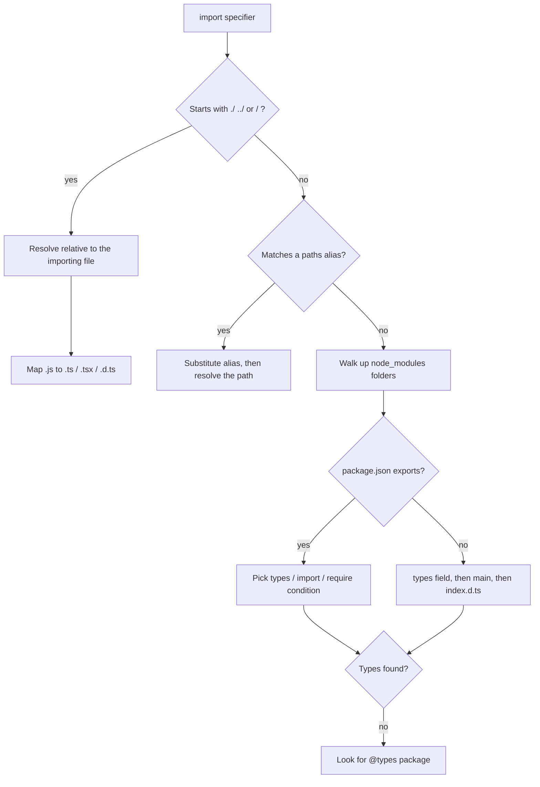

## Introduction

Early JavaScript had no way to split a program into files that could see each other's code safely. Every `<script>` tag shared one global scope, so two files that both declared a `total` variable overwrote each other, and the order of script tags decided what existed when. **Modules** fixed this. A module is a file with its own private scope. Nothing inside it is visible outside unless it is **exported**, and nothing from outside is visible inside unless it is **imported**. JavaScript gained a standard module system, **ES modules (ESM)**, in ES2015; Node.js had already been using its own, **CommonJS (CJS)**.

TypeScript adds a second kind of thing that crosses file boundaries: **types**. An interface declared in `types.ts` must be importable in `api.ts`, yet at runtime the interface does not exist — there is nothing to load. So a TypeScript module system has to answer questions JavaScript never had to: which imports refer to real runtime values and which only to types, what happens to type-only imports in the emitted JavaScript, and how the compiler finds the file (or the type declarations) behind a string like `"./types.js"` or `"react"`.

Getting these answers right matters in everyday work. Most "it type-checks but crashes at runtime" module bugs — a missing file extension, a side effect that silently disappeared, an import that works in Vite but not in Node.js — come from not knowing what the compiler does with an import. This lesson teaches that model. The runtime formats themselves, and how TypeScript emits each, are covered in [[b2-esm-vs-cjs-ts]].

Examples were compiled with TypeScript 6.0 (the version in this repository) and run with Node.js 22.

## Before you start

- **JavaScript modules** — `import`, `export`, default versus named exports. See [[b1-modules]], [[b1-export-import]] and [[b1-default-named-exports]].
- **How `tsc` works** — that it type-checks a whole program and then emits each file, and the basic `tsconfig.json` options `module`, `outDir` and `rootDir`. See [[b2-tsc-compilation]].
- **Interfaces and type aliases**, which are the types you will import and export. See [[b2-interfaces]] and [[b2-type-aliases]].

## The intuition

Picture each file as a room with a locked door. Inside, you can name things however you like without worrying about other rooms. The **export list** is a hatch in the door: whatever you put in it, other rooms can ask for by name. An `import` is a request slip pushed under another room's door.

TypeScript adds a twist: some things passed through the hatch are objects (functions, classes, constants) and some are only **blueprints** (interfaces, type aliases). Blueprints are needed while the compiler is checking the building plans, but they are torn up before the building opens. If a room asks only for blueprints from another room, the finished building does not need a corridor between the two rooms at all — and TypeScript removes it. Most of this lesson is about knowing when that corridor is removed and when it must stay.

## Scripts and modules: what makes a file a module

In plain JavaScript, a file is a module if it is loaded as one: `<script type="module">`, a `.mjs` file in Node.js, or a `.js` file inside a package whose `package.json` has `"type": "module"`. TypeScript needs to decide the same thing at compile time, because a **script** puts its top-level declarations into the shared global scope, while a module keeps them private.

By default (`"moduleDetection": "auto"`), TypeScript treats a file as a module if it contains a top-level `import` or `export`, or if the runtime would load it as one. Under `"module": "nodenext"` (or `node16`–`node20`), TypeScript 6.0 goes further and defaults `moduleDetection` to `"force"`, treating every file as a module, because Node.js gives each CommonJS file its own scope too. With a bundler-oriented setup such as `"module": "esnext"` and `"moduleResolution": "bundler"`, a file with no imports or exports is a script. Here are two such files:

```ts title="src/a.ts"
const total = 10;
console.log(total);
```

```ts title="src/b.ts"
const total = 20;
console.log(total);
```

```output
src/a.ts(1,7): error TS2451: Cannot redeclare block-scoped variable 'total'.
src/b.ts(1,7): error TS2451: Cannot redeclare block-scoped variable 'total'.
```

Both files declare `total` in the global scope, so the compiler reports a clash — exactly what would happen if a browser loaded them as two classic `<script>` tags. There are three fixes. Add an `import` or `export` to each file; if a file has nothing to export, the empty statement `export {};` is enough to make it a module. Or set `"moduleDetection": "force"`, which treats every non-declaration file as a module; `tsc --init` in TypeScript 6.0 writes this setting. Or, if the files really are browser scripts, rename one variable.

The reverse situation also exists. A file that has no imports or exports and is meant to add global declarations — for example a `globals.d.ts` that declares `const __APP_VERSION__: string` — must stay a script. Adding an `import` to it turns its declarations into private module members, and the globals disappear. [[b2-declaration-files]] covers how to add globals from inside a module with `declare global`.

## Exporting and importing

TypeScript uses standard ES module syntax for both values and types. The following module exports a type alias, an interface, a named function and a default function:

```ts title="src/money.ts"
export type Currency = "USD" | "EUR";
export interface Money {
  amount: number;
  currency: Currency;
}
export function format(m: Money): string {
  return `${m.amount.toFixed(2)} ${m.currency}`;
}
export default function zero(currency: Currency): Money {
  return { amount: 0, currency };
}
```

A **barrel** (or index) module gathers exports from several files so callers have one import path. It uses **re-exports**, which forward another module's exports without creating local bindings:

```ts title="src/index.ts"
export { format } from "./money.js";
export type { Money, Currency } from "./money.js";
export { default as zero } from "./money.js";
export * as money from "./money.js";
```

Each line does something different. The first forwards a value. The second forwards two types, and the `type` keyword marks it as type-only, which the next section explains. The third renames the default export to a named one: a default export is an export whose name is `default`, so this is ordinary renaming. The fourth creates a single export, `money`, that is a **namespace object** containing every export of `money.ts` (ES2020 syntax). A consumer can use all of them:

```ts title="src/main.ts"
import { format, zero, money, type Money } from "./index.js";

const price: Money = { amount: 19.5, currency: "EUR" };
console.log(format(price));
console.log(money.format(zero("USD")));
```

```output
19.50 EUR
0.00 USD
```

Prefer named exports in application code. A named export has one name everywhere, so "find all references" and automatic renames work, and a typo in an import is a compile error. A default export can be imported under any name, so the same function ends up called `zero`, `makeZero` and `empty` in different files.

## Type-only imports and exports

### Import elision

Consider a module that imports an interface and uses it only in annotations:

```ts title="src/types.ts"
export interface User {
  id: string;
  name: string;
}
console.log("types.ts evaluated");
```

```ts title="src/api.ts"
import { User } from "./types.js";

export function getUser(id: string): User {
  return { id, name: "Ada" };
}
```

When `tsc` emits `api.js`, the import is gone:

```js title="dist/api.js"
export function getUser(id) {
    return { id, name: "Ada" };
}
```

This is **import elision**: if every name brought in by an import is used only as a type, TypeScript deletes the whole import statement from the output. It has to — `User` does not exist at runtime, so `import { User }` would fail in Node.js with a "does not provide an export named 'User'" error. But notice the side effect: the `console.log` in `types.ts` never runs, because nothing imports `types.js` at runtime any more. If that module registered something (a polyfill, a custom element, a global error handler), the registration silently disappears.

### Why elision is a problem for fast tools

Elision depends on knowing what `User` *is*. `tsc` knows because it has read `types.ts`. But most real projects compile TypeScript with **single-file transpilers** — esbuild (used by Vite), SWC, Babel, or Node.js's built-in type stripping. These tools look at one file at a time and do not read its imports. Looking only at `api.ts`, they cannot tell whether `User` is an interface (drop the import) or a class (keep it).

Two compiler options exist to make code safe for such tools:

- **`isolatedModules`** makes `tsc` report any construct that a single-file transpiler could get wrong. For example, re-exporting a type without marking it:

  ```ts title="src/index.ts"
  export { Money, format } from "./money.js";
  ```

  ```output
  src/index.ts(1,10): error TS1205: Re-exporting a type when 'isolatedModules' is enabled requires using 'export type'.
  ```

- **`verbatimModuleSyntax`** (TypeScript 5.0) goes further with a simple rule: imports and exports are emitted exactly as written, minus anything explicitly marked `type`. No guessing. With it on, the original `api.ts` is an error:

  ```output
  src/api.ts(1,10): error TS1484: 'User' is a type and must be imported using a type-only import when 'verbatimModuleSyntax' is enabled.
  ```

### `import type` and the inline `type` modifier

The fix is to say in the source that a name is a type. There are two spellings:

```ts
import type { User } from "./types.js";        // whole statement is type-only
import { getUser, type User } from "./api.js"; // only User is type-only
```

A whole-statement `import type` is always removed from the output. With the inline form, only the marked names are removed; under `verbatimModuleSyntax`, if *every* name is marked inline, the statement survives as `import {} from "./types.js";`. That empty import still loads the module — with it, the program above prints `types.ts evaluated` — which is sometimes what you want and sometimes a surprise. If the module has no side effects you rely on, prefer `import type`, which disappears completely.

`export type { ... }` works the same way for re-exports. A name imported with `import type` can be used in type positions such as annotations and `implements` clauses, but not as a value: `new User()` on a type-only import is a compile error, even if `User` is a class.

> [!TIP] The modern default
> New projects should enable `verbatimModuleSyntax` (TypeScript 6.0's `tsc --init` does). The rule "what you write is what runs" is easy to remember, works with every transpiler, and makes type-only dependencies visible in code review.

## Module resolution: from a string to a file

An import specifier is just a string. **Module resolution** is the algorithm that turns it into a file on disk, and the `moduleResolution` option chooses which algorithm TypeScript uses. The goal is always to mimic whatever will load the code at runtime, so that "it compiles" implies "it will be found".

Specifiers come in two kinds. **Relative** specifiers start with `./`, `../` or `/` and name a file relative to the importing file. **Bare** (non-relative) specifiers such as `"react"` or `"@acme/ui/button"` name a package, looked up in `node_modules` folders (or redirected by the `paths` option, see [[b2-tsconfig]]).

| `moduleResolution` | Use when | Key rules |
|---|---|---|
| `nodenext` / `node16` | Code runs directly in Node.js | Follows Node.js exactly: relative ESM imports need a file extension; honours `package.json` `"exports"` and `"imports"`; ESM and CJS files resolve differently |
| `bundler` | Code goes through Vite, webpack, esbuild or similar | Honours `"exports"`, but extensionless relative imports and directory imports are allowed, as bundlers allow them |
| `node10` | Old projects | Pre-`exports` Node.js rules. Deprecated in TypeScript 6.0 (error unless `"ignoreDeprecations": "6.0"`); removed in 7.0 |

`moduleResolution` is usually implied by `module`: `"module": "nodenext"` implies `nodenext` resolution, and `"module": "preserve"` (for bundlers) implies `bundler`.

### The `.js` extension rule

Node.js's ES module loader never guesses file extensions. `import "./types"` fails at runtime with `ERR_MODULE_NOT_FOUND`, because there is no file called `types`. TypeScript does not rewrite import paths by default, so under `nodenext` you write the path of the *output* file, and TypeScript maps it back to the source:

```ts
import { User } from "./types";
```

```output
src/api.ts(1,27): error TS2835: Relative import paths need explicit file extensions in ECMAScript imports when '--moduleResolution' is 'node16' or 'nodenext'. Did you mean './types.js'?
```

Writing `"./types.js"` in a `.ts` file looks odd at first, but it is correct: TypeScript sees the `.js` extension, strips it, finds `types.ts`, and the emitted `import "./types.js"` is exactly what Node.js needs. You can watch this with `tsc --traceResolution`:

```output
======== Resolving module './money.js' from '/app/src/index.ts'. ========
Loading module as file / folder, candidate module location '/app/src/money.js', target file types: TypeScript, JavaScript, Declaration, JSON.
File name '/app/src/money.js' has a '.js' extension - stripping it.
File '/app/src/money.ts' exists - use it as a name resolution result.
======== Module name './money.js' was successfully resolved to '/app/src/money.ts'. ========
```

Since TypeScript 5.7 there is an alternative. With `"rewriteRelativeImportExtensions": true`, you write `import { greet } from "./greet.ts"` and `tsc` rewrites it to `"./greet.js"` in the output. The same source file then also runs directly under Node.js's built-in type stripping (unflagged since Node.js 22.18 and 23.6), which needs real `.ts` paths. Only relative paths are rewritten, never package names.

With `moduleResolution: "bundler"` none of this applies: `import "./types"` is fine, because the bundler resolves it.

### Resolving packages

For a bare specifier such as `"tiny-slug"`, TypeScript walks up from the importing file looking for `node_modules/tiny-slug`. Inside the package it needs **type information**, and looks in this order (simplified, for `nodenext` and `bundler`):

1. The `"exports"` map in the package's `package.json`, using the `"types"` condition if present, otherwise the JavaScript file it points to, then a sibling `.d.ts` next to that file.
2. If there is no `"exports"`: the `"types"` (or older `"typings"`) field, then `"main"` with a sibling `.d.ts`, then `index.d.ts`.
3. If the package has no types at all: a separate package `@types/tiny-slug` (see [[b2-definitely-typed]]).

`"exports"` also *restricts* what you can import. If a package exports only `"."` and `"./button"`, then `import "@acme/ui/src/internal.js"` is an error under `nodenext` and `bundler` — the same error Node.js would raise.



## Typing modules that have no types

Suppose your project depends on a small JavaScript package that ships no type declarations:

```js title="node_modules/tiny-slug/index.js"
export function slugify(text) {
  return text.toLowerCase().trim().replace(/[^a-z0-9]+/g, "-");
}
```

Importing it under `strict` fails:

```output
src/main.ts(1,25): error TS7016: Could not find a declaration file for module 'tiny-slug'. '/app/node_modules/tiny-slug/index.js' implicitly has an 'any' type.
  Try `npm i --save-dev @types/tiny-slug` if it exists or add a new declaration (.d.ts) file containing `declare module 'tiny-slug';`
```

The error comes from `noImplicitAny` (see [[b2-noimplicitany]]): without types, everything imported from the package would silently be `any`. If no `@types` package exists, write an **ambient module declaration** — a `declare module "name"` block that describes a module's exports without implementing them:

```ts title="src/types/tiny-slug.d.ts"
declare module "tiny-slug" {
  export function slugify(text: string): string;
}
```

```ts title="src/main.ts"
import { slugify } from "tiny-slug";
console.log(slugify("Hello TypeScript Modules"));
```

```output
hello-typescript-modules
```

The `.d.ts` file must be inside the program (covered by `include`), and it must itself be a script — no top-level `import` or `export` — so that the `declare module` block is global and visible everywhere. Two shorter forms exist. The **shorthand** `declare module "tiny-slug";` with no body makes every import from that package `any`; it silences the error and nothing else, so treat it as a temporary measure. A **wildcard** declaration types a whole family of specifiers, which bundler projects use for non-code imports:

```ts title="src/assets.d.ts"
declare module "*.svg" {
  const url: string;
  export default url;
}
```

Vite ships declarations like this in `vite/client`. Writing richer declarations, including augmenting existing modules rather than declaring new ones, is the subject of [[b2-declaration-files]] and [[b2-module-augmentation]].

## Side-effect imports

An import with no bindings, such as `import "./polyfills.js"` or `import "./styles.css"`, is a **side-effect import**: it runs the module for what it does, not for what it exports. Before TypeScript 5.6 the compiler did not check that such a path existed at all, so a typo compiled cleanly and failed at runtime. The option `noUncheckedSideEffectImports` makes TypeScript resolve these too, and **TypeScript 6.0 turns it on by default**:

```output
src/main.ts(2,8): error TS2882: Cannot find module or type declarations for side-effect import of './polyfills.js'.
```

For a real file the fix is to create it or correct the path. For a CSS import in a bundler project, the bundler handles the file but TypeScript cannot, so you add a wildcard declaration such as `declare module "*.css";` (Vite's `vite/client` types already include one).

## Referring to other modules' types without importing

Two more forms are worth knowing. An **import type expression**, `import("./money.js").Money`, names a type from another module inline, with no import statement. `tsc` writes these in generated declaration files and they are handy in JSDoc. And a **dynamic import**, `await import("./money.js")`, loads a module on demand at runtime; TypeScript types the result as the module's namespace object:

```ts title="src/main.ts"
import { format } from "./index.js";

type Fmt = typeof import("./money.js").format;
const f: Fmt = format;

const mod = await import("./money.js");
console.log(mod.format({ amount: 3, currency: "USD" }), f === mod.format);
```

```output
3.00 USD true
```

`f === mod.format` is `true` because a module is evaluated once and every importer — static or dynamic — receives the same bindings. Top-level `await` like this needs an ES module output (`module` set to `es2022` or later, `nodenext` on a `"type": "module"` package, or `preserve`). Dynamic import is how bundlers split code into lazily loaded chunks; see [[b1-dynamic-import]].

## How it works internally

When `tsc` starts, it takes the root files from `files`/`include` and builds a **program**: it parses each file, collects its import specifiers, resolves each one with the active `moduleResolution`, and adds the resolved files (`.ts`, `.tsx`, `.d.ts`, or `.js` with `allowJs`) to the program, repeating until no new files appear. That is why a file outside `include` still gets type-checked if something imports it.

The binder then gives each module its own **symbol table**. A symbol can carry a value meaning, a type meaning and a namespace meaning at once — `class User` has both a value (the constructor) and a type (the instance shape). An import binds a local name to the *target* symbol, carrying whatever meanings it has; `import type` binds only the type side. When the checker resolves a name used in an expression it looks for a value meaning, and in an annotation for a type meaning, which is why `User` can be imported once and used in both positions when it is a class.

During emit, each import is checked: if none of its bindings were referenced in a value position (and `verbatimModuleSyntax` is off), the statement is dropped. Then the module transform rewrites `import`/`export` into the output format chosen by `module` — left as ES syntax, or turned into `require` calls and `exports.x = ...` assignments for CommonJS. [[b2-esm-vs-cjs-ts]] shows those transforms.

## Legacy alternatives you will still meet

Before ES modules, TypeScript had two other ways to share code between files. **Namespaces** (`namespace App { ... }`) group declarations under one global object, and **triple-slash references** (`/// <reference path="./other.ts" />`) told the compiler to include another file in a script-based program. Both remain valid in declaration files and old codebases, and `/// <reference types="vite/client" />` is still a common way to pull in global type packages. New application code uses modules. See [[b2-namespaces]].

## In real systems

**Vite and other bundler apps** use `"module": "esnext"` or `"preserve"` with `"moduleResolution": "bundler"`, `verbatimModuleSyntax`, and `noEmit`, because Vite transpiles and `tsc` only checks. Imports omit extensions and often use a `paths` alias such as `@/components/Button`.

**Node.js services and libraries** use `"module": "nodenext"`, write `.js` extensions in relative imports (or `.ts` with `rewriteRelativeImportExtensions`), and rely on `package.json` `"exports"` for their public API. Library authors publish declaration files alongside the JavaScript so that consumers get types.

**Large frontends** watch out for barrel files. An `index.ts` that re-exports a hundred components is convenient, but every import from it makes tools load all hundred modules. Dev servers slow down, test runners such as Jest and Vitest import more than needed, and tree-shaking may keep modules whose top-level code has side effects. Teams often import from specific paths in hot code and keep barrels for small, stable public APIs.

## Trade-offs and alternatives

| Choice | Benefit | Cost |
|---|---|---|
| Named exports | One name everywhere, safe refactors, typo-proof | Slightly longer import lines |
| Default exports | Required by some frameworks (Next.js pages, `React.lazy`) | Names drift between files |
| Barrel files | One import path, hides folder layout | Loads everything; slower tools; risk of circular imports |
| `verbatimModuleSyntax` | Predictable output, works with every transpiler | Must write `type` on type imports |
| `.ts` extensions + rewriting | Same source runs under Node.js type stripping and `tsc` | Needs TypeScript 5.7+; only for relative paths |
| Shorthand `declare module "x";` | Unblocks compilation instantly | Everything from the package is `any` |

## Common mistakes

**Omitting the extension under `nodenext`.** `import "./util"` produces TS2835. Write `./util.js` (or `./util.ts` with `rewriteRelativeImportExtensions`). Choosing `moduleResolution: "bundler"` to silence the error is wrong if Node.js runs the output directly: it will compile and then fail with `ERR_MODULE_NOT_FOUND`.

**Relying on a side effect from a type-only import.** If a module both exports types and registers something at load time, an import that uses only its types is elided and the registration never happens. Import the module for its side effect explicitly: `import "./register.js";`.

**Importing a type as a value under `verbatimModuleSyntax`.** TS1484 asks for `import type`. Add `type` rather than turning the option off; the option is what keeps your esbuild or Vite build correct.

**Turning a global declaration file into a module.** Adding `import` to a `globals.d.ts` makes its declarations local, and every global it declared vanishes. Use `declare global { ... }` inside the module instead.

**Writing `declare module "pkg";` and forgetting it.** The shorthand turns the whole package into `any`, which spreads silently. Replace it with real declarations or an `@types` package.

## Interview perspective

**"What does `import type` do, and why does it exist?"** It imports only the type meaning of a name and is always removed from the output. It exists because single-file transpilers cannot tell whether an imported name is a type, so they cannot safely drop or keep the import. A strong answer mentions import elision, `isolatedModules` and `verbatimModuleSyntax`.

**"Why do TypeScript files import `./foo.js` when the file is `foo.ts`?"** TypeScript does not rewrite import paths by default, and Node.js's ESM loader requires the real runtime filename. TypeScript maps `.js` back to the `.ts` source during resolution. Mention `rewriteRelativeImportExtensions` (5.7+) as the alternative.

**"How does TypeScript find types for `import x from 'lib'`?"** Through `moduleResolution`: `node_modules` lookup, `package.json` `"exports"` with the `"types"` condition, then `"types"`, then a sibling `.d.ts`, then `@types/lib`. Follow-up: what if none exist? An ambient `declare module` in a `.d.ts` file.

**"When is a file a script rather than a module?"** When it has no top-level `import`/`export` and the runtime would not load it as a module, under `moduleDetection: "auto"`. Scripts share the global scope, which causes redeclaration errors and is also how global declaration files work.

## Practice

1. Create two files without imports or exports that both declare `const config`, compile with `"module": "esnext"`, and fix the clash three different ways.
2. Write `types.ts` exporting an interface and logging a message. Import the interface into `main.ts` with a regular import, then with `import { type X }` under `verbatimModuleSyntax`. Compare the emitted JavaScript and the program output.
3. In a `nodenext` project, run `tsc --traceResolution` on an import of a package in `node_modules` and identify which `package.json` field supplied its types.
4. Install or create an untyped package, observe TS7016, and fix it with a full `declare module` block rather than the shorthand.
5. Add `import "./missing.js";` to a TypeScript 6.0 project. Explain the error, then turn off `noUncheckedSideEffectImports` and explain what risk you have accepted.

```quiz
Q: `api.ts` contains `import { User } from "./types.js"` and uses `User` only in a return type annotation. `types.ts` also calls `console.log` at the top level. With default settings, what happens when the compiled program runs?
- [ ] The log message prints, because every imported module is evaluated
- [x] The log message does not print, because the import is elided from `api.js`
- [ ] Node.js throws because `User` is not exported at runtime
- [ ] `tsc` refuses to compile until `import type` is used
> Because `User` is used only as a type, `tsc` removes the entire import statement, so nothing loads `types.js` at runtime and its side effect never runs. Node.js does not throw because the import no longer exists. `tsc` only demands `import type` when `verbatimModuleSyntax` is enabled.
```

```quiz
Q: Under `"moduleResolution": "nodenext"`, `src/main.ts` imports `"./util"` and `src/util.ts` exists. Why does TypeScript report an error?
- [ ] TypeScript cannot read files without an extension
- [ ] The specifier should be `"./util.ts"`, which is always required
- [x] Node.js's ESM loader does not add extensions, so the emitted import would fail at runtime; the specifier must name the output file, `./util.js`
- [ ] Relative imports are not allowed under `nodenext`
> `nodenext` mirrors Node.js. TypeScript does not rewrite paths by default, so the emitted import would be `"./util"`, which Node.js cannot find. Writing `"./util.js"` resolves to `util.ts` at compile time and to `util.js` at runtime. A `.ts` extension works only with `allowImportingTsExtensions` or `rewriteRelativeImportExtensions`.
```

```quiz
Q: Which declaration makes `import logo from "./logo.svg"` type-check in a Vite project?
- [ ] `declare module "./logo.svg" { export const logo: string; }` inside a file that also has `export {}`
- [x] `declare module "*.svg" { const url: string; export default url; }` in a `.d.ts` script file
- [ ] `import type logo from "./logo.svg";`
- [ ] Setting `"allowJs": true`
> A wildcard ambient module declaration matches every specifier ending in `.svg`, and `export default` types the default import. It must live in a global (script) declaration file. In a file with `export {}`, a `declare module` block becomes an augmentation of an existing module, and since no module exists at `./logo.svg`, the import still fails with TS2307. `allowJs` is about `.js` files, and `import type` does not load anything.
```

## Quick revision {#quick-revision}

- A **module** has its own scope; a **script** shares the global scope. Under `moduleDetection: "auto"`, top-level `import`/`export` (or the runtime's rules under `nodenext`) makes a file a module; `export {};` forces it; `moduleDetection: "force"` makes every file a module.
- Exports: named, `default`, re-export `export { x } from`, `export * as ns from`, `export type { T } from`.
- **Import elision**: imports used only as types are removed from output, along with the module's side effects.
- `isolatedModules` flags code single-file transpilers could mis-compile; `verbatimModuleSyntax` (5.0+) emits imports as written minus `type`-marked ones (TS1484 if a type is imported without `type`).
- `import type { T }` disappears completely; `import { type T }` leaves `import {} from "..."` under `verbatimModuleSyntax`.
- `moduleResolution`: `nodenext`/`node16` for Node.js (relative imports need `.js`, TS2835), `bundler` for bundlers, `node10` deprecated in 6.0.
- `rewriteRelativeImportExtensions` (5.7+) lets you write `./x.ts` and emits `./x.js`.
- Package types: `"exports"` + `"types"` condition, then `"types"` field, then sibling `.d.ts`, then `@types/pkg`; `"exports"` also blocks deep imports.
- Untyped package → TS7016 → `declare module "pkg" { ... }` in a script `.d.ts`; shorthand `declare module "pkg";` = all `any`; wildcards like `"*.svg"`.
- `noUncheckedSideEffectImports` is on by default in TypeScript 6.0 (TS2882 for unresolved `import "./x.js"`).
- `typeof import("./m.js").fn` and `await import("./m.js")` reference other modules' types and load modules lazily.

## Key takeaways {#key-takeaways}

- Modules give each file a private scope; TypeScript extends them to carry types as well as values.
- Type-only imports are erased. Mark them with `type` and enable `verbatimModuleSyntax` so every tool agrees on what remains.
- Module resolution must mirror the real runtime: `nodenext` for code Node.js loads, `bundler` for code a bundler processes.
- Under `nodenext`, write the runtime filename (`./x.js`) in relative imports, or use `.ts` paths with `rewriteRelativeImportExtensions`.
- When a package has no types, look for `@types` first, then write a real ambient module declaration rather than the `any` shorthand.
- Imports with no bindings are checked by default in TypeScript 6.0; declare non-code assets with wildcard modules.
