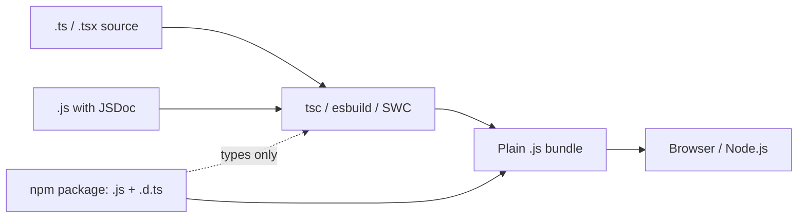

## Introduction

People often talk about JavaScript and TypeScript as if they were rival languages. They are not. **JavaScript** is the language defined by the ECMAScript specification and executed by engines such as V8 (Chrome, Node.js), SpiderMonkey (Firefox) and JavaScriptCore (Safari). **TypeScript** is JavaScript with a static type system layered on top, checked by a compiler before the code runs and then removed. No browser and no mainstream engine executes TypeScript; Node.js, Deno and Bun accept `.ts` files only because they strip the types first.

So the comparison is really between two ways of working with the same language: writing JavaScript and discovering type mistakes when the code runs, or writing TypeScript and discovering many of them while you type. Everything else — the event loop, closures, prototypes, `this`, the standard library, npm packages — is identical, because the program that runs is JavaScript in both cases.

This lesson makes the differences concrete. [[b2-what-is-typescript]] introduced the core idea of checking-then-erasing; here you will see the same bug in both languages, what TypeScript catches and what it cannot, what happens to modern syntax when you target older runtimes, and the middle ground of type-checked JavaScript.

## Before you start

- **What TypeScript is** — checking versus emitting, and type erasure. See [[b2-what-is-typescript]].
- **JavaScript types and coercion** — how `typeof` works and how `"100" * 1.2` becomes `120`. See [[b1-typeof]] and [[b1-type-coercion]].
- **Error types** — what a `TypeError` is and when it is thrown. See [[b1-typeerror]].

## The intuition

JavaScript is **dynamically typed**: values carry types, variables do not. A variable can hold a number now and a string later, and the engine only discovers that you called `.toUpperCase()` on a number at the moment it tries. The type check exists, but it happens at runtime, one executed line at a time.

TypeScript is **statically typed**: variables, parameters and return values have types known before the code runs, and the checker examines every line, including branches that rarely execute. The engine's runtime checks are still there underneath — TypeScript does not remove them — but a large share of the mistakes never get that far.

A useful picture: JavaScript tests your assumptions by running the code; TypeScript tests them by reading the code. Reading covers every path at once but cannot see data that only appears at runtime. Running sees the real data but only on the paths you happen to execute.

## The same bug in both languages

Here is a small JavaScript function with two mistakes: a typo in a property name, and a call that passes `null`.

```javascript title="profile.js"
function displayName(user) {
  return user.firstName + " " + user.lastNmae;
}

const user = { firstName: "Grace", lastName: "Hopper" };
console.log(displayName(user));
console.log(displayName(null));
```

```output
Grace undefined
TypeError: Cannot read properties of null (reading 'firstName')
```

Notice how differently the two mistakes behave. The typo does not crash at all: reading a missing property in JavaScript gives `undefined`, which is silently turned into the string `"undefined"`. That kind of bug can ship and sit in a UI for months. The `null` call does crash, but only when it runs.

The TypeScript version describes the expected input once:

```typescript title="profile.ts"
interface User {
  firstName: string;
  lastName: string;
}

function displayName(user: User): string {
  return user.firstName + " " + user.lastNmae;
}

const user = { firstName: "Grace", lastName: "Hopper" };
console.log(displayName(user));
console.log(displayName(null));
```

```output
profile.ts(7,38): error TS2551: Property 'lastNmae' does not exist on type 'User'. Did you mean 'lastName'?
profile.ts(12,25): error TS2345: Argument of type 'null' is not assignable to parameter of type 'User'.
```

Both mistakes are reported before anything runs, with locations and a suggested fix. The second error depends on `strictNullChecks`, which is part of `strict` mode (on by default in TypeScript 6.0); without it, `null` would be accepted everywhere and the crash would return. That is why the strictness setting matters so much — see [[b2-strict-null-checks]].

## Side-by-side comparison

| Aspect | JavaScript | TypeScript |
|---|---|---|
| Typing | Dynamic: types belong to values, checked as code runs | Static and optional: types checked before running, then erased |
| What executes | The source file itself | The emitted JavaScript (source never runs as-is) |
| Build step | Optional (bundling, minifying) | Needed to type-check; type-stripping tools can skip it for running |
| Error discovery | When the faulty line executes | In the editor and build, for every code path |
| Runtime speed | Baseline | Same — the output is JavaScript |
| Runtime type checks | Engine checks operations as they run | Exactly the same; TypeScript adds none |
| Editor support | Good, partly powered by TypeScript's engine | Precise autocomplete, rename, go-to-definition |
| Extra syntax | — | Annotations, `interface`, `type`, generics, `enum`, access modifiers |
| File extensions | `.js`, `.mjs`, `.cjs`, `.jsx` | `.ts`, `.mts`, `.cts`, `.tsx`, plus `.d.ts` for types only |
| Library types | None | Shipped with the package or from `@types/*` |

Two rows deserve a comment. "Runtime speed: same" is a common interview trap: people assume a compiled or typed language must be faster or slower, but TypeScript output is ordinary JavaScript and engines optimise it exactly as they would hand-written code. And the editor row is subtler than it looks — VS Code's JavaScript support is itself powered by the TypeScript language service, which infers what it can from plain JavaScript. With TypeScript annotations it simply has much more to work with.

## What TypeScript can and cannot catch

TypeScript prevents errors that are visible in the structure of your code. Typical examples:

- Reading a property that does not exist (typos, renamed fields).
- Calling something that is not a function, or calling a function with the wrong number or kinds of arguments.
- Using a value that might be `null` or `undefined` without checking first (with `strictNullChecks`).
- Forgetting to handle one case of a union, such as a new status value (with exhaustiveness checks — see [[b2-exhaustiveness-assertnever]]).
- Breaking callers when you change a function's signature: every call site that no longer fits becomes an error.

It cannot catch errors that depend on what happens at runtime:

- A network request that fails, times out or returns a different shape than declared.
- Bad user input, unless you validate it.
- Logic errors where the types line up but the computation is wrong (`price * rate` instead of `price * (1 + rate)`).
- Anything you have hidden from the checker with `any`, an `as` assertion or a `// @ts-ignore` comment.
- Index access past the end of an array, unless `noUncheckedIndexedAccess` is enabled.

A good rule: TypeScript checks that the parts of your program fit together. Tests check that the program does the right thing, and runtime validation checks that the outside world sends what you expect. You need all three.

## Output targets and downlevel emit

TypeScript's compiler has a second job besides erasing types: it can rewrite newer JavaScript syntax into older syntax for runtimes that lack it. This is called **downlevel emit**, and it is controlled by the `target` option. It is the same service Babel provides, and it has nothing to do with types — plain JavaScript features get rewritten.

```typescript title="defaults.ts"
const config = { retries: 0, timeout: undefined as number | undefined };
const retries = config.retries ?? 3;
const timeout = config.timeout ?? 5000;
console.log(retries, timeout, config?.retries);
```

With `--target es2022`, the output is the same code minus the `as` clause, because ES2022 engines understand `??` and `?.`. With `--target es2019` (before those operators existed), the compiler rewrites them:

```javascript title="defaults.js (target es2019)"
"use strict";
var _a, _b;
const config = { retries: 0, timeout: undefined };
const retries = (_a = config.retries) !== null && _a !== void 0 ? _a : 3;
const timeout = (_b = config.timeout) !== null && _b !== void 0 ? _b : 5000;
console.log(retries, timeout, config === null || config === void 0 ? void 0 : config.retries);
```

```output
0 5000 0
```

Both versions print the same thing; the older one is just longer. This shows why "TypeScript is slower" is a myth but "your target setting matters" is true: an unnecessarily old target makes output larger and sometimes slower (for example, `async` functions compiled into generator-based state machines with helper functions). Match `target` to the oldest runtime you support. In TypeScript 6.0, `target: "es5"` is deprecated and will be removed in TypeScript 7, reflecting that no current runtime needs it.

Note also what downlevel emit does *not* do: it rewrites syntax but does not add missing standard-library functions. If you target an old runtime and call `Array.prototype.at`, you need a polyfill; TypeScript will only stop you from calling it if your `lib` setting says it is unavailable.

## The middle ground: type-checked JavaScript

You can get much of TypeScript's checking without leaving `.js` files. The checker understands types written in **JSDoc** comments, and a `// @ts-check` comment at the top of a file (or `checkJs` in `tsconfig.json`) turns checking on:

```javascript title="price.js"
// @ts-check

/**
 * @param {number} price
 * @param {number} rate
 * @returns {number}
 */
function withTax(price, rate) {
  return price * (1 + rate);
}

console.log(withTax(100, 0.2));
console.log(withTax("100", 0.2));
```

Running `tsc price.js --allowJs --noEmit` reports:

```output
price.js(13,21): error TS2345: Argument of type 'string' is not assignable to parameter of type 'number'.
```

Run the same file with `node price.js` and both lines print `120`, because JavaScript coerces `"100"` to a number for multiplication. The code "works" by accident; the moment the function is changed to use `+`, the string would be concatenated instead. The checker flags the risky call either way.

Checked JavaScript is a real option, not a toy. The Svelte project moved its source from TypeScript to JSDoc-annotated JavaScript to avoid a build step for its own code, while still type-checking it. The trade-off is verbosity: complex types are clumsy in comments, and some TypeScript features, such as `enum`, have no JSDoc equivalent. Most teams use checked JavaScript as a migration step: enable `allowJs` and `checkJs`, add JSDoc to the most important files, then rename files to `.ts` one at a time (see [[b2-optional-static-typing]]).

## How they connect in a project



A TypeScript project freely imports JavaScript packages. The package's JavaScript is what runs; its `.d.ts` declaration files (shipped with the package or installed from `@types/*`) are what the checker reads. If a package has no types at all, TypeScript treats its imports as untyped (and in strict mode asks you to add a declaration), which is one of the frictions covered in [[b2-ts-disadvantages]]. Modules work the same way in both languages, using ECMAScript `import`/`export`; TypeScript adds rules for resolving files and type-only imports — see [[b2-ts-modules]].

## In real systems

A frontend team migrating a large JavaScript codebase rarely does it in one go. A common path: add `tsconfig.json` with `allowJs`, keep everything compiling, turn on `checkJs` for a few folders, convert shared utilities and API clients to `.ts` first (because they have the most callers), and tighten strictness flags over months. Throughout, the deployed artefact is JavaScript and users notice no change.

Library authors often write in TypeScript and publish JavaScript plus `.d.ts` files. JavaScript users of the library get working code and, in VS Code, autocomplete powered by those declarations — a benefit of TypeScript that reaches people who never write it.

## Common mistakes

**Saying "TypeScript runs in the browser".** It never does. Browsers run the JavaScript a tool produced from it. Even runtimes that accept `.ts` strip the types first and skip checking.

**Assuming TypeScript code is slower or faster.** Output speed depends on the JavaScript emitted, which depends on `target`. With a modern target the output is nearly identical to the source without types.

**Believing a typed codebase needs fewer tests.** Types remove a class of tests (passing the wrong kind of argument) but say nothing about whether the logic is correct.

**Using an old `target` "to be safe".** It bloats bundles and adds helpers. Pick the oldest runtime you actually support.

**Expecting downlevel emit to add missing APIs.** Syntax is rewritten; library methods are not added. Use `lib` to describe the environment and polyfills to fill gaps.

## Interview perspective

**"What is the difference between TypeScript and JavaScript?"** Lead with the relationship (superset, compiles to JavaScript), then the key difference (static versus dynamic type checking), then the consequences: earlier error detection and better tooling, at the cost of a build step and type maintenance, with identical runtime behaviour and performance.

**"Can TypeScript prevent all `TypeError`s?"** No. It prevents those visible in code structure; it cannot see runtime data, and escape hatches like `any` and `as` bypass it. Mention validating external data.

**"Is TypeScript faster?"** No and no slower; runtime speed depends on the emitted JavaScript. A good follow-up remark is that `target` affects output size because of downlevel emit.

**"Can you type-check JavaScript without converting it?"** Yes: JSDoc annotations plus `// @ts-check` or `checkJs`. Mention it as a migration path.

## Practice

1. Take any small JavaScript function you have written, add `// @ts-check` and JSDoc types, and run `npx tsc --allowJs --noEmit` on it. Fix whatever it reports.
2. Compile a file containing `async`/`await` and optional chaining with `--target es2015` and with `--target es2022`. Compare line counts and identify the helper functions added.
3. Write three bugs TypeScript would catch and three it would not. For each of the latter, name the tool that would catch it instead (test, runtime validation, lint rule).

```quiz
Q: A JavaScript project is rewritten in TypeScript with identical logic and a modern `target`. How does runtime performance change?
- [ ] It improves, because the engine can use the type annotations to optimise
- [ ] It worsens, because TypeScript adds runtime type checks
- [x] It stays essentially the same, because the engine runs equivalent JavaScript
- [ ] It depends on whether `strict` mode is enabled
> Types are erased, so engines never see them and cannot use them. TypeScript adds no runtime checks. `strict` changes what the checker reports, not the emitted logic. Only `target` noticeably changes output, and with a modern target the output matches the source minus types.
```

```quiz
Q: Which bug can TypeScript catch at compile time?
- [ ] An API that returns `{ total: "12" }` when the interface says `total: number`
- [x] Calling `order.totl` when the `Order` type has a `total` property
- [ ] Computing tax as `price * rate` instead of `price * (1 + rate)`
- [ ] A user typing letters into a quantity field
> A misspelled property is visible in the code's structure. The API response and user input only exist at runtime, so they need validation. The tax formula is type-correct (number times number) but logically wrong, which only a test catches.
```

## Quick revision {#quick-revision}

- JavaScript: dynamic typing, types belong to values, errors found when lines execute.
- TypeScript: static, optional types checked before running, then erased; output is JavaScript.
- Runtime behaviour and speed are identical; no runtime checks are added.
- TypeScript catches structural mistakes: typos, wrong arguments, unhandled `null`, missed union cases, broken callers.
- It cannot catch: bad external data, logic errors, anything hidden by `any`/`as`/`@ts-ignore`.
- `target` controls downlevel emit (syntax rewriting); old targets mean bigger output. `es5` is deprecated in TypeScript 6.0.
- Downlevel emit does not polyfill APIs; `lib` describes available APIs.
- JSDoc + `// @ts-check` / `checkJs` type-checks plain `.js` — a common migration step.
- JavaScript packages provide types via bundled `.d.ts` or `@types/*`.

## Key takeaways {#key-takeaways}

- TypeScript is not a different runtime language; it is a way of checking JavaScript before it runs.
- The main difference is when type errors are found: while reading the code instead of while running it.
- Static checking covers every code path but only your own code; runtime data still needs runtime validation.
- Performance is unchanged; output size depends on the `target` you choose.
- You can adopt TypeScript gradually, even starting from checked JavaScript with JSDoc.
