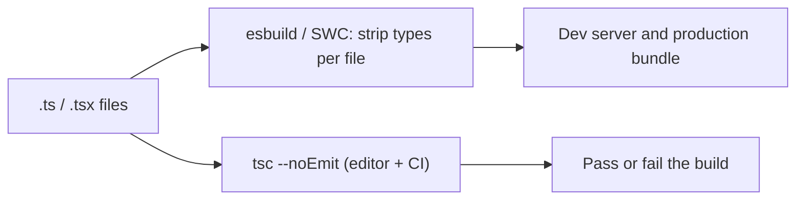

## Introduction

TypeScript code cannot run until something turns it into JavaScript, and its types are worthless until something checks them. **`tsc`**, the TypeScript compiler, does both. It ships in the `typescript` npm package, it is the reference implementation of the language, and everything else that understands TypeScript — VS Code's error squiggles, esbuild, Vite, Node.js type stripping — either uses `tsc`'s engine or imitates part of its behaviour.

Knowing `tsc` well pays off in daily work. Most confusing TypeScript problems are not about types at all: output files appear in the wrong folder, Node.js complains about `require` in an ES module, a build passes locally and fails in CI, or a dev server shows no errors while `tsc` shows dozens. Each of these comes from how the compiler is configured and invoked. This lesson walks through a compile from the inside, sets up a real project, and explains the modes and options you will meet in every codebase.

The examples use TypeScript 6.0, the version in this repository. Where 6.0 behaves differently from 5.x — and it does in a few important defaults — the lesson says so.

## Before you start

- **What TypeScript is**, especially that checking and emitting are separate jobs — [[b2-what-is-typescript]].
- **Downlevel emit** and the `target` option, introduced in [[b2-ts-vs-javascript]].
- **JavaScript modules** — `import`/`export`, and the difference between ES modules and CommonJS. See [[b1-modules]] and [[b1-esm-vs-cjs]].
- **npm basics** — installing a dev dependency and running `npx`.

## The intuition

Think of `tsc` as a careful editor-and-printer working on a book. First the editor reads every chapter to check that cross-references are consistent — a character introduced in chapter 2 must exist when chapter 9 mentions them. That is **type checking**, and it needs the whole book. Then the printer prints each chapter, dropping the editor's margin notes. That is **emitting**, and it can be done one chapter at a time.

The split matters because the two jobs scale differently. Checking needs global knowledge and is the expensive part. Printing a chapter only needs that chapter, which is why fast tools can do it in milliseconds. Hold on to this picture; it explains most of the build setups you will see.

## What happens inside a compile

`tsc` processes a program in a fixed pipeline:


The **scanner** splits text into tokens (`function`, `average`, `(`, …). The **parser** builds an **Abstract Syntax Tree (AST)** for each file. The **binder** walks the trees and creates **symbols** — one per declared name — linking each use of a name to its declaration and recording scopes. The **checker**, by far the largest part of the compiler, computes the type of every expression, performs inference and narrowing, and reports errors. Finally the **emitter** walks each tree and writes JavaScript with the type syntax removed and newer syntax rewritten for the configured `target`, plus optional declaration files (`.d.ts`) and source maps (`.js.map`).

Before any of that, `tsc` builds the **program**: the set of files to compile. It starts from the files matched by `include` (or `files`) in `tsconfig.json`, follows every `import` to find more files, and adds the built-in library declarations (`lib.es2022.d.ts`, `lib.dom.d.ts`, …) that describe JavaScript and browser APIs. You can see the list with `tsc --listFilesOnly`, and ask why a file was included with `tsc --explainFiles`.

Two consequences follow. First, a type error in one file can be caused by a change in another, because the checker reasons across the whole program. Second, emitting a file does not depend on the checker's verdict: by default `tsc` writes JavaScript even when there are type errors.

## A first project

Start from an empty folder:

```bash title="terminal"
npm init -y
npm install --save-dev typescript
npx tsc --init
```

`tsc --init` writes a commented `tsconfig.json`. In TypeScript 6.0 it enables, among others, `strict`, `module: "nodenext"`, `target: "esnext"`, `sourceMap`, `declaration`, `isolatedModules`, `verbatimModuleSyntax` and `skipLibCheck`, and sets `types: []` so global types from `@types/*` packages are not loaded unless you list them. For this lesson, a smaller hand-written config is easier to follow. With `"type": "module"` in `package.json` (so Node.js treats `.js` files as ES modules):

```json title="tsconfig.json"
{
  "compilerOptions": {
    "target": "es2022",
    "module": "nodenext",
    "rootDir": "src",
    "outDir": "dist",
    "strict": true,
    "sourceMap": true,
    "declaration": true
  },
  "include": ["src"]
}
```

And two source files:

```typescript title="src/math.ts"
export function average(values: number[]): number {
  if (values.length === 0) return 0;
  return values.reduce((sum, v) => sum + v, 0) / values.length;
}
```

```typescript title="src/index.ts"
import { average } from "./math.js";

const scores = [72, 85, 91];
console.log(`Average: ${average(scores).toFixed(1)}`);
```

Note the import path `./math.js`, not `./math` or `./math.ts`. With `module: "nodenext"`, TypeScript follows Node.js's ES module rules, which require full file extensions, and you write the extension of the file that will exist *at runtime*. `tsc` knows that `./math.js` corresponds to `src/math.ts` during checking.

Run `npx tsc` with no arguments. It finds `tsconfig.json` in the current folder, compiles, prints nothing on success and produces:

```output
dist/index.d.ts
dist/index.js
dist/index.js.map
dist/math.d.ts
dist/math.js
dist/math.js.map
```

Then `node dist/index.js` prints:

```output
Average: 82.7
```

Look at what was emitted for `math.ts`:

```javascript title="dist/math.js"
export function average(values) {
    if (values.length === 0)
        return 0;
    return values.reduce((sum, v) => sum + v, 0) / values.length;
}
//# sourceMappingURL=math.js.map
```

```typescript title="dist/math.d.ts"
export declare function average(values: number[]): number;
```

The `.js` file is the source minus types (reformatted — `tsc` does not preserve your layout). The `.d.ts` file is the opposite: only the types, no implementation. Libraries publish both so that consumers get runnable code and type information. The final comment points to the source map, which lets debuggers and stack traces show `src/math.ts` line numbers instead of `dist/math.js` ones.

## The options that shape output

Dozens of options exist; a handful decide what comes out. The full reference is in [[b2-tsconfig]].

**`target`** — the JavaScript version to emit. Syntax newer than the target is rewritten (downlevelled). Choose the oldest runtime you support; `es2022` covers every current browser and Node.js 18+. In TypeScript 6.0 the default is a recent ECMAScript version, and `es5` is deprecated.

**`module`** — the module format of the output. `nodenext` follows Node.js's rules: a file is emitted as an ES module or as CommonJS depending on the nearest `package.json` `"type"` field and the file extension (`.mts` is always ESM, `.cts` always CommonJS). `esnext` or `es2022` always emit `import`/`export`, the right choice when a bundler consumes the output (often together with `moduleResolution: "bundler"`). `commonjs` always emits `require`/`exports`. The same `math.ts` compiled with `--module commonjs` becomes:

```javascript title="math.js (module commonjs)"
"use strict";
Object.defineProperty(exports, "__esModule", { value: true });
exports.average = average;
function average(values) {
    if (values.length === 0)
        return 0;
    return values.reduce((sum, v) => sum + v, 0) / values.length;
}
```

A mismatch between `module` and how the output is actually loaded produces the classic runtime errors "`require` is not defined in ES module scope" or "Cannot use import statement outside a module". See [[b2-esm-vs-cjs-ts]].

**`rootDir` and `outDir`** — `outDir` is where emitted files go; `rootDir` is the folder whose structure is mirrored inside `outDir`. With `rootDir: "src"`, `src/math.ts` becomes `dist/math.js`. Without it, older versions computed the common folder of all inputs; TypeScript 6.0 instead requires you to set `rootDir` when it would matter, and the same config without it fails with:

```output
tsconfig.json(5,5): error TS5011: The common source directory of 'tsconfig.json' is './src'. The 'rootDir' setting must be explicitly set to this or another path to adjust your output's file layout.
```

(It still emits, to `dist/src/…` — which is exactly the surprise the error warns about.)

**`include`, `exclude`, `files`** — which files start the program. `include: ["src"]` means every supported file under `src`. `exclude` only removes files from that initial set; a file that is imported by an included file is still compiled.

**`strict`** — a bundle of checks including `noImplicitAny` and `strictNullChecks` (see [[b2-strict-compiler-options]]). On by default in TypeScript 6.0.

**`declaration`, `sourceMap`** — whether to emit `.d.ts` files and `.js.map` files.

**`noEmit`, `noEmitOnError`** — `noEmit` makes `tsc` a pure checker. `noEmitOnError` keeps the previous output when there are errors instead of writing possibly broken files.

**`lib` and `types`** — which built-in API declarations exist (`lib: ["es2022", "dom"]`) and which global `@types` packages are loaded (`types: ["node"]`). If `process` or `describe` are "not found", one of these is usually the reason; TypeScript 6.0's `types: []` default means you must list `"node"` explicitly to use Node.js globals.

## Running tsc: modes and flags

| Command | What it does | Typical use |
|---|---|---|
| `tsc` | Check and emit using `tsconfig.json` | Building a library or Node.js service |
| `tsc --noEmit` | Check only | CI step; when a bundler does the emitting |
| `tsc --watch` | Recompile on file changes | Local development without a bundler |
| `tsc --incremental` | Cache results in `.tsbuildinfo`; recheck only what changed | Faster repeated builds |
| `tsc --build` (`-b`) | Build a graph of referenced projects in order | Monorepos with project references |
| `tsc -p path/tsconfig.json` | Use a specific config | Separate configs for app and tests |
| `tsc --showConfig` | Print the final resolved config | Debugging `extends` chains |
| `tsc --listFilesOnly` / `--explainFiles` | Show which files are in the program and why | "Why is this file compiled?" |

One TypeScript 6.0 change catches people out: running `tsc src/index.ts` (naming files on the command line) in a folder that has a `tsconfig.json` is now an error (`TS5112`), because command-line files make `tsc` ignore the config entirely — a frequent source of "it compiled differently" confusion. Use `tsc` alone to use the config, or add `--ignoreConfig` if you really want to compile individual files with default settings.

**Exit codes matter in CI.** When `tsc` finds errors, it exits with a non-zero code, which fails the CI job. With `noEmitOnError`, the code is `1` and no files are written; without it, the code is `2`, meaning "errors were reported, but output was generated". Exit code `0` means no errors.

**Reading an error.** `src/bad.ts(1,14): error TS2322: Type 'string' is not assignable to type 'number'.` gives the file, line and column, a stable error code to search for, and a message. Long messages are indented chains: each indented line explains *why* the line above failed, so read from the top for the summary and down for the root cause.

## Checking versus transpiling in real toolchains

Most frontend projects do not use `tsc` to produce the JavaScript that ships. Bundlers such as Vite use **esbuild** or **SWC** to strip types file by file — tens to hundreds of times faster than `tsc` — and `tsc --noEmit` runs separately for checking:



Per-file transpilers have a limitation: they see one file at a time, without type information, so they cannot handle constructs whose output depends on other files. Two options make `tsc` warn about such code so it stays compatible:

- **`isolatedModules`** reports code that cannot be compiled one file at a time, such as re-exporting a type with `export { User } from "./types"` (a per-file tool cannot know `User` is a type that must vanish) or using `const enum` values from another file.
- **`verbatimModuleSyntax`** goes further with a simple rule: imports and exports are emitted exactly as written, minus anything marked `type`. So a type-only import must say so:

```typescript title="app.ts"
import { User } from "./types.js";

const u: User = { id: 1, name: "Ada" };
console.log(u.name);
```

```output
app.ts(1,10): error TS1484: 'User' is a type and must be imported using a type-only import when 'verbatimModuleSyntax' is enabled.
```

Changing the first line to `import type { User } from "./types.js";` fixes it; the import then disappears completely from the output. Both options are enabled by `tsc --init` in TypeScript 6.0.

A related option, **`erasableSyntaxOnly`** (TypeScript 5.8+), rejects constructs that need code generation — `enum`, value namespaces, parameter properties — so code can run under pure type-stripping runtimes such as Node.js 22.18+ (`node file.ts`). Remember that those runtimes never type-check; `tsc --noEmit` is still how you find type errors.

## Scaling up: incremental builds and project references

On large codebases, the full check is the slow part. `incremental: true` stores a dependency graph and file hashes in a `.tsbuildinfo` file; the next run reuses results for unchanged files. In the example project a repeated incremental build finishes in a fraction of a second.

**Project references** split a monorepo into separately compiled projects. Each package gets its own `tsconfig.json` with `composite: true` (which requires `declaration` so other projects can consume its `.d.ts` files), and a root config lists `references`. `tsc --build` then compiles projects in dependency order and skips any whose inputs have not changed — `tsc --build --verbose` prints messages such as "Project 'tsconfig.json' is up to date because newest input … is older than output …". For editor performance, it also means opening one package does not load the whole repository.

TypeScript 7, the native Go port of the compiler, targets the same problem from the other side: it keeps the language and configuration but makes the checker itself much faster, and removes the options TypeScript 6.0 deprecates.

## In real systems

**A Node.js service** typically runs `tsc` to compile `src/` to `dist/` with `module: "nodenext"`, runs `node dist/index.js` in production, and uses `tsc --watch` or a type-stripping runner during development.

**A React app with Vite** never ships `tsc` output. Vite transpiles with esbuild; the `build` script runs `tsc --noEmit` (or `tsc -b` for project references) first so a type error fails the build.

**A library** compiles with `declaration: true` and publishes `dist/*.js` plus `dist/*.d.ts`, with `package.json` `"types"` or `"exports"` pointing at the declarations so consumers get types.

In all three, CI runs the type check as a separate required step, and the config is read by the editor too, so local squiggles and CI failures agree.

## Common mistakes

**Passing file names to `tsc` in a project with a config.** Files on the command line bypass `tsconfig.json`. TypeScript 6.0 reports `TS5112`; older versions silently used default options.

**Not setting `rootDir`, then finding `dist/src/index.js`.** Set `rootDir` to the folder you want mirrored.

**Assuming no errors because the dev server runs.** Vite and similar tools do not type-check. Run `tsc --noEmit` in the editor workflow and CI.

**Mismatched `module` and runtime.** Emitting CommonJS into a `"type": "module"` package (or the reverse) fails at runtime. Use `nodenext` for Node.js so TypeScript follows the same rules Node.js does.

**Writing `import "./math"` under `nodenext`.** Node.js ES modules need the extension; write `./math.js`.

**Thinking `exclude` hides a file from compilation.** It only affects the starting set. If an included file imports it, it is compiled.

## Interview perspective

**"What does `tsc` do?"** Builds the program from the config and imports, parses, binds, type-checks the whole program and emits JavaScript, declarations and source maps. Emitting happens even with type errors unless `noEmitOnError` is set.

**"Why do projects use esbuild or SWC instead of `tsc` to build?"** Speed: they strip types per file without checking. `tsc --noEmit` provides the checking. Follow-up: `isolatedModules` and `verbatimModuleSyntax` keep code compatible with per-file transpilation.

**"How would you speed up a slow TypeScript build?"** Separate transpile from check, `incremental`, project references with `tsc --build`, `skipLibCheck`, narrower `include`, and look for pathological types with `--extendedDiagnostics`.

## Practice

1. Create the two-file project above. Remove `rootDir`, build, and explain the error and the resulting folder layout. Restore it.
2. Add a deliberate type error, then run `tsc`, `tsc --noEmitOnError` and `tsc --noEmit`, checking what is written to `dist` and the exit code each time (`echo $?`).
3. Compile `math.ts` with `module` set to `nodenext`, `esnext` and `commonjs` (use `--ignoreConfig` with explicit flags) and compare the outputs.
4. Turn on `verbatimModuleSyntax`, import an interface without `type`, read the error, fix it, and confirm the import is gone from the emitted file.

```quiz
Q: `tsc` reports three type errors, yet `dist/` contains fresh `.js` files. Why?
- [ ] `tsc` only reports errors after emitting, then deletes the files later
- [x] By default emitting does not depend on type checking; `noEmitOnError` changes that
- [ ] The errors were in `.d.ts` files, which do not block emit
- [ ] `outDir` overrides error handling
> Checking and emitting are separate jobs, and `tsc` emits even when checking fails (exit code 2). With `noEmitOnError` it writes nothing and exits with code 1. This default exists so JavaScript projects can migrate gradually.
```

```quiz
Q: A Vite app runs fine in the browser, but CI fails with type errors. What explains the difference?
- [ ] Vite uses an older TypeScript version
- [ ] The browser ignores type errors at runtime but Node.js does not
- [x] Vite strips types per file with esbuild and never type-checks; the CI step runs `tsc --noEmit`
- [ ] CI uses `strict` while Vite cannot
> Type-stripping transpilers remove types without checking them, so the app runs regardless of type errors. Only `tsc` (or the editor's language service) checks. Runtimes never see types at all.
```

```quiz
Q: With `verbatimModuleSyntax` enabled, why must an interface be imported with `import type`?
- [ ] Interfaces cannot be imported any other way
- [ ] `import type` makes the interface available at runtime
- [x] Imports are emitted as written, so a plain import of a type would remain in the JavaScript and point at an export that does not exist
- [ ] It makes type checking faster
> Under this option the compiler does not guess which imports are type-only. Marking them with `type` lets any tool, even a per-file one, delete them safely. Without the marker the import would survive into JavaScript, where the interface does not exist.
```

## Quick revision {#quick-revision}

- Pipeline: scanner → parser (AST) → binder (symbols) → checker (types, errors) → emitter (`.js`, `.d.ts`, `.js.map`).
- Program = files from `include`/`files` + everything they import + `lib` declarations.
- `tsc` emits despite errors (exit 2); `noEmitOnError` → no output, exit 1; `--noEmit` → check only.
- Key options: `target` (syntax level), `module` (`nodenext` for Node.js, `esnext` for bundlers), `rootDir`/`outDir` (layout), `strict`, `declaration`, `sourceMap`, `lib`, `types`.
- TypeScript 6.0: `strict` default; `types: []` default; set `rootDir` explicitly (TS5011); files on the command line with a config present → TS5112; `es5`, `baseUrl`, `node10` resolution deprecated.
- Under `nodenext`, imports use the runtime extension: `./math.js`.
- Bundlers transpile with esbuild/SWC; `tsc --noEmit` checks. `isolatedModules`, `verbatimModuleSyntax` (`import type`), `erasableSyntaxOnly` keep code per-file-safe.
- Scale: `incremental` (`.tsbuildinfo`), project references with `composite` and `tsc --build`, `skipLibCheck`.

## Key takeaways {#key-takeaways}

- `tsc` is both a whole-program checker and a per-file emitter; many toolchains use it only for the first job.
- `tsconfig.json` decides what is compiled, how strictly, in which module format and where output goes.
- Most "TypeScript problems" in practice are configuration mismatches between `tsc`, the bundler and the runtime.
- Make the type check a required CI step, because dev servers and type-stripping runtimes do not perform it.
- TypeScript 6.0 tightens defaults and deprecates legacy options in preparation for the native TypeScript 7 compiler.
