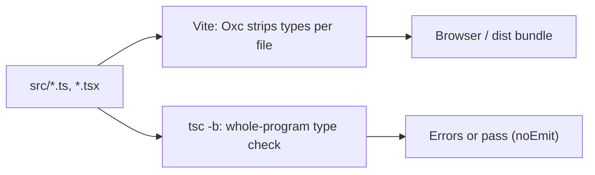

## Introduction

Open a new React project, introduce an obvious type error such as `const count: number = 'five'`, and save. The browser reloads instantly and the page works. No error appears in the terminal running `vite`. Many developers meet Vite this way and conclude that something is broken. Nothing is: Vite was designed not to type-check.

**Vite** is a development server and build tool for web applications. In development it serves your source files to the browser as native ES modules, transforming each one on request, and swaps changed modules into the running page with **Hot Module Replacement (HMR)**. For production it bundles everything into optimised files. To serve a `.ts` or `.tsx` file it needs JavaScript, and it gets it the fastest way possible: by deleting the type annotations, one file at a time, without asking whether they are correct.

That design choice, **transpile without type-checking**, explains almost every TypeScript question about Vite: why it is fast, why you still need `tsc`, why certain TypeScript features need special settings, and why the official templates run two commands to build. This lesson works through each of those, using Vite 8 (the version this site is built with) and TypeScript 6.

## Before you start

- **How `tsc` compiles** — that type checking and JavaScript emit are separate jobs. See [[b2-tsc-compilation]].
- **tsconfig.json basics** — `compilerOptions`, `include`, `references`. See [[b2-tsconfig]].
- **ES modules** — `import`/`export` and how the browser loads modules. See [[b1-modules]] and [[b2-ts-modules]].
- **Declaration files** — for the `vite/client` types. See [[b2-declaration-files]].

## The intuition: a printer and a proofreader

Compiling TypeScript with `tsc` combines two jobs. **Type checking** is proofreading: reading the whole project, following every import, and confirming everything fits. **Emitting** JavaScript is printing: for each file, remove the type syntax and write out what remains. Proofreading needs the whole book. Printing one page needs only that page.

Vite hands the printing to a very fast tool and skips the proofreading entirely. When you save one file, Vite reprints that one page in about a millisecond, and the browser swaps it in. If it had to proofread the whole book on every save, large projects would wait seconds. The proofreading still happens, just elsewhere: in your editor as you type, and in a separate `tsc` run before you ship.

The analogy has a limit worth stating. Some TypeScript constructs cannot be printed correctly from one page alone, because their output depends on another file. Those are the cases where Vite needs your `tsconfig` to forbid them, covered below.

## How Vite turns TypeScript into JavaScript

In Vite 8, TypeScript and JSX are transformed by **Oxc**, a JavaScript toolchain written in Rust, and production bundles are produced by **Rolldown**, a Rust bundler. Vite 7 and earlier used **esbuild** for the transform and Rollup for production builds; you will see `esbuild` options in older configs, which Vite 8 accepts but marks deprecated in favour of `oxc`. The principle is the same in every version: each file is transformed in isolation, and types are removed, not checked.

You can watch this happen. Vite exports its transform function, so this Node.js script feeds it a file with a deliberate type error:

```js title="strip-demo.mjs"
import { transformWithOxc } from 'vite';

const source = `import type { User } from './types';
const count: number = 'not a number';
export function greet(user: User): string {
  return 'Hello, ' + user.name;
}
`;

const result = await transformWithOxc(source, 'greet.ts');
console.log(result.code);
console.log('warnings:', result.warnings?.length ?? 0);
```

```output
const count = "not a number";
export function greet(user) {
	return "Hello, " + user.name;
}

warnings: 0
```

Three things happened. The `import type` line disappeared, because it can only ever refer to types. The annotations `: number`, `: User` and `: string` disappeared. And the wrong assignment passed through untouched, with no warning, because the transformer never compares a value with its annotation. (It also normalised quotes and indentation; the output is generated code, not a copy of your formatting.)

In the browser, `count` is now the string `'not a number'`. If later code does `count + 1`, the result is `'not a number1'`. Vite will never tell you; only a type checker will.

## The single-file problem: `isolatedModules` and `verbatimModuleSyntax`

Transforming one file at a time works for nearly all TypeScript, but not all. Consider a barrel file that re-exports from other modules:

```ts title="src/models/index.ts"
export { User } from './types.js';
export { greet } from './greet.js';
```

If `User` is an interface, this first line must disappear from the JavaScript, because there is no runtime value called `User`. If it is a class, the line must stay. `tsc` knows which, because it reads `types.ts`. A single-file transformer does not read `types.ts`, so it must guess, and Oxc keeps the line:

```output
export { User } from "./types";
export { greet } from "./greet";
```

In the browser, that line then fails with a `SyntaxError` saying the module does not provide an export named `User` (this follows from how ES modules link; it was not run in a browser here), a confusing error for a project that type-checks.

The fix is to make the source code say what the transformer cannot infer: `export type { User } from './types.js'`. Two compiler options enforce that everywhere. **`isolatedModules: true`** makes `tsc` report every construct that a single-file transpiler cannot handle correctly:

```output
index.ts(1,10): error TS1205: Re-exporting a type when 'isolatedModules' is enabled requires using 'export type'.
```

**`verbatimModuleSyntax: true`** goes further with a simple rule: imports and exports without the `type` modifier are kept exactly as written, and those with it are removed. Under it, you must write `import type` or `import { type User }` for anything used only as a type. Vite's templates enable one or both of these. With either on, the rules the transformer needs are checked by `tsc` and by the editor, so the guessing never happens. The lint rule `consistent-type-imports` can add and fix the `type` keywords automatically; see [[b2-eslint-typescript]].

Other features are affected for the same reason. A `const enum` defined in one file cannot be inlined into another file that the transformer cannot see; under `isolatedModules` it is treated like a regular enum. Since TypeScript 5.8, **`erasableSyntaxOnly`** goes a step further and forbids every TypeScript construct that generates runtime code (enums, namespaces with values, constructor parameter properties). Code that passes it can be run by tools that only erase types, including Node.js's built-in type stripping. This site's own `tsconfig.app.json` enables it.

## The official template: two configs and two commands

`npm create vite@latest my-app -- --template react-ts` generates a project whose TypeScript setup shows the intended workflow. The root `tsconfig.json` contains no settings of its own, only references:

```json title="tsconfig.json"
{
  "files": [],
  "references": [
    { "path": "./tsconfig.app.json" },
    { "path": "./tsconfig.node.json" }
  ]
}
```

**`tsconfig.app.json`** covers `src/`, the code that runs in the browser. **`tsconfig.node.json`** covers `vite.config.ts`, which runs in Node.js. They are separate because the environments differ: browser code gets the DOM library and Vite's client types; config code gets Node.js types. Mixing them would let browser code use `process` or Node code use `document` without errors, the same problem described for `types` in [[b2-definitely-typed]].

A trimmed `tsconfig.app.json`, close to this site's own, looks like this:

```json title="tsconfig.app.json"
{
  "compilerOptions": {
    "target": "es2023",
    "lib": ["ES2023", "DOM", "DOM.Iterable"],
    "module": "esnext",
    "moduleResolution": "bundler",
    "types": ["vite/client"],
    "allowImportingTsExtensions": true,
    "verbatimModuleSyntax": true,
    "moduleDetection": "force",
    "noEmit": true,
    "jsx": "react-jsx",
    "strict": true,
    "skipLibCheck": true
  },
  "include": ["src"]
}
```

Several of these follow directly from "Vite emits, `tsc` only checks". **`noEmit`** stops `tsc` writing JavaScript, because Vite produces the output. **`moduleResolution: "bundler"`** resolves imports the way Vite does, honouring `package.json` `exports` without requiring file extensions. **`allowImportingTsExtensions`** permits `import './util.ts'`, which is only legal when something other than `tsc` produces the output. **`types: ["vite/client"]`** loads Vite's declarations for `import.meta.env` and asset imports. `target` here only affects which syntax `tsc` accepts and checks against; Vite ignores it and uses its own `build.target` for output.

Vite does read a small set of `tsconfig` options that change how code is *transpiled*, such as the JSX settings and `useDefineForClassFields`, because those affect the JavaScript produced. Everything else in `tsconfig` matters only to `tsc` and your editor.

The template's scripts show the division of labour:

```json title="package.json"
{
  "scripts": {
    "dev": "vite",
    "build": "tsc -b && vite build",
    "preview": "vite preview"
  }
}
```

`npm run dev` starts the dev server with no type checking. `npm run build` runs **`tsc -b`** first: build mode follows the project references and type-checks both configs (writing only `.tsbuildinfo` files so the next run is incremental). If it finds any error, `&&` stops the build, so a type error can never reach production. Only then does `vite build` bundle the code. CI typically runs the same `build` script.

## Seeing type errors during development

Because `vite` reports no type errors, you need another source of them while you work. There are three common options.

Your **editor** is the first. VS Code and other editors run the TypeScript language service on open files, so errors appear as you type. It does not check files you have not opened, so a change that breaks a distant file can go unnoticed.

A **watch process** fixes that: run `tsc -b --watch` (or `tsc --noEmit --watch -p tsconfig.app.json`) in a second terminal. It rechecks the whole project incrementally on every save.

A **checker plugin** such as `vite-plugin-checker` runs the type checker in a worker thread and shows errors in the terminal and as an overlay in the browser. It is convenient for teams who prefer one command, at the cost of an extra dependency and some background CPU.

> [!WARNING] A green dev server is not a passing type check
> `vite` and `vite build` both succeed with type errors present. Only a `tsc` run proves the project type-checks. If your build script is `vite build` alone, broken types can ship; keep `tsc -b &&` in front of it.

## Typing what Vite adds

Vite adds features that plain TypeScript does not know about. `vite/client` declares types for them.

### Environment variables

Vite exposes variables from `.env` files whose names start with `VITE_` on `import.meta.env`, along with built-ins such as `MODE`, `DEV` and `PROD`. Only `VITE_`-prefixed variables are exposed, because everything on `import.meta.env` is inlined into the client bundle where anyone can read it. To give your own variables types, augment the `ImportMetaEnv` interface in a declaration file:

```ts title="src/env.d.ts"
/// <reference types="vite/client" />

interface ViteTypeOptions {
  // Makes unknown import.meta.env keys a type error instead of `any`.
  strictImportMetaEnv: unknown;
}

interface ImportMetaEnv {
  readonly VITE_API_URL: string;
}
```

```ts title="src/config.ts"
export const apiUrl: string = import.meta.env.VITE_API_URL;
export const isDev: boolean = import.meta.env.DEV;
export const secret = import.meta.env.VITE_SECRET_KEY;
```

```output
src/config.ts(5,39): error TS2339: Property 'VITE_SECRET_KEY' does not exist on type 'ImportMetaEnv'.
```

Interface declarations with the same name merge, so your `ImportMetaEnv` adds `VITE_API_URL` to Vite's built-in one (see [[b2-declaration-merging]]). Without the `ViteTypeOptions` entry, Vite types any unknown key as `any`, so a typo such as `VITE_API_ULR` compiles and is `undefined` at runtime. With `strictImportMetaEnv`, misspelled or undeclared variables become errors. The declaration is still only a promise: if the `.env` file lacks `VITE_API_URL`, the value is `undefined` at runtime, so validate required variables at startup.

### Assets and other imports

`vite/client` also declares wildcard modules for assets, so `import logoUrl from './logo.svg'` gives a `string` URL, and `import styles from './card.module.css'` gives an object of class names. It declares `import.meta.hot` for HMR APIs and `import.meta.glob` for importing many files by pattern. If an import of an unusual file type reports "Cannot find module", the fix is a `declare module '*.ext'` declaration as shown in [[b2-third-party-types]].

### Path aliases

Many projects import with an alias such as `@/components/Button` instead of `../../components/Button`. Two separate systems must agree on what `@` means. TypeScript uses `paths` in `tsconfig` for type checking. Vite uses its own resolver for running the code and does not read `paths` by default:

```ts title="vite.config.ts"
import { defineConfig } from 'vite';
import react from '@vitejs/plugin-react';
import { fileURLToPath } from 'node:url';

export default defineConfig({
  plugins: [react()],
  resolve: {
    alias: {
      '@': fileURLToPath(new URL('./src', import.meta.url)),
    },
  },
});
```

```json title="tsconfig.app.json (excerpt)"
{
  "compilerOptions": {
    "paths": { "@/*": ["./src/*"] }
  }
}
```

If you set only `paths`, the editor resolves `@/…` happily and the browser fails to load the module. If you set only `resolve.alias`, the app runs and `tsc` reports "Cannot find module". Vite 8 also offers `resolve.tsconfigPaths: true` (off by default), which makes Vite read `paths` from `tsconfig` so the alias is defined once. Note that `paths` no longer needs `baseUrl`; TypeScript 6 deprecates `baseUrl`, so new configs should write `paths` entries relative to the `tsconfig` file, as above.

## How it works internally

In development, the browser requests `/src/main.tsx`. Vite's server reads the file, runs the Oxc transform (types removed, JSX turned into function calls), rewrites bare imports such as `react` to point at pre-bundled dependency files, and responds with JavaScript. Each imported module triggers another request, transformed the same way. The browser caches transformed modules, and Vite only re-transforms the file you change.

When you save `Button.tsx`, Vite transforms that one file and sends an HMR update over a WebSocket. For React, `@vitejs/plugin-react` adds Fast Refresh, which swaps component definitions while keeping their state. None of this ever builds a TypeScript program, which is why the time per change stays nearly constant as a project grows.



`vite build` runs a similar transform for every module, then Rolldown bundles, tree-shakes and minifies the result into `dist/`. Source maps map the output back to your `.ts` lines so breakpoints in DevTools land in the original code (see [[b2-source-maps-ts]]).

## In real systems

Most new React, Vue, Svelte and Solid projects start from Vite templates, and many meta-frameworks build on it. The pattern in production repositories is consistent: editor feedback while coding, `tsc -b` or `tsc --noEmit` in a pre-push hook or CI, ESLint as a separate step, and `vite build` last. Monorepos lean on project references so `tsc -b` rechecks only packages that changed. The same transpile-only split appears beyond Vite: Vitest, which this site uses for its tests, runs `.ts` test files through Vite's pipeline without type-checking them, so a test can pass while its file contains type errors unless `tsc` also covers the test files.

## Trade-offs and alternatives

| Approach | Strengths | Costs |
|---|---|---|
| Vite (transpile only) + separate `tsc` | Near-instant dev feedback; fast builds; type checking in parallel | Two tools to configure; type errors not shown by the dev server |
| `tsc` as the compiler (emit JavaScript) | One tool; output exactly as TypeScript defines | Slow on large projects; no dev server, HMR or bundling |
| webpack + `ts-loader` (type-checking) | Mature ecosystem | Slower; `transpileOnly` plus a separate checker is the common fix, which is the Vite model again |

Choose Vite for browser applications. Use `tsc` emit for libraries that publish JavaScript plus `.d.ts` files, where you need declaration output and exact TypeScript semantics; many libraries combine both, using a bundler for JavaScript and `tsc` for declarations.

## Common mistakes

- **Assuming the dev server checks types.** It does not. Run a watch process or a checker plugin, and keep `tsc -b` in the build script.
- **Re-exporting types without `export type`.** The line survives transpilation and fails in the browser. Enable `isolatedModules` or `verbatimModuleSyntax`.
- **Configuring an alias in only one place.** Set both `paths` and `resolve.alias`, or use `resolve.tsconfigPaths`.
- **Expecting `tsconfig` `target` to control output.** Vite uses `build.target`.
- **Putting secrets in `VITE_` variables.** They are inlined into client JavaScript and visible to every user.
- **One `tsconfig` for browser and config code.** Browser files then see Node.js globals; keep the app/node split.

> [!MISTAKE] "My tests pass, so the types are fine"
> Vitest strips types just like Vite. A test file with a type error can still pass. Make sure `tsc` checks test files too, for example by including them in a `tsconfig` that `tsc -b` builds.

## Interview perspective

> [!INTERVIEW] What a strong answer sounds like
> "Vite transpiles each TypeScript file in isolation, with Oxc in Vite 8 and esbuild before that, so it's fast but never checks types. That's why the template runs `tsc -b && vite build`, and why I turn on `verbatimModuleSyntax` or `isolatedModules`: they make `tsc` reject code like type re-exports that a single-file transpiler can't compile correctly."

Questions to be ready for:

- **Why does Vite not type-check?** Type checking needs the whole program and is slow; transpiling one file needs only that file. Vite optimises dev feedback and leaves checking to `tsc` and the editor.
- **What does `isolatedModules` do?** It makes `tsc` error on constructs a per-file transpiler cannot handle, such as re-exporting a type without `export type`.
- **Why `noEmit` in a Vite project?** Vite produces the JavaScript; `tsc` only checks.
- **Follow-up: "Why is the alias working in VS Code but not in the browser?"** `paths` only affects TypeScript; Vite needs `resolve.alias` or `resolve.tsconfigPaths`.

```quiz
Q: You add `const total: number = '10'` to a component and run `npm run dev` in a Vite project. What happens?
- [ ] Vite refuses to serve the file and shows a type error overlay
- [x] The page loads; `total` is the string `'10'` at runtime, and only the editor or a `tsc` run reports the error
- [ ] Vite converts `'10'` to the number `10` to match the annotation
- [ ] The dev server crashes
> Vite removes annotations without checking them, so the assignment reaches the browser unchanged as a string. Without a checker plugin, nothing in the dev server reports type errors; the editor's language service and `tsc` do.

Q: Why does `export { User } from './types'` break at runtime in a Vite app when `User` is an interface?
- [ ] Interfaces cannot be exported in TypeScript
- [ ] Vite does not support re-exports
- [x] The transpiler sees one file and cannot know `User` is type-only, so it keeps the re-export, and the runtime module has no `User` export
- [ ] The browser does not support `export ... from`
> Deciding whether to erase the re-export requires reading `types.ts`, which a per-file transpiler does not do. Writing `export type { User }` makes the intent explicit; `isolatedModules` or `verbatimModuleSyntax` makes `tsc` require it.

Q: In the Vite React template, what does `tsc -b` in `"build": "tsc -b && vite build"` contribute?
- [ ] It produces the JavaScript that `vite build` bundles
- [x] It type-checks every referenced project and stops the build if there are errors; with `noEmit` it writes no JavaScript
- [ ] It generates `.d.ts` files for the browser
- [ ] It minifies the TypeScript before bundling
> The template's configs set `noEmit`, so `tsc -b` only checks (and writes incremental build info). Vite produces the JavaScript. The `&&` makes type errors block the production build.
```

## Practice

1. Create a project with `npm create vite@latest -- --template react-ts`. Add a type error, confirm `npm run dev` still works, then confirm `npm run build` fails.
2. Turn off `verbatimModuleSyntax` and `isolatedModules`, add a type-only re-export through a barrel file, and observe the runtime error in the browser console. Turn the option back on and read the compiler's message.
3. Add `VITE_API_URL` to `.env`, type it with `ImportMetaEnv`, enable `strictImportMetaEnv`, and make a typo to see the error.
4. Add an `@` alias using `resolve.tsconfigPaths`, then switch to `resolve.alias` plus `paths` and compare.

## Quick revision {#quick-revision}

- Vite transforms each file in isolation and strips types without checking: Oxc in Vite 8 (esbuild in Vite 7 and earlier); Rolldown bundles in Vite 8 (Rollup before).
- Type errors never come from `vite` or `vite build`; they come from the editor, `tsc`, or a checker plugin.
- Template build: `tsc -b && vite build`; `tsc` configs use `noEmit`. Dev feedback: editor + `tsc -b --watch` or `vite-plugin-checker`.
- `isolatedModules` / `verbatimModuleSyntax`: require `import type`/`export type` so per-file transpilation is correct. `erasableSyntaxOnly` (TS 5.8+) bans enums, namespaces with values and parameter properties.
- `tsconfig.app.json` (browser, `vite/client`, DOM) vs `tsconfig.node.json` (`vite.config.ts`, Node types).
- `moduleResolution: "bundler"`, `allowImportingTsExtensions` (needs `noEmit`), `jsx: "react-jsx"`.
- `import.meta.env`: only `VITE_*` exposed (and inlined publicly); type with `interface ImportMetaEnv`; `strictImportMetaEnv` via `ViteTypeOptions`.
- Aliases: `paths` (types) and `resolve.alias` (runtime), or `resolve.tsconfigPaths: true` in Vite 8.
- `tsconfig` `target` does not control Vite output; `build.target` does.

## Key takeaways {#key-takeaways}

- Vite is fast because it only removes types, one file at a time; it never checks them.
- Type checking is a separate, required step: in the editor while you work and in `tsc -b` before you build.
- Per-file transpilation cannot see other files, so enable `verbatimModuleSyntax` or `isolatedModules` to make `tsc` reject code it would mis-compile.
- Separate browser and Node configurations keep each environment's globals honest.
- Anything Vite adds (environment variables, assets, aliases) needs matching types, and aliases need configuring for both TypeScript and Vite.
