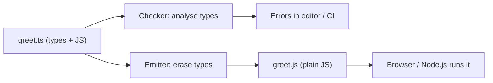

## Introduction

JavaScript lets you write `user.emial` instead of `user.email`, pass a number to a function that expects a string, or call a method that does not exist, and it will not complain until that exact line runs. Sometimes that happens on your machine a second later. Sometimes it happens in production, three weeks later, when a rarely used branch finally executes for a customer.

**TypeScript** is a language built to catch that kind of mistake before the program runs. It is JavaScript plus a **static type system**: a way to describe what kind of value each variable, parameter and return value holds, and a checker that reads your code and reports places where those descriptions are violated. "Static" means the checking happens by analysing the source text, without executing it.

The defining design choice is what happens after checking. TypeScript does not have its own runtime. The compiler removes the type information and produces ordinary JavaScript, which then runs in a browser, Node.js, Deno, Bun or any other JavaScript engine exactly as hand-written JavaScript would. The types help you while you write and build the code; they are gone by the time it runs.

TypeScript was released by Microsoft in 2012, led by Anders Hejlsberg (who also designed C#). It is now the default choice for most new frontend and Node.js projects, and frameworks such as React, Angular, Vue, Next.js and NestJS ship first-class TypeScript support. The repository compiler used in this course is TypeScript 6.0, the last version whose compiler is written in TypeScript itself; TypeScript 7 is a port of the same compiler to Go for speed, with the same language.

This lesson builds the mental model the rest of the TypeScript track relies on. The next lessons compare it with JavaScript in detail ([[b2-ts-vs-javascript]]), explain why teams adopt it ([[b2-why-typescript]]) and what it costs ([[b2-ts-disadvantages]]).

## Before you start

- **JavaScript fundamentals** — variables, functions, objects and arrays. See [[b1-what-is-javascript]].
- **JavaScript's runtime types** — what `typeof` reports and how values are coerced. See [[b1-typeof]] and [[b1-type-coercion]]. TypeScript's types describe these same runtime values.
- **A terminal and Node.js** — the examples are compiled with `tsc` and run with `node`. You do not need any TypeScript knowledge yet.

## The intuition

Think of a spell-checker and grammar-checker in a word processor. It reads your document and underlines problems, but it does not change what you wrote, and when you print the document the red underlines are not printed. A reader of the printed page cannot tell whether a checker was used.

TypeScript works the same way. The **type annotations** you add (`name: string`) are notes for the checker. The checker underlines mistakes in your editor and fails your build. When the code is compiled, the notes are removed and the printed result — the JavaScript — is what runs.

The analogy has a useful limit. A spell-checker can only check words it knows. If you paste in text from outside (user input, a network response, a file on disk), the checker has to trust whatever you *claim* about it. TypeScript is the same: it checks your code's internal consistency, not the outside world. That limit is the single most important thing to understand about TypeScript, and the section on runtime safety below returns to it.

## What "typed superset of JavaScript" means

TypeScript is usually described as a **typed superset of JavaScript**. A superset contains everything the smaller set has, plus more. The claim has two halves.

The "superset" half: TypeScript's grammar includes JavaScript's grammar. Any modern JavaScript syntax — classes, `async`/`await`, optional chaining, private `#fields`, BigInt literals — is also TypeScript syntax. You can rename a `.js` file to `.ts` and the compiler will parse it.

The "typed" half: on top of that grammar, TypeScript adds syntax that only the checker cares about: annotations (`: string`), `interface` and `type` declarations, generics (`Array<number>`), and a few constructs that do emit code, such as `enum`.

Here is where the claim needs precision, because interviewers like to probe it. **Parsing** a JavaScript file as TypeScript almost always works. **Type-checking** it is another matter. This is valid JavaScript:

```typescript title="reassign.ts"
let count = 1;
count = "one";
console.log(count);
```

```output
reassign.ts(2,1): error TS2322: Type 'string' is not assignable to type 'number'.
```

JavaScript happily changes `count` from a number to a string. TypeScript **infers** that `count` is a `number` from its initial value and then reports the reassignment. So "every JavaScript program is a valid TypeScript program" is true at the level of syntax, but many JavaScript programs produce type errors. By default `tsc` still emits the JavaScript in that case (more on this in [[b2-tsc-compilation]]), which is exactly what makes gradual migration possible.

There are also a few rare expressions that parse differently. In JavaScript, `a < b > (c)` is two comparisons; in TypeScript it is parsed as calling `a` with a type argument `b`. You will essentially never write such code, but it shows that "superset" is a very good approximation rather than a mathematical fact.

## From source file to running program

A TypeScript program goes through two separate jobs, and keeping them apart in your head explains most of TypeScript's behaviour:

1. **Type checking** — read all the files, work out the type of every expression, and report errors.
2. **Emitting** (also called transpiling) — produce JavaScript by deleting type syntax and, optionally, rewriting newer JavaScript syntax into older syntax for old runtimes.



The official compiler, `tsc`, does both. Many modern toolchains split them: a fast tool such as esbuild, SWC or Vite only erases types so the app starts quickly, while `tsc --noEmit` runs separately to check. Node.js 22.18 and later can even run a `.ts` file directly by stripping its types on load — but it does no type checking at all. Either way, the runtime only ever sees JavaScript.

Here is a small file with a deliberate mistake on line 6:

```typescript title="greet.ts"
function greet(name: string): string {
  return `Hello, ${name.toUpperCase()}`;
}

console.log(greet("Ada"));
console.log(greet(42));
```

Running `tsc greet.ts --target es2022` prints:

```output
greet.ts(6,19): error TS2345: Argument of type 'number' is not assignable to parameter of type 'string'.
```

The error names the file, line and column, an error code (`TS2345`) you can search for, and a sentence explaining the mismatch. You saw it without running anything. In an editor such as VS Code, the same message appears as a red underline while you type, because the editor runs the same checker in the background.

Because `tsc` emits even when there are errors (unless you set `noEmitOnError`), it still wrote `greet.js`:

```javascript title="greet.js (emitted)"
"use strict";
function greet(name) {
    return `Hello, ${name.toUpperCase()}`;
}
console.log(greet("Ada"));
console.log(greet(42));
```

Compare the two files. The only differences are that `: string` disappeared twice and `"use strict"` was added (TypeScript 6.0 compiles in strict mode by default). The logic is untouched. If you run this JavaScript anyway, you get exactly the crash the checker warned about:

```output
Hello, ADA
TypeError: name.toUpperCase is not a function
```

That is the value proposition in one example: the same bug, reported at build time with a precise location, instead of at runtime on someone else's screen.

## Type erasure: what survives into JavaScript

**Type erasure** is the rule that type-level syntax is deleted during emit and leaves nothing behind. Annotations, `interface`, `type` aliases, generics, `as` assertions and `import type` statements all vanish. A consequence is that TypeScript types cost nothing at runtime: no extra checks, no extra bytes, no slower code.

A few TypeScript-only constructs are not pure types, so they *do* generate JavaScript. Compare a type alias, an interface and an enum:

```typescript title="erasure.ts"
type Role = "admin" | "viewer";
interface Account { name: string; role: Role }
enum Status { Active, Suspended }
const acct: Account = { name: "Ada", role: "admin" };
console.log(acct.role, Status.Suspended);
```

```javascript title="erasure.js (emitted)"
"use strict";
var Status;
(function (Status) {
    Status[Status["Active"] = 0] = "Active";
    Status[Status["Suspended"] = 1] = "Suspended";
})(Status || (Status = {}));
const acct = { name: "Ada", role: "admin" };
console.log(acct.role, Status.Suspended);
```

```output
admin 1
```

`Role` and `Account` left no trace. `Status` became a real object built by an immediately invoked function, because your code reads `Status.Suspended` at runtime and that value has to exist. The constructs that emit code are `enum` (see [[b2-enums]]), `namespace` with values inside it, class **parameter properties** such as `constructor(private name: string)` (see [[b2-parameter-properties]]), and the older experimental decorators. Everything else is erased.

This distinction has become practical rather than academic. Tools that only strip types — Node.js's built-in TypeScript support is the prominent example — cannot handle constructs that need code generation. Running a file with an `enum` directly in Node.js 22 fails with `ERR_UNSUPPORTED_TYPESCRIPT_SYNTAX`. The compiler option `erasableSyntaxOnly` (TypeScript 5.8+) makes `tsc` reject those constructs so a codebase stays compatible with type-stripping tools.

> [!NOTE] Why erasure was chosen
> Because types disappear, TypeScript output is just JavaScript and interoperates with every JavaScript library and runtime. The price is that you cannot ask "what TypeScript type is this?" at runtime — `typeof` and `instanceof` only know about JavaScript's runtime types.

## Compile-time safety is not runtime safety

The checker reasons about your source code. Data that arrives while the program runs — `JSON.parse` output, `fetch` responses, form fields, `localStorage`, environment variables — did not exist when the checker ran, so TypeScript cannot know its shape. You can *tell* the checker what shape to assume, and it will believe you:

```typescript title="trust.ts"
interface User {
  id: number;
  email: string;
}

// The server actually sends { id: "7", mail: "ada@example.com" }
const raw = '{"id":"7","mail":"ada@example.com"}';
const user = JSON.parse(raw) as User;

console.log(typeof user.id);       // TypeScript believes this is a number
console.log(user.email.length);    // TypeScript believes this is a string
```

This compiles with no errors, then prints:

```output
string
TypeError: Cannot read properties of undefined (reading 'length')
```

`as User` is a **type assertion**: an instruction to the checker, not a conversion or a check. It was erased, and the program ran with whatever the server sent. The checker was not wrong about your code; it was given a false premise.

The correct approach at the boundary is to treat outside data as `unknown` and verify it with real runtime checks before using it — hand-written guards (see [[b2-narrowing]] and [[b2-custom-type-guards]]) or a validation library such as Zod or Valibot that both checks the data and produces a matching TypeScript type. Inside the boundary, once the data has been validated, the static types can be trusted.

> [!WARNING] TypeScript adds no runtime checks
> No annotation, interface or `as` cast produces a runtime check. If a value comes from outside your program, validate it at runtime; the types only describe what you have already proved.

## Structural typing in one picture

TypeScript decides whether one type fits another by comparing **shapes**, not names. This is called **structural typing**. If a function needs an object with numeric `x` and `y`, any object that has them is accepted, whatever it was declared as and whatever extra properties it carries:

```typescript title="structural.ts"
interface Point { x: number; y: number }

function magnitude(p: Point): number {
  return Math.hypot(p.x, p.y);
}

const pixel = { x: 3, y: 4, color: "red" };
console.log(magnitude(pixel));
```

```output
5
```

`pixel` was never declared as a `Point`, yet it is accepted, because it has every property `Point` requires. Languages such as Java and C# are **nominal**: a class must explicitly declare that it implements an interface. TypeScript chose structural typing because JavaScript code passes plain object literals around constantly, and forcing them to name their types would fight the language. (One nuance: if you pass an object *literal* directly with an extra property, TypeScript reports an "excess property" error, on the assumption that it is a typo.) The full rules are in [[b2-structural-typing]].

## How the checker works, briefly

You do not need compiler internals to use TypeScript, but a rough picture helps explain its error messages. `tsc` runs a pipeline: a **scanner** turns text into tokens, a **parser** builds a syntax tree, a **binder** connects each name to its declaration, the **checker** computes types and reports errors, and the **emitter** writes JavaScript, declaration files (`.d.ts`) and source maps.

The checker uses **inference** heavily: in `let count = 1`, nobody wrote `number`, but the checker computed it. You annotate where inference cannot know your intent — usually function parameters and public APIs — and let inference fill in the rest (see [[b2-optional-static-typing]] and [[b2-type-inference]]).

Your editor uses the same engine through the **TypeScript language service** (the `tsserver` process). That is why autocomplete, "go to definition", rename-symbol and inline errors in VS Code work so well for TypeScript: they are powered by the type information the checker computed.

For JavaScript libraries that have no TypeScript source, types come from **declaration files** (`.d.ts`) — files containing only types that describe the library's API. Popular libraries either ship their own or have community-maintained ones in the `@types/*` packages on npm (see [[b2-declaration-files]]).

## Setting up a minimal project

To try everything above yourself:

```bash title="terminal"
npm init -y
npm install --save-dev typescript
npx tsc --init
```

`tsc --init` writes a `tsconfig.json` with sensible modern defaults; in TypeScript 6.0 it already enables `strict`, which turns on the checks that make TypeScript worth using (no implicit `any`, strict `null` handling and more). Put `.ts` files next to it and run `npx tsc` to check and emit, or `npx tsc --noEmit` to check only. The configuration file is covered in detail in [[b2-tsconfig]].

## In real systems

In a typical React application built with Vite, you write `.tsx` files, Vite strips the types on the fly so the development server starts instantly, and a separate `tsc --noEmit` step runs in the editor and in Continuous Integration (CI) to block merges that introduce type errors. In a Node.js service, `tsc` compiles `src/` into `dist/` and production runs the JavaScript in `dist/`. Libraries published to npm ship compiled JavaScript plus `.d.ts` files, so consumers get types whether or not they use TypeScript themselves.

At every boundary where data enters — HTTP request bodies, API responses, message queues, database rows — production code runs a runtime validator, because that is the one place the static types cannot vouch for.

## Common mistakes

**Believing TypeScript validates data at runtime.** It does not. An interface describing an API response is a promise you make to the checker. Validate untrusted data with real checks.

**Using `as` to silence errors.** An assertion overrides the checker without proving anything, which turns a compile-time error into a possible runtime crash. Prefer narrowing or validation; use `as` only when you know something the checker cannot.

**Thinking TypeScript makes code faster or slower.** The emitted JavaScript runs at the same speed as equivalent hand-written JavaScript. The cost of TypeScript is at build time, not runtime.

**Expecting `typeof x === "User"` to work.** Interfaces and type aliases do not exist at runtime, so there is nothing to compare against. Check the properties you rely on instead.

**Assuming a successful emit means no errors.** By default `tsc` writes JavaScript even when type errors exist. Read the error output, or set `noEmitOnError`, and make CI fail on any type error.

## Interview perspective

**"What is TypeScript?"** A strong answer has four parts: a superset of JavaScript that adds a static type system; types are checked at compile time and erased, so output is plain JavaScript; no runtime type checks are added; and its value is catching errors early plus better tooling and refactoring. Mentioning structural typing shows depth.

**"Does TypeScript make your app safer at runtime?"** Only indirectly. It removes classes of bugs from your own code, but external data must still be validated. Give the `JSON.parse(...) as User` example.

**"Which TypeScript features exist at runtime?"** Enums, namespaces containing values, parameter properties and legacy decorators emit code. Everything else is erased. Follow-ups may ask about `erasableSyntaxOnly` and Node.js type stripping.

**"Is every JavaScript file valid TypeScript?"** Syntactically, nearly always; type-wise, often not, because inference makes the checker stricter than JavaScript. The compiler can still emit it, which enables gradual adoption.

## Practice

1. Install TypeScript in an empty folder, write a function `area(width: number, height: number)`, call it once correctly and once with a string, run `npx tsc`, and read the error. Then open the emitted `.js` file and list every difference from your source.
2. Add an `enum Direction { Up, Down }` to the file, compile it, and explain why `Direction` survives into the output while an `interface` does not.
3. Write a `User` interface and a function that receives `unknown` from `JSON.parse` and returns a `User` only after checking that `id` is a number and `email` is a string, throwing otherwise.
4. Predict whether `magnitude({ x: 3, y: 4, z: 5 })` (an object literal passed directly) compiles, then check. Explain the difference from passing a variable.

```quiz
Q: A teammate writes `const order = (await res.json()) as Order;` and says the response is now type-safe. What is actually true?
- [ ] TypeScript inserts a runtime check that throws if the JSON does not match `Order`
- [x] The assertion only changes what the checker believes; the runtime value is whatever the server sent
- [ ] The code will not compile unless the server's response matches `Order`
- [ ] `as` converts the object into an `Order` instance
> Type assertions are erased during emit, so nothing checks the data at runtime. The checker simply trusts the claim. The server's response does not exist at compile time, so it cannot cause a compile error, and `as` never converts values.
```

```quiz
Q: Which of these TypeScript constructs produces JavaScript code in the emitted output?
- [ ] `interface User { name: string }`
- [ ] `type Id = string | number`
- [x] `enum Color { Red, Green }`
- [ ] The annotations in `function f(x: number): void {}`
> Interfaces, type aliases and annotations are pure type syntax and are erased. An enum is read at runtime (`Color.Red`), so the compiler must generate an object for it.
```

```quiz
Q: Why does `let n = 1; n = "one";` produce a TypeScript error even though it is valid JavaScript?
- [ ] TypeScript forbids reassigning `let` variables
- [ ] Strings and numbers cannot be compared in TypeScript
- [x] TypeScript inferred `number` from the initialiser and checks later assignments against it
- [ ] The file is missing a type annotation, so TypeScript rejects it
> No annotation was written; inference supplied `number`. Reassigning `let` is allowed as long as the new value fits the inferred type. This is why "valid JavaScript" does not imply "type-correct TypeScript".
```

## Quick revision {#quick-revision}

- TypeScript = JavaScript + a static type system checked before runtime.
- The compiler does two jobs: type checking and emitting JavaScript. Tools like esbuild, SWC, Vite and Node.js type stripping do only the second.
- Types are erased: zero runtime cost, zero runtime checks.
- Constructs that emit code: `enum`, value `namespace`, parameter properties, legacy decorators. `erasableSyntaxOnly` forbids them.
- `tsc` emits even with type errors unless `noEmitOnError` is set.
- `as` is a claim, not a check. Validate external data (`unknown` + guards or a schema library).
- Structural typing: compatibility is by shape, not by declared name.
- "Superset" holds for syntax; many JS files still produce type errors.
- Editors use the same engine (`tsserver`) for autocomplete, navigation and refactors.
- TypeScript 6.0 enables `strict` by default; TypeScript 7 is the Go-native compiler for the same language.

## Key takeaways {#key-takeaways}

- TypeScript checks your code statically and then disappears; what runs is ordinary JavaScript.
- The checker can only verify your own code's consistency. Anything that enters at runtime must be validated at runtime.
- Almost all TypeScript syntax is erased; enums and a few other constructs are the exceptions that generate code.
- Types are compared by shape, which fits the way JavaScript passes plain objects around.
- Keep checking and emitting separate in your mind; modern toolchains often run them with different tools.
