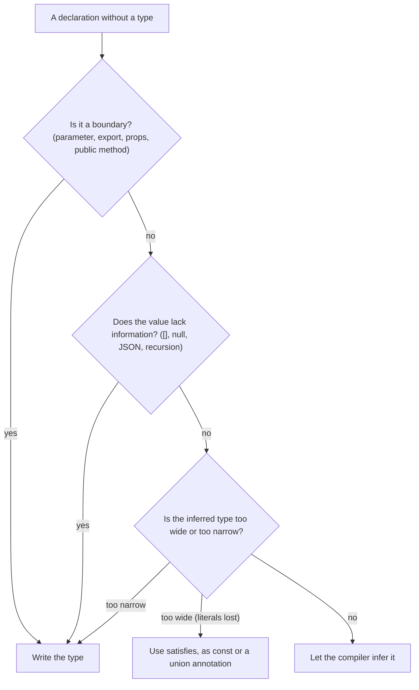

## Introduction

Once you know how to write types ([[b2-type-annotations]]) and how the compiler infers them ([[b2-type-inference]]), every declaration poses a small question: should I write the type, or let the compiler work it out? Beginners usually swing between two extremes. Some annotate everything — `const count: number = 0`, `(item: Item): void => ...` on every callback — and end up with code that is noisy, slow to change and sometimes *less* precise than inference. Others annotate nothing, and discover that a function's public type silently changed when someone edited its body, or that a variable initialised to `[]` accepts anything.

The professional answer is not a matter of taste. Explicit types and inference have different strengths, described in [[b2-explicit-types]]: explicit types fix a contract and report errors where the mistake is made; inferred types stay in sync with the code and cost nothing to maintain. So the decision rule follows from asking, for each declaration, **"Is this a boundary, or is inference missing information?"** If yes, write the type. If no, let the compiler infer it.

This lesson turns that rule into a concrete checklist, works through a realistic module, and covers the cases where neither an annotation nor plain inference is quite right.

## Before you start

- **Explicit types** — what an annotation changes, and how it differs from `as` and `satisfies`. See [[b2-explicit-types]].
- **Type annotations** — the syntax for every position. See [[b2-type-annotations]].
- **Type inference** — widening, contextual typing, generic inference and where inference fails. See [[b2-type-inference]].

## The intuition

Think of driving with a car's lane-keeping assistant. On a straight motorway you let it steer; it is accurate and tireless, and holding the wheel tightly yourself only adds strain. At junctions, roundabouts and road works — places where the assistant cannot know your intention or cannot see the road markings — you take the wheel.

Inference is the assistant. Function bodies, local variables and callbacks are the straight motorway. **Boundaries** are the junctions: places where your code meets other code (callers, importers, components that render yours) or meets the outside world (network, storage, user input). And places where the markings are missing — an empty array, a `null` placeholder, `JSON.parse` — are the road works. Those are the places to write a type.

## The decision process



The diagram reads top to bottom. Most local declarations fall straight through to "infer". The sections below explain each question.

## Annotate the boundaries

A **boundary** is any place where a type is seen by code other than the code that produced it.

**Function parameters.** Parameters are always a boundary: the function cannot know what callers will pass, and TypeScript never infers parameter types from usage. Under `strict`, an unannotated parameter without a default or context is an error. Annotate every parameter of a standalone function.

**Exported functions' return types.** For a function used by other modules, the return type is part of the public contract. Inferring it means an innocent edit inside the body — returning `null` on a new error path, or a string instead of a number — changes the type every caller sees, and the error appears in their files instead of yours. An explicit return type turns that into an error at the faulty `return`. It also documents the function without reading the body and lets declaration files be generated without full type-checking (TypeScript 5.5's `isolatedDeclarations` option requires it on exports for exactly that reason).

**Component props and hook signatures.** In React, a component's props type is its public API; write it as a named type and annotate the parameter. Custom hooks benefit from an explicit return type for the same reason exported functions do. See [[b2-react-typescript]] and [[b2-hooks-typing]].

**Public class members.** Fields and methods that other code uses should have declared types, especially fields that are initialised later, in the constructor or lazily.

**Module-level constants that others import.** If a constant's type should be stable — a configuration object, a table of routes — check it with `satisfies` or annotate it so that edits cannot widen it unnoticed.

> [!NOTE] Internal helpers are a judgement call
> For a small private helper used in one file, inferring the return type is fine: every caller is in view, and any error appears nearby. Annotate it if it is long, has many return paths, or is recursive.

## Annotate where inference lacks information

Some values do not contain enough information for inference to produce the type you mean. These need explicit types even in the middle of a function body.

| Situation | What inference gives | What to write |
|---|---|---|
| `const items = []` used later | evolving `any[]`, error if read early | `const items: Item[] = []` |
| `{ items: [] }` in an object | `never[]` | annotate the object type |
| `useState(null)` | state type `null` forever | `useState<User \| null>(null)` |
| `new Map()` | `Map<any, any>` | `new Map<string, number>()` |
| `JSON.parse(text)`, `response.json()` | `any` | `unknown`, then validate |
| A recursive function | error TS7023 | an explicit return type |
| A callback extracted into its own function | parameters lose context | annotate its parameters |

The last row catches many people. Inline, `buttons.forEach((b) => ...)` types `b` from context. Move the callback to `function handle(b) { ... }` and the context is gone, so `b` needs an annotation.

## External data: validate, then type

Data arriving from outside the program is a special boundary because the compiler has never seen it. Annotating it — `const user: User = await response.json()` — compiles, because `json()` returns `any`, but it proves nothing. The honest approach is to treat it as `unknown`, check it at runtime, and let the check give it a type.

```typescript title="validate.ts"
function isUser(value: unknown): value is { id: string; name: string } {
  return (
    typeof value === "object" && value !== null &&
    typeof (value as Record<string, unknown>).id === "string" &&
    typeof (value as Record<string, unknown>).name === "string"
  );
}
const raw: unknown = JSON.parse('{"id":"u1","name":"Ada"}');
if (isUser(raw)) {
  console.log(raw.name.toUpperCase());
}
```

```output
ADA
```

`isUser` is a **type guard**: its return type `value is { ... }` tells the compiler that when it returns `true`, the argument has that type. Inside the `if`, `raw` is narrowed and fully typed; outside, using `raw.name` is error TS18046, "'raw' is of type 'unknown'". In production this hand-written check is usually replaced by a schema library that both validates and infers the type. See [[b2-special-types]], [[b2-narrowing]] and [[b2-impl-type-guard]].

## Let the compiler infer the internals

Everything that is not a boundary and does not lack information is better left to inference.

- **Local variables initialised with a value.** `const subtotal = items.reduce(...)` is already `number`. Writing `const subtotal: number` adds nothing and must be kept in sync by hand.
- **`const` variables holding literals.** `const retries: number = 3` actively *loses* information: inference would give the literal type `3`.
- **Callback parameters.** `items.map((item) => item.price)` is typed by context. Annotating `item: CartItem` repeats information and breaks if the array's type changes.
- **Generic call sites.** `createStore({ count: 0 })` infers `S` as `{ count: number }`. Write explicit type arguments only when the argument alone is not enough, as with `useState<User | null>(null)`.

> [!TIP] Hover first
> Before adding an annotation, hover over the name in your editor. If the inferred type is exactly what you would have written, leave it. If it shows `any`, an empty-array type, or a union wider than you expect, annotate at the point where the type first went wrong — not further downstream.

## Precision: when neither choice is right

Sometimes inference is too wide and a plain annotation is too wide as well. A theme configuration is the classic case. Inference widens `{ mode: "dark" }` to `{ mode: string }`; annotating with `Record<string, string>` loses the keys. You want both checking and precision:

- **`satisfies`** checks a value against a type without replacing the inferred type: `const theme = { mode: "dark", accent: "teal" } satisfies ThemeConfig` keeps `mode: "dark"` and still reports a misspelt key. See [[b2-satisfies]].
- **`as const`** freezes every literal, for lists of allowed values from which you derive a union type. See [[b2-as-const]].
- **A literal union annotation** (`let mode: "dark" | "light" = "dark"`) when a mutable variable must accept a fixed set of values.

The opposite problem — an annotation *wider* than the value — is a quiet way to lose safety. Compare:

```typescript title="precision.ts"
function statusLabel(code: number): string {
  return code < 400 ? "ok" : "error";
}
function statusLabelInferred(code: number) {
  return code < 400 ? "ok" : "error";
}
const a: "ok" | "error" = statusLabel(200);
const b: "ok" | "error" = statusLabelInferred(200);
```

```output
precision.ts(7,7): error TS2322: Type 'string' is not assignable to type '"error" | "ok"'.
```

The inferred return type is `"ok" | "error"`; the explicit `: string` threw that away, so callers can no longer switch exhaustively over the result. If you annotate a boundary, write the *precise* type — here `: "ok" | "error"`, ideally as a named alias.

## Worked example: reviewing a module

Here is a small cart module written with the rule applied. Read it first, then the review notes.

```typescript title="cart.ts"
export type CartItem = { sku: string; price: number; quantity: number };

export function cartTotal(items: CartItem[]): number {
  const subtotal = items.reduce((sum, item) => sum + item.price * item.quantity, 0);
  const shipping = subtotal >= 50 ? 0 : 4.99;
  return Math.round((subtotal + shipping) * 100) / 100;
}

export function createStore<S>(initial: S) {
  let state = initial;
  const listeners: Array<(next: S) => void> = [];
  return {
    get: (): S => state,
    set(next: S): void {
      state = next;
      listeners.forEach((listener) => listener(next));
    },
    subscribe(listener: (next: S) => void): void {
      listeners.push(listener);
    },
  };
}

const store = createStore({ count: 0 });
store.subscribe((next) => console.log("count is", next.count));
store.set({ count: 1 });
console.log(cartTotal([
  { sku: "A1", price: 20, quantity: 2 },
  { sku: "B2", price: 3.5, quantity: 1 },
]));
```

```output
count is 1
48.49
```

Walk through each declaration and why it is (or is not) annotated:

1. **`CartItem`** is a named type because it is shared between the function signature and callers.
2. **`cartTotal`'s parameter and return type** are explicit: it is exported, so its contract should not change by accident.
3. **`subtotal`, `shipping`, `sum`, `item`** are inferred. They are internal, initialised with values, or typed by context from `reduce`.
4. **`createStore<S>`** relies on generic inference at the call site — `createStore({ count: 0 })` makes `S` equal `{ count: number }`, so `store.set({ count: "1" })` is a compile error. Its overall return type is inferred; for a library you would likely extract a named `Store<S>` type and annotate it.
5. **`listeners`** is explicitly typed because it starts empty — the "lacks information" case.
6. **`get`, `set` and `subscribe`** declare their parameter and return types so the object's public shape is stable.
7. **The `subscribe` callback** at the bottom has no annotation: `next` gets `{ count: number }` from context.

An over-annotated version of the same code would add `: number` to `subtotal` and `shipping`, `(sum: number, item: CartItem)` to the reducer, and `<{ count: number }>` to the `createStore` call — nine extra type mentions, none of which catch a bug the current version misses.

## In real systems

Teams usually encode this rule in tooling rather than in reviews. With typescript-eslint ([[b2-eslint-typescript]]), `explicit-module-boundary-types` requires types on exported functions, `no-inferrable-types` flags annotations such as `const n: number = 0` that only repeat inference, and `no-explicit-any` keeps `any` from slipping in at boundaries. Libraries that publish declaration files often enable `isolatedDeclarations` so that every export has an explicit type. Application code inside components and services stays mostly inferred.

API clients follow the "validate, then type" pattern: a schema per endpoint, a `parse` step at the fetch function, and an inferred type for everything that uses the result. Configuration objects use `satisfies` so that values are both checked and precisely typed.

## Trade-offs and alternatives

Annotating more gives earlier, more local errors and more readable signatures, at the cost of noise, maintenance and the risk of writing a type less precise than inference. Annotating less gives concise code that refactors easily, at the cost of errors surfacing in callers and invisible contracts. The boundary rule captures most of the benefit of both. Where teams disagree is mainly on internal helper return types and on whether to annotate return types of React components (usually not: the inferred JSX type is fine).

## Common mistakes

- **Annotating every local and callback.** It adds nothing and hides the few annotations that matter. Remove annotations that repeat inference.
- **Leaving exported functions without return types.** Internal edits then change the public contract silently.
- **Annotating external data instead of validating it.** `const x: T = JSON.parse(...)` is a promise, not a check. Use `unknown` and a guard or schema.
- **Writing a wider annotation than the value.** `: string` on a function returning `"ok" | "error"` loses precision. Write the precise type or use `satisfies`.
- **Using `as` where an annotation belongs.** An assertion skips the check; an annotation performs it.
- **Forgetting empty containers.** `[]`, `new Map()` and `useState(null)` need explicit types.

## Interview perspective

**"How do you decide when to annotate in TypeScript?"** A strong answer states the rule — annotate boundaries (parameters, exported return types, props, public APIs) and places where inference lacks information (empty containers, `null` initial state, external data, recursion), and infer the rest — then gives one example of each and mentions tooling (`explicit-module-boundary-types`, `no-inferrable-types`).

**"Is it bad to annotate everything?"** Not unsafe, but costly: it adds maintenance, can lose literal precision, and dilutes the annotations that carry meaning. Mention `const n: number = 3` losing the literal `3`.

**Follow-up: "How do you type a JSON response?"** Treat it as `unknown`, validate with a type guard or schema, and let the validation produce the type. Explain why annotating `any` proves nothing.

```quiz
Q: Which declaration most clearly needs an explicit type?
- [ ] `const total = items.reduce((s, i) => s + i.price, 0);`
- [ ] `const names = users.map((u) => u.name);`
- [x] `const selected = useState(null);` for state that will later hold a `User`
- [ ] `const limit = 20;`
> The `null` initial value contains no information about the `User` it will hold, so the state type would be `null`. Write `useState<User | null>(null)`. The other three are fully inferred from their initial values or context.
```

```quiz
Q: Why add an explicit return type to an exported function whose return type inference already gets right?
- [ ] It makes the function run faster
- [x] It fixes the public contract, so an accidental change inside the body becomes an error at the faulty `return`
- [ ] Exported functions cannot use inferred return types
> Inferred return types follow the body, so a change silently alters the type callers see and errors appear in their code. An explicit return type turns the change into a local error. It has no runtime effect.
```

```quiz
Q: A config object `{ mode: "dark", size: "md" }` must match `ThemeConfig` but you want `mode` to stay typed as `"dark"`. What fits best?
- [ ] `const config: ThemeConfig = { ... }`
- [ ] `const config = { ... } as ThemeConfig`
- [x] `const config = { ... } satisfies ThemeConfig`
> `satisfies` checks the value against `ThemeConfig` but keeps the inferred, more precise type. An annotation would replace it with `ThemeConfig`'s wider property types, and `as` would skip the check.
```

## Practice

1. Take a file from a project you know. Remove every annotation on local `const` variables and callback parameters, and add explicit types on every exported function. Count how many type errors appear and what they reveal.
2. Rewrite `async function getUser(id: string) { const res = await fetch(...); return res.json(); }` so that its return type is honest, using `unknown` and a type guard.
3. For `function priority(n: number): string { return n > 5 ? "high" : "low"; }`, explain what the return annotation costs callers and fix it.
4. Write a typed `useList` custom hook that starts with an empty array and exposes `add` and `remove`, annotating only what the decision process requires.
5. Configure (on paper) the three typescript-eslint rules from this lesson and describe what each would flag in the over-annotated version of the cart example.

## Quick revision {#quick-revision}

- Rule: **annotate boundaries and missing information; infer everything else.**
- Boundaries: parameters, exported function return types, component props, hook signatures, public class members, shared constants.
- Missing information: `[]`, `{ items: [] }`, `useState(null)`, `new Map()`, `JSON.parse`/`response.json()`, recursion, extracted callbacks.
- External data: type as `unknown`, validate with a type guard or schema, then use the narrowed type.
- Infer: initialised locals, `const` literals, callback parameters, generic call sites with informative arguments.
- Too wide: `satisfies`, `as const`, or a literal union. Never annotate a boundary with a wider type than the value.
- Tooling: `explicit-module-boundary-types`, `no-inferrable-types`, `no-explicit-any`, `isolatedDeclarations`.

## Key takeaways {#key-takeaways}

- Whether to annotate is decided by the role of the declaration, not by habit: boundaries and information gaps get types, internals are inferred.
- Explicit return types on exports keep public contracts stable and keep errors next to their cause.
- Redundant annotations are not free: they add maintenance and can discard the literal precision inference would give you.
- External data must be validated before it is trusted; an annotation on `any` is not validation.
- `satisfies` and `as const` cover the cases where you need both checking and precision.
